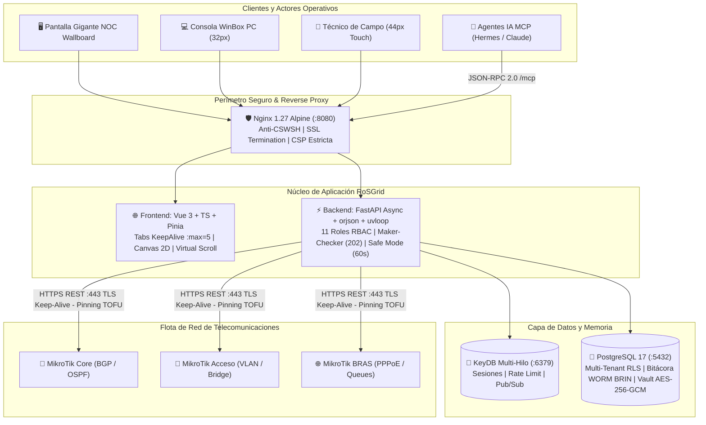
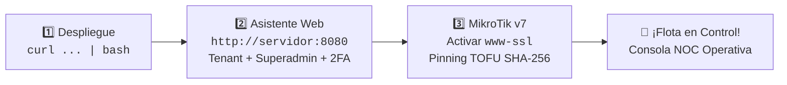

# 🌐 RoSGrid — Consola Centralizada Multi-Tenant para Flotas MikroTik RouterOS v7+

**Licencia:** GNU General Public License v3.0 (GPL-3.0-only)  
**Stack Principal:** FastAPI (Python 3.15 + `orjson` + `uvloop`) + Vue 3 (TypeScript / Pinia / Node.js 26 LTS) + PostgreSQL 17 (RLS + BRIN) + KeyDB Multi-Hilo (Compatible DragonflyDB)  
**Calidad y Seguridad:** Certificado bajo el Estándar Corporativo **[QA 11X](https://github.com/tecno-consultores/qa-testing-blueprints)**

---

## 🎯 Propósito del Proyecto

**RoSGrid** es una plataforma web centralizada de alta seguridad diseñada para que proveedores de internet (ISP), operadores de telecomunicaciones, centros de monitoreo (NOC) y departamentos de infraestructura administren, diagnostiquen, respalden y auditen flotas de equipos **MikroTik con RouterOS v7.1+** utilizando exclusivamente su **REST API nativa sobre TLS (`/rest/*`)**.

El sistema traslada la experiencia operativa y técnica de **WinBox / WebFig** a un entorno web centralizado **Multi-Tenant** (adaptativo para PC, Tablet y Móvil), con control de acceso granular de **11 roles**, protección automática contra pérdida de conectividad (**Safe Mode Anti-Bloqueo**), bóveda criptográfica AES-256-GCM y una bitácora de **Auditoría Inmutable (WORM)**.

**Principios de Diseño Operativo:**

- **No es un sistema de facturación:** RoSGrid se enfoca 100% en la operación técnica de red, aprovisionamiento, seguridad y diagnóstico.
- **Cero almacenamiento de métricas históricas en base de datos:** Para series históricas a largo plazo existen herramientas dedicadas como Zabbix o Prometheus. En RoSGrid, las gráficas de CPU, RAM y tráfico en vivo funcionan exactamente igual que en **WinBox**: se alimentan por WebSocket y se acumulan en memoria RAM del navegador (`RingBuffer` de hasta 3 horas renderizado en `<canvas>` 2D) mientras el técnico mantiene la consola del router abierta, reiniciándose al salir sin consumir disco en PostgreSQL.



---

## ✨ Características Principales

### 1. Seguridad Criptográfica e Identidad Multi-Tenant

- **Aislamiento Estricto por Empresa (Tenant):** Cada organización opera en un entorno aislado mediante políticas **Row-Level Security (RLS)** forzadas a nivel de motor en PostgreSQL 17.
- **Autenticación *Split-Credential* + 2FA TOTP Obligatorio:**
  - Inicio de sesión mediante Identificador de Empresa (`tenant_slug`) + Correo/Usuario + Contraseña (`Argon2id`) + Código 2FA TOTP.
  - Tokens de sesión encapsulados en cookies `__Host-` con banderas `HttpOnly; Secure; SameSite=Strict` (inmunes a exfiltración por XSS) y protección `X-CSRF-Token` firmada con HMAC-SHA256.
  - Rotación estricta de Refresh Tokens en KeyDB con detección automática de robo por reúso (*Reuse Detection*).
- **Control de Sesiones en Vivo (*Kill-Switch*):** Panel en tiempo real para que Administradores y Supervisores visualicen qué técnicos están conectados, desde qué IP/dispositivo y qué MikroTik están operando, con botón de expulsión instantánea en KeyDB y cierre forzoso de WebSockets.
- **Flujo de Auto-Registro Web y Aprobación Maker-Checker:** Interfaz accesible en el login para que nuevos operadores soliciten acceso. Las solicitudes ingresan en estado `PENDING_APPROVAL` (bloqueo 403 preventivo) y requieren la aprobación explícita del Superadmin con asignación de rol, gobernado por un interruptor global de registro en KeyDB.
- **Superficie de Ataque Cero en Producción:** En modo `ROSGRID_ENV=production`, la documentación interactiva Swagger/ReDoc/OpenAPI se desactiva por completo (consulta la especificación estática en `docs/06_REFERENCIA_COMPLETA_API_REST_Y_WEBSOCKETS.md`).
- **Arquitectura de Defensa en Plataforma Híbrida (Vue 3 + FastAPI):**
  - **Mitigación Anti-CSWSH (*Cross-Site WebSocket Hijacking*):** Validación pre-handshake de la cabecera `Origin` en todos los canales WebSocket (`/ws/v1/*`), cerrando con código HTTP 4403 ante orígenes no autorizados antes de ejecutar `accept()`.
  - **Sanitización de Errores 422 en Producción:** Intercepción global de `RequestValidationError` para enmascarar detalles internos de esquemas y modelos en producción, registrando el detalle en logs de servidor y respondiendo con mensajes seguros.
  - **Protección contra Asignación Masiva (*Mass Assignment*):** Todos los esquemas de entrada de Pydantic v2 aplican `ConfigDict(extra="forbid")` para impedir la inyección arbitraria de roles o atributos no declarados.
  - **Defensa Anti-SSRF en Webhooks:** Validación estricta con resolución DNS y bloqueo incondicional de direcciones privadas (RFC 1918), loopback, link-local y rangos multicast en despachos de alertas externas.
  - **Aislamiento SQL y Límites de Carga:** Inyección de contexto de Tenant en MCP mediante sentencias parametrizadas seguras y límite estricto de 2 MB en cargas de inventario CSV para prevenir denegación de servicio por memoria.

### 2. Bóveda de Credenciales AES-256-GCM, Rotación Automática y Pinning SSL (TOFU)

- **Cifrado Autenticado con AAD:** Las credenciales de la REST API de cada MikroTik se almacenan cifradas con `AES-256-GCM` vinculadas criptográficamente al `tenant_id` y `router_id`.
- **Rotación Automática de Contraseñas API:** RoSGrid puede rotar periódicamente (o bajo demanda) la contraseña del usuario API dentro del MikroTik por llaves aleatorias de 32 caracteres, conservando la clave inmediatamente anterior como respaldo transaccional.
- **Consulta Protegida con *Step-Up Auth* (30 Segundos):** Solo los 2 perfiles más altos (`SUPERADMIN_GLOBAL` y `TENANT_ADMIN`) pueden revelar una clave de la bóveda tras validar su código 2FA TOTP en vivo, dejando traza inmutable en auditoría y autodestruyendo la clave en memoria a los 30 segundos.
- **Certificados SSL Autofirmados con TOFU (*Trust On First Use*):** Acepta certificados autofirmados de RouterOS v7 capturando su huella SHA-256 en la primera conexión y bloqueando cualquier cambio no autorizado de certificado (*MitM protection*).

### 3. Consola Centralizada WebFig de Doble Capa y Alto Rendimiento (RouterOS v7+)

- **Capa 1 — Módulos Nativos Especializados (con Pestañas en Memoria `KeepAlive`, *Virtual Scrolling* y Densidad Dual WinBox/Móvil):**
  - **Dashboard en Vivo:** Gráficas efímeras estilo WinBox sobre `<canvas>` 2D acelerado con `requestAnimationFrame` (CPU, RAM, Disco, Temperatura, Voltaje y Tráfico bps/pps por interfaz).
  - **Interfaces & Óptica SFP:** Ethernet, diagnóstico óptico **SFP/SFP+ DDM** (potencia láser TX/RX en dBm, temperatura y salud óptica), test de cables TDR, VLANs 802.1Q, Bridges, WireGuard y tabla de registro WiFi.
  - **IP & Servicios:** Addresses, Routes (incluyendo balanceo ECMP), ARP, Pools, DHCP Server Leases (conversión a estático en un clic), DNS, IP Neighbors (MNDP/LLDP/CDP) y `/ip/service` (con protección anti-suicidio del puerto `www-ssl`).
  - **Firewall Completo con *Drag & Drop*:** Reglas Filter, NAT, Mangle, RAW, Address-Lists y Connection Tracking, con reordenamiento visual y por teclado protegido por Safe Mode.
  - **Routing Avanzado v7:** Sesiones y peers BGP en vivo, prefijos anunciados, OSPF v2/v3, Routing Tables, Policy Rules, BFD y Routing Filters.
  - **PPP, VPNs & Queues:** Sesiones PPPoE Active (con botón de reconexión rápida para Soporte N1 y *Virtual Scrolling* para miles de sesiones simultáneas), Secrets, Profiles, Simple Queues y Queue Tree.
  - **System & Diagnóstico en Vivo:** Identity, usuarios del router, Scripts, Scheduler, Packages, Ping, Traceroute, Torch y visor de Log.
- **Capa 2 — Motor Dinámico Universal:**
  - Renderizador automático de tablas y formularios para el **100% restante de submenús `/rest/*` de RouterOS v7** (MPLS, VXLAN, ZeroTier, Containers, CAPsMAN, User-Manager, RADIUS, SNMP, Certificates).

### 4. Protección Anti-Bloqueo (*Safe Mode*), *Maker-Checker* y Operaciones Masivas

- **Safe Mode vía *Dead Man's Switch* (`/system/scheduler`):** Antes de aplicar un cambio delicado de red o firewall, RoSGrid inyecta un scheduler temporal de reversión a 60 segundos en el propio MikroTik. Si el cambio deja incomunicado al router, el MikroTik revierte el cambio por sí solo y recupera la conexión automáticamente.
- **Flujo de Aprobación (*Maker-Checker*):** Las 7 categorías de acciones críticas ejecutadas por niveles operativos intermedios se interceptan hacia una bandeja de aprobación para que un Supervisor o Soporte N3 las autorice revisando el Diff previo (con segregación estricta de funciones `maker != checker`).
- **Backups Nocturnos Deduplicados y Comparador Diff Estilo Git (`.rsc`):** Retención de 30 días con deduplicación por hash SHA-256 y visor lado a lado estilo Git para auditar qué líneas exactas cambiaron en un router entre dos fechas o frente al estado en vivo (`LIVE`).
- **Operaciones Masivas y Plantillas (*Golden Configs*):** Catálogo de plantillas predefinidas (`CLIENTE_NTP`, `DNS_CORPORATIVO_RESILIENTE`, `SNMP_V2C_MONITOREO_NOC`, `SYSLOG_CENTRALIZADO_ROSGRID`) con parametrización dinámica de variables (IP de servidor RoSGrid, puertos, comunidades), previsualización de comandos REST/CLI y ejecución por lotes protegida por *Safe Mode (60s)*.
- **Mapa Interactivo OpenStreetMap (Leaflet) y Wallboard NOC:** Georreferenciación 100% gratuita sin API Keys, ventanas de mantenimiento programadas y alertas *Zero-Storage* hacia **Telegram, Correo SMTP, Webhooks HMAC-SHA256 y Pantalla NOC**.

### 5. Servidor MCP Protegido para Agentes de IA (`Hermes Agent`, `Claude Desktop / Code`)

- **Model Context Protocol (JSON-RPC 2.0 Streamable HTTP):** Endpoint `POST /api/v1/mcp` protegido por lista blanca CIDR, tokens de cuenta `SERVICE_ACCOUNT` y límite de tasa en KeyDB (`30 req/min`).
- **Catálogo de 22 Tools Semánticas:** Inventario (`rosgrid_list_inventory`), salud física (`rosgrid_get_router_health`), óptica SFP DDM (`rosgrid_check_sfp_optical_ddm`), enrutamiento BGP/OSPF (`rosgrid_inspect_routing_bgp_ospf`), diagnóstico en vivo (`rosgrid_run_live_diagnostic`), comparador Diff Git `.rsc` (`rosgrid_compare_config_diff`), reconexión PPPoE (`rosgrid_reconnect_pppoe_client`), propuesta de mutaciones de red (`rosgrid_propose_network_change`), diagnóstico 360° (`rosgrid_run_360_diagnostics`), aislamiento técnico (`rosgrid_isolate_subscriber`), restauración técnica (`rosgrid_restore_subscriber`), cambio de rate-limit (`rosgrid_change_rate_limit`), consultas BGP Looking Glass (`rosgrid_query_bgp_looking_glass`), detección de desviación de configuración (`rosgrid_check_config_drift`), auditoría CIS Benchmark (`rosgrid_run_cis_audit`), detección de caídas masivas (`rosgrid_detect_mass_outage`), topología L2 física (`rosgrid_get_l2_topology`), matriz local de CVEs (`rosgrid_check_fleet_cves`), terminal Syslog efímero (`rosgrid_get_recent_syslog`), actualizaciones PoE-aware con Safety Stop (`rosgrid_execute_poe_aware_upgrade`), y **Grounding Oficial de Documentación MikroTik** mediante búsqueda en índice oficial (`rosgrid_search_mikrotik_docs`) y lectura de tópicos Markdown (`rosgrid_get_mikrotik_doc_topic`) sobre el estándar abierto `https://manual.mikrotik.com/llms.txt`.
- **NOC Autónomo 24/7 y Gobierno Maker-Checker:** Las propuestas de mutación generadas por agentes IA se retienen automáticamente como `202 Accepted` (`AWAITING_APPROVAL`) para autorización humana previa, protegidas por *Safe Mode (60s)* y registradas en la bitácora forense WORM (`MCP_AI_TOOL_CALL`). Consulta `docs/07_GUIA_INTEGRACION_IA_MCP_HERMES_Y_CLAUDE.md`.

### 6. Gobernanza Modular (Feature Flags): Operación Dual ISP y Corporativa

Una sola instalación de RoSGrid se adapta instantáneamente a las necesidades de cada organización mediante el panel de Feature Flags por Tenant administrado por el Superadmin:

- **Modo Proveedor de Internet (ISP / WISP / FTTH):**
  - **Cero Facturación y Cero Datos Personales:** Identificación técnica exclusiva por `device_serial` y `endpoint_identifier`. Desacoplamiento total con sistemas de facturación/CRM externos.
  - **QoS Técnico & Perfiles de Tráfico:** Modelado de Simple Queues y PCQ con tasas nominales, Burst (limit, threshold, time) y prioridades (1-8).
  - **API de Aprovisionamiento Idempotente:** Endpoints `/isolate`, `/restore` y `/change-rate-limit` con cabecera `Idempotency-Key` (UUIDv7) y webhooks salientes firmados con `HMAC-SHA256`.
  - **Diagnóstico 360°:** Ping secuencial multi-MTU (64B, 512B, 1472B), análisis automático de motivos de desconexión en `/log` de RouterOS y muestreo Torch de flujos en tiempo real.
  - **Mapa Exclusivo de ONUs:** Separado de la infraestructura core, con telemetría efímera Zero-Metrics (Verde, Naranja, Rojo) y alarma visual/auditiva en Wallboard NOC ante caídas simultáneas > 10 equipos.
  - **Toolkit de Campo Responsive:** Interfaz táctil fluida para móviles, tablets o laptops con captura directa de coordenadas GPS (`navigator.geolocation`).
  - **Internacionalización (i18n):** Arquitectura modular multilingüe con diccionarios JSON (`locales/es.json`, `locales/en.json`).
- **Modo Redes Corporativas / Enterprise (Banca, Retail, Universidades, Hospitales):**
  - **Detección de Desviación de Configuración (*Config Drift*):** Comparación continua contra la Plantilla Maestra (*Golden Baseline*) con visor Git Diff y reversión en 1-clic (*Auto-Revert*) bajo Safe Mode.
  - **Orquestador SD-WAN WireGuard Hub & Spoke:** Despliegue automático de túneles WireGuard inter-sucursal con enrutamiento dinámico OSPF y failover multi-WAN recursivo en $< 1\text{s}$.
  - **Auditoría de Seguridad CIS Benchmark:** Evaluación de 10 directivas críticas de RouterOS, cálculo de Security Score (0 a 100) y botón de auto-endurecimiento (*Auto-Hardening*).
  - **Detección de Rogue DHCP & Seguridad LAN:** Detección de servidores DHCP no autorizados mediante DHCP Snooping en switches/bridges y aislamiento de puertos comprometidos.
  - **Monitor de Cumplimiento de SLA:** Sondas continuas hacia gateways de carriers con generación de reportes mensuales de disponibilidad y latencia P95/P99 para reclamos contractuales.
  - **Gestión Centralizada WiFi (CAPsMAN / WiFiWave2):** Perfiles de radio para SSIDs Corporativo (WPA3-Enterprise 802.1X), Invitados (aislado) y dispositivos IoT.

---

## 🛡️ Decisiones de Arquitectura y Seguridad por Diseño (ADR)

### ¿Por qué RoSGrid NO incluye una Terminal CLI / SSH interactiva estilo WebFig?

Una pregunta frecuente de colaboradores y operadores acostumbrados a WinBox/WebFig es por qué RoSGrid no ofrece una consola interactiva libre (vía SSH/`xterm.js` o intérprete CLI crudo). **Esta omisión es una decisión de seguridad deliberada e innegociable de la arquitectura de RoSGrid** por cinco razones fundamentales:

1. **Preservación del Modelo *Split-Credential*:** RoSGrid está diseñado para que los técnicos operen los routers sin conocer ni interactuar directamente con las credenciales administrativas almacenadas en la Bóveda `AES-256-GCM`. Abrir un shell interactivo sobre la sesión del router rompe el aislamiento entre el operador humano y el plano de control.
2. **Imposibilidad de Evasión del *Maker-Checker* (Segregación de Funciones):** Si un rol intermedio (`SUPPORT_L2`, `SUPPORT_L1` o `FIELD_TECH`) dispusiera de una terminal CLI libre, podría alterar sesiones BGP, reglas de Firewall o tablas de enrutamiento eludiendo el interceptor **Maker-Checker** y las políticas de los **11 roles RBAC**.
3. **Protección del *Safe Mode (Dead Man's Switch)* y Anti-Suicidio:** Desde una terminal interactiva no gobernada, un operador podría deshabilitar accidentalmente `/ip/service/www-ssl` o eliminar las tareas temporales `rosgrid_safemode_*` en `/system/scheduler`, dejando el nodo huérfano sin reversión automática.
4. **Trazabilidad Forense Estructurada en la Cadena WORM (`audit_logs`):** La auditoría inmutable de RoSGrid registra criptográficamente el estado exacto antes (`before_state`) y después (`after_state`) de cada mutación JSON sobre `/rest/*`. Una sesión SSH transmite flujos de caracteres y secuencias de escape ANSI que impiden reconstruir de forma determinista el estado previo y posterior de un objeto de red.
5. **Cobertura del 100% vía WebFig Capa 1 + Motor Universal Capa 2:** Cualquier módulo avanzado de RouterOS v7 que no esté en las vistas dedicadas de Capa 1 es accesible de forma estructurada, gobernada por RBAC, protegida por Safe Mode y auditada en WORM a través del **Explorador Universal de Capa 2 (`/webfig/layer2/*`)** y las **Plantillas Masivas (*Golden Configs*)**.

> **Nota para colaboradores (Pull Requests):** No se aceptarán PRs que introduzcan proxies SSH, Telnet, `/system/telnet` o consolas CLI no estructuradas que puenteen el motor de políticas RBAC, el *Maker-Checker* o la cadena de auditoría WORM.

---

## 👥 Matriz de los 11 Roles del Sistema (RBAC)

1. **`SUPERADMIN_GLOBAL`**: Gobierno global de la plataforma y creación/suspensión de empresas (Tenants).
2. **`TENANT_ADMIN`**: Administración total de su empresa, asignación de routers por técnico y acceso *Step-Up* a la Bóveda de Claves.
3. **`SUPERVISOR`**: Aprobador de cambios críticos (*Maker-Checker*), gestión de ventanas de mantenimiento y *Kill-Switch* de sesiones.
4. **`SUPPORT_L3`**: Ingeniería Core/Borde, BGP/OSPF, WebFig Capa 1 y Capa 2, acciones masivas y aprobaciones técnicas.
5. **`SUPPORT_L2`**: Administración de red intermedia en equipos asignados (cambios críticos sujetos a *Maker-Checker*).
6. **`SUPPORT_L1`**: Helpdesk, diagnóstico en vivo (Ping, Traceroute, ARP, SFP), reconexión de sesiones PPPoE/DHCP y solicitud de cambios.
7. **`FIELD_TECH`**: Técnico de campo / instalador acotado a los nodos asignados para validación física, óptica y vecinos.
8. **`INVENTORY_MANAGER`**: Alta de equipos, importación masiva por CSV en 2 pasos (*Dry-Run* + ejecución) y rotación de credenciales.
9. **`AUDITOR`**: Acceso 100% de solo lectura a la bitácora inmutable WORM (`audit_logs`), verificación criptográfica de cadena de custodia y comparador Diff (`.rsc`).
10. **`NOC_MONITOR`**: Perfil exclusivo para televisores y pantallas de monitoreo 24/7 (Mapa OpenStreetMap, KPIs y alertas en tiempo real).
11. **`SERVICE_ACCOUNT`**: Cuenta Machine-to-Machine restringida por lista blanca CIDR y alcances específicos.

---

## 🗂️ Estructura del Repositorio

```text
rosgrid/
├── LICENSE                         # Licencia GNU GPLv3
├── README.md                       # Documentación principal del proyecto y ADR de seguridad
├── SECURITY.md                     # Política de seguridad, criptografía y reporte de vulnerabilidades
├── CONTRIBUTING.md                 # Guía de contribución y umbrales del estándar QA 11X
├── CODE_OF_CONDUCT.md              # Código de conducta de la comunidad (Contributor Covenant v2.1)
├── CHANGELOG.md                    # Historial de versiones (Keep a Changelog / SemVer)
├── ROADMAP.md                      # Control granular de ejecución por hitos (Hitos 0 al 22)
├── TESTING.md                      # Bitácora Viva de certificación QA 11X
├── docker-compose.yml              # Orquestador de entorno local / laboratorio EVE-NG (con KeyDB)
├── docker-compose.prod.yml         # Orquestador de producción (Imágenes oficiales en Docker Hub)
├── .env.example                    # Plantilla de configuración de entorno
├── lefthook.yml                    # Barrera de seguridad Pre-Commit, Commit-Msg y Pre-Push
├── commitlint.config.js            # Convenciones estrictas de mensajes de commit
├── scripts/                        # Scripts operativos, compilación y compuertas de seguridad
│   ├── auditar-infra.sh            # Auditoría efímera Trivy (IaC + File System CVEs)
│   ├── build.sh                    # Script multi-arquitectura buildx para publicación en Docker Hub
│   ├── instalar-hooks.sh           # Instalador local de hooks Lefthook
│   ├── instalar-rosgrid.sh         # Asistente de instalación No-Root y aprovisionamiento
│   ├── limpieza.sh                 # Limpieza y purga unificada de cachés y temporales
│   ├── probar-prod-local.sh        # Pipeline de validación de producción local en 6 fases
│   └── verificar-secretos.sh       # Detección preventiva de credenciales y secretos hardcodeados
├── docs/                           # Manuales operativos, especificaciones técnicas y guías
│   ├── INSTALL.md                  # Guía paso a paso de instalación, KeyDB vs DragonflyDB y MikroTik
│   ├── FAQ.md                      # Preguntas frecuentes técnicas y operativas
│   ├── RESOURCES.md                # Catálogo de recursos, imágenes Docker y RFCs
│   ├── specs/                      # Enciclopedia de 36 especificaciones arquitectónicas + Blueprints QA 11X
│   └── examples/                   # Plantillas de referencia y blueprints canónicos (FastAPI y Vue 3)
├── fastapi/                        # Ecosistema Backend (FastAPI + SQLAlchemy 2.0 + KeyDB + QA 11X)
└── vue3/                           # Ecosistema Frontend (Vue 3 + TypeScript + Pinia + Leaflet + QA 11X)
```

### 📖 Enciclopedia Documental de Producción (`docs/`)

Para una referencia exhaustiva de operación, seguridad y despliegue, consulta los 12 manuales e informes oficiales del sistema, así como la [Guía de Instalación](./docs/INSTALL.md), las [Preguntas Frecuentes](./docs/FAQ.md) y el [Catálogo de Recursos](./docs/RESOURCES.md):

| Manual | Descripción Técnica |
| :--- | :--- |
| **[`docs/01_GUIA_DESPLIEGUE_Y_ENTORNO.md`](./docs/01_GUIA_DESPLIEGUE_Y_ENTORNO.md)** | Variables `.env`, entropía criptográfica, arquitectura **KeyDB Multi-Hilo por defecto** vs. perfil **DragonflyDB**, Compose y `./scripts/build.sh`. |
| **[`docs/02_PREPARACION_MIKROTIK_ROUTEROS_V7.md`](./docs/02_PREPARACION_MIKROTIK_ROUTEROS_V7.md)** | Comandos CLI RouterOS v7.1+, política obligatoria `rest-api` (v7.13+), certificados TLS para Pinning TOFU (`SHA-256`), `/ip/service/www-ssl` y Safe Mode. |
| **[`docs/03_MANUAL_ADMIN_MULTITENANT_Y_SEGURIDAD.md`](./docs/03_MANUAL_ADMIN_MULTITENANT_Y_SEGURIDAD.md)** | Aislamiento RLS en PostgreSQL 17, matriz de 11 roles RBAC, permisos por router, Bóveda 2FA (30s), Kill-Switch y Auto-Registro con Maker-Checker. |
| **[`docs/04_MANUAL_OPERATIVO_WEBFIG_NOC_Y_BACKUPS.md`](./docs/04_MANUAL_OPERATIVO_WEBFIG_NOC_Y_BACKUPS.md)** | Consola WebFig L1/L2, pestañas `<KeepAlive :max="5">`, gráficas Canvas 2D, Maker-Checker, comparador Git Diff `.rsc`, Wallboard y Plantillas Golden Configs masivas. |
| **[`docs/05_AUDITORIA_FORENSE_Y_ARQUITECTURA.md`](./docs/05_AUDITORIA_FORENSE_Y_ARQUITECTURA.md)** | Perfil Auditor, cadena WORM SHA-256 e índice BRIN, ADR sobre la exclusión de terminal CLI/SSH y diagramas Mermaid AST. |
| **[`docs/06_REFERENCIA_COMPLETA_API_REST_Y_WEBSOCKETS.md`](./docs/06_REFERENCIA_COMPLETA_API_REST_Y_WEBSOCKETS.md)** | Especificación completa de endpoints `/api/v1/*` (incluyendo `/api/v1/operations/templates*`, `/bulk-jobs*`, `/auth/register` y `/api/v1/mcp`) y WebSockets `/ws/v1/*`. |
| **[`docs/07_GUIA_INTEGRACION_IA_MCP_HERMES_Y_CLAUDE.md`](./docs/07_GUIA_INTEGRACION_IA_MCP_HERMES_Y_CLAUDE.md)** | Servidor MCP protegido (`POST /api/v1/mcp`), catálogo de 16 tools semánticas, configuración Hermes/Claude y NOC Autónomo 24/7. |
| **[`docs/08_PIPELINE_VALIDACION_LOCAL_PRODUCCION.md`](./docs/08_PIPELINE_VALIDACION_LOCAL_PRODUCCION.md)** | Pipeline local `./scripts/probar-prod-local.sh`, verificación sintética en 6 fases y suite de 24 pruebas de integración UI-API (`validar_comunicacion_front_back.py`). |
| **[`docs/09_PLAN_MAESTRO_PRUEBAS_MANUALES_UAT.md`](./docs/09_PLAN_MAESTRO_PRUEBAS_MANUALES_UAT.md)** | Plan maestro de pruebas de aceptación de usuario (UAT 11X), 28 casos manuales E2E, redescubrimiento TOFU y bitácora de sign-off. |
| **[`docs/10_REPORTE_INVESTIGACION_PYTHON_3_15.md`](./docs/10_REPORTE_INVESTIGACION_PYTHON_3_15.md)** | Investigación técnica sobre Python 3.15 (Free-Threading / No-GIL PEP 703, Tier-2 JIT, PEP 649) y migración a `sinfallas/base-python-uv:3.15`. |
| **[`docs/11_REPORTE_INVESTIGACION_NODE_26.md`](./docs/11_REPORTE_INVESTIGACION_NODE_26.md)** | Investigación técnica sobre Node.js 26 LTS (Native Type Stripping, V8 14.x, Temporal API) y migración a `sinfallas/base-node-ionic:26`. |
| **[`docs/12_DISENO_TOPOLOGIA_L2_SYSLOG_Y_AUTOMATIZACION.md`](./docs/12_DISENO_TOPOLOGIA_L2_SYSLOG_Y_AUTOMATIZACION.md)** | Topología física L2 (MNDP/LLDP), actualizaciones PoE-Aware con Safety Stop, receptor Syslog efímero (UDP 5514), plantilla Golden Config y métricas Prometheus. |

---

## ⚡ Puesta en Marcha Rápida (Instalación en 3 Pasos)

RoSGrid está diseñado para desplegarse en **menos de 2 minutos** bajo el principio de **infraestructura inmutable**: todas las dependencias, servicios y migraciones de base de datos (`pg_advisory_lock`) se configuran automáticamente al iniciar los contenedores.



### 📋 Requisitos Previos

- **Servidor Anfitrión:** Servidor Linux de 64-bit (Ubuntu 24.04/26.04 LTS o Debian 12+) con **Docker Engine 24.0+** y **Docker Compose v2.20+**.
- **Recursos Mínimos:** 2 vCPU y **4 GB de RAM** (gracias a **KeyDB Multi-Hilo**, que consume apenas ~35 MB en reposo).
- **Routers MikroTik:** Equipos con **RouterOS v7.1 o superior** (v7.13+ con política `rest-api`) y alcance de red por el puerto HTTPS `443`.

---

### Paso 1: Desplegar el Servidor RoSGrid

Elige el método que mejor se adapte a tu entorno:

#### 🌟 Opción A (Recomendada): Servidor en Blanco — Turnkey en 1 Comando
Si estás en un servidor VPS o dedicado recién instalado, no necesitas clonar el repositorio de código fuente. Ejecuta:

```bash
curl -fsSL https://raw.githubusercontent.com/tecno-consultores/RoSGrid/main/scripts/instalar-rosgrid.sh | bash
```

> **¿Qué hace este comando automáticamente?**
> 1. Crea de forma segura el directorio `/opt/rosgrid` asignado a tu usuario no-root.
> 2. Descarga los manifiestos de producción oficiales (`docker-compose.prod.yml`).
> 3. Genera un archivo `.env` con secretos criptográficos únicos de alta entropía (256 bits) para la bóveda `AES-256-GCM`, tokens JWT y base de datos con permisos estrictos `chmod 600`.
> 4. Descarga las imágenes oficiales inmutables de Docker Hub (`sinfallas/rosgrid-*`).
> 5. Levanta los contenedores y ejecuta las migraciones de PostgreSQL automáticamente.

#### Opción B: Desde el Repositorio Clonado
Si eres desarrollador o ya clonaste este repositorio con `git clone`:

```bash
git clone https://github.com/tecno-consultores/RoSGrid.git
cd RoSGrid
./scripts/instalar-rosgrid.sh
```

#### Opción C: Despliegue Manual con Docker Compose
Si prefieres gestionar manualmente tus manifiestos y variables:

```bash
cp .env.example .env
# Genera tus secretos criptográficos (openssl rand -hex 24 / openssl rand -base64 32)
docker compose -f docker-compose.prod.yml up -d
```

---

### Paso 2: Asistente Inicial y Onboarding en el Navegador

Una vez que los contenedores estén en ejecución (`docker compose -f docker-compose.prod.yml ps`), abre tu navegador web favorito:

👉 **`http://<IP_DE_TU_SERVIDOR>:8080`** *(o `http://localhost:8080` si estás en local)*

Al ser la primera vez que se inicia el sistema, RoSGrid detectará que la base de datos está virgen y te guiará a través del **Asistente de Bienvenida (Bootstrap Wizard)**:

1. **🏢 Nombre de tu Organización (Tenant Inicial):** Define la empresa o nodo principal (ej. *NOC Central Telecom* o *Mi ISP*).
2. **👤 Cuenta Superadmin:** Configura el correo y la contraseña maestra del Administrador Global.
3. **🔐 Vinculación 2FA TOTP Obligatoria:** Escanea el código QR interactivo con tu aplicación móvil de autenticación preferida (*Google Authenticator, Aegis, Bitwarden, 2FAS, Authy*) e introduce el código de 6 dígitos para activar la cuenta.

¡Listo! Ingresarás directamente al panel principal de RoSGrid con tu sesión protegida.

---

### Paso 3: Conectar tu Primer MikroTik RouterOS v7 (en 1 Minuto)

Para que RoSGrid pueda gestionar un router mediante su REST API nativa sobre TLS, ejecuta este bloque de comandos en la terminal CLI de tu MikroTik (a través de WinBox o SSH):

```routeros
# 1. Generar y firmar certificado TLS autofirmado para Pinning TOFU
/certificate add name="rosgrid-tofu-cert" common-name="rosgrid.local" key-size=2048 days-valid=3650 key-usage=digital-signature,key-encipherment,tls-server
/certificate sign "rosgrid-tofu-cert"

# 2. Habilitar REST API sobre HTTPS (puerto 443) y deshabilitar HTTP sin cifrar
/ip service set www-ssl certificate="rosgrid-tofu-cert" port=443 disabled=no
/ip service set www disabled=yes

# 3. Crear grupo de permisos y usuario API dedicado para RoSGrid
/user group add name="rosgrid-api-group" policy=read,write,api,rest-api,test comment="Acceso REST para RoSGrid"
/user add name="rosgrid_api" password="CambiarPorPasswordFuerte2026!" group="rosgrid-api-group" comment="Managed by RoSGrid Vault"
```

**Para agregarlo a RoSGrid:**
1. En la consola web de RoSGrid, dirígete al menú **Inventario de Routers** y haz clic en **+ Registrar Router**.
2. Ingresa el nombre del equipo (ej. *Core-BGP-Principal*), su dirección IP o dominio, el puerto HTTPS (`443`) y las credenciales creadas (`rosgrid_api`).
3. RoSGrid verificará la conexión inmediatamente mediante **Pinning TOFU (*Trust On First Use*)**, capturando y fijando la huella digital SHA-256 del certificado TLS para protegerte contra ataques *Man-in-the-Middle*.

---

### 📚 Recursos y Guías Avanzadas

| Documento | Contenido y Casos de Uso |
| :--- | :--- |
| **[`docs/INSTALL.md`](./docs/INSTALL.md)** | Guía de instalación técnica avanzada: Nginx Reverse Proxy con TLS Let's Encrypt de dominio, perfil de memoria **DragonflyDB** para flotas masivas (300 a 2,000+ routers) y compilación local de imágenes. |
| **[`docs/02_PREPARACION_MIKROTIK_ROUTEROS_V7.md`](./docs/02_PREPARACION_MIKROTIK_ROUTEROS_V7.md)** | Reglas de firewall recomendadas, listas de acceso IP (ACLs), Safe Mode y políticas de seguridad para RouterOS v7.13+. |
| **[`docs/FAQ.md`](./docs/FAQ.md)** | Respuestas a preguntas frecuentes sobre puertos, resolución de problemas de conectividad, 2FA y migración. |
| **[`docs/07_GUIA_INTEGRACION_IA_MCP_HERMES_Y_CLAUDE.md`](./docs/07_GUIA_INTEGRACION_IA_MCP_HERMES_Y_CLAUDE.md)** | Habilitar el servidor MCP integrado (`/api/v1/mcp`) para conectar agentes de IA autónomos (Hermes Agent / Claude Desktop). |

---

## 🧪 Certificación de Calidad (Estándar QA 11X)

Toda prueba unitaria, de mutación, análisis estático, accesibilidad WCAG 2.1 AA, rendimiento y caos se ejecuta exclusivamente dentro de contenedores efímeros a través de los `Makefile` de cada ecosistema. Consulta [TESTING.md](./TESTING.md) para ver los comandos detallados de validación.

---

## 🤖 Gobernanza de IA, Directivas y la Carpeta `.agents/`

RoSGrid incorpora de forma nativa el estándar abierto de **Gobernanza para Agentes de Inteligencia Artificial** y asistentes de desarrollo (Google Antigravity, Claude Code, Cursor, Hermes Agent, Windsurf):

- **[`AGENTS.md`](./AGENTS.md):** Manifiesto principal de gobernanza y directivas técnicas para agentes y colaboradores.
- **[`.agents/rules/`](./.agents/rules/):** Reglas activas innegociables:
  - [`mandatory_qa_pyramid_and_doc_sync.md`](./.agents/rules/mandatory_qa_pyramid_and_doc_sync.md): Obligación de crear pruebas multi-capa (unitarias, DB real, contratos y Karate Labs) y sincronización documental continua.
  - [`secure_development_and_testing_guidelines.md`](./.agents/rules/secure_development_and_testing_guidelines.md): Prevención de mocks ciegos de BD, forzado de RLS en PostgreSQL, protección anti-SSRF y bóveda criptográfica.
  - [`frontend_parity_and_closure.md`](./.agents/rules/frontend_parity_and_closure.md): Paridad terminal-UI y protocolo de cierre.
  - [`continuous_agent_evolution.md`](./.agents/rules/continuous_agent_evolution.md): Evolución y optimización autónoma y continua de directivas, habilidades y scripts en `.agents/`.
- **[`.agents/skills/`](./.agents/skills/):** Playbooks especializados de dominio (Operador NOC RouterOS v7, Certificador Docker QA 11X, Safe Mode, etc.).
- **[`.agents/scripts/`](./.agents/scripts/):** Herramientas de automatización como `verify_alembic_orm_parity.py` (auditoría ORM vs Alembic) y `certify_task_completion.sh`.

Cualquier desarrollador que clone el repositorio puede utilizar estos recursos para calibrar a su agente de IA o ejecutar las compuertas de calidad localmente. Consulta [`.agents/README.md`](./.agents/README.md) para más detalles.

---

## 📄 Licencia

Este proyecto es Software Libre distribuido bajo los términos de la **GNU General Public License v3.0 (GPL-3.0-only)**. Consulta el archivo [LICENSE](./LICENSE) para más detalles.

