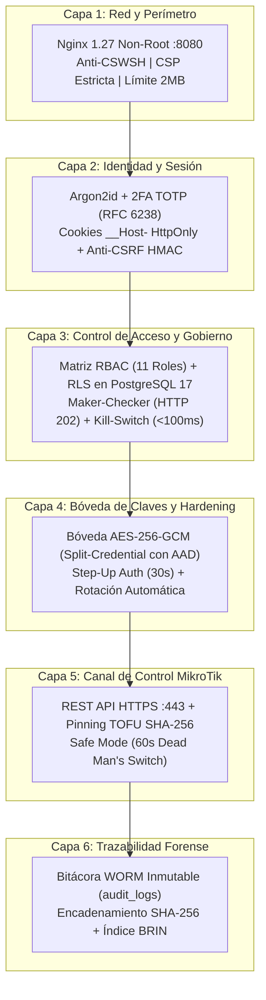

# 🛡️ Política de Seguridad y Arquitectura de Defensa (RoSGrid)

**Proyecto:** RoSGrid — Consola Centralizada Multi-Tenant para Flotas MikroTik RouterOS v7+  
**Licencia:** GPL-3.0-only  
**Estándar de Certificación:** QA 11X DevSecOps

---

## 1. Versiones Soportadas

Actualmente reciben parches de seguridad activos las siguientes ramas e imágenes oficiales en Docker Hub (`sinfallas/rosgrid-backend` y `sinfallas/rosgrid-frontend`):

| Versión | Estado de Soporte | Requisitos de Infraestructura |
| :--- | :--- | :--- |
| **1.0.x (`latest`)** | ✅ Soporte Activo | RouterOS v7.1+, PostgreSQL 17, KeyDB Multi-Hilo (o DragonflyDB) |
| **< 1.0.0** | ❌ No Soportado | N/A |

---

## 2. Reporte Responsable de Vulnerabilidades

Si descubres una vulnerabilidad de seguridad en el motor criptográfico, el aislamiento Multi-Tenant (RLS), el interceptor RBAC/Maker-Checker o el conector de RouterOS v7:

1. **NO abras un Issue público en GitHub/GitLab** con el exploit o vector de ataque.
2. Envía un reporte detallado por correo electrónico a: **soporte (`soporte@tecnoconsultores.net`)** con el asunto `[SECURITY-ROSGRID] Descripción breve del hallazgo`.
3. Incluye los pasos de reproducción, el componente afectado (`fastapi/` o `vue3/`) y el impacto potencial.
4. Recibirás acuse de recibo en un máximo de **48 horas** y coordinaremos la publicación del parche antes de la divulgación pública.

---

## 3. Pilares de Seguridad por Diseño en RoSGrid

RoSGrid administra infraestructura crítica de telecomunicaciones e ISP (routers de borde BGP, BRAS PPPoE y firewalls). Por ello, implementa **8 capas de defensa en profundidad**:

### 3.1 Aislamiento Multi-Tenant a Nivel de Motor (`FORCE ROW LEVEL SECURITY`)

- Todas las tablas operativas en PostgreSQL 17 aplican políticas `ENABLE` y `FORCE ROW LEVEL SECURITY (RLS)`.
- Cada transacción inyecta `SET LOCAL app.current_tenant_id = '<uuid>'`, impidiendo matemáticamente fugas de datos cruzadas entre empresas (Tenants) incluso ante errores en consultas de la capa de aplicación.

### 3.2 Autenticación *Split-Credential*, 2FA TOTP y Cookies `__Host-`

- **Contraseñas de Usuario:** Hash con `Argon2id` de alta dureza de memoria.
- **Segundo Factor Obligatorio (2FA):** TOTP conforme al RFC 6238 para todos los operadores humanos.
- **Cero Tokens en `localStorage`:** Los tokens de sesión viajan exclusivamente en cookies `__Host-rg_at` y `__Host-rg_rt` con banderas `HttpOnly; Secure; SameSite=Strict`, acompañadas de validación `X-CSRF-Token` firmada con `HMAC-SHA256`.
- **Detección de Robo de Sesión (*Reuse Detection*) y *Kill-Switch*:** KeyDB invalida automáticamente toda la familia de Refresh Tokens si detecta el reúso de un token rotado y permite la expulsión instantánea en vivo (`SESSION_KILLED` con cierre de WebSockets código `4401`).

### 3.3 Bóveda Criptográfica `AES-256-GCM` y *Step-Up Auth* (30s)

- Las credenciales de la REST API de cada router MikroTik se cifran con `AES-256-GCM` vinculando criptográficamente el `tenant_id|router_id` como *Additional Authenticated Data (AAD)*.
- **Rotación Automática Transaccional:** El worker de bóveda rota las contraseñas API por llaves aleatorias de 32 caracteres manteniendo `previous_password` para recuperación ante cortes de red.
- **Revelación Efímera (30 Segundos):** Solo los roles `SUPERADMIN_GLOBAL` y `TENANT_ADMIN` pueden consultar una clave tras superar un desafío **Step-Up 2FA TOTP en vivo**. El Frontend purga la clave de la memoria RAM automáticamente tras 30 segundos.

### 3.4 Pinning TLS *Trust On First Use* (TOFU) sobre `/rest/*`

- RoSGrid se comunica exclusivamente mediante HTTPS (`/ip/service/www-ssl`) contra la REST API de RouterOS v7.1+ reutilizando pools persistentes `Keep-Alive` TLS verificados.
- En el primer contacto verificado se fija la huella `SHA-256` del certificado X.509 del MikroTik (`TRUSTED_PINNED`). Si la huella cambia sin autorización previa (`FINGERPRINT_MISMATCH`), RoSGrid aborta la conexión y dispara una alerta crítica de posible ataque *Man-in-the-Middle (MitM)*.

### 3.5 *Safe Mode (Dead Man's Switch)* y Protección Anti-Suicidio

- Toda mutación delicada inyecta previamente una tarea temporal `rosgrid_safemode_*` en `/rest/system/scheduler` a 60 segundos antes de aplicar el cambio. Si el cambio corta la conectividad de gestión, el propio MikroTik revierte la operación automáticamente.
- El sistema bloquea cualquier intento de deshabilitar o alterar el servicio `www-ssl` desde Capa 1 o Capa 2 (`FORBIDDEN_L2_PATHS`).

### 3.6 Segregación de Funciones (*Maker-Checker*) y Cadena Forense WORM (Índice `BRIN`)

- Los cambios en las 7 categorías críticas realizados por roles intermedios se retienen con estado `202 Accepted` (`AWAITING_APPROVAL`). Ningún usuario puede aprobar su propia solicitud (`maker_user_id != checker_user_id`).
- La tabla `audit_logs` cuenta con un trigger en PostgreSQL (`trg_immutable_audit_logs`) que prohíbe `UPDATE`, `DELETE` y `TRUNCATE`, encadenando cada registro con `SHA-256` (`prev_record_hash -> record_sha256_hash`), sanitizando secretos (`[REDACTED]`) e indexando cronológicamente con un índice `BRIN` de alta velocidad.

### 3.7 Exclusión Deliberada de Terminal CLI / SSH Libre

- Por diseño de seguridad, RoSGrid **no incluye ni aceptará** terminales interactivas SSH/Telnet ni consolas CLI libres que permitan a un operador evadir el modelo *Split-Credential*, el interceptor *Maker-Checker*, el *Safe Mode* o la auditoría estructurada `before_state` / `after_state`.

### 3.8 Desactivación Estricta de Swagger / ReDoc / OpenAPI en Producción

- Cuando el contenedor se ejecuta con `ROSGRID_ENV=production`, FastAPI inicializa con `docs_url=None`, `redoc_url=None` y `openapi_url=None` para impedir el reconocimiento automatizado de esquemas y endpoints por parte de terceros (consulta `docs/06_REFERENCIA_COMPLETA_API_REST_Y_WEBSOCKETS.md`).

### 3.9 Servidor MCP Protegido para Agentes IA (`POST /api/v1/mcp`) y Gobierno Autónomo

- **Autenticación Machine-to-Machine Restringida:** El endpoint JSON-RPC 2.0 Streamable HTTP solo acepta autenticación `Bearer` proveniente del rol `SERVICE_ACCOUNT`.
- **Lista Blanca de Red (CIDR):** La IP del agente IA (Hermes Agent o Claude) debe pertenecer estrictamente a la subred declarada en `user.allowed_cidr`. Cualquier intento fuera de rango responde `403 Forbidden`.
- **Rate-Limiting en KeyDB:** La variable `ROSGRID_MCP_RATE_LIMIT_PER_MIN` (por defecto `30` req/min) previene sobrecargas al plano de control del MikroTik.
- **Trazabilidad WORM:** Cada llamada a herramientas (`tools/call`) se registra en la bitácora inmutable con acción `MCP_AI_TOOL_CALL`.
- **Contención de Mutaciones (Maker-Checker Obligatorio):** Cualquier herramienta de cambio destructivo o mutación de red (`rosgrid_propose_network_change`) no se ejecuta inmediatamente en el router; se retiene con estado `202 Accepted` (`AWAITING_APPROVAL`) para que un operador humano la revise y apruebe, respaldada por *Safe Mode (60s)*. Consulta `docs/07_GUIA_INTEGRACION_IA_MCP_HERMES_Y_CLAUDE.md`.

### 3.10 Gobernanza de Auto-Registro de Operadores (Maker-Checker)

- Para prevenir registros descontrolados, el auto-registro web (`POST /api/v1/auth/register`) almacena a los solicitantes con bandera inactiva y estado `PENDING_APPROVAL`.
- El endpoint de inicio de sesión rechaza con `403 Forbidden` cualquier intento de autenticación hasta que un `SUPERADMIN_GLOBAL` o `TENANT_ADMIN` apruebe explícitamente al operador (`PUT /api/v1/users/{id}/approve`) y le asigne un rol RBAC adecuado.
- Un switch global en KeyDB (`rosgrid:registration_enabled`) permite al Superadmin desactivar completamente el auto-registro público cuando no se esperan nuevos operadores.

### 3.11 Mitigación Integral de Vectores de Ataque en Plataforma Híbrida (Vue 3 + FastAPI)

La integración entre una SPA en Vue 3 y una API asíncrona en FastAPI introduce una superficie de ataque híbrida que RoSGrid neutraliza mediante directivas arquitectónicas de endurecimiento:

- **Prevención de Asignación Masiva (*Mass Assignment / Over-posting*):**
  - Todos los esquemas de entrada Pydantic v2 configuran `model_config = ConfigDict(extra="forbid")`.
  - Los modelos de entrada (`RegisterOperatorRequest`, `UserCreate`, `UserUpdate`, `RouterCreateRequest`) están estrictamente desacoplados de los modelos de base de datos (`UserInDB`, `RouterInDB`) y modelos públicos (`UserPublic`, `RouterResponse`), impidiendo la inyección arbitraria de campos como `role`, `is_superuser` o `is_verified`.
- **Protección Anti-CSWSH (*Cross-Site WebSocket Hijacking*):**
  - Los WebSockets no aplican las restricciones de la política SOP del navegador. Si un atacante aloja un sitio malicioso y el usuario tiene la cookie de sesión activa, un script malicioso podría iniciar un apretón de manos WebSocket.
  - RoSGrid implementa `_verify_ws_origin(ws)` en `fastapi/src/api/v1/websockets.py` que inspecciona la cabecera `Origin` **antes** de ejecutar `await ws.accept()`. Si el origen no coincide con los dominios autorizados en `settings.ALLOWED_ORIGINS` o falta en entorno de producción, la conexión se aborta inmediatamente con código de cierre de aplicación `4403` ("Forbidden Origin"), sin llegar a establecer el canal.
- **Sanitización de Errores de Validación 422 (`RequestValidationError`):**
  - En desarrollo, FastAPI devuelve un desglose detallado de campos esperados, regex y estructuras de datos en respuestas 422. En producción (`ROSGRID_ENV=production`), esta información facilita el reconocimiento de la arquitectura interna de la API.
  - Se implementó un manejador global de excepciones para `RequestValidationError` que registra el traceback y detalle en los logs del servidor (Docker stdout) y devuelve al cliente una respuesta genérica y segura: `{"detail": "Los datos proporcionados no cumplen con los requisitos de validación."}`.
- **Defensa Anti-SSRF en Webhooks y Notificaciones Salientes:**
  - En `alert_dispatcher_worker.py`, las URLs de webhooks configuradas por los tenants se validan mediante `is_safe_webhook_url()`.
  - La validación resuelve el hostname por DNS antes de emitir la petición y bloquea incondicionalmente cualquier IP que pertenezca a rangos privados (RFC 1918: `10.0.0.0/8`, `172.16.0.0/12`, `192.168.0.0/16`), loopback (`127.0.0.0/8`), link-local (`169.254.0.0/16`), rangos reservados o direcciones multicast, impidiendo que el atacante use RoSGrid como pivote para escanear redes internas o consultar metadatos de proveedores de nube (como `169.254.169.254`).
- **Sentencias Parametrizadas Seguras en Contexto de Tenant MCP:**
  - En `src/api/v1/mcp.py`, el cambio de contexto para sesiones de agentes IA se realiza mediante `set_tenant_context(session, tenant_id)` utilizando `bindparam` seguro en lugar de interpolación cruda de cadenas (`f-strings`), eliminando cualquier riesgo de inyección SQL.
- **Límite Estricto de Carga de Archivos (CSV):**
  - El endpoint de importación masiva de inventario (`POST /api/v1/inventory/routers/import-csv`) impone una cuota máxima de 2 MB por archivo, rechazando peticiones que excedan este umbral con HTTP `413 Payload Too Large` y evitando saturación de memoria RAM en el backend.
- **Preservación de Cabeceras de Proxy Inverso en Nginx:**
  - El bloque `location /ws/` en la configuración de Nginx (`vue3/nginx/default.conf`) incluye explícitamente `proxy_set_header X-Forwarded-For $proxy_add_x_forwarded_for;` y `proxy_set_header X-Forwarded-Proto $scheme;`, garantizando la correcta trazabilidad de IPs de clientes y protocolos en conexiones WebSocket en tiempo real.
- **Desacoplamiento de Middleware Anti-CSRF y Protección Escopada:**
  - El middleware `CSRFProtectionMiddleware` extrae el JWT de sesión directamente desde las cookies del navegador (`__Host-rg_at` / `rg_at`) de forma autónoma respecto a `request.state`, previniendo omisiones (*bypasses*). Se alinea con OWASP CSRF Prevention eximiendo de validación CSRF a las peticiones basadas en cabecera `Authorization: Bearer` (usadas por agentes IA, automatizaciones y el endpoint MCP `/api/v1/mcp`).
- **Sanitización Estricta Anti-XSS en Capa Cartográfica Leaflet / OpenStreetMap:**
  - La utilidad `escapeHtml` (`vue3/src/utils/security.ts`) sanitiza obligatoriamente cualquier dato dinámico (`display_name`, `ros_identity`, `serial_number`, `physical_location`) antes de inyectarlo en `popupContent.innerHTML` de `OsmRouterMap.vue` y `OsmOnuMap.vue`, neutralizando cualquier vector de inyección de scripts HTML en nombres o identidades de equipos.
- **Validación Anti-SSRF en Direccionamiento de Routers MikroTik:**
  - El validador `validate_router_target_url` en esquemas Pydantic y en el asistente CSV masivo descarta esquemas no seguros, loopback (`127.0.0.0/8`, `::1`), metadatos de nube y link-local (`169.254.0.0/16`, `fe80::/10`) y nombres de contenedor Docker internos (`localhost`, `rosgrid-db`, `rosgrid-redis`, `rosgrid-keydb`, `rosgrid-api`, `rosgrid-worker`).
- **Tolerancia a Carreras Concurrentes (*Grace Period Leeway* de 5s) en Refresh Tokens:**
  - Se añade `ROSGRID_REFRESH_TOKEN_GRACE_PERIOD_SECONDS` (por defecto 5 segundos) en `rotate_refresh_token` (`src/redis_layer/sessions.py`), eliminando falsos positivos de `REUSE_DETECTED` y revocaciones accidentales de sesión ante refrescos simultáneos en múltiples pestañas.
- **Aislamiento Multi-Tenant y por Operador en Llaves de Idempotencia:**
  - `IdempotencyMiddleware` decodifica claims del JWT para estructurar llaves en KeyDB bajo `rg:{tenant_id}:{user_id}:idemp:{key}`, evitando colisiones cruzadas entre inquilinos u operadores que envíen el mismo UUIDv7.

---

## 4. Barreras Automatizadas DevSecOps

Antes de cada commit, push o publicación de imagen en Docker Hub (`./build.sh`), el código supera:

- **Detección de Secretos:** `gitleaks` vía `lefthook.yml`.
- **SAST Backend & Frontend:** `Bandit` (Python) y `eslint-plugin-security` (Vue 3 / TypeScript), más `.npmrc` con `ignore-scripts=true`.
- **Auditoría IaC y Contenedores:** `Trivy` (`./auditar-infra.sh`) exigiendo `0` vulnerabilidades `HIGH` o `CRITICAL` y ejecución con usuarios sin privilegios (`non-root`).
- **DAST en Vivo:** Escaneo dinámico con **OWASP ZAP Baseline** contra el contenedor compilado.

---

## 5. Manuales Oficiales de Referencia de Seguridad (`docs/`)

Para una inspección profunda de los controles y auditorías de RoSGrid:

- [docs/01_GUIA_DESPLIEGUE_Y_ENTORNO.md](./docs/01_GUIA_DESPLIEGUE_Y_ENTORNO.md) — Generación de llaves AES-256-GCM / JWT y despliegue inmutable.
- [docs/02_PREPARACION_MIKROTIK_ROUTEROS_V7.md](./docs/02_PREPARACION_MIKROTIK_ROUTEROS_V7.md) — Hardening de RouterOS v7, política `rest-api` (v7.13+), pinning SSL TOFU y Safe Mode.
- [docs/03_MANUAL_ADMIN_MULTITENANT_Y_SEGURIDAD.md](./docs/03_MANUAL_ADMIN_MULTITENANT_Y_SEGURIDAD.md) — Aislamiento RLS en PostgreSQL 17, matriz de 11 roles RBAC, Bóveda 2FA, Kill-Switch y Auto-Registro.
- [docs/05_AUDITORIA_FORENSE_Y_ARQUITECTURA.md](./docs/05_AUDITORIA_FORENSE_Y_ARQUITECTURA.md) — Cadena WORM SHA-256, índice BRIN y ADR sobre la exclusión de terminales libres.
- [docs/06_REFERENCIA_COMPLETA_API_REST_Y_WEBSOCKETS.md](./docs/06_REFERENCIA_COMPLETA_API_REST_Y_WEBSOCKETS.md) — Especificación exhaustiva de endpoints protegidos y WebSocket multiplexor.
- [docs/07_GUIA_INTEGRACION_IA_MCP_HERMES_Y_CLAUDE.md](./docs/07_GUIA_INTEGRACION_IA_MCP_HERMES_Y_CLAUDE.md) — Arquitectura de seguridad del servidor Model Context Protocol.
- [docs/08_PIPELINE_VALIDACION_LOCAL_PRODUCCION.md](./docs/08_PIPELINE_VALIDACION_LOCAL_PRODUCCION.md) — Pipeline de validación local y suite de 24 pruebas de integración UI-API.
- [docs/09_PLAN_MAESTRO_PRUEBAS_MANUALES_UAT.md](./docs/09_PLAN_MAESTRO_PRUEBAS_MANUALES_UAT.md) — Plan maestro de pruebas de aceptación UAT 11X (28 casos E2E).
