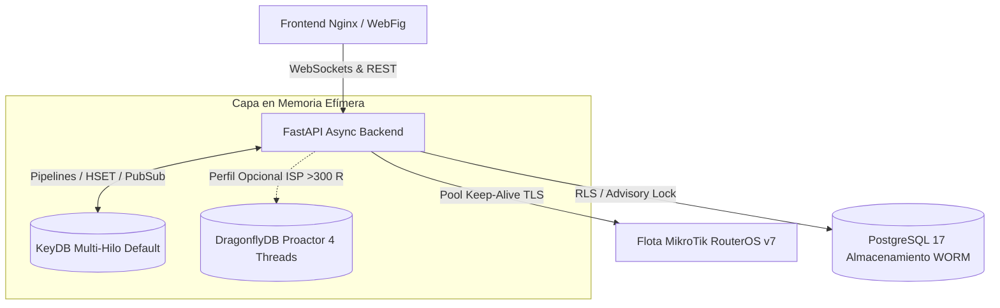

# 01 — Guía Oficial de Despliegue, Entorno y Rendimiento

Este manual detalla los requerimientos de infraestructura, la configuración de variables de entorno, la arquitectura de memoria (KeyDB Multi-Hilo y perfil DragonflyDB), el despliegue con Docker y Docker Compose, la auto-migración con bloqueos distribuidos y el empaquetado multi-arquitectura de **RoSGrid**.

---

## 1. Requerimientos de Infraestructura y Red

### 1.1 Dimensionamiento de Hardware

| Escenario de Uso | Routers Gestionados | CPU Mínima | Memoria RAM | Almacenamiento | Motor en Memoria Recomendado |
| :--- | :--- | :--- | :--- | :--- | :--- |
| **Laboratorio / PoC** | 1 a 15 routers | 2 vCPU | 4 GB | 20 GB SSD | KeyDB Multi-Hilo (`512 MB`) |
| **Operador ISP Mediano** | 16 a 150 routers | 4 vCPU | 8 GB | 60 GB NVMe | KeyDB Multi-Hilo (`1 GB`) |
| **Gran Flota ISP / Telco** | 151 a 500+ routers | 8+ vCPU | 16 GB+ | 150 GB NVMe | DragonflyDB (`2 GB+`, `--proactor_threads=4`) |

### 1.2 Requisitos de Red y Firewall
- **Red IPv4 Exclusiva:** Docker configurado con driver `bridge` IPv4. IPv6 se mantiene deshabilitado en contenedores de acuerdo al perfil de seguridad Trivy IaC.
- **Acceso a Routers MikroTik:** La red interna de RoSGrid o el host de despliegue debe tener visibilidad IP bidireccional hacia el puerto HTTPS/REST (predeterminado `443` o puerto personalizado `ROSGRID_API_PORT`) de cada router.
- **Puertos Expuestos:**
  - `8080/TCP`: Interfaz Web y punto de entrada unificado Nginx (`rosgrid-ui`).
  - Las bases de datos PostgreSQL (`5432`) y KeyDB (`6379`) permanecen estrictamente aisladas en la red interna `rosgrid_internal_net` sin mapeo de puertos hacia el host.

---

## 2. Variables de Entorno (`.env`)

Copia la plantilla oficial `.env.example` a `.env` en la raíz del proyecto:
```bash
cp .env.example .env
chmod 600 .env
```

### 2.1 Catálogo Completo de Variables

| Variable | Tipo | Valor Predeterminado | Descripción y Consideraciones de Producción |
| :--- | :--- | :--- | :--- |
| `ROSGRID_ENV` | String | `production` | Entorno de ejecución (`production`, `qa_test`, `development`). En `production`, Swagger y OpenAPI se ocultan permanentemente. |
| `ROSGRID_HTTP_PORT` | Entero | `8080` | Puerto en el host donde escuchará el servidor Nginx de RoSGrid. |
| `POSTGRES_DB` | String | `rosgrid` | Nombre de la base de datos central en PostgreSQL 17. |
| `POSTGRES_USER` | String | `rosgrid_user` | Usuario de PostgreSQL con permisos RLS. |
| `POSTGRES_PASSWORD` | String | *(Obligatorio)* | Contraseña segura para el usuario de PostgreSQL. |
| `REDIS_PASSWORD` | String | *(Obligatorio)* | Clave de autenticación para KeyDB o DragonflyDB. |
| `ROSGRID_MASTER_VAULT_KEY` | Base64 (32 B) | *(Obligatorio)* | Llave criptográfica maestra para cifrar/descifrar credenciales de routers con `AES-256-GCM`. |
| `ROSGRID_JWT_SECRET_KEY` | String (64+ B) | *(Obligatorio)* | Secreto para firma de tokens JWT (`HS256`) con verificación de sesión en KeyDB. |
| `ROSGRID_CSRF_HMAC_SECRET` | String (64+ B) | *(Obligatorio)* | Secreto HMAC para la firma y validación de tokens anti-CSRF (`X-CSRF-Token`). |
| `ROSGRID_MIKROTIK_TIMEOUT_SECONDS` | Entero | `10` | Tiempo límite en segundos para llamadas HTTP a la REST API de MikroTik. |
| `ROSGRID_SAFEMODE_ROLLBACK_SECONDS`| Entero | `60` | Tiempo de gracia del *Dead Man's Switch* en MikroTik antes de abortar cambios sin confirmar. |
| `ROSGRID_BACKUP_RETENTION_DAYS` | Entero | `30` | Días de retención para respaldos automáticos y manuales de configuraciones `.rsc`. |
| `ROSGRID_MCP_ENABLED` | Booleano | `false` | Activa el servidor Model Context Protocol (`POST /api/v1/mcp`) para agentes IA como Hermes o Claude. |
| `ROSGRID_MCP_RATE_LIMIT_PER_MIN` | Entero | `30` | Límite de peticiones MCP por minuto por cuenta `SERVICE_ACCOUNT`. |
| `ROSGRID_CORS_ORIGINS` | String | `*` | Lista de orígenes permitidos separados por comas para despliegues con Backend y Frontend en servidores separados (ej. `https://app.tuempresa.com,http://localhost:8080`). |
| `ROSGRID_CROSS_ORIGIN_COOKIES` | Booleano | `false` | Si es `true`, emite cookies de sesión sin prefijo `__Host-` con `SameSite=None; Secure` para permitir autenticación cross-domain. |

### 2.2 Generación Criptográfica de Secretos
Ejecuta los siguientes comandos en tu terminal para generar llaves criptográficas de alta entropía:

```bash
# Llave Maestra para la Bóveda AES-256-GCM (32 bytes codificados en Base64)
openssl rand -base64 32

# Secreto para JWT HS256
openssl rand -hex 64

# Secreto para Tokens CSRF HMAC
openssl rand -hex 64

# Contraseñas robustas para PostgreSQL y KeyDB
openssl rand -base64 24
```

---

## 3. Arquitectura en Memoria: KeyDB Multi-Hilo vs. DragonflyDB



### 3.1 KeyDB Multi-Hilo Predeterminado (`eqalpha/keydb:alpine`)
RoSGrid utiliza **KeyDB Multi-Hilo** por defecto en lugar de Redis estándar monohilo. Esto permite procesar ráfagas concurrentes de telemetría provenientes de cientos de routers sin bloquear la cola de peticiones HTTP:
- **Hilos asignados:** `--server-threads 2`
- **Políticas de memoria:** `--maxmemory 512mb --maxmemory-policy volatile-lru`
- **Persistencia en disco:** Deshabilitada (`--appendonly no --save ""`) para garantizar cero latencia I/O en telemetría volátil.

### 3.2 Activación del Perfil de Alto Rendimiento con DragonflyDB
Para flotas ISP de gran escala (`> 300` routers gestionados) alojadas en servidores dedicados con `16 GB+` de memoria RAM, puedes activar el motor ultrarrápido **DragonflyDB**.

En `docker-compose.yml` o `docker-compose.prod.yml`, comenta el servicio `rosgrid-redis` existente y descomenta el bloque DragonflyDB:

```yaml
  rosgrid-redis:
    image: docker.dragonflydb.io/dragonflydb/dragonfly:latest
    container_name: rosgrid_redis
    hostname: rosgrid-redis
    restart: unless-stopped
    ulimits:
      memlock: -1
    command: >
      dragonfly
      --proactor_threads=4
      --maxmemory=2gb
      --requirepass=${REDIS_PASSWORD}
      --alsologtostderr
    volumes:
      - rosgrid_redis_data:/data
    healthcheck:
      test: ["CMD-SHELL", "redis-cli -a \"$${REDIS_PASSWORD}\" ping | grep PONG"]
      interval: 10s
      timeout: 5s
      retries: 5
    networks:
      - rosgrid_internal_net
```

---

## 4. Despliegue de RoSGrid

### 4.1 Despliegue de Producción Directo desde Docker Hub (`docker-compose.prod.yml`)
Este método no requiere descargar el código fuente ni compilar imágenes localmente; descarga las imágenes inmutables oficiales:

```bash
# 1. Crear directorio del proyecto y descargar docker-compose.prod.yml
mkdir -p /opt/rosgrid && cd /opt/rosgrid
curl -fsSL -o docker-compose.prod.yml https://raw.githubusercontent.com/tecno-consultores/RoSGrid/main/docker-compose.prod.yml

# 2. Configurar variables de entorno
curl -fsSL -o .env https://raw.githubusercontent.com/tecno-consultores/RoSGrid/main/.env.example
nano .env

# 3. Iniciar el stack de producción
docker compose -f docker-compose.prod.yml up -d

# 4. Verificar salud de los contenedores
docker compose -f docker-compose.prod.yml ps
```

### 4.2 Despliegue Local / Desarrollo (`docker-compose.yml`)
Para entornos con el código fuente completo:

```bash
# Iniciar servicios con volumen compartido y hot-reload
docker compose up -d

# Ver logs en vivo de la API y los workers
docker compose logs -f rosgrid-api rosgrid-worker
```

---

## 5. Auto-Migración con `pg_advisory_lock`

En despliegues de clúster o contenedores redundantes, múltiples instancias de Backend compitiendo por correr migraciones de base de datos pueden corromper el esquema de Alembic.

RoSGrid implementa en su script de entrada (`scripts/entrypoint.sh`) la adquisición transaccional de un bloqueo consultivo en PostgreSQL antes de ejecutar `alembic upgrade head`:
- **ID de Bloqueo Global:** `pg_advisory_lock(948271605)`
- Si una instancia está migrando la base de datos, las demás instancias quedan en espera pasiva hasta que la migración concluye con éxito, tras lo cual liberan el candado e inician Uvicorn bajo `uvloop` y `httptools`.

---

## 6. Compilación y Publicación Multi-Arquitectura (`./build.sh`)

Para construir y publicar imágenes de producción para Docker Hub cumpliendo las directivas de seguridad Trivy IaC:

```bash
# Requiere privilegios de usuario regular (EUID != 0) con acceso al socket Docker
./build.sh 1.0.0
```

El script `./build.sh`:
1. Inicializa emuladores QEMU con `tonistiigi/binfmt` para soporte multi-arquitectura.
2. Crea una instancia aislada `docker buildx` de tipo contenedor (`container-builder`).
3. Compila y etiqueta `sinfallas/rosgrid-backend` y `sinfallas/rosgrid-frontend` con la versión especificada y `latest`.
4. Publica las imágenes autenticadas a Docker Hub.
5. Ejecuta limpieza profunda con `prune -af` para liberar espacio en disco.

---

## 7. Operaciones Avanzadas de Despliegue y Validación

### 7.1 Inicialización Inicial (Bootstrap y Seeder del Super Administrador)
En una instalación limpia con base de datos virgen (`COUNT(users) == 0`), RoSGrid provee dos mecanismos para aprovisionar la primera organización y al Super Administrador Global:

1. **Vía Consola Web (Recomendado para Operadores):**
   - Al acceder por primera vez a `http://localhost:8080`, la interfaz detecta automáticamente el estado de inicialización y muestra el formulario de bienvenida de **Configuración Inicial de RoSGrid**.
   - Ingresa el nombre de la organización, slug, credenciales del Super Administrador y confirma. El sistema aprovisionará la cuenta y te presentará inmediatamente el código QR para el enrolamiento 2FA TOTP y los códigos de respaldo.

2. **Vía CLI en el Servidor (Recomendado para SysAdmins y Automatización):**
   - Ejecuta de forma interactiva:
     ```bash
     docker exec -it rosgrid_api python3 /app/scripts/crear_admin.py
     ```
   - O de forma desatendida mediante argumentos:
     ```bash
     docker exec rosgrid_api python3 /app/scripts/crear_admin.py \
         --tenant-name "ISP Principal" \
         --tenant-slug "master" \
         --username "superadmin" \
         --email "admin@rosgrid.local" \
         --password "ClaveSegura123!" \
         --full-name "Super Administrador"
     ```
   - Una vez creado el primer usuario, los endpoints de bootstrap se bloquean permanentemente con HTTP `403 Forbidden`.

### 7.2 Despliegue en Servidores Separados (Backend y Frontend Independientes)
RoSGrid permite desplegar el Frontend (Nginx) y el Backend (FastAPI + Bases de Datos) en servidores físicos o virtuales distintos:

* **Opción B — Dominios Cruzados / Cross-Origin Directo (CORS):**
  - **Servidor 1 (Frontend):** `https://app.tuempresa.com`
    * Configura la variable de entorno `VITE_API_BASE_URL=https://api.tuempresa.com`.
  - **Servidor 2 (Backend):** `https://api.tuempresa.com`
    * Configura en `.env`:
      ```bash
      ROSGRID_CORS_ORIGINS="https://app.tuempresa.com,http://localhost:8080"
      ROSGRID_CROSS_ORIGIN_COOKIES=true
      ```
    * El backend habilitará `CORSMiddleware` con credenciales permitidas y emitirá las cookies de sesión con `SameSite=None; Secure` para permitir la autenticación cross-origin.

* **Opción A — Proxy Reverso en Misma Origen Virtual:**
  - El servidor Frontend recibe todo el tráfico en `https://noc.tuempresa.com` y reenvía internamente `/api/` y `/ws/` al servidor Backend a través de red privada o túnel WireGuard.
  - Permite conservar las cookies `__Host-rg_at` con `SameSite=Strict`.

### 7.3 Pipeline de Validación de Imágenes de Producción en Local (`./probar-prod-local.sh`)
Para validar el stack completo de producción (`--no-dev`) antes de subir las imágenes a Docker Hub o desplegarlas, RoSGrid dispone de un pipeline automatizado configurable a petición del usuario:

```bash
# Ejecución estándar automatizada
./probar-prod-local.sh

# Modo interactivo (mantiene el stack activo para navegar en http://localhost:8085)
./probar-prod-local.sh --keep-alive

# Modo rápido (sin recompilar si las imágenes ya existen)
./probar-prod-local.sh --skip-build

# Modo seguridad (ejecuta auditoría Trivy previa y cambia el puerto UI)
./probar-prod-local.sh --audit --port 8090
```

Este pipeline ejecuta 6 fases exhaustivas:
1. **Auditoría e Imágenes:** Verificación estática con Trivy (opcional) y compilación multi-stage de Backend y Frontend.
2. **Despliegue Aislado:** Levantamiento del stack efímero mediante `docker-compose.prod.local.yml`.
3. **Healthchecks:** Estabilización de PostgreSQL 17, KeyDB Multi-Hilo y FastAPI hasta estado `healthy`.
4. **Pruebas Sintéticas:** Validación de endpoints `/health`, `/metrics`, `/api/v1/auth/bootstrap-status` (estado virgen) y bundle UI Nginx.
5. **Aprovisionamiento E2E y MCP:** Creación de Super Admin con `crear_admin.py`, verificación de transición a `is_bootstrapped: true`, emisión de Token Bearer MCP con `generar_token_mcp.py` y validación de sesión autenticada contra KeyDB en `/api/v1/auth/me`.
6. **Inspección de Logs y Limpieza:** Auditoría de ausencia de tracebacks y purga de volúmenes (o entrega de enlaces si se usó `--keep-alive`).

> [!NOTE]
> Para la guía operativa paso a paso, arquitectura y solución de problemas, consulta el manual completo en [08_PIPELINE_VALIDACION_LOCAL_PRODUCCION.md](08_PIPELINE_VALIDACION_LOCAL_PRODUCCION.md). Además, el script de publicación [build.sh](file:///home/sinfallas/Dropbox/git/tecno-consultores/RoSGrid/build.sh) ejecuta automáticamente este pipeline como Paso 0 previo a cualquier `docker buildx build --push`.

### 7.4 Dictamen de Arquitecturas de Hardware (AMD64, ARM64 y ARMv7)
- **Soportadas Oficialmente:** `linux/amd64` (Intel/AMD) y `linux/arm64` (`aarch64`, para Raspberry Pi 3/4/5 con SO de 64 bits y servidores ARM empresariales).
- **Incompatible (ARMv7 32-bit):** Las placas con procesadores de 32 bits no están soportadas debido a que:
  * El motor en memoria multi-hilo **KeyDB** requiere instrucciones atómicas de 64 bits (`CAS64`) y carece de imágenes oficiales para 32 bits.
  * **PostgreSQL 17** ha discontinuado los builds oficiales de 32 bits en Alpine Linux.
  * El espacio virtual de memoria está topado en 2 GB por proceso, incompatible con la telemetría concurrente y los índices BRIN.
