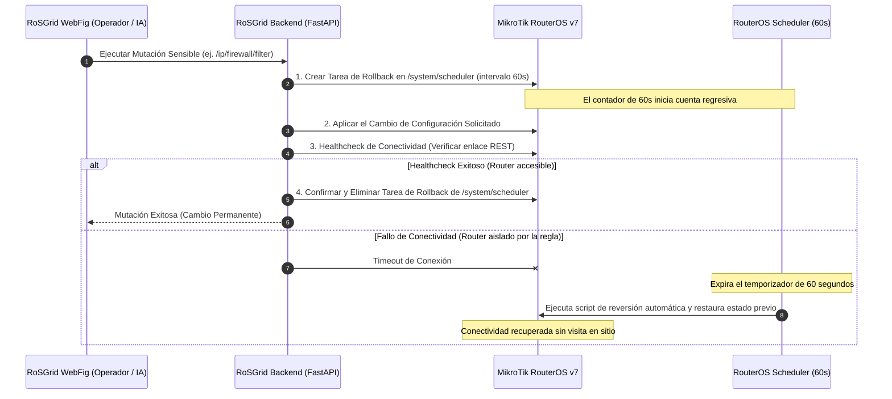

# 02 — Preparación de Routers MikroTik RouterOS v7+

Este manual describe los procedimientos oficiales para preparar cualquier router MikroTik con **RouterOS v7.1+** (recomendado v7.16 o superior) para su integración segura con **RoSGrid**: configuración de certificados SSL para pinning TOFU, activación de la API REST HTTPS, desactivación de servicios inseguros, asignación de cuentas de servicio y funcionamiento del *Dead Man's Switch (Safe Mode)*.

---

## 1. Comandos CLI en RouterOS v7

Accede por primera vez a tu equipo MikroTik mediante consola serial o WinBox temporal y ejecuta los siguientes comandos en la terminal de RouterOS:

### 1.1 Generación de Certificado SSL para Pinning TOFU (`SHA-256`)
RoSGrid valida la autenticidad del router mediante *Trust On First Use* (TOFU) capturando y fijando criptográficamente la huella digital SHA-256 del certificado SSL:

```routeros
# 1. Crear plantilla de certificado autofirmado
/certificate add name=my-ca common-name="Rosgrid Root CA" days-valid=3650 key-size=2048 key-usage=key-cert-sign,crl-sign
/certificate sign my-ca

# 2. Firmar el certificado localmente
/certificate add name=rosgrid-ssl common-name="rosgrid-router.local" days-valid=3650 key-size=2048 key-usage=digital-signature,key-encipherment,tls-server
/certificate sign rosgrid-ssl ca=my-ca

# 3. Verificar el certificado firmado y obtener el Fingerprint SHA-256
/certificate print detail where name=rosgrid-ssl
```

Anota el valor de `fingerprint` (ej. `3a:b8:c4:...`); este valor será fijado automáticamente por RoSGrid en el primer apretón de manos TLS o introducido manualmente en el inventario.

### 1.2 Activación de `/ip/service/www-ssl` y Endurecimiento
La comunicación entre RoSGrid y MikroTik se realiza **exclusivamente mediante la REST API nativa sobre HTTPS**. Deshabilita todos los protocolos no cifrados o legados:

```routeros
# 1. Asignar el certificado y habilitar el servicio www-ssl en puerto 443
/ip service set www-ssl certificate=rosgrid-ssl port=443 disabled=no tls-version=only-1.2

# 2. Deshabilitar servicios inseguros y puertos innecesarios
/ip service disable www
/ip service disable api
/ip service disable api-ssl
/ip service disable telnet
/ip service disable ftp

# 3. (Opcional recomendado) Restringir acceso al puerto www-ssl solo desde la IP de RoSGrid
/ip service set www-ssl address=10.0.0.0/8,192.168.100.50/32
```

### 1.3 Creación del Grupo y Usuario de Servicio RoSGrid
Para cumplir con el principio de mínimo privilegio, crea un grupo restringido sin acceso a la consola SSH completa:

```routeros
# 1. Crear grupo con permisos requeridos para REST API, telemetría y operaciones
/user group add name=rosgrid-api-group policy=api,read,write,test,reboot,policy,sensitive

# 2. Crear usuario con contraseña criptográfica aleatoria
/user add name=rosgrid_agent group=rosgrid-api-group password="CAMBIAR_POR_PASSWORD_ROBUSTO_DE_BOVEDA" comment="Gestionado por RoSGrid Central"
```

---

## 2. Funcionamiento del Safe Mode (*Dead Man's Switch* a 60 Segundos)

Una de las causas principales de pérdida de routers remotos en ISPs es la aplicación de reglas de Firewall erróneas, caídas de rutas BGP o cambios de interfaces que aíslan al equipo de la red de gestión.

En RouterOS REST API, el Safe Mode de sesión no existe de la misma manera que en la consola interactiva. **RoSGrid solventa esta limitación mediante un mecanismo autónomo de tipo Dead Man's Switch basado en `/system/scheduler`:**



### 2.1 Pasos del Flujo Safe Mode
1. **Armado del Disparador:** Antes de ejecutar cualquier mutación sensible (categorías de Firewall, Interfaces WAN, Direccionamiento IP o Enrutamiento BGP/OSPF), RoSGrid inyecta una tarea temporal en `/system/scheduler` configurada para ejecutarse en exactamente 60 segundos. Esta tarea contiene el comando de reversión específico (restablecer el valor previo o borrar la regla agregada).
2. **Ejecución del Cambio:** La mutación solicitada por el operador o aprobada en Maker-Checker es ejecutada vía REST API.
3. **Verificación de Enlace:** RoSGrid valida inmediatamente mediante un ping y una llamada REST GET que el canal de gestión sigue operativo y respondiendo normalmente.
4. **Desarmado o Auto-Reversión:**
   - Si la prueba de enlace tiene éxito, RoSGrid elimina de inmediato la tarea de `/system/scheduler`, consolidando el cambio de forma permanente.
   - Si el cambio causó la pérdida de enlace, RoSGrid no puede contactar al router; a los 60 segundos exactos, el planificador interno de RouterOS dispara el script de rollback, revirtiendo la configuración y restaurando el acceso sin requerir despliegue físico de personal técnico.
