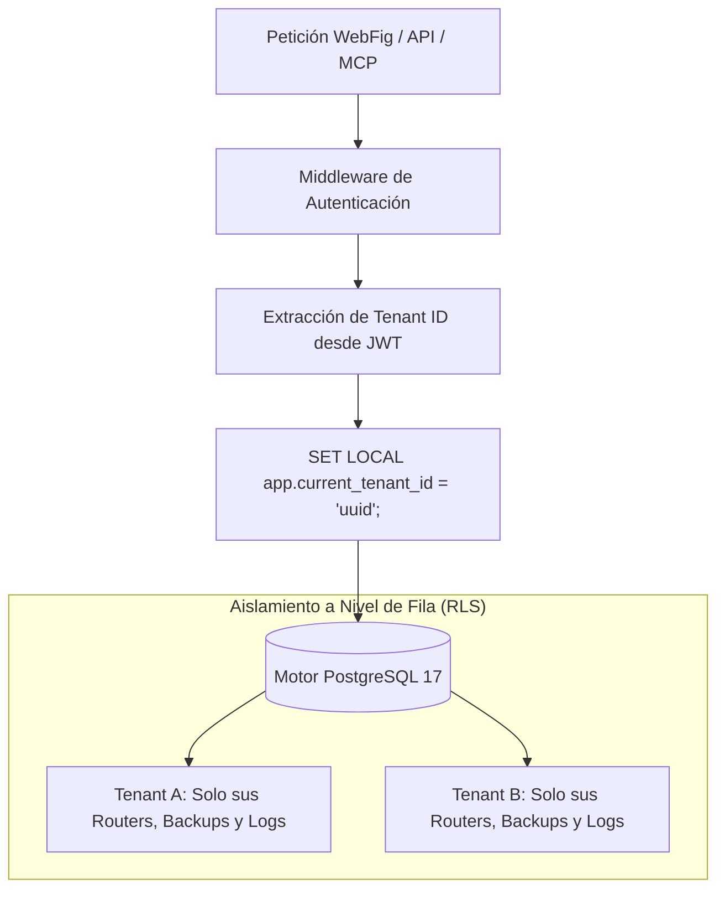
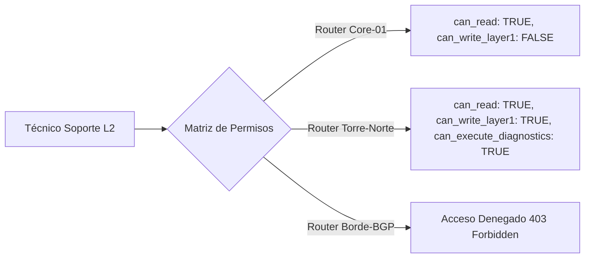
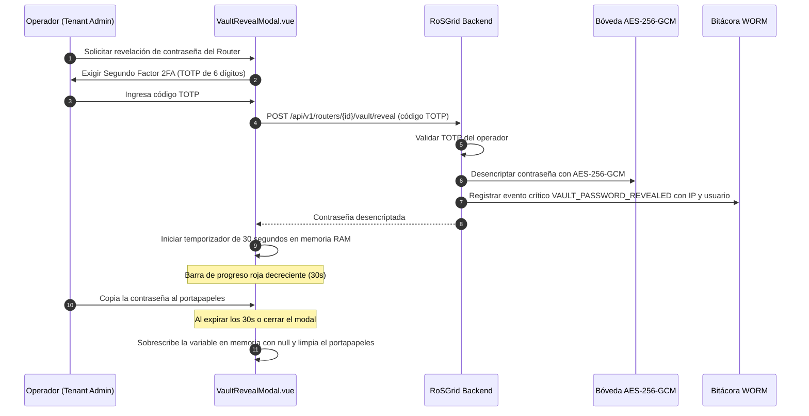
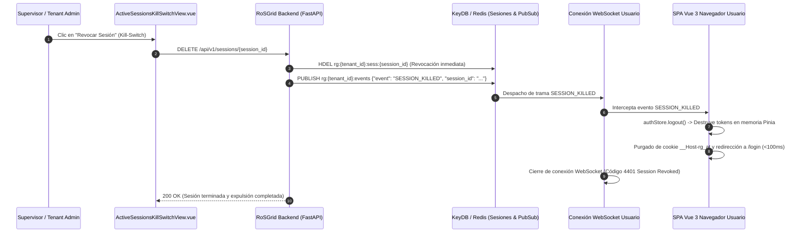
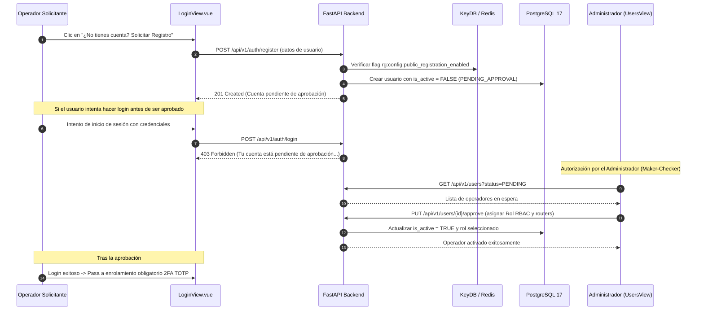
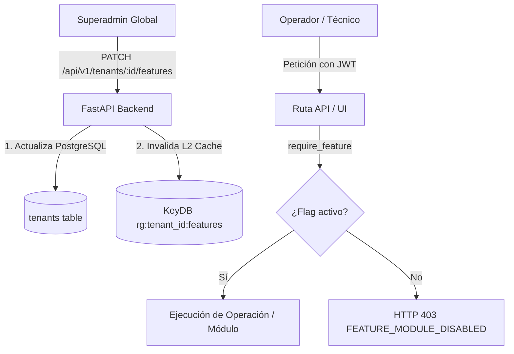
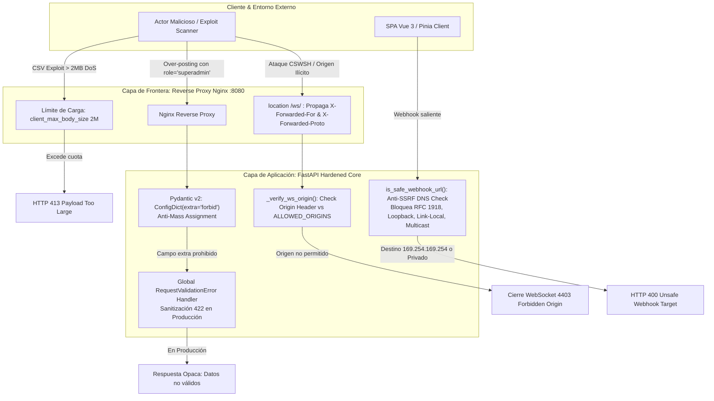
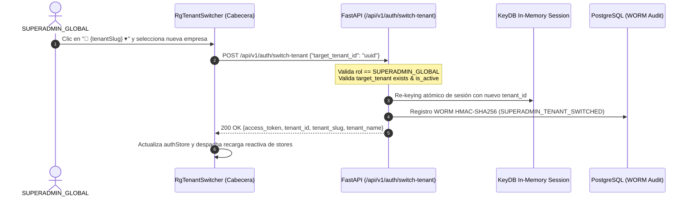

# 03 — Manual de Administración Multi-Tenant, RBAC y Bóveda de Seguridad

Este manual describe el modelo de seguridad de **RoSGrid**: la segregación criptográfica y lógica entre organizaciones (Multi-Tenancy mediante PostgreSQL 17 Row-Level Security), el catálogo completo de los 11 roles RBAC, la asignación granular de routers por técnico, el funcionamiento de la Bóveda de Credenciales (*Split-Credential*) con Step-Up Auth de 30 segundos y el Kill-Switch de sesiones en vivo.

---

## 1. Aislamiento Multi-Tenant con Row-Level Security (RLS)

RoSGrid permite alojar múltiples empresas o sucursales de telecomunicaciones en una misma instancia sin riesgo de contaminación cruzada o fuga de información.



### 1.1 Inyección de Contexto en Sesión

Cada transacción en la base de datos inyecta de forma atómica la variable de sesión:

```sql
SET LOCAL app.current_tenant_id = 'c1234567-89ab-cdef-0123-456789abcdef';
```

Todas las tablas críticas (`routers`, `tenant_custom_roles`, `router_backups`, `approval_requests`, `audit_logs`, `users`, etc.) cuentan con políticas RLS activadas (`ENABLE ROW LEVEL SECURITY; FORCE ROW LEVEL SECURITY;`), impidiendo que incluso un fallo en la capa de aplicación pueda devolver o mutar registros de otra empresa.

---

## 2. Catálogo de los 11 Roles RBAC

RoSGrid define 11 roles jerárquicos y segregados para cumplir con auditorías ISO 27001, SOC 2 y PCI-DSS:

| # | Rol RBAC | Nivel de Riesgo | Capacidades y Alcance Operativo | Restricciones Clave |
| :--- | :--- | :--- | :--- | :--- |
| **1** | `SUPERADMIN_GLOBAL` | Crítico Global | Administración total de la plataforma, creación de Tenants, configuración global y mantenimiento del clúster. | No participa en la operación cotidiana de routers; sus acciones quedan firmadas en WORM. |
| **2** | `TENANT_ADMIN` | Crítico Tenant | Gestión de usuarios, cuotas de routers, políticas 2FA, canales de alerta y autorización en Maker-Checker para su empresa. | Limitado exclusivamente al `tenant_id` asignado. |
| **3** | `SUPERVISOR` | Alto | Aprobación de solicitudes críticas en Maker-Checker, revisión de diffs de configuración y gestión de ventanas de mantenimiento. | No puede crear ni eliminar usuarios administradores. |
| **4** | `SUPPORT_L3` | Alto | Configuración avanzada de enrutamiento (BGP/OSPF), diseño de políticas de firewall y restauración de respaldos con Safe Mode. | Las mutaciones de alto impacto requieren aprobación en Maker-Checker. |
| **5** | `SUPPORT_L2` | Medio | Modificación de direccionamiento IP, interfaces, switches, bridges, VLANs, túneles WireGuard y colas de ancho de banda. | Sin acceso a credenciales en texto plano de la Bóveda. |
| **6** | `SUPPORT_L1` | Bajo | Atención al cliente, reconexión de clientes PPPoE activos, reinicio acotado de sesiones y diagnóstico en vivo (ping/traceroute). | Solo lectura en reglas de firewall y tablas de rutas. |
| **7** | `FIELD_TECH` | Bajo | Diagnóstico físico de interfaces y módulos SFP (DDM), verificación de cableado y lectura de inventario de equipos asignados. | Solo routers vinculados en su matriz de permisos; interfaz con botones de 44px optimizada para tablets. |
| **8** | `INVENTORY_MANAGER` | Bajo | Creación, edición e importación masiva por CSV de routers, ubicación geográfica en mapa OSM y gestión de etiquetas. | Sin acceso a configuraciones de red en vivo ni comandos de diagnóstico. |
| **9** | `AUDITOR` | Especializado | Inspección forense de la bitácora inmutable WORM (`audit_logs`), verificación criptográfica de la cadena SHA-256 e informes de cumplimiento. | **Modo Estrictamente Solo Lectura:** no puede ejecutar mutaciones ni ver contraseñas. |
| **10** | `NOC_MONITOR` | Solo Lectura | Visualización de la pantalla gigante Wallboard NOC, recepción de alertas sonoras/visuales y monitoreo de telemetría de tráfico. | Sin privilegios para enviar comandos ni alterar el estado de los routers. |
| **11** | `SERVICE_ACCOUNT` | Automatización / M2M | Consumo exclusivo del **Endpoint MCP (`/api/v1/mcp`)** para agentes IA como Hermes o Claude y orquestadores externos. | **Exige validación de lista blanca CIDR**, no tiene acceso a la bóveda y todas las mutaciones van a Maker-Checker (202). |

---

## 3. Matriz de Asignación de Routers por Técnico

Para evitar que un técnico acceda por error o intención a routers que no le corresponden, RoSGrid implementa una matriz granular de permisos (`UserRouterMatrixModal` / tabla `user_router_permissions`):



### 3.1 Banderas de Control por Router

- `can_read`: Permite visualizar el router y su telemetría en la lista y mapa.
- `can_write_layer1`: Permite alterar interfaces, firewall, rutas, colas y servicios.
- `can_write_layer2`: Permite modificar recursos universales de Capa 2.
- `can_execute_diagnostics`: Permite correr ping, traceroute y tests de cable.
- `can_trigger_backup`: Permite disparar la generación manual de respaldos `.rsc`.
- `can_reboot`: Habilita el botón de reinicio controlado del MikroTik.
- `bypass_maker_checker`: Solo concedible a ingenieros certificados para saltar la retención de cambios en emergencias operativas.

---

## 4. Bóveda de Credenciales (*Split-Credential*) y Step-Up Auth

RoSGrid utiliza una arquitectura **Split-Credential**: los operadores no necesitan conocer la contraseña real de los routers para operarlos; el sistema almacena las credenciales cifradas y las utiliza internamente mediante un pool TLS Keep-Alive.

### 4.1 Cifrado Autenticado `AES-256-GCM`

Cada contraseña se almacena en la tabla `router_credentials_vault` cifrada con:

- Algoritmo: `AES-256-GCM` (Galois/Counter Mode).
- Vector de Inicialización (`IV`): 12 bytes aleatorios por registro.
- Datos Autenticados Adicionales (`AAD`): Cadena atómica `"{tenant_id}:{router_id}"` que previene ataques de transposición de contraseñas entre routers o empresas.

### 4.2 Modal de Revelación con Step-Up Auth 2FA y Autodestrucción en 30s (`VaultRevealModal.vue`)

Cuando un administrador o supervisor requiere ver la contraseña en texto plano para una intervención de emergencia en sitio:



---

## 5. Kill-Switch de Sesiones en Vivo

Si un usuario pierde su dispositivo, es desvinculado de la empresa o se sospecha un compromiso de credenciales, un administrador puede revocar sus sesiones de inmediato desde `ActiveSessionsKillSwitchView.vue`:



1. **Invalidación en Memoria:** RoSGrid elimina inmediatamente la clave de sesión en KeyDB (`rg:{tenant_id}:sess:{session_id}`).
2. **Empuje WebSocket:** El servicio de eventos publica una trama `SESSION_KILLED` dirigida al navegador del usuario.
3. **Expulsión Inmediata:** La SPA Vue 3 destruye el almacén de Pinia (`authStore.logout()`), elimina la cookie segura `__Host-rg_at` y redirige a la pantalla de login en menos de 100 milisegundos.

---

## 6. Flujo de Auto-Registro Web y Aprobación Maker-Checker de Operadores

Para simplificar el onboarding de técnicos sin requerir acceso a consola de servidores:



### 6.1 Control de Registro Público en KeyDB

El Superadmin o Tenant Admin puede habilitar o deshabilitar las solicitudes externas de registro en cualquier momento desde el botón en la cabecera de `UsersAndPermissionsView.vue` (`POST /api/v1/users/registration-toggle`). Cuando está desactivado, el endpoint responde inmediatamente `403 Forbidden`.

### 6.2 Plan B por Terminal (`crear_admin.py`)

El script de terminal en `fastapi/scripts/crear_admin.py` se mantiene 100% operativo como alternativa para aprovisionamiento directo por consola cuando no se dispone de acceso web o en entornos de contingencia.

### 6.3 Menú Táctico de Usuario y Auto-Gestión de Credenciales

En la barra de navegación superior (`RgResponsiveShell.vue`), cada operador autenticado dispone de un menú contextual interactivo accesible al hacer clic sobre su nombre de usuario (`username`):

1. **Preferencias en Caliente:**
   - **Formato Horario:** Conmutador inmediato entre **24 Horas** y **12h AM/PM**, reflejado de forma reactiva en el reloj del Centro de Mando y almacenado localmente en `useThemeAndLayoutStore`.
   - **Tema Gráfico:** Selección entre **Oscuro Táctico**, **Modo Claro** y **Alto Contraste NOC**.
   - **Idioma:** Alternancia entre **Español** e **English** con traducción dinámica de todas las vistas operativas vía `useI18n`.
2. **Acciones de Seguridad y Credenciales:**
   - **Cambiar Mi Clave:** Despliega el modal táctico `ChangePasswordModal.vue`, permitiendo al usuario actualizar su contraseña validando la clave actual con `argon2id` (`POST /api/v1/users/change-password`).
   - **Resetear Mi 2FA:** Permite reiniciar el segundo factor TOTP personal con revocación inmediata de sesiones activas en KeyDB.
   - **Token de Acceso MCP:** Permite emitir o renovar el Bearer Token JWT de larga duración para asistentes de IA (`RgMcpTokenModal.vue`).
   - **Cerrar Sesión:** Salida limpia del sistema con invalidación de cookies de sesión y redirección segura a `/login`.
3. **Paridad Administrativa y Sesiones Activas:**
   - Los administradores (`SUPERADMIN_GLOBAL` y `TENANT_ADMIN`) gestionan todas las sesiones vivas de la organización desde la pestaña **Sesiones Activas** dentro de **Usuarios y RBAC** (`/users?tab=sessions`), evitando redundancias en la barra lateral.
   - Conservan las opciones equivalentes para todos los operadores desde la tabla de usuarios, incluyendo el botón `[ 🔑 Clave ]`, `[ ↺ Reset 2FA ]` y `[ ⚡ Token MCP ]`.

---

## 7. Gobernanza Modular y Panel de Feature Flags por Tenant

Para permitir que cada empresa u organización active únicamente las capacidades requeridas según su modelo de negocio (ej. ISP de fibra/inalámbrico vs. Empresa Corporativa con flota SD-WAN), RoSGrid implementa una matriz de **16 Feature Flags granulares** gestionados de forma centralizada por el `SUPERADMIN_GLOBAL`.



### 7.1 Catálogo de Feature Flags Modulares

| Categoría | Nombre del Flag | Valor por Defecto | Propósito y Módulos Afectados |
| :--- | :--- | :--- | :--- |
| **Operaciones ISP & Red** | `isp_module_enabled` | `true` | Gestión de abonados (`/api/v1/subscriber-devices`), perfiles QoS y corte de fibra. |
| | `bgp_looking_glass_enabled` | `false` | Consola interna de consulta de rutas BGP y prefijos anunciados. |
| | `sfp_ddm_telemetry_enabled` | `true` | Lectura de telemetría óptica DDM (temperatura, potencia TX/RX SFP). |
| | `ipfix_analytics_enabled` | `false` | Colectores y analítica de flujos de tráfico IPFIX / NetFlow. |
| **Seguridad & Compliance** | `enforce_maker_checker` | `true` | Obligatoriedad de doble aprobación para cambios de alto impacto. |
| | `auto_safemode_enforced` | `true` | Safe Mode (Dead Man's Switch) de 60s obligatorio en mutaciones WebFig. |
| | `ai_mcp_integration_enabled` | `true` | Exposición del endpoint MCP protegido (`/api/v1/mcp`) para agentes IA. |
| | `nightly_backups_enabled` | `true` | Ejecución del worker de respaldos automáticos nocturnos `.rsc` y binarios. |
| | `outbound_webhooks_enabled` | `true` | Despacho de webhooks firmados HMAC-SHA256 ante eventos críticos de red. |
| | `cis_audit_enabled` | `true` | Escaneo y cálculo de score de cumplimiento de endurecimiento CIS MikroTik. |
| **Suite Corporativa** | `config_drift_monitoring_enabled` | `false` | Detección de desviaciones contra la plantilla maestra (*Golden Baseline*). |
| | `sdwan_orchestrator_enabled` | `false` | Orquestación de topologías Hub & Spoke con túneles WireGuard y OSPF. |
| | `capsman_wifi_enabled` | `false` | Gestión centralizada de controladoras WiFi MikroTik CAPsMAN. |
| | `sla_tracker_enabled` | `false` | Monitor de cumplimiento de acuerdos de nivel de servicio (SLA) de enlaces. |
| **Gobernanza & Umbrales** | `mass_outage_threshold` | `10` | Cantidad mínima de abonados caídos simultáneamente para declarar corte masivo. |
| | `default_locale` | `"es"` | Idioma base del tenant (`es` / `en`). |

### 7.2 Operación desde la Consola Web

El Superadmin accede a `TenantsManagementView.vue` y hace clic en el botón táctico **"⚙️ Módulos"** de la empresa correspondiente:

1. Se despliega el modal reactivo *"Módulos & Capacidades"*.
2. Permite conmutar en caliente los switches organizados por grupos temáticos.
3. Al guardar, el backend persiste los cambios en PostgreSQL e invalida inmediatamente la clave KeyDB `rg:{tenant_id}:features`.
4. En la interfaz web, el menú lateral (`RgResponsiveShell.vue`) y la paleta de comandos (`RgCommandPalette.vue`) reaccionan automáticamente ocultando o mostrando los módulos asociados a través de `useAuthStore.isFeatureEnabled`.

---

## 8. Arquitectura de Defensa en Plataforma Híbrida (Vue 3 + FastAPI)

La combinación de una aplicación SPA en Vue 3 con un backend asíncrono en FastAPI introduce vectores de ataque específicos que RoSGrid neutraliza sistemáticamente:



### 8.1 Mitigación de Asignación Masiva (*Mass Assignment*)

- Para prevenir que peticiones HTTP inyecten campos reservados (como `role`, `is_superuser`, `is_verified` o `tenant_id`) en formularios de login, registro o actualización de usuarios, todos los esquemas Pydantic v2 de entrada declaran `model_config = ConfigDict(extra="forbid")`.
- El backend rechaza de forma estricta cualquier atributo no especificado en el modelo con HTTP `422 Unprocessable Entity`.

### 8.2 Protección Anti-CSWSH (*Cross-Site WebSocket Hijacking*)

- Dado que los navegadores adjuntan cookies automáticamente en el apretón de manos WebSocket sin importar el origen de la página que hace la petición, RoSGrid implementa verificación de origen obligatoria (`_verify_ws_origin`) en `fastapi/src/api/v1/websockets.py`.
- Si la cabecera HTTP `Origin` no coincide con los dominios permitidos en `settings.ALLOWED_ORIGINS` o falta en entorno productivo, el servidor rechaza y cierra la conexión inmediatamente con código **`4403` ("Forbidden Origin")** antes de ejecutar `ws.accept()`.

### 8.3 Sanitización de Respuestas de Error 422 en Producción

- En entorno productivo (`ROSGRID_ENV=production`), los errores de validación de Pydantic se interceptan mediante un manejador global de `RequestValidationError`.
- En lugar de exponer nombres de atributos internos, regexes y estructuras de datos, la API devuelve una respuesta uniforme y segura `{"detail": "Los datos proporcionados no cumplen con los requisitos de validación."}`, registrando el desglose completo en los logs de servidor.

### 8.4 Defensa Anti-SSRF en Webhooks Salientes

- Los webhooks configurados por los tenants en `alert_dispatcher_worker.py` se validan mediante la función `is_safe_webhook_url()`.
- Esta directiva realiza resolución DNS del destino y descarta cualquier dirección IP perteneciente a redes privadas (RFC 1918), loopback (`127.0.0.0/8`), enlaces locales (`169.254.0.0/16`, impidiendo extracción de credenciales de metadatos en nubes públicas) o rangos de multidifusión.

### 8.5 Límite Estricto de Carga de Archivos de Inventario (2 MB)

- La importación masiva de routers mediante archivo CSV (`POST /api/v1/inventory/routers/import-csv`) valida el tamaño del flujo en el primer chunk y aborta con HTTP `413 Payload Too Large` si supera **2 MB**, previniendo ataques de denegación de servicio por agotamiento de memoria RAM en el contenedor backend.

### 8.6 Desacoplamiento de Middleware Anti-CSRF y Ámbito de Protección

- Para evitar interrupciones o derivaciones (*bypass*) en el ciclo de vida de los middlewares de Starlette/FastAPI, el middleware `CSRFProtectionMiddleware` extrae y valida el JWT de sesión directamente desde las cookies del navegador (`__Host-rg_at` / `rg_at`).
- Siguiendo las directrices de la guía OWASP CSRF Prevention, la validación de cabecera `X-CSRF-Token` se aplica estrictamente a peticiones basadas en cookies de navegador. Las peticiones autenticadas exclusivamente mediante `Authorization: Bearer <token>` (como clientes API puros, agentes IA o el endpoint MCP `/api/v1/mcp`) quedan exentas de CSRF, ya que carecen de credenciales ambientales en el navegador y no son susceptibles a ataques Cross-Site.

### 8.7 Sanitización Anti-XSS en Mapas Leaflet / OpenStreetMap (`escapeHtml`)

- Dado que Leaflet inyecta contenido HTML directo en el DOM a través de `popupContent.innerHTML`, los componentes cartográficos (`OsmRouterMap.vue` y `OsmOnuMap.vue`) filtran todos los valores interpolados dinámicamente (`display_name`, `ros_identity`, `serial_number`, `physical_location`, etc.) utilizando la función de escape estricta `escapeHtml()` en `vue3/src/utils/security.ts`.
- Esto neutraliza cualquier vector de inyección de código JavaScript o atributos maliciosos (ej. ``, `<script>`) incrustados en nombres de routers, identidades de MikroTik o números de serie.

### 8.8 Validación Anti-SSRF en Direccionamiento de Routers MikroTik

- En el alta y actualización de routers (`api_base_url`), así como en la importación masiva por CSV (`validate_single_csv_row`), se ejecuta la validación exhaustiva `validate_router_target_url`.
- Esta rutina bloquea la introducción de esquemas no permitidos, direcciones de loopback (`127.0.0.0/8`, `::1`), metadatos de proveedores de nube o enlace local (`169.254.0.0/16`, `fe80::/10`) y nombres de host internos del clúster Docker (`localhost`, `rosgrid-db`, `rosgrid-redis`, `rosgrid-keydb`, `rosgrid-api`, `rosgrid-worker`), impidiendo que atacantes utilicen el conector REST v7 para escanear la infraestructura interna.

### 8.9 Tolerancia a Carreras Multi-Pestaña en Rotación de Refresh Tokens (*Leeway*)

- Para eliminar falsos positivos de `REUSE_DETECTED` (que cerraban abruptamente la sesión cuando un usuario tenía múltiples pestañas abiertas o cuando Axios emitía refrescos paralelos), el backend implementa una ventana de gracia configurable mediante `ROSGRID_REFRESH_TOKEN_GRACE_PERIOD_SECONDS` (por defecto 5 segundos).
- Durante esta ventana, las solicitudes concurrentes que presenten el token recientemente rotado reciben el nuevo token vigente sin destruir la sesión. Superado el intervalo de gracia, se activa la respuesta de contención forzosa revocando la sesión completa en KeyDB y PostgreSQL.

### 8.10 Aislamiento Multi-Tenant en Llaves de Idempotencia

- El middleware de idempotencia (`IdempotencyMiddleware`) decodifica el token de sesión (`rg_at` o Bearer) y construye llaves canónicas en KeyDB con el esquema `rg:{tenant_id}:{user_id}:idemp:{idempotency_key}`.
- Este aislamiento por empresa y usuario garantiza que la generación o repetición fortuita de un UUIDv7 entre dos inquilinos diferentes jamás provoque colisiones ni interferencias operativas.

---

## 9. Conmutador Rápido de Contexto de Tenant en Cabecera (SuperAdmin Fast-Switching)

En plataformas SaaS multi-tenant, los operadores con rol `SUPERADMIN_GLOBAL` requieren supervisar y auditar distintas empresas sin incurrir en la fricción operativa de cerrar e iniciar sesión repetidamente.



### 9.1 Reglas de Autorización y Gobernanza RBAC
1. **Restricción Exclusiva:** Únicamente los usuarios con `role == "SUPERADMIN_GLOBAL"` tienen acceso al endpoint `POST /api/v1/auth/switch-tenant` y al componente visual interactivo. Cualquier otro rol (`TENANT_ADMIN`, `OPERATOR`, `FIELD_TECH`) recibe un rechazo estricto `HTTP 403 Forbidden`.
2. **Visualización Adaptativa:**
   - Para `SUPERADMIN_GLOBAL`: El elemento en cabecera es un botón táctico `🏢 {tenantSlug} ▾` con popover de búsqueda rápida (`🔍 Buscar empresa...`) y listado de empresas con indicador de empresa activa.
   - Para otros roles: El elemento se renderiza como una etiqueta estática (badge solo de lectura), garantizando que el operador permanezca consciente de su tenant sin opciones de evasión.
3. **Re-keying Atómico y Auditoría Inmutable:**
   - La sesión en KeyDB se re-vincula al nuevo `tenant_id` y `tenant_slug`.
   - Se emite un nuevo JWT con claims renovados.
   - Se registra inmediatamente un evento de auditoría WORM inmutable con acción `SUPERADMIN_TENANT_SWITCHED`, capturando el tenant de origen, el tenant destino, IP de origen y marca de tiempo micro-segundo.

---

## 10. Gestión Táctica de Módulos & Feature Flags por Empresa (Sub-pantalla de Alta Densidad)

Las capacidades y módulos de RoSGrid (tales como BGP Looking Glass, Topología L2, Monitoreo Syslog, Auditoría CIS o Aprovisionamiento FTTH) son atributos específicos de cada Organización (Tenant), licenciados o activados según el perfil operativo del cliente.

### 10.1 Punto de Entrada en la Tabla de Empresas
En lugar de dispersar las flags en un menú global inconexo, el punto de control reside donde se administran las entidades empresariales (`/tenants` — `TenantsManagementView.vue`):
- **Badge Resumen:** `[ 12/16 Módulos ]` que refleja al instante el grado de activación de la empresa.
- **Botón Descriptivo:** `[ ⚙️ Módulos ]` que abre la sub-pantalla completa de alta densidad en `/admin/tenants/:tenantId/modules` (`TenantModulesStudioView.vue`).

### 10.2 Cuadrantes Tácticos y Arquetipos en 1 Clic
El estudio táctico de módulos organiza las 16 capacidades en 4 cuadrantes funcionales:
1. **🌐 Núcleo de Red & Servicios ISP:** Abonados FTTH, BGP Looking Glass, Wi-Fi CAPsMAN, Túneles SD-WAN WireGuard.
2. **🛡️ Ciberseguridad & Gobernanza:** CIS Hardening, Config Drift, Rogue DHCP, Maker-Checker (4 ojos), Safe Mode forzado (60s).
3. **📡 Telemetría & Observabilidad:** Syslog en tiempo real (5514), Telemetría SFP DDM, Exportador Prometheus, Analítica IPFIX.
4. **⚙️ Automatización & Plataforma:** Topología L2, Respaldos WORM, Sondas SLA, Webhooks salientes, Servidor MCP para Agentes IA.

Para agilizar la configuración, la barra superior ofrece **Arquetipos en 1 Clic**:
- `🏢 Perfil Corporativo`: Enciende CIS Hardening, Safe Mode forzado, Maker-Checker, Topología L2, Syslog y Respaldos. Apaga BGP y módulos de abonados residenciales.
- `🌐 Perfil ISP & WISP`: Enciende Abonados FTTH, BGP Looking Glass, Syslog, SFP DDM, CAPsMAN y Webhooks.
- `⚡ Perfil NOC Mínimo`: Deja activo solo lo indispensable para telemetría esencial de red.
- `⚙️ Perfil Personalizado`: Control granular manual con interruptores independientes.

### 10.3 Blindaje de Radio de Impacto (*Blast Radius Shield*)
Para salvaguardar la resiliencia operativa, la desactivación de módulos de **Gobernanza Crítica** (`syslog_collector_enabled`, `enforce_maker_checker`, `auto_safemode_enforced`) exige pasar por un diálogo modal de confirmación táctica. Este modal calcula dinámicamente la cantidad de routers y operadores afectados en el tenant antes de permitir la persistencia en base de datos.

---

## 11. Ergonomía de Pantalla Completa y Pie de Página In-Flow (Eliminación de Sticky Footers)

La densidad de información en centros de operaciones de red (NOC) exige maximizar la altura vertical visible para tablas, terminales y mapas.

### 11.1 Problema de las Barras Fijas Flotantes
Un pie de página fijo (`position: fixed` o elemento estático al fondo del flex container principal) sustrae de manera permanente entre 32 y 40 píxeles verticales en cada vista, obligando a barras de scroll innecesarias en resoluciones típicas de campo (1366x768 o 1080p).

### 11.2 Directiva In-Flow Layout
1. **Cero Barras Fijas en el Fondo:** La interfaz de RoSGrid prohíbe terminantemente barras inferiores flotantes fijas. El 100% de la altura de la ventana del navegador se reserva para el contenido operativo.
2. **Ubicación In-Flow con `margin-top: auto`:** Los créditos institucionales de *Tecno Consultores 2023 C.A.* y la licencia *GNU GPLv3* se ubican como último elemento dentro de `<main class="rg-main">`, mostrándose de forma natural únicamente cuando el usuario navega hasta el fondo del scroll.
