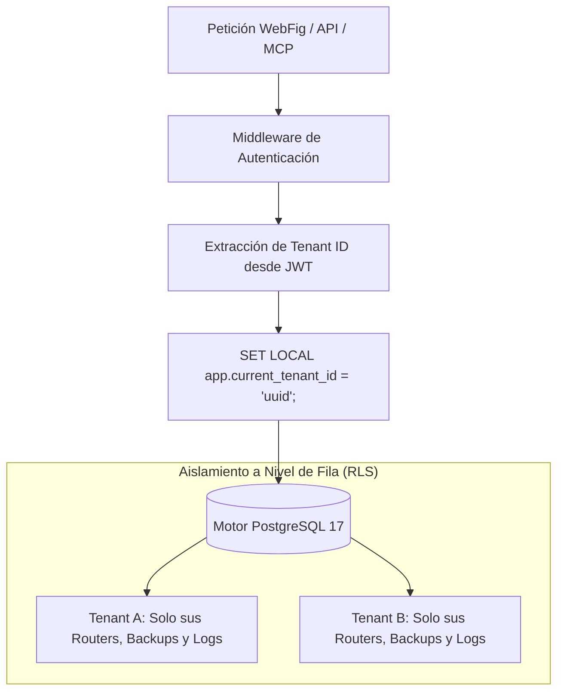
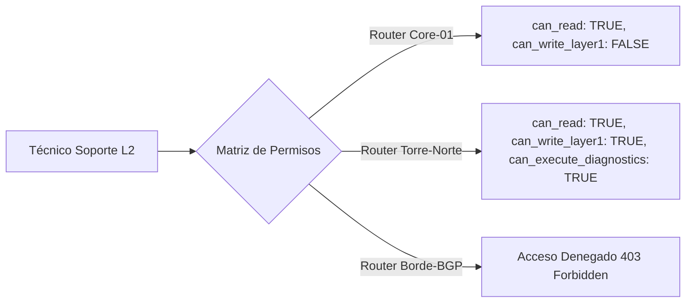
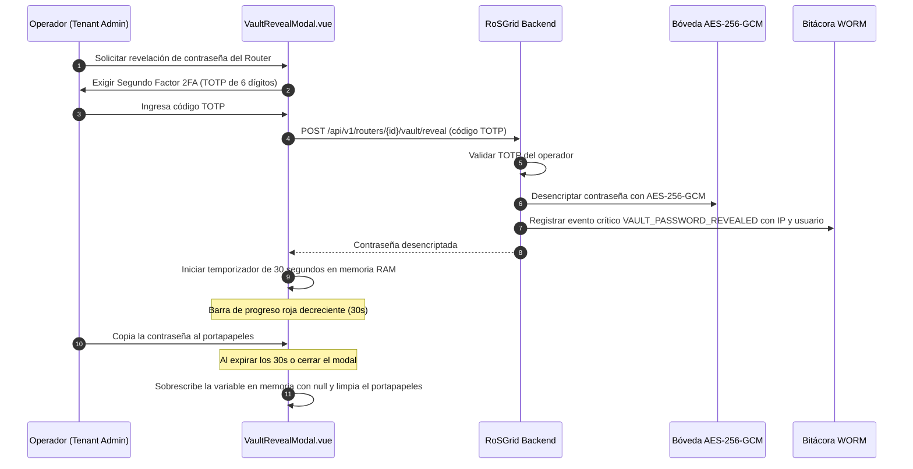
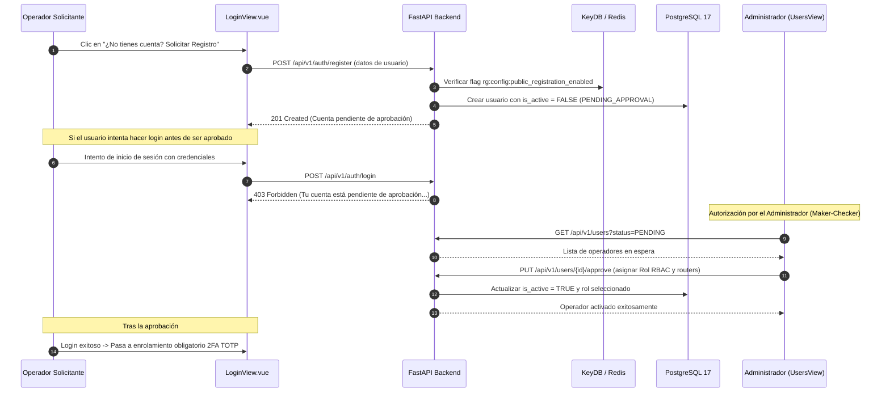

# 03 — Manual de Administración Multi-Tenant, RBAC y Bóveda de Seguridad

Este manual describe el modelo de seguridad de **RoSGrid**: la segregación criptográfica y lógica entre organizaciones (Multi-Tenancy mediante PostgreSQL 17 Row-Level Security), el catálogo completo de los 11 roles RBAC, la asignación granular de routers por técnico, el funcionamiento de la Bóveda de Credenciales (*Split-Credential*) con Step-Up Auth de 30 segundos y el Kill-Switch de sesiones en vivo.

---

## 1. Aislamiento Multi-Tenant con Row-Level Security (RLS)

RoSGrid permite alojar múltiples empresas o sucursales de telecomunicaciones en una misma instancia sin riesgo de contaminación cruzada o fuga de información.



### 1.1 Inyección de Contexto en Sesión

Cada transacción en la base de datos inyecta de forma atómica la variable de sesión:

```sql
SET LOCAL app.current_tenant_id = 'c1234567-89ab-cdef-0123-456789abcdef';
```

Todas las tablas críticas (`routers`, `router_backups`, `approval_requests`, `audit_logs`, `users`, etc.) cuentan con políticas RLS activadas (`ENABLE ROW LEVEL SECURITY; FORCE ROW LEVEL SECURITY;`), impidiendo que incluso un fallo en la capa de aplicación pueda devolver o mutar registros de otra empresa.

---

## 2. Catálogo de los 11 Roles RBAC

RoSGrid define 11 roles jerárquicos y segregados para cumplir con auditorías ISO 27001, SOC 2 y PCI-DSS:

| # | Rol RBAC | Nivel de Riesgo | Capacidades y Alcance Operativo | Restricciones Clave |
| :--- | :--- | :--- | :--- | :--- |
| **1** | `SUPERADMIN_GLOBAL` | Crítico Global | Administración total de la plataforma, creación de Tenants, configuración global y mantenimiento del clúster. | No participa en la operación cotidiana de routers; sus acciones quedan firmadas en WORM. |
| **2** | `TENANT_ADMIN` | Crítico Tenant | Gestión de usuarios, cuotas de routers, políticas 2FA, canales de alerta y autorización en Maker-Checker para su empresa. | Limitado exclusivamente al `tenant_id` asignado. |
| **3** | `SUPERVISOR` | Alto | Aprobación de solicitudes críticas en Maker-Checker, revisión de diffs de configuración y gestión de ventanas de mantenimiento. | No puede crear ni eliminar usuarios administradores. |
| **4** | `SUPPORT_L3` | Alto | Configuración avanzada de enrutamiento (BGP/OSPF), diseño de políticas de firewall y restauración de respaldos con Safe Mode. | Las mutaciones de alto impacto requieren aprobación en Maker-Checker. |
| **5** | `SUPPORT_L2` | Medio | Modificación de direccionamiento IP, interfaces, switches, bridges, VLANs, túneles WireGuard y colas de ancho de banda. | Sin acceso a credenciales en texto plano de la Bóveda. |
| **6** | `SUPPORT_L1` | Bajo | Atención al cliente, reconexión de clientes PPPoE activos, reinicio acotado de sesiones y diagnóstico en vivo (ping/traceroute). | Solo lectura en reglas de firewall y tablas de rutas. |
| **7** | `FIELD_TECH` | Bajo | Diagnóstico físico de interfaces y módulos SFP (DDM), verificación de cableado y lectura de inventario de equipos asignados. | Solo routers vinculados en su matriz de permisos; interfaz con botones de 44px optimizada para tablets. |
| **8** | `INVENTORY_MANAGER` | Bajo | Creación, edición e importación masiva por CSV de routers, ubicación geográfica en mapa OSM y gestión de etiquetas. | Sin acceso a configuraciones de red en vivo ni comandos de diagnóstico. |
| **9** | `AUDITOR` | Especializado | Inspección forense de la bitácora inmutable WORM (`audit_logs`), verificación criptográfica de la cadena SHA-256 e informes de cumplimiento. | **Modo Estrictamente Solo Lectura:** no puede ejecutar mutaciones ni ver contraseñas. |
| **10** | `NOC_MONITOR` | Solo Lectura | Visualización de la pantalla gigante Wallboard NOC, recepción de alertas sonoras/visuales y monitoreo de telemetría de tráfico. | Sin privilegios para enviar comandos ni alterar el estado de los routers. |
| **11** | `SERVICE_ACCOUNT` | Automatización / M2M | Consumo exclusivo del **Endpoint MCP (`/api/v1/mcp`)** para agentes IA como Hermes o Claude y orquestadores externos. | **Exige validación de lista blanca CIDR**, no tiene acceso a la bóveda y todas las mutaciones van a Maker-Checker (202). |

---

## 3. Matriz de Asignación de Routers por Técnico

Para evitar que un técnico acceda por error o intención a routers que no le corresponden, RoSGrid implementa una matriz granular de permisos (`UserRouterMatrixModal` / tabla `user_router_permissions`):



### 3.1 Banderas de Control por Router

- `can_read`: Permite visualizar el router y su telemetría en la lista y mapa.
- `can_write_layer1`: Permite alterar interfaces, firewall, rutas, colas y servicios.
- `can_write_layer2`: Permite modificar recursos universales de Capa 2.
- `can_execute_diagnostics`: Permite correr ping, traceroute y tests de cable.
- `can_trigger_backup`: Permite disparar la generación manual de respaldos `.rsc`.
- `can_reboot`: Habilita el botón de reinicio controlado del MikroTik.
- `bypass_maker_checker`: Solo concedible a ingenieros certificados para saltar la retención de cambios en emergencias operativas.

---

## 4. Bóveda de Credenciales (*Split-Credential*) y Step-Up Auth

RoSGrid utiliza una arquitectura **Split-Credential**: los operadores no necesitan conocer la contraseña real de los routers para operarlos; el sistema almacena las credenciales cifradas y las utiliza internamente mediante un pool TLS Keep-Alive.

### 4.1 Cifrado Autenticado `AES-256-GCM`

Cada contraseña se almacena en la tabla `router_credentials_vault` cifrada con:

- Algoritmo: `AES-256-GCM` (Galois/Counter Mode).
- Vector de Inicialización (`IV`): 12 bytes aleatorios por registro.
- Datos Autenticados Adicionales (`AAD`): Cadena atómica `"{tenant_id}:{router_id}"` que previene ataques de transposición de contraseñas entre routers o empresas.

### 4.2 Modal de Revelación con Step-Up Auth 2FA y Autodestrucción en 30s (`VaultRevealModal.vue`)

Cuando un administrador o supervisor requiere ver la contraseña en texto plano para una intervención de emergencia en sitio:



---

## 5. Kill-Switch de Sesiones en Vivo

Si un usuario pierde su dispositivo, es desvinculado de la empresa o se sospecha un compromiso de credenciales, un administrador puede revocar sus sesiones de inmediato desde `ActiveSessionsKillSwitchView.vue`:

1. **Invalidación en Memoria:** RoSGrid elimina inmediatamente la clave de sesión en KeyDB (`rg:{tenant_id}:sess:{session_id}`).
2. **Empuje WebSocket:** El servicio de eventos publica una trama `SESSION_KILLED` dirigida al navegador del usuario.
3. **Expulsión Inmediata:** La SPA Vue 3 destruye el almacén de Pinia (`authStore.logout()`), elimina la cookie segura `__Host-rg_at` y redirige a la pantalla de login en menos de 100 milisegundos.

---

## 6. Flujo de Auto-Registro Web y Aprobación Maker-Checker de Operadores

Para simplificar el onboarding de técnicos sin requerir acceso a consola de servidores:



### 6.1 Control de Registro Público en KeyDB

El Superadmin o Tenant Admin puede habilitar o deshabilitar las solicitudes externas de registro en cualquier momento desde el botón en la cabecera de `UsersAndPermissionsView.vue` (`POST /api/v1/users/registration-toggle`). Cuando está desactivado, el endpoint responde inmediatamente `403 Forbidden`.

### 6.2 Plan B por Terminal (`crear_admin.py`)

El script de terminal en `fastapi/scripts/crear_admin.py` se mantiene 100% operativo como alternativa para aprovisionamiento directo por consola cuando no se dispone de acceso web o en entornos de contingencia.
