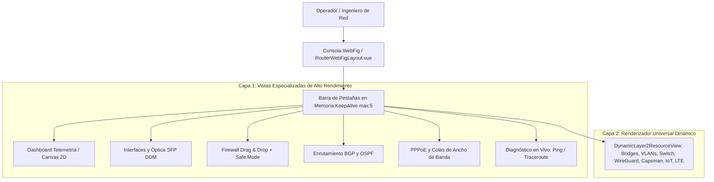
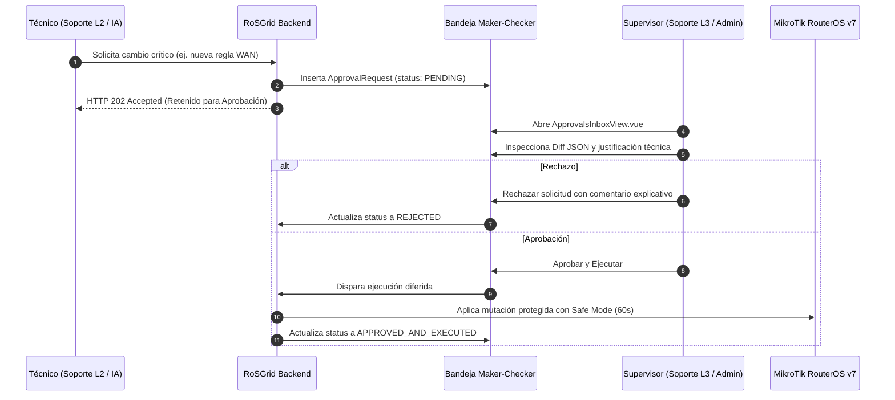

# 04 — Manual Operativo: Consola WebFig, NOC y Gestión de Respaldos

Este manual describe la operación diaria de la interfaz de usuario de **RoSGrid**: la Consola WebFig de Doble Capa, el sistema de pestañas en memoria con `<KeepAlive :max="5">`, la densidad visual adaptativa, el motor de telemetría gráfica en tiempo real con `<canvas>` 2D, el flujo de autorizaciones Maker-Checker, el comparador Diff estilo Git de respaldos `.rsc` y el Wallboard para centros de control NOC.

---

## 1. Arquitectura de la Consola WebFig de Doble Capa

RoSGrid replica y supera la experiencia nativa de WinBox y WebFig dentro de un entorno web seguro, dividiendo la gestión del router en dos niveles arquitectónicos:

### 1.1 Vistas Especializadas de Capa 1
1. **`RouterLiveDashboardView.vue`:** Tablero de control con métricas en tiempo real de CPU, RAM, Uptime, almacenamiento y gráficas de tráfico aceleradas por hardware.
2. **`InterfacesAndSfpView.vue`:** Listado integral de interfaces físicas y lógicas con telemetría óptica DDM (`sfp-rx-power`, `sfp-tx-power`, temperatura láser) y clasificación de salud (`OPTIMAL`, `WARNING`, `CRITICAL_LOW_LIGHT`).
3. **`FirewallRulesView.vue`:** Tabla interactiva de reglas Filter, NAT y Mangle con reordenamiento por arrastrar y soltar (*Drag & Drop*) que calcula automáticamente la posición en RouterOS (`/ip/firewall/filter/move`) ejecutada bajo **Safe Mode (60s)**.
4. **`RoutingBgpOspfView.vue`:** Resumen de sesiones BGP v7 (estado `established`, prefijos anunciados/recibidos, uptime) y adyacencias OSPF activas.
5. **`PppAndQueuesView.vue`:** Monitor de sesiones PPPoE activas con opción de reinicio controlado para soporte N1 y gestión de colas simples (*Simple Queues*).
6. **`LiveToolsDiagnosticsView.vue`:** Consola de ejecución de utilidades de red (`/tool/ping`, `/tool/traceroute`) acotadas para prevenir saturación de CPU.

### 1.2 Capa 2: Renderizador Universal Dinámico (`DynamicLayer2ResourceView.vue`)
Para dar cobertura al 100% del catálogo de RouterOS v7 sin escribir cientos de pantallas estáticas, RoSGrid incluye un motor dinámico que introspecciona el endpoint REST solicitado (ej. `/interface/bridge`, `/interface/wireguard`, `/ip/pool`) y genera automáticamente la tabla con sus banderas nativas (`[D]` Dinámico, `[X]` Deshabilitado, `[I]` Inválido, `[R]` Corriendo).

---

## 2. Pestañas en Memoria con `<KeepAlive :max="5">`

El componente `RouterWorkspaceTabsBar.vue` permite mantener abiertas hasta 5 herramientas operativas por router de forma simultánea:
- **Cero Pérdida de Estado:** Si un técnico está editando una regla de firewall y cambia a la pestaña de Ping para comprobar conectividad, la edición del firewall no se reinicia ni pierde los campos rellenados.
- **Gestión de Memoria:** Al abrir una sexta pestaña, la menos utilizada en el historial se destruye limpiamente para conservar la memoria RAM del navegador.

---

## 3. Densidad Dual Adaptativa y *Virtual Scrolling*

Para optimizar el trabajo tanto en salas de control de escritorio como en campo con tablets:
- **Modo WinBox PC (`32px` por fila):** Filas compactas de 32 píxeles de alto, fuentes monoespaciadas y controles de alta densidad que permiten visualizar más de 30 reglas o interfaces en pantalla simultáneamente.
- **Modo Táctil / Campo (`44px` por fila):** Al detectar pantalla táctil o resolución móvil, los controles se expanden automáticamente a 44 píxeles para cumplir el estándar de accesibilidad **WCAG 2.1 AA** (objetivos de toque para dedos sin clics accidentales).
- **Virtual Scrolling Nativo:** Los componentes de tabla (`RgDataTable.vue`) renderizan únicamente los elementos visibles en el viewport más un buffer de seguridad, permitiendo desplazarse fluidamente sobre tablas con más de 5,000 clientes PPPoE o rutas BGP sin degradar el navegador.

---

## 4. Telemetría Gráfica en Vivo con `<canvas>` 2D y `TelemetryRingBuffer`

El monitoreo de tráfico de alta frecuencia genera miles de eventos por minuto que suelen saturar el DOM en bibliotecas gráficas pesadas como Chart.js.

RoSGrid implementa una arquitectura de cero costo de renderizado:
1. **Buffer Circular en RAM (`TelemetryRingBuffer<T>`):**
   - Tamaño máximo: 5,400 puntos por métrica (3 horas continuas a 1 tick cada 2 segundos).
   - Estructura indexada en memoria con `shallowRef` para evitar sobrecarga del sistema de reactividad de Vue 3.
2. **Dibujado con `<canvas>` 2D y `requestAnimationFrame`:**
   - La gráfica se redibuja directamente sobre un elemento HTML5 Canvas mediante la GPU.
   - Si la pestaña pasa a segundo plano o se minimiza el navegador, `requestAnimationFrame` pausa el renderizado automáticamente, ahorrando CPU y batería.
3. **Limpieza en Desmontaje:** Al cerrar la pestaña del router, el evento de ciclo de vida `onBeforeUnmount` vacía el buffer y desconecta el WebSocket, previniendo fugas de memoria.

---

## 5. Bandeja de Aprobaciones *Maker-Checker* (`ApprovalsInboxView.vue`)

Las mutaciones críticas de red (modificaciones en BGP, interfaces WAN o reglas de firewall estructurales) quedan retenidas con código HTTP `202 Accepted`:

---

## 6. Comparador Visual de Respaldos Diff estilo Git (`RscGitDiffViewer.vue`)

Ante incidentes o comportamientos anómalos de red, el comparador de configuraciones `.rsc` permite identificar con precisión forense qué línea cambió:
- **Comparación Bidireccional:** Compara dos respaldos históricos cifrados entre sí o compara cualquier respaldo histórico contra la configuración en vivo (`LIVE`).
- **Limpieza de Ruido Volátil:** Filtra automáticamente marcas de tiempo volátiles de RouterOS (`# jan/01/1970 00:00:00 by RouterOS`).
- **Vista Lado a Lado / Unificada:** Resalta en rojo las líneas eliminadas (`-`) y en verde las adiciones (`+`) agrupadas por secciones de menú (ej. `/ip firewall nat`, `/routing bgp`).

---

## 7. Importación Masiva CSV y Ventanas de Mantenimiento

- **Asistente CSV en 2 Pasos (`CsvOnboardingWizardModal.vue`):** Permite subir archivos CSV con cientos de routers (IP, puerto, credenciales iniciales, rol y coordenadas GPS), validando la sintaxis antes de insertar masivamente en la base de datos.
- **Ventanas de Mantenimiento (`MaintenanceWindowsView.vue`):** Programa periodos de gracia operativa en los que se silencian automáticamente las alertas hacia los canales de notificación (Telegram, Email, Webhooks), evitando falsas alarmas durante trabajos programados de madrugada.

---

## 8. Pantalla Gigante Wallboard NOC (`NocWallboardView.vue`)

Diseñada para salas de control y pantallas de monitoreo 24/7 en centros de operaciones (NOC):
- **Diseño *Dark High-Contrast*:** Fondo oscuro profundo con acentos Cyan tácticos para visualización clara a distancia.
- **Alertas Sonoras y Visuales:** Emite tonos discretos y destellos perimetrales en tiempo real ante caídas de routers (`OFFLINE`), enlaces caídos o degradación óptica en módulos SFP.
- **Integración Cartográfica:** Muestra la ubicación geográfica de los nodos en un mapa interactivo con OpenStreetMap (Leaflet).
