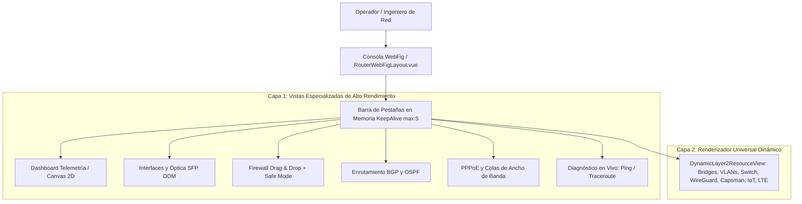
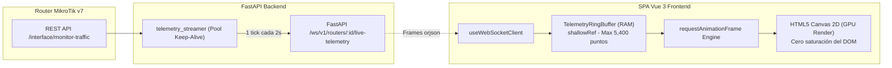
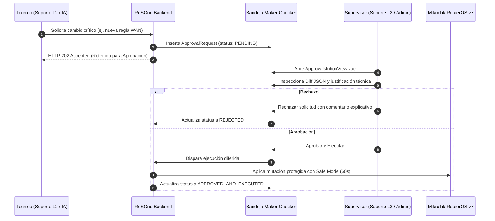
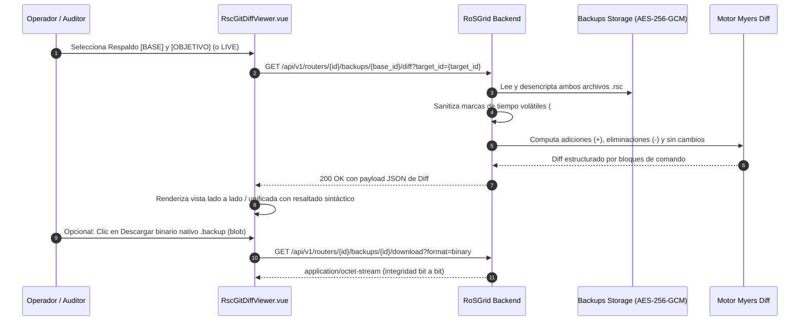
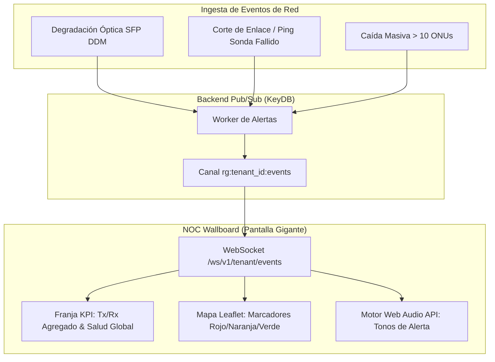

# 04 — Manual Operativo: Consola WebFig, NOC y Gestión de Respaldos

Este manual describe la operación diaria de la interfaz de usuario de **RoSGrid**: la Consola WebFig de Doble Capa, el sistema de pestañas en memoria con `<KeepAlive :max="5">`, la densidad visual adaptativa, el motor de telemetría gráfica en tiempo real con `<canvas>` 2D, el flujo de autorizaciones Maker-Checker, el comparador Diff estilo Git de respaldos `.rsc` y el Wallboard para centros de control NOC.

---

## 1. Arquitectura de la Consola WebFig de Doble Capa

RoSGrid replica y supera la experiencia nativa de WinBox y WebFig dentro de un entorno web seguro, dividiendo la gestión del router en dos niveles arquitectónicos:

### 1.1 Vistas Especializadas de Capa 1

1. **`RouterLiveDashboardView.vue`:** Tablero de control con métricas en tiempo real de CPU, RAM, Uptime, almacenamiento y gráficas de tráfico aceleradas por hardware.
2. **`InterfacesAndSfpView.vue`:** Listado integral de interfaces físicas y lógicas con telemetría óptica DDM (`sfp-rx-power`, `sfp-tx-power`, temperatura láser) y clasificación de salud (`OPTIMAL`, `WARNING`, `CRITICAL_LOW_LIGHT`).
3. **`FirewallRulesView.vue`:** Tabla interactiva de reglas Filter, NAT y Mangle con reordenamiento por arrastrar y soltar (*Drag & Drop*) que calcula automáticamente la posición en RouterOS (`/ip/firewall/filter/move`) ejecutada bajo **Safe Mode (60s)**.
4. **`RoutingBgpOspfView.vue`:** Resumen de sesiones BGP v7 (estado `established`, prefijos anunciados/recibidos, uptime) y adyacencias OSPF activas.
5. **`PppAndQueuesView.vue`:** Monitor de sesiones PPPoE activas con opción de reinicio controlado para soporte N1 y gestión de colas simples (*Simple Queues*).
6. **`LiveToolsDiagnosticsView.vue`:** Consola de ejecución de utilidades de red (`/tool/ping`, `/tool/traceroute`) acotadas para prevenir saturación de CPU.
7. **`RouterSyslogTerminalView.vue`:** Consola de eventos Syslog en vivo en tiempo real que consume el RingBuffer efímero en KeyDB (UDP/TCP 5514, 500 eventos sin almacenamiento en disco), con badges de severidad (`CRIT 🚨`, `WARN ⚠️`), auto-scroll inteligente y modal con script de enrolamiento CLI.

### 1.2 Capa 2: Renderizador Universal Dinámico (`DynamicLayer2ResourceView.vue`)

Para dar cobertura al 100% del catálogo de RouterOS v7 sin escribir cientos de pantallas estáticas, RoSGrid incluye un motor dinámico que introspecciona el endpoint REST solicitado (ej. `/interface/bridge`, `/interface/wireguard`, `/ip/pool`) y genera automáticamente la tabla con sus banderas nativas (`[D]` Dinámico, `[X]` Deshabilitado, `[I]` Inválido, `[R]` Corriendo).

---

## 2. Pestañas en Memoria con `<KeepAlive :max="5">`

El componente `RouterWorkspaceTabsBar.vue` permite mantener abiertas hasta 5 herramientas operativas por router de forma simultánea:

- **Cero Pérdida de Estado:** Si un técnico está editando una regla de firewall y cambia a la pestaña de Ping para comprobar conectividad, la edición del firewall no se reinicia ni pierde los campos rellenados.
- **Gestión de Memoria:** Al abrir una sexta pestaña, la menos utilizada en el historial se destruye limpiamente para conservar la memoria RAM del navegador.

---

## 3. Densidad Dual Adaptativa y *Virtual Scrolling*

Para optimizar el trabajo tanto en salas de control de escritorio como en campo con tablets:

- **Modo WinBox PC (`32px` por fila):** Filas compactas de 32 píxeles de alto, fuentes monoespaciadas y controles de alta densidad que permiten visualizar más de 30 reglas o interfaces en pantalla simultáneamente.
- **Modo Táctil / Campo (`44px` por fila):** Al detectar pantalla táctil o resolución móvil, los controles se expanden automáticamente a 44 píxeles para cumplir el estándar de accesibilidad **WCAG 2.1 AA** (objetivos de toque para dedos sin clics accidentales).
- **Virtual Scrolling Nativo:** Los componentes de tabla (`RgDataTable.vue`) renderizan únicamente los elementos visibles en el viewport más un buffer de seguridad, permitiendo desplazarse fluidamente sobre tablas con más de 5,000 clientes PPPoE o rutas BGP sin degradar el navegador.

---

## 4. Telemetría Gráfica en Vivo con `<canvas>` 2D y `TelemetryRingBuffer`

El monitoreo de tráfico de alta frecuencia genera miles de eventos por minuto que suelen saturar el DOM en bibliotecas gráficas pesadas como Chart.js.

RoSGrid implementa una arquitectura de cero costo de renderizado:

1. **Buffer Circular en RAM (`TelemetryRingBuffer<T>`):**
   - Tamaño máximo: 5,400 puntos por métrica (3 horas continuas a 1 tick cada 2 segundos).
   - Estructura indexada en memoria con `shallowRef` para evitar sobrecarga del sistema de reactividad de Vue 3.
2. **Dibujado con `<canvas>` 2D y `requestAnimationFrame`:**
   - La gráfica se redibuja directamente sobre un elemento HTML5 Canvas mediante la GPU.
   - Si la pestaña pasa a segundo plano o se minimiza el navegador, `requestAnimationFrame` pausa el renderizado automáticamente, ahorrando CPU y batería.
3. **Limpieza en Desmontaje:** Al cerrar la pestaña del router, el evento de ciclo de vida `onBeforeUnmount` vacía el buffer y desconecta el WebSocket, previniendo fugas de memoria.

---

## 5. Bandeja de Aprobaciones *Maker-Checker* (`ApprovalsInboxView.vue`)

Las mutaciones críticas de red (modificaciones en BGP, interfaces WAN o reglas de firewall estructurales) quedan retenidas con código HTTP `202 Accepted`:

---

## 6. Comparador Visual de Respaldos Diff estilo Git (`RscGitDiffViewer.vue`)

Ante incidentes o comportamientos anómalos de red, el comparador de configuraciones `.rsc` permite identificar con precisión forense qué línea cambió:

- **Selección Interactiva en Tarjetas:** Los respaldos de los últimos 30 días se organizan en tarjetas visuales interactivas (`.backup-card`). El operador puede hacer clic directamente en cualquier tarjeta para designarla como configuración **[🔵 BASE]** o usar el botón para asignarla como **[🟢 OBJETIVO]**, permitiendo comparaciones entre cualquier par de fechas sin restricciones.
- **Comparación Bidireccional:** Compara dos respaldos históricos cifrados entre sí o compara cualquier respaldo histórico contra la configuración en vivo (`LIVE`).
- **Limpieza de Ruido Volátil:** Filtra automáticamente marcas de tiempo volátiles de RouterOS (`# jan/01/1970 00:00:00 by RouterOS`).
- **Vista Lado a Lado / Unificada:** Resalta en rojo las líneas eliminadas (`-`) y en verde las adiciones (`+`) agrupadas por secciones de menú (ej. `/ip firewall nat`, `/routing bgp`).
- **Descargas Seguras de Respaldos (`.rsc` vs `.backup`):**
  - **Script `.rsc` (Texto Plano Cifrado):** Exportación completa en comandos RouterOS legible y auditable. Descargable en cualquier momento para inspección en editores de texto.
  - **Binario Nativo `.backup`:** Archivo binario de restauración total generado por MikroTik (`/system backup save`). El botón de descarga binaria (`💾`) valida la existencia del binario nativo en el almacenamiento persistente y lo transmite con encoding `application/octet-stream` (`responseType: 'blob'`), garantizando integridad bit a bit y previniendo archivos corruptos.

---

## 7. Importación Masiva CSV, Roles Dinámicos y Ventanas de Mantenimiento

- **Asistente CSV en 2 Pasos (`CsvOnboardingWizardModal.vue`):** Permite subir archivos CSV con cientos de routers (IP, puerto, credenciales iniciales, rol y coordenadas GPS), validando la sintaxis antes de insertar masivamente en la base de datos.
- **Roles de Red Personalizados y Auto-Registro Dinámico:**
  - Los administradores pueden definir roles personalizados adaptados a su topología (`POST /api/v1/inventory/roles`).
  - **Manejo de Roles No Predefinidos en CSV:** Si se importa un CSV con roles de red nuevos que no existían en el desplegable, RoSGrid los detecta automáticamente, los registra de forma segura en la tabla `tenant_custom_roles` de PostgreSQL y los habilita de inmediato en los desplegables de filtrado y edición sin interrumpir el proceso de importación.
- **Ventanas de Mantenimiento (`MaintenanceWindowsView.vue`):** Programa periodos de gracia operativa en los que se silencian automáticamente las alertas hacia los canales de notificación (Telegram, Email, Webhooks), evitando falsas alarmas durante trabajos programados de madrugada.

---

## 8. Pantalla Gigante Wallboard NOC y Hub "Mission Control" (`NocWallboardView.vue`)

Diseñada para salas de control y pantallas de monitoreo 24/7 en centros de operaciones (NOC):

- **Hub Táctico "Mission Control":**
  - Muestra métricas agregadas en vivo: ancho de banda total transmitido y recibido (Tx/Rx), desglose de equipos por rol operativo, latencia de sondas activas y porcentaje de salud global del parque de routers.
  - Transiciones cinemáticas fluidas con aceleración por hardware (`will-change`, CSS cubic-bezier) para alternar entre el mapa geográfico y el panel de analítica.
- **Apertura Directa de WebFig:** Al seleccionar un router en el mapa interactivo (Leaflet / OpenStreetMap), el popup de inspección rápida incluye el botón **"Abrir WebFig"**, que redirige inmediatamente a la consola operativa en vivo (`/routers/:id/webfig/live`) del equipo seleccionado.
- **Diseño *Dark High-Contrast*:** Fondo oscuro profundo con acentos Cyan tácticos para visualización clara a distancia.
- **Alertas Sonoras y Visuales:** Emite tonos discretos y destellos perimetrales en tiempo real ante caídas de routers (`OFFLINE`), enlaces caídos o degradación óptica en módulos SFP.

---

## 9. Topología Física Layer 2, Matriz de Vulnerabilidades CVE y Operaciones Masivas (Hitos 22 y 23)

### 9.1 Visualizador Táctico de Topología Física Capa 2 (`L2TopologyView.vue` en `/topology/l2`)

- **Lienzo Gráfico Acelerado:** Canvas 2D interactivo a 60 FPS con Pan/Zoom y cuadrícula táctica, diseñado para inspeccionar adyacencias puerto a puerto (MNDP/LLDP) sin sobrecargar la CPU del cliente.
- **Distribución de Energía PoE:** Enlaces con entrega de energía activos renderizados en amarillo eléctrico con indicación de potencia en tiempo real (`⚡ W`). Nodos alimentadores PSE identificados con halo dorado y radio ampliado.
- **Drawer de Detalles y WebFig:** Al seleccionar un nodo o enlace en el lienzo, se despliega un panel lateral con información de interfaces interconectadas, velocidad de enlace y acceso directo a la consola WebFig del router.

### 9.2 Matriz de Vulnerabilidades CVE de Flota (`FleetCveMatrix.vue` en `/inventory/cves`)

- **Evaluación Local Zero-Leak:** Cruce proactivo del catálogo oficial embebido contra las versiones RouterOS instaladas en la flota sin enviar telemetría a la nube externa.
- **Tarjetas KPI y Filtro de Severidad:** Muestra el recuento de routers evaluados, vulnerables y críticos, junto con la versión de firmware recomendada. Permite filtrar por severidad (`CRITICAL`, `HIGH`, `MEDIUM`, `LOW`).
- **Remediación en 1 Clic:** Botón directo `[ 🚀 Actualizar Flota Afectada ]` que preconfigura el asistente de operaciones masivas.

### 9.3 Asistente de Actualización Masiva PoE-Aware (`BulkOperationsAndUpdatesView.vue` en `/bulk-ops`)

- **Conmutador PoE-Aware:** Reordena la cola de actualización invirtiendo el DAG de dependencias eléctricas para actualizar primero los dispositivos alimentados (PD) antes que los conmutadores alimentadores (PSE), previniendo apagones accidentales durante el flasheo de firmware.
- **Circuito Safety Stop:** Monitorea la tasa de fallos post-reinicio y congela automáticamente el lote si se supera el umbral configurado (1%, 2% o 5%), emitiendo alertas inmediatas al NOC.

### 9.4 Catálogo de Plantillas Golden Configs y Enrolamiento Syslog Masivo

El asistente de operaciones masivas (`/bulk-ops`) incorpora un catálogo de plantillas de configuración estandarizadas (*Golden Configs*) gobernadas por el motor de **Safe Mode (60s)**:

- **Presets Nativos Disponibles:**
  1. `CLIENTE_NTP`: Sincronización horaria contra servidores NTP primarios y de respaldo.
  2. `DNS_CORPORATIVO_RESILIENTE`: Servidores DNS locales y de contingencia con caché dimensionada.
  3. `SNMP_V2C_MONITOREO_NOC`: Comunidad SNMP v2c protegida por lista blanca de direcciones IP.
  4. `SYSLOG_CENTRALIZADO_ROSGRID`: Enrolamiento de telemetría Syslog hacia el receptor centralizado de RoSGrid en UDP 5514.
- **Parametrización Dinámica de Syslog:**
  - `rosgrid_server_ip`: Dirección IP alcanzable del servidor RoSGrid (ingresada dinámicamente por el operador).
  - `rosgrid_syslog_port`: Puerto del receptor en KeyDB (por defecto `5514`).
  - La sustitución de variables es insensible a mayúsculas/minúsculas (`{{ rosgrid_server_ip }}` o `{{ ROSGRID_SERVER_IP }}`).
- **Previsualización de Comandos Dual REST y CLI:**
  - El operador puede alternar entre la vista de llamadas estructuradas REST (`PUT /rest/system/logging/*`) y el script CLI nativo equivalente antes de la ejecución.
- **Ejecución Protegida por Safe Mode:**
  - Cada router aplica los 7 pasos de configuración bajo un temporizador transaccional de reversión automática a 60 segundos (`rosgrid_safemode_*`), impidiendo que un error de sintaxis o bloqueo de firewall interrumpa la conectividad administrativa de la flota.
