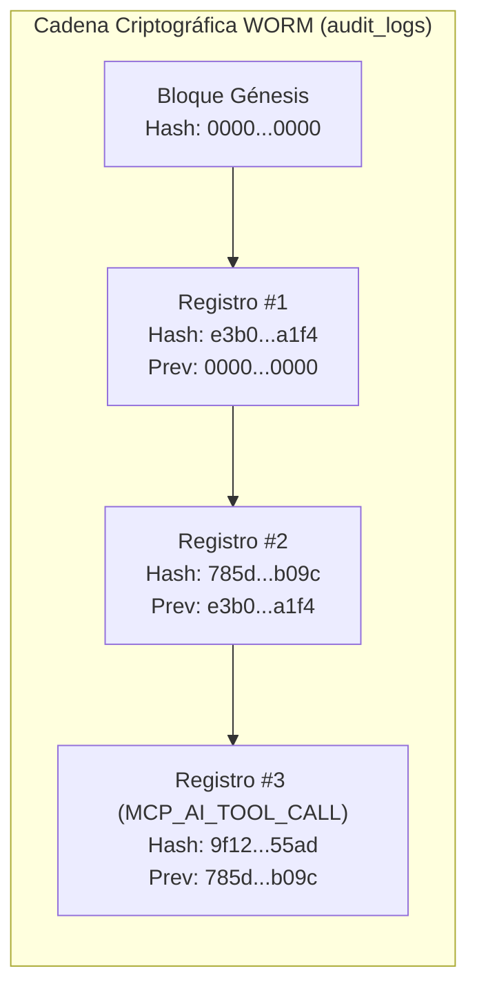
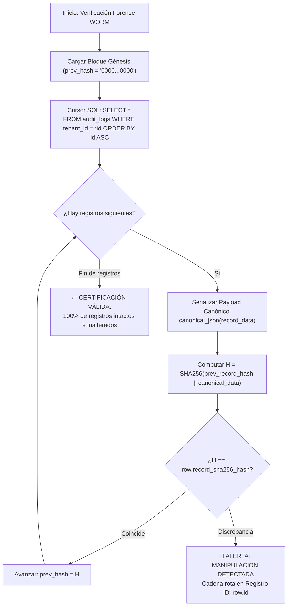
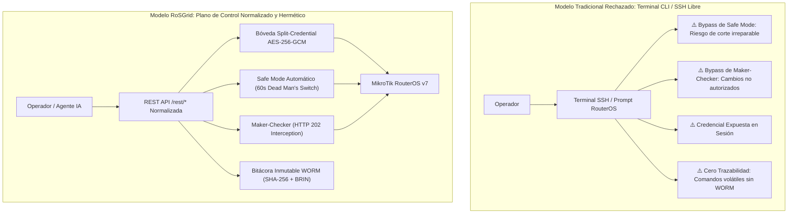
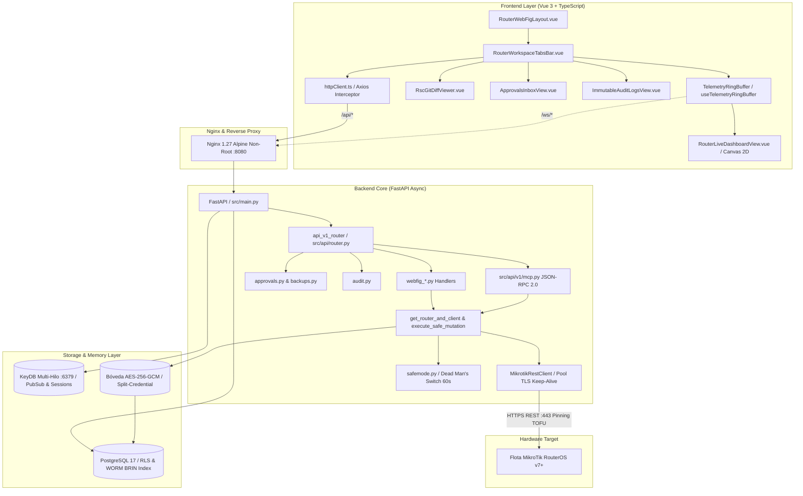

# 05 — Auditoría Forense WORM, ADR de Seguridad y Arquitectura

Este documento está dirigido a oficiales de seguridad, equipos de cumplimiento regulatorio y al rol **AUDITOR**. Explica el diseño de la bitácora inmutable WORM (*Write Once, Read Many*), el algoritmo de encadenamiento criptográfico SHA-256 con índice BRIN, el Registro de Decisión de Arquitectura (ADR) sobre la exclusión de terminal CLI interactiva y los diagramas de arquitectura del sistema basados en los grafos AST de Graphify.

---

## 1. Bitácora de Auditoría Inmutable WORM

Toda acción realizada en RoSGrid —ya sea por un operador humano a través de la interfaz web, una llamada a la REST API o un agente de Inteligencia Artificial invocando herramientas semánticas vía MCP— genera un registro inmutable e imborrable en la tabla `audit_logs`.



### 1.1 Trigger de Inmutabilidad en PostgreSQL 17

La tabla `audit_logs` cuenta con un trigger a nivel de base de datos (`trg_immutable_audit_logs`) que intercepta cualquier intento de manipulación:

- **`UPDATE`:** Bloqueado con excepción SQL; ningún dato de auditoría puede ser modificado una vez insertado.
- **`DELETE`:** Bloqueado con excepción SQL; ningún registro puede ser eliminado, incluso por el usuario administrador de la base de datos de la aplicación.

### 1.2 Encadenamiento Criptográfico de Bloques SHA-256

Cada fila contiene:

- `prev_record_hash`: El hash SHA-256 del registro anterior perteneciente al mismo Tenant.
- `record_sha256_hash`: El hash computado sobre la serialización canónica del registro actual concatenado con el hash previo:

```text
record_hash = SHA256(prev_record_hash || canonical_json(record_data))
```



Si un adversario con acceso directo a la base de datos alterase una sola coma o parámetro de un comando pasado, todos los hashes posteriores de la cadena quedan invalidados inmediatamente, delatando la manipulación durante la verificación.

### 1.3 Índice BRIN para Alto Volumen

Para permitir la búsqueda rápida sobre millones de registros generados durante meses de operación sin saturar la memoria RAM con árboles B-Tree gigantescos, RoSGrid utiliza un **índice de rangos de bloques (BRIN)**:

```sql
CREATE INDEX ix_audit_logs_created_at_brin ON audit_logs USING brin (created_at);
```

Este índice ocupa menos del 1% del espacio en disco de un índice B-Tree tradicional y ofrece un rendimiento óptimo en consultas por ventanas temporales.

---

## 2. Registro de Invocaciones de Agentes IA (`MCP_AI_TOOL_CALL`)

Cuando un agente de IA (como Hermes Agent o Claude) invoca una herramienta semántica a través de `POST /api/v1/mcp`, el sistema registra de forma obligatoria:

- `event_category`: `"MCP_AI_TOOL_CALL"`
- `event_action`: El nombre exacto de la herramienta invocada (ej. `rosgrid_get_router_health`, `rosgrid_compare_config_diff`, `rosgrid_propose_network_change`).
- `actor_username`: Nombre de la cuenta de servicio (`SERVICE_ACCOUNT`).
- `actor_ip`: Dirección IP del host donde corre el agente IA (validada contra la lista blanca CIDR).
- `after_state`: Diccionario sanitizado de los argumentos transmitidos a la herramienta.

---

## 3. ADR (Architectural Decision Record): Exclusión Deliberada de Terminal CLI/SSH Interactiva Libre

### Contexto

En herramientas de gestión tradicionales de MikroTik es común encontrar emuladores de terminal SSH embebidos en el navegador que otorgan acceso directo al prompt de RouterOS (`[admin@MikroTik] >`).

### Decisión

**RoSGrid PROHÍBE Y EXCLUYE DELIBERADAMENTE la inclusión de cualquier consola de terminal CLI o SSH interactiva libre.** Toda interacción con los routers ocurre de forma estructurada a través de la REST API v7 normalizada.

### Justificación: Las 5 Razones Fundamentales de Seguridad

| # | Razón de Seguridad | Impacto Crítico de una Terminal CLI Libre | Solución Implementada en RoSGrid |
| :--- | :--- | :--- | :--- |
| **1** | **Evasión del Safe Mode (Dead Man's Switch)** | Un comando interactivo como `/ip firewall filter add ...` o `/interface disable` ejecutado en consola puede aislar al router remotamente sin ningún mecanismo de rollback automático si se corta la sesión SSH. | Todas las mutaciones sensibles se envuelven obligatoriamente en `/system/scheduler` a 60 segundos con rollback garantizado. |
| **2** | **Ruptura de la Cadena de Custodia WORM** | En una sesión SSH interactiva interactúan comandos multilínea, pipes, alias y expresiones dinámicas que impiden a un SIEM o auditor conocer el `before_state` y `after_state` exacto de las entidades afectadas. | Cada operación REST atómica registra los parámetros sanitizados en `audit_logs` con hash encadenado SHA-256. |
| **3** | **Inyección de Puertas Traseras y Escalada** | A través de la CLI un atacante interno puede ejecutar `/system/script/add` o crear usuarios ocultos (`/user/add`) con privilegios `full` que escapan al control centralizado de contraseñas. | La Bóveda de RoSGrid gestiona de forma hermética la única credencial existente mediante *Split-Credential*; el usuario nunca conoce la clave real. |
| **4** | **Riesgo de Denegación de Servicio (DoS)** | Comandos como `/tool/flood-ping`, bucles infinitos en scripts o lecturas masivas de memoria congelan la CPU de routers de gama de entrada (RB750Gr3, hEX). | Los endpoints REST están acotados y las utilidades diagnósticas (Ping/Traceroute) tienen un límite estricto de conteo (máximo 5 paquetes). |
| **5** | **Bypass del Freno Maker-Checker** | La presencia de una terminal permite saltarse la segregación de funciones, ejecutando cambios mayores sin que un supervisor apruebe la solicitud previamente. | Las 7 categorías críticas de red interceptan las peticiones con HTTP 202 (`AWAITING_APPROVAL`) antes de tocar el router. |



---

## 4. Arquitectura General del Sistema (Basada en Graphify AST)

El siguiente diagrama sintetiza los nodos centrales y dependencias descubiertas en los grafos semánticos de `fastapi/graphify-out/` y `vue3/graphify-out/`:


