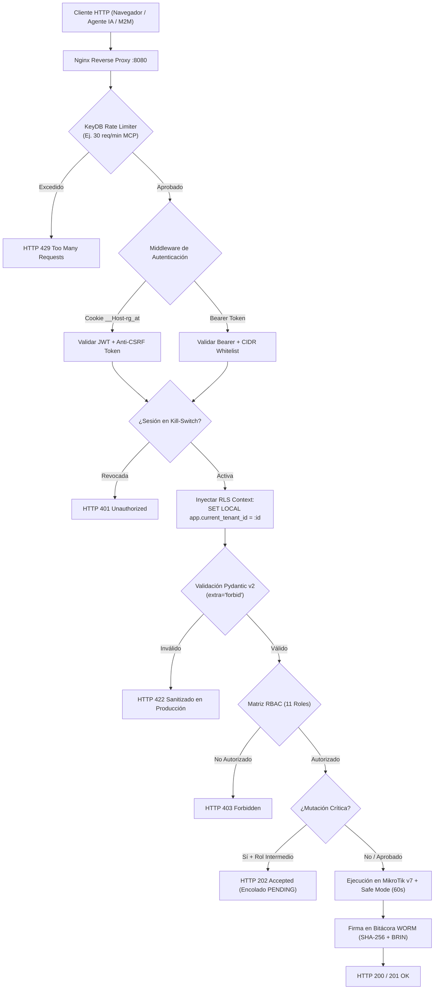
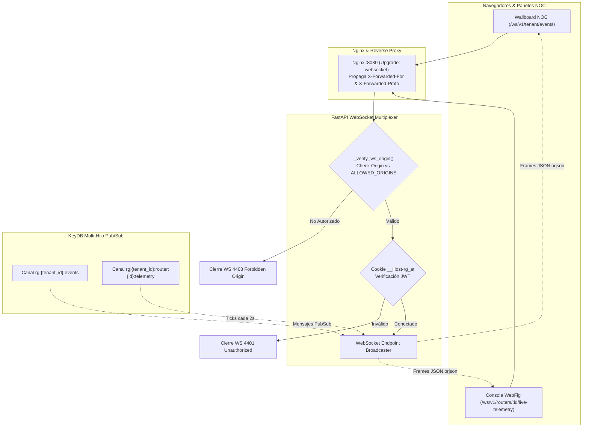

# 06 — Referencia Completa de la API REST y WebSockets

> **Nota de Seguridad de Producción y Certificación QA:**  
> En cumplimiento del estándar de endurecimiento de RoSGrid, la documentación interactiva Swagger UI (`/docs`), ReDoc (`/redoc`) y la especificación abierta OpenAPI (`/openapi.json`) están **deshabilitadas de forma estricta e inmutable en entornos productivos** (`ROSGRID_ENV=production`). Este documento constituye la especificación formal y exhaustiva de todas las interfaces REST y WebSockets del sistema.  
> El 100% de los endpoints y contratos aquí descritos están certificados con la suite de pruebas BDD de caja negra de **Karate Labs** (`fastapi/test/api_test.feature`, 54 escenarios integrales).

---

## 1. Convenciones de Comunicación, Seguridad y Cabeceras



### 1.1 Esquemas de Autenticación

1. **Acceso de Usuarios y Operadores Web (Navegador):**
   - **Cookie Segura:** `__Host-rg_at` (o `rg_at` en testing): `HttpOnly; Secure; SameSite=Strict; Path=/`.
   - **Cabecera Anti-CSRF:** En peticiones mutantes (`POST`, `PUT`, `PATCH`, `DELETE`) es obligatoria la cabecera `X-CSRF-Token`.
2. **Acceso Máquina a Máquina (M2M) y Agentes IA (`SERVICE_ACCOUNT`):**
   - **Cabecera Authorization:** `Authorization: Bearer <TOKEN_JWT_VALIDO>`
   - **Validación de IP de Origen:** La dirección IP del cliente se verifica forzosamente contra la lista blanca CIDR asociada a la cuenta de servicio (`allowed_cidr_list`).

### 1.2 Idempotencia en Mutaciones Sensibles

Para prevenir la duplicación accidental de reglas o peticiones por cortes transitorios de red, los endpoints de mutación aceptan la cabecera opcional:

```http
Idempotency-Key: 018f23a4-8b1c-7e3f-912a-456789abcdef (UUIDv7)
```

RoSGrid almacena la respuesta en KeyDB durante 120 segundos. Las peticiones idénticas subsiguientes devuelven inmediatamente la respuesta cacheada sin re-ejecutar el comando en el MikroTik.

### 1.3 Códigos de Estado HTTP Estándar

| Código HTTP | Significado en RoSGrid |
| :--- | :--- |
| `200 OK` | Operación de lectura o mutación directa completada exitosamente. |
| `201 Created` | Recurso creado exitosamente (ej. nuevo usuario, router o respaldo generado). |
| `202 Accepted` | **Freno Maker-Checker Activo:** La mutación crítica ha sido interceptada y encolada en `approval_requests` (`status: PENDING`) en espera de autorización humana. |
| `401 Unauthorized` | Sesión no provista, token expirado, cookie inválida o sesión revocada por Kill-Switch. |
| `403 Forbidden` | Rol RBAC insuficiente, router no autorizado en la matriz de permisos o IP no autorizada en CIDR whitelist. |
| `404 Not Found` | Router, usuario, respaldo o recurso REST no encontrado en el Tenant actual. |
| `409 Conflict` | Conflicto de unicidad (ej. nombre de usuario, IP de router o nombre de regla duplicado). |
| `413 Payload Too Large` | Carga de archivo excede el límite máximo permitido (ej. CSV de inventario > 2 MB). |
| `422 Unprocessable` | Validación fallida de esquema Pydantic v2 (en producción `ROSGRID_ENV=production` se sanitiza a un mensaje genérico para evitar fuga de estructura interna). |
| `429 Too Many Requests` | Límite de tasa excedido en KeyDB (ej. más de 30 req/min en el endpoint MCP). |

---

## 2. Catálogo de Endpoints REST (`/api/v1/*`)

### 2.1 Autenticación y Sesiones (`/api/v1/auth`, `/api/v1/sessions`)

#### `GET /api/v1/auth/bootstrap-status`

- **Roles:** Público.
- **Propósito:** Determinar si el sistema requiere inicialización del primer usuario (`COUNT(users) == 0`) y si el auto-registro público está habilitado en KeyDB.
- **Salida (200):**

```json
{
  "is_bootstrapped": true,
  "tenants_count": 1,
  "users_count": 1,
  "registration_enabled": true,
  "message": "Sistema ya inicializado"
}
```

#### `POST /api/v1/auth/bootstrap`

- **Roles:** Público (restringido exclusivamente a cuando `COUNT(users) == 0`; si ya existen usuarios responde `403 Forbidden`).
- **Propósito:** Crear atómicamente la Organización Principal y el usuario `SUPERADMIN_GLOBAL` inicial.
- **Entrada:**

```json
{
  "tenant_name": "Empresa Principal",
  "tenant_slug": "master",
  "admin_username": "superadmin",
  "admin_email": "admin@empresa.com",
  "admin_password": "ClaveSegura123!",
  "admin_full_name": "Super Administrador"
}
```

- **Salida (201 Created):**

```json
{
  "status": "success",
  "tenant_id": "uuid",
  "tenant_slug": "master",
  "admin_id": "uuid",
  "admin_username": "superadmin",
  "totp_secret": "JBSWY3DPEHPK3PXP",
  "totp_provisioning_uri": "otpauth://totp/RoSGrid:admin@empresa.com?secret=...",
  "backup_codes": ["A1B2C3D4", "E5F6G7H8", "..."],
  "message": "Super Administrador y Tenant Principal creados exitosamente."
}
```

#### `POST /api/v1/auth/register`

- **Roles:** Público (sujeto al flag en KeyDB `rg:config:public_registration_enabled`).
- **Propósito:** Solicitar registro como nuevo operador. Crea la cuenta en estado `is_active = false` (`PENDING_APPROVAL`). Cualquier intento de login previo a aprobación responderá `403 Forbidden`.
- **Entrada:**

```json
{
  "tenant_slug": "isp-local",
  "username": "tecnico_redes",
  "email": "tecnico@isp.net",
  "full_name": "Carlos Rodríguez",
  "password": "Password123!"
}
```

- **Salida (201 Created):**

```json
{
  "status": "PENDING_APPROVAL",
  "message": "Tu cuenta fue creada exitosamente y se encuentra pendiente de aprobación por el Administrador.",
  "user_id": "uuid",
  "username": "tecnico_redes",
  "is_active": false
}
```

#### `POST /api/v1/auth/login`

- **Roles:** Público.
- **Entrada:** `{"tenant_slug": "isp-local", "username_or_email": "tecnico_redes", "password": "secure_password"}`
- **Salida (200 con Desafío 2FA):** `{"next_step": "VERIFY_2FA_TOTP", "challenge_id": "uuid", "expires_in_seconds": 180}`.
- **Salida (403 Forbidden para Cuenta Pendiente):** `{"detail": "Tu cuenta está pendiente de aprobación por el Administrador. No puedes ingresar hasta que sea autorizada y se te asigne un rol."}`.

#### `POST /api/v1/auth/verify-2fa`

- **Roles:** Público (con `challenge_id` válido).
- **Entrada:** `{"challenge_id": "uuid", "totp_code": "123456"}`
- **Salida (200):** Establece cookie `__Host-rg_at` y devuelve `{"status": "AUTHENTICATED", "user": {...}}`.

#### `POST /api/v1/auth/logout`

- **Roles:** Todos los usuarios autenticados.
- **Salida (200):** Invalida la sesión en KeyDB y elimina la cookie.

#### `GET /api/v1/sessions`

- **Roles:** `TENANT_ADMIN`, `SUPERADMIN_GLOBAL`.
- **Salida (200):** Lista de sesiones activas en KeyDB con IP, navegador, último acceso y `session_id`.

#### `DELETE /api/v1/sessions/{session_id}` *(Kill-Switch)*

- **Roles:** `TENANT_ADMIN`, `SUPERADMIN_GLOBAL`.
- **Salida (200):** Revoca inmediatamente la sesión en KeyDB y emite señal WebSocket para expulsar al navegador cliente.

---

### 2.2 Gestión de Usuarios, Roles RBAC y Aprobaciones (`/api/v1/users`)

#### `GET /api/v1/users`

- **Roles:** `SUPERADMIN_GLOBAL`, `TENANT_ADMIN`, `SUPERVISOR`, `AUDITOR`.
- **Parámetros Query:** `pending_only` (`true`/`false`), `role`, `search`.
- **Salida (200):** Lista de usuarios del tenant con indicación de `is_active`, `role`, `totp_enabled`, `has_all_routers_access`.

#### `POST /api/v1/users`

- **Roles:** `SUPERADMIN_GLOBAL`, `TENANT_ADMIN`.
- **Propósito:** Creación directa de operador aprovisionado por el Administrador (con `is_active = true` inmediato).

#### `PUT /api/v1/users/{user_id}/approve`

- **Roles:** `SUPERADMIN_GLOBAL`, `TENANT_ADMIN`.
- **Propósito:** Aprobar y activar una cuenta de auto-registro en estado PENDIENTE, asignándole su rol operativo y permisos iniciales de router.
- **Entrada:**

```json
{
  "role": "SUPPORT_L2",
  "has_all_routers_access": true,
  "allowed_cidr_list": ["10.250.0.0/16"]
}
```

- **Salida (200):** Objeto de usuario con `is_active: true` y rol asignado.

#### `DELETE /api/v1/users/{user_id}/reject`

- **Roles:** `SUPERADMIN_GLOBAL`, `TENANT_ADMIN`.
- **Propósito:** Rechazar y eliminar una solicitud pendiente. Compatible con la inmutabilidad de RoSGrid WORM: si el usuario ya registró eventos en `audit_logs`, se revoca y bloquea irreversiblemente en lugar de violar la restricción del disparador WORM.
- **Salida (204 No Content).**

#### `POST /api/v1/users/registration-toggle`

- **Roles:** `SUPERADMIN_GLOBAL`, `TENANT_ADMIN`.
- **Propósito:** Conmutador global en KeyDB (`rg:config:public_registration_enabled`) para permitir o suspender el auto-registro web.
- **Entrada:** `{"enabled": true}` o `{"enabled": false}`
- **Salida (200):** `{"registration_enabled": bool}`.

#### `PUT /api/v1/users/{user_id}/router-permissions`

- **Roles:** `SUPERADMIN_GLOBAL`, `TENANT_ADMIN`.
- **Propósito:** Asignar granularmente la matriz de routers autorizados para un técnico (`can_read`, `can_write_layer1`, `can_write_layer2`, `can_reboot`, `bypass_maker_checker`).

#### `POST /api/v1/users/{user_id}/reset-2fa`

- **Roles:** `SUPERADMIN_GLOBAL`, `TENANT_ADMIN`, o el **propio usuario autenticado** (`caller_id == user_id`).
- **Propósito:** Reiniciar el segundo factor de autenticación TOTP de un operador. Al completarse, invalida el secreto cifrado en base de datos y ejecuta el Kill-Switch de sesiones activas en KeyDB.

#### `POST /api/v1/users/change-password`

- **Roles:** Todos los roles autenticados (auto-cambio de contraseña personal) o `SUPERADMIN_GLOBAL` / `TENANT_ADMIN` (reseteo administrativo a otros usuarios).
- **Cabeceras Obligatorias:** `Authorization: Bearer <token>`, `Idempotency-Key: <UUIDv7>`.
- **Body (`ChangePasswordRequest`):**
  ```json
  {
    "user_id": "opcional-uuid-para-admin",
    "current_password": "clave_actual_obligatoria_si_es_auto_cambio",
    "new_password": "nueva_clave_minimo_8_caracteres"
  }
  ```
- **Auditoría WORM:** Registra evento `USER_SECURITY` / `CHANGE_PASSWORD` en `audit_logs` con hash seguro Argon2id.

#### `POST /api/v1/users/{user_id}/mcp-token`

- **Roles:** `SUPERADMIN_GLOBAL`, `TENANT_ADMIN`.
- **Propósito:** Emisión criptográfica de Bearer Tokens JWT (HS256) de larga duración para agentes de IA (Claude Desktop, Hermes Agent, scripts de automatización). Registra la sesión en KeyDB con TTL, control de lista blanca CIDR y auditoría WORM (`MCP_TOKEN_ISSUED`).
- **Body (`GenerateMcpTokenRequest`):** `{"expiry_days": 365}` (validado `1 <= expiry_days <= 3650`).
- **Respuesta 200 OK (`McpTokenResponse`):** Token JWT, Session ID, fecha de expiración, claims y autoría.

---

### 2.3 Gestión de Inventario y Bóveda (`/api/v1/inventory`, `/api/v1/routers`)

#### `POST /api/v1/inventory/routers/{router_id}/discover`

- **Roles:** `SUPERADMIN_GLOBAL`, `TENANT_ADMIN`, `SUPPORT_L3`.
- **Propósito:** Ejecutar autodescubrimiento y captura criptográfica de huella SSL (TOFU) del router MikroTik. Consumido por el botón TOFU de la UI.
- **Salida (200):** Objeto del router con `model_name`, `ros_version`, `cpu_count`, `total_memory`, `is_reachable: true`.

#### `GET /api/v1/routers`

- **Roles:** Todos los roles (filtrado automáticamente por RLS y matriz de permisos por router).
- **Parámetros Query:** `status_filter` (`ONLINE`, `OFFLINE`), `role_filter`.
- **Salida (200):**

```json
{
  "total": 1,
  "items": [
    {
      "id": "c7a8b9c0-1234-4567-89ab-cdef01234567",
      "display_name": "Edge-Core-01",
      "api_base_url": "https://10.0.0.1:443",
      "model_name": "CCR2004-16G-2S+",
      "ros_version": "7.16",
      "is_reachable": true,
      "ssl_trust_status": "TRUSTED_PINNED",
      "network_role": "CORE"
    }
  ]
}
```

#### `POST /api/v1/routers`

- **Roles:** `TENANT_ADMIN`, `INVENTORY_MANAGER`.
- **Entrada:**

```json
{
  "display_name": "Edge-Core-01",
  "api_base_url": "https://10.0.0.1:443",
  "api_port": 443,
  "network_role": "CORE",
  "physical_location": "Datacenter Principal Rack 2",
  "initial_api_username": "rosgrid_agent",
  "initial_api_password": "super_secret_password"
}
```

- **Salida (201):** Crea el router y almacena la contraseña cifrada con `AES-256-GCM` en la Bóveda.

#### `POST /api/v1/routers/{id}/vault/reveal` *(Step-Up Auth 2FA)*

- **Roles:** `TENANT_ADMIN`, `SUPERVISOR`.
- **Entrada:** `{"totp_code": "654321"}`
- **Salida (200):**

```json
{
  "username": "rosgrid_agent",
  "password": "unencrypted_password_for_onsite_work",
  "expires_in_seconds": 30
}
```

#### `POST /api/v1/inventory/import-csv/dry-run`

- **Roles:** `SUPERADMIN_GLOBAL`, `TENANT_ADMIN`, `SUPERVISOR`, `SUPPORT_L3`, `INVENTORY_MANAGER`.
- **Entrada:** `multipart/form-data` con archivo `.csv` (máximo 500 filas, 2 MB).
- **Salida (200):** Objeto `CsvDryRunResponse` con `total_rows`, `valid_rows_count`, `invalid_rows_count`, `can_proceed` y `rows_preview` con validación exhaustiva anti-SSRF, formato y duplicados.

#### `POST /api/v1/inventory/import-csv/commit`

- **Roles:** `SUPERADMIN_GLOBAL`, `TENANT_ADMIN`, `SUPERVISOR`, `SUPPORT_L3`, `INVENTORY_MANAGER`.
- **Cabeceras:** `X-CSRF-Token`, `Idempotency-Key`.
- **Entrada:** `multipart/form-data` con archivo `file` o JSON `{"rows": [CsvCommitRowItem, ...]}`.
- **Salida (200):** `{"imported_count": 3, "created_ids": ["uuid-1", "uuid-2", "uuid-3"]}`. Auto-registra roles dinámicos (ej. `L1`) en `tenant_custom_roles` y cifra credenciales en Bóveda AES-256-GCM.

#### `GET /api/v1/inventory/network-roles`

- **Roles:** Todos los usuarios autenticados.
- **Salida (200):** Catálogo unificado que incluye los roles estándar del sistema (`CORE`, `EDGE_BGP`, `WAN_BALANCER`, `BRAS_PPPOE`, `DISTRIBUTION_SWITCH`, `TOWER_AP`, `CORPORATE_CPE`) y los roles personalizados registrados por el tenant (`custom_roles`).

---

### 2.4 Consola WebFig Capa 1 y Capa 2 (`/api/v1/routers/{id}/...`)

#### `GET /api/v1/routers/{id}/interfaces`

- **Roles:** Lectura concedida en matriz de permisos.
- **Salida (200):** Lista de interfaces físicas con estadísticas en vivo de bytes, paquetes y estado SFP DDM (`tx-power`, `rx-power`, temperatura láser).

#### `POST /api/v1/routers/{id}/firewall/filter`

- **Roles:** `SUPPORT_L3`, `SUPPORT_L2`, `TENANT_ADMIN`.
- **Entrada:**

```json
{
  "chain": "input",
  "action": "drop",
  "src_address": "198.51.100.0/24",
  "comment": "Bloqueo por tráfico anómalo detectado"
}
```

- **Comportamiento:**
  - Si la regla afecta la cadena `input` crítica: **HTTP 202 Accepted** (Derivada a Maker-Checker).
  - Si el usuario cuenta con `bypass_maker_checker`: **HTTP 200 OK** (Ejecutada con Safe Mode de 60s).

#### `POST /api/v1/routers/{id}/webfig/interfaces/bridge`

- **Roles:** `SUPPORT_L2`, `SUPPORT_L3`, `TENANT_ADMIN`, `SUPERADMIN_GLOBAL`.
- **Protección:** **Safe Mode obligatorio (60s Dead Man's Switch)**.
- **Entrada (`BridgeCreateRequest`, extra='forbid'):**

```json
{
  "name": "bridge1",
  "protocol_mode": "rstp",
  "vlan_filtering": true,
  "mtu": 1500,
  "comment": "Bridge LAN con filtrado VLAN y RSTP"
}
```

- **Comportamiento:**
  - Valida el modo Spanning Tree (`protocol_mode`: `rstp`, `stp`, `mstp`, `none`).
  - Convierte flags booleanos (`vlan_filtering`) al formato nativo `"yes"` / `"no"` de RouterOS v7.
  - Ejecuta la creación atómica bajo Safe Mode en `/rest/interface/bridge`.
- **Salida (200 / 201):** Objeto con `.id` retornado por RouterOS (ej. `{"ret": "*1"}`).

#### `PATCH /api/v1/routers/{id}/webfig/interfaces/bridge/{item_id}`

- **Roles:** `SUPPORT_L3`, `TENANT_ADMIN` (o derivación Maker-Checker si es crítico).
- **Protección:** **Safe Mode obligatorio (60s)**.
- **Entrada (`BridgeUpdateRequest`, extra='forbid'):**

```json
{
  "protocol_mode": "rstp",
  "vlan_filtering": true,
  "disabled": false,
  "comment": "Actualización de protocolo STP"
}
```

#### `POST /api/v1/routers/{id}/webfig/interfaces/bridge/ports`

- **Roles:** `SUPPORT_L2`, `SUPPORT_L3`, `TENANT_ADMIN`.
- **Protección:** **Safe Mode obligatorio (60s)**.
- **Entrada (`BridgePortCreateRequest`, extra='forbid'):**

```json
{
  "bridge": "bridge1",
  "interface": "ether2",
  "pvid": 10,
  "hw": true,
  "frame_types": "admit-all",
  "ingress_filtering": true
}
```

- **Salida (200 / 201):** Identificador del puerto creado en RouterOS.

#### `GET/POST/PATCH/DELETE /api/v1/routers/{id}/layer2/{resource_path}`

- **Roles:** `can_write_layer2` en matriz de permisos.
- **Descripción:** Acceso transparente a recursos de Capa 2 (Bridges, VLANs, Switch, WireGuard, Capsman, IoT).

---

### 2.5 Operaciones: Aprobaciones Maker-Checker y Respaldos (`/api/v1/operations/*`)

#### `GET /api/v1/operations/approvals`

- **Roles:** `TENANT_ADMIN`, `SUPERVISOR`, `SUPPORT_L3`, `AUDITOR`.
- **Salida (200):** Lista de solicitudes pendientes (`status: PENDING`), expiradas o aprobadas con diff del cambio y justificación técnica.

#### `POST /api/v1/operations/approvals/{id}/approve`

- **Roles:** `TENANT_ADMIN`, `SUPERVISOR`, `SUPPORT_L3` (Segregación: el aprobador debe ser un usuario distinto al solicitante).
- **Salida (200):** Ejecuta la mutación almacenada utilizando Safe Mode (60s) y actualiza el estado a `APPROVED_AND_EXECUTED`.

#### `GET /api/v1/routers/{id}/backups/diff`

- **Roles:** `SUPPORT_L3`, `SUPPORT_L2`, `AUDITOR`.
- **Parámetros Query:** `base_backup_id` (UUID), `target_backup_id` (UUID o `"LIVE"`).
- **Salida (200):**

```json
{
  "router_id": "uuid",
  "lines_added": 4,
  "lines_removed": 1,
  "unified_diff_text": "--- base.rsc\n+++ target.rsc\n@@ -10,3 +10,6 @@\n-/ip firewall filter add chain=input action=accept\n+/ip firewall filter add chain=input action=drop",
  "side_by_side_hunks": []
}
```

#### `GET /api/v1/operations/notification-channels`

- **Roles:** `SUPERADMIN_GLOBAL`, `TENANT_ADMIN`, `SUPERVISOR`.
- **Propósito:** Lista los canales de notificación configurados para el Tenant (Telegram, SMTP, Webhooks). Los secretos permanecen protegidos bajo cifrado AES-256-GCM.

#### `POST /api/v1/operations/notification-channels`

- **Roles:** `SUPERADMIN_GLOBAL`, `TENANT_ADMIN`, `SUPERVISOR`.
- **Propósito:** Crea un nuevo canal de alertas, cifrando sus credenciales (`bot_token`, contraseñas SMTP, tokens webhook) con AES-256-GCM y AAD de Tenant.

#### `PATCH /api/v1/operations/notification-channels/{channel_id}`

- **Roles:** `SUPERADMIN_GLOBAL`, `TENANT_ADMIN`, `SUPERVISOR`.
- **Propósito:** Actualiza nombre, estado (`is_enabled`), eventos suscritos o configuración cifrada.

#### `DELETE /api/v1/operations/notification-channels/{channel_id}`

- **Roles:** `SUPERADMIN_GLOBAL`, `TENANT_ADMIN`, `SUPERVISOR`.
- **Propósito:** Elimina de forma permanente un canal de notificación.

#### `POST /api/v1/operations/notification-channels/{channel_id}/test`

- **Roles:** `SUPERADMIN_GLOBAL`, `TENANT_ADMIN`, `SUPERVISOR`.
- **Propósito:** Despacha un mensaje interactivo de prueba al canal para validar credenciales y conectividad en tiempo real sin disparar una alarma real.

---

### 2.6 Endpoint MCP Protegido para Agentes IA (`POST /api/v1/mcp`)

- **Protocolo:** JSON-RPC 2.0 *Streamable HTTP*.
- **Roles Exclusivos:** `SERVICE_ACCOUNT` (o `TENANT_ADMIN` / `SUPERADMIN_GLOBAL` en auditoría).
- **Seguridad:** Requiere `ROSGRID_MCP_ENABLED=true` y verificación de origen contra la lista blanca CIDR.
- **Rate-Limiting:** Máximo 30 peticiones por minuto por cuenta en KeyDB.
- **Métodos Soportados:** `initialize`, `ping`, `notifications/initialized`, `tools/list`, `tools/call`.

#### Catálogo de las 16 Herramientas Semánticas MCP

| # | Nombre de la Tool | Categoría | Descripción Técnica |
| :--- | :--- | :--- | :--- |
| **1** | `rosgrid_list_inventory` | Inventario | Lista routers MikroTik autorizados con estado en KeyDB y TOFU SSL. |
| **2** | `rosgrid_get_router_health` | Telemetría | Consulta CPU%, RAM, Uptime, Temperatura láser y Voltaje. |
| **3** | `rosgrid_check_sfp_optical_ddm` | Diagnóstico Óptico | Diagnóstico DDM (`rx/tx power` en dBm, clasificación óptica). |
| **4** | `rosgrid_inspect_routing_bgp_ospf` | Enrutamiento | Resumen de sesiones BGP v7 y adyacencias OSPF. |
| **5** | `rosgrid_run_live_diagnostic` | Diagnóstico Activo | Ejecuta ping o traceroute acotado (1 a 5 paquetes) hacia un destino. |
| **6** | `rosgrid_compare_config_diff` | Forense | Diff estilo Git (`unified_diff`) entre respaldos `.rsc` o contra `LIVE`. |
| **7** | `rosgrid_reconnect_pppoe_client` | Soporte N1 | Reinicia sesión PPPoE en `/ppp/active` con auditoría WORM. |
| **8** | `rosgrid_propose_network_change` | **Maker-Checker (202)** | Encola propuesta de cambio para revisión humana (Safe Mode 60s). |
| **9** | `rosgrid_run_360_diagnostics` | Diagnóstico 360° | Ping Multi-MTU (64B/512B/1472B DF), logs de desconexión y Torch. |
| **10** | `rosgrid_isolate_subscriber` | QoS / Seguridad | Aislamiento idempotente en lista de firewall `AISLADOS_TECNICO` o cola 64k. |
| **11** | `rosgrid_restore_subscriber` | QoS / Aprovisionamiento | Restauración idempotente y normalización de colas de abonado. |
| **12** | `rosgrid_change_rate_limit` | QoS Dinámico | Modificación en caliente de perfil Simple Queue / PCQ sin desconexión física. |
| **13** | `rosgrid_query_bgp_looking_glass` | Looking Glass BGP | Consulta de tabla de rutas y prefijos anunciados a peers BGP. |
| **14** | `rosgrid_check_config_drift` | Cumplimiento | Detección de desviación de configuración contra la Golden Template. |
| **15** | `rosgrid_run_cis_audit` | Ciberseguridad | Auditoría CIS Benchmark (10 directivas críticas y Security Score 0-100). |
| **16** | `rosgrid_detect_mass_outage` | NOC / Incidentes | Correlación de cortes de fibra óptica y caídas masivas en ramas PON/cajas. |

*(La especificación detallada, esquemas JSON y ejemplos de integración se detallan en el manual `docs/07_GUIA_INTEGRACION_IA_MCP_HERMES_Y_CLAUDE.md`).*

---

## 3. Especificación de Canales WebSocket (`/ws/v1/*`)

Los canales WebSocket de RoSGrid requieren pasar la cookie `__Host-rg_at` durante el apretón de manos inicial (`Upgrade: websocket`) y operan frames codificados en JSON ultrarrápido con **`orjson`**.

### 3.0 Seguridad Pre-Handshake y Mitigación Anti-CSWSH

- **Validación de Origen (`Origin`):** Para neutralizar ataques de secuestro de WebSocket de sitio cruzado (*Cross-Site WebSocket Hijacking*), el servidor valida la cabecera `Origin` contra `ALLOWED_ORIGINS` antes de aceptar la conexión. Si no coincide o está ausente en modo producción, se cierra de inmediato con código de aplicación **`4403 Forbidden Origin`**.
- **Cabeceras de Proxy Inverso Nginx:** El bloque `/ws/` propaga `X-Forwarded-For` y `X-Forwarded-Proto` hacia FastAPI para auditoría y trazabilidad IP.
- **Cierre por Kill-Switch:** Si la sesión es terminada por un administrador, el canal se cierra automáticamente con código **`4401 Session Revoked`**.



### 3.1 Canal de Telemetría en Vivo de Router

```http
GET /ws/v1/routers/{router_id}/live-telemetry HTTP/1.1
Upgrade: websocket
Connection: Upgrade
```

- **Frecuencia de Emisión:** 1 tick cada 2 segundos.
- **Estructura de la Trama (`TELEMETRY_TICK`):**

```json
{
  "event": "TELEMETRY_TICK",
  "router_id": "c7a8b9c0-1234-4567-89ab-cdef01234567",
  "timestamp": "2026-10-16T00:30:00Z",
  "metrics": {
    "cpu_load_percent": 14,
    "free_memory_mb": 842.5,
    "total_memory_mb": 1024.0,
    "voltage_v": 24.2,
    "temperature_c": 38.5,
    "traffic_bps": {
      "ether1_rx": 45210800,
      "ether1_tx": 12890500,
      "sfp-sfpplus1_rx": 985400120,
      "sfp-sfpplus1_tx": 450120800
    }
  }
}
```

### 3.2 Canal Global de Eventos del Tenant

```http
GET /ws/v1/tenant/events HTTP/1.1
Upgrade: websocket
Connection: Upgrade
```

- **Trama `MAKER_CHECKER_REQUEST_CREATED`:** Notifica a los supervisores cuando un cambio ha quedado encolado para su revisión.
- **Trama `NOC_ROUTER_STATE_CHANGED`:** Alerta instantánea cuando un equipo pasa a estado `OFFLINE` o `DEGRADED`.
- **Trama `MASS_OUTAGE_DETECTED`:** Alerta prioritaria cuando caen simultáneamente más de `mass_outage_threshold` equipos de última milla.
- **Trama `SESSION_KILLED`:** Fuerza el cierre de sesión del usuario especificado.

---

## 4. Endpoints de Gobernanza Modular, Feature Flags y Operaciones

### 4.1 Gestión Integral de Empresas Multi-Tenant (`/api/v1/tenants`)

Permite la administración global de organizaciones, control de cuotas de hardware MikroTik, suspensión/activación y gobernanza modular de capacidades por organización.

#### `GET /api/v1/tenants`

- **Roles:** Exclusivo `SUPERADMIN_GLOBAL`.
- **Propósito:** Listar todas las organizaciones registradas con sus cuotas de routers, usuarios activos y estado operativo.
- **Salida (200 OK):**

  ```json
  [
    {
      "id": "3fa85f64-5717-4562-b3fc-2c963f66afa6",
      "slug": "isp-andino",
      "name": "ISP Andino C.A.",
      "tax_id": "J-12345678-9",
      "status": "ACTIVE",
      "max_routers_quota": 50,
      "max_users_quota": 20,
      "active_routers_count": 12,
      "active_users_count": 5,
      "default_safemode_seconds": 60,
      "created_at": "2026-10-19T20:00:00Z"
    }
  ]
  ```

#### `POST /api/v1/tenants`

- **Roles:** Exclusivo `SUPERADMIN_GLOBAL`.
- **Propósito:** Registrar una nueva empresa en el sistema, asignándole sus cuotas y aprovisionando automáticamente a su primer `TENANT_ADMIN`.
- **Payload de Entrada:**

  ```json
  {
    "slug": "isp-andino",
    "name": "ISP Andino C.A.",
    "tax_id": "J-12345678-9",
    "admin_username": "admin_andino",
    "admin_email": "admin@ispandino.net",
    "admin_full_name": "Administrador Andino",
    "admin_password": "ClaveTemporalSegura2026!",
    "max_routers_quota": 50,
    "max_users_quota": 20,
    "require_2fa_all_users": true,
    "default_safemode_seconds": 60
  }
  ```

- **Salida (201 Created):** Retorna el objeto `TenantResponse` creado.

#### `PATCH /api/v1/tenants/{tenant_id}`

- **Roles:** Exclusivo `SUPERADMIN_GLOBAL`.
- **Propósito:** Modificar nombre, RIF, cuotas o suspender/reactivar un Tenant (`status: "ACTIVE" | "SUSPENDED" | "MAINTENANCE"`).
- **Salida (200 OK):** Retorna el objeto `TenantResponse` actualizado.

#### `GET /api/v1/tenants/{id}/features`

- **Roles:** `SUPERADMIN_GLOBAL` o miembros del propio tenant (`TENANT_ADMIN`, etc.).
- **Salida (200 OK):**

  ```json
  {
    "isp_module_enabled": true,
    "bgp_looking_glass_enabled": false,
    "sfp_ddm_telemetry_enabled": true,
    "ipfix_analytics_enabled": false,
    "enforce_maker_checker": true,
    "auto_safemode_enforced": true,
    "ai_mcp_integration_enabled": true,
    "nightly_backups_enabled": true,
    "outbound_webhooks_enabled": true,
    "config_drift_monitoring_enabled": false,
    "cis_audit_enabled": true,
    "sdwan_orchestrator_enabled": false,
    "capsman_wifi_enabled": false,
    "sla_tracker_enabled": false,
    "mass_outage_threshold": 10,
    "default_locale": "es"
  }
  ```

#### `PATCH /api/v1/tenants/{id}/features`

- **Roles:** Exclusivo `SUPERADMIN_GLOBAL`.
- **Cabecera Requerida:** `Idempotency-Key: {uuid}`.
- **Entrada:** Cualquier subconjunto de los 16 atributos del esquema anterior.
- **Comportamiento:** Persiste en PostgreSQL, invalida la caché KeyDB y genera traza forense inmutable WORM en `audit_logs` con `event_action: "TENANT_FEATURE_FLAGS_UPDATED"`.
- **Salida (200 OK):** Objeto con el estado consolidado de los Feature Flags del tenant.

---

### 4.2 Dispositivos de Abonados & Perfiles de Calidad de Servicio (QoS Técnico)

> **Gobernanza de Datos (Purga de PII):** RoSGrid no almacena datos personales de clientes (nombres, cédulas, teléfonos o direcciones residenciales). La vinculación técnica se realiza de forma estrictamente seudónima mediante `endpoint_identifier` y el serial técnico del equipo `device_serial`.

#### A. Perfiles de Ancho de Banda (`/api/v1/bandwidth-profiles`)

- **`GET /api/v1/bandwidth-profiles`:** Lista perfiles QoS del tenant con conteo de dispositivos asignados (`subscribers_count`).
- **`POST /api/v1/bandwidth-profiles`:** Crea un nuevo perfil técnico.
  - **Roles:** `SUPERADMIN_GLOBAL`, `TENANT_ADMIN`.
  - **Cabecera:** `Idempotency-Key: {uuid}`.
  - **Entrada:**

    ```json
    {
      "name": "Plan-Fibra-100M",
      "rate_down_kbps": 102400,
      "rate_up_kbps": 51200,
      "burst_down_kbps": 122880,
      "burst_up_kbps": 61440,
      "burst_threshold_down_kbps": 81920,
      "burst_threshold_up_kbps": 40960,
      "burst_time_seconds": 16,
      "priority": 4,
      "queue_type": "pcq-download-custom"
    }
    ```

- **`GET /api/v1/bandwidth-profiles/{id}`:** Consulta detalle de un perfil.
- **`PATCH /api/v1/bandwidth-profiles/{id}`:** Modifica parámetros de velocidad o ráfagas.
- **`DELETE /api/v1/bandwidth-profiles/{id}`:** Elimina el perfil (rechazado con HTTP 409 si tiene abonados asociados).
- **`GET /api/v1/bandwidth-profiles/{id}/mikrotik-script?target_ip=100.64.0.10`:** Genera scripts CLI RouterOS v7 listos para Simple Queues (`/queue/simple/add`) y Queue Tree (`/queue/tree/add`).

#### B. Dispositivos de Abonados (`/api/v1/subscriber-devices`)

- **`GET /api/v1/subscriber-devices`:** Lista abonados con filtros opcionales (`router_id`, `service_type`, `status`).
- **`POST /api/v1/subscriber-devices`:** Registra un nuevo dispositivo de acceso.
  - **Roles:** `SUPERADMIN_GLOBAL`, `TENANT_ADMIN`, `SUPPORT_L2`, `FIELD_TECH`.
  - **Cabecera:** `Idempotency-Key: {uuid}`.
  - **Entrada:**

    ```json
    {
      "router_id": "c7a8b9c0-1234-4567-89ab-cdef01234567",
      "endpoint_identifier": "CLI-CAR-0042",
      "service_type": "PPPOE",
      "auth_backend": "LOCAL_SECRET",
      "bandwidth_profile_id": "b1a2c3d4-0000-1111-2222-333344445555",
      "onu_mode": "ROUTER",
      "onu_mac_address": "AA:BB:CC:DD:EE:FF",
      "device_serial": "ALCLB1234567",
      "pon_port": "pon-1/1/2",
      "optical_box": "NAP-CENTRO-01",
      "latitude": 10.4806,
      "longitude": -66.9036
    }
    ```

- **`GET /api/v1/subscriber-devices/{id}`:** Detalle técnico del abonado.
- **`PATCH /api/v1/subscriber-devices/{id}`:** Actualización técnica de parámetros de red (MAC, serial, caja óptica, estado).
- **`DELETE /api/v1/subscriber-devices/{id}`:** Desincorporación del dispositivo.
- **`GET /api/v1/subscriber-devices/{id}/mikrotik-queue-script`:** Genera dinámicamente el comando de provisión de cola `/queue/simple/add` basado en el perfil asociado.

#### B. API de Aprovisionamiento Técnico Idempotente (`/api/v1/network-services`)

> **Idempotencia Obligatoria:** Todo endpoint mutante requiere la cabecera `Idempotency-Key` con un UUIDv7 válido. Si la operación ya fue procesada, responde con el estado actual sin mutaciones redundantes ni errores (HTTP 200).

- **`POST /api/v1/network-services/{id}/isolate`**
  - **Cabecera:** `Idempotency-Key: {uuid}`.
  - **Mecanismo en MikroTik:** Agrega la IP a la lista de firewall `AISLADOS_TECNICO` o conmuta la velocidad de su cola a `64k/64k` para mantener telemetría sin cortar la sesión física.
  - **Respuesta (200 OK):** `{ "status": "ISOLATED" | "ALREADY_ISOLATED", "service_id": "{id}", "endpoint_identifier": "{ep}", "message": "..." }`.
  - **Evento Emitido:** `DEVICE_ISOLATED`.

- **`POST /api/v1/network-services/{id}/restore`**
  - **Cabecera:** `Idempotency-Key: {uuid}`.
  - **Mecanismo en MikroTik:** Retira la IP de la lista `AISLADOS_TECNICO` y restaura los límites normales de su cola Simple Queue según su `bandwidth_profile_id`.
  - **Respuesta (200 OK):** `{ "status": "RESTORED" | "ALREADY_ACTIVE", "service_id": "{id}", "endpoint_identifier": "{ep}", "message": "..." }`.
  - **Evento Emitido:** `DEVICE_RESTORED`.

- **`POST /api/v1/network-services/{id}/change-rate-limit`**
  - **Cabecera:** `Idempotency-Key: {uuid}`.
  - **Entrada:** `{ "bandwidth_profile_id": "{uuid}" }`.
  - **Mecanismo en MikroTik:** Modifica en caliente los parámetros `max-limit`, `burst-limit`, `burst-threshold` y `burst-time` en `/queue/simple` sin desconectar al abonado.
  - **Respuesta (200 OK):** `{ "status": "RATE_LIMIT_UPDATED", "bandwidth_profile_name": "...", "rate_down_kbps": 100000, "rate_up_kbps": 50000 }`.

- **`GET /api/v1/network-services/{id}`**
  - **Respuesta (200 OK):** Retorna el detalle técnico consolidado del servicio de red, estado de aislamiento, IP asignada y perfil QoS.

### 4.3 Webhooks Salientes Técnicos

RoSGrid despacha peticiones `POST` firmadas criptográficamente con `X-RoSGrid-Signature: sha256={hmac}` y `X-RoSGrid-Signature-256: {hmac}` hacia las URLs registradas ante eventos de red:

- `DEVICE_ACTIVATED_GPS`: Activación de abonado con coordenadas GPS definitivas por el técnico de campo.
- `DEVICE_ISOLATED`: Suspensión o aislamiento preventivo del servicio en MikroTik.
- `DEVICE_RESTORED`: Restablecimiento del servicio y normalización de colas.
- `MASS_OUTAGE_TRIGGERED`: Detección de caída masiva (>= 10 ONUs caídas en el mismo puerto PON o caja óptica).

```json
{
  "event": "DEVICE_ACTIVATED_GPS",
  "timestamp": "2026-10-19T22:40:00Z",
  "payload": {
    "order_id": "c7a8b9c0-1234-4567-89ab-cdef01234567",
    "customer_service_id": "b1a2c3d4-0000-1111-2222-333344445555",
    "device_serial": "ZTEGC1234567",
    "latitude": 10.4806,
    "longitude": -66.9036,
    "activated_at": "2026-10-19T22:40:00Z"
  }
}
```

### 4.4 Diagnóstico 360°, BGP Looking Glass e IPFIX

#### 4.4.1 `POST /api/v1/diagnostics/endpoint-360`

- **Propósito:** Suite unificada de diagnóstico para abonado o enlace en MikroTik v7: ejecuta Ping Multi-MTU secuencial (64B, 512B, 1472B DF-bit), parsea causas forenses de desconexión en `/log` (`link down`, `peer is not responding`, `user request`, `authentication failed`) y ejecuta muestreo Torch instantáneo (Top 5 flujos activos).
- **Feature Flag:** `isp_module_enabled`.
- **Rol Mínimo:** `SUPPORT_L1`, `FIELD_TECH`, `NOC_MONITOR`.
- **Payload Entrada:**

  ```json
  {
    "router_id": "7b8d4f10-1234-4567-89ab-cdef01234567",
    "target_ip": "100.64.10.50",
    "device_serial": "ZTEGC1234567",
    "interface": "ether2"
  }
  ```

- **Respuesta (200 OK):**

  ```json
  {
    "router_id": "7b8d4f10-1234-4567-89ab-cdef01234567",
    "target_ip": "100.64.10.50",
    "device_serial": "ZTEGC1234567",
    "interface": "ether2",
    "overall_status": "OPTIMAL",
    "multi_mtu": {
      "ping_64": { "size": 64, "sent": 3, "received": 3, "packet_loss_pct": 0.0, "min_rtt_ms": 12.0, "avg_rtt_ms": 13.5, "max_rtt_ms": 15.0, "jitter_ms": 1.5, "df_bit": false },
      "ping_512": { "size": 512, "sent": 3, "received": 3, "packet_loss_pct": 0.0, "min_rtt_ms": 13.0, "avg_rtt_ms": 14.2, "max_rtt_ms": 15.5, "jitter_ms": 1.2, "df_bit": false },
      "ping_1472": { "size": 1472, "sent": 3, "received": 3, "packet_loss_pct": 0.0, "min_rtt_ms": 14.5, "avg_rtt_ms": 15.8, "max_rtt_ms": 17.0, "jitter_ms": 1.3, "df_bit": true },
      "mtu_dispersion_detected": false,
      "mtu_pass_1500": true
    },
    "disconnect_analysis": {
      "detected_reason": "none_detected",
      "last_disconnect_time": null,
      "matched_logs": []
    },
    "torch_top_flows": [
      { "protocol": "tcp", "port": 443, "src_address": "100.64.10.50", "dst_address": "1.1.1.1", "tx_rate_kbps": 2500.0, "rx_rate_kbps": 45000.0 }
    ],
    "diagnostic_timestamp": "2026-10-19T22:50:00Z"
  }
  ```

#### 4.4.2 `GET /api/v1/bgp/looking-glass/route`

- **Propósito:** Consulta de rutas BGP en RouterOS v7 sin acceso shell/SSH. Filtra por prefijo o CIDR.
- **Feature Flag:** `bgp_looking_glass_enabled`.
- **Rol Mínimo:** `SUPPORT_L1`, `NOC_MONITOR`.
- **Query Params:** `router_id={uuid}&prefix={cidr}&refresh={bool}`.
- **Respuesta (200 OK):**

  ```json
  {
    "router_id": "7b8d4f10-1234-4567-89ab-cdef01234567",
    "prefix": "1.1.1.0/24",
    "total_routes": 1,
    "routes": [
      {
        "prefix": "1.1.1.0/24",
        "gateway": "186.10.20.1",
        "immediate_gw": "186.10.20.1%ether1",
        "as_path": "65001 13335",
        "communities": ["65001:100", "65001:500"],
        "scope": 30,
        "active": true,
        "protocol": "bgp",
        "uptime": "1w2d"
      }
    ]
  }
  ```

#### 4.4.3 `GET /api/v1/bgp/looking-glass/advertised`

- **Propósito:** Consulta prefijos anunciados en vivo hacia un peer o carrier BGP upstream.
- **Feature Flag:** `bgp_looking_glass_enabled`.
- **Rol Mínimo:** `SUPPORT_L1`, `NOC_MONITOR`.
- **Query Params:** `router_id={uuid}&peer={peer_name}&refresh={bool}`.
- **Respuesta (200 OK):**

  ```json
  {
    "router_id": "7b8d4f10-1234-4567-89ab-cdef01234567",
    "peer": "ISP-Uplink-1",
    "total_advertised": 1,
    "advertisements": [
      {
        "peer": "ISP-Uplink-1",
        "prefix": "190.200.0.0/22",
        "nexthop": "186.10.20.2",
        "as_path": "65000",
        "origin": "igp",
        "communities": ["65000:10"]
      }
    ]
  }
  ```

#### 4.4.4 `GET /api/v1/traffic-flow/anomalies`

- **Propósito:** Escaneo y análisis de la tabla de conexiones de RouterOS v7 para identificar hosts abusivos, flood de conexiones o saturación de PPS.
- **Feature Flag:** `ipfix_analytics_enabled`.
- **Rol Mínimo:** `SUPPORT_L1`, `NOC_MONITOR`.
- **Query Params:** `router_id={uuid}&threshold_pps=1000&threshold_conns=500`.
- **Respuesta (200 OK):**

  ```json
  {
    "router_id": "7b8d4f10-1234-4567-89ab-cdef01234567",
    "threshold_pps": 1000,
    "threshold_conns": 500,
    "anomalies_detected": 1,
    "items": [
      {
        "ip_address": "192.168.88.240",
        "connection_count": 850,
        "estimated_pps": 1200,
        "protocols": ["tcp"],
        "anomaly_type": "HIGH_CONNECTION_COUNT",
        "severity": "HIGH"
      }
    ]
  }
  ```

#### 4.4.5 `POST /api/v1/traffic-flow/mitigate`

- **Propósito:** Mitigación de emergencia FastDrop / Blackhole bajo Safe Mode (60s) con registro de auditoría WORM inmutable.
- **Feature Flag:** `ipfix_analytics_enabled`.
- **Rol Mínimo:** `SUPPORT_L2`.
- **Payload Entrada:**

  ```json
  {
    "router_id": "7b8d4f10-1234-4567-89ab-cdef01234567",
    "target_ip": "192.168.88.240",
    "action": "fast_drop",
    "comment": "Mitigación SYN Flood",
    "duration_seconds": 3600
  }
  ```

- **Respuesta (200 OK):**

  ```json
  {
    "status": "MITIGATED",
    "router_id": "7b8d4f10-1234-4567-89ab-cdef01234567",
    "target_ip": "192.168.88.240",
    "action_taken": "fast_drop",
    "rule_or_list_id": "mitig-a1b2c3d4",
    "safemode_applied": true,
    "audit_event": "TRAFFIC_ANOMALY_MITIGATED"
  }
  ```

### 4.5 Suite Corporativa & Cumplimiento Normativo (Hito 20)

#### 4.5.1 Config Drift & Golden Baselines (`/api/v1/compliance`)

##### `GET /api/v1/compliance/golden-templates`

- **Propósito:** Listar las plantillas maestras (*Golden Templates*) de configuración homologada del Tenant.
- **Rol Mínimo:** `OPERATOR`.
- **Respuesta (200 OK):** Array de `GoldenConfigTemplate` (`id`, `name`, `network_role`, `baseline_rsc_content`, `enforce_strict_firewall`, `enforce_ntp_dns`, etc.).

##### `POST /api/v1/compliance/golden-templates`

- **Propósito:** Crear una nueva plantilla maestra de configuración para un rol de red.
- **Rol Mínimo:** `TENANT_ADMIN`.
- **Payload Entrada:**

  ```json
  {
    "name": "Baseline-CORE-Strict",
    "network_role": "CORE",
    "baseline_rsc_content": "/ip service set telnet disabled=yes\n/ip service set ftp disabled=yes",
    "enforce_strict_firewall": true,
    "enforce_ntp_dns": true
  }
  ```

##### `GET /api/v1/compliance/config-drift/{router_id}`

- **Propósito:** Comparar la configuración exportada en vivo (`/export verbose`) del router contra su plantilla maestra homologada.
- **Rol Mínimo:** `OPERATOR`.
- **Respuesta (200 OK):**

  ```json
  {
    "router_id": "7b8d4f10-1234-4567-89ab-cdef01234567",
    "router_name": "Core-CCR2004",
    "network_role": "CORE",
    "drift_detected": true,
    "baseline_template_name": "Baseline-CORE-Strict",
    "added_lines": ["/ip service set telnet disabled=no"],
    "removed_lines": [],
    "diff_unified": "--- golden\n+++ active\n@@ -1 +1 @@\n-/ip service set telnet disabled=yes\n+/ip service set telnet disabled=no",
    "total_drift_lines": 1,
    "checked_at": "2026-10-19T20:00:00Z"
  }
  ```

##### `POST /api/v1/compliance/config-drift/revert`

- **Propósito:** Revertir la configuración del router a la plantilla homologada en 1 clic (*Auto-Revert*).
- **Protección:** Safe Mode (60s) forzoso y registro forense inmutable WORM HMAC-SHA256.
- **Rol Mínimo:** `TENANT_ADMIN` (sujeto a interceptor Maker-Checker en producción).
- **Payload Entrada:**

  ```json
  {
    "router_id": "7b8d4f10-1234-4567-89ab-cdef01234567",
    "template_id": "tpl-uuid-optional",
    "enforce_safemode": true
  }
  ```

#### 4.5.2 Auditoría & Auto-Hardening CIS Benchmark (`/api/v1/compliance`)

##### `GET /api/v1/compliance/cis-audit/{router_id}`

- **Propósito:** Auditar las 10 directivas críticas de seguridad para MikroTik RouterOS v7.
- **Rol Mínimo:** `OPERATOR`.
- **Respuesta (200 OK):**

  ```json
  {
    "router_id": "7b8d4f10-1234-4567-89ab-cdef01234567",
    "router_name": "Core-CCR2004",
    "security_score": 85,
    "compliance_grade": "B",
    "total_directives": 10,
    "passed_directives": 8,
    "failed_directives": 2,
    "directives": [
      {
        "code": "CIS-1.1",
        "title": "Deshabilitar Telnet",
        "passed": false,
        "weight": 15,
        "finding": "Telnet está activo en puerto 23",
        "remediation_cmd": "/ip service set telnet disabled=yes"
      }
    ],
    "audited_at": "2026-10-19T20:00:00Z"
  }
  ```

##### `POST /api/v1/compliance/cis-audit/{router_id}/auto-harden`

- **Propósito:** Auto-endurecimiento en 1 clic aplicando las directivas CIS fallidas bajo Safe Mode (60s).
- **Rol Mínimo:** `TENANT_ADMIN`.

#### 4.5.3 Orquestación SD-WAN WireGuard Hub & Spoke (`/api/v1/sdwan`)

##### `POST /api/v1/sdwan/spokes`

- **Propósito:** Aprovisionamiento dinámico de un nuevo spoke SD-WAN WireGuard con cálculo de subred `/31` o `/30`.
- **Rol Mínimo:** `TENANT_ADMIN`.
- **Payload Entrada:**

  ```json
  {
    "hub_router_id": "hub-uuid",
    "spoke_router_id": "spoke-uuid",
    "spoke_name": "Maracaibo-Branch",
    "routing_protocol": "BGP",
    "multi_wan_failover_enabled": true
  }
  ```

##### `GET /api/v1/sdwan/topology/{tenant_id}`

- **Propósito:** Obtener el grafo de topología SD-WAN del tenant con estado operativo de túneles y spokes.
- **Rol Mínimo:** `OPERATOR`.

##### `POST /api/v1/sdwan/multi-wan/failover`

- **Propósito:** Desplegar política de conmutación Multi-WAN recursiva mediante scripts `netwatch` en RouterOS v7.
- **Rol Mínimo:** `TENANT_ADMIN`.

#### 4.5.4 Seguridad L2 & Detección de Rogue DHCP (`/api/v1/switching`)

##### `GET /api/v1/switching/dhcp-snooping/{router_id}`

- **Propósito:** Inspeccionar estado de DHCP Snooping en bridges y lista de puertos confiables/no-confiables.
- **Rol Mínimo:** `SUPPORT_L2`.

##### `GET /api/v1/switching/rogue-dhcp/alerts/{router_id}`

- **Propósito:** Listar alertas de servidores DHCP no autorizados detectados en bridges del router.
- **Rol Mínimo:** `SUPPORT_L2`.

##### `POST /api/v1/switching/rogue-dhcp/isolate-port`

- **Propósito:** Aislamiento inmediato en 1 clic del puerto del intruso bajo Safe Mode (60s).
- **Rol Mínimo:** `SUPPORT_L2`.
- **Payload Entrada:**

  ```json
  {
    "router_id": "7b8d4f10-1234-4567-89ab-cdef01234567",
    "interface_name": "ether4",
    "reason": "Servidor DHCP rogue no autorizado detectado en bridge1"
  }
  ```

#### 4.5.5 Monitor de Cumplimiento de SLA para Enlaces Dedicados (`/api/v1/sla`)

##### `POST /api/v1/sla/probes/run`

- **Propósito:** Ejecutar ciclo inmediato de sondeo de latencia mínima/promedio/máxima/p95/p99 y jitter hacia el carrier.
- **Rol Mínimo:** `SUPPORT_L2`.

##### `GET /api/v1/sla/metrics/{router_id}`

- **Propósito:** Listar mediciones históricas de SLA y estado de cumplimiento contractual (`COMPLIANT` / `BREACH`).
- **Rol Mínimo:** `SUPPORT_L2`.

##### `GET /api/v1/sla/reports/export`

- **Propósito:** Generar informe oficial de cumplimiento de SLA para auditoría y reclamo de penalizaciones por caída/degradación.
- **Rol Mínimo:** `OPERATOR`.

#### 4.5.6 Wi-Fi Corporativo CAPsMAN / WiFiWave2 (`/api/v1/wifi`)

##### `GET /api/v1/wifi/capsman/{router_id}/overview`

- **Propósito:** Consultar el estado operativo del controlador central CAPsMAN, radios y APs activos.
- **Rol Mínimo:** `OPERATOR`.

##### `GET /api/v1/wifi/capsman/{router_id}/ssids` y `POST /api/v1/wifi/capsman/{router_id}/ssids`

- **Propósito:** Gestionar perfiles de SSID centralizados (WPA3-Enterprise 802.1X, Invitados, IoT).
- **Rol Mínimo:** `TENANT_ADMIN`.

##### `GET /api/v1/wifi/clients/{router_id}`

- **Propósito:** Telemetría en tiempo real de clientes Wi-Fi conectados con niveles de señal RSSI (dBm), SNR (dB) y soporte de roaming rápido 802.11r/k/v.
- **Rol Mínimo:** `OPERATOR`.

---

### 4.6 Automatización Táctica de Flota, Topología L2, Syslog, CVEs y Prometheus (Hito 23.4)

#### 4.6.1 Matriz de Vulnerabilidades CVE (`/api/v1/inventory/cves`)

##### `GET /api/v1/inventory/cves`

- **Propósito:** Evalúa en tiempo real toda la flota adoptada del tenant contra el catálogo de firmas CVE de RouterOS v7.
- **Feature Flag:** `cve_scanner_enabled`.
- **Rol Mínimo:** `OPERATOR`.
- **Respuesta (200 OK):**

  ```json
  {
    "total_evaluated_routers": 45,
    "vulnerable_routers_count": 8,
    "critical_routers_count": 2,
    "high_routers_count": 6,
    "total_unique_cves": 4,
    "summary_by_severity": { "CRITICAL": 2, "HIGH": 6 },
    "vulnerable_routers": [
      {
        "router_id": "7b8d4f10-1234-4567-89ab-cdef01234567",
        "display_name": "Edge-CCR2004",
        "ros_version": "7.15.3",
        "total_vulnerabilities": 2,
        "critical_count": 1,
        "high_count": 1,
        "medium_count": 0,
        "max_cvss_score": 9.8,
        "recommended_target_version": "7.16.2",
        "vulnerabilities": [
          {
            "cve_id": "CVE-2023-32154",
            "title": "Desbordamiento de búfer en IPv6 Router Advertisement",
            "cvss_score": 9.8,
            "severity": "CRITICAL",
            "affected_versions_expr": ">=7.0.0,<7.9.2",
            "fixed_in_version": "7.9.2",
            "description_es": "Desbordamiento en el procesamiento de paquetes IPv6 Neighbor Discovery.",
            "remediation": "Actualizar a RouterOS 7.9.2 o superior, o deshabilitar IPv6 temporalmente.",
            "published_date": "2023-05-22"
          }
        ]
      }
    ],
    "timestamp": "2026-10-20T21:00:00Z"
  }
  ```

##### `POST /api/v1/inventory/cves/sync`

- **Propósito:** Sincroniza y actualiza el catálogo local de firmas de vulnerabilidades desde los boletines oficiales de MikroTik Security (`https://mikrotik.com/supportsec`) y búsqueda autorizada de registros NIST NVD MikroTik (`https://nvd.nist.gov/vuln/search?keyword=mikrotik&resultType=records`).
- **Feature Flag:** `cve_scanner_enabled`.
- **Rol Mínimo:** `TENANT_ADMIN`.
- **Respuesta (200 OK):**

  ```json
  {
    "success": true,
    "source_url": "https://mikrotik.com/supportsec",
    "total_cves": 23,
    "updated_at": "2026-10-22T22:00:00Z",
    "message": "Catálogo de CVEs actualizado exitosamente desde MikroTik Security (https://mikrotik.com/supportsec y https://nvd.nist.gov/vuln/search?keyword=mikrotik&resultType=records) con 23 boletines oficiales."
  }
  ```

##### `GET /api/v1/inventory/cves/routers/{router_id}`

- **Propósito:** Evaluación detallada individual de vulnerabilidades para un router específico.
- **Feature Flag:** `cve_scanner_enabled`.
- **Rol Mínimo:** `OPERATOR`.

#### 4.6.2 Topología Física Layer 2 (`/api/v1/topology/l2`)

##### `GET /api/v1/topology/l2`

- **Propósito:** Descubrimiento y generación del grafo de interconexión física Layer 2 cruzando adyacencias MNDP/LLDP y telemetría PoE (PSE vs PD) de la flota.
- **Feature Flag:** `l2_topology_enabled`.
- **Rol Mínimo:** `OPERATOR`.
- **Query Params:** `refresh={bool}` (por defecto `false`, caché de 60s en KeyDB).
- **Respuesta (200 OK):**

  ```json
  {
    "nodes": [
      {
        "id": "7b8d4f10-1234-4567-89ab-cdef01234567",
        "display_name": "SW-PoE-Core",
        "ros_identity": "SW-Core",
        "model_name": "CRS328-24P-4S+RM",
        "board_name": "CRS328",
        "ros_version": "7.16",
        "status": "ONLINE",
        "ip_address": "10.0.0.1",
        "is_pse": true
      }
    ],
    "edges": [
      {
        "id": "edge:7b8d...:ether1-8c9e...:ether1",
        "source_router_id": "7b8d4f10-1234-4567-89ab-cdef01234567",
        "source_interface": "ether1",
        "target_router_id": "8c9e1a2b-3456-789a-bcde-f0123456789a",
        "target_interface": "ether1",
        "link_speed": "1Gbps",
        "is_poe_delivering": true,
        "poe_power_watts": 14.5,
        "protocol": "MNDP"
      }
    ],
    "total_nodes": 12,
    "total_edges": 15,
    "timestamp": "2026-10-20T21:00:00Z"
  }
  ```

#### 4.6.3 Receptor Syslog Efímero BSD (`/api/v1/routers/syslog`)

##### `GET /api/v1/routers/syslog/template`

- **Propósito:** Genera la plantilla CLI de aprovisionamiento en RouterOS v7 para reenviar eventos syslog en formato BSD RFC 3164 hacia el puerto UDP/TCP 5514 de RoSGrid.
- **Feature Flag:** `syslog_collector_enabled`.
- **Rol Mínimo:** `SUPPORT_L2`.
- **Respuesta (200 OK):** Devuelve comandos `/system logging action add ...` listos para aplicar.

##### `GET /api/v1/routers/{router_id}/syslog`

- **Propósito:** Consulta los eventos recientes de syslog almacenados en el RingBuffer circular de KeyDB (máx 500 entradas, sin persistencia en Postgres).
- **Feature Flag:** `syslog_collector_enabled`.
- **Rol Mínimo:** `OPERATOR`.
- **Query Params:** `limit={int}` (1 a 200, por defecto 50).

#### 4.6.4 Exportador Prometheus OpenMetrics (`/api/v1/metrics/fleet`)

##### `GET /api/v1/metrics/fleet`

- **Propósito:** Endpoint de scraping dinámico para Prometheus / Grafana que expone la telemetría viva de la flota (estado, CPU, RAM, CVEs activos) extrayéndola de KeyDB en microsegundos, sin almacenamiento en PostgreSQL.
- **Headers:** `Authorization: Bearer <token>` (opcional, requerido si `ROSGRID_PROMETHEUS_SCRAPE_TOKEN` está configurado).
- **Respuesta (200 OK / text/plain):**
  - Métricas: `rosgrid_router_status`, `rosgrid_router_cpu_percent`, `rosgrid_router_memory_usage_ratio`, `rosgrid_router_active_cves_count`.

#### 4.6.5 Actualizaciones Masivas PoE-Aware con Safety Stop (`/api/v1/operations/ros-updates/execute`)

##### `POST /api/v1/operations/ros-updates/execute`

- **Propósito:** Ejecuta actualizaciones masivas de RouterOS v7 ordenadas topológicamente mediante DAG inverso (dispositivos terminales alimentados por PoE primero, switches inyectores intermedios después, core al final).
- **Parámetros Clave:**
  - `poe_aware: bool` (por defecto `true`).
  - `safety_stop_threshold_pct: float` (por defecto `1.0%`).
- **Gobernanza:** Si supera el umbral de fallos, activa el *Safety Stop*, aborta las etapas posteriores y emite alertas de alta prioridad.

#### 4.6.6 Plantillas de Configuración y Trabajos Masivos (`/api/v1/operations/templates*` y `/api/v1/operations/bulk-jobs*`)

##### `GET /api/v1/operations/templates`
- **Propósito:** Lista todas las plantillas de configuración disponibles para el tenant actual (`config_templates`). Si la tabla está vacía, autosembra de forma determinista el catálogo inicial de plantillas del sistema.
- **Roles Autorizados:** `SUPERADMIN_GLOBAL`, `TENANT_ADMIN`, `SUPERVISOR`, `SUPPORT_L3`, `SUPPORT_L2`.
- **Respuesta (200 OK):** Array de objetos plantilla con `id`, `name`, `description`, `target_category`, `variables_schema` y `steps`.

##### `GET /api/v1/operations/templates/presets`
- **Propósito:** Devuelve el catálogo inmutable de plantillas predefinidas provistas por el sistema (`CLIENTE_NTP`, `DNS_CORPORATIVO_RESILIENTE`, `SNMP_V2C_MONITOREO_NOC`, `SYSLOG_CENTRALIZADO_ROSGRID`).
- **Roles Autorizados:** Todos los roles autenticados con acceso al módulo de operaciones.
- **Respuesta (200 OK):** Array de presets con variables tipadas, pasos REST y scripts CLI correspondientes.

##### `POST /api/v1/operations/templates`
- **Propósito:** Crea una nueva plantilla de configuración personalizada para el tenant.
- **Roles Autorizados:** `SUPERADMIN_GLOBAL`, `TENANT_ADMIN`, `SUPERVISOR`, `SUPPORT_L3`.
- **Payload:** `TemplateCreateRequest` (`name`, `description`, `target_category`, `variables_schema`, `steps`).
- **Respuesta (201 Created):** Objeto plantilla creado.

##### `POST /api/v1/operations/templates/seed-defaults`
- **Propósito:** Sembrado explícito e idempotente de las plantillas predefinidas del sistema en la base de datos del tenant sin sobrescribir plantillas existentes.
- **Roles Autorizados:** `SUPERADMIN_GLOBAL`, `TENANT_ADMIN`, `SUPPORT_L3`.
- **Respuesta (200 OK):** `{"seeded": int, "templates": [...]}`.

##### `GET /api/v1/operations/templates/{template_id}`
- **Propósito:** Obtiene el detalle completo y pasos REST de una plantilla específica.
- **Respuesta (200 OK):** Objeto plantilla con esquema de variables y lista de pasos.

##### `PUT /api/v1/operations/templates/{template_id}`
- **Propósito:** Actualiza el nombre, descripción, esquema de variables o pasos de una plantilla existente.
- **Roles Autorizados:** `SUPERADMIN_GLOBAL`, `TENANT_ADMIN`, `SUPERVISOR`, `SUPPORT_L3`.

##### `DELETE /api/v1/operations/templates/{template_id}`
- **Propósito:** Elimina de forma segura una plantilla personalizada. Las plantillas del sistema protegen la integridad referencial de trabajos históricos.
- **Roles Autorizados:** `SUPERADMIN_GLOBAL`, `TENANT_ADMIN`.

##### `POST /api/v1/operations/bulk-jobs`
- **Propósito:** Encola y ejecuta un trabajo de configuración masiva sobre una lista seleccionada de routers empleando una plantilla de configuración.
- **Roles Autorizados:** `SUPERADMIN_GLOBAL`, `TENANT_ADMIN`, `SUPERVISOR`, `SUPPORT_L3`.
- **Payload:** `BulkJobCreateRequest` (`template_id: UUID`, `target_router_ids: list[UUID]`, `variable_values: dict`, `use_safe_mode: bool = true`, `timeout_seconds: int = 60`).
- **Comportamiento:**
  - Sustituye de forma insensible a mayúsculas/minúsculas las variables ingresadas en cada paso REST (`_render_template_steps`).
  - Aplica un *Dead Man's Switch* Safe Mode en cada router (`rosgrid_safemode_*`).
  - Registra el resultado por router (`SUCCESS`, `FAILED`, `ROLLED_BACK`) en la base de datos y la bitácora WORM.
- **Respuesta (201 Created):** Objeto `BulkJobSummary` con `job_id`, `status`, `total_routers`, `success_count`, `failure_count` y marcas temporales.

##### `GET /api/v1/operations/bulk-jobs`
- **Propósito:** Consulta el historial paginado de trabajos masivos ejecutados en el tenant.
- **Respuesta (200 OK):** Lista de trabajos con estado global y conteos de éxito/error.

##### `GET /api/v1/operations/bulk-jobs/{job_id}`
- **Propósito:** Obtiene el reporte detallado router por router de la ejecución de un trabajo masivo.
- **Respuesta (200 OK):** Detalle del trabajo incluyendo trazas de error individuales en caso de fallo.


