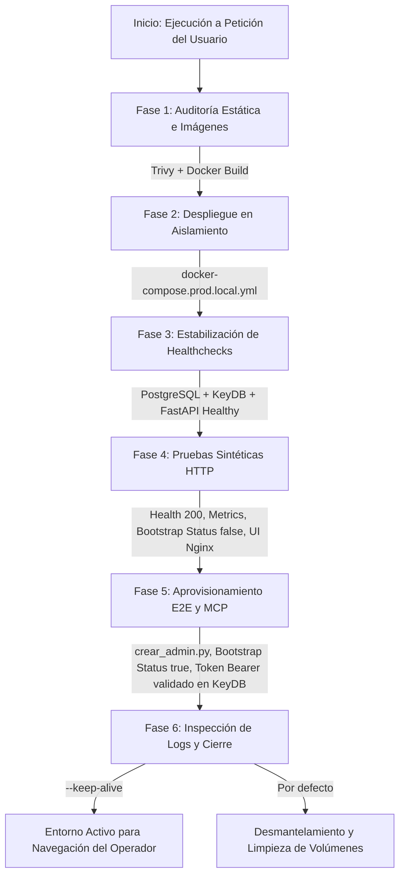
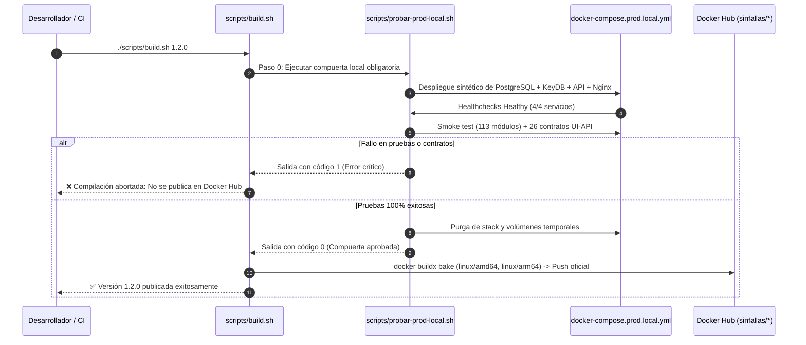

<!-- SPDX-License-Identifier: GPL-3.0-only -->
<!-- Copyright (C) 2026 RoSGrid Contributors -->

# Guía Operativa: Pipeline de Validación y Pruebas Locales de Imágenes de Producción

Este documento detalla el procedimiento formal, la arquitectura y las opciones de ejecución bajo demanda del **Pipeline de Validación Local de Imágenes de Producción** de RoSGrid (`./scripts/probar-prod-local.sh`).

Su propósito es actuar como **compuerta de calidad obligatoria (Gatekeeper)** antes de publicar imágenes en Docker Hub (`./scripts/build.sh`) o de desplegarlas en entornos reales de clientes mediante `docker-compose.prod.yml`.

---

## 1. Objetivos y Principios de Diseño

1. **Garantía de la Regla Cero:** Ningún binario, compilador ni herramienta de desarrollo se ejecuta en el host del desarrollador o servidor de staging. Todo el ciclo de vida (compilación, pruebas sintéticas, seeder de base de datos y auditoría) ocurre en contenedores Docker efímeros.
2. **Aislamiento Total de Producción:** Las pruebas se ejecutan contra `docker-compose.prod.local.yml`, utilizando una red interna propia (`rosgrid_internal_net`), nombres de contenedor diferenciados (`*_local`) y volúmenes temporales purgados al finalizar.
3. **Validación Integral de Pila Completa:** No se limita a un `docker build` pasivo; levanta la base de datos real (PostgreSQL 17), el motor en memoria (KeyDB), la API async (FastAPI) y el frontend optimizado (Nginx Alpine), verificando la conectividad de red, migraciones de base de datos y transiciones de estado.
4. **Verificación E2E de Bootstrap y Tokens:** Valida que el sistema virgen responda adecuadamente al estado inicial, se ejecute el aprovisionamiento mediante CLI o interfaz, y se verifique la emisión y persistencia de tokens de larga duración para agentes de IA (MCP).

---

## 2. Flujo de Validación en 6 Fases



### Detalle de las Fases

| Fase | Título | Acciones Ejecutadas | Criterio de Éxito |
| :--- | :--- | :--- | :--- |
| **1/6** | **Auditoría e Imágenes** | Opcional: Escaneo Trivy (`./scripts/auditar-infra.sh`). Construcción local de `sinfallas/rosgrid-backend:local-test` y `sinfallas/rosgrid-frontend:local-test`. | 0 vulnerabilidades CRITICAL/HIGH y compilación multi-stage exitosa. |
| **2/6** | **Despliegue Sintético** | Limpieza de huérfanos y arranque de PostgreSQL 17, KeyDB, FastAPI API, Worker y Nginx UI con `docker-compose.prod.local.yml`. | Contenedores creados e iniciados sin conflicto de puertos. |
| **3/6** | **Healthchecks** | Sondeo activo con `docker inspect` hasta 45 intentos de PostgreSQL 17, KeyDB, FastAPI y `rosgrid-worker`. | Los cuatro servicios reportan estado `healthy`. |
| **4/6** | **Pruebas Sintéticas y Hardening** | Ejecución de `test_production_boot_smoke.py` (`--no-dev`), consultas `curl` a `/health`, `/metrics`, `/api/v1/auth/bootstrap-status`, bundle servido en `/` (UI Nginx), **validación de proxy inverso Nginx** (`http://127.0.0.1:${UI_PORT}/api/...`), **ocultamiento estricto de Swagger/OpenAPI** (`/docs` y `/openapi.json` = HTTP 404) y **prueba negativa de autenticación** (`/api/v1/auth/me` sin token = HTTP 401). | 113 submódulos importados sin dependencias dev, HTTP 200 en endpoints operativos, HTTP 404 en Swagger, HTTP 401 en llamadas no autenticadas y bundle Nginx servido con cabeceras de seguridad. |
| **5/6** | **Aprovisionamiento E2E, MCP y Contratos Front-Back** | Ejecución de `crear_admin.py`, consulta de transición a `is_bootstrapped: true`, emisión de token MCP y validación en `/api/v1/auth/me`. **Invocación JSON-RPC 2.0 a `POST /api/v1/mcp`** (`tools/list`). Ejecución de **`validar_comunicacion_front_back.py`** (26 contratos de rutas y funciones de la UI contra FastAPI y RouterOS real). | Super Admin creado con 2FA, token Bearer validado en KeyDB, motor JSON-RPC 2.0 respondiendo catálogo de tools y 100% de éxito (26/26) en rutas UI-API. |
| **6/6** | **Cierre, Aislamiento y Limpieza** | Inspección de logs en `rosgrid_api_local` y `rosgrid_worker_local` en busca de `Traceback`, **verificación de aislamiento de puertos internos** (5432 y 6379 inaccesibles desde el host) y purga de volúmenes con `docker compose down -v` (o modo interactivo con `-k`). | 0 excepciones no controladas en logs, puertos internos protegidos y host limpio. |

---

## 3. Opciones de Ejecución a Petición del Usuario

El script `./scripts/probar-prod-local.sh` dispone de un menú flexible de argumentos CLI:

```bash
Uso: ./scripts/probar-prod-local.sh [OPCIONES]
```

| Opción | Argumento Largo | Descripción |
| :--- | :--- | :--- |
| `-h` | `--help` | Muestra el menú de ayuda con descripción de fases y ejemplos. |
| `-k` | `--keep-alive` | **Modo Interactivo:** No apaga los contenedores al terminar. Muestra las credenciales creadas y los enlaces para acceder desde el navegador. |
| `-w` | `--wizard` | **Modo Asistente Inicial:** Omite la creación de admin_local y mantiene el sistema activo en `is_bootstrapped: false` para registrarse manualmente desde el navegador (incluye `--keep-alive` implícito). |
| `-s` | `--skip-build` | **Modo Rápido:** Omite la compilación Docker si las imágenes ya existen en la caché local. Reduce el tiempo a solo unos segundos. |
| `-a` | `--audit` | **Modo Seguridad:** Ejecuta `./scripts/auditar-infra.sh` (ShellCheck + Trivy IaC, CVEs y secretos) previo al despliegue. |
| `-p` | `--port <PUERTO>` | Define el puerto TCP del host para exponer la interfaz de usuario Nginx (Predeterminado: `8085` o `$ROSGRID_HTTP_PORT`). |

---

## 4. Casos de Uso Habituales

### 4.1 Validación Estándar Previa a Git Push

Ejecuta la validación completa en modo desatendido. Si todas las fases se superan, limpia los recursos y retorna código `0`:

```bash
./scripts/probar-prod-local.sh
```

### 4.2 Inspección Interactiva en el Navegador Web

Ideal cuando el operador desea verificar visualmente la interfaz WebFig táctil, el formulario de login o las políticas de seguridad antes de dar el visto bueno:

```bash
./scripts/probar-prod-local.sh --keep-alive
```

Al finalizar, el script mostrará en consola:

```text
==============================================================================
El stack permanece ACTIVO (--keep-alive) para tu inspección interactiva:
  • Interfaz Web (NOC):    http://localhost:8085
  • API Backend:           http://localhost:8000 (Docs desactivado en producción)
  • Endpoint MCP IA:       http://localhost:8000/api/v1/mcp (JSON-RPC 2.0)
  • Organización (Slug):   isp-local
  • Usuario Super Admin:   admin_local
  • Contraseña:            ClaveSegura123!
------------------------------------------------------------------------------
Para apagar el stack y liberar los recursos cuando termines, ejecuta:
  docker compose -f docker-compose.prod.local.yml down -v
==============================================================================
```

### 4.3 Validación Rápida de Configuración (Sin Recompilar)

Si solo se modificaron variables de entorno o configuraciones del compose y las imágenes locales ya están construidas:

```bash
./scripts/probar-prod-local.sh --skip-build
```

### 4.4 Auditoría de Seguridad Integral con Puerto Personalizado

Para verificar exhaustivamente las imágenes con Trivy y levantar la UI en el puerto 9000:

```bash
./scripts/probar-prod-local.sh --audit --keep-alive --port 9000
```

---

## 5. Integración con el Proceso de Publicación (`scripts/build.sh`)

Para impedir que imágenes rotas o desincronizadas se publiquen en Docker Hub, el script [build.sh](file:///home/sinfallas/Dropbox/git/tecno-consultores/RoSGrid/scripts/build.sh) invoca automáticamente a `./scripts/probar-prod-local.sh` como **Paso 0**:



```bash
# Publicación normal (valida en local antes de compilar multi-arch y publicar)
./scripts/build.sh 1.2.0

# Publicación forzada (omitiendo la validación previa solo si es estrictamente necesario)
./scripts/build.sh 1.2.0 --skip-validation
```

Si `./scripts/probar-prod-local.sh` detecta cualquier fallo en healthchecks, migraciones, endpoints o tokens, el proceso de compilación `buildx` multi-plataforma (`linux/amd64`, `linux/arm64`) se aborta inmediatamente con código de error `1`, protegiendo el registro público.

---

## 6. Procedimiento de Diagnóstico y Resolución de Problemas

### 6.1 Conflicto de Puertos en el Host (`address already in use`)

Si un servicio local ya está utilizando el puerto `8085` o `8000`:

- **Solución:** Ejecuta el pipeline especificando un puerto alternativo:

  ```bash
  ./scripts/probar-prod-local.sh -p 8095
  ```

- O exporta la variable en tu sesión:

  ```bash
  export ROSGRID_HTTP_PORT=8095
  ./scripts/probar-prod-local.sh
  ```

### 6.2 Tiempo de Espera Agotado en Healthchecks (`timeout`)

Si el contenedor de la API o la base de datos no alcanza el estado `healthy` en 45 intentos:

- El pipeline ejecutará automáticamente la captura de logs mediante la trampa `EXIT`:

  ```bash
  docker compose -f docker-compose.prod.local.yml logs --tail=40
  ```

- Si deseas investigar con los contenedores congelados en su estado actual, puedes arrancar manualmente:

  ```bash
  docker compose -f docker-compose.prod.local.yml up -d
  docker compose -f docker-compose.prod.local.yml ps
  docker compose -f docker-compose.prod.local.yml logs rosgrid-api
  ```

### 6.3 Reseteo Completo de Contenedores Huérfanos

Si se interrumpió abruptamente una sesión anterior con `Ctrl+C`:

```bash
docker compose -f docker-compose.prod.local.yml down -v --remove-orphans
docker volume prune -f
```

---

## 7. Suite Automatizada de Validación Front-Back (`validar_comunicacion_front_back.py`)

Para certificar que **todas** las rutas, formularios y vistas de la interfaz Vue 3 se comunican contractualmente sin errores con el backend FastAPI y con la flota MikroTik real, RoSGrid incluye una suite de 24 pruebas de integración en `fastapi/scripts/validar_comunicacion_front_back.py`.

### 7.1 Ejecución en Contenedor (Regla Cero)

```bash
docker exec -i rosgrid_api_local python3 /app/scripts/validar_comunicacion_front_back.py
```

### 7.2 Catálogo de 24 Pruebas de Integración Cubiertas

1. **Infraestructura Base:** Liveness de Nginx (`/`), cabeceras CSP con soporte de mapas OpenStreetMap y `/health` de FastAPI.
2. **Autenticación y Ciclo de Vida:** `/api/v1/auth/bootstrap-status`, login de Superadmin con TOTP 2FA y perfil `/api/v1/auth/me`.
3. **Flujo Maker-Checker de Registro Web:** Auto-registro `/api/v1/auth/register`, bloqueo 403 a usuarios no aprobados, aprobación `/api/v1/users/{id}/approve` por Superadmin, rechazo seguro `/api/v1/users/{id}/reject` y toggle de registro en KeyDB.
4. **Inventario y Hardware Real:** Consulta de routers `/api/v1/inventory/routers`, botón TOFU de redescubrimiento `/api/v1/inventory/routers/{id}/discover` con validación de versión y arquitectura real (CHR QEMU v7.21.5), y lectura de interfaces reales `/api/v1/routers/{id}/webfig/interfaces`.
5. **Gobernanza y Operaciones:** Sesiones activas en KeyDB, pistas inmutables WORM en PostgreSQL, ventanas de mantenimiento, catálogo de usuarios, plantillas de script, cola de aprobaciones Maker-Checker, estado de actualizaciones RouterOS, dry-run de importación CSV e historial de backups `.rsc`.
