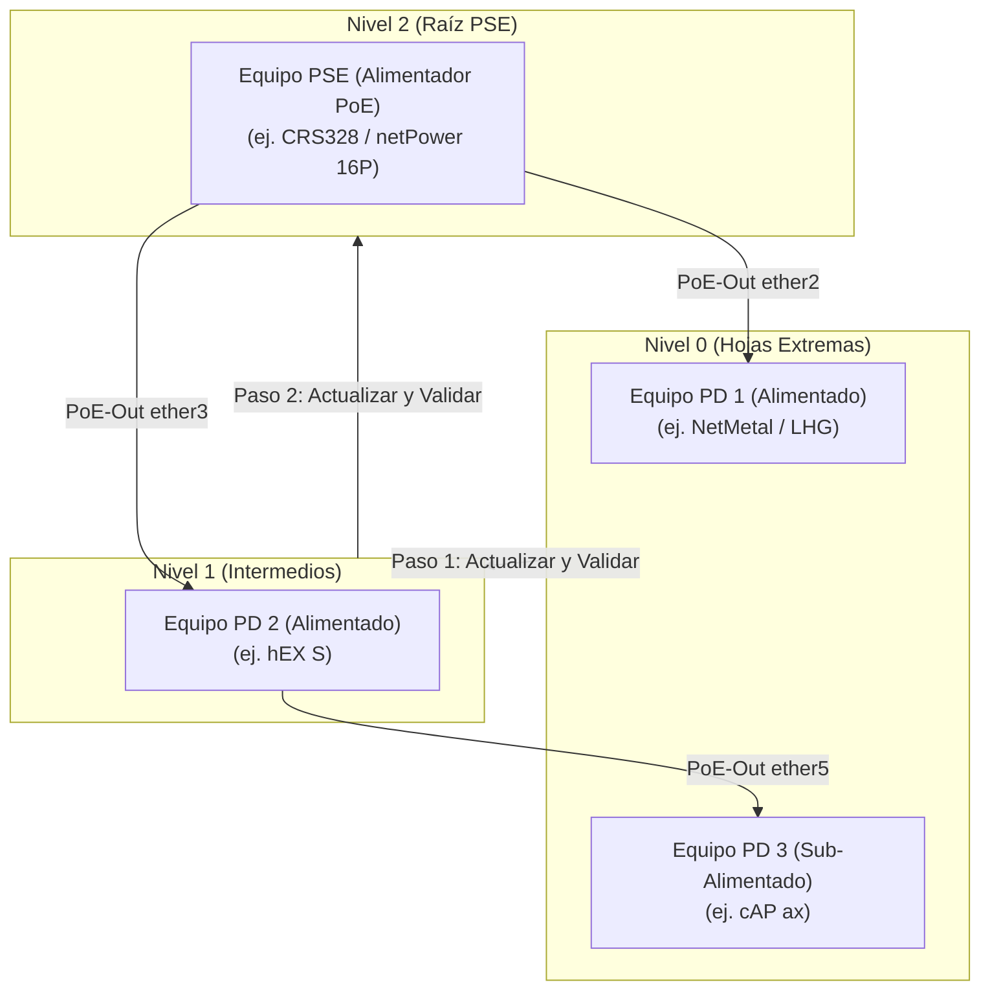
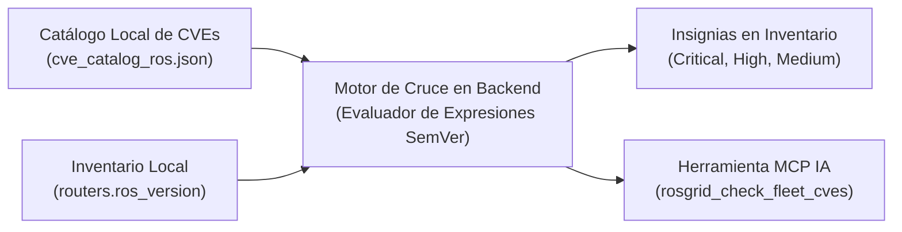
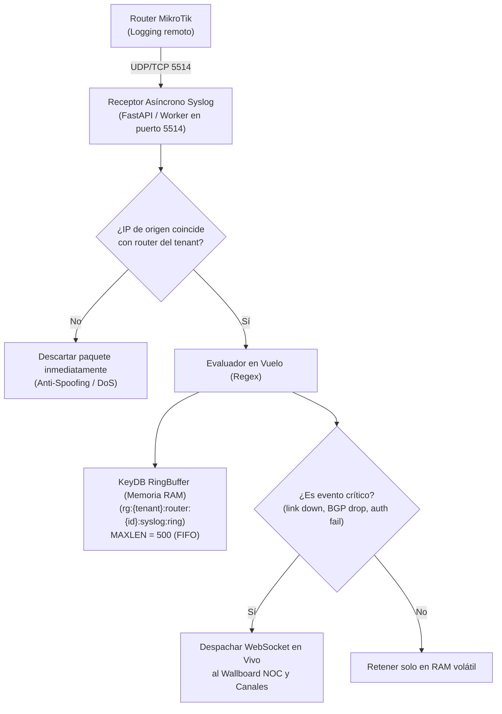
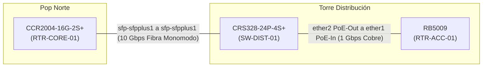
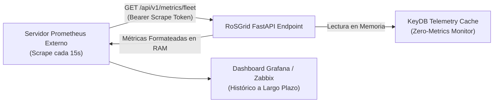

# 12 — Diseño Arquitectónico: Automatización de Flota, Topología L2, Syslog Efímero y Exportador Prometheus

Este documento técnico de diseño define la arquitectura conceptual, estructuras de datos, flujos de control y consideraciones de rendimiento y seguridad para las cinco capacidades tácticas de próxima generación en **RoSGrid**:

1. **Actualizaciones Masivas PoE-Aware & Parada de Emergencia de Flota (*Safety Stop*).**
2. **Cruce Proactivo de Vulnerabilidades CVE en Inventario (Cero Fuga a la Nube).**
3. **Receptor Syslog Centralizado Efímero (UDP/TCP 5514) con Alertas en Vuelo y Cero Disco.**
4. **Plantilla de Aprovisionamiento Masivo Syslog para Routers MikroTik RouterOS v7.**
5. **Descubrimiento y Visualización de Topología Física Capa 2 (MNDP/LLDP).**
6. **Puente de Telemetría hacia Prometheus (`/api/v1/metrics/fleet`) sin Persistencia en PostgreSQL.**
7. **Interoperabilidad con Agentes IA (MCP Server y Skill `rosgrid-noc-operator`).**
8. **Marco de Ciberseguridad y Mitigación de Vulnerabilidades.**

---

## 1. Principio Rector: Preservación de "Zero-Metrics Storage" y Alto Rendimiento

El mayor riesgo técnico al incorporar Syslog, telemetría para Prometheus y mapas topológicos es la **degradación por saturación de disco (IOPS)** y el **crecimiento descontrolado de la base de datos**.

RoSGrid mantiene invariable su premisa fundacional:

* **PostgreSQL 17** se reserva única y exclusivamente para:
  * Entidades transaccionales (tenants, usuarios, routers, credenciales encriptadas).
  * Bitácora forense inmutable WORM (`audit_logs`) que audita acciones humanas o de agentes IA.
* **KeyDB Multi-Hilo (en memoria RAM)** absorbe la totalidad de los datos volátiles de alta frecuencia:
  * Telemetría efímera (~200 bytes por router).
  * Búfer circular de Syslog (`MAXLEN 500` eventos por router).
* **Prometheus y Grafana externos** asumen el almacenamiento histórico de series temporales de largo plazo si la organización lo requiere, liberando a RoSGrid de cualquier carga de almacenamiento de métricas.

---

## 2. Actualizaciones Masivas PoE-Aware con Parada de Emergencia de Flota (*Safety Stop*)

### 2.1. El Problema Operativo del PoE en Cascada

En torres de telecomunicaciones y redes de acceso, es habitual encontrar esquemas en cascada donde un switch o router central entrega energía PoE a radios, antenas o routers secundarios.

Si un operador lanza una actualización masiva desordenada:

1. El equipo alimentador (PSE) se reinicia para aplicar el nuevo firmware.
2. Al reiniciar, corta temporalmente la salida de alimentación en sus puertos `poe-out`.
3. Los equipos alimentados (PD) sufren un corte súbito de energía eléctrica justo en el instante en que estaban flasheando su chip RouterBOARD o escribiendo paquetes en almacenamiento flash.
4. **Consecuencia:** Equipos dañados permanentemente (*bricked*) y desplazamiento forzado de cuadrillas técnicas en campo.

### 2.2. Algoritmo de Grafo de Dependencia Eléctrica (DAG)



#### Fases de Ejecución

1. **Inspección Topológica Previa:**
   * El orquestador consulta `/rest/interface/ethernet/poe` en los equipos candidatos.
   * Cruza la información con la tabla de vecinos L2 para saber qué router específico está conectado a cada puerto PoE activo (`poe-out-status = "delivering-power"`).
2. **Topological Sort (Orden Topológico Inverso):**
   * Se calculan los niveles de dependencia. Los equipos en el nivel de hojas (que solo consumen PoE pero no entregan a nadie) se programan primero.
3. **Actualización Escalonada con Barrera de Sincronización (*Sync Barrier*):**
   * El Nivel 1 no inicia hasta que el 100% de los equipos del Nivel 0 hayan reiniciado, verificado su firma TOFU SSL y reportado estado `ONLINE`.

### 2.3. Circuito de Parada de Emergencia (*Fleet Safety Stop*)

Para proteger la red contra caídas masivas si una versión de RouterOS contiene un error inesperado:

* **Umbral de Falla:** Parámetro configurable en el lote (por defecto `1%` de la flota seleccionada, o un mínimo de 1 router).
* Si un router no regresa a estado `ONLINE` tras 180 segundos posteriores al reinicio:
  * El router se clasifica como `UPGRADE_UNRESPONSIVE`.
  * El motor evalúa la tasa de error: si `(fallos / total_en_proceso) >= threshold`, se activa inmediatamente el **Safety Stop**.
  * Se purgan los trabajos pendientes en la cola masiva, impidiendo que el resto de los routers inicien su actualización.
  * Se emite una alerta prioritaria en el Wallboard NOC y por canales de notificación (Telegram/Webhook).
  * Toda la secuencia queda asentada en la bitácora inmutable WORM.

---

## 3. Cruce Proactivo de Vulnerabilidades CVE en el Inventario

### 3.1. Arquitectura de Cero Fuga de Datos (Zero-Telemetry Leak)

Muchos escáneres de vulnerabilidades envían las versiones y modelos de los routers a APIs externas en la nube. En infraestructuras críticas o gubernamentales, esto constituye una fuga de información inaceptable.

RoSGrid adopta un modelo 100% local y soberano:



### 3.2. Estructura del Catálogo Local Embebido

El catálogo se empaqueta directamente en la imagen de producción (`fastapi/src/data/cve_catalog_ros.json`):

```json
[
  {
    "cve_id": "CVE-2023-32154",
    "title": "Desbordamiento de búfer en IPv6 Router Advertisement",
    "cvss_score": 9.8,
    "severity": "CRITICAL",
    "affected_versions_expr": ">=7.0,<7.9.1",
    "fixed_in_version": "7.9.2",
    "description_es": "Permite ejecución remota de código arbitrario mediante paquetes IPv6 modificados sin autenticación previa.",
    "remediation": "Actualizar de inmediato a RouterOS v7.9.2 o superior, o deshabilitar temporalmente IPv6 si no está en uso."
  }
]
```

El cálculo del cruce se realiza en memoria sin sobrecargar la base de datos ni consultar APIs externas.

---

## 4. Receptor Syslog Centralizado Efímero (UDP/TCP 5514)

### 4.1. Arquitectura de Flujo en Memoria (KeyDB RingBuffer)



### 4.2. Especificaciones de Desempeño

* **Puerto:** `5514` (no privilegiado, seguro para ejecutar en contenedores `non-root`).
* **Consumo de Memoria:** Cada registro en el RingBuffer ocupa ~200 bytes.  
  $$100\text{ routers} \times 500\text{ eventos} \times 200\text{ bytes} \approx 10\text{ MB de RAM total en KeyDB}.$$
* **Persistencia en Disco:** **Cero.** Si se reinicia el contenedor KeyDB, los logs se purgan limpiamente sin dejar residuos ni fragmentar índices en PostgreSQL.

---

## 5. Plantilla de Aprovisionamiento Masivo Syslog

Para que un router recién incorporado reporte sus eventos a RoSGrid, se incorpora a la biblioteca de plantillas la siguiente configuración estandarizada:

```routeros
# ==============================================================================
# RoSGrid: Plantilla de Enrolamiento Syslog Remoto Efímero (RouterOS v7)
# Variables requeridas: {{ROSGRID_SERVER_IP}}, {{ROSGRID_SYSLOG_PORT}} (def: 5514)
# ==============================================================================

/system logging action
remove [find name="rosgrid-syslog"]
add name="rosgrid-syslog" target=remote remote={{ROSGRID_SERVER_IP}} remote-port={{ROSGRID_SYSLOG_PORT}} bsd-syslog=yes facility=daemon sys-ident=yes

/system logging
remove [find action="rosgrid-syslog"]
add topics=interface,warning,critical action="rosgrid-syslog"
add topics=route,bgp,warning action="rosgrid-syslog"
add topics=route,ospf,warning action="rosgrid-syslog"
add topics=system,error,critical action="rosgrid-syslog"
add topics=dhcp,critical action="rosgrid-syslog"
add topics=firewall,warning action="rosgrid-syslog"
```

Esta plantilla se distribuye mediante el asistente de **Operaciones Masivas (*Bulk Ops*)**, protegiendo la ejecución con **Safe Mode (60s)**.

---

## 6. Descubrimiento y Mapeo Visual de Topología Física Capa 2 (MNDP/LLDP)

### 6.1. Correlación de Enlaces Puerto a Puerto

A diferencia de los mapas georreferenciados (que ubican routers por coordenadas GPS en OpenStreetMap), el mapa de Topología L2 dibuja el diagrama de cableado físico y enlaces de fibra:



### 6.2. Algoritmo de Cruce

1. El backend consulta periódicamente `/rest/ip/neighbor` en todos los routers del inquilino.
2. Cada entrada de vecino entrega: `interface`, `mac-address`, `identity`, `board-name`, `version`.
3. El motor correlaciona bidireccionalmente: si Router A ve a Router B en `sfp1`, y Router B ve a Router A en `sfp2`, se consolida un único enlace bidireccional verificado.
4. **Visualización Frontend (`L2TopologyView.vue`):** Lienzo interactivo basado en Canvas/SVG con físicas de resortes, coloreado dinámico según estado operativo y agrupadores por sitio físico.

---

## 7. Puente de Telemetría de Flota hacia Prometheus (`/api/v1/metrics/fleet`)

### 7.1. Integración con Grafana sin Almacenamiento en PostgreSQL

Las organizaciones que requieren retención histórica de métricas por meses o años no deben cargar esa responsabilidad sobre RoSGrid. En su lugar, RoSGrid expone un endpoint formateado para que el servidor Prometheus corporativo extraiga la telemetría periódicamente (*pull scraping*):



### 7.2. Métricas Expuestas

* `rosgrid_fleet_router_status`: Estado (1 = Online, 0 = Offline, 2 = Degraded).
* `rosgrid_fleet_cpu_load_percent`: Uso actual de CPU (0 a 100%).
* `rosgrid_fleet_memory_usage_ratio`: Proporción de memoria usada (0.0 a 1.0).
* `rosgrid_fleet_active_cves_count`: Número de vulnerabilidades detectadas (clasificadas por severidad).
* `rosgrid_fleet_syslog_critical_events_total`: Contador acumulativo de caídas de interfaz y eventos de advertencia.

---

## 8. Ampliación del Servidor MCP y de la Skill `rosgrid-noc-operator`

Para capacitar a los agentes autónomos de Inteligencia Artificial (Hermes Agent, Claude Desktop, Antigravity) en estas nuevas capacidades, se incorporan 4 herramientas semánticas al catálogo MCP (`/api/v1/mcp`):

1. `rosgrid_get_l2_topology`: Devuelve la matriz de interconexión física entre routers (puertos, vecinos MNDP/LLDP y velocidad).
2. `rosgrid_check_fleet_cves`: Reporta boletines CVE pendientes para uno o todos los routers de la flota.
3. `rosgrid_get_recent_syslog`: Consulta el RingBuffer efímero en memoria (últimos N eventos) para diagnosticar causas de caídas recientes.
4. `rosgrid_execute_poe_aware_upgrade`: Propone un trabajo masivo ordenado por topología PoE con freno de seguridad Maker-Checker y Safety Stop.

---

## 9. Marco de Ciberseguridad y Mitigación de Vulnerabilidades

Siguiendo las lecciones aprendidas en auditorías previas (Hitos 22.5 y 22.12):

1. **Mitigación Anti-Spoofing UDP en Syslog:**
   * El recolector valida que el paquete UDP provenga de una IP registrada en la tabla de routers del tenant.
   * Paquetes de IPs no autorizadas son descartados silenciosamente sin procesar regex.
2. **Control de Inundación (*Rate-Limiting*):**
   * Se establece un techo de 50 paquetes/segundo por router en el receptor Syslog para neutralizar ataques de denegación de servicio.
3. **Autenticación Fuerte de Scrape para Prometheus:**
   * Acceso protegido por token criptográfico estático (`ROSGRID_PROMETHEUS_SCRAPE_TOKEN`) o pertenencia a subred de monitoreo interna autorizada.
4. **Validación Anti-SSRF en la Plantilla de Enrolamiento:**
   * La IP de destino configurada en los routers debe someterse a `validate_router_target_url` para impedir que un operador desvíe el tráfico Syslog a direcciones restringidas.
5. **Gobernanza Maker-Checker y Safe Mode (60s):**
   * Todas las operaciones masivas de actualización y despliegue de plantillas requieren validación a cuatro ojos (`maker != checker`) y cuentan con reversión automática ante pérdida de conectividad.

---

## 10. Implementación Frontend Vue 3 + Pinia (Hito 23.5)

El Hito 23.5 traslada toda la arquitectura de datos efímera a componentes tácticos de alta densidad visual siguiendo el estándar *Tactical NOC Cyan*:

1. **`FleetCveMatrix.vue` (`/inventory/cves`):**
   - 4 Tarjetas KPI con tipografía numérica alineada (`tabular-nums`) para auditoría inmediata.
   - Filtro reactivo por severidad (`CRITICAL`, `HIGH`, `MEDIUM`, `LOW`) y búsqueda textual en vivo.
   - Detalle expandible con descripción de vulnerabilidad en español, vector CVSS v3 y versiones recomendadas.
   - Conexión directa al sincronizador NVD (`POST /api/v1/inventory/cves/sync`) y botón de remediación que enlaza con las operaciones masivas.

2. **`L2TopologyView.vue` (`/topology/l2`):**
   - Lienzo Canvas 2D acelerado a 60 FPS con Pan/Zoom, cuadrícula táctica y físicas de nodos.
   - Enlaces físicos con indicación visual de consumo PoE en vatios (`⚡ W`) y diferenciación de nodos PSE (inyectores de energía) vs clientes PD.
   - Drawer lateral accesible con detalles de interconexión y acceso a WebFig.

3. **`RouterSyslogTerminalView.vue` (`/routers/:id/webfig/syslog`):**
   - Terminal embebido en la consola WebFig que consume el RingBuffer efímero en KeyDB (500 eventos por router, 0 persistencia en PostgreSQL).
   - Detección de patrones críticos (`CRIT 🚨`), auto-scroll inteligente que detecta inspección manual y modal con script CLI de enrolamiento.

4. **`BulkOperationsAndUpdatesView.vue` (`/bulk-ops`):**
   - Conmutador táctico *PoE-Aware* para ejecución en orden topológico inverso (hojas primero, switch PoE al final).
   - Selector de umbral de emergencia *Safety Stop* (1%, 2%, 5%) que aborta la cola ante caídas post-reinicio.

---

## 11. Cobertura BDD y Certificación con Karate Labs (API & UI)

La totalidad de los contratos REST y flujos de usuario del Hito 23 cuentan con pruebas automatizadas en **Karate Labs**:

### 11.1 Pruebas de Contratos REST API (`fastapi/test/api_test.feature`)

- **Escenarios 55-61:** Cobertura de las rutas `/api/v1/inventory/cves`, `/api/v1/inventory/cves/sync`, `/api/v1/topology/l2`, `/api/v1/routers/syslog/template`, `/api/v1/routers/{id}/syslog`, `/api/v1/metrics/fleet` y `/api/v1/operations/ros-updates/execute`.
- **Resultado:** 61 de 61 escenarios aprobados (100%).

### 11.2 Pruebas de Interfaz de Usuario UI (`vue3/test/ui_business_flow.feature`)

- **Escenarios 17-20:** Cobertura integral de la Topología L2, Matriz de Vulnerabilidades CVE, Consola Syslog Terminal y el Asistente de Actualización Masiva PoE-Aware con Safety Stop.
- **Resultado:** 20 de 20 escenarios aprobados (100%).

