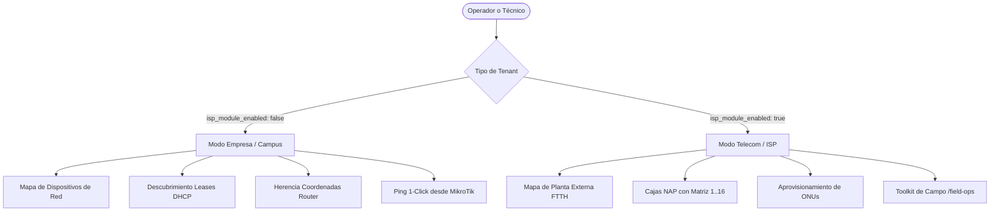

# 13 — Manual Operativo: Mapa de Red Bimodal, Infraestructura Pasiva (Cajas NAP) y Toolkit de Campo

Este manual operativo describe el funcionamiento, flujos de trabajo y directivas de ingeniería para el **Mapa de Red Bimodal (`/subscribers/map`)** y el **Toolkit Táctico de Operaciones de Campo (`/field-ops`)** en RoSGrid.

---

## 1. Arquitectura Bimodal: Empresa Corporativa vs Operador ISP

RoSGrid adapta automáticamente su interfaz y lógica de negocio en función del tipo de organización autenticada (`tenant.isp_module_enabled`).

### 1.1. Modo Empresa / Campus (`isp_module_enabled: false`)
Diseñado para corporaciones, bancos, universidades, hospitales y redes industriales:
* **Entidades Gestionadas:** Computadoras portátiles, estaciones de trabajo, impresoras de red, cámaras CCTV, puntos de acceso Wi-Fi y servidores.
* **Auto-Descubrimiento:** Se alimenta de las asignaciones de direcciones IP en `/ip/dhcp-server/lease` de los routers MikroTik del tenant.
* **Herencia de Coordenadas:** Todo equipo nuevo toma automáticamente la latitud y longitud del router de su sede (`router.latitude`, `router.longitude`) y el nombre de la sede física (`router.physical_location`).
* **Edición Táctica:** El administrador puede arrastrar o ajustar manualmente las coordenadas de cualquier dispositivo para reflejar su ubicación física (piso, ala o departamento). Las coordenadas editadas se marcan como personalizadas (`is_custom_coordinates: true`) y quedan protegidas contra sobreescrituras automáticas.
* **Verificación de Respuesta:** Un botón `[ ⚡ Test Ping 1-Click ]` ejecuta un sondeo ICMP desde el router MikroTik asignador hacia la IP del dispositivo, reportando latencia media, pérdida y estado cromático inmediato.
* **Supresión de Ruido:** Las pantallas de alta de clientes FTTH y cajas de dispersión óptica quedan totalmente apagadas y ocultas para no saturar al personal de TI corporativo.

### 1.2. Modo Telecom / ISP (`isp_module_enabled: true`)
Diseñado para operadores de fibra óptica FTTH y proveedores WISP:
* **Entidades Gestionadas:** Cajas NAP (Network Access Points / Splitters en postes y fachadas) y Abonados ONUs/ONTs de fibra óptica.
* **Aprovisionamiento Controlado:** Cero altas automáticas indiscriminadas por DHCP. Cada cliente se asocia formalmente a una Caja NAP y a un puerto físico del splitter.
* **Telemetría Óptica:** Medición de potencia óptica en la entrada de la caja NAP y potencia de recepción en la roseta del cliente ($Rx\text{ dBm}$), con semáforo de calidad de enlace.
* **Toolkit Móvil de Campo (`/field-ops`):** Tres herramientas directas optimizadas para smartphones de instaladores en ruta:
  1. `[ 📦 Registrar Caja NAP ]`
  2. `[ 👤 Registrar Nuevo Cliente / ONU ]`
  3. `[ ⚡ Diagnósticos y Certificación 1-Click ]`

---

## 2. Gestión de Infraestructura Pasiva: Cajas NAP (Terminal Box / ODB)

### 2.1. Parámetros Técnicos de una Caja NAP
En redes de dispersión óptica, cada caja representa un punto de empalme y división:
* **Código / Identificador:** Alfanumérico único por tenant (ej. `NAP-CBO-01`).
* **Capacidad de Puertos:** 8, 16 o 24 puertos de splitter (usualmente conectores SC/APC).
* **Ratio del Splitter:** 1:8, 1:16, o cascadas desbalanceadas (1:2 + 1:8).
* **Potencia de Entrada (Input Power dBm):** Nivel óptico medido en el conector de entrada que alimenta el splitter (ej. `-14.80 dBm`).
* **Tipo de Anclaje:**
  * `POLE`: Poste de hormigón o madera (con número de poste).
  * `FAÇADE`: Fachada o muro exterior de edificio.
  * `UNDERGROUND`: Cámara o arqueta subterránea.
  * `INDOOR_ODF`: Repartidor o armario interior.

### 2.2. Visualización e Interacción en el Mapa Cartográfico
* **Marcador Cartográfico:** Icono táctico con badge de ocupación de puertos: `ocupados / capacidad` (ej. `6/16`).
* **Panel de Detalle de Caja (Drawer):**
  * **Matriz de Puertos Estilo Patch Panel (1 al 16):**
    * 🟢 **Puerto Ocupado (Online):** Abonado conectado y navegando normalmente.
    * 🔴 **Puerto Ocupado (Offline):** Abonado con pérdida de señal óptica o desconexión.
    * ⚪ **Puerto Libre:** Disponible para asignación de nueva acometida.
  * **Acciones Directas:**
    * `[ ➕ Conectar Cliente en este NAP ]`: Abre la pantalla del técnico preseleccionando la caja y el primer puerto libre disponible.
    * `[ ⚡ Diagnóstico Ráfaga ]`: Envía pruebas de ping secuenciales a todos los abonados de la caja para descartar fallas masivas de splitter.

---

## 3. Toolkit de Operaciones de Campo (`/field-ops`)

### 3.1. Eliminación de Bloqueos por Órdenes de Trabajo
El instalador en calle no depende de asignaciones burocráticas previas. Puede proceder de inmediato con el alta de infraestructura física o la regularización de acometidas.

### 3.2. Pestaña 1: Registrar Caja NAP
1. El técnico llega al poste o fachada donde se ubicará la caja.
2. Pulsa el botón prominente `[ 📍 Capturar GPS de la Caja ]`.
3. Ingresa el código (`NAP-01`), selecciona capacidad (`16 puertos`) y anclaje (`Poste`).
4. Mide la potencia óptica con el Power Meter en el latiguillo de entrada y registra el valor (ej. `-14.5 dBm`).
5. Pulsa `[ Guardar Caja NAP ]`. La caja aparece disponible de inmediato en el mapa de toda la organización.

### 3.3. Pestaña 2: Registrar Nuevo Cliente FTTH
1. El técnico ingresa el identificador de circuito o usuario PPPoE.
2. El sistema lista las Cajas NAP cercanas ordenadas automáticamente por proximidad GPS. El técnico selecciona la caja asignada.
3. Se despliega la matriz de puertos libres; pulsa el puerto a utilizar (ej. `Puerto 4`).
4. Escanea o escribe el número de serie de la ONU. El sistema formatea automáticamente prefijos de fabricantes conocidos (`HWTC` para Huawei, `ZTEG` para ZTE, etc.).
5. Conecta el latiguillo a la roseta y registra la lectura de potencia óptica $Rx\text{ dBm}$:
   * **$-15.0\text{ a }-24.0\text{ dBm}$ (Verde):** Señal óptima.
   * **$-24.1\text{ a }-27.0\text{ dBm}$ (Naranja):** Señal degradada / en alerta.
   * **$< -27.0\text{ dBm}$ (Rojo):** Señal crítica inaceptable.
6. Pulsa `[ 📍 Capturar GPS Domicilio ]` y certifica el alta del servicio.

### 3.4. Pestaña 3: Diagnósticos y Certificación 1-Click
1. El técnico selecciona el servicio recién instalado.
2. Pulsa `[ ⚡ Ejecutar Diagnóstico en Vivo ]`.
3. El sistema consulta al MikroTik vía API REST:
   * Valida sesión activa (`bound` en DHCP o activa en `/ppp/active`).
   * Envía paquetes ICMP hacia la IP del cliente y mide latencia y pérdida.
   * Compara `caller-id` con la MAC registrada de la ONU para confirmar si está en modo Router o Bridge.
4. Con todas las comprobaciones en verde, el servicio pasa a estado `ACTIVE`.

---

## 4. Gobernanza y Seguridad RLS

* **Aislamiento Multi-Tenant Estricto:** Toda consulta a `optical_boxes` y `subscriber_devices` filtra por `tenant_id` mediante políticas nativas de PostgreSQL Row Level Security (RLS).
* **Protección Anti-SSRF:** La comunicación con los routers de acceso utiliza exclusivamente el cliente `MikrotikRestClient` validado con pinning de certificados TOFU y credenciales descifradas de la bóveda AES-256-GCM.
* **Cero Datos Personales (GDPR):** RoSGrid almacena exclusivamente parámetros de red y telemetría física. Las identidades civiles, contratos y cobranzas residen en los sistemas BSS/CRM externos.

---

## 5. Gobernador Anti-Saturación y Protección de Equipos MikroTik

Para garantizar que el uso masivo de diagnósticos 1-Click por parte de los técnicos en campo o del personal de soporte en el Centro de Operaciones de Red (NOC) no degrade el rendimiento de los enrutadores MikroTik RouterOS v7 ni consuma los recursos del servidor RoSGrid, el sistema incorpora un **Gobernador de Diagnósticos**:

1. **Caché Táctico de 15 Segundos (Anti-Thundering Herd):**
   * Cuando se ejecuta un ping sobre un abonado o equipo de red, el resultado se almacena en memoria de alta velocidad (KeyDB) durante 15 segundos.
   * Si el técnico o un compañero consulta el mismo abonado dentro de esa ventana, el resultado se entrega de inmediato ($< 2\text{ ms}$) sin volver a consultar al router.
   * La interfaz muestra un distintivo táctico de color cian: `⚡ Caché Anti-Saturación (Ns)` indicando los segundos restantes de vigencia del resultado.

2. **Semáforo Concurrente por Router (Máximo 3 Pruebas Simultáneas):**
   * Ningún equipo MikroTik procesará más de 3 diagnósticos concurrentes. Si se alcanza este umbral en routers con muchos técnicos operando en paralelo, el sistema solicita pausar brevemente unos segundos antes de reintentar.

3. **Circuit Breaker Automático ante Contingencias:**
   * Si un router MikroTik pierde conectividad, se apaga o sufre timeouts repetitivos (3 fallas consecutivas), RoSGrid activa de inmediato el modo `CIRCUIT_OPEN` durante 30 segundos.
   * Esto previene que las peticiones se acumulen en el servidor esperando timeouts lentos (fail-fast táctico con HTTP 503), manteniendo la consola de campo ágil y fluida en todo momento.

---

## 6. Componente de Mapa Unificado, 3 Toggles Independientes y Correlación de Alarmas (RCA)

### 6.1. Los 3 Toggles de Capas Independientes y Feature Flags
En lugar de forzar al usuario a ver todo junto o nada, el mapa de red ofrece 3 botones independientes en la barra superior:
* `[ 🏢 Routers de Red ]`: Muestra los equipos MikroTik de cabecera con su estado operativo en tiempo real.
* `[ 📦 Cajas NAP FTTH ]`: Visible exclusivamente si el tenant tiene activo `isp_module_enabled: true`. En empresas estándar corporativas, este control no se renderiza.
* `[ 💻 Dispositivos / Abonados ]`: Muestra los equipos clientes (terminales corporativos DHCP o abonados residenciales FTTH).

### 6.2. Control de Acceso RBAC en el Mapa
* **Técnicos de Campo (`FIELD_TECH` / `SUPPORT_L1`):** Al tocar un router en el mapa pueden ver su dirección IP, latencia, modelo y si se encuentra encendido o apagado para entender contingencias de zona, pero el botón de acceso a la consola **WebFig se encuentra completamente oculto y bloqueado**.
* **Personal de Ingeniería / NOC (`TENANT_ADMIN`, `NETWORK_ADMIN`):** Disponen del botón de enlace directo para abrir WebFig, Safe Mode y Terminal.

### 6.3. Correlación de Alarmas y Causa Raíz (RCA estilo Zabbix)
* Si un router MikroTik se apaga o pierde conectividad con RoSGrid, el sistema detecta de forma inteligente la relación padre-hijo:
  * El mapa despliega una barra de alerta superior: `🚨 ALERTA DE NODO: Router 'Core-01' CAÍDO (Afecta a 50 abonados de este mapa)`.
  * Si un técnico intenta ejecutar una prueba sobre cualquiera de esos 50 abonados, el sistema **no emite ningún ping inútil hacia el equipo caído**, respondiendo de inmediato: *"Diagnóstico omitido: El router de cabecera 'Core-01' está inalcanzable. Resuelva primero la contingencia del nodo."*

### 6.4. Prevención de Colisiones Operativas en Campo
* Cuando un técnico ejecuta un diagnóstico sobre un cliente o abre su ficha de trabajo, RoSGrid activa una cerradura táctica efímera en KeyDB (`TTL = 10 minutos`).
* Si un segundo técnico consulta ese mismo abonado, la interfaz despliega un aviso informativo: `👥 Atención en Curso: El técnico Carlos Mendoza ya ejecutó un diagnóstico hace 2 minutos`. Esto erradica traslados redundantes de brigadas de calle.

---

## 7. Automatización de Sondeo de Fondo (Worker Jitter) y Actualización Reactiva por WebSocket

Para que el mapa de red y el Wallboard NOC reflejen permanentemente el estado real de los equipos en verde o rojo sin requerir que un operador presione manualmente el botón `[ Sincronizar ]`, RoSGrid incorpora un motor de sondeo pasivo automatizado y un canal de notificación reactivo:

### 7.1. Sondeo Pasivo Escalonado de Fondo (*Staggered Session Poller*)
* El contenedor en segundo plano `rosgrid-worker` ejecuta un bucle periódico cada 3 minutos consultando las tablas nativas de sesiones de los routers (`/ip/dhcp-server/lease` en empresas y `/ppp/active` en ISPs).
* **Escalonamiento Temporal (*Inter-Router Jitter*):** El worker no consulta a todos los routers al mismo tiempo. Distribuye las consultas a lo largo del intervalo de 3 minutos, espaciando cada router por varios segundos (jitter dinámico de 2 a 5s).
* **Cero Pings en la Red:** La comprobación se basa exclusivamente en las tablas que el kernel de RouterOS mantiene en memoria. No se emite tráfico ICMP hacia los clientes.

### 7.2. Filtro Delta de Base de Datos (*Zero-Write DB Optimization*)
* RoSGrid compara el estado actual del dispositivo con el registrado previamente.
* Si el cliente se mantiene en el mismo estado (`ONLINE` sigue en `ONLINE`, o `OFFLINE` sigue en `OFFLINE`), **no se ejecutan operaciones de escritura en PostgreSQL**, protegiendo la base de datos de saturación I/O.
* Solo ante una transición de estado (`ONLINE -> OFFLINE` o viceversa), el sistema persiste el cambio y publica el evento en KeyDB.

### 7.3. Notificación Instantánea vía Syslog UDP 5514 (*Fast Path*)
* Si un cliente desconecta su cable o se apaga su terminal, el MikroTik envía de inmediato un evento Syslog al puerto UDP 5514 de RoSGrid.
* El worker procesa el datagrama en $< 1\text{ ms}$ y conmuta el estado del cliente a `OFFLINE` de forma inmediata, sin tener que esperar al ciclo de sondeo de los 3 minutos.

### 7.4. Actualización Visual Reactiva por WebSocket (60 FPS)
* Las transiciones de estado se propagan al navegador mediante el canal de eventos WebSocket en tiempo real (`DEVICE_STATUS_CHANGED`).
* El mapa unificado (`UnifiedNetworkMap.vue`) y el Wallboard reciben el evento y actualizan únicamente el color del marcador afectado (verde a rojo o rojo a verde) en memoria, sin recargar la página, sin peticiones HTTP y sin parpadeos visuales.

