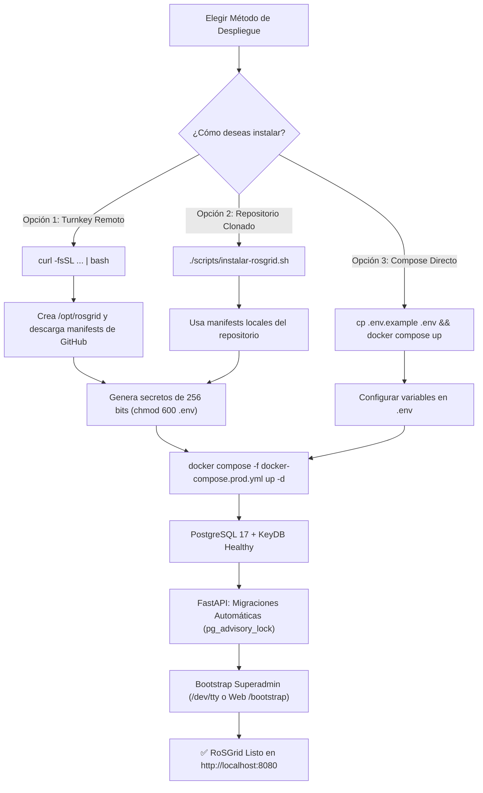

# ⚙️ Guía de Instalación y Puesta en Marcha (INSTALL) — RoSGrid

Este documento detalla los requisitos técnicos y el procedimiento paso a paso para instalar, configurar y actualizar **RoSGrid** tanto en entornos de producción (ISP / NOC / Telecom) como en laboratorios de prueba (EVE-NG / GNS3).

---

## 1. Requisitos del Sistema y Red

### 1.1 Requisitos del Servidor Anfitrión (Host Docker)

| Recurso | Estándar con **KeyDB** (Hasta 300 Routers) | Alta Escala con **DragonflyDB** (300 a 2,000+ Routers) |
| :--- | :--- | :--- |
| **Sistema Operativo** | Linux 64-bit (Ubuntu 24.04 / 26.04 LTS, Debian 12+) | Ubuntu Server 24.04 / 26.04 LTS (Kernel `>= 6.2` con soporte `io_uring`) |
| **CPU** | 2 a 4 vCPU (`x86_64` / `amd64`) | 8+ vCPU (`x86_64` / `amd64`) |
| **Memoria RAM** | **4 GB a 8 GB RAM** (KeyDB consume ~35 MB en reposo) | **16 GB+ RAM** (DragonflyDB pre-reserva memoria por cada hilo de CPU) |
| **Almacenamiento** | 20 GB SSD (NVMe recomendado) | 80 GB+ NVMe (para retención de backups `.rsc` y bitácora WORM con índice `BRIN`) |
| **Motor de Contenedores** | Docker Engine `>= 24.0` + Docker Compose `v2.20+` | Docker Engine `>= 26.0` + Docker Compose `v2.27+` |

### 1.2 Requisitos en los Equipos MikroTik

- **Versión de Sistema Operativo:** **RouterOS v7.1 o superior** (arquitecturas `ARM`, `ARM64`, `TILE`, `x86` o `CHR`). *Nota: RouterOS v6 no es compatible por carecer de API REST nativa `/rest/*`.*
- **Conectividad de Red:** El contenedor `rosgrid-api` y `rosgrid-worker` deben alcanzar la IP de gestión de cada MikroTik por el puerto **TCP `443`** (o el puerto personalizado asignado a `/ip/service/www-ssl`).
- **Reloj Sincronizado (NTP):** Tanto el servidor host de RoSGrid como los operadores deben tener la hora sincronizada vía NTP para la validación de códigos **2FA TOTP (RFC 6238)**.

---

## 2. Preparación de Variables de Entorno y Secretos Criptográficos (`.env`)

Nunca utilices las claves de ejemplo en un entorno real. Ejecuta los siguientes comandos en tu terminal Linux para generar un archivo `.env` con entropía criptográfica segura (`256 bits`):

```bash
# 1. Copiar la plantilla base
cp .env.example .env

# 2. Generar secretos criptográficos aleatorios e inyectarlos en .env
sed -i "s|POSTGRES_PASSWORD=.*|POSTGRES_PASSWORD=$(openssl rand -hex 24)|" .env
sed -i "s|REDIS_PASSWORD=.*|REDIS_PASSWORD=$(openssl rand -hex 24)|" .env
sed -i "s|ROSGRID_MASTER_VAULT_KEY=.*|ROSGRID_MASTER_VAULT_KEY=$(openssl rand -base64 32)|" .env
sed -i "s|ROSGRID_JWT_SECRET_KEY=.*|ROSGRID_JWT_SECRET_KEY=$(openssl rand -base64 48)|" .env
sed -i "s|ROSGRID_CSRF_HMAC_SECRET=.*|ROSGRID_CSRF_HMAC_SECRET=$(openssl rand -base64 48)|" .env

# 3. Opcional: Habilitar el Servidor MCP para Agentes de IA (Hermes Agent / Claude)
# Deshabilitado por defecto (false). Para activarlo, cambia a true y define el rate limit:
# sed -i "s|ROSGRID_MCP_ENABLED=.*|ROSGRID_MCP_ENABLED=true|" .env
# sed -i "s|ROSGRID_MCP_RATE_LIMIT_PER_MIN=.*|ROSGRID_MCP_RATE_LIMIT_PER_MIN=30|" .env

# 4. Proteger los permisos del archivo .env (solo lectura para el propietario)
chmod 600 .env
```

> ⚠️ **IMPORTANTE SOBRE `ROSGRID_MASTER_VAULT_KEY`:** Esta llave maestra de 32 bytes (codificada en Base64) cifra las credenciales API de todos tus routers MikroTik mediante `AES-256-GCM`. Guárdala en un gestor de secretos externo seguro; si pierdes esta llave, no podrás descifrar la bóveda `router_credentials_vault`. Para detalles completos de todas las variables, consulta [01_GUIA_DESPLIEGUE_Y_ENTORNO.md](./01_GUIA_DESPLIEGUE_Y_ENTORNO.md) y [07_GUIA_INTEGRACION_IA_MCP_HERMES_Y_CLAUDE.md](./07_GUIA_INTEGRACION_IA_MCP_HERMES_Y_CLAUDE.md).

---

## 3. Modos de Instalación y Despliegue

Para conocer todos los parámetros avanzados de despliegue, puertos y topologías de red, consulta [01_GUIA_DESPLIEGUE_Y_ENTORNO.md](./01_GUIA_DESPLIEGUE_Y_ENTORNO.md).



### Método Asistido Rápido (Recomendado — Turnkey en 1 Comando)

Para una instalación turnkey sin fricción, dispones de dos alternativas asistidas:

#### 1. Instalación Remota Standalone vía `curl` (Sin clonar el repositorio)

Si te encuentras en un servidor nuevo y deseas desplegar RoSGrid sin clonar el repositorio de código fuente, ejecuta:

```bash
curl -fsSL https://raw.githubusercontent.com/tecno-consultores/RoSGrid/main/scripts/instalar-rosgrid.sh | bash
```

**¿Qué hace este comando automáticamente?**

- Detecta la ejecución remota y crea el directorio de despliegue en `/opt/rosgrid` (personalizable exportando `ROSGRID_INSTALL_DIR`, solicitando `sudo` únicamente para crear la carpeta y asignarla a tu usuario no-root `$USER`).
- Descarga los manifiestos oficiales de producción (`.env.example` y `docker-compose.prod.yml`) desde la rama `main` de GitHub.
- Genera automáticamente secretos criptográficos de alta entropía (256 bits) para PostgreSQL, KeyDB, Bóveda AES-256-GCM, JWT y CSRF con permisos estrictos `chmod 600 .env`.
- Descarga las imágenes oficiales inmutables de Docker Hub (`sinfallas/rosgrid-*`) y levanta los servicios.
- Permite crear el Super Administrador inicial de forma interactiva a través de la terminal `/dev/tty`.

#### 2. Instalación Local (Dentro del repositorio clonado)

Si ya clonaste el repositorio con `git clone`:

```bash
chmod +x ./scripts/instalar-rosgrid.sh
./scripts/instalar-rosgrid.sh
```

*(El script detectará la ejecución local, buscará y cargará automáticamente la configuración de tu archivo `.env` existente —o empleará los valores por defecto si aún no ha sido creado— y te ofrecerá elegir el modo de despliegue: oficial de Docker Hub, compilación local o desarrollo).*

---

### Opción A: Despliegue Manual en Producción desde Docker Hub (ISP / NOC)

Utiliza las imágenes oficiales precompiladas, inmutables y sin privilegios (`non-root`) publicadas en Docker Hub (`sinfallas/rosgrid-backend:latest` y `sinfallas/rosgrid-frontend:latest`). En este modo (`ROSGRID_ENV=production`), la documentación interactiva Swagger/ReDoc está **deshabilitada por seguridad** (consulta `docs/06_REFERENCIA_COMPLETA_API_REST_Y_WEBSOCKETS.md`).

```bash
# 1. Descargar las imágenes oficiales más recientes
docker compose -f docker-compose.prod.yml pull

# 2. Iniciar la plataforma en segundo plano
docker compose -f docker-compose.prod.yml up -d

# 3. Verificar que las migraciones automáticas (pg_advisory_lock) hayan finalizado
docker logs -f rosgrid_api
```

### Opción B: Despliegue Local o Laboratorio (EVE-NG / Desarrollo)

Levanta la plataforma montando el código fuente local sobre las imágenes base inmutables (`sinfallas/base-python-uv:3.15` y `sinfallas/base-node-ionic:26`):

```bash
# 1. Auditar la configuración con Trivy antes de levantar
./scripts/auditar-infra.sh

# 2. Levantar todos los servicios
docker compose up -d

# 3. Verificar el estado de salud de los contenedores
docker compose ps
```

### Opción C: Compilación Multi-Etapa Propia con `buildx`

Si deseas construir tus propias imágenes de producción a partir del código fuente auditado:

```bash
# Ejecutar como usuario normal (NO root)
./scripts/build.sh 1.0.0
```

---

## 4. Motor en Memoria: KeyDB Multi-Hilo (Predeterminado) vs. DragonflyDB (Alto Rendimiento)

Para superar la limitación mono-hilo de Redis tradicional en el bus `Pub/Sub` de telemetría WebSocket y en los pipelines del monitor *Zero-Metrics*, RoSGrid utiliza **KeyDB (`eqalpha/keydb:alpine`) con `--server-threads 2`** como motor predeterminado.

### ¿Por qué recomendamos usar KeyDB por defecto?

1. **Eficiencia extrema de memoria RAM:** Consume apenas `~35 MB` en reposo, ideal para servidores VPS de 4 GB / 8 GB de RAM y laboratorios en EVE-NG.
2. **Desempeño Multi-Hilo real:** Triplica el rendimiento de Redis tradicional en canales `Pub/Sub` y hashes efímeros sin exigir permisos especiales del kernel.
3. **Licencia 100% Software Libre (`BSD-3-Clause`):** Totalmente compatible con la filosofía `GPL-3.0-only` de RoSGrid.

### ¿Cuándo y cómo cambiar al Perfil de Alto Rendimiento con DragonflyDB?

**Recomendación oficial:** Utiliza **KeyDB** a menos que tu entorno opere una flota masiva (**más de 300 a 500 routers MikroTik con decenas de operadores y pantallas NOC conectadas simultáneamente a gráficas en vivo**) sobre un servidor dedicado con **16 GB+ de RAM**.

Si tu operación requiere el motor *Shared-Nothing* sobre `io_uring` de **DragonflyDB**, reemplaza el bloque del servicio `rosgrid-redis` en tu `docker-compose.prod.yml` por el siguiente perfil (no requiere ningún cambio en el código de FastAPI):

```yaml
  rosgrid-redis:
    image: docker.dragonflydb.io/dragonflydb/dragonfly:latest
    container_name: rosgrid_redis
    restart: unless-stopped
    ulimits:
      memlock: -1
    command: >
      dragonfly
      --proactor_threads=4
      --maxmemory=2gb
      --requirepass=${REDIS_PASSWORD} --alsologtostderr networks: - rosgrid_internal_net healthcheck: test: ["CMD-SHELL", "redis-cli -a $${REDIS_PASSWORD} ping | grep PONG"]
      interval: 10s
      timeout: 5s
      retries: 5
```

---

## 5. Preparación Rápida de tus Equipos MikroTik (RouterOS v7.1+)

Antes de registrar un router en el inventario de RoSGrid (individualmente o por lote CSV), ejecuta estos comandos en la terminal del MikroTik para habilitar `www-ssl` con un certificado TLS para fijación **TOFU (*Trust On First Use*)**. Para una explicación detallada de políticas de firewall, grupos de permisos y Safe Mode, consulta [02_PREPARACION_MIKROTIK_ROUTEROS_V7.md](./02_PREPARACION_MIKROTIK_ROUTEROS_V7.md):

```routeros
# 1. Generar y firmar certificado TLS autofirmado en el MikroTik
/certificate add name="rosgrid-tofu-cert" common-name="rosgrid.local" key-size=2048 days-valid=3650 key-usage=digital-signature,key-encipherment,tls-server
/certificate sign "rosgrid-tofu-cert"

# 2. Habilitar REST API v7 sobre HTTPS (puerto 443) y desactivar HTTP plano
/ip service set www-ssl certificate="rosgrid-tofu-cert" port=443 disabled=no
/ip service set www disabled=yes

# 3. Crear grupo con política REST API (obligatorio en RouterOS v7.13+) y usuario dedicado
/user group add name="rosgrid-api-group" policy=read,write,api,rest-api,test comment="Acceso REST para RoSGrid"
/user add name="rosgrid_api" password="CambiarPorClaveInicialFuerte2026!" group="rosgrid-api-group" comment="Managed by RoSGrid Vault"
```

---

## 6. Actualización de Versiones y Migraciones Automáticas

RoSGrid incluye un mecanismo de auto-migración protegido por bloqueo atómico en PostgreSQL (`pg_advisory_lock` ID `948271605` en `fastapi/scripts/entrypoint.sh`). Para actualizar tu instalación a una nueva versión sin corromper el esquema:

```bash
# 1. Consultar cambios relevantes en CHANGELOG.md
less ../CHANGELOG.md

# 2. Descargar la nueva versión de las imágenes y recrear contenedores
docker compose -f docker-compose.prod.yml pull
docker compose -f docker-compose.prod.yml up -d
```

El contenedor `rosgrid_api` adquirirá automáticamente el bloqueo en PostgreSQL 17, ejecutará `alembic upgrade head`, liberará el bloqueo e iniciará el servidor ASGI Uvicorn (`--loop uvloop --http httptools`) sin intervención manual.

---

## 7. Referencias y Manuales Detallados

Para profundizar en la configuración y operación de cada subsistema:

- [01_GUIA_DESPLIEGUE_Y_ENTORNO.md](./01_GUIA_DESPLIEGUE_Y_ENTORNO.md) — Infraestructura, variables y perfiles en memoria (KeyDB / DragonflyDB).
- [02_PREPARACION_MIKROTIK_ROUTEROS_V7.md](./02_PREPARACION_MIKROTIK_ROUTEROS_V7.md) — Comandos CLI, política `rest-api`, TOFU y Safe Mode.
- [03_MANUAL_ADMIN_MULTITENANT_Y_SEGURIDAD.md](./03_MANUAL_ADMIN_MULTITENANT_Y_SEGURIDAD.md) — RLS, 11 roles, Bóveda 2FA, Kill-Switch y Auto-Registro.
- [04_MANUAL_OPERATIVO_WEBFIG_NOC_Y_BACKUPS.md](./04_MANUAL_OPERATIVO_WEBFIG_NOC_Y_BACKUPS.md) — WebFig, RingBuffer, Maker-Checker y Wallboard.
- [05_AUDITORIA_FORENSE_Y_ARQUITECTURA.md](./05_AUDITORIA_FORENSE_Y_ARQUITECTURA.md) — Bitácora WORM, ADR de seguridad y grafos Mermaid.
- [06_REFERENCIA_COMPLETA_API_REST_Y_WEBSOCKETS.md](./06_REFERENCIA_COMPLETA_API_REST_Y_WEBSOCKETS.md) — Especificación técnica de endpoints REST y WebSockets.
- [07_GUIA_INTEGRACION_IA_MCP_HERMES_Y_CLAUDE.md](./07_GUIA_INTEGRACION_IA_MCP_HERMES_Y_CLAUDE.md) — Conexión de agentes autónomos IA (Hermes Agent / Claude).
- [08_PIPELINE_VALIDACION_LOCAL_PRODUCCION.md](./08_PIPELINE_VALIDACION_LOCAL_PRODUCCION.md) — Pipeline de pruebas locales y suite de 24 contratos de integración.
- [09_PLAN_MAESTRO_PRUEBAS_MANUALES_UAT.md](./09_PLAN_MAESTRO_PRUEBAS_MANUALES_UAT.md) — Plan maestro UAT 11X (28 casos E2E).
