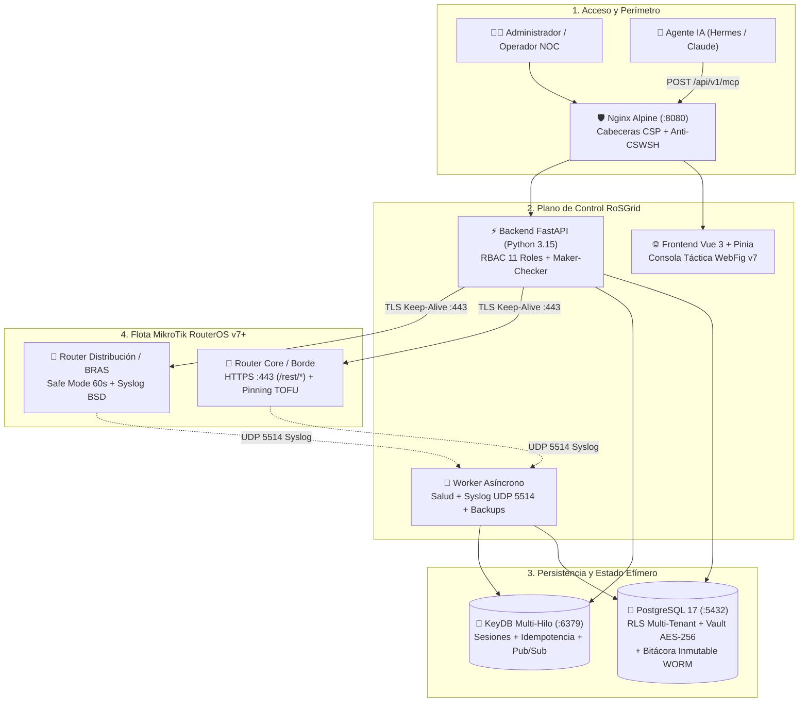
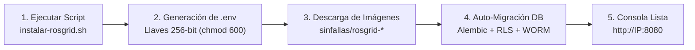
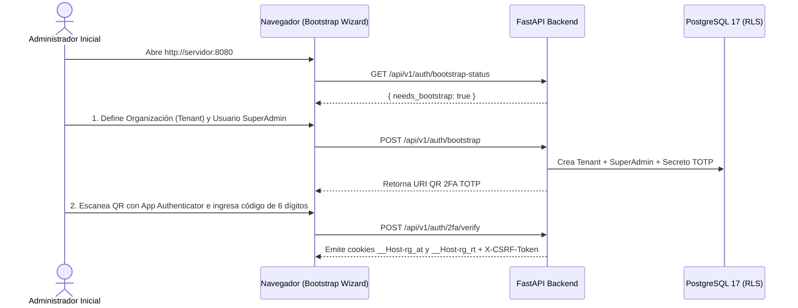
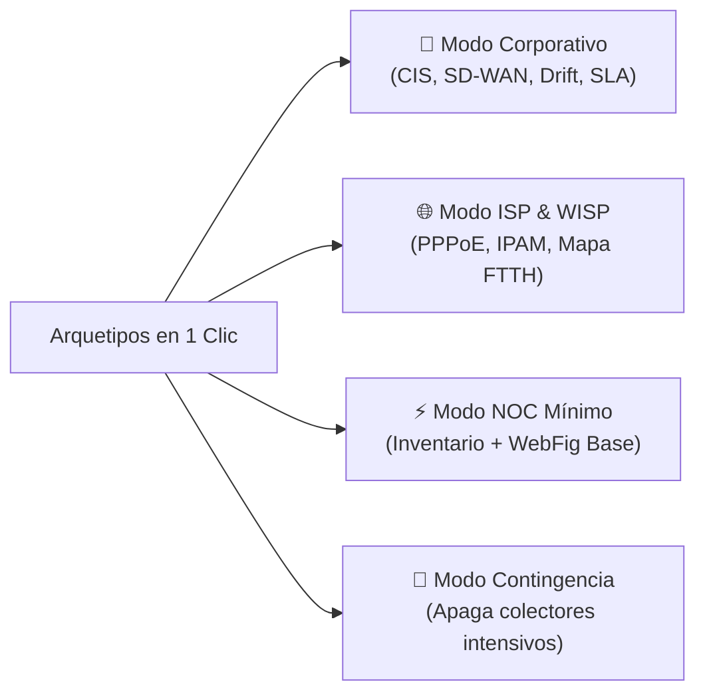
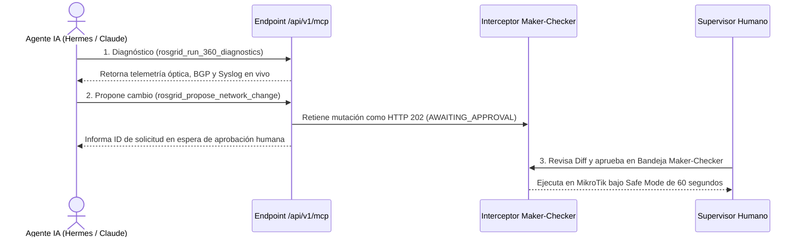

# 🛠️ Manual de Administrador e Instalador — RoSGrid

**Plataforma Centralizada Multi-Tenant y Servidor MCP para Flotas MikroTik RouterOS v7.1+**  
**Sitio Oficial:** [https://rosgrid.net](https://rosgrid.net) • **Licencia:** GNU GPLv3 (`GPL-3.0-only`)

---

## 📑 Índice de Contenidos

1. [Visión General de la Arquitectura de Plataforma](#1-visión-general-de-la-arquitectura-de-plataforma)
2. [Requisitos de Hardware, Red y Sistema Operativo](#2-requisitos-de-hardware-red-y-sistema-operativo)
3. [Instalación Paso a Paso (Turnkey en 1 Comando y Docker Compose)](#3-instalación-paso-a-paso-turnkey-en-1-comando-y-docker-compose)
4. [Asistente de Arranque Inicial (Bootstrap Wizard y 2FA TOTP)](#4-asistente-de-arranque-inicial-bootstrap-wizard-y-2fa-totp)
5. [Preparación y Endurecimiento de Routers MikroTik RouterOS v7](#5-preparación-y-endurecimiento-de-routers-mikrotik-routeros-v7)
6. [Gobierno Multi-Tenant, Feature Flags (19 Módulos) y Conmutación Rápida](#6-gobierno-multi-tenant-feature-flags-19-módulos-y-conmutación-rápida)
7. [Matriz de los 11 Roles RBAC, Bóveda AES-256-GCM y Kill-Switch](#7-matriz-de-los-11-roles-rbac-bóveda-aes-256-gcm-y-kill-switch)
8. [Servidor MCP Protegido para Agentes de Inteligencia Artificial](#8-servidor-mcp-protegido-para-agentes-de-inteligencia-artificial)
9. [Mantenimiento de Plataforma, Respaldos, Escalamiento y Troubleshooting](#9-mantenimiento-de-plataforma-respaldos-escalamiento-y-troubleshooting)

---

## 1. Visión General de la Arquitectura de Plataforma

**RoSGrid** es una consola de gestión técnica, seguridad y automatización diseñada para administrar flotas de routers **MikroTik con RouterOS v7.1 o superior** exclusivamente a través de su **API REST nativa sobre HTTPS (`/rest/*`)**.

### 1.1 Diagrama de Componentes y Flujo de Seguridad



### 1.2 Principios Arquitectónicos Clave para el Administrador

- **Cero Series Temporales en Base de Datos (*Zero-Metrics Storage*):** PostgreSQL almacena únicamente configuración, inventario, bóveda cifrada y auditoría WORM. Las gráficas en vivo se procesan en RAM del navegador (`TelemetryRingBuffer`) igual que en WinBox, garantizando que el disco de la base de datos no crezca descontroladamente.
- **Aislamiento Criptográfico (*Split-Credential*):** Los operadores humanos y los agentes IA jamás ven las contraseñas de los routers MikroTik; el backend firma cada petición internamente desencriptando la credencial en memoria desde la bóveda `AES-256-GCM`.
- **Cero Terminal SSH/CLI Libre:** Toda operación pasa por los endpoints estructurados de Capa 1 o el Motor Universal de Capa 2, preservando las políticas RBAC, el *Maker-Checker*, el *Safe Mode* de 60 segundos y la auditoría WORM.

<div style="page-break-after: always;"></div>

---

## 2. Requisitos de Hardware, Red y Sistema Operativo

### 2.1 Dimensionamiento del Servidor Anfitrión (Linux 64-bit)

| Escala de Flota | CPU Recomendada | Memoria RAM | Disco SSD / NVMe | Motor en Memoria |
| :--- | :--- | :--- | :--- | :--- |
| **Pequeña (1 a 100 Routers)** | 2 vCPU | 4 GB RAM | 30 GB SSD | KeyDB Multi-Hilo (Predeterminado) |
| **Mediana (100 a 500 Routers)** | 4 vCPU | 8 GB RAM | 60 GB NVMe | KeyDB Multi-Hilo (Predeterminado) |
| **Gran Escala (500 a 2,500+)** | 8+ vCPU | 16 GB RAM | 120 GB NVMe | Perfil DragonflyDB (Opcional) |

- **Sistema Operativo Soportado:** Ubuntu Server 24.04 LTS / 26.04 LTS o Debian 12+ (64 bits).
- **Motor de Contenedores:** Docker Engine `>= 24.0` y Docker Compose `>= v2.20`.

### 2.2 Matriz de Puertos de Red

| Puerto | Protocolo | Dirección | Propósito Técnico |
| :--- | :--- | :--- | :--- |
| **`8080` (o `443`)** | TCP (HTTP/HTTPS) | Entrante al Servidor | Acceso de navegadores web a la consola RoSGrid y endpoint `/api/v1/mcp`. |
| **`5514` (o `514`)** | UDP | Entrante al Servidor | Recepción de eventos Syslog en tiempo real desde los routers MikroTik. |
| **`443`** | TCP (HTTPS) | Saliente hacia MikroTik | Conexión del backend FastAPI hacia la API REST (`/rest/*`) de cada router. |
| **`5432` y `6379`** | TCP | Interno Docker (Cerrado) | PostgreSQL 17 y KeyDB. **Nunca** se exponen al exterior del host. |

---

## 3. Instalación Paso a Paso (Turnkey en 1 Comando y Docker Compose)

### 3.1 Flujo de Instalación Automatizada



### 3.2 Opción A (Recomendada): Instalación Turnkey en 1 Comando

En un servidor Linux limpio con Docker instalado, ejecute con su usuario administrativo:

```bash
curl -fsSL https://raw.githubusercontent.com/tecno-consultores/RoSGrid/main/scripts/instalar-rosgrid.sh | bash
```

El instalador realiza automáticamente las siguientes tareas:
1. Crea el directorio `/opt/rosgrid` asignado a su usuario sin privilegios (`non-root`).
2. Genera el archivo `/opt/rosgrid/.env` con llaves criptográficas aleatorias de 256 bits (`ROSGRID_VAULT_MASTER_KEY`, `ROSGRID_JWT_SECRET`, `ROSGRID_CSRF_SECRET` y `POSTGRES_PASSWORD`) protegiéndolo con permisos `chmod 600`.
3. Descarga las imágenes firmadas de producción (`sinfallas/rosgrid-backend:latest` y `sinfallas/rosgrid-frontend:latest`) y levanta el stack completo.

### 3.3 Opción B: Instalación desde el Repositorio Clonado

```bash
git clone https://github.com/tecno-consultores/RoSGrid.git
cd RoSGrid
./scripts/instalar-rosgrid.sh
```

### 3.4 Variables Críticas del Archivo `.env`

| Variable | Descripción | Requisito de Seguridad |
| :--- | :--- | :--- |
| `ROSGRID_ENV` | Modo de ejecución (`production`) | Oculta Swagger/OpenAPI y aplica cookies seguras. |
| `ROSGRID_VAULT_MASTER_KEY` | Llave maestra AES-256-GCM (Base64 de 32 bytes) | **Crítica:** Respaldar fuera del servidor. Si se pierde, no podrá desencriptar claves guardadas. |
| `ROSGRID_JWT_SECRET` | Secreto de firma para tokens de sesión | Cadena hexadecimal aleatoria de al menos 64 caracteres. |
| `ROSGRID_CSRF_SECRET` | Secreto HMAC-SHA256 para tokens anti-CSRF | Cadena hexadecimal aleatoria de al menos 64 caracteres. |
| `POSTGRES_PASSWORD` | Contraseña del motor PostgreSQL 17 | Generada automáticamente por el instalador. |

<div style="page-break-after: always;"></div>

---

## 4. Asistente de Arranque Inicial (Bootstrap Wizard y 2FA TOTP)

Al abrir por primera vez `http://<IP_DEL_SERVIDOR>:8080` en el navegador, RoSGrid detecta que la base de datos no tiene organizaciones registradas y muestra automáticamente el **Asistente de Inicialización (Bootstrap Wizard)**:



1. **Paso 1 — Crear Organización Principal (*Tenant*):** Ingrese el nombre de la empresa (ej. `ISP Telecom Principal`) y su identificador corto (`slug`, ej. `sistemas`).
2. **Paso 2 — Crear Cuenta `SUPERADMIN_GLOBAL`:** Defina su nombre de usuario, correo corporativo y contraseña maestra (almacenada con hash `Argon2id`).
3. **Paso 3 — Vincular Segundo Factor (2FA TOTP):** Escanee el código QR en pantalla con *Google Authenticator*, *Aegis*, *2FAS* o *Bitwarden* e introduzca el código de 6 dígitos. Una vez completado, el endpoint de bootstrap queda sellado permanentemente.

---

## 5. Preparación y Endurecimiento de Routers MikroTik RouterOS v7

Para que RoSGrid gestione un equipo MikroTik (físico CCR, CRS, RB o virtual CHR) con **RouterOS v7.1+**, el equipo debe tener habilitado el servicio `www-ssl` (HTTPS) y un usuario con políticas `api` y `rest-api`.

### 5.1 Script CLI Canónico para el Router MikroTik

Copie y pegue el siguiente bloque en la terminal de su MikroTik (vía WinBox):

```routeros
# 1. Crear Autoridad Certificadora (CA) local en el router
/certificate add name="rosgrid-ca" common-name="RoSGrid Local CA" \
    days-valid=3650 key-size=2048 key-usage=key-cert-sign,crl-sign
/certificate sign "rosgrid-ca"

# 2. Crear y firmar certificado TLS para el servicio HTTPS (www-ssl)
/certificate add name="rosgrid-tofu-cert" common-name="rosgrid.local" \
    key-size=2048 days-valid=3650 \
    key-usage=digital-signature,key-encipherment,tls-server
/certificate sign "rosgrid-tofu-cert" ca="rosgrid-ca"

# 3. Activar HTTPS (puerto 443) y desactivar HTTP plano (puerto 80)
/ip service set www-ssl certificate="rosgrid-tofu-cert" port=443 disabled=no
/ip service set www disabled=yes

# 4. Crear grupo y usuario exclusivo para la Bóveda de RoSGrid
/user group add name="rosgrid-api-group" \
    policy=api,rest-api,read,write,test,reboot,policy,sensitive \
    comment="Grupo REST API para RoSGrid"
/user add name="rosgrid_agent" password="CambiarPorClaveSegura2026!" \
    group="rosgrid-api-group" comment="Gestionado por Boveda RoSGrid"
```

### 5.2 Cómo Funciona el Pinning SSL TOFU (*Trust On First Use*) y Auto-Syslog

- **Pinning SHA-256 Automático:** No necesita comprar certificados públicos para cada router. Al registrar el router en RoSGrid, el conector captura la huella `SHA-256` del certificado autofirmado en la primera conexión (`TRUSTED_PINNED`). Si posteriormente un atacante intenta interceptar el tráfico con otro certificado, RoSGrid bloquea la conexión con alerta crítica `FINGERPRINT_MISMATCH` y permite al Administrador verificar y ejecutar un **Re-Pin TOFU** con 2FA.
- **Auto-Aprovisionamiento de Syslog (9 Reglas Canónicas):** Al sincronizar Syslog desde el inventario, RoSGrid configura de forma idempotente la acción remota UDP `5514` (`rosgridsyslog`) en `/system/logging` para recibir eventos críticos, inicios de sesión (`account`), cambios de configuración (`system,info`) y alertas de firewall (`firewall,info`).

<div style="page-break-after: always;"></div>

---

## 6. Gobierno Multi-Tenant, Feature Flags (19 Módulos) y Conmutación Rápida

Una sola instancia de RoSGrid puede alojar múltiples empresas (*Tenants*) completamente aisladas en PostgreSQL mediante políticas `FORCE ROW LEVEL SECURITY (RLS)`.

### 6.1 Conmutador Rápido de Empresas en Cabecera (`SUPERADMIN_GLOBAL`)

El usuario con rol `SUPERADMIN_GLOBAL` dispone en la esquina superior izquierda del selector interactivo **`🏢 {empresa} ▾`**, desde el cual puede buscar cualquier organización activa y cambiar de contexto en caliente sin cerrar sesión.

### 6.2 Estudio de Módulos y Capacidades (`TenantModulesStudioView`)

Desde **Empresas (Tenants) -> `⚙️ Módulos`**, el SuperAdmin gobierna las **19 Feature Flags** divididas en 4 cuadrantes, o aplica **Arquetipos en 1 Clic**:



- **Bloqueo en Cascada (DAG Hard Lock):** Si un módulo padre (como `isp_module_enabled`) se desactiva, sus módulos dependientes (`bgp_looking_glass_enabled`, `sla_tracker_enabled`) se desactivan y bloquean automáticamente para evitar configuraciones inconsistentes.
- **Historial y Rollback en 1 Clic:** En la pestaña **`📜 Historial de Modificaciones`**, el SuperAdmin puede auditar cada cambio previo de módulos con su hash criptográfico WORM y restaurar cualquier estado anterior pulsando **`[ ⤺ Cargar esta versión ]`**.

---

## 7. Matriz de los 11 Roles RBAC, Bóveda AES-256-GCM y Kill-Switch

### 7.1 Tabla Resumen de los 11 Perfiles de Acceso

| Rol del Sistema | Alcance de Equipos | Capacidades Principales y Restricciones |
| :--- | :--- | :--- |
| **`SUPERADMIN_GLOBAL`** | Todos los Tenants | Gobierno global, creación de empresas, licenciamiento de Feature Flags y Bóveda Step-Up. |
| **`TENANT_ADMIN`** | Todo su Tenant | Gestión de usuarios, asignación de routers por técnico, Bóveda Step-Up (30s) y aprobaciones. |
| **`SUPERVISOR`** | Todo su Tenant | Autorización de cambios *Maker-Checker*, ventanas de mantenimiento y *Kill-Switch* de sesiones. |
| **`SUPPORT_L3`** | Asignados / Tenant | Ingeniería Core (BGP, OSPF, Firewall, WebFig Capa 1 y Capa 2), plantillas masivas y aprobaciones. |
| **`SUPPORT_L2`** | Routers Asignados | Configuración WebFig intermedia. Acciones críticas se envían a aprobación *Maker-Checker* (`HTTP 202`). |
| **`SUPPORT_L1`** | Routers Asignados | Diagnóstico en vivo (Ping, Traceroute, Torch), reconexión PPPoE/DHCP y consulta de estado. |
| **`FIELD_TECH`** | Nodos Asignados | Interfaz móvil/tablet de campo, captura GPS, diagnóstico 360° y activación de ONUs (sin acceso a WebFig). |
| **`INVENTORY_MANAGER`** | Todo su Tenant | Alta de routers, importación masiva por CSV en 2 pasos (*Dry-Run* + *Commit*) y rotación de claves API. |
| **`AUDITOR`** | Todo su Tenant | Acceso 100% de solo lectura a la bitácora forense WORM (`audit_logs`) y comparador Git Diff `.rsc`. |
| **`NOC_MONITOR`** | Todo su Tenant | Perfil exclusivo de solo lectura para pantallas gigantes / TVs 24/7 (*Wallboard NOC*). |
| **`SERVICE_ACCOUNT`** | Filtrado por CIDR | Cuenta Machine-to-Machine para agentes IA en el servidor MCP (`POST /api/v1/mcp`). |

### 7.2 Bóveda Criptográfica con *Step-Up Auth* (Autodestrucción en 30s)

1. Solo `SUPERADMIN_GLOBAL` y `TENANT_ADMIN` ven el botón **`🔑 Bóveda`** en el inventario.
2. Al pulsarlo, RoSGrid exige un código **2FA TOTP en vivo** (*Step-Up Authentication*).
3. La contraseña se muestra durante **30 segundos** con una barra de progreso regresiva y luego se purga automáticamente de la memoria RAM del navegador, dejando un registro inmutable en `audit_logs`.

<div style="page-break-after: always;"></div>

---

## 8. Servidor MCP Protegido para Agentes de Inteligencia Artificial

RoSGrid incluye de serie un servidor **Model Context Protocol (MCP)** sobre JSON-RPC 2.0 Streamable HTTP en el endpoint `POST /api/v1/mcp`, permitiendo conectar agentes como **Hermes Agent**, **Claude Desktop** o **Claude Code**.



### 8.1 Emisión de Token MCP en 3 Pasos

1. Ingrese a **Usuarios & RBAC** o al botón **`🤖 Emitir Token MCP`** en la vista de Sesiones Activas.
2. Asigne el nombre del agente, la lista blanca de IPs permitidas (CIDR) y genere el Bearer Token.
3. Descargue la configuración lista para pegar en `claude_desktop_config.json` o `hermes_config.yaml`, junto con la Skill oficial `rosgrid-noc-operator`.

---

## 9. Mantenimiento de Plataforma, Respaldos, Escalamiento y Troubleshooting

### 9.1 Comandos Operativos Frecuentes del Administrador

Ejecute estos comandos dentro de `/opt/rosgrid` (o en la raíz del repositorio):

```bash
# Ver estado de los contenedores y consumo de recursos
docker compose -f docker-compose.prod.yml ps
docker stats --no-stream

# Consultar logs en vivo del backend o del worker de salud/syslog
docker compose -f docker-compose.prod.yml logs -f rosgrid-api
docker compose -f docker-compose.prod.yml logs -f rosgrid-worker

# Realizar copia de seguridad comprimida de la base de datos PostgreSQL 17
docker compose -f docker-compose.prod.yml exec -T postgres \
    pg_dump -U rosgrid rosgrid_db | gzip > backup_rosgrid_$(date +%F).sql.gz

# Actualizar RoSGrid a la última versión publicada en Docker Hub
docker compose -f docker-compose.prod.yml pull
docker compose -f docker-compose.prod.yml up -d
```

### 9.2 Activación Opcional del Perfil DragonflyDB (Flotas > 500 Routers)

Por defecto, RoSGrid utiliza **KeyDB Multi-Hilo**, que consume solo ~35 MB de RAM. Si su flota supera los 500 routers concurrentes y su servidor cuenta con `>= 8 GB` de RAM, puede activar el perfil `dragonfly` en `docker-compose.prod.yml` manteniendo total compatibilidad con el protocolo RESP.

### 9.3 Guía Rápida de Resolución de Problemas (Troubleshooting)

| Síntoma Observado | Causa Probable | Solución Directa |
| :--- | :--- | :--- |
| Router aparece como **`OFFLINE`** al registrarlo | Servicio `www-ssl` apagado o firewall del MikroTik bloqueando el puerto `443`. | Verifique en el MikroTik `/ip service print` y permita la IP del servidor RoSGrid en `/ip firewall filter` (cadena `input`, puerto `443`). |
| Alerta roja **`FINGERPRINT_MISMATCH`** | Se regeneró el certificado TLS en el MikroTik. | En **Inventario**, pulse el botón **`🛡️ Re-Pin TOFU`** en la fila del router y confirme con su código 2FA. |
| Indicador Syslog muestra **`⚪ Sin Syslog`** | El router aún no tiene las reglas de envío hacia el puerto UDP `5514`. | Pulse el botón **`🔄 Sincronizar Syslog`** en la fila del router dentro de **Inventario** para inyectar las 9 directivas automáticamente. |
| Al reabrir el navegador pide iniciar sesión nuevamente | Por seguridad, al cerrar todas las pestañas se activa el período de gracia de 35s que revoca la sesión efímera en KeyDB. | Ingrese sus credenciales nuevamente; el sistema limpia automáticamente el estado previo evitando redirecciones en bucle. |
