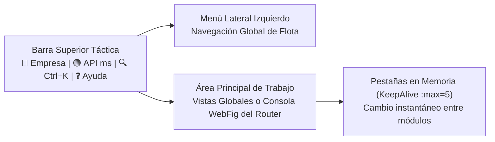
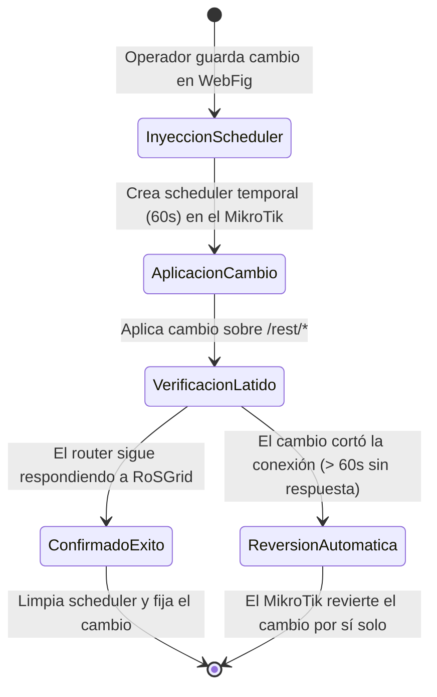
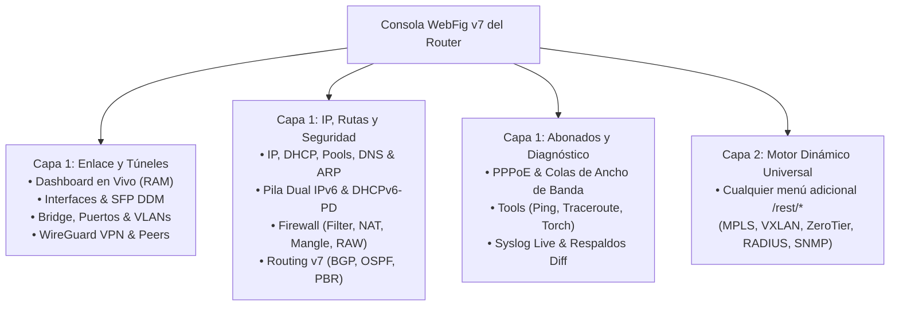

# 📘 Manual de Usuario y Operador NOC — RoSGrid

**Consola Centralizada Multi-Tenant para Operación Técnica de Flotas MikroTik RouterOS v7.1+**  
**Sitio Oficial:** [https://rosgrid.net](https://rosgrid.net) • **Licencia:** GNU GPLv3 (`GPL-3.0-only`)

---

## 📑 Índice de Contenidos

1. [Acceso al Sistema, Navegación Rápida y Temas Visuales](#1-acceso-al-sistema-navegación-rápida-y-temas-visuales)
2. [Protecciones Operativas: Safe Mode (60s) y Maker-Checker](#2-protecciones-operativas-safe-mode-60s-y-maker-checker)
3. [Centro de Mando, Inventario de Routers y Wallboard NOC 24/7](#3-centro-de-mando-inventario-de-routers-y-wallboard-noc-247)
4. [Consola WebFig v7 Paso a Paso (Todos los Módulos de Capa 1 y Capa 2)](#4-consola-webfig-v7-paso-a-paso-todos-los-módulos-de-capa-1-y-capa-2)
5. [Gestión de Direccionamiento IPAM, Mapa Bimodal y Técnico de Campo](#5-gestión-de-direccionamiento-ipam-mapa-bimodal-y-técnico-de-campo)
6. [Respaldos Git Diff, Acciones Masivas y Ventanas de Mantenimiento](#6-respaldos-git-diff-acciones-masivas-y-ventanas-de-mantenimiento)
7. [Cumplimiento Corporativo (CIS Benchmark, CVE, Drift, SLA, CAPsMAN) y Auditoría WORM](#7-cumplimiento-corporativo-cis-benchmark-cve-drift-sla-capsman-y-auditoría-worm)

---

## 1. Acceso al Sistema, Navegación Rápida y Temas Visuales

### 1.1 Inicio de Sesión en 2 Pasos con 2FA TOTP

1. Ingrese el **Identificador de Empresa (*Tenant*)** asignado por su organización (ej. `sistemas`), su usuario o correo electrónico y su contraseña.
2. Introduzca el código temporal de 6 dígitos generado por su aplicación de autenticación (*Google Authenticator*, *Aegis*, *2FAS*).
3. Si aún no tiene cuenta y el administrador habilitó el auto-registro, puede solicitar acceso desde **`Solicitar Registro`**; su cuenta quedará pendiente de aprobación por un administrador.

### 1.2 Estructura de la Interfaz y Atajos de Productividad

- **Buscador Global Rápido (`Ctrl + K`):** Pulse `Ctrl + K` desde cualquier lugar para buscar un router por nombre, IP o serial, o saltar directamente a un submódulo (ej. escribir `"r1 bridge"` o `"firewall"`).
- **Densidad de Tablas (`Compacta 32px` vs `Cómoda 44px`):** En el encabezado de cada tabla técnica puede alternar entre el modo compacto de alta densidad estilo WinBox (`32px`) para escritorio y el modo táctil cómodo (`44px`) para tablets y teléfonos.
- **Tres Temas Visuales:** Conmute desde la barra superior entre **Oscuro Táctico NOC** (predeterminado), **Alto Contraste Wallboard** y **Claro de Oficina/Campo**.
- **Insignias Nativas de RouterOS v7:** Todas las tablas muestran las banderas oficiales al inicio de cada fila:
  - **`[R]` (Running):** Interfaz o sesión activa transportando tráfico.
  - **`[D]` (Dynamic):** Creado dinámicamente por un protocolo (DHCP, BGP, OSPF).
  - **`[X]` (Disabled):** Regla o interfaz deshabilitada administrativamente.
  - **`[I]` (Invalid):** Configuración inválida (pase el cursor para ver la causa).

---

## 2. Protecciones Operativas: Safe Mode (60s) y Maker-Checker

Antes de realizar cambios en un router en producción, es fundamental comprender los dos mecanismos que protegen su red en RoSGrid:

### 2.1 Safe Mode Automático de 60 Segundos (*Dead Man's Switch*)

Cada vez que usted crea, edita o elimina una configuración de red (IP, Bridge, VLAN, Firewall, Routing, WireGuard o PPPoE), RoSGrid protege la operación con **Safe Mode**:

- Mientras la verificación está activa, verá un banner superior con cuenta regresiva de **60 segundos**. Si el router responde con normalidad, el cambio queda confirmado automáticamente.

### 2.2 Flujo de Aprobación *Maker-Checker* (`HTTP 202`)

Cuando un operador con rol intermedio (como `SUPPORT_L2`) o un agente IA ejecuta una acción crítica (ej. eliminar un Bridge, borrar una interfaz o insertar una regla de Firewall de bloqueo), el sistema no la aplica a ciegas:
1. La operación se intercepta con estado **`202 Accepted`**, mostrando un aviso informativo en pantalla.
2. Un **`SUPERVISOR`**, **`SUPPORT_L3`** o **`TENANT_ADMIN`** ingresa al menú **`Maker-Checker`**, revisa los parámetros exactos propuestos y pulsa **`✅ Aprobar y Ejecutar`** (o **`❌ Rechazar`**).
3. Por regla de seguridad, quien solicita el cambio (*Maker*) no puede auto-aprobarlo (*Checker*).

---

## 3. Centro de Mando, Inventario de Routers y Wallboard NOC 24/7

### 3.1 Centro de Mando (`/dashboard`)

Presenta de un vistazo la salud general de la flota: total de routers en línea vs fuera de línea, estado de recepción Syslog, alertas recientes y accesos directos a los módulos más utilizados.

### 3.2 Inventario de Routers (`/inventory`)

Desde esta pantalla puede:
- **Abrir la Consola WebFig de un equipo:** Haga clic en el botón **`🎛️ WebFig`** de la fila del router.
- **Registrar Equipos Individuales o por Lote CSV:** Use **`+ Registrar Router`** o **`📥 Importar CSV`** (que incluye un paso previo de validación *Dry-Run* antes de guardar).
- **Autodescubrimiento de Hardware (`🔍 Descubrir`):** Consulta en vivo modelo de RouterBOARD/CHR, versión de RouterOS v7, número de serie y arquitectura.
- **Sincronizar Syslog (`🔄 Syslog`):** Verifica y aprovisiona en 1 clic el envío de eventos hacia RoSGrid.

### 3.3 Wallboard NOC (`/wallboard`)

Diseñado para monitores y televisores de operación continua 24/7. Muestra el mapa interactivo en vivo, contadores de disponibilidad y alertas visuales/sonoras ante caídas de enlaces o cortes masivos de fibra óptica.

---

## 4. Consola WebFig v7 Paso a Paso (Todos los Módulos de Capa 1 y Capa 2)

Al entrar a **`🎛️ WebFig`** en cualquier router del inventario, dispone del menú lateral de módulos de RouterOS v7 y una barra superior de pestañas que conserva en memoria hasta 5 vistas abiertas simultáneamente (`KeepAlive`).

### 4.1 Dashboard en Vivo (`RouterLiveDashboardView`)
Muestra gráficas en tiempo real de CPU, Memoria RAM, Temperatura, Voltaje y tráfico `TX/RX` por interfaz renderizadas en `<canvas>` 2D. Los datos se acumulan en la memoria de su navegador mientras tiene la pestaña abierta sin llenar la base de datos.

### 4.2 Interfaces & Diagnóstico Óptico SFP DDM (`InterfacesAndSfpView`)
- **Filtrado Rápido por Tipo:** Alterne entre `Todas`, `Ethernet`, `SFP Óptico`, `VLAN`, `Bridge`, `WireGuard` y `WiFi`.
- **Acciones por Interfaz:**
  - **`🔍 DDM Óptico` (en puertos SFP/SFP+):** Abre el modal de telemetría láser mostrando Potencia TX (`dBm`), Potencia RX (`dBm`), Temperatura del transceptor, Voltaje y semáforo de salud óptica (`OPTIMAL`, `WARNING`, `CRITICAL`).
  - **`✏️` (Editar):** Permite cambiar el nombre de la interfaz, el `MTU`, el comentario o el `VLAN ID` (si es una subinterfaz VLAN).
  - **`▶ / ⏸` (Habilitar / Deshabilitar):** Activa o desactiva la interfaz bajo Safe Mode.
  - **`+ Crear Subinterfaz VLAN` y `🗑️`:** Crea o elimina subinterfaces 802.1Q (`/interface/vlan`).

### 4.3 Bridge, Puertos Miembro & VLAN Switching (`BridgeView`)
Dividido en 4 pestañas operativas:
1. **`🌉 Bridges`:** Permite **`+ Crear Bridge`**, **`✏️ Editar`** sus parámetros (nombre, protocolo `rstp`/`stp`/`mstp`, `MTU`, `VLAN Filtering`, comentario) y **`🗑️`** eliminar un bridge.
2. **`🔌 Puertos Miembro`:**
   - **`+ Agregar Puerto`:** Asigna una interfaz física a un bridge definiendo su `PVID` y `Frame Types`.
   - **`✏️ Editar`:** Modifica el bridge destino, el `PVID`, `Frame Types`, `Hardware Offload` o comentario del puerto miembro.
   - **`⏏ Sacar del Bridge`:** Libera inmediatamente la interfaz física del bridge (`/interface/bridge/port`) bajo protección Safe Mode para que pueda utilizarse de forma independiente.
3. **`🏷️ Tabla VLANs`:** Permite **`+ Definir VLAN en Bridge`** (`/interface/bridge/vlan`), crear una **`+ Subinterfaz 802.1Q`**, **`✏️ Editar`** los puertos `tagged` / `untagged` de una VLAN existente o **`🗑️`** eliminarla.
4. **`💻 Hosts / FDB MAC`:** Consulta en tiempo real la tabla de direcciones MAC aprendidas por cada puerto del switch/bridge.

### 4.4 WireGuard VPN & Peers (`WireGuardVpnView`)
Cuenta con 2 pestañas con control CRUD completo:
1. **`🛡️ Interfaces WireGuard`:**
   - **`+ Nueva Interfaz WireGuard`:** Crea un túnel definiendo nombre, puerto UDP de escucha (`Listen Port`) y `MTU`.
   - **`✏️ Editar`:** Modifica nombre, puerto de escucha UDP, `MTU` o comentario del túnel.
   - **`🗑️ Eliminar`:** Elimina la interfaz de túnel WireGuard seleccionada bajo Safe Mode.
2. **`🔑 Peers Criptográficos`:**
   - **`+ Agregar Peer`:** Registra un par remoto con su clave pública Base64, `Allowed Address`, `Endpoint` y puerto.
   - **`✏️ Editar` y `🗑️ Eliminar`:** Edita los parámetros de enrutamiento/endpoint de un Peer existente o lo revoca inmediatamente.

### 4.5 IP, Servidor/Cliente DHCP, Pools, DNS & ARP (`IpAddressesAndDhcpView`)
Centraliza todo el direccionamiento IPv4 en 6 pestañas con edición y borrado completos:

| Pestaña | Acciones Disponibles en Pantalla |
| :--- | :--- |
| **`Direcciones IP`** | **`+ Asignar IP`**, **`✏️`** editar dirección CIDR/interfaz/comentario/estado y **`🗑`** eliminar IP (con bloqueo anti-suicidio sobre la IP de gestión de RoSGrid). |
| **`Servidor DHCP`** | Contiene 3 sub-pestañas: • **Concesiones Activas (Leases):** **`📌`** Hacer estática (`make-static`), **`✏️`** editar IP/Rate-Limit/comentario, **`🚫`** bloquear cliente en cuarentena y **`🗑`** eliminar. • **Servidores DHCP:** **`⚡ Asistente DHCP 3 Pasos`**, **`+ Crear Servidor`**, **`✏️`** editar servidor (nombre, interfaz, pool, lease time, deshabilitado) y **`🗑`** eliminar. • **Redes y Opciones:** **`+ Añadir Red DHCP`**, **`✏️`** editar subred CIDR, Gateway, Servidores DNS, Dominio, NTP y comentario, y **`🗑`** eliminar red. |
| **`Cliente DHCP WAN`** | **`+ Añadir Cliente WAN`**, **`✏️`** editar interfaz WAN, distancia de ruta por defecto (`1..255`), uso de DNS/NTP del proveedor, comentario y estado, **`🔄`** renovar (`Renew`), **`❌`** liberar (`Release`) y **`🗑`** eliminar. |
| **`Pools de Direcciones`** | **`+ Nuevo Pool`**, **`✏️`** editar nombre, rangos de IPs y siguiente pool (`Next Pool`), y **`🗑`** eliminar pool de conexiones. |
| **`DNS & Caché`** | **`✏️ Editar Parámetros`:** Abre el modal para editar los servidores DNS upstream, permitir peticiones remotas (`Allow Remote Requests`), tamaño de caché, tamaño máximo UDP y servidor DoH (`/ip/dns/set`). Además incluye **`🧹 Vaciar Caché DNS`** y tabla de **Registros DNS Estáticos** con **`+ Nuevo Registro DNS`**, **`✏️`** editar y **`🗑`** eliminar. |
| **`Tabla ARP`** | **`+ Añadir ARP Estático`**, **`📌`** fijar entrada dinámica como estática, **`✏️`** editar IP/MAC/interfaz/comentario y **`🗑`** eliminar entrada ARP. |

### 4.6 Pila Dual IPv6 & Prefix Delegation (`Ipv6DualStackView`)
Permite operar redes IPv6 de última generación en 5 pestañas:
- **`Direcciones IPv6`:** **`+ Asignar IPv6`** (con SLAAC `advertise` y `EUI-64`), **`✏️`** editar y **`🗑`** eliminar.
- **`Cliente DHCPv6 (PD)`:** Solicita prefijos delegados al proveedor WAN, con botones **`✏️`** editar, **`🔄`** renovar y **`🗑`** eliminar.
- **`Servidor DHCPv6` y `Pools IPv6`:** Creación, edición (**`✏️`**) y eliminación (**`🗑`**) de servidores y pools de prefijos `/48`, `/56` o `/64`.
- **`Vecinos NDP`:** Inspección en vivo de dispositivos descubiertos por Neighbor Discovery Protocol.

### 4.7 Firewall (Filter, NAT, Mangle, RAW, Address-Lists) y Asistentes NAT (`FirewallRulesView`)
- **Conmutador Bimodal `IPv4` / `IPv6`:** Alterne entre `/ip/firewall` e `/ipv6/firewall`.
- **Asistentes Rápidos en 1 Clic (pestaña NAT):**
  - **`⚡ Wizard Masquerade`:** Configura salida a Internet seleccionando la interfaz WAN.
  - **`🎯 Wizard Port Forwarding`:** Publica un servidor interno (cámaras, web, PBX) creando la regla `dstnat` en 2 pasos.
- **Gestión de Reglas y Address-Lists:** Crear (`+ Nueva Regla`), editar (`✏️`), habilitar/deshabilitar (`▶/⏸`), reordenar con *Drag & Drop* o flechas de teclado y eliminar (`🗑️`) tanto reglas como entradas de listas de direcciones (`Address-Lists`).

### 4.8 Routing v7 (Rutas Estáticas, BGP, OSPF y PBR) (`RoutingBgpOspfView`)
- **Rutas Estáticas Dual-Stack:** Creación, edición (`✏️`) y borrado (`🗑️`) de rutas con monitoreo `check-gateway` (`ping` / `arp`) y distancia administrativa para failover automático.
- **BGP v7 Interactivo:** Creación, edición (`✏️`), reinicio suave (`🔄 Soft Reset`) y eliminación (`🗑️`) de sesiones BGP (`/routing/bgp/connection`) indicando AS local, AS remoto y dirección del peer.
- **OSPF v2/v3 y Policy-Based Routing (PBR):** Supervisión de instancias/vecinos OSPF y gestión completa (crear, editar `✏️` y eliminar `🗑️`) de tablas FIB (`/routing/table`) y reglas de política de enrutamiento (`/routing/rule`).

### 4.9 PPPoE & Colas de Ancho de Banda (`PppAndQueuesView`)
- **`Sesiones Activas`:** Permite desconectar (`⏏ Kick`) sesiones PPPoE colgadas para forzar su reconexión limpia.
- **`Secretos PPP`, `Perfiles PPP` y `Servidores PPPoE`:** Cuentan con botones para crear, **`✏️ Editar`** (contraseña, servicio, perfil, IP local/remota, `Rate Limit`, servidores DNS, `Max MTU`), habilitar/deshabilitar y **`🗑️ Eliminar`**.
- **`Simple Queues`:** Creación y edición (`✏️`) de colas de ancho de banda con barra de **Presets en 1 Clic** (`10M`, `25M/50M`, `50M/100M`, `100M/300M`, `200M/600M`, `1G`) y semáforo de saturación en tiempo real.

---

## 5. Gestión de Direccionamiento IPAM, Mapa Bimodal y Técnico de Campo

### 5.1 Módulo IPAM (`/ipam`)
- Visualiza todos los bloques IPv4 e IPv6 de la organización con barras de porcentaje de ocupación.
- Al hacer clic en un prefijo `/24`, despliega la **Rejilla Táctica de 256 IPs** coloreando las direcciones libres, asignadas y reservadas.
- Incluye alertas automáticas de corte de fibra GPON desglosando el puerto PON y la caja NAP afectada.

### 5.2 Mapa Unificado Bimodal (`/subscribers/map`) y Topología L2 (`/topology`)
- **3 Capas Conmutables:** Alterne en el mapa entre Routers de Infraestructura, Clientes/ONUs y Enlaces.
- **Análisis de Causa Raíz (RCA):** Si un router de cabecera cae, el sistema suprime las alarmas redundantes de los equipos hijos conectados aguas abajo para señalar el origen real de la falla.
- **Cerradura Operativa Anti-Colisión:** Cuando un técnico toma un incidente en el mapa, el nodo queda marcado como "En atención" para evitar que dos cuadrillas trabajen sobre el mismo corte sin saberlo.

### 5.3 Vista de Técnico de Campo (`/field-tech`)
Adaptada para teléfonos móviles, tablets y laptops en terreno: permite ejecutar el **Diagnóstico 360°** (Ping multi-MTU, verificación de niveles ópticos y logs de desconexión), capturar coordenadas GPS del domicilio con un toque y registrar la activación del cliente.

---

## 6. Respaldos Git Diff, Acciones Masivas y Ventanas de Mantenimiento

### 6.1 Comparador de Respaldos Estilo Git (`/backups-diff`)
Compara lado a lado cualquier respaldo histórico `.rsc` contra otro respaldo o contra la configuración en vivo (`LIVE`) del router, resaltando en verde las líneas añadidas y en rojo las líneas eliminadas.

### 6.2 Operaciones Masivas y Plantillas Golden Config (`/bulk-ops`)
Permite aplicar un catálogo de **24 plantillas estandarizadas** (NTP, DNS resiliente, Syslog centralizado, BGP RPKI, CGNAT determinista, CoPP, BCP38, QoS CAKE, VLAN Trunk, etc.) o actualizaciones de firmware PoE-Aware sobre decenas de routers simultáneamente, deteniendo el lote automáticamente (*Safety Stop*) si detecta anomalías.

### 6.3 Ventanas de Mantenimiento con Auto-Eliminación Auditada (`/maintenance`)
1. Programe una ventana seleccionando fecha/hora de inicio y fin en el calendario interactivo (o usando los botones rápidos `+1 Hora`, `+2 Horas`, `+4 Horas`, `+24 Horas`) y el alcance (`Global`, `Por Etiqueta` o `Routers Específicos`).
2. Mientras la ventana está activa, las alertas de los routers incluidos se silencian para evitar falsas alarmas durante trabajos nocturnos.
3. **Auto-Eliminación Automática al Finalizar:** En cuanto se cumple la hora de finalización programada (`ends_at`), el sistema **elimina automáticamente la ventana vencida** y deja un registro inmutable en la bitácora de auditoría (`MAINTENANCE_WINDOW_EXPIRED_AUTO_DELETED`) y en el log del servidor.

---

## 7. Cumplimiento Corporativo (CIS Benchmark, CVE, Drift, SLA, CAPsMAN) y Auditoría WORM

En el menú **`Flota & Seguridad`** (`/enterprise` y `/fleet-cves`):
- **Auditoría CIS Benchmark Interactivo (28 Directivas):** Evalúa el nivel de endurecimiento de cada router (0 a 100%), permite filtrar por perfil recomendado (`Todos`, `ISP`, `Empresa`), consultar los enlaces oficiales de RFC/MikroTik y aplicar **`⚡ Auto-Remediar`** en 1 clic bajo Safe Mode.
- **Matriz de Vulnerabilidades CVE:** Cruza la versión exacta de RouterOS v7 de cada equipo contra el catálogo de vulnerabilidades conocidas para priorizar actualizaciones.
- **Config Drift (Desviación de Configuración):** Detecta si algún cambio manual desvió al router de su plantilla maestra (*Golden Baseline*) y permite revertirlo en 1 clic.
- **Detección de Rogue DHCP y Monitor de SLA:** Detecta servidores DHCP piratas en la red LAN y mide latencia/jitter P95/P99 hacia proveedores upstream.
- **Bitácora de Auditoría Forense WORM (`/audit-logs`):** Exclusiva para Auditores y Administradores; permite inspeccionar cada acción humana o de IA con su estado previo/posterior y verificar criptográficamente la cadena de bloques `HMAC-SHA256` que impide alterar o borrar cualquier registro histórico.
