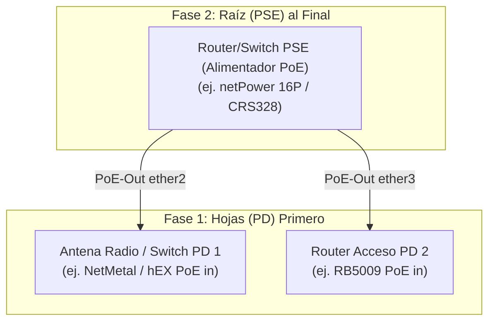

# 35 — AUTOMATIZACIÓN DE FLOTA, TOPOLOGÍA FÍSICA L2, RECEPTOR SYSLOG EFÍMERO Y EXPORTADOR PROMETHEUS (RoSGrid)

> **[DIRECTIVA DE SISTEMA]:** Esta especificación define la arquitectura técnica y el diseño conceptual para la siguiente evolución de capacidades operativas de RoSGrid:
>
> 1. Motor de Actualizaciones Masivas con Ordenamiento Consciente de PoE (*PoE-Aware Upgrades*) y Parada de Emergencia Automática (*Fleet Safety Stop*).
> 2. Cruce Proactivo de Vulnerabilidades CVE sobre el Inventario con Base de Conocimiento Local (Cero Fuga a Nube Externa).
> 3. Receptor Syslog Centralizado Efímero (UDP/TCP en puerto 5514) con Alertas en Vuelo y Cero Almacenamiento en Disco PostgreSQL (RingBuffer KeyDB).
> 4. Plantilla Estandarizada para Enrolamiento Masivo de Routers al Receptor Syslog.
> 5. Descubrimiento y Mapeo Visual Dinámico de Topología Física Capa 2 (MNDP/LLDP) sin Guardar Series Temporales.
> 6. Puente de Telemetría de Flota hacia Prometheus (`GET /api/v1/metrics/fleet`) para Grafana, preservando la premisa *Zero-Metrics Storage* en PostgreSQL.
> 7. Ampliación del Servidor MCP y de la Skill `rosgrid-noc-operator` para Agentes IA autónomos.
> 8. Marco Integral de Ciberseguridad, Mitigación de Vulnerabilidades y Análisis de Riesgos.

---

## 1. Actualizaciones Masivas PoE-Aware y Parada de Emergencia de Flota (*Safety Stop*)

### 1.1. Grafo de Dependencia Energética y Topológica

En entornos de telecomunicaciones (torres WISP, nodos FTTH, redes de distribución), es común que routers o switches MikroTik energicen a otros equipos aguas abajo mediante PoE (*Power over Ethernet* / `poe-out`). Si se actualiza y reinicia primero el equipo que suministra energía (*Power Sourcing Equipment* - PSE), se corta el suministro eléctrico a los equipos alimentados (*Powered Devices* - PD) en pleno proceso de escritura de firmware/RouterBOARD, pudiendo corromper el sistema operativo del equipo dependiente (*bricking*).



#### Reglas del Algoritmo de Ordenamiento

1. **Detección de Relación PoE:** A partir del descubrimiento L2 (MNDP/LLDP) y el estado de `/rest/interface/ethernet/poe` (`poe-out-status = "delivering-power"`), el sistema construye un Grafo Acíclico Dirigido (DAG) de dependencias eléctricas.
2. **Secuencia de Ejecución:**
   * **Nivel 0 (Hojas / PD):** Se actualizan, reinician y verifican primero los equipos alimentados que no energizan a ningún otro nodo.
   * **Nivel 1..N (Nodos Intermedios):** Se actualizan secuencialmente por capas de abajo hacia arriba.
   * **Nivel Raíz (PSE):** El router o switch proveedor de energía solo se actualiza una vez que todos sus clientes PoE hayan reiniciado exitosamente y reportado estado `ONLINE`.

### 1.2. Parada de Emergencia Automática (*Fleet Safety Stop Circuit-Breaker*)

Para evitar catástrofes operativas en actualizaciones masivas de cientos de routers:

* **Umbral de Tolerancia:** Se configura un porcentaje de fallo máximo por lote (por defecto `1%` o un valor absoluto configurable, ej. `1 router fallido`).
* **Verificación Post-Reinicio:** Tras enviar `/system/package/update/install` y el posterior reinicio del equipo, el worker espera un periodo de gracia (ej. 180 segundos). Si el router no restablece su conexión HTTPS REST y su huella SSL TOFU dentro de ese tiempo:
  * El router se marca como `UPGRADE_FAILED_POST_REBOOT`.
  * Si la tasa de fallos acumulada supera el umbral de `Safety Stop`:
    * Se **cancela de forma inmediata y automática** el resto de la cola de actualización del lote.
    * Se emite una alerta prioritaria `CRITICAL_SAFETY_STOP_TRIGGERED` a través de los canales de notificación configurados (Telegram, Webhook, Wallboard NOC).
    * Se registra el incidente en la bitácora inmutable WORM (`audit_logs`) con firma HMAC-SHA256.

### 1.3. Gobernanza Maker-Checker

* Cualquier trabajo masivo de actualización de firmware o paquetes clasifica como categoría crítica `SYSTEM_PACKAGE_UPGRADE_OR_RESET`.
* Exige aprobación de dos operadores distintos (`maker != checker`) generando una respuesta inicial `HTTP 202 Accepted`.

---

## 2. Cruce Proactivo de Vulnerabilidades CVE en el Inventario

### 2.1. Arquitectura de Cero Exposición Externa (Zero-Telemetry Leak)

Para preservar la confidencialidad absoluta de la infraestructura:

* **Prohibido:** Enviar modelos o versiones de routers a servicios en la nube de terceros.
* **Modelo Adoptado:** RoSGrid mantendrá un archivo de base de datos local embebida (`cve_catalog_ros.json`) dentro del backend.
  * Cada registro contiene: `cve_id`, `cvss_score`, `severity` (`CRITICAL`, `HIGH`, `MEDIUM`, `LOW`), `affected_versions_expr`, `description_es`, `remediation_ros_version`, `published_date`.
  * El motor de cruce evalúa en memoria la versión instalada (`routers.ros_version`) contra las expresiones de versiones afectadas sin realizar peticiones salientes a internet.

### 2.2. Visualización en Inventario y Alertas

* **Insignias Tácticas de Riesgo:** En la grilla de inventario (`RgDataTable.vue`), si un router tiene CVEs pendientes, se muestra una insignia de advertencia:
  * 🔴 `CRITICAL (CVSS >= 9.0)`: ej. vulnerabilidades de ejecución remota o escalada de privilegios en WebFig/REST.
  * 🟠 `HIGH (CVSS 7.0 - 8.9)`: DoS en BGP/WireGuard.
  * 🟡 `MEDIUM (CVSS 4.0 - 6.9)`.
* **Modal de Detalles CVE:** Al hacer clic, se listan los boletines aplicables, el resumen de la vulnerabilidad y la versión recomendada para mitigación.

---

## 3. Receptor Syslog Centralizado Efímero (UDP/TCP 5514)

### 3.1. Cumplimiento Estricto de "Zero-Metrics Storage"

* **Problema:** En flotas con cientos de routers, almacenar texto de Syslog indiscriminadamente en PostgreSQL satura el almacenamiento y genera cuellos de botella de I/O.
* **Solución Arquitectónica:**
  1. **Receptor Asíncrono no Privilegiado:** El worker backend expone un puerto no privilegiado (UDP y TCP en el puerto `5514`), mapeado externamente a `514` o `5514`.
  2. **Búfer Circular en KeyDB (Cero Disco):** Cada router almacena únicamente sus últimos `500` eventos en un RingBuffer en memoria RAM de KeyDB (clave `rg:{tenant_id}:router:{router_id}:syslog:ring` con estructura de lista circular o Redis Stream con `MAXLEN 500`).
  3. **Auto-Expiración y Memoria Fija:** Máximo ~20 MB de RAM en KeyDB para toda la flota. Cero bytes escritos en PostgreSQL.

### 3.2. Motor de Alertas en Vuelo (*Filter-in-Flight*)

El receptor analiza cada mensaje entrante en memoria en microsegundos:

* **Patrones Críticos:**
  * Caídas de interfaz física: `interface,warning.*link down`
  * Desconexiones BGP/OSPF: `route,bgp,warning.*state changed to (Idle|Active)`
  * Fuerza bruta o accesos fallidos: `system,error,critical.*login failure`
  * Agotamiento de recursos: `dhcp,critical.*pool.*is exhausted` o `system,critical.*out of memory`
* **Acción Inmediata:** Si coincide con un patrón crítico:
  * Despacha un evento WebSocket prioritario a la consola del Wallboard NOC.
  * Dispara alerta por Telegram/Webhook si el canal está activo.
  * El mensaje rutinario (`system,info`, etc.) solo se retiene en el búfer circular volátil de KeyDB para consulta diagnóstica del operador.

---

## 4. Plantilla Estandarizada para Enrolamiento Masivo de Routers al Syslog

Para que los routers envíen sus logs a RoSGrid, se incorpora al catálogo de plantillas (*Config Templates*) la plantilla oficial de aprovisionamiento Syslog:

```routeros
# ==============================================================================
# Plantilla RoSGrid: Enrolamiento de Syslog Remoto Efímero (RouterOS v7)
# Parámetros: {{ROSGRID_SERVER_IP}}, {{ROSGRID_SYSLOG_PORT}} (por defecto 5514)
# ==============================================================================

/system logging action
remove [find name="rosgrid-syslog"]
add name="rosgrid-syslog" target=remote remote={{ROSGRID_SERVER_IP}} remote-port={{ROSGRID_SYSLOG_PORT}} bsd-syslog=yes facility=daemon sys-ident=yes

/system logging
remove [find action="rosgrid-syslog"]
add topics=interface,warning,critical action="rosgrid-syslog"
add topics=route,bgp,warning action="rosgrid-syslog"
add topics=route,ospf,warning action="rosgrid-syslog"
add topics=system,error,critical action="rosgrid-syslog"
add topics=dhcp,critical action="rosgrid-syslog"
add topics=firewall,warning action="rosgrid-syslog"
```

Esta plantilla puede desplegarse en 1 clic sobre 50 o 500 routers mediante el módulo de Operaciones Masivas (*Bulk Ops*) bajo Safe Mode.

---

## 5. Descubrimiento y Grafo Visual de Topología Física Capa 2 (MNDP/LLDP)

### 5.1. Recolección y Cruce de Vecinos L2

* El backend consulta periódicamente o bajo demanda el endpoint `/rest/ip/neighbor` de todos los routers adoptados en el tenant.
* **Correlación de Enlaces:**
  * Router A reporta en su interfaz `sfp-sfpplus1` un vecino con identidad `SW-CORE-01` y MAC `48:8F:5A:xx:xx:xx`.
  * RoSGrid busca en la tabla `routers` del tenant cuál router posee esa identidad o MAC.
  * Se establece una arista en el grafo topológico: `RouterA [sfp-sfpplus1] <---> [sfp-sfpplus2] SwitchCore`.
  * Se extrae la velocidad de negociación (`10Gbps`, `1Gbps`), estado del enlace y tipo de vecino (MikroTik MNDP o estándar LLDP/CDP).

### 5.2. Renderizado Táctico en Frontend

* **Visualizador en Canvas / SVG Interactivo:**
  * Vista disponible en `/topology/l2` con físicas suaves (fuerza de repulsión entre nodos).
  * Los nodos representan routers/switches con su estado en vivo (`ONLINE` en verde cyan, `DEGRADED` en naranja, `OFFLINE` en rojo).
  * Al hacer clic en un enlace, muestra el par de puertos interconectados y la velocidad reportada.
  * **Cero almacenamiento de métricas:** El grafo se construye y resuelve en memoria de la sesión del usuario.

---

## 6. Exportador de Métricas de Flota para Prometheus (`/api/v1/metrics/fleet`)

### 6.1. Puente de Memoria KeyDB -> Prometheus Exposition Format

Para permitir a organizaciones que ya operan Grafana o Zabbix graficar tendencias a largo plazo sin que RoSGrid deba almacenar series en PostgreSQL:

* **Endpoint:** `GET /api/v1/metrics/fleet`
* **Mecanismo:** Al ser consultado por Prometheus (scrape HTTP), el backend lee el estado más reciente de la máquina de estados en KeyDB y genera en microsegundos el texto en formato estándar de Prometheus:

```prometheus
# HELP rosgrid_router_status Estado de conectividad del router (1=ONLINE, 0=OFFLINE, 2=DEGRADED)
# TYPE rosgrid_router_status gauge
rosgrid_router_status{tenant_id="tenant-acme",router_id="uuid-1",identity="RTR-BOG-01",model="CCR2004-16G-2S+"} 1

# HELP rosgrid_router_cpu_percent Uso de CPU del router reportado por el monitor efímero
# TYPE rosgrid_router_cpu_percent gauge
rosgrid_router_cpu_percent{tenant_id="tenant-acme",router_id="uuid-1",identity="RTR-BOG-01"} 14.5

# HELP rosgrid_router_memory_usage_ratio Proporción de memoria RAM utilizada (0.0 a 1.0)
# TYPE rosgrid_router_memory_usage_ratio gauge
rosgrid_router_memory_usage_ratio{tenant_id="tenant-acme",router_id="uuid-1",identity="RTR-BOG-01"} 0.32

# HELP rosgrid_router_active_cves_count Cantidad de vulnerabilidades CVE pendientes por severidad
# TYPE rosgrid_router_active_cves_count gauge
rosgrid_router_active_cves_count{tenant_id="tenant-acme",router_id="uuid-1",severity="critical"} 0
rosgrid_router_active_cves_count{tenant_id="tenant-acme",router_id="uuid-1",severity="high"} 1

# HELP rosgrid_router_syslog_critical_events_total Contador de eventos críticos detectados en vuelo
# TYPE rosgrid_router_syslog_critical_events_total counter
rosgrid_router_syslog_critical_events_total{tenant_id="tenant-acme",router_id="uuid-1",event_type="link_down"} 3
```

* **Seguridad del Scrape:** Requiere autenticación mediante Bearer Token específico para Prometheus (`ROSGRID_PROMETHEUS_SCRAPE_TOKEN`) o pertenencia a una red de monitoreo permitida, impidiendo enumeración no autorizada de la flota.

---

## 7. Ampliación del Servidor MCP y de la Skill `rosgrid-noc-operator`

Para capacitar a los agentes autónomos de Inteligencia Artificial (Hermes Agent, Claude Desktop, Antigravity) en estas nuevas capacidades, se incorporan 4 herramientas semánticas al catálogo MCP (`/api/v1/mcp`):

| Herramienta MCP | Parámetros | Propósito Operativo para el Agente IA |
| :--- | :--- | :--- |
| `rosgrid_get_l2_topology` | `tenant_id` (opcional), `router_id` (opcional) | Devuelve el grafo de adyacencias físicas L2 (puertos, vecinos MNDP/LLDP y velocidad) para análisis de topología. |
| `rosgrid_check_fleet_cves` | `router_id` (opcional), `min_severity` (opcional: `CRITICAL`, `HIGH`, `ALL`) | Consulta vulnerabilidades CVE aplicables a uno o todos los routers de la flota según su versión activa. |
| `rosgrid_get_recent_syslog` | `router_id` (obligatorio), `limit` (opcional, 10-100), `filter_topic` (opcional) | Lee el RingBuffer efímero en KeyDB con los últimos eventos registrados por el router para diagnóstico de causa raíz. |
| `rosgrid_execute_poe_aware_upgrade` | `router_ids` (lista UUID), `target_version` (string), `safety_stop_threshold_percent` (float) | Propone un trabajo masivo de actualización ordenado por PoE con parada de emergencia bajo flujo Maker-Checker. |

---

## 8. Marco de Ciberseguridad, Mitigación de Vulnerabilidades y Análisis de Riesgos

Para evitar la introducción de vectores de ataque en estas nuevas funciones:

1. **Prevención de Suplantación (*Spoofing*) en Syslog UDP:**
   * Dado que UDP no valida el origen del paquete, el colector Syslog coteja la IP de origen del paquete contra la IP registrada del router en el inventario del tenant.
   * Si la IP no pertenece a ningún router adoptado, el paquete se descarta de inmediato para prevenir ataques de inyección de logs falsos o saturación de memoria.
2. **Limitación de Tasa (*Rate-Limiting*) en Recepción Syslog:**
   * Se impone un límite estricto de paquetes por segundo (PPS) por IP de router para neutralizar tormentas de logs que intenten saturar el búfer de KeyDB o el CPU del backend.
3. **Autenticación Fuerte en `/api/v1/metrics/fleet`:**
   * El endpoint de métricas no expone secretos, pero sí identidades y topología de red. Queda blindado con token Bearer obligatorio y exención de CSRF según directrices de API.
4. **Protección Anti-SSRF en la Plantilla de Syslog:**
   * Al renderizar la plantilla de configuración de Syslog, la IP del servidor RoSGrid se valida mediante las utilidades anti-SSRF ya certificadas (`validate_router_target_url`), impidiendo apuntar a servicios internos no autorizados.
5. **Aislamiento Multi-Tenant en el Grafo L2:**
   * El cruce de vecinos L2 únicamente asocia routers pertenecientes a la misma organización (`tenant_id`), previniendo fugas de información entre inquilinos.

---

## 9. Especificación de Interfaz de Usuario y Vistas Frontend (Hito 23.5)

### 9.1. Matriz de Vulnerabilidades CVE de Flota (`FleetCveMatrix.vue` en `/inventory/cves`)

* **Objetivo:** Panel táctico centralizado de riesgos de seguridad de la flota MikroTik.
* **Métricas KPI:** 4 tarjetas tácticas con tipografía `tabular-nums` que resumen: *Total Routers Evaluados*, *Routers Vulnerables*, *Amenazas Críticas Pendientes* y *Versión de Firmware Recomendada*.
* **Controles y Filtros:** Búsqueda en vivo por ID de CVE, descripción o nombre de router; filtro desplegable por severidad (`ALL`, `CRITICAL`, `HIGH`, `MEDIUM`, `LOW`).
* **Detalle Táctico:** Fila expandible con descripción en español, vector CVSS v3, versiones afectadas y botón de mitigación.
* **Acciones Directas:** Sincronizador manual contra boletines oficiales de MikroTik Security Advisories (`https://mikrotik.com/supportsec`) y búsqueda de registros NIST NVD MikroTik (`https://nvd.nist.gov/vuln/search?keyword=mikrotik&resultType=records`) vía (`POST /api/v1/inventory/cves/sync`) y botón de acceso directo `[ 🚀 Actualizar Flota Afectada ]` enlazado al asistente de operaciones masivas.

### 9.2. Topología Física Capa 2 en Canvas 2D (`L2TopologyView.vue` en `/topology/l2`)

* **Objetivo:** Visualización táctica de enlaces físicos y distribución de energía PoE.
* **Lienzo Acelerado:** Canvas 2D con renderizado a 60 FPS, soporte de Pan (arrastrar fondo) y Zoom continuo (0.3x a 3.0x).
* **Indicadores de Nodos:** Radio diferenciado para equipos alimentadores PSE (32px) vs clientes PD (28px), anillo de selección Cyan (`#22D3EE`), halo dorado para PSE (`#F59E0B`), y LED de conectividad en tiempo real (verde = `ONLINE`, rojo = `OFFLINE`).
* **Enlaces y PoE:** Líneas dinámicas con grosor dependiente de selección; enlaces con entrega de energía representados en amarillo eléctrico (`#FACC15`) con badge central que indica el consumo en vatios (`⚡ X.X W`).
* **Accesibilidad y Fallback:** Atributo `role="region"` con alternativa oculta para lectores de pantalla (`aria-live="polite"`) que lista todos los nodos y enlaces en formato tabular semántico.

### 9.3. Terminal de Eventos Syslog en Vivo (`RouterSyslogTerminalView.vue` en `/routers/:id/webfig/syslog`)

* **Objetivo:** Diagnóstico de bajo nivel en tiempo real para soporte NOC y resolución de incidentes de conectividad.
* **Consumo Efímero:** Polling automático cada 3 segundos contra el RingBuffer de 500 eventos en KeyDB (`GET /api/v1/routers/:id/syslog?limit=200`).
* **Resaltado Táctico de Severidad:** Badges coloreados por criticidad (`CRIT 🚨`, `WARN ⚠️`, `INFO ℹ️`).
* **Auto-Scroll Inteligente:** Desplazamiento automático al fondo que se pausa de inmediato si el operador sube la barra de scroll para inspeccionar un log previo.
* **Asistente de Enrolamiento:** Modal con el script CLI oficial de MikroTik para aprovisionar el syslog remoto con 1 clic de copiado al portapapeles.

### 9.4. Actualizaciones Masivas PoE-Aware (`BulkOperationsAndUpdatesView.vue` en `/bulk-ops`)

* **Conmutador PoE-Aware:** Alternador booleano que instruye al orquestador a calcular el DAG de dependencias eléctricas e invertir la secuencia de actualización (hojas PD primero, switch PSE al final).
* **Selector de Umbral Safety Stop:** Menú de opciones (1%, 2%, 5%) que congela automáticamente el lote si los fallos post-reinicio superan dicho porcentaje.

---

## 10. Estrategia y Cobertura de Pruebas BDD con Karate Labs (API & UI)

Para garantizar la integridad y cero regresión en todo el ciclo de vida, el Hito 23 incorpora suites de pruebas de contratos y de comportamiento en **Karate Labs**:

### 10.1. Contratos REST de Backend (`fastapi/test/api_test.feature` y réplica en `docs/examples/`)

* **Escenario 55:** Validación 401 en `/api/v1/inventory/cves` sin autenticación.
* **Escenario 56:** Validación 401 en `/api/v1/inventory/cves/sync` sin autenticación.
* **Escenario 57:** Validación 401 en `/api/v1/topology/l2` sin autenticación.
* **Escenario 58:** Validación 401 en `/api/v1/routers/syslog/template` sin autenticación.
* **Escenario 59:** Validación 401 en `/api/v1/routers/{id}/syslog` sin autenticación.
* **Escenario 60:** Scraping OpenMetrics `/api/v1/metrics/fleet` devuelve 200 y métrica `rosgrid_router_status`.
* **Escenario 61:** Actualización masiva PoE-aware `/api/v1/operations/ros-updates/execute` sin autenticación devuelve 401.

### 10.2. Flujos de Interfaz Web E2E (`vue3/test/ui_business_flow.feature` y réplica en `docs/examples/`)

* **Escenario 17:** Verificación de carga de Topología L2 (`/topology/l2`), renderizado del canvas y leyenda de inyector PSE.
* **Escenario 18:** Verificación de la Matriz de Vulnerabilidades CVE (`/inventory/cves`), tarjetas KPI, botón de sincronización y botón remediador de flota.
* **Escenario 19:** Verificación del Terminal Syslog en Vivo en WebFig (`/routers/{id}/webfig/syslog`), contenedor de consola y apertura del modal de script CLI.
* **Escenario 20:** Verificación del Actualizador Masivo PoE-Aware en Operaciones Masivas (`/bulk-ops`), conmutador PoE y selector de umbral Safety Stop.

---

## 11. Certificación QA 11X Pre-Lanzamiento y Validación Local de Producción

Concluida la fase de desarrollo, la suite completa fue sometida al protocolo de pruebas pre-lanzamiento bajo la **Regla Cero** en contenedores Docker efímeros:

1. **Auditoría de Shell Scripts:** Cero errores y cero advertencias en `ShellCheck` (`koalaman/shellcheck:stable`) sobre todos los scripts `.sh` del monorepo (`auditar-infra.sh`, `probar-prod-local.sh`, `build.sh`, `instalar-rosgrid.sh`, `instalar-hooks.sh`, `limpieza.sh`, `verificar-secretos.sh`).
2. **Suite Unitaria y Cobertura de Backend (`fastapi/`):**
   * **463 pruebas unitarias aprobadas al 100%** en 29.09 segundos dentro de `sinfallas/base-python-uv:3.15`.
   * **Cobertura global de código: 95.11%** (478 líneas faltantes sobre 9.781 declaraciones, superando el umbral estricto `--cov-fail-under=95`).
   * Cobertura por módulo crítico del Hito 23:
     * `src/api/v1/syslog.py`: **100%**
     * `src/api/v1/cve.py`: **100%**
     * `src/api/v1/mcp.py`: **98%**
     * `src/workers/syslog_collector.py`: **97%**
     * `src/services/cve_matcher.py`: **97%**
     * `src/api/v1/fleet_metrics.py`: **96%**
     * `src/api/v1/topology_l2.py`: **95%**
     * `src/services/topology_l2.py`: **94%**
   * **Tipado Estricto (Mypy Strict):** 0 errores en los 114 archivos del backend.
   * **Complejidad Ciclomática (Radon):** 100% Grado A corporativo.
   * **Análisis de Seguridad SAST (Bandit):** 0 problemas identificados en 19.941 líneas de código fuente.
   * **Auditoría de Paquetes (`pip-audit`):** 0 vulnerabilidades conocidas (`certifi` y `uv` actualizados en `uv.lock`).
3. **Suite Unitaria y Build de Frontend (`vue3/`):**
   * **297 pruebas unitarias aprobadas al 100%** en 43 suites dentro de `sinfallas/base-node-ionic:26`.
   * **Tipado TypeScript (`vue-tsc --noEmit`):** 0 errores en todas las vistas y composables.
   * **Compilación de Producción (Vite):** Bundle generado de forma limpia en 3.99 segundos.
4. **Pipeline Local de Producción (`./probar-prod-local.sh`):**
   * Validación exitosa de las 6 fases del pipeline con `docker-compose.prod.local.yml`:
     * Compilación multi-etapa de imágenes `rosgrid-backend:local-test` y `rosgrid-frontend:local-test`.
     * Healthchecks de PostgreSQL 17, KeyDB Multi-Hilo, FastAPI y Workers en estado `healthy`.
     * Pruebas sintéticas HTTP: `/health` (200), `/metrics` Prometheus, Swagger `/docs` (404 estricto) y fail-closed (401 sin token).
     * Aprovisionamiento de Super Admin, generación de Token MCP e invocación JSON-RPC 2.0.
     * Suite de integración Front-Back: **24/24 contratos validados al 100%** (`validar_comunicacion_front_back.py`).
     * Aislamiento estricto de puertos de base de datos (5432 y 6379 no expuestos al host).
5. **Auditoría de Secretos (`./verificar-secretos.sh`):** 0 credenciales ni tokens filtrados en el árbol de trabajo.

