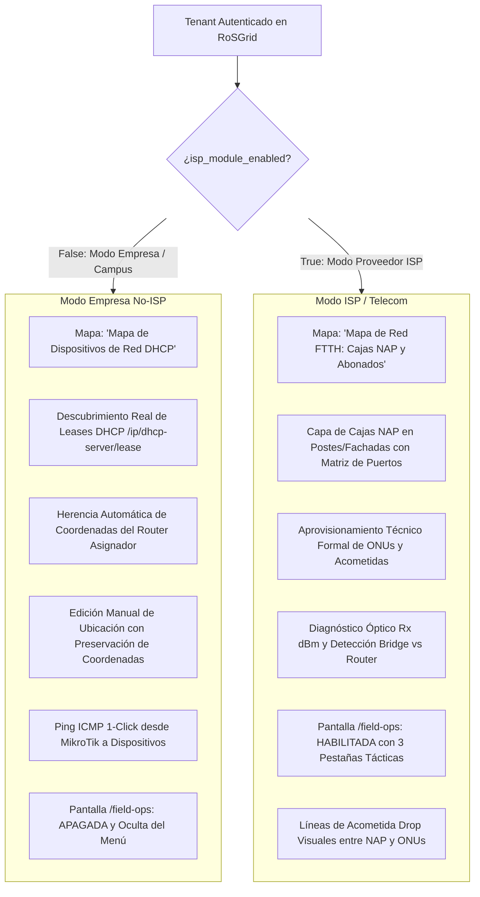

# 37 — ARQUITECTURA BIMODAL DEL MAPA DE RED Y REDISEÑO TÁCTICO DE OPERACIONES DE CAMPO (RoSGrid)

> **[DIRECTIVA DE SISTEMA]:** Esta especificación define de forma exhaustiva la arquitectura bimodal (Empresa vs ISP) del Mapa de Red (`/subscribers/map`), el modelo de datos de Infraestructura Pasiva (Cajas NAP / ODB), la herencia de coordenadas geográficas de routers en clientes DHCP corporativos, el motor de diagnóstico en vivo (Ping 1-Click desde MikroTik) y el rediseño de la suite de campo (`/field-ops`). **Queda terminantemente prohibido almacenar datos personales o financieros (GDPR/Compliance). Toda entidad se referencia por identificadores técnicos únicos (`endpoint_identifier`, `device_serial`, `box_code`, `mac_address`).**

---

## 1. Principio Fundamental: Dualidad Arquitectónica Transparente

RoSGrid opera de manera adaptativa bajo el principio de **cero código duplicado y máxima cohesión**. La presencia de la directiva de gobernanza `tenant.isp_module_enabled` conmuta el comportamiento del mapa y las interfaces de usuario:



---

## 2. Modelo de Datos y Esquemas (`fastapi/src/models/ipam.py`)

### 2.1. Tabla `optical_boxes` (Infraestructura Pasiva / Cajas NAP / ODB)

Almacena la ubicación física, capacidad y características del splitter de las cajas de dispersión óptica o puntos de distribución de planta externa:

- `id`: UUID (Clave primaria).
- `tenant_id`: UUID (Multi-tenant RLS forzado).
- `router_id`: UUID (FK a `routers.id`, router o concentrador que alimenta el área/puerto PON).
- `box_code`: String(64) (ej. `NAP-CBO-01`, identificador alfanumérico único por tenant).
- `brand`: String(64) nullable (ej. `Huawei`, `Corning`, `FiberHome`).
- `model`: String(64) nullable.
- `capacity_ports`: Integer (Capacidad de puertos del splitter: 8, 16 o 24 puertos).
- `splitter_ratio`: String(20) (ej. `1:8`, `1:16`, `1:2+1:8`).
- `installation_type`: String(32) (`POLE`, `FAÇADE`, `UNDERGROUND`, `INDOOR_ODF`).
- `physical_location`: String(255) nullable (ej. *Poste Cantv #48, Av. Principal con Calle 5*).
- `input_power_dbm`: Numeric(5, 2) nullable (Potencia óptica de entrada en dBm, ej. `-14.80`).
- `latitude`: Numeric(9, 6) (Coordenada geográfica de latitud WGS84).
- `longitude`: Numeric(9, 6) (Coordenada geográfica de longitud WGS84).
- `status`: String(20) (`ACTIVE`, `MAINTENANCE`, `FULL`).
- `notes`: Text nullable (Observaciones de acceso o llave de seguridad).
- `created_at`, `updated_at`: Timestamps con zona horaria UTC.

### 2.2. Campos Complementarios en `subscriber_devices`

Evolución del modelo para soportar la doble naturaleza (ONU de fibra vs Dispositivo DHCP corporativo):

- `optical_box_id`: UUID nullable (FK a `optical_boxes.id`, ON DELETE SET NULL).
- `optical_box_port`: SmallInteger nullable (Puerto físico de la caja utilizado: 1 a 24).
- `rx_optical_power_dbm`: Numeric(5, 2) nullable (Potencia óptica de recepción en roseta/ONU).
- `drop_cable_meters`: Integer nullable (Longitud en metros del cable drop de acometida).
- `is_custom_coordinates`: Boolean default False (Indica si el administrador asignó coordenadas manuales para evitar que la auto-sincronización DHCP sobreescriba su ubicación física).

---

## 3. Comportamiento Bimodal del Mapa de Red (`/subscribers/map`)

### 3.1. Flujo en Modo Empresa (`isp_module_enabled: false`)

1. **Auto-descubrimiento Real de Leases DHCP:**
   * Al pulsar `[ 🔄 Sincronizar Dispositivos DHCP ]`, RoSGrid invoca `POST /api/v1/subscriber-devices/sync-dhcp`.
   * El backend consulta en tiempo real `/ip/dhcp-server/lease` en los routers MikroTik del tenant.
   * Por cada lease activo:
     * Si no existe en la base de datos, lo crea con `endpoint_identifier = host-name or ip`, asigna o asocia la IP en `ipam_ip_addresses` y **hereda automáticamente las coordenadas del router asignador** (`router.latitude`, `router.longitude`) y `router.physical_location`.
     * Si el dispositivo ya existía con `is_custom_coordinates == True`, **se preservan estrictamente las coordenadas manuales**.
2. **Edición Manual de Coordenadas:**
   * El administrador puede seleccionar cualquier equipo (ej. *Impresora Piso 2*) en el mapa o lista y modificar latitud/longitud en el drawer lateral o pulsar `[ 📍 Copiar Coordenadas del Router ]`.
   * Al guardar, se actualiza `is_custom_coordinates = True`.
3. **Verificación de Disponibilidad (Ping ICMP 1-Click):**
   * Endpoint `POST /api/v1/subscriber-devices/{id}/ping`:
     * Obtiene el router asignador del dispositivo, desencripta credenciales desde Vault AES-256-GCM y ejecuta en el REST API de RouterOS v7: `POST /ping` con `{"address": ip, "count": 2}`.
     * Retorna `ping_avg_ms`, `packet_loss_pct` y actualiza `last_reachability_status` (`ONLINE` o `OFFLINE`) en memoria y base de datos.
     * Actualiza el semáforo cromático en Leaflet (🟢 < 40ms, 🟠 40-120ms o pérdida parcial, 🔴 timeout).

### 3.2. Flujo en Modo ISP (`isp_module_enabled: true`)

1. **Aprovisionamiento Formal y Control Óptico:**
   * No se puebla la base de datos de clientes DHCP aleatorios; el mapa refleja los abonados aprovisionados por el personal técnico o sincronizados desde contratos autorizados.
2. **Capa Cartográfica de Cajas NAP:**
   * Marcador táctico distintivo (hexágono/caja dorada o cian) con badge visible de saturación de puertos: `ocupados / capacidad` (ej. `5/16`).
   * Al hacer clic en la Caja NAP, se abre el panel interactivo:
     * Ficha de la caja: Identificador, Tipo de Splitter, Potencia de entrada, Ubicación física (Poste #) y Router/OLT alimentador.
     * **Matriz de Puertos estilo Patch Panel (1 al 16):** Muestra el estado de cada puerto del splitter:
       * 🟢 **Puerto Ocupado y Online:** Muestra identificador del cliente, IP y latencia.
       * 🔴 **Puerto Ocupado y Offline:** Alerta de desconexión o falla de potencia en esa acometida.
       * ⚪ **Puerto Libre / Disponible:** Habilitado para nueva acometida.
     * Botón `[ ➕ Conectar Cliente en este NAP ]`: Redirige a la pantalla del técnico con la caja y el primer puerto libre preseleccionados.
     * Botón `[ ⚡ Test Ping a Clientes de la Caja ]`: Diagnóstico masivo para discernir si la falla es general de la rama PON o individual.
3. **Líneas de Acometida (Drop Lines):**
   * Toggle opcional en el mapa `[ ☑ Mostrar Acometidas Drop ]`: Dibuja polilíneas tenues entre la Caja NAP y las ubicaciones de sus abonados vinculados.

---

## 4. Rediseño de la Pantalla del Técnico de Campo (`/field-ops`)

### 4.1. Supresión de Órdenes y Enfoque Directo de Campo

Se elimina la barrera burocrática de "0 órdenes asignadas". El técnico en ruta dispone de acceso inmediato a tres herramientas táctiles optimizadas para smartphone y tablet:

```
┌────────────────────────────────────────────────────────────────────────────────────────┐
│  🛠️ OPERACIONES DE CAMPO (FIELD TECH TOOLKIT)          [ 📍 GPS: 10.480600, -66.903600 ] │
├───────────────────────────────────┬──────────────────────────────────┬─────────────────┤
│  📦 1. Registrar Caja NAP         │  👤 2. Registrar Nuevo Cliente   │  ⚡ 3. Diagnóstico│
└───────────────────────────────────┴──────────────────────────────────┴─────────────────┘
```

### 4.2. Pestaña 1: Registrar Caja NAP
- Formulario de alta rápida con validación de identificador único `box_code`.
- Botones de selección rápida de capacidad: `[ 8 Puertos ]`, `[ 16 Puertos ]`, `[ 24 Puertos ]`.
- Selector de tipo de anclaje: Poste, Fachada, Cámara subterránea, Armario ODF.
- Campo de Potencia de Entrada medido con Power Meter (dBm).
- Botón prominente `[ 📍 Capturar GPS de la Caja ]`.

### 4.3. Pestaña 2: Registrar Nuevo Cliente / Abonado
- Identificador técnico de servicio o usuario PPPoE.
- Selector dinámico de **Caja NAP más cercana** (ordenada por distancia GPS calculada respecto a la ubicación del instalador).
- Selector interactivo del **Puerto de la Caja** (filtrando solo puertos libres).
- Serial de la ONU (con formateo automático de prefijo GPON: `HWTC`, `ZTEG`, etc.) y MAC.
- Medición de **Potencia Óptica Recibida en Roseta ($Rx\text{ dBm}$)** con semáforo dinámico:
  - 🟢 **Óptima:** $-15.0\text{ dBm}$ a $-24.0\text{ dBm}$.
  - 🟠 **Alerta:** $-24.1\text{ dBm}$ a $-27.0\text{ dBm}$.
  - 🔴 **Crítica:** menor a $-27.0\text{ dBm}$.
- Botón `[ 📍 Capturar GPS Domicilio ]` o `[ 📌 Copiar Coordenadas de la Caja NAP ]`.

### 4.4. Pestaña 3: Diagnósticos y Certificación de Enlace
- Prueba 1-Click contra el router MikroTik:
  - Verificación de sesión activa en `/ppp/active` o lease en `/ip/dhcp-server/lease`.
  - Ping ICMP (latencia media en ms y % pérdida).
  - Detección de Modo Bridge vs Router (comparando Caller-ID con la MAC de la ONU registrada).
  - Prueba de fragmentación MTU 1500 DF (Don't Fragment).
- Certificación digital y activación inmediata del servicio (`ACTIVE`).
- Historial inferior de **Altas Recientes de la Jornada** para auditoría y ajustes rápidos.

---

## 5. Matriz de Gobernanza y Desactivación de Pantallas

| Componente / Ruta | 🏢 Empresa (`isp_module_enabled: false`) | 🌐 ISP (`isp_module_enabled: true`) |
| :--- | :--- | :--- |
| `/field-ops` | **Desactivada:** Oculta en menú lateral y command palette. Redirige a `/` si se invoca. | **Activa:** Totalmente accesible para roles autorizados. |
| `/subscribers/map` | **Modo Empresa:** Clientes DHCP, herencia de coordenadas de router y ping 1-Click. | **Modo ISP:** Cajas NAP, matriz de puertos, ONUs y diagnóstico óptico. |
| `/api/v1/optical-boxes` | Retorna lista vacía o deshabilitado si el feature no aplica. | CRUD completo de Cajas NAP e inventario de puertos de splitter. |
