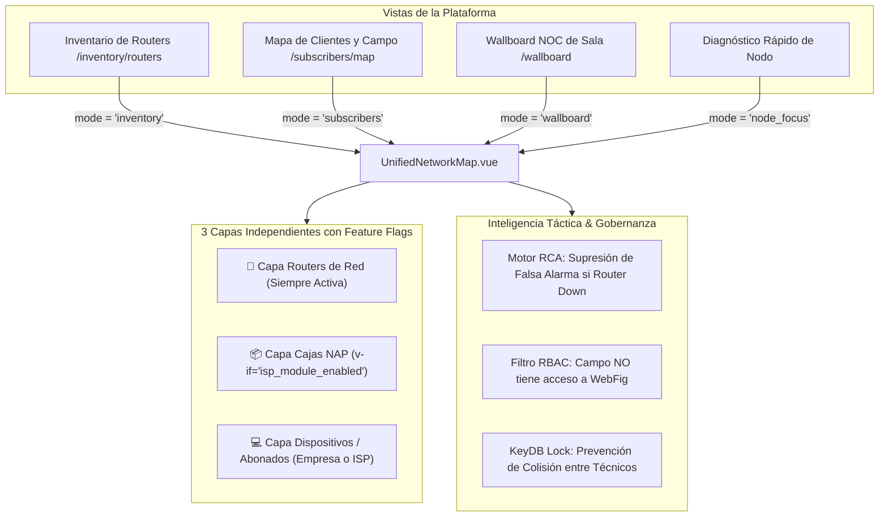
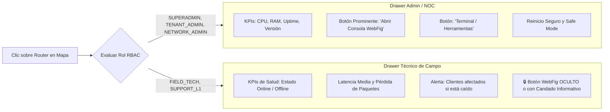
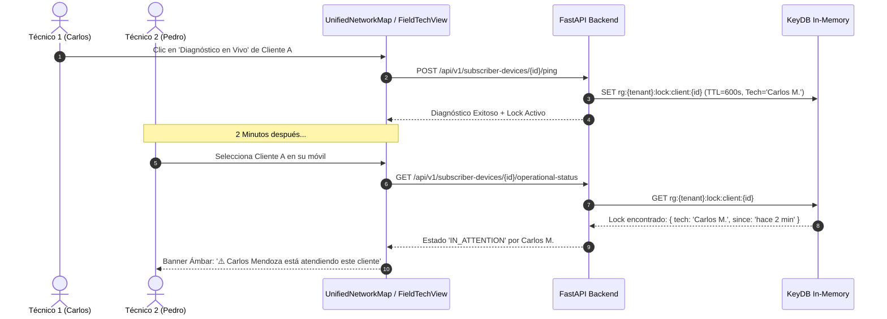

# 38 — COMPONENTE UNIFICADO DE MAPA DE RED BIMODAL, ANÁLISIS DE CAUSA RAÍZ (RCA) Y PREVENCIÓN DE COLISIÓN OPERATIVA (RoSGrid)

> **[DIRECTIVA DE SISTEMA]:** Esta especificación técnica define la arquitectura del componente unificado de cartografía de red (`UnifiedNetworkMap.vue`), la separación de capas independientes gobernadas por Feature Flags (`isp_module_enabled`), la gobernanza RBAC para restringir WebFig a personal de campo, el motor de Correlación de Alarmas y Causa Raíz (Root Cause Analysis - RCA estilo Zabbix) y la prevención de colisiones operativas mediante cerraduras tácticas efímeras en KeyDB. **Queda terminantemente prohibido almacenar datos personales o financieros (GDPR/Compliance). Toda entidad se referencia por identificadores técnicos únicos (`router_id`, `box_code`, `device_id`, `mac_address`).**

---

## 1. Visión y Principio Rector: Un Solo Componente Cartográfico

Actualmente, los mapas de infraestructura (Routers en `/inventory/routers`), operaciones de campo/clientes (`/subscribers/map`) y el centro de monitoreo (`/wallboard`) han operado en componentes o configuraciones desarticuladas. La presente especificación consolida la infraestructura visual en un único componente polimórfico de alto rendimiento: **`UnifiedNetworkMap.vue`**.



---

## 2. Los 3 Toggles de Capa Independientes y Gobernanza Bimodal

En lugar de agrupar cajas y clientes en un solo interruptor, la barra superior del mapa expone **3 botones independientes**, condicionados de forma estricta por los Feature Flags del tenant (`tenant.features.isp_module_enabled`):

```
┌────────────────────────────────────────────────────────────────────────────────────────────────────────┐
│ Capas Activas:                                                                                         │
│ [ 🏢 Routers de Red (6) ]    [ 📦 Cajas NAP FTTH (3) ]*    [ 💻 Dispositivos / Abonados (20) ]         │
└────────────────────────────────────────────────────────────────────────────────────────────────────────┘
```
*\* El botón `[ 📦 Cajas NAP FTTH ]` está completamente excluido del DOM (`v-if="isIspMode"`) en empresas no-ISP.*

### 2.1. Matriz de Comportamiento Bimodal

| Capa / Elemento | 🏢 Empresa Corporativa (`isp_module_enabled = false`) | 🌐 Proveedor ISP (`isp_module_enabled = true`) |
| :--- | :--- | :--- |
| **🏢 Routers de Red** | **Visible y Activo:** Gateways corporativos, sedes, sucursales y switches RouterOS. | **Visible y Activo:** Nodos Core, BGP Edge, OLTs y enrutadores de distribución. |
| **📦 Cajas NAP FTTH** | **DESHABILITADO Y OCULTO:** El botón y la capa no se renderizan en el DOM. | **Visible y Filtrable:** Postes y fachadas con divisores ópticos y matriz de puertos. |
| **💻 Dispositivos / Clientes** | **Modo Dispositivos de Red:** PCs, APs WiFi, cámaras CCTV, servidores obtenidos de leases DHCP. | **Modo Abonados FTTH:** ONUs, routers residenciales y rosetas ópticas con líneas drop. |
| **Líneas de Enlace** | Líneas de salto lógico hacia el Router asignador. | Líneas de cable drop físico hacia la Caja NAP y de la NAP al Router/OLT. |

---

## 3. Matriz de Perfiles y Control de Acceso RBAC en el Mapa

El técnico de calle o el operador de soporte básico que utiliza el mapa para geolocalizar averías **necesita visibilidad de la salud del router**, pero bajo ninguna circunstancia debe tener privilegios para ingresar a la consola de configuración WebFig ni modificar parámetros del sistema:



### 3.1. Directiva de Seguridad en Frontend (`UnifiedNetworkMap.vue`)

```typescript
// Determinación estricta de permisos de acceso a consola WebFig
const canAccessWebFig = computed(() => {
  const allowedRoles = ['SUPERADMIN_GLOBAL', 'TENANT_ADMIN', 'NETWORK_ADMIN', 'SUPPORT_L2'];
  return allowedRoles.includes(authStore.user?.role || '');
});
```

Si `canAccessWebFig` es falso, la tarjeta del router renderiza un distintivo informativo:
`🔒 Acceso a configuración reservado para ingenieros de NOC`.

---

## 4. Motor de Análisis de Causa Raíz (Root Cause Analysis - RCA estilo Zabbix)

Cuando un router de cabecera se desenergiza o pierde el enlace de transporte, todos los clientes dependientes de dicho equipo (50, 100 o más) pasan inmediatamente a estado inalcanzable. Generar 50 diagnósticos individuales o permitir que un técnico pruebe abonado por abonado satura la red y confunde a las brigadas de campo.

### 4.1. Regla de Supresión de Diagnósticos Hijas

Antes de emitir cualquier sondeo ICMP en `POST /api/v1/subscriber-devices/{id}/ping`, el backend consulta el estado de salud del router de cabecera (`device.router_id`):

```python
# fastapi/src/services/diagnostic_governor.py

async def check_root_cause_router_health(
    self, tenant_id: str, router_id: str, redis_client
) -> Optional[dict]:
    """
    Verifica si el router padre se encuentra caído o con Circuit Breaker activo.
    Si está caído, retorna el contexto de Causa Raíz para suprimir pruebas inútiles.
    """
    circuit_open_key = f"rg:{tenant_id}:diag:circuit:open:{router_id}"
    is_circuit_open = await redis_client.get(circuit_open_key)
    
    if is_circuit_open:
        return {
            "root_cause": "ROUTER_DOWN",
            "message": "Diagnóstico omitido: El router de cabecera se encuentra inalcanzable o sin energía. Todos los abonados asociados están afectados por esta contingencia."
        }
    return None
```

### 4.2. Respuesta Inmediata `Fail-Fast` (HTTP 200 con Estado `ROOT_CAUSE_SUPPRESSED`)

```json
{
  "device_id": "01928900-aaaa-7bbb-8ccc-111122223333",
  "endpoint_identifier": "CLIENTE-FIBRA-402",
  "ip_address": "192.168.10.45",
  "status": "ROOT_CAUSE_SUPPRESSED",
  "is_online": false,
  "root_cause_device_name": "MikroTik Core-Norte",
  "message": "Diagnóstico omitido: El router de cabecera 'MikroTik Core-Norte' no responde. Se suprime el ping para proteger recursos de red.",
  "is_cached": false,
  "cache_ttl_remaining": 0
}
```

### 4.3. Franja Táctica de Cabecera en el Mapa

Si uno o más routers asignados al tenant están caídos, `UnifiedNetworkMap.vue` despliega en la parte superior una barra de notificación persistente:

```
┌────────────────────────────────────────────────────────────────────────────────────────┐
│ 🚨 ALERTA DE CABECERA: Router 'MikroTik Core-Norte' CAÍDO (Afecta a 50 clientes)       │
│ [ 🎯 Filtrar zona de impacto ]                          [ ✖️ Descartar aviso ]          │
└────────────────────────────────────────────────────────────────────────────────────────┘
```
Al hacer clic en `[ 🎯 Filtrar zona de impacto ]`:
- El mapa hace zoom automático sobre el centro geográfico del grupo de clientes afectados.
- Resalta a los clientes dependientes con un halo naranja parpadeante: `⚠️ Afectado por contingencia de cabecera`.

---

## 5. Prevención de Colisión Operativa entre Técnicos (Work-In-Progress Lock en KeyDB)

Para evitar que dos técnicos de calle se trasladen al mismo domicilio o ejecuten diagnósticos cruzados sobre el mismo abonado simultáneamente:

### 5.1. Ciclo de Vida de la Cerradura Táctica (`Operational Lock`)



### 5.2. Estructura de la Llave en KeyDB
- **Patrón:** `rg:{tenant_id}:device:lock:{device_id}`
- **TTL:** `600 segundos` (10 minutos con renovación automática ante interacción activa).
- **Contenido JSON:**
  ```json
  {
    "technician_id": "usr-88192a",
    "technician_name": "Carlos Mendoza",
    "action": "DIAGNOSTICO_ACTIVO",
    "locked_at": "2026-10-24T16:15:00Z"
  }
  ```

---

## 6. Aseguramiento de Calidad 11X (Fail & Forbid)

1. **Pruebas Unitarias Backend (`fastapi/tests/`):**
   - Validación del método `check_root_cause_router_health` retornando supresión si el router está en circuit breaker.
   - Validación de adquisición y lectura del operational lock en KeyDB con `FakeAsyncRedis`.
   - Cobertura sostenida `>= 95%`.
2. **Pruebas Unitarias Frontend Vitest (`vue3/src/`):**
   - `UnifiedNetworkMap.unit.ts`:
     - Renderiza solo 2 botones de capa cuando `isp_module_enabled == false`.
     - Renderiza 3 botones de capa cuando `isp_module_enabled == true`.
     - Oculta el botón WebFig cuando el rol es `FIELD_TECH`.
     - Muestra el banner de colisión cuando existe lock activo por otro técnico.
3. **Escenarios BDD Karate Labs:**
   - **Karate API (`fastapi/test/api_test.feature`):** Escenario 84 validando supresión de ping por Causa Raíz de Router caído.
   - **Karate UI (`vue3/test/ui_business_flow.feature`):** Escenario 35 validando los 3 botones de capa independientes y la exclusión de WebFig para perfil técnico.
