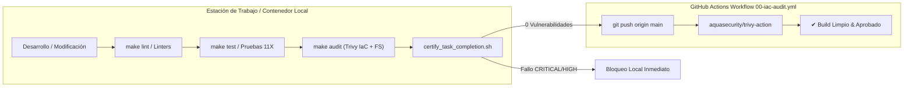

# 40 — AUDITORÍA PREVENTIVA DE VULNERABILIDADES, SEGURIDAD SHIFT-LEFT Y GOBERNANZA DE ARCHIVOS DE BLOQUEO (RoSGrid)

> **[DIRECTIVA DE SISTEMA]:** Esta especificación técnica establece los estándares de seguridad *Shift-Left*, detección temprana de vulnerabilidades de dependencias y configuración de infraestructura en local, gobernanza estricta sobre archivos de bloqueo (`uv.lock` y `pnpm-lock.yaml`), y la integración obligatoria de compuertas preventivas (*Certification Gates*) mediante `make audit`, `scripts/auditar-infra.sh` y `.agents/scripts/certify_task_completion.sh` previo a cualquier confirmación o publicación hacia Git.

---

## 1. Visión y Principio Rector: Seguridad Shift-Left (Desplazamiento a la Izquierda)

En ciclos de integración continua convencionales, las vulnerabilidades de dependencias y errores de configuración de infraestructura suelen detectarse tardíamente al ejecutarse los workflows en la nube (GitHub Actions). Este modelo reactivo genera fricción, rompe pipelines compartidos y retrasa los despliegues.

**RoSGrid adopta la filosofía Shift-Left Security:**
Toda vulnerabilidad en dependencias de código (directas o transitivas) o misconfiguración en manifiestos Docker/Compose debe ser interceptada, evaluada y resuelta en la estación de trabajo local o en el contenedor efímero antes de que cualquier commit sea enviado al repositorio central.

---

## 2. Los Dos Vectores de Escaneo Preventivo en Local

El script canónico `scripts/auditar-infra.sh` orquesta dos tipos complementarios de análisis dentro de contenedores efímeros aislados (`aquasec/trivy:latest` con volumen `:ro` de solo lectura):

### Vector 1: Infraestructura como Código (IaC & Misconfiguraciones)
* **Comando:** `trivy config . --severity HIGH,CRITICAL --exit-code 1`
* **Alcance:** `fastapi/Dockerfile`, `vue3/Dockerfile`, `docker-compose.yml`, `docker-compose.prod.yml`, `docker-compose.prod.local.yml`, `nginx/default.conf`.
* **Políticas Evaluadas:**
  - Prohibición de modo privilegiado (`privileged: true`).
  - Prohibición de capacidades inseguras (`SYS_PTRACE`, `NET_ADMIN`).
  - Aislamiento estricto de redes IPv4 tipo `bridge` (rechazo de `enable_ipv6: true`).
  - Usuarios no privilegiados (`USER rosgrid` UID 10001, `USER nginx`).
  - Directivas obligatorias de `HEALTHCHECK` en contenedores de aplicación.

### Vector 2: Manifiestos de Dependencias & Sistema de Archivos (CVEs)
* **Comando:** `trivy fs . --severity CRITICAL --exit-code 1`
* **Alcance:** `fastapi/uv.lock` (gestor `uv` de Python) y `vue3/pnpm-lock.yaml` (gestor `pnpm` de Node.js).
* **Mecanismo:** Cruce estático de nombres de paquetes y versiones congeladas contra la base de datos oficial de vulnerabilidades (Trivy DB, GitHub Advisory Database, OSV y NVD).
* **Criterio de Rechazo:** Si se detecta un hallazgo con severidad `CRITICAL` (o `HIGH` según la política de despliegue), el script termina con `exit code 1` y bloquea la tarea.

---

## 3. Gobernanza de Archivos de Bloqueo (`uv.lock` y `pnpm-lock.yaml`)

### Por qué el Proyecto Congela Versiones (Hermetic / Reproducible Builds)
1. **Invarianza Determinista:** Una imagen de contenedor construida hoy debe ser idéntica bit por bit a una construida en seis meses, evitando regresiones por librerías externas que rompan contratos sin aviso.
2. **Defensa contra Ataques a la Cadena de Suministro (*Supply Chain*):** Cada entrada en los archivos de bloqueo almacena el hash criptográfico SHA-256 de los binarios y fuentes descargados, impidiendo la inyección de código modificado por terceros.

### Protocolo de Mitigación de Vulnerabilidades Transitivas
Cuando el escáner local o el CI/CD reporta un CVE en una librería secundaria (por ejemplo, `brotli` requerida por `geventhttpclient` / `locust`):
1. **Identificación:** Localizar el paquete en `uv.lock` o `pnpm-lock.yaml` y la versión parcheada recomendada por el aviso de seguridad (ej. `>=1.2.1`).
2. **Actualización Selectiva:**
   - Para Python: ejecutar en Docker `uv lock --upgrade-package <nombre_paquete>`.
   - Para Frontend: ejecutar en Docker `pnpm update <nombre_paquete>`.
3. **Verificación de Regresiones:** Ejecutar la suite completa de pruebas unitarias (`make test`) para certificar que el parche no introduce efectos secundarios.
4. **Re-Escaneo:** Ejecutar `make audit` para confirmar que el reporte de vulnerabilidades arroja `0 Findings`.

---

## 4. Estandarización de Comandos (`Makefile`)

Para garantizar paridad operativa absoluta entre desarrolladores humanos y agentes de inteligencia artificial (Google Antigravity, Claude, Hermes Agent, Cursor), se define el archivo [Makefile](file:///Makefile) en la raíz:

| Target | Propósito | Entorno de Ejecución |
| :--- | :--- | :--- |
| `make audit` | Ejecuta escaneo preventivo Trivy IaC + FS | Contenedor `aquasec/trivy:latest` |
| `make test` | Ejecuta suites completas de pruebas unitarias | Docker (`rosgrid-backend:local-test` y `base-node-ionic:26`) |
| `make test-backend` | Ejecuta pytest en backend | Contenedor `rosgrid-backend:local-test` |
| `make test-frontend` | Ejecuta vitest en frontend | Contenedor `base-node-ionic:26` |
| `make lint` | Chequea formato y tipos estáticos | `ruff`, `mypy --strict`, `vue-tsc --noEmit` |
| `make certify` | Corre el gate de certificación de tarea | `.agents/scripts/certify_task_completion.sh` |
| `make build` | Reconstruye imágenes de producción local | Multi-stage Docker Buildx |
| `make clean` | Limpia residuos y cachés temporales | `scripts/limpieza.sh` |

---

## 5. El Gate de Certificación de Tarea (`certify_task_completion.sh`)

El script [.agents/scripts/certify_task_completion.sh](file:///.agents/scripts/certify_task_completion.sh) incorpora este paso como requisito no-negociable en el flujo de 5 etapas:

1. `🔒 [1/5] Auditoría de Secretos:` Ejecución de `scripts/verificar-secretos.sh`.
2. `🛡️ [2/5] Auditoría de Vulnerabilidades e IaC:` Ejecución de `scripts/auditar-infra.sh` (`make audit`).
3. `🗄️ [3/5] Paridad ORM vs Alembic:` Detección de schema drift contra PostgreSQL.
4. `🧪 [4/5] Contratos Front-Back:` Validación de compatibilidad entre endpoints y esquemas.
5. `📚 [5/5] Sincronización Documental & Pruebas:` Verificación de changelog, roadmap, tests y specs.
