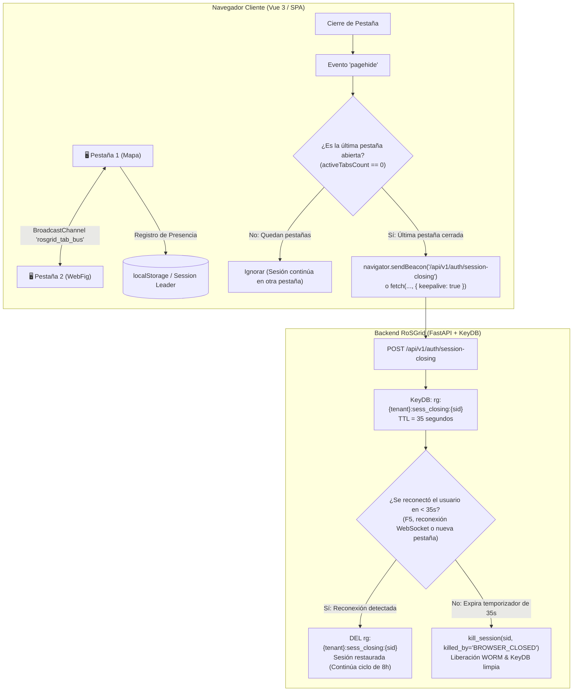

# 41 — DETECCIÓN DE CIERRE DE PESTAÑA O NAVEGADOR, COORDINACIÓN MULTI-PESTAÑA Y LIBERACIÓN EFÍMERA DE SESIÓN CON PERÍODO DE GRACIA (RoSGrid)

> **[DIRECTIVA DE SISTEMA]:** Esta especificación técnica define la arquitectura integral para detectar el cierre de pestañas o del navegador web en el frontend (Vue 3 / TypeScript), coordinar la coexistencia de múltiples pestañas activas de un mismo operador, y notificar al backend (FastAPI / KeyDB) para activar una liberación diferida de sesión protegida por un **Período de Gracia (*Grace Period*) de 35 segundos**. Esta solución preserva de forma estricta la **vigencia absoluta de 8 horas (28,800 s)** del turno operativo de telecomunicaciones sin acortar la sesión, evitando expulsiones accidentales ante recargas con F5 y erradicando sesiones fantasma o duplicadas en el panel de control de sesiones activas.

---

## 1. Contexto Operativo y Planteamiento del Problema

En salas de monitoreo (NOC) y puestos técnicos de ISP/Enterprise, los operadores de RoSGrid abren frecuentemente múltiples vistas en pestañas independientes (por ejemplo: Pestaña 1 en *Mapa de Clientes*, Pestaña 2 en *Consola WebFig*, Pestaña 3 en *Wallboard NOC*).

### La Doble Trampa Técnica del Navegador
1. **El Problema del F5 / Recarga de Página:**  
   Cuando un usuario refresca la página (`F5` o `Ctrl+R`), el motor del navegador dispara incondicionalmente los eventos de descarga de documento (`pagehide` y `beforeunload`). Si la sesión se destruyera de inmediato en el milisegundo 0, el técnico sería deslogueado y forzado a introducir sus credenciales y código 2FA TOTP en cada refresco.
2. **El Problema de Múltiples Pestañas (*Multi-Tab Split*):**  
   Cerrar una sola pestaña porque se concluyó el diagnóstico de un router particular no debe revocar la sesión general del operador si aún mantiene abiertas otras pestañas de RoSGrid en la misma estación de trabajo.
3. **Persistencia de Sesiones Fantasma (TTL de 8 Horas):**  
   Si el técnico apaga la computadora o cierra completamente el navegador al finalizar su turno, la sesión permanece registrada en KeyDB (`rg:{tenant}:active_sessions`) durante el total de las 8 horas restantes (`SESSION_TTL_SECONDS = 28800`), provocando acumulación de sesiones duplicadas y distorsionando las auditorías de presencia en vivo.

---

## 2. Arquitectura de Solución en 2 Capas (Vue 3 + KeyDB)



---

## 3. Capa Frontend: Coordinador de Ciclo de Vida (`useTabLifecycleCoordinator.ts`)

El frontend de Vue 3 implementa un composable especializado de bajo consumo de CPU que coordina las pestañas abiertas mediante la API estándar **`BroadcastChannel`** (con soporte nativo en todos los navegadores modernos y navegadores móviles de técnicos de campo):

### 3.1. Especificación del Canal de Comunicación Inter-Pestaña
* **Canal:** `const channel = new BroadcastChannel('rosgrid_tab_lifecycle_bus')`
* **Mensajes:**
  * `TAB_OPENED`: Emitido al montar la aplicación en `App.vue`. Las pestañas existentes responden con `TAB_HEARTBEAT` para computar el conteo real exacto.
  * `TAB_CLOSED`: Emitido antes de desmontar.
  * `TAB_HEARTBEAT`: Confirmación de presencia para sincronizar la variable reactiva `activeTabsCount`.

### 3.2. Detección Determinista del Último Cierre (`pagehide`)
* El navegador escucha el evento del estándar WHATWG `pagehide` (superior a `unload` y `beforeunload`, ya que no se descarta en navegadores móviles cuando la pestaña pasa a congelación de memoria):
```typescript
window.addEventListener('pagehide', (event: PageTransitionEvent) => {
  // Notificar al bus inter-pestañas
  coordinator.notifyTabClosing();

  // Si esta es la única pestaña activa del usuario
  if (coordinator.isLastActiveTab()) {
    const payload = JSON.stringify({
      session_id: authStore.sessionId,
      client_timestamp: Date.now(),
    });

    const endpoint = '/api/v1/auth/session-closing';
    const blob = new Blob([payload], { type: 'application/json' });

    // Intento primario mediante sendBeacon (transporte asíncrono no bloqueante del SO)
    const success = navigator.sendBeacon(endpoint, blob);
    if (!success) {
      // Fallback a fetch con keepalive para navegadores donde sendBeacon esté restringido
      fetch(endpoint, {
        method: 'POST',
        headers: { 'Content-Type': 'application/json' },
        body: payload,
        keepalive: true,
        credentials: 'include',
      }).catch(() => { /* silencioso */ });
    }
  }
});
```

### 3.3. Prevención de Bucle Infinito de Redirección (*Ping-Pong*) al Reabrir el Navegador
Cuando el operador cierra completamente el navegador (p. ej. Google Chrome) y lo vuelve a abrir pasados los 35 segundos del período de gracia (o cuando el navegador purga las cookies de sesión `__Host-rg_at` / `__Host-rg_rt` al salir), el estado persistido en `localStorage` (`rosgrid_user`, `rosgrid_csrf`, `rosgrid_session_id`) podría seguir presente en el disco local. Para evitar un bucle infinito de redirección entre `/inventory` y `/login?reason=session_expired`:
1. **Purga Atómica en `httpClient.ts` (`triggerSessionExpiredRedirect`):** Antes de emitir el evento `rosgrid:session-expired` y redirigir a `/login?reason=session_expired` tras un fallo definitivo de `POST /api/v1/auth/refresh` (`401 Unauthorized`), `clearPersistedSessionStorage()` elimina inmediatamente `rosgrid_user`, `rosgrid_csrf` y `rosgrid_session_id` de `localStorage`.
2. **Suscripción Reactiva en `useAuthStore.ts` y `useNocEventsStore.ts`:** `useAuthStore` escucha el evento global `rosgrid:session-expired` e invoca `clearAuth()` para anular `user.value` (`isAuthenticated = false`), mientras que `useNocEventsStore` cierra el WebSocket de eventos y cancela cualquier temporizador de reconexión.
3. **Salvaguarda Defensiva en el Guard de Vue Router (`router/index.ts`):** Si `router.beforeEach` intercepta una navegación hacia `/login` con `query.reason` en `{'session_expired', 'session_revoked', 'killed_by_admin', 'SESSION_KILLED', 'unauthorized'}` y `authStore.isAuthenticated` aún evalúa a `true`, invoca `authStore.clearAuth()` en el acto, garantizando que el usuario permanezca en `/login` sin rebotar hacia `/inventory`.

---

## 4. Capa Backend: Endpoint de Despedida y Período de Gracia en KeyDB

### 4.1. Endpoint `POST /api/v1/auth/session-closing`
* **Acceso:** Protegido por cookie de sesión `__Host-rg_at` (o token en payload validado contra la sesión actual en KeyDB).
* **Parámetros:**
  ```json
  {
    "session_id": "01928b4c-9988-7d11-9000-112233445566",
    "client_timestamp": 1729817767000
  }
  ```
* **Comportamiento Atómico en KeyDB:**
  1. No invoca `kill_session()` inmediatamente.
  2. Registra la clave de período de gracia:
     * **Clave:** `rg:{tenant_id}:sess_closing:{session_id}`
     * **Tipo:** `STRING`
     * **Valor:** JSON con `closed_at`, `ip_address`, `user_agent`.
     * **TTL:** `35` segundos (estrictamente ajustado para tolerar un F5 lento sobre redes 3G/4G o reinicio de pestaña).
  3. Agrega el identificador a un Sorted Set efímero de sesiones pendientes de cierre: `rg:{tenant_id}:closing_sessions_queue` con puntuación `epoch_timestamp + 35`.
  4. Retorna inmediatamente `HTTP 202 Accepted` (`{"status": "GRACE_PERIOD_ACTIVE", "ttl_seconds": 35}`).

### 4.2. Cancelación Reactiva de Cierre (Manejo del F5 y Reconexión)
Cualquiera de los siguientes eventos que ocurra dentro de los 35 segundos cancela inmediatamente el cierre diferido:
1. **Apertura de WebSocket (`/api/v1/websockets/tenant/events` o `/telemetry`):** Al autenticarse el WebSocket, el manejador ejecuta:
   ```python
   await redis.delete(f"rg:{tenant_id}:sess_closing:{session_id}")
   await redis.zrem(f"rg:{tenant_id}:closing_sessions_queue", session_id)
   ```
2. **Cualquier Petición REST Autenticada:** El middleware de sesión inspecciona si la clave `sess_closing` existe para el `session_id` entrante; de existir, la elimina en background (`DEL`), confirmando que el usuario sigue activo y restaurando el estado normal.

### 4.3. Proceso de Limpieza Diferida (*Grace Period Expiry Worker*)
Un bucle asíncrono liviano integrado en `rosgrid-worker` (o evaluado de forma reactiva):
1. Consulta `ZRANGEBYSCORE rg:{tenant_id}:closing_sessions_queue -inf {now_epoch}`.
2. Por cada `session_id` expirado:
   * Verifica si la clave `rg:{tenant_id}:sess_closing:{session_id}` sigue existiendo (no fue cancelada).
   * Ejecuta `kill_session(tenant_id, session_id, killed_by="BROWSER_CLOSE_TIMEOUT", reason="Pestaña o navegador cerrado (Grace period 35s expirado)")`.
   * Registra el evento en la auditoría inmutable WORM (`SESSION_CLOSED_ON_DISCONNECT`).
   * Remueve el elemento del set de cola.

---

## 5. Tabla de Estructuras de Datos en KeyDB

| Clave | Tipo | TTL | Propósito |
| :--- | :--- | :--- | :--- |
| `rg:{tenant_id}:sess:{session_id}` | `HASH` | 28800 s (8 h) | Metadatos de la sesión activa del operador. |
| `rg:{tenant_id}:sess_closing:{session_id}` | `STRING` | 35 s | Bandera temporal de período de gracia activa mientras el navegador está cerrado. |
| `rg:{tenant_id}:closing_sessions_queue` | `ZSET` | Volátil | Cola ordenada por timestamp de expiración para recolección desatendida. |
| `rg:{tenant_id}:user_sessions:{user_id}` | `SET` | 28800 s (8 h) | Conjunto de sesiones del usuario para soporte de Kill-Switch global. |

---

## 6. Seguridad y Validación Anti-Abuso

1. **Aislamiento Multi-Tenant:** La clave de período de gracia incluye estrictamente el prefijo del tenant (`rg:{tenant_id}:sess_closing:...`), impidiendo colisiones entre clientes.
2. **Anti-DoS de Cierre Arbitrario:** El endpoint rechaza solicitudes si el `session_id` suministrado no coincide con la sesión del token JWT portado en la cookie `__Host-rg_at` o la cabecera `Authorization`. Un atacante no puede cerrar sesiones de otros técnicos.
3. **Trazabilidad WORM:** El cierre por cierre de navegador queda registrado con categoría `AUTHENTICATION`, acción `SESSION_CLOSED_ON_DISCONNECT` y motivo auditado, diferenciándolo de un cierre de sesión manual o de un Kill-Switch administrativo.

---

## 7. Estrategia de Aseguramiento de Calidad Level-11X

| Nivel de Prueba | Ubicación | Criterio de Aceptación |
| :--- | :--- | :--- |
| **Backend Unitario** | `fastapi/tests/api/test_session_closing_grace_period.unit.py` | 100% de éxito en: registro de gracia de 35s, cancelación por reconexión, y expiración definitiva con invocación de `kill_session`. |
| **Frontend Unitario** | `vue3/src/composables/useTabLifecycleCoordinator.unit.ts` | 100% de éxito en Vitest: detección de pestaña única vs multi-pestaña, despacho de `sendBeacon` con payload JSON y resiliencia ante fallos de red. |
| **Integración Front-Back** | `validar_comunicacion_front_back.py` | Invocación del endpoint `/session-closing` certificando el código HTTP 202 y el registro en KeyDB. |
| **Karate Labs API BDD** | `fastapi/test/api_test.feature` | Escenario BDD verificando 401 unauth y 202 success en `POST /api/v1/auth/session-closing`. |
| **Karate Labs UI BDD** | `vue3/test/ui_business_flow.feature` | Escenario BDD simulando cierre y navegación de ventanas sin pérdida de sesión en recarga. |
