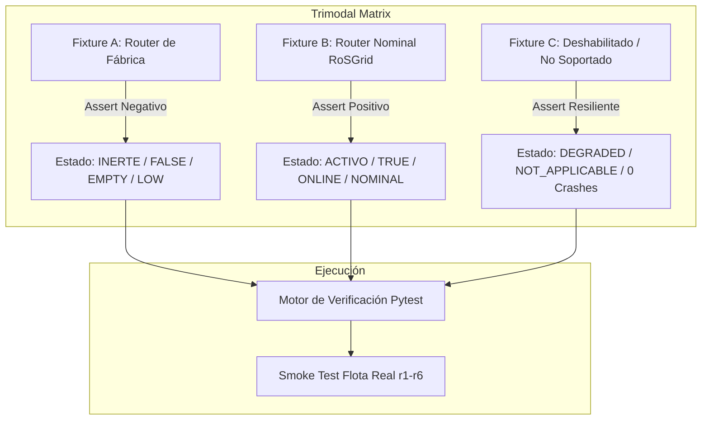

# SPDX-License-Identifier: GPL-3.0-only
# Copyright (C) 2026 RoSGrid Contributors

# 📑 Especificación 43: Marco Universal de Fixtures Trimodales Ground-Truth, Invariantes Negativas y Smoke Tests de Flota Real

**Versión:** 2.0.0 (Ampliación Transversal a Toda la Plataforma)  
**Fecha:** 2026-10-25  
**Estado:** Aprobada  
**Módulos Afectados:** 
- `fastapi/src/api/v1/inventory_helpers.py`, `fastapi/src/workers/health_monitor_worker.py` (Syslog & Reachability)
- `fastapi/src/api/v1/compliance.py` (CIS Hardening, Rogue DHCP & Config Drift)
- `fastapi/src/api/v1/topology.py` (Topología L2 MNDP/LLDP)
- `fastapi/src/api/v1/ipam.py` (Pools DHCP, Leases e Interfaces)
- `fastapi/src/api/v1/bulk_ops.py` (Orquestador PoE & WiFi CAPsMAN)
- `scripts/validar-flota-real.py`, `Makefile`, `.agents/ACTIVE_TASK.md`

---

## 1. Contexto, Diagnóstico y Causa Raíz Sistémica

### 1.1 El Síndrome de la "Ceguera de Mocks" (Mock Blindness)
Durante el desarrollo del Hito 24, se descubrió que los routers de laboratorio `r4`, `r5` y `r6` (mantenidos intencionalmente de fábrica sin Syslog configurado) figuraban en la interfaz web como `🟢 Activo`. 

El análisis de causa raíz demostró que:
1. RouterOS v7 incluye de fábrica una acción inerte en `/system/logging/action` denominada `remote` con `remote=0.0.0.0`.
2. El código del backend utilizaba heurísticas genéricas (búsqueda de subcadenas `"remote"`), otorgando un `True` complaciente.
3. **Las pruebas unitarias daban 100% de éxito** porque el programador creaba diccionarios sintéticos que ya contenían `syslog_active: true`, evaluando tautológicamente la lógica del frontend sin contrastar jamás la respuesta real de RouterOS v7 de fábrica.

### 1.2 Extensión Transversal del Riesgo
Este patrón de ceguera no es exclusivo de Syslog: afecta potencialmente a toda integración donde RoSGrid deba **discriminar un equipo virgen de fábrica de un equipo aprovisionado por la plataforma**.

---

## 2. Marco Universal de Fixtures Trimodales (Ground-Truth)

Para eliminar cualquier ambigüedad sintética, todo subsistema que interactúe con MikroTik RouterOS v7 debe someterse a la **Matriz Trimodal de Fixtures Reales** bajo `fastapi/tests/fixtures/mikrotik/<dominio>/`:



---

## 3. Catálogo de los 8 Dominios Críticos

| Dominio | Endpoint / Recurso | Fixture A (Fábrica) | Fixture B (RoSGrid Nominal) | Fixture C (Degradado/No Soportado) | Invariante Negativa Obligatoria |
| :--- | :--- | :--- | :--- | :--- | :--- |
| **1. Syslog Telemetría** | `/system/logging`, `/system/logging/action` | `factory_default_logging.json` (`remote=0.0.0.0`) | `rosgrid_configured_logging.json` (`action=rosgridsyslog`) | `disabled_rosgrid_logging.json` (`disabled=true`) | Si no existe acción `rosgridsyslog` con IP válida, `syslog_active == False`. |
| **2. CIS Hardening** | `/ip/service`, `/user`, `/ip/dns`, etc. | `factory_default_cis.json` (Telnet/FTP on, admin sin pass) | `hardened_rosgrid_cis.json` (Perfiles Corporate/ISP) | `partial_hardened_cis.json` (Directivas selectivas) | Router de fábrica **DEBE reprobar** directivas críticas; Score < 35 pts. |
| **3. Topología L2 MNDP** | `/ip/neighbor`, `/ip/neighbor/discovery-settings` | `factory_default_neighbors.json` (Lista vacía `[]`) | `meshed_neighbors.json` (Vecinos MikroTik válidos) | `thirdparty_neighbors.json` (Switches no-ROS, foreign MACs) | No alucinar enlaces ni fallar ante MACs desconocidas; `nodes=[]`. |
| **4. IPAM & DHCP** | `/ip/pool`, `/ip/dhcp-server`, `/lease` | `factory_default_dhcp.json` (`192.168.88.0/24` inerte) | `configured_dhcp_pools.json` (Pools corporativos RoSGrid) | `disabled_dhcp_server.json` (`invalid=true`) | No asociar leases ajenos; distinguir pools activos de subredes inertes. |
| **5. Orquestador PoE** | `/interface/ethernet/poe` | `factory_default_poe.json` (Routers sin PoE / CHR) | `active_poe_netpower.json` (PoE-out en interfaces) | `overload_poe.json` (Puertos en sobrecarga/cortocircuito) | Hardware sin PoE debe retornar `UNSUPPORTED`, nunca "puertos caídos". |
| **6. Rogue DHCP** | `/interface/bridge`, `/interface/bridge/port` | `factory_default_bridge.json` (`dhcp-snooping=no`) | `snooping_enabled_bridge.json` (`dhcp-snooping=yes`) | `rogue_server_alert.json` (Servidor no autorizado) | No emitir alertas espurias si DHCP Snooping no está activo en el bridge. |
| **7. WiFi CAPsMAN** | `/interface/wifi`, `/caps-man` | `factory_default_nowifi.json` (CCR/RB sin chip de radio) | `active_wifiwave2_capsman.json` (Radios y clientes en línea) | `unregistered_ap.json` (Radios no autorizadas) | Routers sin wireless deben retornar `NO_WIRELESS`, sin degradar salud. |
| **8. Config Drift** | `/export` vs Golden Baseline | `factory_default_export.rsc` (Configuración de fábrica) | `golden_baseline_export.rsc` (Configuración RoSGrid idéntica) | `tampered_export.rsc` (Reglas firewall modificadas) | Comparar contra Golden Baseline debe dar **100% de desviación (drift)**. |

---

## 4. Guardrail de Validación de Flota Real (`scripts/validar-flota-real.py`)

El entorno de laboratorio físico dispone de 7 nodos MikroTik (`r1` a `r6` y `caps1`):
- `r1` (`10.250.3.8`), `r2` (`10.250.3.13`), `r3` (`10.250.3.14`): Enrolados con servicios RoSGrid y Syslog activo.
- `r4` (`10.250.3.15`), `r5` (`10.250.3.17`), `r6` (`10.250.3.19`): Mantenidos intencionalmente de fábrica (sin Syslog).
- `caps1` (`10.250.3.21`): Punto de acceso y nodo wireless de pruebas (sin Syslog RoSGrid por defecto).

### 4.1 Aserciones Cruzadas Multi-Dominio

```text
[Aserción Positiva]: r1, r2, r3 DEBEN reportar:
  - Reachable: True (API REST HTTPS)
  - Status: ONLINE
  - Syslog Active: True (Sensor encendido)
  - CIS Score: >= 70
  - IPAM Leases: Sincronizados

[Aserción Negativa Obligatoria]: r4, r5, r6, caps1 DEBEN reportar:
  - Reachable: True (Físicamente vivos en lab)
  - Status: ONLINE
  - Syslog Active: FALSE (⚪ Sin Syslog)
  - CIS Score: < 35 (Directivas fallidas)
  - Config Drift: 100% Desviado
```

### 4.2 Principio Fail-Closed
Si cualquier equipo de fábrica o no aprovisionado (`r4, r5, r6, caps1`) reporta un valor positivo en sensores exclusivos de RoSGrid, el script `scripts/validar-flota-real.py` (`make smoke-fleet`) termina inmediatamente con código de salida `1`, impidiendo commits o publicación en Git.

### 4.3 Auto-Sincronización de Directivas de Auditoría y Parseo BSD
Para evitar que routers nominales (`r1, r2, r3`) sufran de ceguera ante cambios administrativos de WinBox o reglas firewall aplicadas localmente:
- El sensor de inventario valida que las 9 directivas canónicas estén activas y en caso de faltar las provisiona automáticamente.
- El receptor UDP normaliza paquetes BSD de RouterOS v7 e infiere los tópicos dinámicamente (`system,info`, `account`, `firewall,info`, `interface,warning`) incluso si el router emite el mensaje sin prefijos canónicos.
- Los smoke tests verifican que ante una mutación en el router, el log de auditoría se emita, normalice y almacene en KeyDB sin latencia ni pérdida de eventos.

---

## 5. Protocolo de Bitácora Activa de Tareas (Tolerancia a Compactación)

Para garantizar continuidad absoluta entre turnos y prevenir la pérdida de contexto cuando el agente de IA compacta el historial:

1. **Archivo de Bitácora Local:** `.agents/ACTIVE_TASK.md` (ignorado en `.gitignore`).
2. **Estructura Obligatoria:**
   - **Objetivo Central:** Qué se busca resolver.
   - **Criterios de Aceptación:** Condiciones binarias de éxito.
   - **Checklist de Ejecución:** Tareas pendientes `[ ]` y completadas `[x]` actualizadas en tiempo real antes y después de cada cambio.
   - **Decisiones de Diseño y Descubrimientos:** Anotaciones técnicas para que el agente reanude sin reiniciar el análisis.
3. **Procedimiento de Reanudación:**
   - Al iniciar cualquier turno tras una compactación, el agente debe leer obligatoriamente `.agents/ACTIVE_TASK.md` antes de proponer o ejecutar acciones.
