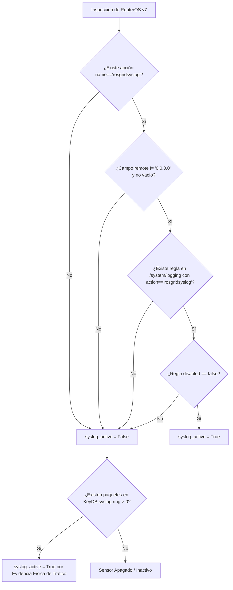

# SPDX-License-Identifier: GPL-3.0-only
# Copyright (C) 2026 RoSGrid Contributors

# 📑 Especificación 43: Detección Canónica Determinista de Syslog, Fixtures Reales MikroTik v7, Smoke Tests de Flota Real y Bitácora Activa de Tareas

**Versión:** 1.0.0  
**Fecha:** 2026-10-25  
**Estado:** Aprobada  
**Módulos Afectados:** `fastapi/src/api/v1/inventory_helpers.py`, `fastapi/src/workers/health_monitor_worker.py`, `scripts/validar-flota-real.py`, `.agents/ACTIVE_TASK.md`, `vue3/src/views/RouterInventoryView.vue`.

---

## 1. Contexto, Diagnóstico y Causa Raíz

### 1.1 El Falso Positivo de Detección de Syslog
En MikroTik RouterOS v7, la instalación de fábrica (`default-configuration`) incluye de manera predeterminada 4 acciones en `/system/logging/action`:
1. `memory` (target: memory)
2. `disk` (target: disk)
3. `echo` (target: echo)
4. `remote` (target: remote, con `remote=0.0.0.0`)

La implementación previa de `inspect_router_syslog_config` evaluaba si existía alguna acción con nombre `"remote"` o `target == "remote"`, retornando `True` sin verificar:
- Si esa acción pertenecía a RoSGrid o era simplemente el elemento inerte de fábrica.
- Si existía una regla activa en `/system/logging` vinculada a dicha acción.
- Si el destino remoto apuntaba realmente a la IP/puerto del servidor RoSGrid.

Como consecuencia, equipos de prueba de laboratorio sin Syslog configurado (`r4`, `r5`, `r6`) fueron erróneamente clasificados con Syslog activo (`syslog_active = True`), contaminando la máquina de estados en KeyDB y la interfaz gráfica de usuario.

### 1.2 La Ceguera de las Pruebas Unitarias Míticas (Tautología de Mocks)
Las pruebas unitarias existentes aprobaban al 100% porque evaluaban mocks sintéticos donde el dato de entrada ya contenía `syslog_active: true`. El sistema probaba que el frontend reflejaba lo que el mock decía, pero **nunca contrastó el algoritmo contra los JSONs reales que devuelve la API REST de RouterOS v7 de fábrica**.

---

## 2. Detección Canónica Determinista (Doble Candado)

RoSGrid establece una firma inmutable para su integración de Syslog sobre MikroTik RouterOS v7. La detección no debe utilizar términos genéricos (`"remote"` o `"syslog"`), sino validar **la firma canónica exacta**:

### 2.1 Criterios Deterministas Obligatorios
1. **Acción Canónica:** La acción debe denominarse exactamente `rosgridsyslog`. Su target debe ser `remote` y el parámetro `remote` debe contener una dirección IP o FQDN válido (distinto de `0.0.0.0` y no nulo).
2. **Regla Vinculada y Habilitada:** En `/system/logging`, debe existir al menos una regla cuyo campo `action` apunte a `rosgridsyslog`, y cuyo atributo `disabled` sea estrictamente `false` (o booleano `False`).
3. **Prueba Física de Tráfico (Fallback Resiliente):** Si la API REST no responde o no está disponible, el sensor evaluará `llen(rg:{tenant}:router:{id}:syslog:ring) > 0`. Si hay datagramas reales recibidos en el colector UDP 5514, el router se considera activo por evidencia física de tráfico.
4. **Condición Negativa de Fábrica:** Si el router únicamente posee las acciones de fábrica (`memory`, `disk`, `echo`, `remote` con `0.0.0.0`), el resultado es **`False`** sin excepción.

---

## 3. Fixtures Reales de MikroTik RouterOS v7 (Ground-Truth)

Para evitar la ceguera de pruebas en el backend, se formalizan tres fixtures JSON capturados de routers físicos RouterOS v7 bajo `fastapi/tests/fixtures/mikrotik/`:

1. `factory_default_logging.json`:
   - Representa un router virgen recién desempaquetado.
   - Acciones: `memory`, `disk`, `echo`, `remote (0.0.0.0)`.
   - Reglas: Solo `memory` y `disk`.
   - **Aserción:** `inspect_router_syslog_config == False`.
2. `rosgrid_configured_logging.json`:
   - Representa un router tras aplicar la plantilla `SYSLOG_CENTRALIZADO_ROSGRID`.
   - Acción: `rosgridsyslog` (`target=remote`, `remote=10.250.3.1`, `remote-port=5514`).
   - Regla: `action=rosgridsyslog`, `topics=info,warning,error,critical`, `disabled=false`.
   - **Aserción:** `inspect_router_syslog_config == True`.
3. `disabled_rosgrid_logging.json`:
   - Representa un router donde el operador deshabilitó temporalmente la regla de Syslog.
   - Acción: `rosgridsyslog` presente.
   - Regla: `action=rosgridsyslog`, `disabled=true`.
   - **Aserción:** `inspect_router_syslog_config == False`.

---

## 4. Smoke Test de Flota Real con Aserciones Negativas Obligatorias

Para impedir que cambios futuros rompan la diferenciación entre routers configurados y no configurados, se establece el script de prueba end-to-end:

$$\text{Archivo: } \texttt{scripts/validar-flota-real.py}$$

### 4.1 Invariantes Innegociables
El script consulta el endpoint real `/api/v1/inventory/routers` sobre el entorno de prueba de producción local levantado y valida:

| Router | Condición Requerida | Syslog Activo | Estado Operacional | Alcanzabilidad |
| :--- | :--- | :--- | :--- | :--- |
| **r1** | Enrolado con Syslog | `True` (🟢) | `ONLINE` | `True` |
| **r2** | Enrolado con Syslog | `True` (🟢) | `ONLINE` | `True` |
| **r3** | Enrolado con Syslog | `True` (🟢) | `ONLINE` | `True` |
| **r4** | De Fábrica (Sin Syslog) | **`False`** (⚪) | `OFFLINE` | `False` |
| **r5** | De Fábrica (Sin Syslog) | **`False`** (⚪) | `OFFLINE` | `False` |
| **r6** | De Fábrica (Sin Syslog) | **`False`** (⚪) | `OFFLINE` | `False` |

* **Métrica de Disponibilidad Global:** Exactamente $\frac{3}{6} = 50\%$.
* **Criterio de Bloqueo (Fail-Closed):** Si `r4`, `r5` o `r6` retornan `syslog_active == True`, el script emite código de salida `1` y bloquea cualquier intento de commit o push.

---

## 5. Protocolo de Bitácora Activa de Tareas (Tolerancia a Compactación)

Para garantizar continuidad absoluta entre turnos y prevenir la pérdida de contexto cuando el agente de IA compacta el historial:

1. **Archivo de Bitácora Local:** `.agents/ACTIVE_TASK.md` (ignorado en `.gitignore`).
2. **Estructura Obligatoria:**
   - **Objetivo Central:** Qué se busca resolver.
   - **Criterios de Aceptación:** Condiciones binarias de éxito.
   - **Checklist de Ejecución:** Tareas pendientes `[ ]` y completadas `[x]` actualizadas en tiempo real antes y después de cada cambio.
   - **Decisiones de Diseño y Descubrimientos:** Anotaciones técnicas para que el agente reanude sin reiniciar el análisis.
3. **Procedimiento de Reanudación:**
   - Al iniciar cualquier turno tras una compactación, el agente debe leer obligatoriamente `.agents/ACTIVE_TASK.md` antes de proponer o ejecutar acciones.
