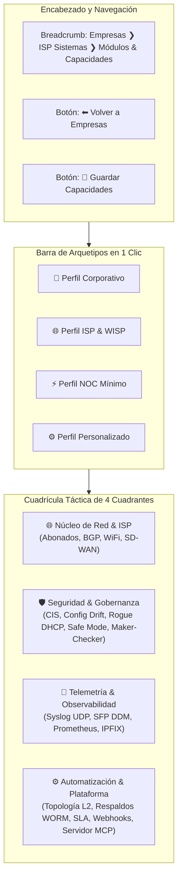

# SPDX-License-Identifier: GPL-3.0-only
# Copyright (C) 2026 RoSGrid Contributors

# 📑 Especificación 44: Conmutador Rápido de Tenants en Cabecera, Ergonomía de Pie de Página In-Flow y Gestión Táctica de Feature Flags por Empresa

**Versión:** 1.1.0  
**Fecha:** 2026-10-25  
**Estado:** Implementado y Certificado al 100%  
**Módulos Afectados:**
- `fastapi/src/api/v1/auth.py`, `fastapi/src/schemas/auth.py`, `fastapi/src/redis_layer/sessions.py` (Tenant Switcher API & Fail-Safe Session Lifecycle)
- `vue3/src/components/common/RgResponsiveShell.vue` (Layout, Header & Footer In-Flow)
- `vue3/src/components/admin/RgTenantSwitcher.vue` (Nuevo Componente Conmutador)
- `vue3/src/views/admin/TenantsManagementView.vue` (Integración de Badges e Invocación de Módulos)
- `vue3/src/views/admin/TenantModulesStudioView.vue` (Sub-pantalla Táctica de Módulos)
- `vue3/src/components/admin/RgFeatureFlagsGrid.vue` (Cuadrícula Táctica de 4 Cuadrantes y Arquetipos)
- `vue3/src/stores/useNocEventsStore.ts` (Filtro Kill-Switch y Reconexión Reactiva WebSocket)
- `vue3/src/stores/useAuthStore.ts`, `vue3/src/router/index.ts`

---

## 1. Justificación y Objetivos de Diseño

Esta especificación formaliza tres mejoras estructurales clave de experiencia de usuario y arquitectura multi-tenant:

1. **Conmutación en Caliente de Tenants para SuperAdmin (Tenant Switcher):**  
   Eliminar la fricción de tener que cerrar e iniciar sesión para supervisar distintas empresas, incorporando un conmutador interactivo en el recuadro superior izquierdo (`🏢 tenant ▾`).
2. **Optimización de Espacio Vertical (Pie de Página In-Flow):**  
   Eliminar la barra fija flotante de 32px que sustrae espacio útil permanentemente en el fondo de la pantalla, moviendo los créditos institucionales y la licencia al final natural del flujo de scroll de cada página.
3. **Gestión Táctica de Módulos & Feature Flags por Empresa (Sub-pantalla de Alta Densidad):**  
   Preservar el principio de que las flags son atributos específicos de cada tenant (gestionables desde la tabla de `Empresas (Tenants)`), sustituyendo el diálogo modal estrecho por una vista de pantalla completa con 4 cuadrantes, arquetipos rápidos (1 clic), verificación de dependencias y cálculo de radio de impacto.

---

## 2. Pilar 1: Conmutador Rápido de Tenants en Cabecera

### 2.1 Flujo y Lógica en Backend (`FastAPI` + `KeyDB`)
* **Endpoint:** `POST /api/v1/auth/switch-tenant`
* **Permiso Requerido:** Estrictamente reservado a usuarios con `role == "SUPERADMIN_GLOBAL"`.
* **Cuerpo de Petición (Pydantic v2):**
  ```python
  class SwitchTenantRequest(BaseModel):
      target_tenant_id: UUID
  ```
* **Mecánica de Conmutación:**
  1. Verifica que el `target_tenant_id` exista y esté activo (`is_active == True`).
  2. Obtiene los roles y permisos del SuperAdmin dentro del tenant destino (o preserva el rol global).
  3. Actualiza en KeyDB la sesión activa (`session_id`) asociándola al nuevo `tenant_id` y `tenant_slug`.
  4. Genera un nuevo JWT Access Token reflejando el nuevo `tenant_id` y `tenant_slug`.
  5. Emite registro de auditoría WORM HMAC-SHA256 con acción `SUPERADMIN_TENANT_SWITCHED`.
  6. Devuelve el nuevo token y los datos del tenant destino.

### 2.2 Experiencia Gráfica en Frontend (`Vue 3` + `TypeScript`)
* **Componente:** `RgTenantSwitcher.vue` embebido en `RgResponsiveShell.vue`.
* **Comportamiento por Rol:**
  - `SUPERADMIN_GLOBAL`: El recuadro es un botón interactivo con indicador de flecha `🏢 {tenantSlug} ▾`. Al hacer clic, despliega un *popover* flotante estilo Tactical NOC con buscador (`🔍 Buscar empresa...`) y lista de tenants activos.
  - Otros Roles (`TENANT_ADMIN`, `OPERATOR`, `FIELD_TECH`): Se mantiene como un badge informativo estático sin interacción ni menú desplegable.
* **Transición en Caliente:**
  - Al seleccionar un nuevo tenant, `authStore` actualiza el token y las llaves de tenant.
  - Se despachan automáticamente las acciones de refresco de Pinia: `inventoryStore.fetchRouters(true)`, recarga de alertas del NOC y telemetría, sin recargar la página ni perder la sesión.

### 2.3 Resiliencia Fail-Safe y Prevención de Auto-Deslogueo por WebSocket (Hotfix 25.11)
Para evitar que la revocación de la sesión previa en KeyDB expulse involuntariamente a la pestaña activa del operador mediante el canal de eventos en vivo:
1. **Silenciamiento de Pub/Sub en Backend:**
   - La función `kill_session(..., notify_ws=False)` omite la publicación del mensaje `SESSION_KILLED` en el canal `rg:pubsub:events:{tenant_id}` cuando la revocación es producto de una conmutación legítima de contexto (`killed_by="SUPERADMIN_TENANT_SWITCH"`).
   - Secuencia **Fail-Safe**: Primero se validan las credenciales, se extraen las capacidades de forma canónica mediante `_extract_tenant_features(target_tenant)` y se activa la nueva sesión en KeyDB. Solo tras recibir confirmación de éxito se revoca la sesión del tenant saliente.
2. **Filtro de Exclusión y Reconexión Reactiva en Frontend:**
   - En `useNocEventsStore.ts`, el interceptor de eventos en vivo descarta cualquier notificación `SESSION_KILLED` que contenga `killed_by === 'SUPERADMIN_TENANT_SWITCH'`, impidiendo la invocación no deseada de `authStore.forceKillSwitchLogout()`.
   - Se establece un oyente global para el evento nativo `rosgrid:tenant-switched` que desconecta el socket del tenant saliente y reconecta el canal de eventos con un retardo controlado de 150 ms apuntando a la nueva organización.

---

## 3. Pilar 2: Ergonomía de Pie de Página In-Flow (Recuperación de 32px Verticales)

### 3.1 Problema del Layout Actual
Actualmente, `.rg-global-footer` es un hijo directo del flex container raíz `.rg-shell`, lo que provoca que permanezca como una franja fija e inamovible de 32px en el borde inferior del navegador, restando espacio para tablas y gráficos en monitores 1080p y 720p.

### 3.2 Solución Arquitectónica
* Mover el bloque `<footer>` al interior de `<main id="main-content" class="rg-main">`, colocado inmediatamente después del `<slot></slot>`.
* Estilos CSS:
  ```css
  .rg-main {
    display: flex;
    flex-direction: column;
    min-height: 100%;
    overflow-y: auto;
  }

  .rg-main-content-body {
    flex: 1 0 auto;
  }

  .rg-inflow-footer {
    margin-top: auto;
    padding: 16px 0 8px 0;
    text-align: center;
    font-size: 11px;
    color: var(--rg-text-muted);
  }
  ```
* **Resultado Visual:** 
  - El 100% de la altura vertical de la pantalla se destina a la visualización de datos.
  - El texto *Elaborado por Tecno Consultores 2023 C.A. • Licencia GNU GPLv3* aparece únicamente cuando el usuario se desplaza al final de la página.

---

## 4. Pilar 3: Gestión Táctica de Módulos & Feature Flags por Empresa

### 4.1 Punto de Entrada en la Tabla de Empresas
En `TenantsManagementView.vue`:
* La columna de acciones de cada tenant incorpora:
  - **Badge de Estado:** `[ 12/16 Módulos ]` (verde táctico si tiene módulos activos, gris si está en mínimos).
  - **Botón Descriptivo:** `[ ⚙️ Módulos ]` (sustituyendo el ícono críptico anterior).

### 4.2 Sub-pantalla Táctica: `TenantModulesStudioView.vue`
Al presionar el botón `[ ⚙️ Módulos ]` de un tenant, la aplicación navega hacia `/admin/tenants/:tenantId/modules` (o abre la sub-vista de pantalla completa):



### 4.3 Especificación de las Tarjetas de Módulo (`RgFeatureCard.vue`)
Cada tarjeta de módulo expone:
1. **Identidad:** Ícono representativo, nombre comercial y clave técnica snake_case.
2. **Badge de Riesgo/Severidad:** `🟢 Bajo Riesgo`, `🟡 Impacto Operativo`, `🔴 Gobernanza Crítica`.
3. **Resumen Operativo:** 2 líneas describiendo la función exacta en español.
4. **Validación de Dependencias (DAG):**
   - Si una flag depende de otra inactiva (ej. `bgp_looking_glass_enabled` depende de `isp_module_enabled`), el switch se deshabilita visualmente con una alerta ámbar indicando la dependencia requerida.
5. **Switch Táctil Táctico:** Control deslizante animado con estado reactivo.
6. **Enlace Contextual:** Botón `[ Ir a la función ➔ ]` activo cuando el módulo está encendido.

### 4.4 Modal de Radio de Impacto (*Blast Radius Shield*)
Si el operador desactiva una flag de nivel **Gobernanza Crítica** (`syslog_collector_enabled`, `enforce_maker_checker`, `auto_safemode_enforced`), se despliega un diálogo de confirmación:
* Cálculo dinámico: *"Esta acción afectará a N routers y N operadores activos en este tenant."*
* Confirmación explícita requerida antes de aplicar la modificación en KeyDB y PostgreSQL.

---

## 5. Criterios de Aceptación y Certificación 11X

1. **Tenant Switcher:**
   - `SUPERADMIN_GLOBAL` conmuta entre tenants sin desloguearse y las llamadas a la API adoptan de inmediato el nuevo `tenant_id`.
   - Usuarios sin privilegios globales no ven ni pueden invocar la conmutación.
2. **Layout In-Flow:**
   - Zero barras fijas flotantes de 32px en el fondo de la pantalla.
   - El copyright de Tecno Consultores y la licencia GPLv3 se renderizan al fondo del scroll de cada página.
3. **Módulos & Capacidades:**
   - La tabla de empresas muestra el conteo exacto de módulos activos por tenant.
   - La sub-pantalla de módulos permite aplicar arquetipos en 1 clic y respeta el grafo de dependencias lógicas.
   - Toda modificación de flags genera un registro WORM `TENANT_FEATURE_FLAGS_UPDATED` en `audit_logs`.
