# SPDX-License-Identifier: GPL-3.0-only
# Copyright (C) 2026 RoSGrid Contributors

# 📑 Especificación 45: Gobernanza Táctica de Módulos B2B — DAG en Cascada (Hard Lock), Blindaje RBAC de Licenciamiento, Modo Contingencia y Auditoría Visual con Rollback

**Versión:** 1.0.0  
**Fecha:** 2026-10-25  
**Estado:** Propuesta (En Planificación)  
**Módulos Afectados:**
- `vue3/src/components/admin/RgFeatureFlagsGrid.vue` (Lógica Reactiva DAG, Botón de Contingencia y Tooltips)
- `vue3/src/views/admin/TenantModulesStudioView.vue` (Pestañas Tácticas: Matriz de Módulos vs. Historial de Auditoría con Rollback)
- `vue3/src/components/admin/TenantModulesAuditTab.vue` (Nuevo Componente de Historial y Rollback en 1 Clic)
- `fastapi/src/api/v1/tenants.py` (Blindaje RBAC de Licenciamiento Comercial — Validación Fail-Closed 403)
- `docs/03_MANUAL_ADMIN_MULTITENANT_Y_SEGURIDAD.md`, `docs/06_REFERENCIA_COMPLETA_API_REST_Y_WEBSOCKETS.md`

---

## 1. Justificación y Objetivos de Diseño

Esta especificación consolida las 4 dimensiones avanzadas de gestión de capacidades organizacionales para la plataforma SaaS B2B **RoSGrid**, cerrando la brecha entre el estado del arte de la industria (OpenFeature, LaunchDarkly, Unleash) y la operación táctica de redes de misión crítica:

```mermaid
graph TD
    subgraph D1 ["Dimensión 1: Grafo DAG (Hard Lock)"]
        D1_A["Módulo Padre Apagado"] -->|Bloqueo en Cascada| D1_B["Hijos Desactivados y Grisados"]
        D1_B --> D1_C["Tooltip Explicativo en UI"]
    end

    subgraph D2 ["Dimensión 2: Licenciamiento Comercial"]
        D2_A["Punto de Entrada Único"] --> D2_B["Tabla Empresas /tenants"]
        D2_B --> D2_C["RBAC Fail-Closed: Solo SUPERADMIN_GLOBAL"]
    end

    subgraph D3 ["Dimensión 3: Modo Contingencia NOC"]
        D3_A["Preset ⚡ Contingencia"] -->|1 Clic| D3_B["Apagado Colectores Pesados UDP/IPFIX"]
        D3_B --> D3_C["Protección CPU/Enlaces + Núcleo Activo"]
    end

    subgraph D4 ["Dimensión 4: Auditoría y Rollback"]
        D4_A["Pestaña Historial"] --> D4_B["Logs WORM de la Empresa"]
        D4_B --> D4_C["Botón ⤺ Cargar esta versión (Rollback)"]
    end
```



1. **Grafo de Dependencias Activo (DAG - Hard Lock):** Erradicar combinaciones incoherentes de red (ej. habilitar BGP Looking Glass sin el Módulo de Enrutamiento ISP) mediante reglas de bloqueo en cascada y deshabilitación visual reactiva.
2. **Jerarquía de Licenciamiento Comercial Soberano:** Blindar conceptual y técnicamente que las Feature Flags en RoSGrid son atributos de contratación B2B gobernados exclusivamente por el `SUPERADMIN_GLOBAL`, inaccesibles e inmodificables por administradores locales de empresa (`TENANT_ADMIN`).
3. **Modo Contingencia / Emergencia Operativa en 1 Clic:** Proveer un interruptor táctico rápido que suspenda inmediatamente colectores de alta frecuencia ante congestión de red, preservando intacto el núcleo de control.
4. **Auditoría Visual en Pantalla y Capacidad de Rollback:** Evitar la dispersión de vistas proporcionando una pestaña de historial de modificaciones dentro del propio estudio de la empresa, dotada de un mecanismo de reversión inmediata en 1 clic.

---

## 2. Dimensión 1: Grafo de Dependencias Activo (DAG - Hard Lock)

### 2.1 Matriz Canónica de Dependencias Técnicas

| Módulo Padre | Módulos Dependientes (Hijos) | Regla de Bloqueo en Cascada | Justificación Técnica |
| :--- | :--- | :--- | :--- |
| `isp_module_enabled` | `bgp_looking_glass_enabled`, `sla_tracker_enabled` | Si el padre es `false`, los hijos se fuerzan a `false` y sus switches quedan deshabilitados (`disabled`). | Looking Glass BGP y las sondas SLA están orientadas a la provisión a abonados y tránsito carrier. |
| `cis_audit_enabled` | `auto_safemode_enforced` | Si CIS está activo, se sugiere/enforza Safe Mode para prevenir bloqueos por auto-hardening. | El endurecimiento CIS aplica filtros de firewall que requieren reversión de emergencia ante fallos de conexión. |
| `syslog_collector_enabled` | `ai_mcp_integration_enabled` (Capacidad Syslog) | Advertencia contextual: la IA MCP no podrá consultar eventos en tiempo real si el recolector está inactivo. | Las herramientas SOP de diagnóstico 360° dependen del RingBuffer de datagramas Syslog. |

### 2.2 Implementación Reactiva en Frontend (`RgFeatureFlagsGrid.vue`)

```typescript
// Reglas del Grafo de Dependencias (DAG)
const isBgpDisabled = computed(() => !localFeatures.value.isp_module_enabled);
const isSlaDisabled = computed(() => !localFeatures.value.isp_module_enabled);

watch(() => localFeatures.value.isp_module_enabled, (enabled) => {
  if (!enabled) {
    localFeatures.value.bgp_looking_glass_enabled = false;
    localFeatures.value.sla_tracker_enabled = false;
  }
});
```

* **Feedback Visual:** Cada switch dependiente mostrará un badge de estado `[ 🔒 Requiere Módulo ISP ]` y un tooltip en hover explicando por qué se encuentra deshabilitado.

---

## 3. Dimensión 2: Jerarquía de Control y Blindaje RBAC (Licenciamiento Comercial)

### 3.1 Modelo de Dominio
En RoSGrid, las Feature Flags definen el **catálogo de herramientas contratadas** por la organización. Por tanto:
- No son configuraciones cosméticas de usuario ni preferencias de operador.
- El cliente (Tenant) opera dentro del marco de capacidades que la administración de la plataforma le ha provisto.

### 3.2 Blindaje en Backend (`fastapi/src/api/v1/tenants.py`)
- Endpoint: `PATCH /api/v1/tenants/{tenant_id}/features` y `PUT /api/v1/tenants/{tenant_id}/features`.
- Control de Acceso:
  ```python
  if current_user.role != SystemRoleEnum.SUPERADMIN_GLOBAL:
      raise HTTPException(
          status_code=status.HTTP_403_FORBIDDEN,
          detail="Solo los usuarios con rol SUPERADMIN_GLOBAL pueden modificar los módulos y licencias de las empresas."
      )
  ```
- **Auditoría WORM Obligatoria:** Cada invocación registra en `audit_logs` la acción `TENANT_FEATURE_FLAGS_UPDATED` detallando el diff completo entre `previous_features` y `updated_features`.

---

## 4. Dimensión 3: Botón Táctico de "Modo Contingencia / Emergencia"

### 4.1 Ubicación e Identidad Visual
En la barra de presets rápidos de [`TenantModulesStudioView.vue`](file:///home/sinfallas/Dropbox/git/tecno-consultores/RoSGrid/vue3/src/views/admin/TenantModulesStudioView.vue), se integra el botón destacado:
`[ ⚡ Modo Contingencia / Bajo Consumo ]` con borde de alerta táctica (`#EF4444`).

### 4.2 Matriz de Apagado de Emergencia en 1 Clic

| Categoría | Módulos Apagados (`false`) | Módulos Preservados (`true`) |
| :--- | :--- | :--- |
| **Telemetría Pesada** | `syslog_collector_enabled`, `ipfix_analytics_enabled`, `prometheus_fleet_exporter_enabled`, `sfp_ddm_telemetry_enabled` | N/A |
| **Monitoreo Secundario** | `config_drift_monitoring_enabled`, `sdwan_orchestrator_enabled` | N/A |
| **Núcleo & Gobernanza** | N/A | `isp_module_enabled`, `cis_audit_enabled`, `enforce_maker_checker`, `auto_safemode_enforced`, `l2_topology_enabled`, `nightly_backups_enabled` |

* **Banner Informativo en UI:** Al aplicar el preset, se despliega un banner de notificación:  
  `⚠️ Modo Contingencia Aplicado: Se han suspendido los recolectores de alta frecuencia para liberar recursos de CPU y ancho de banda en los routers.`

---

## 5. Dimensión 4: Auditoría Visual en Pantalla y Capacidad de Rollback

### 5.1 Estructura Bimodal de Pestañas en la Sub-pantalla
La vista `/admin/tenants/:tenantId/modules` se amplía con dos pestañas de navegación:
1. `[ ⚙️ Matriz de Módulos ]`: Cuadrícula con los 4 cuadrantes, arquetipos y switches.
2. `[ 📜 Historial de Modificaciones ]`: Componente `TenantModulesAuditTab.vue`.

```
┌────────────────────────────────────────────────────────────────────────┐
│ 🏢 Telecomunicaciones Fibra Norte C.A.  [ 12/16 Módulos Activos ]      │
├────────────────────────────────────────────────────────────────────────┤
│ [ ⚙️ Matriz de Módulos ]   [ 📜 Historial de Modificaciones (Reciente) ] │
├────────────────────────────────────────────────────────────────────────┤
│ Fecha/Hora (UTC)    | Operador  | IP          | Módulos Modificados | Acción│
├─────────────────────┼───────────┼─────────────┼─────────────────────┼───────┤
│ 2026-10-25 11:30:15 │ sinfallas │ 192.168.1.5 │ BGP (OFF), SFP (ON) │ [ ⤺ ] │
│ 2026-10-24 18:20:00 │ sinfallas │ 192.168.1.5 │ Syslog (ON)         │ [ ⤺ ] │
└────────────────────────────────────────────────────────────────────────┘
```

### 5.2 Mecánica del Botón de Rollback (`[ ⤺ Cargar esta versión ]`)
1. Al hacer clic en `[ ⤺ Cargar esta versión ]`, se lee el objeto `previous_features` registrado en los metadatos del evento de auditoría.
2. La interfaz cambia automáticamente a la pestaña `[ ⚙️ Matriz de Módulos ]` y carga exactamente esos 16 valores en el formulario reactivo.
3. Se despliega una notificación de alerta:  
   `ℹ️ Valores anteriores cargados en el formulario. Revisa los cuadrantes y pulsa [ Guardar Cambios ] para aplicar la reversión.`
4. La reversión se consolida únicamente cuando el SuperAdmin confirma con el botón de guardado estándar, pasando por el escudo de impacto si corresponde.

---

## 6. Plan de Verificación y Pruebas 11X

1. **Frontend Unitario (Vitest):**
   - Verificar que al poner `isp_module_enabled = false`, `bgp_looking_glass_enabled` se apague y su input tenga `disabled == true`.
   - Verificar que pulsar el preset de contingencia configure la matriz de apagado de emergencia.
   - Verificar que la pestaña de historial renderice los eventos y que el botón de rollback pueble el formulario reactivo.
2. **Backend Unitario (Pytest):**
   - Validar rechazo 403 Forbidden al invocar `PATCH /api/v1/tenants/{id}/features` con roles inferiores a `SUPERADMIN_GLOBAL`.
   - Validar registro exhaustivo del diff en `audit_logs`.
3. **Validación Visual en Navegador Real (`browser_subagent`):**
   - Interacción con switches dependientes, verificación de tooltips, carga de versión anterior y guardado seguro.
