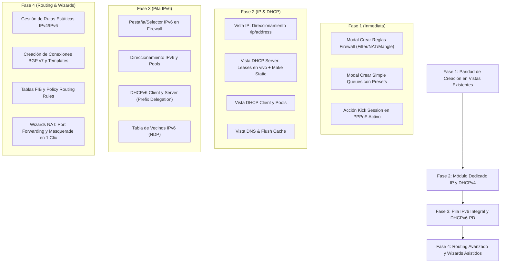

# 46 — REPORTE DE INVESTIGACIÓN: ANÁLISIS DE MERCADO, COMPETITIVIDAD DE WEBFIG Y ROADMAP DE FUNCIONALIDADES (RoSGrid)

**Autor:** Antigravity AI Assistant & RoSGrid Architecture Team  
**Fecha:** 26 de Octubre de 2026  
**Ámbito:** Consola WebFig v7 de RoSGrid (`vue3/src/views/` y `fastapi/src/api/v1/`)  
**Propósito:** Investigación profunda del mercado, benchmark de competidores y catálogo de requerimientos técnicos para posicionar la consola WebFig de RoSGrid como la solución web definitiva frente a WinBox 4, MKController, Splynx, ISPApp, UISP y pfSense/OPNsense.

---

## 1. Resumen Ejecutivo y Diagnóstico del Estado Actual

Tras una auditoría exhaustiva del código fuente actual de RoSGrid (`vue3/` y `fastapi/src/api/v1/`), se identificó una **brecha de paridad crítica entre Frontend y Backend**:

1. **El Backend ya implementa la mayoría de las operaciones mutables:**
   - `webfig_firewall.py`: Posee endpoints REST v7 para creación (`POST`), edición (`PATCH`), borrado (`DELETE`), reordenamiento (`move`), reset de contadores y gestión de listas de direcciones (`address-lists`) tanto para protocolo `ip` (IPv4) como `ipv6`.
   - `webfig_routing.py`: Posee endpoints para crear tablas de enrutamiento (`tables`), reglas de política (`rules`), conexiones BGP v7 (`bgp/connections`) y filtros de ruteo (`filters/rules`).
   - `webfig_queues.py`: Posee endpoints para crear colas simples (`POST /simple`), editarlas (`PATCH`), borrarlas (`DELETE`), reordenarlas (`move`) y crear árboles de colas (`tree`).
   - `webfig_ip.py`: Posee endpoints para direcciones IP (`addresses`), rutas estáticas (`routes`), tablas ARP, pools de direcciones (`pools`), y conversión de concesiones DHCP en estáticas (`make-static`).
   - `webfig_ppp.py`: Posee endpoints para secrets, perfiles y servidores PPPoE.

2. **El Frontend presenta una desconexión de interfaz y omisión de módulos clave:**
   - **Firewall (`FirewallRulesView.vue`):** Solo presenta la tabla de lectura y el reordenamiento drag-and-drop. **No existe botón "+ Nueva Regla"**, ni formularios/modales para crear reglas en *Filter*, *NAT* (Port Forwarding / Masquerade), *Mangle* o *RAW*. No hay selector para alternar entre IPv4 e IPv6.
   - **Routing (`RoutingBgpOspfView.vue`):** Solo expone lectura de sesiones BGP activas y vecinos OSPF. **No permite crear rutas estáticas**, ni crear/editar conexiones BGP, ni gestionar instancias OSPF, ni configurar tablas o reglas de enrutamiento.
   - **Colas y PPPoE (`PppAndQueuesView.vue`):** Permite crear Secrets y Perfiles PPPoE, pero la pestaña de **Simple Queues es de solo lectura** (no hay modal ni botón para crear colas de ancho de banda). En PPPoE Activo, no hay opción para desconectar o expulsar clientes (Kick Session).
   - **Ausencia Total de IPv6:** No existe vista ni menú para direccionamiento IPv6 (`/ipv6/address`), DHCPv6, rutas IPv6 ni firewall IPv6.
   - **Ausencia de Módulos DHCP e IP Básicos:** No existe en el menú de WebFig una vista dedicada a **IP** que agrupe *Addresses*, *DHCP Server (Leases/Setup)*, *DHCP Client*, *Pools*, *ARP* y *DNS*, obligando al usuario a depender de herramientas externas.

---

## 2. Benchmark de la Competencia (Estado del Arte 2024-2026)

Para que WebFig de RoSGrid sea una competencia real e indiscutible en el mercado de operadores ISP, WISPs, centros de datos y redes corporativas, se evaluaron las 6 principales soluciones del sector:

| Solución | Tipo | Puntos Fuertes | Limitaciones frente a RoSGrid |
| :--- | :--- | :--- | :--- |
| **WinBox 4** *(MikroTik Oficial)* | App Escritorio (C++/Flutter) Multiplataforma | Acceso L2 MAC/RoMON (recuperación sin IP), árbol completo de menús RouterOS v7, multi-ventana flotante, Safe Mode nativo, cero latencia. | **No es web ni multi-tenant**. Requiere instalación local. Carece de gobierno RBAC granular, no tiene flujo Maker-Checker, ni auditoría forense inmutable WORM, ni integración con IA. |
| **MKController** | Plataforma Cloud SaaS | Acceso remoto sin IP pública (túnel VPN / CGNAT bypass), backups automáticos con diff visual, alertas Push/Telegram, hotspot vouchers. | **Es un mero proxy/túnel de WebFig nativo**. No rediseña la interfaz, no ofrece wizards de configuración, la UX en móviles es deficiente y no tiene gobernanza empresarial de aprobaciones. |
| **Splynx** | ISP Billing & Network Manager | Automatización masiva de PPPoE (RADIUS), sincronización de DHCP Leases, gestión de colas simples y árboles jerárquicos (PCQ), asignación de prefijos DHCPv6-PD (/56, /64). | **Enfocado en facturación/ERP**. Curva de aprendizaje extremadamente empinada, licenciamiento muy costoso, pesado para tareas tácticas inmediatas de NOC y configuración pura de red. |
| **ISPApp** | Cloud Fleet Management | Despliegue Zero-Touch (ZTP), gráficos de rendimiento en tiempo real, web shell/terminal en navegador, bypass de CGNAT. | Muy orientado a telemetría pasiva. Capacidades de configuración profunda de Firewall y Routing complejas son limitadas; no cuenta con Safe Mode web asistido. |
| **UISP (Ubiquiti)** | Web Controller | Experiencia de usuario (UX) impecable, mapas de topología claros, configuración fluida de interfaces y DHCP. | **Ecosistema cerrado**. No soporta la riqueza técnica de RouterOS v7 (BGP multihop, Mangle, RAW, VRF, RouterOS v7 routing filters). |
| **pfSense / OPNsense** | Open-Source Firewall Web GUI | Referente mundial en UX web para redes: Wizards de Port Forwarding, reglas de firewall drag-and-drop con diagnóstico semántico, botón 1-clic "Make Static" en DHCP leases, soporte IPv6 bimodal. | Limitado al ecosistema FreeBSD. No gestiona routers MikroTik ni hardware RouterBOARD distribuido. |

---

## 3. Desglose de las 5 Brechas Detectadas por el Usuario

### Brecha 1: Firewall (Solo lectura / Sin creación de reglas)
- **Problema:** En `FirewallRulesView.vue`, el operador solo puede visualizar las reglas y reordenarlas con Alt+↑/↓ o Drag & Drop. No existe interfaz para agregar reglas en las cadenas `input`, `forward`, `prerouting`, `postrouting`, `srcnat` o `dstnat`.
- **Qué necesita el mercado:**
  1. **Botón "+ Agregar Regla"** en cada pestaña (*Filter*, *NAT*, *Mangle*, *RAW*, *Address-Lists*).
  2. **Wizard Asistido para NAT:**
     - *Masquerade (Salida a Internet):* Out-Interface + Action Masquerade en 1 clic.
     - *Port Forwarding (Dst-NAT):* In-Interface, Protocolo (TCP/UDP), Puerto Externo (Dst-Port), IP Interna de Destino (To-Addresses) y Puerto Interno (To-Ports).
  3. **Formulario Táctico de Filter / Mangle:** Cadena, Protocolo, Dst/Src Address, In/Out Interface, Action (`accept`, `drop`, `reject`, `fasttrack-connection`, `mark-packet`), Comentario y opción `place-before` para ubicarla en la posición deseada.
  4. **Acciones Contextuales por Fila:** Habilitar/Deshabilitar ([X]), Duplicar Regla, Editar Parámetros y Eliminar con confirmación de Safe Mode.
  5. **Tabla de Conexiones Activas (Conntrack):** Filtros en tiempo real por IP/puerto y botón para matar o cerrar conexiones sospechosas.

### Brecha 2: Routing v7 (Solo lectura / Sin creación de rutas ni protocolos)
- **Problema:** En `RoutingBgpOspfView.vue`, solo se visualizan adyacencias OSPF y sesiones BGP. No hay forma de crear rutas estáticas ni configurar los protocolos de routing dinámico.
- **Qué necesita el mercado:**
  1. **Módulo de Rutas Estáticas (`/ip/route` e `/ipv6/route`):**
     - Crear Ruta: `dst-address` (ej. `0.0.0.0/0`), `gateway` (IP o Interfaz), `distance`, `routing-table` (main o personalizada) y `check-gateway` (`ping` o `arp` para failover automático).
     - Visualización de flags nativos RouterOS v7: `[A]` Active, `[C]` Connect, `[S]` Static, `[D]` Dynamic, `[b]` BGP, `[o]` OSPF.
  2. **BGP v7 Interactivo:**
     - Formulario de creación/edición de Conexiones BGP (`/routing/bgp/connection`): Nombre, `remote.address`, `remote.as`, `local.as`, `templates`, `routing-table`.
     - Monitoreo en vivo de prefijos recibidos, prefijos anunciados y botón de reinicio de sesión BGP (Soft Reset).
  3. **OSPF v3/v2:** Creación de instancias, asignación de áreas y plantillas de interfaz (`interface-templates`) con autenticación.
  4. **Policy Routing (PBR):** Creación de tablas de ruteo (`/routing/table` con flag `fib`) y reglas de ruteo (`/routing/rule` con src-address, dst-address, action `lookup-only-in-table`).
  5. **Filtros de Enrutamiento v7 (`/routing/filter/rule`):** Editor de reglas de filtrado BGP con la nueva sintaxis de RouterOS v7 (`if (dst in 10.0.0.0/8) { reject }`).

### Brecha 3: PPPoE y Simple Queues (Solo lectura en colas / Falta gestión activa)
- **Problema:** `PppAndQueuesView.vue` no permite crear colas simples (`Simple Queues`), y en PPPoE no permite expulsar sesiones activas.
- **Qué necesita el mercado:**
  1. **Creación y Edición de Simple Queues:**
     - Modal con selector de Target (IP de cliente o subred CIDR).
     - Selector de Ancho de Banda con presets rápidos en 1 clic: `10M/10M`, `25M/50M`, `100M/100M`, `300M/300M`, `1G/1G` o valor manual.
     - Parámetros avanzados: Burst Limit, Burst Threshold, Burst Time y Prioridad (1-8).
     - Selector de Cola Padre (Parent Queue) para control de contención de abonados.
     - Indicador visual de consumo en tiempo real: Barra de saturación con semáforo cromático (Verde < 70%, Amarillo 70-90%, Rojo > 90%).
  2. **Acciones PPPoE:**
     - Botón **"Desconectar Sesión" (Kick)** en la tabla de clientes activos (`/ppp/active`), cerrando la conexión del abonado de forma inmediata.
     - Acciones de Edición, Deshabilitación temporal y Eliminación en *Secrets* y *Profiles*.

### Brecha 4: Ausencia Total de IPv6
- **Problema:** Ninguna vista ni menú actual expone la pila IPv6, a pesar de que RouterOS v7 la integra de forma nativa e inseparable.
- **Qué necesita el mercado:**
  1. **Selector Global / Bimodal IPv4 vs. IPv6:** En vistas como Firewall, Routing y Direccionamiento, poder alternar entre IPv4 e IPv6 con una pestaña o selector unificado.
  2. **Direccionamiento IPv6 (`/ipv6/address`):** Asignación de direcciones IPv6 con longitud de prefijo (ej. `2001:db8::1/64`), selección de interfaz, flags `advertise` (SLAAC) y `eui-64`.
  3. **Firewall IPv6 (`/ipv6/firewall`):** Reglas de filtrado específicas para IPv6 (Filter, Mangle, RAW y Address Lists v6), indispensables para proteger el router y permitir ICMPv6 obligatorio para NDP y Path MTU Discovery.
  4. **Vecinos IPv6 / NDP (`/ipv6/nd` y `/ipv6/neighbor`):** Configuración de Router Advertisements (RA) y tabla de vecinos descubiertos (equivalente a la tabla ARP de IPv4).
  5. **Rutas IPv6 (`/ipv6/route`):** Rutas estáticas para prefijos `::/0` y bloques asignados.

### Brecha 5: Configuraciones de DHCP (v4 y v6) Ausentes
- **Problema:** En el árbol de navegación no existe acceso a la configuración de servidores ni clientes DHCP, obligando al operador a recurrir a la consola o WinBox para tareas tan cotidianas como ver leases o fijar una IP.
- **Qué necesita el mercado:**
  1. **DHCPv4 Server:**
     - Asistente **"DHCP Setup"** rápido en 3 pasos: Selección de interfaz/bridge, subred/gateway y rango del pool.
     - Configuración de Redes (`/ip/dhcp-server/network`): Gateway, DNS primario/secundario, dominio, servidor NTP.
     - **Gestión Avanzada de Concesiones (Leases):**
       - Tabla en vivo de clientes conectados con Hostname, IP, MAC y tiempo de concesión restante.
       - Botón **"Hacer Estática" (Make Static)** en 1 clic.
       - Botón **"Bloquear Cliente"** (añadir a address-list de bloqueo o deshabilitar lease).
  2. **DHCPv4 Client:**
     - Visualización y configuración de clientes DHCP en interfaces WAN.
     - Visualización en vivo de IP recibida, Gateway y estado de renovación (`bound`, `requesting`).
  3. **DHCPv6 Server & Prefix Delegation (PD):**
     - Configuración de servidor DHCPv6 para delegación de prefijos `/56` o `/64` a CPEs o routers aguas abajo.
     - Vinculación a Pools IPv6 (`/ipv6/pool`).
  4. **DHCPv6 Client:**
     - Cliente DHCPv6 en interfaz WAN solicitando prefijo (`request=prefix`) para auto-configuración de red LAN/abonados.
  5. **IP Pools (`/ip/pool` e `/ipv6/pool`):**
     - Creación y administración de rangos de direcciones reutilizables.

---

## 4. Diferenciadores Competitivos Únicos de RoSGrid (El Factor "WOW")

Ninguno de los competidores (ni WinBox, ni MKController, ni pfSense) combina la siguiente arquitectura de seguridad y ergonomía técnica:

1. **Safe Mode Táctico Universal de 60 Segundos:**
   - Cada creación o modificación de reglas de firewall, rutas o interfaces activa automáticamente un cronómetro de Safe Mode en la barra superior.
   - Si la regla desconecta al router de RoSGrid, el scheduler interno de RouterOS revierte los cambios a los 60 segundos sin dejar el equipo incomunicado.
2. **Gobernanza Maker-Checker (HTTP 202 Accepted):**
   - Políticas donde técnicos de soporte de primer nivel (L1/L2) pueden proponer reglas de BGP o cambios en la cadena `input` del Firewall, pero requieren la aprobación con 1 clic de un Senior (L3/Admin) para impactar el router.
3. **Paso de Autorización Step-Up (Vault 30s):**
   - Protección criptográfica mediante clave o biometría para operaciones de alto riesgo (reiniciar interfaces troncales, borrar tablas completas).
4. **Auditoría Forense Inmutable WORM (SHA-256):**
   - Cada cambio de configuración queda registrado en la base de datos de auditoría con el diff exacto de la regla (`before_state` vs. `after_state`) firmado criptográficamente.
5. **Asistente Inteligente de NOC con IA (Servidor MCP):**
   - Asistente agéntico capaz de explicar el flujo de paquetes de una cadena de firewall, diagnosticar por qué un vecino BGP está en estado `Active`/`Connect` o sugerir la regla NAT exacta para un requerimiento técnico.

---

## 5. Propuesta de Roadmap Técnico por Fases

Para estructurar una planificación ordenada sin regresiones, se recomienda abordar la implementación en 4 fases sucesivas:

---

## 6. Conclusión y Próximos Pasos

El backend de RoSGrid ya cuenta con la infraestructura arquitectónica para soportar la gran mayoría de estas operaciones. La clave del éxito radica en **completar la paridad de la interfaz gráfica táctica en Vue 3**, incorporando:
- Los modales de creación en las vistas existentes (*Firewall*, *Queues*).
- Las vistas consolidadas para el menú **IP** (*Addresses*, *DHCP*, *Pools*, *DNS*).
- La integración transparente de la **Pila IPv6**.

Este reporte queda a disposición para acordar las prioridades específicas con el usuario y dar inicio a la planificación detallada de la Fase 1.
