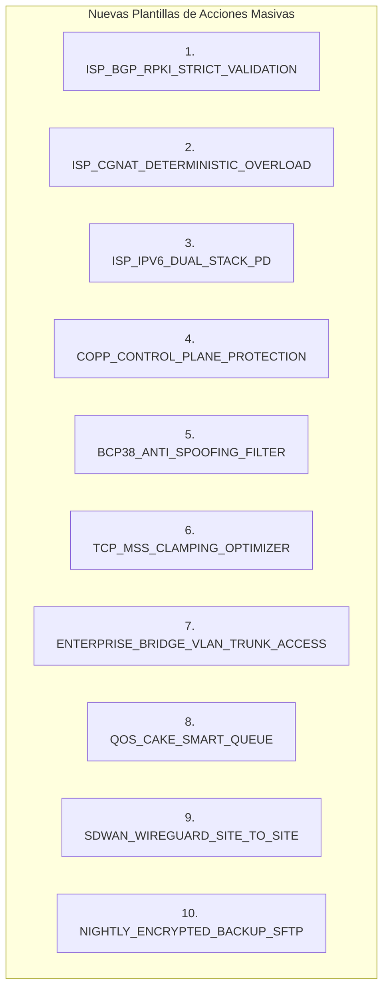

# SPDX-License-Identifier: GPL-3.0-only
# Copyright (C) 2026 RoSGrid Contributors

# 📋 ESPECIFICACIÓN TÉCNICA 50 — Expansión de CIS Benchmark Hardening Interactivo (ISP vs Empresa con Enlaces Oficiales) y Catálogo de Plantillas Masivas Avanzadas

**Estado:** Especificado / Listo para Desarrollo  
**Fecha:** 2026-10-26  
**Ámbitos:** `fastapi/src/api/v1/compliance.py`, `fastapi/src/api/v1/bulk_and_updates.py`, `vue3/src/views/EnterpriseComplianceView.vue`, `vue3/src/views/BulkOperationsView.vue`, `fastapi/src/schemas/enterprise.py`  
**Hito Asociado:** Hito 27.11 (Previo al Cierre Definitivo y Publicación en Hito 28)

---

## 1. Visión y Justificación Arquitectónica

RoSGrid actualmente implementa 12 directivas fundamentales en su suite de cumplimiento CIS (`CIS-1.1` a `CIS-1.10`, `CIS-2.1` y `CIS-2.2`). Sin embargo, en despliegues reales de telecomunicaciones existe una marcada bifurcación operacional entre dos perfiles de clientes:
1. **Proveedores de Servicios de Internet (ISP / WISP / Telco):** Requieren controles orientados a la estabilidad del núcleo de enrutamiento (BGP/RPKI, mitigación de ataques volumétricos hacia la CPU mediante CoPP, prevención de spoofing BCP 38, mitigación de amplificación DNS y aislamiento en VRFs de gestión).
2. **Redes Corporativas y Campus (Enterprise):** Requieren controles orientados a la seguridad de acceso local (802.1X, DHCP Snooping en bridges, erradicación de protocolos legados como SNMP v1/v2c o MAC-Telnet, hardening estricto de llaves SSH y auditoría forense hacia Syslog centralizado).

Adicionalmente, se detectan dos requerimientos operacionales clave:
- **Trazabilidad y Transparencia Normativa:** Los auditores y CISOs demandan conocer la fuente de cada directiva. Cada ítem debe presentar enlaces directos clickeables hacia los estándares internacionales (**CIS Benchmarks**, **NIST**, **IETF RFCs**) y hacia la **documentación oficial de MikroTik RouterOS v7** (`manual.mikrotik.com`), similar a la integración existente en la matriz de CVEs.
- **Soberanía Operativa Total del Usuario:** El perfil (`ISP`, `CORPORATE`, `DATACENTER`) no debe actuar como un filtro que oculte reglas, sino como una **plantilla de recomendación inicial (preset)**. Todas las directivas deben ser visibles en el catálogo general, y el usuario tiene la potestad de encender o apagar cualquier directiva individualmente para ajustar el cálculo dinámico de su *Security Score* (0–100%).
- **Ejecución de Funciones Complejas mediante Plantillas Masivas (Bulk-Ops):** Muchas funciones avanzadas de MikroTik que resultan peligrosas o sobrecargadas para formularios web individuales (ej. Carrier-Grade NAT RFC 6598, colas anti-bufferbloat CAKE con PCQ, mallas SD-WAN WireGuard y tareas programadas de backup cifrado a SFTP) deben empaquetarse como plantillas parametrizadas con Safe Mode de 60s y rollback automático.

---

## 2. Modelo de Datos y Enriquecimiento de Esquemas (Backend)

### 2.1 Enriquecimiento de `CisDirectiveResult` y Catálogo Base

En `fastapi/src/schemas/enterprise.py` y `fastapi/src/api/v1/compliance.py`, cada directiva incorporará metadatos formales de auditoría y enlaces canónicos:

```python
class CisDirectiveResult(BaseModel):
    code: str
    title: str
    category: str
    weight: int
    severity: Literal["CRITICAL", "HIGH", "MEDIUM", "LOW"]
    status: Literal["PASS", "FAIL", "MANUAL_REVIEW", "DISABLED"]
    remediation_cmd: str
    profile_target: Literal["ALL", "ISP", "CORPORATE", "DATACENTER"]
    standard_ref: str          # Ej: "CIS Benchmark v3.0 § 4.2 / IETF RFC 2827"
    reference_url: str         # Ej: "https://manual.mikrotik.com/docs/security-guide/#..."
    standard_url: str          # Ej: "https://datatracker.ietf.org/doc/html/rfc2827"
    rationale: str             # Justificación del riesgo e impacto
    audit_logic_summary: str   # Resumen de inspección en RouterOS v7
```

---

## 3. Catálogo Extendido de Directivas CIS (28 Directivas en Total)

A las 12 directivas base existentes se incorporan 16 directivas especializadas (8 para ISP y 8 para Empresa):

### 3.1 Bloque Especializado para ISPs y Operadores de Red (8 Nuevas Directivas)

1. **`CIS-ISP-1` — Filtrado de Paquetes Bogon / Martians en Ingress (RFC 1918, RFC 6598, RFC 5737):**
   - *Severidad:* `CRITICAL` | *Peso:* 10
   - *Estándar:* IETF RFC 6890 / BCP 84
   - *Referencia MikroTik:* `https://manual.mikrotik.com/docs/firewall-best-practices/#protect-your-router`
   - *Inspección:* Verifica en `/ip/firewall/raw` la existencia de regla en `chain=prerouting` con `in-interface-list=WAN` y `src-address-list=bogons` con `action=drop`.
   - *Remediación:* `/ip firewall raw add chain=prerouting in-interface-list=WAN src-address-list=bogons action=drop comment="CIS-ISP-1: Drop Bogons"`

2. **`CIS-ISP-2` — Protección Total contra Open DNS Resolver en WAN:**
   - *Severidad:* `CRITICAL` | *Peso:* 10
   - *Estándar:* NIST SP 800-41 § 4.3 / CERT VU#858729
   - *Referencia MikroTik:* `https://manual.mikrotik.com/docs/security-guide/#dns-cache-poisoning-and-open-resolvers`
   - *Inspección:* Si `/ip/dns` tiene `allow-remote-requests=yes`, exige regla en `/ip/firewall/filter` (o raw) descartando UDP/TCP puerto 53 en interfaz WAN.
   - *Remediación:* `/ip firewall filter add chain=input in-interface-list=WAN protocol=udp dst-port=53 action=drop comment="CIS-ISP-2: Block WAN DNS"`

3. **`CIS-ISP-3` — Autenticación Criptográfica en Vecindades BGP (MD5 / TCP-AO):**
   - *Severidad:* `HIGH` | *Peso:* 8
   - *Estándar:* RFC 2385 / RFC 5925 / CIS Benchmark v3.0 § 3.2
   - *Referencia MikroTik:* `https://manual.mikrotik.com/docs/cli-reference/routing/bgp/#connection-properties`
   - *Inspección:* Comprueba que todas las conexiones en `/routing/bgp/connection` tengan `tcp-md5-key` configurado.
   - *Remediación:* `/routing bgp connection set [find] tcp-md5-key=yes`

4. **`CIS-ISP-4` — Control Plane Policing (CoPP) para Tráfico de Señalización de Red:**
   - *Severidad:* `HIGH` | *Peso:* 8
   - *Estándar:* NSA Router Hardening Guide § 2.1 / CIS Control 4
   - *Referencia MikroTik:* `https://help.mikrotik.com/docs/display/ROS/Building+Advanced+Firewall`
   - *Inspección:* Verifica la existencia de límites de tasa (rate-limiting) en la cadena `input` para protocolos BGP (TCP 179), OSPF y LDP.
   - *Remediación:* `/ip firewall filter add chain=input protocol=tcp dst-port=179 limit=100,50:packet action=accept comment="CIS-ISP-4: CoPP BGP Limit"`

5. **`CIS-ISP-5` — Aislamiento de Gestión Administrativa en Management VRF:**
   - *Severidad:* `HIGH` | *Peso:* 8
   - *Estándar:* NIST SP 800-123 § 5.2 / CIS Benchmark v3.0 § 1.4
   - *Referencia MikroTik:* `https://manual.mikrotik.com/docs/cli-reference/ip/vrf/`
   - *Inspección:* Comprueba que los servicios de gestión (`winbox`, `www-ssl`, `ssh`) estén vinculados a una VRF no predeterminada o interfaz fuera de banda.
   - *Remediación:* `/ip service set winbox,www-ssl,ssh vrf=mgmt-vrf`

6. **`CIS-ISP-6` — Autenticación Criptográfica OSPFv2/v3 (SHA-256):**
   - *Severidad:* `MEDIUM` | *Peso:* 6
   - *Estándar:* RFC 5709 / CIS Benchmark v3.0 § 3.1
   - *Referencia MikroTik:* `https://manual.mikrotik.com/docs/cli-reference/routing/ospf/#interface-template`
   - *Inspección:* Verifica que las plantillas de interfaz en `/routing/ospf/interface-template` utilicen `auth=sha256` o `auth=md5`.
   - *Remediación:* `/routing ospf interface-template set [find] auth=sha256 auth-key=SecretOspfKey123`

7. **`CIS-ISP-7` — Supresión de ICMP Redirects y Limitación de Respuestas Unreachable:**
   - *Severidad:* `MEDIUM` | *Peso:* 5
   - *Estándar:* RFC 1812 § 4.3.2.7 / NIST SP 800-41
   - *Referencia MikroTik:* `https://manual.mikrotik.com/docs/cli-reference/ip/settings/`
   - *Inspección:* Verifica que en `/ip/settings` esté configurado `send-redirects=no` y `icmp-rate-limit` con un valor `>= 10`.
   - *Remediación:* `/ip settings set send-redirects=no icmp-rate-limit=50`

8. **`CIS-ISP-8` — Desactivación de Servidores Proxy Web y SOCKS no autorizados:**
   - *Severidad:* `HIGH` | *Peso:* 7
   - *Estándar:* CIS Control 9 / OWASP Top 10 A05
   - *Referencia MikroTik:* `https://manual.mikrotik.com/docs/cli-reference/ip/proxy/`
   - *Inspección:* Comprueba que `/ip/proxy` y `/ip/socks` tengan `enabled=no`.
   - *Remediación:* `/ip proxy set enabled=no; /ip socks set enabled=no`

---

### 3.2 Bloque Especializado para Redes Corporativas y Campus (8 Nuevas Directivas)

1. **`CIS-CORP-1` — Desactivación del Servidor Bandwidth-Test (`btest`):**
   - *Severidad:* `HIGH` | *Peso:* 8
   - *Estándar:* CIS Benchmark v3.0 § 2.4 / MITRE ATT&CK T1499
   - *Referencia MikroTik:* `https://manual.mikrotik.com/docs/cli-reference/tool/bandwidth-server/`
   - *Inspección:* Verifica que en `/tool/bandwidth-server` la propiedad `enabled` sea `false`.
   - *Remediación:* `/tool bandwidth-server set enabled=no`

2. **`CIS-CORP-2` — Desactivación de MAC-WinBox y MAC-Telnet en Interfaces de Acceso de Usuario:**
   - *Severidad:* `HIGH` | *Peso:* 9
   - *Estándar:* CIS Benchmark v3.0 § 2.2 / NIST SP 800-123
   - *Referencia MikroTik:* `https://manual.mikrotik.com/docs/security-guide/#mac-access`
   - *Inspección:* Comprueba que `/tool/mac-server` y `/tool/mac-server/mac-winbox` no permitan listas abiertas (`all`) sino una lista restringida a gestión.
   - *Remediación:* `/tool mac-server set allowed-interface-list=MGMT; /tool mac-server mac-winbox set allowed-interface-list=MGMT`

3. **`CIS-CORP-3` — Hardening Estricto de SSH (Solo Llaves Fuertes Ed25519, Deshabilitar Password):**
   - *Severidad:* `HIGH` | *Peso:* 9
   - *Estándar:* CIS Control 4.3 / PCI-DSS v4.0 Req 8.3
   - *Referencia MikroTik:* `https://manual.mikrotik.com/docs/security-guide/#ssh-access`
   - *Inspección:* Verifica en `/ip/ssh` las opciones `always-allow-password-login=no`, `strong-crypto=yes` y `host-key-type=ed25519`.
   - *Remediación:* `/ip ssh set always-allow-password-login=no host-key-type=ed25519 strong-crypto=yes`

4. **`CIS-CORP-4` — DHCP Snooping y Option 82 Activos en Bridges de Conmutación:**
   - *Severidad:* `HIGH` | *Peso:* 8
   - *Estándar:* CIS Control 12.1 / NIST SP 800-115
   - *Referencia MikroTik:* `https://manual.mikrotik.com/docs/cli-reference/interface/bridge/#bridge-properties`
   - *Inspección:* Verifica que todos los bridges en `/interface/bridge` tengan `dhcp-snooping=yes` y `add-dhcp-option82=yes`.
   - *Remediación:* `/interface bridge set [find] dhcp-snooping=yes add-dhcp-option82=yes`

5. **`CIS-CORP-5` — Erradicación de SNMP v1/v2c (Exigencia Exclusiva de SNMPv3 USM con SHA256/AES):**
   - *Severidad:* `MEDIUM` | *Peso:* 7
   - *Estándar:* CIS Benchmark v3.0 § 2.8 / NIST SP 800-123 § 5.3
   - *Referencia MikroTik:* `https://manual.mikrotik.com/docs/cli-reference/snmp/`
   - *Inspección:* Si `/snmp` está activo, verifica que no existan comunidades sin contraseña y que la versión exigida sea v3 con cifrado.
   - *Remediación:* `/snmp set trap-version=3; /snmp community set [find default=yes] security=private authentication-protocol=SHA256 encryption-protocol=AES`

6. **`CIS-CORP-6` — Auditoría Forense Completa hacia Syslog Centralizado (Tópicos `account`, `system,info`, `firewall,info`):**
   - *Severidad:* `HIGH` | *Peso:* 9
   - *Estándar:* PCI-DSS v4.0 Req 10.2 / CIS Control 8
   - *Referencia MikroTik:* `https://manual.mikrotik.com/docs/cli-reference/system/logging/`
   - *Inspección:* Verifica que existan reglas activas en `/system/logging` dirigidas a `action=rosgridsyslog` con los tópicos `system,info,account` y `firewall,info`.
   - *Remediación:* `/system logging add topics=system,info,account action=rosgridsyslog; /system logging add topics=firewall,info action=rosgridsyslog`

7. **`CIS-CORP-7` — Desactivación de RoMON y Protocolos de Descubrimiento (MNDP/CDP/LLDP) en Segmentos de Usuario:**
   - *Severidad:* `MEDIUM` | *Peso:* 6
   - *Estándar:* CIS Benchmark v3.0 § 2.3 / NSA Hardening § 3.4
   - *Referencia MikroTik:* `https://manual.mikrotik.com/docs/cli-reference/tool/romon/`
   - *Inspección:* Comprueba que `/tool/romon` esté en `enabled=no` y que en `/ip/neighbor/discovery-settings` la interfaz de descubrimiento esté restringida.
   - *Remediación:* `/tool romon set enabled=no; /ip neighbor discovery-settings set discover-interface-list=MGMT`

8. **`CIS-CORP-8` — Cifrado Obligatorio en Respaldos Binarios y Exportaciones (`AES-256`):**
   - *Severidad:* `HIGH` | *Peso:* 8
   - *Estándar:* ISO 27001 A.12.3 / GDPR Art. 32
   - *Referencia MikroTik:* `https://manual.mikrotik.com/docs/cli-reference/system/backup/`
   - *Inspección:* Verifica que no existan respaldos automáticos sin contraseña o que las tareas programadas utilicen parámetros de cifrado AES.
   - *Remediación:* `/system backup save name=encrypted-backup encryption=aes-sha256 password="ClaveRobustaDeRespaldo"`

---

## 4. Catálogo de Plantillas Masivas Avanzadas (Bulk-Ops)

En `fastapi/src/api/v1/bulk_and_updates.py`, el catálogo de plantillas predefinidas se amplía con 10 nuevas plantillas completas:



### Especificación de Parámetros y Pasos REST por Plantilla

1. **`QOS_CAKE_SMART_QUEUE`:**
   - *Categoría:* `TRAFFIC_ENGINEERING` | *Safe Mode:* `True`
   - *Variables:* `wan_interface` (string), `download_bandwidth` (ej. `100M`), `upload_bandwidth` (ej. `50M`).
   - *Pasos REST:*
     - `POST /rest/queue/type` -> `{"name": "cake-rx", "kind": "cake", "cake-flowmode": "triple-isolate", "cake-memlimit": "32M"}`
     - `POST /rest/queue/type` -> `{"name": "cake-tx", "kind": "cake", "cake-flowmode": "triple-isolate", "cake-memlimit": "32M"}`
     - `POST /rest/queue/tree` -> `{"name": "CAKE_DOWNLOAD", "parent": "{{ wan_interface }}", "queue": "cake-rx", "max-limit": "{{ download_bandwidth }}"}`
     - `POST /rest/queue/tree` -> `{"name": "CAKE_UPLOAD", "parent": "{{ wan_interface }}", "queue": "cake-tx", "max-limit": "{{ upload_bandwidth }}"}`

2. **`COPP_CONTROL_PLANE_PROTECTION`:**
   - *Categoría:* `SECURITY_HARDENING` | *Safe Mode:* `True`
   - *Variables:* `mgmt_address_list` (string, default: `10.0.0.0/8,192.168.0.0/16`), `icmp_rate_limit` (int, default: `50`).
   - *Pasos REST:* Creación de cadenas de rate-limit y descarte en `/rest/ip/firewall/filter` y `/rest/ip/firewall/raw`.

3. **`ENTERPRISE_BRIDGE_VLAN_TRUNK_ACCESS`:**
   - *Categoría:* `LAYER2_SWITCHING` | *Safe Mode:* `True`
   - *Variables:* `bridge_name`, `trunk_ports`, `access_ports_vlan10`, `access_ports_vlan20`, `mgmt_vlan_id`.
   - *Pasos REST:* Aprovisionamiento atómico de `/rest/interface/bridge/port` y `/rest/interface/bridge/vlan` culminando en `vlan-filtering=yes`.

---

## 5. Arquitectura de Interfaz y Ergonomía Visual (Vue 3)

### 5.1 Enriquecimiento de `EnterpriseComplianceView.vue` y `CisPoliciesModal.vue`
* **Selector de Vistas y Filtros por Perfil:**
  - `[ Todos (28) ]`
  - `[ Recomendados para mi perfil: ISP (14) ]` / `[ Recomendados Empresa (18) ]`
  - `[ Directivas Activas ]` / `[ Directivas Inactivas ]`
* **Columna de Referencias y Enlaces Externos:**
  - Cada fila desplegará un badge interactivo con el nombre del estándar y dos enlaces externos clickeables:
    - `[ 🔗 Estándar Oficial ]` apuntando a `standard_url` (IETF RFC, CISecurity o NIST).
    - `[ 📖 Manual MikroTik v7 ]` apuntando a `reference_url` (`manual.mikrotik.com`).
  - Accesibilidad WCAG 2.1 AA garantizada: atributos `target="_blank" rel="noopener noreferrer"` con etiquetas `aria-label` descriptivas ("Abrir documentación oficial de MikroTik para directiva CIS-ISP-1 en nueva pestaña").
* **Interruptor de Activación (Switch Toggle) por Directiva:**
  - Permite al usuario decidir individualmente qué directivas forman parte del cálculo de su *Security Score*.
  - Las directivas desactivadas por el usuario se muestran atenuadas (opacidad 0.6) y muestran el estado `DESHABILITADA (NO EVALUADA)`.
* **Botón de Auto-Remediación Asistida:**
  - Para directivas con estado `FAIL`, el botón `[ ⚡ Auto-Remediar ]` muestra un diálogo modal de confirmación con el comando RouterOS v7 exacto y ejecuta la remediación bajo Safe Mode de 60 segundos.

---

## 6. Plan de Pruebas y Certificación Nivel-11X

1. **Backend Unitario (`fastapi/tests/api/test_compliance_cis_expanded.unit.py`):**
   - Validación del cálculo ponderado del Security Score excluyendo reglas con `enabled=false`.
   - Verificación de la integridad de URLs y esquemas Pydantic v2 para las 28 directivas.
   - Evaluación contra fixtures trimodales ground-truth de RouterOS v7 (Fábrica, Nominal y Degradado).
2. **Frontend Unitario Vitest (`vue3/src/views/enterpriseComplianceExpanded.unit.ts`):**
   - Renderizado correcto de enlaces externos con atributos de seguridad.
   - Conmutación reactiva de filtros de perfil y cálculo dinámico de puntuación.
3. **Escenarios BDD Karate Labs:**
   - API: Consulta del catálogo enriquecido con links y actualización de directivas activas.
   - UI: Navegación por la tabla de directivas CIS, apertura de enlaces oficiales y activación de directivas con recálculo visual del score.
4. **Compuerta de Certificación:**
   - 0 errores en `ruff check` y `vue-tsc --noEmit`.
   - 0 vulnerabilidades en `make audit`.
   - Paridad total entre modelos, esquemas y endpoints.
