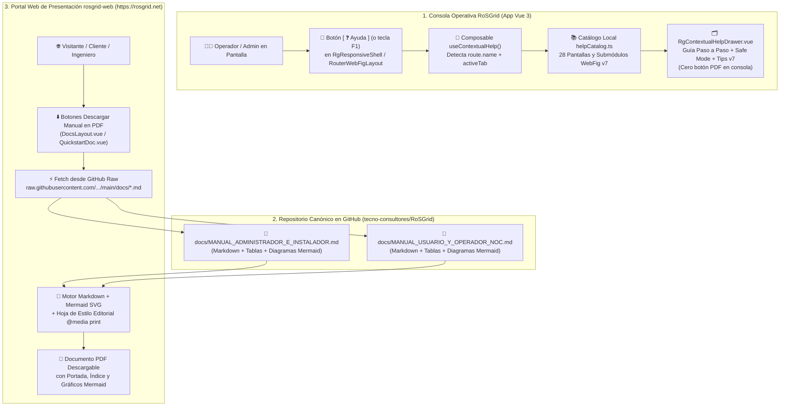

# SPDX-License-Identifier: GPL-3.0-only
# Copyright (C) 2026 RoSGrid Contributors

# 📘 Especificación Técnica 52: Sistema de Ayuda Contextual Transversal en Consola (`RgContextualHelpDrawer`), Manuales Duales en Markdown Optimizados para PDF con Mermaid y Conversión Dinámica desde `rosgrid-web`

**Estándar:** Nivel 11X (QA Corporativo, WCAG 2.1 AA, Refactoring UI, Cero Componentes Huérfanos)  
**Estado:** IMPLEMENTADO Y CERTIFICADO 11X (Hito 27.14 Completado en `RoSGrid` y `rosgrid-web`)  
**Módulos Afectados en `RoSGrid`:**
- `vue3/src/components/common/RgContextualHelpDrawer.vue` (+ `RgContextualHelpDrawer.unit.ts`)
- `vue3/src/composables/useContextualHelp.ts` (+ `useContextualHelp.unit.ts`)
- `vue3/src/data/helpCatalog.ts`
- `vue3/src/components/common/RgResponsiveShell.vue`
- `vue3/src/views/RouterWebFigLayout.vue`
- `vue3/src/locales/es.json` y `vue3/src/locales/en.json`
- `docs/MANUAL_ADMINISTRADOR_E_INSTALADOR.md`
- `docs/MANUAL_USUARIO_Y_OPERADOR_NOC.md`

**Módulos Afectados en `rosgrid-web` (`https://rosgrid.net`):**
- `src/composables/useManualPdfExporter.ts` (+ `tests/unit/useManualPdfExporter.spec.ts`)
- `src/pages/DocsLayout.vue` y `src/pages/docs/QuickstartDoc.vue`

---

## 1. Propósito y Alcance Arquitectónico

Esta especificación define la arquitectura integral de asistencia operativa y documentación portátil del ecosistema **RoSGrid**, dividida en tres pilares complementarios y estrictamente desacoplados:

1. **Ayuda Contextual Interactiva en Consola (`RoSGrid`):** Un botón táctico `[ ❓ Ayuda ]` (accesible también mediante el atajo `F1` o `Alt + H`) presente en cada pantalla de la plataforma que despliega un cajón lateral (*Drawer*) con la guía específica de la vista y pestaña activa.
2. **Manuales Duales Canónicos en Markdown (`docs/`):** Dos manuales maestros alojados en el repositorio Git de `RoSGrid`, redactados bajo un estándar editorial optimizado para paginación PDF A4/Carta y con diagramas vectoriales **Mermaid**:
   - [`docs/MANUAL_ADMINISTRADOR_E_INSTALADOR.md`](file:///home/sinfallas/Dropbox/git/tecno-consultores/RoSGrid/docs/MANUAL_ADMINISTRADOR_E_INSTALADOR.md): Dirigido a administradores de infraestructura, DevSecOps, instaladores y SuperAdmins.
   - [`docs/MANUAL_USUARIO_Y_OPERADOR_NOC.md`](file:///home/sinfallas/Dropbox/git/tecno-consultores/RoSGrid/docs/MANUAL_USUARIO_Y_OPERADOR_NOC.md): Dirigido a ingenieros de red (N1/N2/N3), operadores NOC, supervisores, técnicos de campo y auditores.
3. **Exportación a PDF Bajo Demanda en el Portal Oficial (`rosgrid-web`):** Botones de descarga en el sitio web de presentación (`https://rosgrid.net`) que obtienen en tiempo real el archivo Markdown desde el repositorio oficial de GitHub (`raw.githubusercontent.com`), renderizan tanto el contenido estructurado como los diagramas **Mermaid** a SVG vectorial y generan el documento PDF listo para distribuir o imprimir.

> **[!IMPORTANT] INVARIANTE ARQUITECTÓNICO DE FRONTERA (SEPARACIÓN DE RESPONSABILIDADES):**
> - **En la consola operativa `RoSGrid` (`vue3/`):** **NO** existirá ningún botón para convertir o exportar la ayuda a PDF. El cajón de ayuda en `RoSGrid` es 100% ligero, instantáneo, offline-first (cero dependencias de motores PDF o librerías pesadas en el bundle operativo) y enfocado en resolver dudas de la pantalla actual en milisegundos.
> - **En el portal público `rosgrid-web` (`https://rosgrid.net`):** Es donde residirán los botones `[ 📄 Descargar Manual de Administrador (PDF) ]` y `[ 📘 Descargar Manual de Usuario NOC (PDF) ]`, consumiendo los archivos Markdown desde GitHub y generando el PDF con sus gráficos Mermaid renderizados.

---

## 2. Arquitectura del Flujo Extremo a Extremo



---

## 3. Especificación de la Función 1: Botón de Ayuda Contextual en Cada Pantalla (`RoSGrid`)

### 3.1 Ubicación Visual y Ergonomía Táctica (`Refactoring UI`)

Para garantizar que **todas las pantallas presentes y futuras** cuenten con el botón de ayuda sin duplicar código en las 28 vistas:

1. **Cabecera Global (`RgResponsiveShell.vue`):**
   - Se incorpora el botón táctico `#btn-contextual-help` (`[ ❓ Ayuda ]`) en la barra de herramientas superior (`.rg-topbar__actions`), ubicado entre el buscador rápido (`Ctrl + K`) y el selector de idioma/tema.
   - Estilo neutro en reposo (`background: rgba(15, 23, 42, 0.75); border: 1px solid var(--rg-border-panel); color: var(--rg-text-secondary)`), con iluminación cian (`--rg-accent-cyan`) en `:hover` y `:focus-visible`.
   - Atributos de accesibilidad WCAG 2.1 AA: `type="button"`, `aria-label="Abrir ayuda contextual de esta pantalla (F1)"`, `:aria-expanded="isHelpOpen"`, `aria-controls="rg-contextual-help-drawer"`.
2. **Cabecera Contextual de Consola WebFig (`RouterWebFigLayout.vue`):**
   - Incluye un acceso directo contextual `[ ❓ Guía del Módulo ]` alineado con las pestañas del router para que cuando el operador navegue entre `Bridge`, `WireGuard`, `IP & DHCP`, `IPv6`, `Firewall`, `Routing` o `PPPoE`, el contenido del panel de ayuda refleje exactamente el submódulo activo.
3. **Atajo Global de Teclado:**
   - Pulsar `F1` o `Alt + H` abre/cierra el cajón de ayuda desde cualquier vista, y pulsar `Escape` lo cierra devolviendo el foco al botón invocador (*Focus Trap & Restoration*).

### 3.2 Modelo de Datos del Catálogo de Ayuda (`vue3/src/data/helpCatalog.ts`)

Cada entrada del catálogo contextual implementa la interfaz tipada `ContextualHelpEntry`:

```typescript
export interface ContextualHelpStep {
  title: string;
  description: string;
}

export interface ContextualHelpEntry {
  routeKey: string;              // Ej. 'webfig-bridge', 'webfig-ip', 'inventory', 'maintenance'
  title: string;                 // Ej. 'Gestor Bridge & VLAN Switching (Capa 2)'
  moduleBadge: string;           // Ej. 'WEBFIG CAPA 1 • ROUTEROS V7'
  summary: string;               // Propósito operativo de la pantalla
  keyActions: ContextualHelpStep[]; // Acciones paso a paso (Crear, Editar, Eliminar, Wizards)
  safetyAndGovernance: string[]; // Comportamiento de Safe Mode (60s), Maker-Checker (202) y WORM
  mikrotikV7Notes: string[];     // Equivalencia REST API (/rest/*) y buenas prácticas RouterOS v7
  relatedRoles: string[];        // Roles RBAC autorizados para operar en esta vista
}
```

### 3.3 Cobertura Obligatoria del Catálogo (100% de Pantallas)

El diccionario `helpCatalog.ts` debe cubrir todas las rutas del enrutador (`vue3/src/router/index.ts`):

| Categoría | Clave de Ruta / Vista | Contenido Clave de la Ayuda Contextual |
| :--- | :--- | :--- |
| **Núcleo Global** | `dashboard` (`DashboardHomeView`) | KPIs de flota, estado de colector Syslog, accesos rápidos y resumen de alertas. |
| **Inventario y Seguridad** | `inventory` (`RouterInventoryView`) | Alta individual, importación CSV en 2 pasos, Pinning SSL TOFU SHA-256, Bóveda Step-Up (30s) y sincronización Syslog. |
| **Monitoreo 24/7** | `wallboard` (`NocWallboardView`) | Modo pantalla completa de alto contraste, alertas sonoras/visuales de caída masiva y mapa en tiempo real. |
| **Gobernanza** | `approvals` (`ApprovalsInboxView`) | Flujo Maker-Checker (`HTTP 202`), segregación `maker != checker`, revisión de payload y ejecución diferida. |
| **Gestión IP** | `ipam` (`IpamManagementView`) | Prefijos IPv4/IPv6, rejilla visual `/24` de 256 IPs, alerta de corte de fibra GPON y pools corporativos. |
| **Cartografía y Campo** | `subscribers-map` (`SubscribersMapView`) | Mapa bimodal (Empresa DHCP vs ISP FTTH/NAP/ONUs), análisis de causa raíz (RCA) y bloqueo operativo anti-colisión. |
| **Operaciones de Campo** | `field-tech` (`FieldTechOperationsView`) | Diagnóstico 360°, captura de coordenadas GPS, aprovisionamiento de ONUs y prueba óptica. |
| **Topología Física** | `topology-l2` (`L2TopologyView`) | Descubrimiento MNDP/LLDP/CDP, lienzo interactivo 60 FPS y telemetría PoE. |
| **Control de Cambios** | `backups-diff` (`RscGitDiffViewer`) | Respaldos `.rsc` deduplicados SHA-256, comparador lado a lado estilo Git contra estado `LIVE`. |
| **Automatización** | `bulk-ops` (`BulkOperationsAndUpdatesView`) | Catálogo de 24 plantillas Golden Config, actualizaciones de firmware PoE-Aware con Safety Stop (1%). |
| **Mantenimiento** | `maintenance` (`MaintenanceWindowsView`) | Programación por calendario, supresión de falsos positivos y **auto-eliminación automática al vencer con registro en AuditLog WORM**. |
| **Identidad y Acceso** | `users-rbac` (`UsersAndPermissionsView`) | Matriz de 11 roles, permisos granulares por router, aprobación de auto-registro y reinicio 2FA. |
| **Sesiones en Vivo** | `sessions` (`ActiveSessionsKillSwitchView`) | Auditoría de operadores y agentes IA conectados y ejecución del Kill-Switch en tiempo real. |
| **Multi-Tenant** | `tenants` / `tenant-modules` | Gestión de empresas, conmutador rápido SuperAdmin y estudio de 19 Feature Flags con DAG en cascada y Rollback. |
| **Cumplimiento y Flota** | `enterprise` / `fleet-cves` / `audit-logs` | Auditoría CIS Benchmark (28 directivas con auto-remediación), matriz CVE, Config Drift, Rogue DHCP, SLA, CAPsMAN v7 y cadena WORM. |
| **WebFig: Vivo** | `webfig-dashboard` (`RouterLiveDashboardView`) | Gráficas efímeras `TelemetryRingBuffer` en RAM (cero escritura en BD) y estado de recursos. |
| **WebFig: Interfaces** | `webfig-interfaces` (`InterfacesAndSfpView`) | Edición de interfaces/MTU, subinterfaces VLAN 802.1Q y diagnóstico óptico SFP/SFP+ DDM (`dBm`). |
| **WebFig: Bridge** | `webfig-bridge` (`BridgeView`) | Creación/edición/eliminación de Bridges, edición de puertos miembro, botón **`[ ⏏ Sacar del Bridge ]`**, tabla VLANs y FDB MAC. |
| **WebFig: WireGuard** | `webfig-wireguard` (`WireGuardVpnView`) | Creación, edición y **eliminación de interfaces de túnel WireGuard** y Peers criptográficos. |
| **WebFig: IP & DHCP** | `webfig-ip` (`IpAddressesAndDhcpView`) | Direcciones IP, Servidor DHCP, **edición de Redes y Opciones DHCP**, **edición de Cliente DHCP WAN**, **edición/eliminación de Pools**, **edición de Parámetros DNS** (`/ip/dns/set`), DNS estático y ARP. |
| **WebFig: IPv6** | `webfig-ipv6` (`Ipv6DualStackView`) | Direcciones IPv6 SLAAC/EUI-64, Clientes DHCPv6-PD, Servidores DHCPv6, Pools IPv6 y Vecinos NDP (`CRUD` completo). |
| **WebFig: Firewall** | `webfig-firewall` (`FirewallRulesView`) | Reglas Filter, NAT, Mangle, RAW, Address-Lists editables, reordenamiento Drag & Drop y Wizards NAT en 1 clic. |
| **WebFig: Routing** | `webfig-routing` (`RoutingBgpOspfView`) | Rutas estáticas con `check-gateway`, conexiones BGP v7 interactivas, OSPF y tablas/reglas PBR (`CRUD` completo). |
| **WebFig: PPPoE & Colas** | `webfig-ppp` (`PppAndQueuesView`) | Sesiones activas (*Kick Session*), **edición/eliminación de Secretos PPP, Perfiles PPP y Servidores PPPoE**, y Simple Queues con presets. |
| **WebFig: Tools & Syslog** | `webfig-tools` / `webfig-syslog` / `webfig-layer2` | Ping, Traceroute, Torch, terminal Syslog en vivo y Motor Universal Capa 2 para cualquier menú `/rest/*`. |

---

## 4. Especificación de la Función 2: Estándar de Redacción de los 2 Manuales en Markdown para Conversión Perfecta a PDF

### 4.1 Ubicación y Nombres Canónicos en el Repositorio `RoSGrid`

1. **`docs/MANUAL_ADMINISTRADOR_E_INSTALADOR.md`**: Manual Oficial de Instalación, Despliegue Inmutable, Preparación de MikroTik RouterOS v7 y Administración Multi-Tenant.
2. **`docs/MANUAL_USUARIO_Y_OPERADOR_NOC.md`**: Manual Oficial de Usuario, Operación WebFig v7, Gobernanza Safe Mode / Maker-Checker, NOC Wallboard y Operaciones de Campo.

### 4.2 Reglas Editoriales para Legibilidad en PDF y Renderizado de Diagramas Mermaid

Para que ambos documentos Markdown se conviertan en documentos PDF profesionales, legibles y sin recortes horizontales ni errores de sintaxis gráfica:

1. **Cabecera YAML Frontmatter Estandarizada:**
   Cada manual incluye metadatos estructurados (`title`, `subtitle`, `version`, `date`, `author`, `license`) al inicio del archivo para que el generador PDF construya automáticamente la portada corporativa.
2. **Índice de Contenidos (TOC) Numerado y Jerarquía Estricta (`H1` -> `H2` -> `H3`):**
   Capítulos numerados secuencialmente (`1.`, `1.1.`, `1.2.`) que facilitan tanto la lectura en pantalla como la referencia impresa.
3. **Diagramas Mermaid 100% Compatibles con Renderizado Vectorial SVG en PDF:**
   - Utilizar exclusivamente tipos de diagramas soportados universalmente y de alto contraste: `flowchart TB`, `flowchart LR`, `sequenceDiagram` y `stateDiagram-v2`.
   - **Etiquetas entrecomilladas obligatorias:** Todo nodo que contenga paréntesis, barras, dos puntos o corchetes debe escribirse entre comillas dobles (ej. `A["RouterOS v7 (/rest/*)"]`) para evitar errores de parseo en el motor Mermaid al generar el PDF.
   - Preferir orientación vertical (`flowchart TB`) o flujos horizontales de máximo 4–5 etapas (`flowchart LR`) para que el diagrama encaje exactamente en el ancho de página A4/Carta vertical sin reducir el tamaño de fuente.
4. **Tablas Compactas de Ancho Controlado:**
   - Máximo 4 a 5 columnas por tabla, con encabezados concisos, evitando líneas de código largas sin espacio dentro de celdas para que ninguna tabla desborde el margen derecho en el PDF.
5. **Bloques de Código con Longitud de Línea `<= 90` Caracteres:**
   - Los comandos bash y RouterOS v7 se dividen con saltos de línea legibles (`\`) para evitar truncamiento en páginas PDF.

---

## 5. Especificación de la Función 3: Descarga de Manuales en PDF desde `rosgrid-web` (`https://rosgrid.net`)

### 5.1 Flujo Técnico de Obtención desde GitHub y Conversión a PDF en el Navegador

En el repositorio `rosgrid-web` (portal público en Cloudflare Pages):

1. **Origen de Datos (Single Source of Truth en GitHub):**
   - URL Manual Administrador:
     `https://raw.githubusercontent.com/tecno-consultores/RoSGrid/main/docs/MANUAL_ADMINISTRADOR_E_INSTALADOR.md`
   - URL Manual Usuario NOC:
     `https://raw.githubusercontent.com/tecno-consultores/RoSGrid/main/docs/MANUAL_USUARIO_Y_OPERADOR_NOC.md`
2. **Composable `useManualPdfExporter.ts` en `rosgrid-web`:**
   - Descarga el archivo `.md` en vivo desde GitHub Raw (con caché en memoria de sesión y manejo de errores).
   - Extrae el bloque YAML Frontmatter para construir la portada técnica del documento.
   - Convierte el Markdown a HTML semántico limpio (encabezados, tablas, bloques de código, alertas `[!NOTE]` / `[!IMPORTANT]` / `[!WARNING]`).
   - Transforma todos los bloques ```` ```mermaid ```` en gráficos vectoriales `<svg>` nítidos utilizando `mermaid.render()` con tema de alto contraste para impresión (`theme: 'neutral'`).
   - Abre una ventana/documento de impresión estilizado con reglas CSS `@page { size: A4 portrait; margin: 16mm; }` y `@media print` (evitando cortes a mitad de tabla o de diagrama con `break-inside: avoid`), disparando el diálogo nativo de guardado en PDF del navegador (`Guardar como PDF`) con nombre sugerido (`RoSGrid-Manual-Administrador.pdf` / `RoSGrid-Manual-Usuario-NOC.pdf`).
3. **Ubicación de los Botones en `rosgrid-web`:**
   - En la barra lateral e índice de documentación (`src/pages/DocsLayout.vue`) y en la guía de inicio rápido (`src/pages/docs/QuickstartDoc.vue`):
     - Botón `[ 🛠️ Manual de Administrador e Instalador (PDF) ]`
     - Botón `[ 📘 Manual de Usuario y Operador NOC (PDF) ]`

---

## 6. Criterios de Aceptación y Aseguramiento de Calidad 11X

1. **Invariante de Cero Componentes Huérfanos (`verify_zero_orphan_vue_components.py`):**
   - `RgContextualHelpDrawer.vue` debe contar obligatoriamente con su suite unitaria `RgContextualHelpDrawer.unit.ts` en el mismo directorio (`vue3/src/components/common/`).
2. **Cobertura Unitaria (`>= 95%`):**
   - Pruebas unitarias en Vitest verificando la resolución contextual por ruta y por pestaña WebFig (`bridge`, `wireguard`, `ip`, `ipv6`, `ppp`, `firewall`, `routing`), apertura/cierre por clic y por teclado (`F1` / `Escape`), y ausencia total de botones de exportación PDF dentro de `RoSGrid`.
   - En `rosgrid-web`, pruebas unitarias en Vitest para `useManualPdfExporter.ts` y los botones de descarga en `DocsLayout.vue`.
3. **Accesibilidad WCAG 2.1 AA (`@axe-core/playwright`):**
   - El cajón `RgContextualHelpDrawer.vue` debe usar `role="dialog"`, `aria-modal="true"`, `aria-labelledby="help-drawer-title"` y contraste `>= 4.5:1` en los 3 temas (`dark`, `light`, `noc-high-contrast`).
4. **Escenarios BDD Karate Labs (`ui_business_flow.feature`):**
   - Escenario BDD en `RoSGrid/vue3/test/ui_business_flow.feature` (y `docs/examples/vue3/test/ui_business_flow.feature`) validando la presencia y apertura del botón `[ ❓ Ayuda ]`.
   - Escenario BDD en `rosgrid-web/test/ui_business_flow.feature` (y `docs/examples/vue3/test/ui_business_flow.feature`) validando los botones de descarga de los manuales PDF en `/docs/quickstart`.
