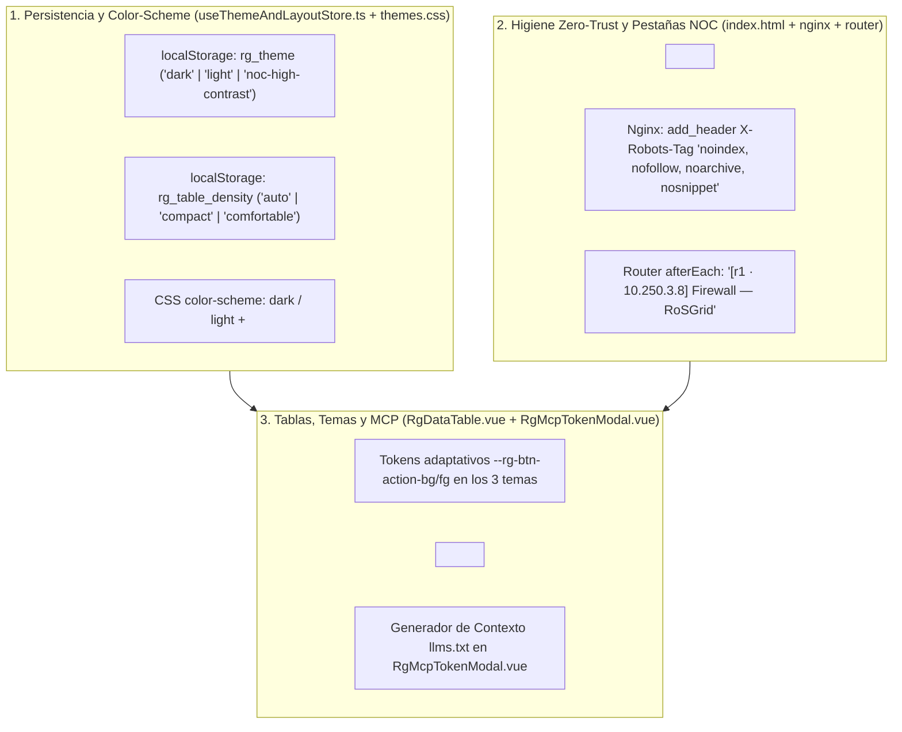

# SPDX-License-Identifier: GPL-3.0-only
# Copyright (C) 2026 RoSGrid Contributors

# Especificación Técnica 53: Paridad de Sistema de Diseño Frontend, Persistencia de Tema/Densidad, Higiene de Metadatos Zero-Trust (`X-Robots-Tag`), Accesibilidad Móvil (`data-label`) y Contexto `llms.txt` para Agentes MCP

**Estado:** IMPLEMENTADO Y CERTIFICADO 11X (Hito 27.15 Completado en `ROADMAP.md`)  
**Repositorio:** `RoSGrid` (`vue3/` y `fastapi/`)  
**Origen del Análisis:** Auditoría comparativa cruzada entre `rosgrid-web` (`https://rosgrid.net`, Specs 00–08) y el frontend productivo de `RoSGrid` (`vue3/`)

---

## 1. Diagnóstico Comparativo: ¿Qué le Falta al Frontend de `RoSGrid` (`vue3/`) Frente a `rosgrid-web`?

Al contrastar las mejoras de diseño, responsividad móvil, accesibilidad WCAG 2.1 AA, metadatos web y descubrimiento IA implementadas y especificadas en `rosgrid-web` contra el código fuente actual de `RoSGrid/vue3/`, se identificaron **6 brechas técnicas concretas** en el producto principal:

| # | Subsistema Auditado en `RoSGrid/vue3/` | Estado Actual en `RoSGrid/vue3/` | Brecha Detectada Frente al Estándar `rosgrid-web` |
| :--- | :--- | :--- | :--- |
| **1** | **Persistencia de Tema, Densidad y `color-scheme`** ([`useThemeAndLayoutStore.ts`](file:///home/sinfallas/Dropbox/git/tecno-consultores/RoSGrid/vue3/src/stores/useThemeAndLayoutStore.ts), [`themes.css`](file:///home/sinfallas/Dropbox/git/tecno-consultores/RoSGrid/vue3/src/assets/themes.css), [`index.html`](file:///home/sinfallas/Dropbox/git/tecno-consultores/RoSGrid/vue3/index.html)) | Solo `timeFormat` se guarda en `localStorage` (`rg_time_format`). `theme` y `tableDensityMode` se reinician a `'dark'` y `'auto'` en cada `F5`. Falta `color-scheme` en CSS y HTML. | El operador pierde su tema (`light` o `noc-high-contrast`) y densidad (`32px`/`44px`) al recargar; los controles nativos (`<select>`, `<input type="datetime-local">`, scrollbars) se ven blancos en modo oscuro. |
| **2** | **Metadatos `<head>`, Blindaje `X-Robots-Tag` y `<title>` Dinámico por Router** ([`vue3/index.html`](file:///home/sinfallas/Dropbox/git/tecno-consultores/RoSGrid/vue3/index.html), [`vue3/nginx/default.conf`](file:///home/sinfallas/Dropbox/git/tecno-consultores/RoSGrid/vue3/nginx/default.conf), [`vue3/src/router/index.ts`](file:///home/sinfallas/Dropbox/git/tecno-consultores/RoSGrid/vue3/src/router/index.ts)) | Existe `robots.txt` (`Disallow: /`), pero faltan `<meta name="robots" content="noindex, nofollow">` y la cabecera `X-Robots-Tag` en Nginx. El `<title>` en WebFig no muestra el nombre del router activo. | Motores de escaneo que ignoran `robots.txt` podrían indexar metadatos si se expone el puerto; en el NOC, todas las pestañas WebFig dicen lo mismo sin distinguir `[r1]` de `[r2]`. |
| **3** | **Contraste de Botones de Tabla en Tema `light` y Tokens de Marca** ([`RgDataTable.vue`](file:///home/sinfallas/Dropbox/git/tecno-consultores/RoSGrid/vue3/src/components/common/RgDataTable.vue), [`themes.css`](file:///home/sinfallas/Dropbox/git/tecno-consultores/RoSGrid/vue3/src/assets/themes.css)) | `.btn-table-action` en `RgDataTable.vue` usa un fondo oscuro fijo `rgba(15, 23, 42, 0.75)` con `color: var(--rg-text-secondary)`. | En `data-theme="light"`, el botón conserva fondo azul marino oscuro con texto gris oscuro (`#334155`), rompiendo el contraste WCAG 2.1 AA ($\ge 4.5:1$). Faltan tokens `--rg-brand-cyber-blue` (`#00D2FF`), `--rg-brand-electric-orange` (`#FF8400`) y `--rg-bg-terminal`. |
| **4** | **Atributos `data-label` y `.num-col` en Celdas de `RgDataTable.vue`** ([`RgDataTable.vue`](file:///home/sinfallas/Dropbox/git/tecno-consultores/RoSGrid/vue3/src/components/common/RgDataTable.vue)) | `<td v-for="col in dataColumns">` renderiza la celda sin `:data-label="col.label"` ni clase `.num-col` cuando `col.align === 'right'`. | En pantallas móviles ($\le 768\text{px}$), las tablas no cuentan con el atributo `data-label` para tarjetas apiladas y las columnas numéricas no fuerzan `tabular-nums lining-nums`. |
| **5** | **Logotipo Vectorial Constelación (`RgBrandLogo.vue`)** ([`RgResponsiveShell.vue`](file:///home/sinfallas/Dropbox/git/tecno-consultores/RoSGrid/vue3/src/components/common/RgResponsiveShell.vue), [`LoginView.vue`](file:///home/sinfallas/Dropbox/git/tecno-consultores/RoSGrid/vue3/src/views/LoginView.vue)) | Usa `` estático. | No aprovecha el componente SVG reactivo a los 3 temas (`RosgridLogo.vue` en `rosgrid-web`) con variantes `sm`, `md`, `lg`. |
| **6** | **Plantilla `llms.txt` / Prompt de Sistema para Agentes MCP en `RgMcpTokenModal.vue`** ([`RgMcpTokenModal.vue`](file:///home/sinfallas/Dropbox/git/tecno-consultores/RoSGrid/vue3/src/components/admin/RgMcpTokenModal.vue)) | El modal entrega el Bearer Token MCP, pero no ofrece el resumen estructurado `llms.txt` para el agente. | El operador debe redactar manualmente las instrucciones de grounding cuando conecta Claude Desktop, Claude Code o Hermes Agent a `/api/v1/mcp`. |

---

## 2. Especificación Detallada de Implementación por Subsistema



### 2.1. Persistencia de Tema Visual, Densidad de Tabla y `color-scheme` Nativo

1. **En [`vue3/src/stores/useThemeAndLayoutStore.ts`](file:///home/sinfallas/Dropbox/git/tecno-consultores/RoSGrid/vue3/src/stores/useThemeAndLayoutStore.ts):**
   - Leer al inicializar el store (con `try / catch` seguro):
     - `rg_theme`: validar que pertenezca a `['dark', 'light', 'noc-high-contrast']` (por defecto `'dark'`) y aplicar inmediatamente `document.documentElement.setAttribute('data-theme', theme.value)`.
     - `rg_table_density`: validar que pertenezca a `['auto', 'compact', 'comfortable']` (por defecto `'auto'`).
   - En `setTheme(newTheme)` y `setTableDensityMode(mode)` / `toggleTableDensity()`, persistir el nuevo valor en `localStorage.setItem('rg_theme', newTheme)` y `localStorage.setItem('rg_table_density', tableDensityMode.value)`.
2. **En [`vue3/src/assets/themes.css`](file:///home/sinfallas/Dropbox/git/tecno-consultores/RoSGrid/vue3/src/assets/themes.css) y [`vue3/index.html`](file:///home/sinfallas/Dropbox/git/tecno-consultores/RoSGrid/vue3/index.html):**
   - Añadir `<meta name="color-scheme" content="dark light" />` en `vue3/index.html`.
   - Declarar `color-scheme: dark;` en `:root, [data-theme="dark"]` y `[data-theme="noc-high-contrast"]`, y `color-scheme: light;` en `[data-theme="light"]`.

### 2.2. Blindaje Anti-Indexación (`X-Robots-Tag`) y Títulos Dinámicos Multitarea en Pestañas NOC

1. **Aislamiento de Motores de Búsqueda Públicos (Consola Privada vs Portal Público):**
   - A diferencia de `rosgrid-web` (`https://rosgrid.net`), la consola operativa de **RoSGrid** jamás debe aparecer indexada en buscadores públicos:
     - En [`vue3/index.html`](file:///home/sinfallas/Dropbox/git/tecno-consultores/RoSGrid/vue3/index.html): añadir `<meta name="robots" content="noindex, nofollow, noarchive, nosnippet" />`, `<meta property="og:locale" content="es_ES" />` y `<meta property="og:site_name" content="RoSGrid NOC" />`.
     - En [`vue3/nginx/default.conf`](file:///home/sinfallas/Dropbox/git/tecno-consultores/RoSGrid/vue3/nginx/default.conf): añadir `add_header X-Robots-Tag "noindex, nofollow, noarchive, nosnippet" always;` tanto en el bloque `server` como en `location = /index.html`.
2. **Título Dinámico con Contexto de Router en [`vue3/src/router/index.ts`](file:///home/sinfallas/Dropbox/git/tecno-consultores/RoSGrid/vue3/src/router/index.ts):**
   - Cuando la ruta activa contiene `to.params.routerId` y el router existe en `useInventoryStore` o `useWebFigStore` (ej. `r1` con IP `10.250.3.8`), formatear `document.title` como:
     `[${router.name} · ${router.ip_address}] ${baseTitle}`
   - Esto permite a los operadores del NOC identificar de un vistazo cada router cuando trabajan con múltiples pestañas del navegador abiertas simultáneamente.

### 2.3. Tokens de Botones de Acción por Fila en los 3 Temas (`themes.css` + `RgDataTable.vue`)

Para garantizar contraste **WCAG 2.1 AA ($\ge 4.5:1$)** en los 3 temas (`dark`, `light`, `noc-high-contrast`), se definirán en [`vue3/src/assets/themes.css`](file:///home/sinfallas/Dropbox/git/tecno-consultores/RoSGrid/vue3/src/assets/themes.css) los siguientes tokens semánticos:

| Token CSS | `dark` | `light` | `noc-high-contrast` |
| :--- | :--- | :--- | :--- |
| `--rg-brand-cyber-blue` | `#00D2FF` | `#006C8A` | `#00FFFF` |
| `--rg-brand-electric-orange` | `#FF8400` | `#9E4600` | `#FFAA00` |
| `--rg-bg-terminal` | `#070B12` | `#0B111E` | `#000000` |
| `--rg-btn-action-bg` | `rgba(15, 23, 42, 0.75)` | `#F1F5F9` | `#000000` |
| `--rg-btn-action-fg` | `#CBD5E1` | `#1E293B` | `#FFFFFF` |
| `--rg-btn-action-border` | `#334155` | `#94A3B8` | `#22D3EE` |
| `--rg-btn-action-danger-fg` | `#FCA5A5` | `#991B1B` | `#F87171` |
| `--rg-btn-action-danger-border` | `rgba(239, 68, 68, 0.35)` | `rgba(220, 38, 38, 0.45)` | `#F87171` |

En [`vue3/src/components/common/RgDataTable.vue`](file:///home/sinfallas/Dropbox/git/tecno-consultores/RoSGrid/vue3/src/components/common/RgDataTable.vue#L527-L571), `.col-custom-actions :deep(.btn-table-action)` reemplazará los colores fijos por `var(--rg-btn-action-bg)`, `var(--rg-btn-action-fg)`, `var(--rg-btn-action-border)` y `var(--rg-btn-action-danger-fg)`.

### 2.4. Etiquetado Automático `data-label` y Alineación Numérica `.num-col` en `RgDataTable.vue`

En [`vue3/src/components/common/RgDataTable.vue`](file:///home/sinfallas/Dropbox/git/tecno-consultores/RoSGrid/vue3/src/components/common/RgDataTable.vue#L294-L301), actualizar la celda de datos para inyectar automáticamente el nombre de la columna y la clase de alineación tabular:

```html
<td
  v-for="col in dataColumns"
  :key="col.key"
  class="rg-data"
  :class="{ 'num-col': col.align === 'right' }"
  :data-label="col.label"
  :style="{ textAlign: col.align || 'left' }"
>
  {{ col.formatter ? col.formatter(row) : (row[col.key] ?? '—') }}
</td>
```

### 2.5. Generador de Contexto `llms.txt`, Conectores Multi-Cliente MCP (6 Clientes) y Acción `Copiar como Markdown` ("LLM-Ready Docs")

Siguiendo el estándar **LLM-Ready Docs** ([`gitbook.com/docs/getting-started/llm-ready-docs`](https://gitbook.com/docs/getting-started/llm-ready-docs)):

1. **En [`vue3/src/components/users/RgMcpTokenModal.vue`](file:///home/sinfallas/Dropbox/git/tecno-consultores/RoSGrid/vue3/src/components/users/RgMcpTokenModal.vue):**
   - Ampliar el selector de clientes MCP para ofrecer comandos e integraciones de 1 clic para los **6 entornos de agentes IA modernos**:
     - **Claude Code CLI:** `claude mcp add --transport http rosgrid-noc <origin>/api/v1/mcp`
     - **OpenAI Codex CLI:** `codex mcp add rosgrid-noc <origin>/api/v1/mcp` (`[mcp_servers.rosgrid-noc]`)
     - **Cursor IDE (`.cursor/mcp.json`):** `{"mcpServers": {"rosgrid-noc": {"url": "<origin>/api/v1/mcp"}}}`
     - **VS Code / GitHub Copilot (`mcp.json`):** `{"servers": {"rosgrid-noc": {"type": "http", "url": "<origin>/api/v1/mcp"}}}`
     - **Claude Desktop / Web Connectors** y **Hermes Agent**.
   - Añadir el botón táctico `[ 📋 Copiar Contexto llms.txt para Agente IA ]` que incluye la ficha de contexto MCP con las 22 herramientas `rosgrid_*` (incluyendo `#21 rosgrid_search_mikrotik_docs` y `#22 rosgrid_get_mikrotik_doc_topic`), los 8 SOP Playbooks y un bloque final `# Agent Instructions` explicando cómo consultar el servidor MCP definiendo la pregunta específica (`ask`) y el objetivo operativo (`goal`).
2. **En `RgContextualHelpDrawer.vue` (`docs/specs/52`):**
   - Incorporar la acción de página **`[ 📋 Copiar Guía como Markdown ]`** (*Page Action: Copy as Markdown*) en la cabecera del cajón de ayuda contextual para que el operador pueda copiar en 1 clic la guía técnica de la pantalla actual en formato Markdown puro y pegarla en su asistente IA (manteniendo estrictamente **cero botón de conversión PDF** dentro de la interfaz operativa de `RoSGrid`).

---

## 3. Plan de Pruebas y Certificación Nivel 11X

1. **Pruebas Unitarias Frontend (`Vitest`):**
   - Ampliar [`vue3/src/stores/useThemeAndLayoutStore.unit.ts`](file:///home/sinfallas/Dropbox/git/tecno-consultores/RoSGrid/vue3/src/stores/useThemeAndLayoutStore.unit.ts) verificando la lectura y escritura de `rg_theme` y `rg_table_density` en `localStorage`.
   - Ampliar [`vue3/src/components/common/RgDataTable.unit.ts`](file:///home/sinfallas/Dropbox/git/tecno-consultores/RoSGrid/vue3/src/components/common/RgDataTable.unit.ts) verificando la presencia del atributo `data-label` en cada `<td>` y la clase `num-col` en columnas alineadas a la derecha.
   - Ampliar [`vue3/src/router/router.unit.ts`](file:///home/sinfallas/Dropbox/git/tecno-consultores/RoSGrid/vue3/src/router/router.unit.ts) verificando el formato del `<title>` dinámico con nombre de router.
2. **Accesibilidad WCAG 2.1 AA (`@axe-core/playwright`):**
   - Verificar `0 violaciones` de contraste en los botones `.btn-table-action` bajo los 3 temas (`dark`, `light`, `noc-high-contrast`).
3. **Escenario BDD Karate Labs UI (`vue3/test/ui_business_flow.feature` y `docs/examples/vue3/test/ui_business_flow.feature`):**
   - Añadir escenario validando la cabecera `X-Robots-Tag: noindex, nofollow, noarchive, nosnippet`, `<meta name="color-scheme" content="dark light">` y los tokens adaptativos de acción en tabla.
