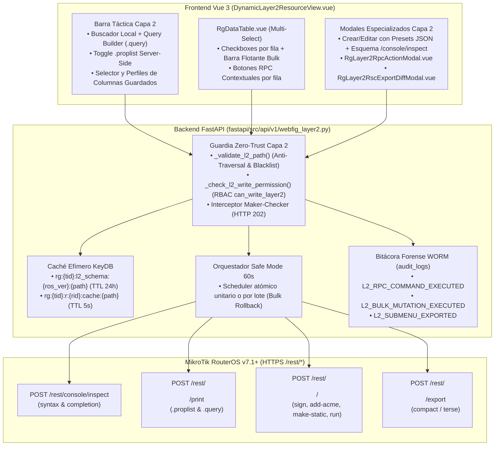
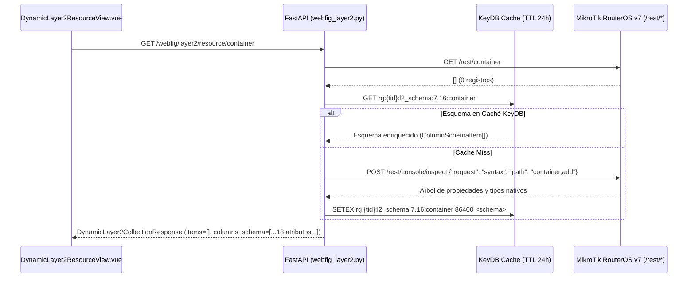

# SPDX-License-Identifier: GPL-3.0-only
# Copyright (C) 2026 RoSGrid Contributors

# 54 — EVOLUCIÓN NEXT-GEN DEL MOTOR DINÁMICO UNIVERSAL WEBFIG CAPA 2: ACCIONES RPC CONTEXTUALES, INTROSPECCIÓN `/console/inspect`, FILTRADO SERVER-SIDE (`.query`/`.proplist`), OPERACIONES POR LOTE (`BULK`), EXPORTACIÓN `.rsc` CON DIFF Y PERFILES/PRESETS (RoSGrid)

> **[DIRECTIVA DE SISTEMA PARA ANTIGRAVITY]:** Este documento especifica la arquitectura del **Hito 27.16**, diseñado para evolucionar el **Motor Dinámico Universal WebFig de Capa 2** (`fastapi/src/api/v1/webfig_layer2.py`, `fastapi/src/schemas/webfig_layer2.py` y `vue3/src/views/DynamicLayer2ResourceView.vue`) desde un visor CRUD genérico (`GET`, `PUT`, `PATCH`, `DELETE`) hacia un motor de ingeniería NOC de segunda generación que aprovecha las capacidades avanzadas del motor C++ de **MikroTik RouterOS v7.1+** sobre `/rest/*`, preservando el 100% de las garantías Zero-Trust de RoSGrid (**RBAC `can_write_layer2`**, **Idempotencia en KeyDB**, **Pinning SSL TOFU**, **Intercepción Maker-Checker HTTP 202**, **Safe Mode de 60 segundos** y **Auditoría Forense Inmutable WORM**).

---

## 1. Matriz Ejecutiva de las 6 Capacidades Propuestas para Capa 2

| # | Función para Capa 2 (Motor Universal) | Endpoint / Mecanismo Nativo RouterOS v7 | Endpoint Backend RoSGrid (`/api/v1/routers/{router_id}/webfig/layer2/...`) | Valor Operativo en el NOC |
| :-: | :--- | :--- | :--- | :--- |
| **1** | **Acciones RPC Específicas por Menú (Comandos POST Dinámicos)** | `POST /rest/<menu>/<acción>` (ej. `/rest/certificate/add-acme`, `/rest/certificate/sign`, `/rest/certificate/export-certificate`, `/rest/ip/dhcp-server/lease/make-static`, `/rest/system/script/run`, `/rest/container/start`) | `GET /rpc-catalog/{ros_path:path}` y `POST /command/{ros_path:path}` | Supera el límite del CRUD básico permitiendo emitir certificados Let's Encrypt ACME, firmar certificados internos con `rosgrid-ca`, exportar `.pem`/`.p12`, arrancar contenedores OCI o ejecutar scripts en 1 clic con validación de argumentos. |
| **2** | **Introspección Automática de Esquema y Autocompletado con `/console/inspect`** | `POST /rest/console/inspect` con `{"request": "syntax", "path": "certificate"}` o `{"request": "completion"}` | `GET /inspect/{ros_path:path}` (y fallback automático en `GET /resource/{ros_path:path}`) | Resuelve el problema de tablas vacías (`0 registros`) donde `_infer_columns()` no podía deducir atributos. Descubre el 100% de las propiedades válidas, tipos, enumeraciones y descripciones directamente del binario de RouterOS v7. |
| **3** | **Filtrado Server-Side (`.query`) y Proyección de Columnas (`.proplist`)** | `GET /rest/<menu>?.proplist=name,common-name,expires-after` y `POST /rest/<menu>/print` con `{".proplist": [...], ".query": ["disabled=false", "trusted=true"]}` | `POST /query/{ros_path:path}` (y query param `?proplist=` en `GET /resource/{ros_path:path}`) | En tablas masivas del router (`/ip/firewall/address-list`, `/ip/arp`, `/routing/route`, `/certificate`), delegar el filtrado y proyección al motor C++ de RouterOS reduce hasta en un **85%** el payload JSON y la latencia entre el router y RoSGrid. |
| **4** | **Operaciones por Lote (`Bulk Enable / Disable / Comment / Remove`)** | Selección múltiple en `RgDataTable` + ejecución secuencial/transaccional bajo ventana única de Safe Mode 60s (`PATCH /rest/<menu>/*id` o `DELETE`) | `POST /bulk/{ros_path:path}` | Permite seleccionar múltiples filas en cualquier tabla de Capa 2 para habilitarlas, deshabilitarlas, etiquetarlas con un comentario común o eliminarlas en bloque bajo un **único scheduler atómico de reversión Safe Mode (60s)**. |
| **5** | **Exportación Contextual `.rsc` por Submenú y Previsualización Diff** | `POST /rest/<menu>/export` (con `terse` / `compact`) y comparación contra la sección homónima del último respaldo Git en PostgreSQL | `POST /export/{ros_path:path}` | Permite al operador exportar únicamente la configuración CLI (`.rsc`) del submenú que está inspeccionando en Capa 2 (ej. solo `/certificate export` o `/mpls/ldp export`) y ver el `unified_diff` contra el último snapshot antes o después de aplicar cambios. |
| **6** | **Perfiles de Columnas Guardados por Operador/Tenant y Presets de Plantillas** | Persistencia ligera en `localStorage` (`rg_l2_cols:<tenant>:<path>`) + preferencias de usuario y catálogo de plantillas rápidas JSON | Composable `useLayer2ColumnProfiles.ts` + catálogo `layer2PresetsCatalog.ts` | Guarda qué columnas eligió ver cada operador para cada submenú (`/certificate`, `/snmp/community`, `/mpls/interface`, etc.) y ofrece plantillas prellenadas en 1 clic al abrir el modal **`+ Nuevo Registro`**. |

---

## 2. Arquitectura General e Interacción de Componentes (Mermaid)



---

## 3. Especificación Técnica Detallada de los 6 Subsistemas

### 3.1 Subsistema 1 (`27.16.2`): Acciones RPC Específicas por Menú (`POST /rest/<menu>/<acción>`)

#### 3.1.1 Problema Actual y Fundamento en RouterOS v7
En RouterOS v7, la API REST mapea las operaciones CRUD estándar a métodos HTTP (`GET`, `PUT`, `PATCH`, `DELETE`), pero todos los comandos operativos especializados de cada submenú se exponen como endpoints RPC mediante `POST /rest/<menu>/<comando>` recibiendo un diccionario JSON con argumentos (donde `.id` o `numbers` referencia el registro objetivo cuando la acción es por fila).

#### 3.1.2 Catálogo Canónico de Acciones RPC Permitidas (`L2_RPC_ACTIONS_CATALOG`)
Para mantener la política Zero-Trust de RoSGrid (prohibiendo la ejecución arbitraria de comandos destructivos fuera de gobernanza), el backend define un catálogo tipado `L2_RPC_ACTIONS_CATALOG` indexado por `ros_path`:

| Submenú (`ros_path`) | Verbo RPC (`action`) | Endpoint Nativo RouterOS v7 | Ámbito (`scope`) | Requiere Safe Mode | Requiere Maker-Checker (`SUPPORT_L2`) | Parámetros Tipados (`parameters_schema`) |
| :--- | :--- | :--- | :-: | :-: | :-: | :--- |
| `certificate` | `add-acme` | `POST /rest/certificate/enable-ssl-certificate` | `menu` | `false` | `false` | `dns-name` (`string`, opcional) |
| `certificate` | `sign` | `POST /rest/certificate/sign` | `row` | `false` | `true` | `numbers` (`.id` auto), `ca` (`string`), `name` (`string`, opcional) |
| `certificate` | `export-certificate` | `POST /rest/certificate/export-certificate` | `row` | `false` | `false` | `numbers` (`.id` auto), `type` (`enum: pem, pkcs12`), `export-passphrase` (`password`, opcional), `file-name` (`string`) |
| `certificate` | `create-certificate-request` | `POST /rest/certificate/create-certificate-request` | `row` | `false` | `false` | `template` (`.id` auto), `key-passphrase` (`password`), `file-name` (`string`) |
| `ip/dhcp-server/lease` | `make-static` | `POST /rest/ip/dhcp-server/lease/make-static` | `row` | `true` | `false` | `numbers` (`.id` auto) |
| `ip/arp` | `make-static` | `POST /rest/ip/arp/make-static` | `row` | `true` | `false` | `numbers` (`.id` auto) |
| `container` | `start` | `POST /rest/container/start` | `row` | `false` | `false` | `number` (`.id` auto) |
| `container` | `stop` | `POST /rest/container/stop` | `row` | `false` | `false` | `number` (`.id` auto) |
| `system/script` | `run` | `POST /rest/system/script/run` | `row` | `true` | `true` | `number` (`.id` auto) |
| `ip/ipsec/active-peers` | `kill-connections` | `POST /rest/ip/ipsec/active-peers/kill-connections` | `menu` | `true` | `true` | *(sin argumentos adicionales)* |

#### 3.1.3 Contratos Backend y Frontend
- **`GET /api/v1/routers/{router_id}/webfig/layer2/rpc-catalog/{ros_path:path}`:**
  - Devuelve la lista de objetos `Layer2RpcActionDescriptor` disponibles para ese `ros_path` (también embebida directamente en `DynamicLayer2CollectionResponse.available_rpc_actions` para evitar un round-trip extra).
- **`POST /api/v1/routers/{router_id}/webfig/layer2/command/{ros_path:path}`:**
  - Valida que el comando solicitado pertenezca al catálogo seguro o cumpla `_validate_l2_path()`.
  - Si `enable_safemode == True` en el descriptor o en el request, envuelve la invocación `client.post(f"{clean_path}/{action}", payload.arguments)` dentro de `execute_safe_mutation()`.
  - Registra en `audit_logs` con `event_category="WEBFIG_L2"` y `event_action="L2_RPC_COMMAND_EXECUTED"`.
- **Componente Frontend (`RgLayer2RpcActionModal.vue`):**
  - En `DynamicLayer2ResourceView.vue`, las acciones con `scope === "menu"` aparecen como botones tácticos en la barra superior (ej. `[ 🔐 Emitir Let's Encrypt ACME ]` en `/certificate`), y las acciones con `scope === "row"` aparecen en la columna `Acciones` de cada fila (ej. `[ ✍️ Firmar ]`, `[ 📤 Exportar PEM ]`).
  - Al pulsar la acción, abre `RgLayer2RpcActionModal.vue` con los campos definidos en `parameters_schema`, valida entradas y ejecuta la llamada con feedback inmediato.

---

### 3.2 Subsistema 2 (`27.16.3`): Introspección Automática de Esquema y Autocompletado con `/rest/console/inspect`

#### 3.2.1 Problema Actual y Fundamento en RouterOS v7
Actualmente, `_infer_columns(items)` en `fastapi/src/api/v1/webfig_layer2.py` deduce las columnas iterando sobre los primeros 10 registros (`items[:10]`). Si un submenú del router está vacío (`items == []`, por ejemplo al abrir `/mpls/ldp`, `/zerotier` o `/container` por primera vez), `columns_schema` queda vacío (`[]`) y el modal **`+ Nuevo Registro`** no puede mostrar los campos de creación.

RouterOS v7 incluye el motor nativo de introspección del árbol de comandos en `POST /rest/console/inspect`:
1. **`{"request": "child", "path": "certificate"}`:** Lista los subcomandos (`add`, `set`, `sign`, `export-certificate`, `remove`, `print`) y nodos hijos del menú.
2. **`{"request": "syntax", "path": "certificate,add"}`:** Devuelve la definición formal de cada propiedad aceptada al crear/editar un registro, su descripción técnica (`text`) y su tipo sintáctico (`symbol-type`, rangos numéricos o valores permitidos).
3. **`{"request": "completion", "path": "certificate,add", "input": ""}`:** Devuelve las opciones de autocompletado y enumeraciones válidas para un parámetro específico.

#### 3.2.2 Algoritmo de Introspección e Hidratación en Caché KeyDB


- **Enriquecimiento de `ColumnSchemaItem`:**
  ```python
  class ColumnSchemaItem(StrictBaseModel):
      key: str = Field(..., min_length=1, max_length=80)
      label: str = Field(..., min_length=1, max_length=120)
      type: str = Field(..., min_length=1, max_length=40)  # string | integer | boolean_ros | enum | ip_or_cidr | readonly_id
      sortable: bool = False
      editable: bool = True
      required: bool = False
      default_value: str | None = None
      enum_options: list[str] = Field(default_factory=list)
      description: str | None = Field(default=None, max_length=400)
  ```
- **Endpoint Dedicado de Introspección y Autocompletado:**
  - `GET /api/v1/routers/{router_id}/webfig/layer2/inspect/{ros_path:path}?attribute=<attr>`
  - Permite tanto obtener el esquema completo del submenú como consultar sugerencias de autocompletado en vivo para un campo específico mientras el operador escribe en el modal de creación/edición.

---

### 3.3 Subsistema 3 (`27.16.4`): Filtrado Server-Side (`.query`) y Proyección de Columnas (`.proplist`)

#### 3.3.1 Problema Actual y Fundamento en RouterOS v7
En routers de borde o concentradores BRAS con miles de entradas en `/ip/arp`, `/ip/firewall/address-list`, `/routing/route` o decenas de certificados X.509 con 35 atributos cada uno, traer el JSON completo con `GET /rest/<menu>` transmite megabytes innecesarios y obliga a serializar campos pesados que están ocultos en la Vista Compacta.

La API REST de RouterOS v7 soporta de forma nativa:
- **Proyección `.proplist`:**
  - En `GET`: `GET /rest/certificate?.proplist=.id,name,common-name,expires-after,trusted,expired`
  - En `POST /print`: `POST /rest/certificate/print` con `{".proplist": [".id", "name", "common-name", "expires-after", "trusted", "expired"]}`
- **Filtrado en el Motor C++ con `.query`:**
  - `POST /rest/certificate/print` con `{".proplist": [...], ".query": ["disabled=false", "trusted=true"]}`

#### 3.3.2 Contratos Backend y Sanitización de `.query`
1. **Parámetro opcional `proplist` en `GET /resource/{ros_path:path}`:**
   - `proplist: str | None = Query(default=None, max_length=600, pattern=r"^[a-zA-Z0-9_.,-]+$")`
   - Garantiza que `.id` siempre esté incluido en la lista de proyección para no romper las acciones de edición/borrado por fila.
2. **Nuevo Endpoint `POST /api/v1/routers/{router_id}/webfig/layer2/query/{ros_path:path}`:**
   - **Esquema de Entrada (`DynamicLayer2QueryRequest`):**
     ```python
     class Layer2QueryFilterItem(StrictBaseModel):
         field: str = Field(..., min_length=1, max_length=80, pattern=r"^[a-zA-Z0-9_.-]+$")
         operator: Literal["=", "!=", "<", ">"] = "="
         value: str = Field(..., max_length=200)

     class DynamicLayer2QueryRequest(StrictBaseModel):
         proplist: list[str] = Field(default_factory=list, max_length=60)
         filters: list[Layer2QueryFilterItem] = Field(default_factory=list, max_length=15)
     ```
   - Traduce `filters` a la pila `.query` de RouterOS v7 (incluyendo operadores de combinación `#&` cuando hay múltiples condiciones en `POST /rest/<menu>/print`) y retorna `DynamicLayer2CollectionResponse` con el metadato `payload_reduction_pct: float` e `is_server_filtered: bool = True`.
3. **Constructor Visual en Frontend (`RgLayer2QueryBuilder.vue`):**
   - Barra colapsable en `DynamicLayer2ResourceView.vue` donde el operador puede añadir píldoras de filtro server-side (`[ Campo ▾ ] [ = ▾ ] [ Valor ] [ + Añadir Filtro Server-Side ]`) y activar el switch **`[ ⚡ Optimizar Payload (.proplist) ]`** para solicitar al router únicamente las columnas visibles o cuando el usuario pulsa `✏️ Editar` (haciendo *lazy-fetch* del registro completo `GET /rest/<menu>/<id>` al abrir el modal).

---

### 3.4 Subsistema 4 (`27.16.5`): Operaciones por Lote (`Bulk Enable / Disable / Comment / Remove`) bajo Ventana Única de Safe Mode (60s)

#### 3.4.1 Arquitectura de Reversión Atómica por Lote
Cuando un operador necesita deshabilitar 15 túneles VPLS, comentar 20 certificados o eliminar 30 entradas obsoletas en Capa 2, hacerlo fila por fila genera 30 ventanas independientes de Safe Mode.

El nuevo endpoint **`POST /api/v1/routers/{router_id}/webfig/layer2/bulk/{ros_path:path}`** ejecuta todo el lote bajo **un único punto de restauración Safe Mode (60s)**:

1. **Esquema de Entrada (`DynamicLayer2BulkRequest`):**
   ```python
   class DynamicLayer2BulkRequest(StrictBaseModel):
       action: Literal["enable", "disable", "comment", "remove"]
       item_ids: list[str] = Field(..., min_length=1, max_length=100)
       comment: str | None = Field(default=None, max_length=255)
       enable_safemode: bool = True
   ```
2. **Flujo Transaccional en `webfig_layer2.py`:**
   - Valida `_validate_l2_path(ros_path)` y `_check_l2_write_permission(claims, perm)`.
   - Si el lote supera el umbral crítico o el rol requiere aprobación, intercepta con **HTTP 202 Accepted (Maker-Checker)**.
   - Lee el estado previo (`before_states`) de los `item_ids` seleccionados.
   - Si `enable_safemode == True`, inyecta un único script de reversión en `/system/scheduler` (`rosgrid-safemode-bulk-<uuid>`) que restaura todos los ítems modificados si el router deja de responder durante los próximos 60 segundos.
   - Ejecuta las mutaciones (`PATCH` con `{"disabled": "false"}` / `{"disabled": "true"}` / `{"comment": ...}` o `DELETE`) reutilizando el pool TLS `Keep-Alive` de `httpx`.
   - Verifica el latido del router, limpia el scheduler temporal y escribe un registro consolidado en `audit_logs` con `event_category="WEBFIG_L2"` y `event_action="L2_BULK_MUTATION_EXECUTED"`.
3. **Selección Múltiple en `RgDataTable.vue` y Barra Flotante Bulk:**
   - Propiedad opcional `selectable: boolean = false` y `v-model:selectedRowKeys` en `RgDataTable.vue` (con casilla *"Seleccionar todos los visibles"* en `<thead>` y casilla por fila con `aria-label` accesible).
   - Al seleccionar $\ge 1$ fila en `DynamicLayer2ResourceView.vue`, emerge la barra táctica de lote:
     - `[ ▶️ Habilitar (N) ]`
     - `[ ⏸️ Deshabilitar (N) ]`
     - `[ 💬 Comentar (N) ]`
     - `[ 🗑️ Eliminar Lote (N) ]`

---

### 3.5 Subsistema 5 (`27.16.6`): Exportación Contextual `.rsc` por Submenú y Comparador Diff contra el Último Respaldo Git

#### 3.5.1 Problema Actual y Fundamento en RouterOS v7
El módulo global de Respaldos (`/backups-diff`) exporta y compara el archivo `.rsc` completo del router (miles de líneas). Sin embargo, cuando un ingeniero N3 está trabajando dentro de un submenú específico de Capa 2 (ej. `/certificate`, `/mpls/ldp`, `/snmp` o `/routing/bfd`), necesita ver y exportar **únicamente los comandos CLI `.rsc` de ese submenú** y verificar qué cambió respecto al último respaldo oficial almacenado en PostgreSQL (`router_backups`).

#### 3.5.2 Contratos Backend y Algoritmo de Extracción de Sección `.rsc`
- **Endpoint `POST /api/v1/routers/{router_id}/webfig/layer2/export/{ros_path:path}`:**
  - **Entrada (`DynamicLayer2ExportRequest`):**
    ```python
    class DynamicLayer2ExportRequest(StrictBaseModel):
        mode: Literal["compact", "terse", "verbose"] = "compact"
        compare_with_latest_backup: bool = True
    ```
  - **Ejecución:**
    1. Invoca `POST /rest/{clean_path}/export` en el MikroTik (y si la versión de RouterOS devuelve el export en archivo o bloque, extrae el bloque exacto correspondiente a `/{clean_path.replace('/', ' ')}`).
    2. Sanitiza cualquier secreto residual (`hide-sensitive` forzado por diseño).
    3. Si `compare_with_latest_backup == True`, busca el último registro exitoso en `router_backups` para ese `router_id`, extrae la sección `/{clean_path.replace('/', ' ')}` del snapshot histórico y genera el `unified_diff` con `difflib.unified_diff`.
    4. Registra `L2_SUBMENU_EXPORTED` en `audit_logs`.
  - **Respuesta (`DynamicLayer2ExportResponse`):**
    ```json
    {
      "ros_path": "certificate",
      "cli_header": "/certificate",
      "live_rsc_text": "/certificate\nadd common-name=r1.isp.local key-size=2048 name=webfig-tls trusted=yes\n",
      "backup_rsc_text": "/certificate\n",
      "unified_diff": "--- backup:/certificate\n+++ live:/certificate\n@@ -1 +1,2 @@\n /certificate\n+add common-name=r1.isp.local key-size=2048 name=webfig-tls trusted=yes\n",
      "has_drift": true,
      "latest_backup_timestamp": "2026-10-30T04:00:00Z"
    }
    ```
- **Modal Frontend (`RgLayer2RscExportDiffModal.vue`):**
  - Accesible desde el botón **`[ 📜 Exportar .rsc / Diff ]`** (`#btn-layer2-rsc-export`) en la cabecera de `DynamicLayer2ResourceView.vue`.
  - Muestra pestañas **`[ 📄 Script CLI .rsc en Vivo ]`** y **`[ 🔍 Diff vs Último Respaldo ]`**, selector `compact` / `terse`, botón **`[ 📋 Copiar .rsc ]`** y botón **`[ ⬇️ Descargar .rsc ]`**.

---

### 3.6 Subsistema 6 (`27.16.7`): Perfiles de Columnas Guardados por Operador/Submenú y Presets de Plantillas Rápidas JSON

#### 3.6.1 Persistencia de Perfiles de Columnas (`useLayer2ColumnProfiles.ts`)
- En el Hito `27.13.6` se introdujo la **Vista Compacta (8 columnas prioritarias)** y el selector `⚙️ Columnas`. Sin embargo, al cambiar de menú o recargar el navegador, la selección manual de columnas se reiniciaba.
- El nuevo composable `vue3/src/composables/useLayer2ColumnProfiles.ts`:
  - Guarda automáticamente en `localStorage` bajo la clave `rg_l2_cols:${tenantSlug}:${rosPath}` el arreglo `customSelectedKeys` y el booleano `compactColumnsMode` elegidos por el operador para cada submenú (`/certificate`, `/mpls/interface`, `/snmp/community`, etc.).
  - Envuelve todos los accesos a `localStorage` en bloques `try ... catch` seguros (`getSafeStorage()`).
  - Expone acciones en el popover `⚙️ Columnas`:
    - `[ 💾 Fijar como mi vista por defecto para /<rosPath> ]`
    - `[ 🔄 Restaurar 8 Columnas Prioritarias ]`
    - Badge indicador `📌 Vista personalizada activa` cuando el submenú carga un perfil guardado.

#### 3.6.2 Catálogo de Presets de Plantillas Rápidas JSON (`layer2PresetsCatalog.ts`)
- Al pulsar **`+ Nuevo Registro`** en `DynamicLayer2ResourceView.vue`, si el submenú actual tiene plantillas recomendadas en `vue3/src/data/layer2PresetsCatalog.ts`, el modal muestra en su parte superior una **Barra de Presets en 1 Clic (`⚡ Plantillas Rápidas`)** que prellena `activeRecord` con valores validados para RouterOS v7:
  - **`certificate`:**
    1. `🔐 Certificado TLS WebFig/API (RSA 2048, 825 días, server-auth)`
    2. `🏛️ Autoridad Certificadora Interna (CA RSA 4096, 3650 días, crl-sign, key-cert-sign)`
    3. `📱 Certificado Cliente VPN / EAP (RSA 2048, 365 días, client-auth)`
  - **`snmp/community`:**
    1. `🛡️ SNMPv3 USM SHA256 + AES128 Solo Lectura (CIS Compliant)`
  - **`mpls/interface`:**
    1. `🌐 MPLS Backbone Interface (MTU 1526, All Interfaces)`
  - **`system/ntp/client` / `ip/ipsec/profile` / `container`:**
    1. Perfiles endurecidos con criptografía moderna (`sha256`, `aes-256-gcm`, `dh-group=ecp256/modp2048`).

---

## 4. Pirámide de Aseguramiento de Calidad 11X para el Hito 27.16

1. **Pruebas Unitarias Backend (`fastapi/tests/api/test_webfig_layer2_nextgen.unit.py`):**
   - Cobertura $\ge 95\%$ probando:
     - Catálogo y ejecución de acciones RPC (`sign`, `add-acme`, `make-static`, bloqueo `403` en rutas prohibidas).
     - Introspección `/rest/console/inspect` con caché en KeyDB y fallback cuando `GET /rest/<menu>` retorna `[]`.
     - Filtrado server-side `.query` y proyección `.proplist` (incluyendo rechazo `422`/`400` de caracteres inválidos).
     - Ejecución por lote (`bulk enable/disable/comment/remove`) con creación y limpieza de un único scheduler Safe Mode.
     - Exportación `.rsc` por submenú y cálculo de `unified_diff` contra `router_backups`.
2. **Pruebas Unitarias Frontend (`vue3/src/`):**
   - Invariante de **Cero Componentes `.vue` Huérfanos** (cada nuevo modal o componente en `vue3/src/components/webfig/` tendrá su archivo `.unit.ts` co-ubicado).
   - Suites para `useLayer2ColumnProfiles.unit.ts`, `RgLayer2RpcActionModal.unit.ts`, `RgLayer2QueryBuilder.unit.ts`, `RgLayer2RscExportDiffModal.unit.ts` y ampliación de `webfigViews.unit.ts` y `RgDataTable.unit.ts`.
3. **Escenarios BDD en Karate Labs (API y UI):**
   - **Karate API (`fastapi/test/api_test.feature` + `docs/examples/fastapi/test/api_test.feature`):** Escenario validando `/webfig/layer2/inspect/certificate`, `/webfig/layer2/query/certificate`, `/webfig/layer2/bulk/mpls/interface` y `/webfig/layer2/export/certificate`.
   - **Karate UI (`vue3/test/ui_business_flow.feature` + `docs/examples/vue3/test/ui_business_flow.feature`):** Escenario validando el flujo de usuario en `DynamicLayer2ResourceView.vue` (perfiles de columnas, presets JSON, filtro `.query`, barra de lote y modal `.rsc` Diff).
