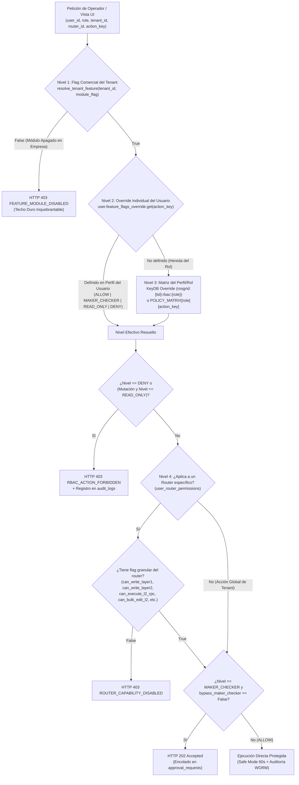
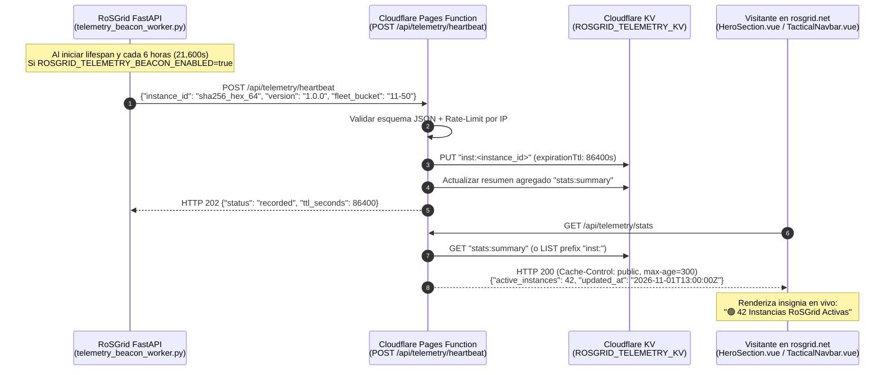
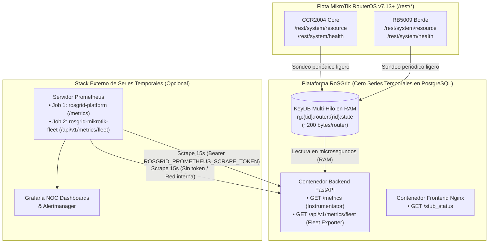

# SPDX-License-Identifier: GPL-3.0-only
# Copyright (C) 2026 RoSGrid Contributors

# 55 — GOBERNANZA GRANULAR DE FLAGS EN PERFILES DE USUARIO (30 ACCIONES RBAC + OVERRIDES INDIVIDUALES), TELEMETRÍA ANÓNIMA DE INSTANCIAS ACTIVAS (`rosgrid-web` BEACON) Y ARQUITECTURA DUAL DE OBSERVABILIDAD PROMETHEUS + GRAFANA (RoSGrid)

> **[ESTADO DE IMPLEMENTACIÓN Y CERTIFICACIÓN 11X]:**
> - **Hito 27.17 (Gobernanza Granular de Flags en Perfiles de Usuario, Matriz 30×11 y 10 Flags por Router):** COMPLETADO Y CERTIFICADO AL 100% en Docker (605 tests unitarios Pytest, 507 tests Vitest en 79 suites, 0 errores en `ruff` y `vue-tsc`, Escenario 129 Karate API y Escenario 73 Karate UI).
> - **Hito 27.18 (Telemetría Anónima de Instancias Activas hacia `rosgrid-web`):** COMPLETADO Y CERTIFICADO AL 100% en Docker (621 tests unitarios Pytest, worker `telemetry_beacon_worker.py` Grado A CC <= 5, endpoints `/system/telemetry-beacon/status` y `/trigger`, paridad en `rosgrid-web` con Cloudflare Pages Functions + KV, Escenario 130 Karate API).
> - **Hito 27.19 (Arquitectura Dual Prometheus y Guía Grafana):** COMPLETADO Y CERTIFICADO AL 100% en Docker (630 tests unitarios Pytest, exportador `GET /api/v1/metrics/fleet` con 8 métricas canónicas, parser RouterOS v7 uptime `_parse_ros_uptime_to_seconds`, 100% cobertura en `fleet_metrics.py`, complejidad Radon Grado A, plantillas oficiales en `docs/examples/grafana/` y `docs/examples/prometheus/`, y Escenario 60 Karate API enriquecido).

> **[DIRECTIVA DE SISTEMA PARA ANTIGRAVITY]:** Este documento especifica la arquitectura técnica detallada de los **Hitos 27.17, 27.18 y 27.19**, cubriendo tres pilares estratégicos de gobernanza y observabilidad en **RoSGrid**:
>
> 1. **Hito 27.17 — Validación y Expansión Exhaustiva de Flags en Perfiles de Usuario (`RBAC 30×11` + `UserRouterPermission 10 Flags` + Overrides por Operador Individual):** Garantiza que el **100% de las funciones y submódulos** de RoSGrid posean un interruptor explícito para activarse o desactivarse tanto a nivel de **Perfil/Rol (`SystemRoleEnum`)**, como a nivel de **Usuario Individual (`users.feature_flags_override`)** y **Permiso por Router (`user_router_permissions`)**.
> 2. **Hito 27.18 — Telemetría Anónima de Instancias Activas (*Privacy-Preserving Heartbeat Beacon*) hacia `rosgrid-web` (`https://rosgrid.net`):** Mecanismo ligero, asíncrono y respetuoso de la privacidad (*Zero-PII*) mediante el cual cada instalación activa de `RoSGrid` reporta periódicamente un latido anónimo hacia una función de borde en **Cloudflare Pages Functions + Cloudflare KV** en `rosgrid-web`, permitiendo exhibir en tiempo real en el portal oficial la cantidad de instancias activas en el mundo.
> 3. **Hito 27.19 — Arquitectura Dual de Observabilidad Prometheus (`GET /metrics` Plataforma vs. `GET /api/v1/metrics/fleet` Routers MikroTik) e Integración con Grafana:** Especificación canónica, enriquecimiento de métricas de salud de hardware RouterOS v7 (`/rest/system/resource` y `/rest/system/health`) y guía operativa paso a paso para conectar **Prometheus**, **Alertmanager** y **Grafana** sin violar el principio *Zero-Metrics Storage* en PostgreSQL.

---

## 1. Pilar 1 (Hito 27.17): Gobernanza Granular de Flags en Perfiles de Usuario, Roles y Routers

### 1.1. Fundamentación contra la Documentación Oficial de MikroTik RouterOS v7 (`/user/group`)

De acuerdo con la documentación oficial de **MikroTik RouterOS v7** ([`https://manual.mikrotik.com/docs/cli-reference/`](https://manual.mikrotik.com/docs/cli-reference/)), los permisos internos de un router en `/user/group` se dividen en políticas de bajo nivel del sistema operativo:
* `rest-api` (obligatoria desde RouterOS v7.13+ para acceder a `/rest/*`).
* `read`, `write`, `policy`, `test`, `reboot`, `sensitive`, `sniff`, `romon`, `api`, `ssh`, `winbox`, `web`.

Sin embargo, en una arquitectura **Split-Credential Multi-Tenant** como **RoSGrid** (donde los operadores humanos nunca conocen la contraseña almacenada en la bóveda `AES-256-GCM` y RoSGrid se autentica ante el MikroTik con una cuenta de servicio administrativa o de monitoreo), **las políticas nativas de `/user/group` de RouterOS son demasiado gruesas** para un NOC moderno: por ejemplo, otorgar `write` en RouterOS permite alterar simultáneamente BGP, Firewall, Certificados, CAPsMAN y Scripts.

Por ello, **RoSGrid** impone un **Plano de Control de Permisos de 4 Niveles** antes de despachar cualquier petición HTTPS hacia `/rest/*`, garantizando que **cada función de la plataforma tenga su propio flag de activación/desactivación en el perfil del usuario**.

### 1.2. Arquitectura de Evaluación Determinista en 4 Niveles (`CC <= 5`)



### 1.3. Catálogo Completo de 30 Flags de Función en Perfiles de Usuario (`ACTIONS_METADATA` & `POLICY_MATRIX`)

Se amplía el catálogo de `fastapi/src/api/v1/rbac.py` (`ACTIONS_METADATA`) y `fastapi/src/rbac/policy_matrix.py` (`POLICY_MATRIX`) de **19 a 30 acciones granulares** agrupadas en **6 categorías tácticas**, cubriendo el 100% de las pantallas y motores de RoSGrid:

| # | Clave del Flag (`action_key`) | Categoría | Función que Activa / Desactiva en el Perfil de Usuario | `SUPERADMIN` / `TENANT_ADMIN` | `SUPERVISOR` | `SUPPORT_L3` | `SUPPORT_L2` | `SUPPORT_L1` | `FIELD_TECH` | `INVENTORY_MGR` | `AUDITOR` | `NOC_MONITOR` | `SERVICE_ACCT` |
| :-: | :--- | :--- | :--- | :-: | :-: | :-: | :-: | :-: | :-: | :-: | :-: | :-: | :-: |
| **1** | `TENANT_MANAGEMENT` | Administración y Seguridad | Creación, suspensión, cuotas y módulos de empresas (Tenants). | `ALLOW` / `DENY` | `DENY` | `DENY` | `DENY` | `DENY` | `DENY` | `DENY` | `DENY` | `DENY` | `DENY` |
| **2** | `USER_MANAGEMENT` | Administración y Seguridad | Creación/edición de usuarios, reseteo 2FA, roles y overrides de flags por usuario. | `ALLOW` | `READ_ONLY` | `DENY` | `DENY` | `DENY` | `DENY` | `DENY` | `READ_ONLY` | `DENY` | `DENY` |
| **3** | `VIEW_ACTIVE_SESSIONS_KILLSWITCH` | Administración y Seguridad | Inspección de sesiones en vivo y desconexión inmediata (*Kill-Switch*). | `ALLOW` | `ALLOW` | `DENY` | `DENY` | `DENY` | `DENY` | `DENY` | `READ_ONLY` | `DENY` | `DENY` |
| **4** | `ROUTER_INVENTORY_CSV` | Operaciones e Inventario | Alta/edición de routers MikroTik e importación masiva CSV en 2 pasos. | `ALLOW` | `ALLOW` | `ALLOW` | `DENY` | `DENY` | `DENY` | `ALLOW` | `DENY` | `DENY` | `DENY` |
| **5** | `REVEAL_VAULT_KEYS` | Administración y Seguridad | Revelar credenciales de Bóveda `AES-256-GCM` con Step-Up 2FA (30s). | `ALLOW` | `DENY` | `DENY` | `DENY` | `DENY` | `DENY` | `DENY` | `DENY` | `DENY` | `DENY` |
| **6** | `TRIGGER_PASSWORD_ROTATION` | Administración y Seguridad | Rotación criptográfica manual o programada de claves API en RouterOS. | `ALLOW` | `ALLOW` | `ALLOW` | `DENY` | `DENY` | `DENY` | `ALLOW` | `DENY` | `DENY` | `DENY` |
| **7** | `SCHEDULE_MAINTENANCE` | Operaciones e Inventario | Programación y cierre de ventanas de mantenimiento con supresión de alertas. | `ALLOW` | `ALLOW` | `ALLOW` | `MAKER_CHECKER` | `DENY` | `DENY` | `ALLOW` | `DENY` | `DENY` | `DENY` |
| **8** | `VIEW_OSM_MAP_NOC_CHARTS` | Telemetría y Diagnóstico | Visualización del Mapa Bimodal OSM, Wallboard NOC 24/7 y gráficas Canvas 2D. | `ALLOW` | `ALLOW` | `ALLOW` | `ALLOW` | `ALLOW` | `ALLOW` | `ALLOW` | `ALLOW` | `ALLOW` | `DENY` |
| **9** | `LIVE_DIAGNOSTICS` | Telemetría y Diagnóstico | Herramientas en vivo (Ping, Traceroute, Torch, Cable Test TDR, Diagnóstico 360°). | `ALLOW` | `ALLOW` | `ALLOW` | `ALLOW` | `ALLOW` | `ALLOW` | `DENY` | `DENY` | `DENY` | `ALLOW` |
| **10** | `L1_OPERATIONS` | Configuración y Control de Red | Operación de interfaces físicas, óptica SFP/SFP+ DDM y reconexión PPPoE/DHCP. | `ALLOW` | `ALLOW` | `ALLOW` | `ALLOW` | `ALLOW` | `ALLOW` | `DENY` | `DENY` | `DENY` | `ALLOW` |
| **11** | `CONFIG_STANDARD_L1` | Configuración y Control de Red | Configuración WebFig Capa 1 (Bridge, VLAN, WireGuard, IP/DHCP, IPv6, Queues, NAT). | `ALLOW` | `ALLOW` | `ALLOW` | `ALLOW` | `MAKER_CHECKER` | `DENY` | `DENY` | `DENY` | `DENY` | `ALLOW` |
| **12** | `CRITICAL_NETWORK_ACTIONS` | Configuración y Control de Red | Acciones críticas de red (BGP v7, OSPF, ruta default, Firewall `input`, `/ip/service`). | `ALLOW` | `ALLOW` | `ALLOW` | `MAKER_CHECKER` | `MAKER_CHECKER` | `DENY` | `DENY` | `DENY` | `DENY` | `DENY` |
| **13** | `REBOOT_SHUTDOWN` | Configuración y Control de Red | Reinicio (`reboot`) o apagado (`shutdown`) de routers bajo Safe Mode. | `ALLOW` | `ALLOW` | `ALLOW` | `MAKER_CHECKER` | `MAKER_CHECKER` | `MAKER_CHECKER` | `DENY` | `DENY` | `DENY` | `DENY` |
| **14** | `WEBFIG_L2_UNIVERSAL` | Motor Universal Capa 2 | Lectura/escritura CRUD estándar, `/console/inspect` y `.query`/`.proplist` en Capa 2. | `ALLOW` | `READ_ONLY` | `ALLOW` | `READ_ONLY` | `DENY` | `DENY` | `DENY` | `READ_ONLY` | `DENY` | `DENY` |
| **15** | `WEBFIG_L2_RPC_COMMANDS` *(Nuevo)* | Motor Universal Capa 2 | Ejecución de verbos RPC contextuales en Capa 2 (`add-acme`, `sign`, `make-static`, `run`). | `ALLOW` | `MAKER_CHECKER` | `ALLOW` | `MAKER_CHECKER` | `DENY` | `DENY` | `DENY` | `DENY` | `DENY` | `DENY` |
| **16** | `WEBFIG_L2_BULK_OPS` *(Nuevo)* | Motor Universal Capa 2 | Operaciones masivas por lote en tablas de Capa 2 (`enable`, `disable`, `comment`, `remove`). | `ALLOW` | `ALLOW` | `ALLOW` | `MAKER_CHECKER` | `DENY` | `DENY` | `DENY` | `DENY` | `DENY` | `DENY` |
| **17** | `WEBFIG_L2_EXPORT_RSC` *(Nuevo)* | Motor Universal Capa 2 | Exportación contextual `.rsc` por submenú y previsualización Diff contra respaldo Git. | `ALLOW` | `ALLOW` | `ALLOW` | `ALLOW` | `DENY` | `DENY` | `READ_ONLY` | `ALLOW` | `DENY` | `READ_ONLY` |
| **18** | `MANUAL_BACKUP_DIFF_GIT` | Operaciones e Inventario | Generación de snapshots `.rsc` completos y comparador visual Git Diff. | `ALLOW` | `ALLOW` | `ALLOW` | `ALLOW` | `DENY` | `DENY` | `ALLOW` | `READ_ONLY` | `DENY` | `ALLOW` |
| **19** | `RESTORE_BACKUP_CUSTOM_SCRIPT` | Configuración y Control de Red | Restauración de configuraciones históricas o inyección de `/system/script`. | `ALLOW` | `ALLOW` | `ALLOW` | `MAKER_CHECKER` | `DENY` | `DENY` | `DENY` | `DENY` | `DENY` | `DENY` |
| **20** | `BULK_ACTIONS_UPGRADE_ROS` | Operaciones e Inventario | Plantillas Golden Configs masivas y actualización de RouterOS PoE-Aware con Safety Stop. | `ALLOW` | `ALLOW` | `ALLOW` | `MAKER_CHECKER` | `DENY` | `DENY` | `DENY` | `DENY` | `DENY` | `DENY` |
| **21** | `APPROVE_MAKER_CHECKER` | Operaciones e Inventario | Autorización/rechazo en bandeja Maker-Checker (`HTTP 202`, `maker != checker`). | `ALLOW` | `ALLOW` | `ALLOW` | `DENY` | `DENY` | `DENY` | `DENY` | `DENY` | `DENY` | `DENY` |
| **22** | `AUDIT_LOGS_QUERY` | Administración y Seguridad | Consulta forense y verificación criptográfica de la cadena inmutable WORM (`audit_logs`). | `ALLOW` | `ALLOW` | `DENY` | `DENY` | `DENY` | `DENY` | `DENY` | `ALLOW` | `DENY` | `DENY` |
| **23** | `IPAM_VRFS_PREFIXES_MGMT` *(Nuevo)* | Módulos ISP & Telecom | Gestión de IPAM Dual-Stack, VRFs, Prefijos IPv4/IPv6 y Grilla de Direcciones IP. | `ALLOW` | `ALLOW` | `ALLOW` | `ALLOW` | `READ_ONLY` | `READ_ONLY` | `ALLOW` | `READ_ONLY` | `DENY` | `READ_ONLY` |
| **24** | `SUBSCRIBERS_QOS_PROVISIONING` *(Nuevo)* | Módulos ISP & Telecom | Aprovisionamiento de Suscriptores, Corte/Restauración (`isolate`/`restore`) y Planes QoS. | `ALLOW` | `ALLOW` | `ALLOW` | `ALLOW` | `ALLOW` | `READ_ONLY` | `DENY` | `READ_ONLY` | `DENY` | `ALLOW` |
| **25** | `FIELD_OPS_OPTICAL_NAP_MGMT` *(Nuevo)* | Módulos ISP & Telecom | Toolkit de Campo, Cajas Ópticas FTTH (NAP/CTO 1..16), Empalmes y Cortes de Fibra. | `ALLOW` | `ALLOW` | `ALLOW` | `ALLOW` | `READ_ONLY` | `ALLOW` | `ALLOW` | `READ_ONLY` | `DENY` | `DENY` |
| **26** | `BGP_LOOKING_GLASS_IPFIX` *(Nuevo)* | Telemetría y Diagnóstico | Consultas en BGP Looking Glass y Analítica de Tráfico IPFIX / Traffic-Flow. | `ALLOW` | `ALLOW` | `ALLOW` | `ALLOW` | `READ_ONLY` | `DENY` | `DENY` | `READ_ONLY` | `READ_ONLY` | `ALLOW` |
| **27** | `ENTERPRISE_CIS_DRIFT_COMPLIANCE` *(Nuevo)* | Módulos Corporativos & Seguridad | Auditoría CIS Benchmark (28 directivas), Auto-Hardening y Reversión de Config Drift. | `ALLOW` | `ALLOW` | `ALLOW` | `READ_ONLY` | `DENY` | `DENY` | `DENY` | `READ_ONLY` | `DENY` | `READ_ONLY` |
| **28** | `ENTERPRISE_SDWAN_SLA_ROGUEDHCP` *(Nuevo)* | Módulos Corporativos & Seguridad | Orquestador SD-WAN WireGuard Hub & Spoke, Monitor SLA y Detección de Rogue DHCP. | `ALLOW` | `ALLOW` | `ALLOW` | `MAKER_CHECKER` | `READ_ONLY` | `DENY` | `DENY` | `READ_ONLY` | `READ_ONLY` | `DENY` |
| **29** | `WIFI_CAPSMAN_PROVISIONING` *(Nuevo)* | Módulos Corporativos & Seguridad | Consola Interactiva CAPsMAN v7 (Manager, SSIDs, WPA2/WPA3, Bandas, Quick-Setup, Kick). | `ALLOW` | `ALLOW` | `ALLOW` | `ALLOW` | `READ_ONLY` | `READ_ONLY` | `DENY` | `READ_ONLY` | `DENY` | `DENY` |
| **30** | `TOPOLOGY_L2_CVE_SYSLOG_MCP` *(Nuevo)* | Telemetría y Diagnóstico | Topología Física L2 (MNDP/LLDP), Matriz CVE Local, Terminal Syslog Live y Tokens MCP IA. | `ALLOW` | `ALLOW` | `ALLOW` | `ALLOW` | `READ_ONLY` | `READ_ONLY` | `READ_ONLY` | `ALLOW` | `READ_ONLY` | `ALLOW` |

### 1.4. Esquema de Base de Datos y Migración Alembic (`0012_user_profile_flags_and_router_perms.py`)

1. **Columna `feature_flags_override` en la tabla `users` (`fastapi/src/models/core.py`):**
   ```python
   feature_flags_override: Mapped[dict[str, str]] = mapped_column(
       JSONB, nullable=False, default=dict, server_default=text("'{}'::jsonb")
   )
   ```
   - Permite guardar overrides explícitos por usuario individual, donde cada clave pertenece a los 30 `action_key` oficiales y su valor es `"ALLOW"`, `"MAKER_CHECKER"`, `"READ_ONLY"` o `"DENY"` (o booleano `True -> "ALLOW"`, `False -> "DENY"` normalizado automáticamente en el validador Pydantic).
2. **Expansión de `user_router_permissions` de 7 a 10 Flags Granulares por Router (`fastapi/src/models/core.py` y `fastapi/src/schemas/users.py`):**
   ```python
   can_read: Mapped[bool] = mapped_column(Boolean, nullable=False, default=True)
   can_write_layer1: Mapped[bool] = mapped_column(Boolean, nullable=False, default=False)
   can_write_layer2: Mapped[bool] = mapped_column(Boolean, nullable=False, default=False)
   can_execute_l2_rpc: Mapped[bool] = mapped_column(Boolean, nullable=False, default=False, server_default=text("false"))
   can_bulk_edit_l2: Mapped[bool] = mapped_column(Boolean, nullable=False, default=False, server_default=text("false"))
   can_export_l2_rsc: Mapped[bool] = mapped_column(Boolean, nullable=False, default=True, server_default=text("true"))
   can_execute_diagnostics: Mapped[bool] = mapped_column(Boolean, nullable=False, default=True)
   can_trigger_backup: Mapped[bool] = mapped_column(Boolean, nullable=False, default=False)
   can_reboot: Mapped[bool] = mapped_column(Boolean, nullable=False, default=False)
   bypass_maker_checker: Mapped[bool] = mapped_column(Boolean, nullable=False, default=False)
   ```

### 1.5. Endpoints Backend y Componentes Frontend para Gestión de Flags en Perfiles de Usuario

1. **Backend (`fastapi/src/api/v1/users.py` y `fastapi/src/api/v1/rbac.py`):**
   - `GET /api/v1/users/{user_id}/effective-permissions`: Devuelve el mapa consolidado de las 30 funciones para ese operador combinando el techo del Tenant, el Rol asignado y su `feature_flags_override` individual.
   - `PATCH /api/v1/users/{user_id}/feature-flags`: Permite a `SUPERADMIN_GLOBAL` o `TENANT_ADMIN` activar (`ALLOW`), condicionar (`MAKER_CHECKER`), limitar a lectura (`READ_ONLY`), desactivar (`DENY`) o restaurar a herencia del rol (`null`) cualquiera de las 30 funciones en el perfil de un usuario específico, invalidando la caché en KeyDB (`rg:{tenant_id}:user_perms:{user_id}`) y registrando el evento WORM `USER_PROFILE_FLAGS_UPDATED`.
2. **Frontend (`vue3/src/views/UsersAndPermissionsView.vue`, `RbacRoleMatrixPanel.vue`, `UserRouterMatrixModal.vue` y nuevo `RgUserProfileFlagsModal.vue`):**
   - En la fila de cada operador en `UsersAndPermissionsView.vue`, nuevo botón táctico **`[ 🎛️ Flags de Funciones ]`** (`#btn-user-profile-flags-{username}`) que abre `RgUserProfileFlagsModal.vue`.
   - El modal muestra las **30 funciones** agrupadas en sus 6 categorías con buscador instantáneo, filtro por categoría, indicador de valor heredado del rol (`Heredado de SUPPORT_L2`) y selector rápido para activar/desactivar la función en ese perfil de usuario.
   - En `useAuthStore.ts`: helper reactivo `canUseUserFeature(actionKey: string, requireWrite = false): boolean` para que la barra lateral (`RgResponsiveShell.vue`) y los botones de acción oculten o deshabiliten automáticamente cualquier función desactivada en el perfil del usuario.

---

## 2. Pilar 2 (Hito 27.18): Telemetría Anónima de Instancias Activas (`RoSGrid` API $\rightarrow$ `rosgrid-web`)

### 2.1. Principios de Diseño: Soberanía, *Zero-PII* y Resiliencia *Fail-Silent*

Para mostrar en la web oficial de presentación ([`https://rosgrid.net`](https://rosgrid.net)) la cantidad real de instancias de **RoSGrid** activas globalmente sin comprometer jamás la privacidad ni la seguridad de las operadoras de telecomunicaciones:

1. **Cero Datos Sensibles (*Zero-PII / Zero-Topology*):** El latido jamás transmite nombres de empresas, correos, direcciones IP privadas de routers, dominios ni credenciales.
2. **Identificador Anónimo Irreversible (`instance_id`):** Se deriva mediante `HMAC-SHA256` usando como semilla el UUID del primer tenant o un UUID de instalación generado en KeyDB/PostgreSQL, produciendo un hash hexadecimal de 64 caracteres imposible de revertir.
3. **Expiración Automática en Borde (TTL 24h en Cloudflare KV):** No requiere base de datos SQL en `rosgrid-web`. Cada latido renueva una clave en **Cloudflare KV** con `expirationTtl: 86400` (24 horas). Si una instancia de RoSGrid se apaga por más de 24 horas, su clave desaparece automáticamente de KV y el contador decrece solo.
4. **Tolerancia Total a Entornos Aislados (*Air-Gapped / Fail-Silent*):** Si la instancia de RoSGrid opera en una red de gestión cerrada sin salida a Internet o si el administrador define `ROSGRID_TELEMETRY_BEACON_ENABLED=false` en `.env`, el worker no genera errores ni retrasa el arranque de FastAPI.

### 2.2. Diagrama de Flujo Extremo a Extremo



### 2.3. Contrato del Worker en `RoSGrid` (`fastapi/src/workers/telemetry_beacon_worker.py`)

- **Variables de Configuración en `fastapi/src/core/config.py` y `.env.example`:**
  ```python
  ROSGRID_TELEMETRY_BEACON_ENABLED: bool = True
  ROSGRID_TELEMETRY_BEACON_URL: str = "https://rosgrid.net/api/telemetry/heartbeat"
  ROSGRID_TELEMETRY_BEACON_INTERVAL_SECONDS: int = 21600  # 6 horas
  ```
- **Esquema JSON Enviado (`POST`):**
  ```json
  {
    "schema_version": 1,
    "instance_id": "a8f5f167f44f4964e6c998dee827110c0e5b9a2f7d8c1e3b4a5f6d7e8f9a0b1c",
    "version": "1.0.0",
    "fleet_bucket": "1-10",
    "timestamp": "2026-11-01T13:00:00Z"
  }
  ```
- **Endpoint Local de Diagnóstico en `RoSGrid` (`GET /api/v1/system/telemetry-beacon/status`):**
  - Permite al `SUPERADMIN_GLOBAL` verificar en la consola si el latido anónimo está habilitado, cuál es el `instance_id` anónimo de su servidor y la fecha del último envío exitoso.

### 2.4. Contrato del Receptor en `rosgrid-web` (`functions/api/telemetry/heartbeat.ts` y `stats.ts`)

1. **`POST /api/telemetry/heartbeat`:**
   - Valida que `instance_id` cumpla la expresión regular `^[a-f0-9]{64}$` y que `version` cumpla `^\d+\.\d+\.\d+`.
   - Almacena en Cloudflare KV (`env.ROSGRID_TELEMETRY_KV`) la clave `inst:${instance_id}` con metadatos `{ version, fleet_bucket, last_seen }` y `expirationTtl: 86400`.
   - Devuelve `HTTP 202 Accepted` con cabeceras CORS restringidas y `X-Content-Type-Options: nosniff`.
2. **`GET /api/telemetry/stats`:**
   - Lista las claves vivas con prefijo `inst:` en `env.ROSGRID_TELEMETRY_KV` (todas aquellas cuyo TTL de 24h no ha expirado) y devuelve:
     ```json
     {
       "active_instances": 18,
       "latest_version": "1.0.0",
       "ttl_window_hours": 24,
       "updated_at": "2026-11-01T13:00:00Z"
     }
     ```
   - Incluye cabecera `Cache-Control: public, max-age=300, s-maxage=300` para que el CDN de Cloudflare absorba el tráfico de visitantes.

---

## 3. Pilar 3 (Hito 27.19): Arquitectura Dual de Observabilidad Prometheus (Plataforma vs. Routers) e Integración con Grafana

### 3.1. Clarificación Arquitectónica: Los Dos Endpoints de Prometheus en `RoSGrid`

`RoSGrid` separa deliberadamente la telemetría de **su propia infraestructura de software** de la telemetría de **los routers MikroTik administrados**, exponiendo **dos endpoints independientes** en formato estándar OpenMetrics / Prometheus (`text/plain; version=0.0.4`):



#### Endpoint 1: `GET /metrics` — Métricas Internas de la Plataforma `RoSGrid`
- **Propósito:** Monitorear el rendimiento, latencia, tasa de errores y consumo de recursos del motor **FastAPI / Python 3.15** de RoSGrid.
- **Implementación:** `prometheus-fastapi-instrumentator` en `fastapi/src/main.py`.
- **Métricas Expuestas:**
  - `http_requests_total{handler, method, status}`: Contador total de peticiones HTTP recibidas por la API de RoSGrid.
  - `http_request_duration_seconds_bucket{handler, method, le}`: Histograma de latencia de respuesta de los endpoints de RoSGrid (para calcular P50, P95 y P99).
  - `http_requests_inprogress{handler, method}`: Peticiones concurrentes en vuelo.
  - `process_resident_memory_bytes` y `process_cpu_seconds_total`: Uso de memoria RAM y CPU del contenedor `rosgrid-backend`.

#### Endpoint 2: `GET /api/v1/metrics/fleet` — Métricas de la Flota de Routers MikroTik
- **Propósito:** Exportar la salud operativa, recursos de hardware, estado de conexión y vulnerabilidades CVE de **todos los routers MikroTik adoptados en estado `PRODUCTION`**.
- **Implementación:** `fastapi/src/api/v1/fleet_metrics.py` (gobernado por el Feature Flag `prometheus_fleet_exporter_enabled` y protegido con `Authorization: Bearer <ROSGRID_PROMETHEUS_SCRAPE_TOKEN>`).
- **Origen de Datos en RouterOS v7 (`/rest/system/resource` y `/rest/system/health`):**
  - El worker de monitoreo de RoSGrid consulta `/rest/system/resource` (`cpu-load`, `free-memory`, `total-memory`, `uptime`, `version`, `board-name`) y `/rest/system/health` (`temperature`, `cpu-temperature`, `voltage`) y actualiza el hash efímero en KeyDB (`rg:{tenant_id}:router:{router_id}:state`).
  - Cuando Prometheus hace scrape a `GET /api/v1/metrics/fleet`, FastAPI **no interroga a los routers en vivo ni consulta series en PostgreSQL**; lee instantáneamente el hash en RAM de KeyDB y formatea las siguientes métricas etiquetadas con `{tenant_id, router_id, identity, model, ros_version}`:

| Nombre de la Métrica Prometheus | Tipo | Etiquetas (`Labels`) | Descripción y Unidad |
| :--- | :---: | :--- | :--- |
| `rosgrid_router_status` | `gauge` | `tenant_id`, `router_id`, `identity`, `model`, `ros_version` | Estado de alcanzabilidad HTTPS REST del router (`1` = `ONLINE`, `0` = `OFFLINE`). |
| `rosgrid_router_cpu_percent` | `gauge` | `tenant_id`, `router_id`, `identity`, `model`, `ros_version` | Porcentaje de carga de CPU reportado por `/rest/system/resource` (`0` a `100`). |
| `rosgrid_router_memory_usage_ratio` | `gauge` | `tenant_id`, `router_id`, `identity`, `model`, `ros_version` | Proporción de memoria RAM ocupada `(total - free) / total` (`0.0` a `1.0`). |
| `rosgrid_router_uptime_seconds` | `gauge` | `tenant_id`, `router_id`, `identity`, `model`, `ros_version` | Tiempo de actividad continuo del router en segundos (convertido desde formato RouterOS `1w2d3h4m5s`). |
| `rosgrid_router_temperature_celsius` | `gauge` | `tenant_id`, `router_id`, `identity`, `model`, `ros_version` | Temperatura de CPU/placa en °C reportada por `/rest/system/health` (`0` si el modelo no posee sensor). |
| `rosgrid_router_voltage_volts` | `gauge` | `tenant_id`, `router_id`, `identity`, `model`, `ros_version` | Voltaje de alimentación DC en voltios reportado por `/rest/system/health`. |
| `rosgrid_router_active_cves_count` | `gauge` | `tenant_id`, `router_id`, `identity`, `model`, `severity` | Cantidad de vulnerabilidades CVE activas para la versión de RouterOS instalada (`severity="critical"` \| `"high"`). |
| `rosgrid_router_syslog_critical_events_total` | `counter` | `tenant_id`, `router_id`, `identity`, `model` | Total acumulado de eventos críticos detectados en el RingBuffer Syslog del router. |

---

### 3.2. Guía Paso a Paso de Configuración con Prometheus y Grafana

#### Paso 1: Configurar el Token de Scraping en `.env` de `RoSGrid`
```dotenv
# Token Bearer dedicado para que Prometheus extraiga métricas de /api/v1/metrics/fleet
ROSGRID_PROMETHEUS_SCRAPE_TOKEN=rg_prom_scrape_9f8e7d6c5b4a3f2e1d0c
```

#### Paso 2: Configuración Completa de `prometheus.yml`
```yaml
global:
  scrape_interval: 15s
  evaluation_interval: 15s

scrape_configs:
  # 1. Métricas de la Plataforma RoSGrid (FastAPI / Python)
  - job_name: 'rosgrid-platform-api'
    metrics_path: '/metrics'
    static_configs:
      - targets: ['rosgrid-backend:8000']
        labels:
          service: 'rosgrid-api'

  # 2. Métricas de la Flota de Routers MikroTik (vía Caché Efímera KeyDB de RoSGrid)
  - job_name: 'rosgrid-mikrotik-fleet'
    metrics_path: '/api/v1/metrics/fleet'
    authorization:
      type: Bearer
      credentials: 'rg_prom_scrape_9f8e7d6c5b4a3f2e1d0c'
    static_configs:
      - targets: ['rosgrid-backend:8000']
        labels:
          collector: 'rosgrid-fleet-exporter'
```

#### Paso 3: Consultas PromQL Esenciales para Paneles de Grafana
1. **Disponibilidad Global de la Flota (% Online):**
   ```promql
   avg(rosgrid_router_status) * 100
   ```
2. **Lista de Routers Caídos (Offline):**
   ```promql
   rosgrid_router_status == 0
   ```
3. **Uso de CPU por Router MikroTik (%):**
   ```promql
   rosgrid_router_cpu_percent{identity=~"$router"}
   ```
4. **Uso de Memoria RAM por Router MikroTik (%):**
   ```promql
   rosgrid_router_memory_usage_ratio{identity=~"$router"} * 100
   ```
5. **Temperatura de Hardware (°C) en Equipos Core (CCR/CRS):**
   ```promql
   rosgrid_router_temperature_celsius > 0
   ```
6. **Routers con Vulnerabilidades CVE Críticas Pendientes:**
   ```promql
   rosgrid_router_active_cves_count{severity="critical"} > 0
   ```
7. **Latencia P95 de la API de RoSGrid (`GET /metrics`):**
   ```promql
   histogram_quantile(0.95, sum(rate(http_request_duration_seconds_bucket[5m])) by (le, handler))
   ```

#### Paso 4: Reglas de Alerta para Prometheus Alertmanager (`rosgrid-alerts.rules.yml`)
```yaml
groups:
  - name: rosgrid_mikrotik_fleet_alerts
    rules:
      - alert: MikrotikRouterOffline
        expr: rosgrid_router_status == 0
        for: 2m
        labels:
          severity: critical
        annotations:
          summary: "Router MikroTik {{ $labels.identity }} ({{ $labels.model }}) fuera de línea"
          description: "El router {{ $labels.identity }} en el tenant {{ $labels.tenant_id }} lleva más de 2 minutos sin responder a la REST API HTTPS."

      - alert: MikrotikHighCpuLoad
        expr: rosgrid_router_cpu_percent > 85
        for: 5m
        labels:
          severity: warning
        annotations:
          summary: "CPU alta ({{ $value }}%) en {{ $labels.identity }}"

      - alert: MikrotikCriticalCveDetected
        expr: rosgrid_router_active_cves_count{severity="critical"} > 0
        for: 15m
        labels:
          severity: critical
        annotations:
          summary: "{{ $value }} CVEs críticos detectados en {{ $labels.identity }}"
```

---

## 4. Planificación de Pruebas Nivel 11X para los Hitos 27.17, 27.18 y 27.19

1. **Pruebas Unitarias Backend (`fastapi/tests/`):**
   - `test_rbac_30_actions_and_user_overrides.unit.py`: Verifica la resolución de los 4 niveles (Tenant Flag $\rightarrow$ Override de Usuario $\rightarrow$ Rol en KeyDB/Matriz de 30 acciones $\rightarrow$ 10 Permisos de Router) y los endpoints `GET /api/v1/users/{id}/effective-permissions` y `PATCH /api/v1/users/{id}/feature-flags`.
   - `test_telemetry_beacon_worker.unit.py`: Verifica la generación determinista de `instance_id` (`HMAC-SHA256`), el envío asíncrono, el respeto a `ROSGRID_TELEMETRY_BEACON_ENABLED=false` y la tolerancia *fail-silent* ante timeouts de red.
   - `test_fleet_metrics_extended.unit.py`: Verifica que `GET /api/v1/metrics/fleet` y `GET /metrics` entreguen todas las métricas de plataforma y de flota MikroTik (`uptime_seconds`, `temperature_celsius`, `voltage_volts`, `syslog_critical_events_total`).
2. **Pruebas Unitarias Frontend (`vue3/src/`):**
   - `RgUserProfileFlagsModal.unit.ts`: Verifica el renderizado de las 30 funciones por categoría, filtrado, conmutación de overrides por usuario y guardado vía `PATCH /api/v1/users/{id}/feature-flags` manteniendo **0 componentes `.vue` huérfanos**.
3. **Escenarios BDD Karate Labs (`fastapi/test/api_test.feature` y `vue3/test/ui_business_flow.feature` + `docs/examples/`):**
   - **Escenario 129 (API) / Escenario 73 (UI):** Gestión de los 30 flags en perfiles de usuario y overrides individuales (`RgUserProfileFlagsModal.vue`).
   - **Escenario 130 (API):** Estado del latido anónimo de instancias (`/api/v1/system/telemetry-beacon/status`) y métricas extendidas de Prometheus (`/metrics` y `/api/v1/metrics/fleet`).

---

## 5. Blueprint de Implementación Literal "Flash-Ready" (Guía Paso a Paso Anti-Errores para Modelos Ligeros)

> **[DIRECTIVA PARA MODELOS FLASH / HAiKU / EJECUCIÓN AUTÓNOMA]:** Sigue estrictamente este orden secuencial y utiliza los bloques de código literales de esta sección para evitar las **5 trampas de regresión** del repositorio (`test_rbac_11_roles_matrix.unit.py` línea 37, `down_revision` de Alembic `0011`, complejidad ciclomática `Radon CC <= 5` en `tox.ini`, guardia de `lifespan` en pytest y paridad de componentes `.vue`).

### 5.1. Trampa #1 y Blueprint de `fastapi/migrations/versions/0012_user_profile_flags_and_router_perms.py`

Crear el archivo `fastapi/migrations/versions/0012_user_profile_flags_and_router_perms.py` encadenado exactamente a `down_revision = "0011_tenant_rogue_dhcp_flag"`:

```python
# SPDX-License-Identifier: GPL-3.0-only
# Copyright (C) 2026 RoSGrid Contributors

"""0012_user_profile_flags_and_router_perms

Revision ID: 0012_user_profile_flags_perms
Revises: 0011_tenant_rogue_dhcp_flag
Create Date: 2026-11-01 14:00:00.000000

"""

from collections.abc import Sequence

import sqlalchemy as sa
from alembic import op
from sqlalchemy.dialects import postgresql

revision: str = "0012_user_profile_flags_perms"
down_revision: str | None = "0011_tenant_rogue_dhcp_flag"
branch_labels: str | Sequence[str] | None = None
depends_on: str | Sequence[str] | None = None


def upgrade() -> None:
    op.add_column(
        "users",
        sa.Column(
            "feature_flags_override",
            postgresql.JSONB(astext_type=sa.Text()),
            nullable=False,
            server_default=sa.text("'{}'::jsonb"),
        ),
    )
    op.add_column(
        "user_router_permissions",
        sa.Column("can_execute_l2_rpc", sa.Boolean(), nullable=False, server_default=sa.text("false")),
    )
    op.add_column(
        "user_router_permissions",
        sa.Column("can_bulk_edit_l2", sa.Boolean(), nullable=False, server_default=sa.text("false")),
    )
    op.add_column(
        "user_router_permissions",
        sa.Column("can_export_l2_rsc", sa.Boolean(), nullable=False, server_default=sa.text("true")),
    )


def downgrade() -> None:
    op.drop_column("user_router_permissions", "can_export_l2_rsc")
    op.drop_column("user_router_permissions", "can_bulk_edit_l2")
    op.drop_column("user_router_permissions", "can_execute_l2_rpc")
    op.drop_column("users", "feature_flags_override")
```

### 5.2. Blueprint de Modelos ORM (`fastapi/src/models/core.py`) y Esquemas (`fastapi/src/schemas/users.py`)

1. En `fastapi/src/models/core.py`:
   - Dentro de `class User(Base)` (después de `has_all_routers_access` en la línea 127):
     ```python
     feature_flags_override: Mapped[dict[str, str]] = mapped_column(
         JSONB, nullable=False, default=dict, server_default=text("'{}'::jsonb")
     )
     ```
   - Dentro de `class UserRouterPermission(Base)` (después de `can_write_layer2` en la línea 163):
     ```python
     can_execute_l2_rpc: Mapped[bool] = mapped_column(Boolean, nullable=False, default=False, server_default=text("false"))
     can_bulk_edit_l2: Mapped[bool] = mapped_column(Boolean, nullable=False, default=False, server_default=text("false"))
     can_export_l2_rsc: Mapped[bool] = mapped_column(Boolean, nullable=False, default=True, server_default=text("true"))
     ```
2. En `fastapi/src/schemas/users.py`:
   - En `class RouterAssignmentItem(BaseModel)` (líneas 68-79), añadir:
     ```python
     can_execute_l2_rpc: bool = False
     can_bulk_edit_l2: bool = False
     can_export_l2_rsc: bool = True
     ```
   - En `class UserResponse(BaseModel)` (líneas 95-113), añadir:
     ```python
     feature_flags_override: dict[str, str] = Field(default_factory=dict)
     ```
   - Añadir al final de `fastapi/src/schemas/users.py`:
     ```python
     class UpdateUserFeatureFlagsRequest(BaseModel):
         model_config = ConfigDict(extra="forbid")

         feature_flags_override: dict[str, str | bool | None] = Field(
             default_factory=dict,
             description="Mapa de action_key -> ALLOW | MAKER_CHECKER | READ_ONLY | DENY | true | false | null (hereda del rol)",
         )
     ```

### 5.3. Trampa #2 y Blueprint de `POLICY_MATRIX` (30 Acciones) y `test_rbac_11_roles_matrix.unit.py`

> **⚠️ ATENCIÓN CRÍTICA:** Al expandir `POLICY_MATRIX` de 19 a 30 acciones en `fastapi/src/rbac/policy_matrix.py`, **DEBES** actualizar `fastapi/tests/rbac/test_rbac_11_roles_matrix.unit.py` en la **línea 37**:
> - Cambiar `assert len(POLICY_MATRIX[role]) == 19` por `assert len(POLICY_MATRIX[role]) == 30`.
> - Añadir las 11 nuevas claves a la lista `ALL_ACTIONS` en `fastapi/tests/rbac/test_rbac_11_roles_matrix.unit.py` (líneas 10-30).

Las 11 nuevas claves exactas a agregar en `ACTIONS_METADATA` (`fastapi/src/api/v1/rbac.py`) son:

```python
    {
        "key": "WEBFIG_L2_RPC_COMMANDS",
        "label": "Comandos RPC Contextuales Capa 2",
        "category": "Motor Universal Capa 2",
        "description": "Ejecución de verbos POST dinámicos (add-acme, sign, export-certificate, make-static, run).",
    },
    {
        "key": "WEBFIG_L2_BULK_OPS",
        "label": "Operaciones Masivas por Lote en Capa 2",
        "category": "Motor Universal Capa 2",
        "description": "Habilitar, deshabilitar, comentar o eliminar múltiples registros de Capa 2 bajo Safe Mode.",
    },
    {
        "key": "WEBFIG_L2_EXPORT_RSC",
        "label": "Exportación e Importación Contextual .rsc",
        "category": "Motor Universal Capa 2",
        "description": "Exportación CLI (.rsc) por submenú de Capa 2 y comparador Diff contra respaldo Git.",
    },
    {
        "key": "IPAM_VRFS_PREFIXES_MGMT",
        "label": "Gestión de IPAM Dual-Stack, VRFs y Prefijos",
        "category": "Módulos ISP & Telecom",
        "description": "Administración de VRFs, bloques CIDR IPv4/IPv6 y grilla de asignación de direcciones IP.",
    },
    {
        "key": "SUBSCRIBERS_QOS_PROVISIONING",
        "label": "Aprovisionamiento de Suscriptores y Planes QoS",
        "category": "Módulos ISP & Telecom",
        "description": "Alta de abonados PPPoE/DHCP, corte/reconexión (isolate/restore) y perfiles de velocidad.",
    },
    {
        "key": "FIELD_OPS_OPTICAL_NAP_MGMT",
        "label": "Toolkit de Campo y Cajas Ópticas FTTH (NAP/CTO)",
        "category": "Módulos ISP & Telecom",
        "description": "Gestión de cajas de distribución óptica, puertos 1..16, presupuesto láser y cortes de fibra.",
    },
    {
        "key": "BGP_LOOKING_GLASS_IPFIX",
        "label": "BGP Looking Glass y Analítica IPFIX",
        "category": "Telemetría y Diagnóstico",
        "description": "Consultas de tablas BGP v7 en vivo y colector de flujos Traffic-Flow / IPFIX.",
    },
    {
        "key": "ENTERPRISE_CIS_DRIFT_COMPLIANCE",
        "label": "Auditoría CIS Benchmark y Config Drift",
        "category": "Módulos Corporativos & Seguridad",
        "description": "Evaluación de las 28 directivas CIS RouterOS v7, auto-hardening y reversión de desviaciones.",
    },
    {
        "key": "ENTERPRISE_SDWAN_SLA_ROGUEDHCP",
        "label": "Orquestador SD-WAN, Monitor SLA y Rogue DHCP",
        "category": "Módulos Corporativos & Seguridad",
        "description": "Mallas WireGuard Hub & Spoke, sondas de latencia/jitter SLA y alerta de servidores DHCP intrusos.",
    },
    {
        "key": "WIFI_CAPSMAN_PROVISIONING",
        "label": "Consola Interactiva WiFi CAPsMAN v7",
        "category": "Módulos Corporativos & Seguridad",
        "description": "Aprovisionamiento de radios WiFi/Wave2, SSIDs, seguridad WPA2/WPA3, canales y expulsión de clientes.",
    },
    {
        "key": "TOPOLOGY_L2_CVE_SYSLOG_MCP",
        "label": "Topología Física L2, Matriz CVE, Syslog Live y MCP",
        "category": "Telemetría y Diagnóstico",
        "description": "Descubrimiento de vecinos MNDP/LLDP, escáner de CVEs por versión, terminal Syslog y agentes IA MCP.",
    },
```

### 5.4. Trampa #3 (Complejidad `Radon CC <= 5`) y Blueprint de Endpoints de Flags de Usuario (`fastapi/src/api/v1/users.py`)

Para que `radon cc src -a -nc` mantenga el 100% de funciones en **Grado A (`CC <= 5`)**, divide la normalización y resolución de permisos en funciones pequeñas y deterministas dentro de `fastapi/src/api/v1/users.py`:

```python
def _normalize_flag_override_value(raw_val: str | bool | None) -> str | None:
    """Convierte booleanos o niveles RBAC en nivel canónico (CC = 4)."""
    if raw_val is None:
        return None
    if isinstance(raw_val, bool):
        return "ALLOW" if raw_val else "DENY"
    upper = str(raw_val).strip().upper()
    return upper if upper in ("ALLOW", "MAKER_CHECKER", "READ_ONLY", "DENY") else None


def _sanitize_user_flag_overrides(
    existing: dict[str, str], incoming: dict[str, str | bool | None], valid_keys: set[str]
) -> dict[str, str]:
    """Aplica cambios de overrides eliminando claves con None y validando action_keys (CC = 4)."""
    merged = dict(existing or {})
    for key, raw_val in incoming.items():
        if key not in valid_keys:
            raise HTTPException(status_code=400, detail=f"Flag de función desconocido: '{key}'")
        if raw_val is None:
            merged.pop(key, None)
            continue
        norm = _normalize_flag_override_value(raw_val)
        if norm is None:
            raise HTTPException(status_code=400, detail=f"Valor de permiso inválido para '{key}'")
        merged[key] = norm
    return merged
```

Y añade los dos endpoints en `fastapi/src/api/v1/users.py`:
- `GET /api/v1/users/{user_id}/effective-permissions`: Combina `POLICY_MATRIX[target_user.role]`, overrides del rol en KeyDB (`_get_tenant_role_overrides`) y `target_user.feature_flags_override`, devolviendo `{"user_id": ..., "role": ..., "role_defaults": ..., "overrides": ..., "effective_permissions": ..., "actions_catalog": ACTIONS_METADATA}`.
- `PATCH /api/v1/users/{user_id}/feature-flags`: Actualiza `target_user.feature_flags_override`, borra la caché en KeyDB `rg:{target_user.tenant_id}:user_perms:{target_user.id}`, escribe el registro WORM `USER_PROFILE_FLAGS_UPDATED` con `write_audit_log` y retorna el mapa actualizado.

### 5.5. Trampa #4 (Guardia `lifespan` en Pytest) y Blueprint de `telemetry_beacon_worker.py` + `fleet_metrics.py`

1. **`fastapi/src/workers/telemetry_beacon_worker.py` (Complejidad `CC <= 4` por función):**
   ```python
   # SPDX-License-Identifier: GPL-3.0-only
   # Copyright (C) 2026 RoSGrid Contributors

   import asyncio
   import hashlib
   import hmac
   import logging
   import time
   from typing import Any

   import httpx

   from src.core.config import settings
   from src.redis_layer.client import get_redis_client

   logger = logging.getLogger(__name__)

   BEACON_STATE_KEY = "rg:system:telemetry_beacon_state"


   def compute_anonymous_instance_id(seed: str) -> str:
       """Genera un identificador anónimo irreversible SHA-256 de 64 caracteres hex (CC = 1)."""
       return hmac.new(b"rosgrid-anonymous-beacon-v1", seed.encode("utf-8"), hashlib.sha256).hexdigest()


   def resolve_fleet_bucket(router_count: int) -> str:
       """Clasifica el tamaño de la flota en un rango anónimo sin revelar el número exacto (CC = 4)."""
       if router_count <= 0:
           return "0"
       if router_count <= 10:
           return "1-10"
       if router_count <= 50:
           return "11-50"
       return "51-250" if router_count <= 250 else "250+"


   async def send_telemetry_heartbeat_once(router_count: int = 1) -> dict[str, Any]:
       """Envía un único latido anónimo Zero-PII hacia rosgrid-web de forma fail-silent (CC = 4)."""
       instance_id = compute_anonymous_instance_id(settings.ROSGRID_JWT_SECRET_KEY[:16])
       now_iso = time.strftime("%Y-%m-%dT%H:%M:%SZ", time.gmtime())
       payload = {
           "schema_version": 1,
           "instance_id": instance_id,
           "version": "1.0.0",
           "fleet_bucket": resolve_fleet_bucket(router_count),
           "timestamp": now_iso,
       }
       if not settings.ROSGRID_TELEMETRY_BEACON_ENABLED:
           return {"enabled": False, "instance_id": instance_id, "last_status": "disabled"}

       status_str = "sent"
       try:
           async with httpx.AsyncClient(timeout=5.0) as client:
               resp = await client.post(settings.ROSGRID_TELEMETRY_BEACON_URL, json=payload)
               status_str = f"http_{resp.status_code}"
       except Exception as exc:
           logger.debug("Telemetry beacon fail-silent: %s", exc)
           status_str = "offline_skipped"

       await _persist_beacon_state(instance_id, now_iso, status_str)
       return {"enabled": True, "instance_id": instance_id, "last_sent_at": now_iso, "last_status": status_str}


   async def _persist_beacon_state(instance_id: str, now_iso: str, status_str: str) -> None:
       """Guarda el último estado del latido en KeyDB sin fallar si KeyDB está mockeado (CC = 2)."""
       try:
           redis = get_redis_client()
           await redis.hset(
               BEACON_STATE_KEY,
               mapping={"instance_id": instance_id, "last_sent_at": now_iso, "last_status": status_str},
           )
       except Exception:
           pass
   ```
2. **Guardia obligatoria en `lifespan` de `fastapi/src/main.py`:**
   - **NUNCA** dispares un bucle infinito en `lifespan` cuando `settings.ROSGRID_ENV.startswith("qa") or settings.ROSGRID_ENV == "test"`, para no colgar `pytest` ni `TestClient`.
3. **Parser de Uptime RouterOS v7 (`CC = 2`) en `fastapi/src/api/v1/fleet_metrics.py`:**
   ```python
   import re

   _UPTIME_MULTIPLIERS: dict[str, int] = {"w": 604800, "d": 86400, "h": 3600, "m": 60, "s": 1}


   def _parse_ros_uptime_to_seconds(uptime_str: str) -> int:
       """Convierte cadenas RouterOS v7 ('2w3d4h5m6s') a segundos enteros (CC = 2)."""
       if not uptime_str:
           return 0
       matches = re.findall(r"(\d+)([wdhms])", str(uptime_str).strip().lower())
       return sum(int(val) * _UPTIME_MULTIPLIERS[unit] for val, unit in matches)
   ```
   - En `_get_router_ephemeral_telemetry(tenant_id, router_id)` de `fastapi/src/api/v1/fleet_metrics.py`, leer también del hash `rg:{tenant_id}:router:{router_id}:state`:
     - `uptime_seconds` (o convertir `uptime` con `_parse_ros_uptime_to_seconds`),
     - `temperature_celsius` (`float(raw.get("temperature_celsius", 0.0))`),
     - `voltage_volts` (`float(raw.get("voltage_volts", 0.0))`),
     - `syslog_critical_events_total` (`int(raw.get("syslog_critical_events_total", 0))`).
   - En `_build_router_labels(r: Router)`, añadir `"ros_version": r.ros_version or "unknown"`.

### 5.6. Lista de Verificación de Cierre para el Modelo Ejecutor

1. `docker compose -f docker-compose.qa.yml run --rm backend-test pytest -q` (`100%` pass, cobertura `>= 95%`, incluyendo `test_rbac_11_roles_matrix.unit.py` con `== 30`).
2. `docker compose -f docker-compose.qa.yml run --rm backend-test radon cc src -a -nc` (`0` bloques con complejidad `C` o peor; toda función nueva `CC <= 5`).
3. `docker compose -f docker-compose.qa.yml run --rm frontend-test pnpm test:unit --run` (`100%` pass en Vitest, incluyendo `RgUserProfileFlagsModal.unit.ts`).
4. Sincronizar `fastapi/test/api_test.feature` con `docs/examples/fastapi/test/api_test.feature` y `vue3/test/ui_business_flow.feature` con `docs/examples/vue3/test/ui_business_flow.feature`.
5. Ejecutar `./.agents/scripts/certify_task_completion.sh` y `./scripts/actualizar-grafos-graphify.sh`.
