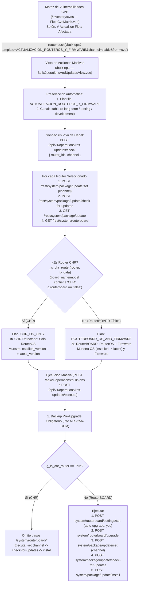

# SPDX-License-Identifier: GPL-3.0-only
# Copyright (C) 2026 RoSGrid Contributors

# 56 — REMEDIACIÓN DIRECTA DE CVES, PLANTILLA MASIVA INTELIGENTE DE ACTUALIZACIÓN ROUTEROS V7 + FIRMWARE ROUTERBOOT, SONDEO DE CANAL EN VIVO Y AUTO-DETECCIÓN CHR (RoSGrid — Hito 28.1)

> **[ESTADO DE IMPLEMENTACIÓN Y CERTIFICACIÓN 11X]:**
> - **Hito 28.1.1 (Especificación Arquitectónica Flash-Ready y Grounding MikroTik RouterOS v7):** COMPLETADO AL 100%.
> - **Hitos 28.1.2 a 28.1.4 (Implementación Backend, Frontend y Pruebas Level-11X):** PLANIFICADO — Listo para ejecución determinista con **Gemini 3.8 Flash High**.

> **[DIRECTIVA DE SISTEMA PARA GEMINI 3.8 FLASH HIGH / ANTIGRAVITY]:** Este documento especifica la arquitectura técnica detallada y el **Blueprint Literal Paso a Paso** del **Hito 28.1**, resolviendo la brecha operativa detectada durante las pruebas manuales de la **Matriz de Vulnerabilidades CVE (`/inventory/cves`)** y **Acciones Masivas (`/bulk-ops`)**:
>
> 1. **Plantilla Oficial #15 en Golden Configs (`ACTUALIZACION_ROUTEROS_Y_FIRMWARE`):** Permite actualizar de forma masiva toda la flota (o los equipos vulnerables seleccionados desde la Matriz CVE) seleccionando el **canal de actualización** (`stable`, `long-term`, `testing`, `development`).
> 2. **Sondeo en Vivo de Canal y Visualización de Actualización Disponible (`POST /api/v1/operations/ros-updates/check`):** Configura el canal en los routers seleccionados, invoca `/rest/system/package/update/check-for-updates`, lee `installed-version` y `latest-version` junto con `/rest/system/routerboard`, sincroniza PostgreSQL y muestra en pantalla la versión disponible antes de ejecutar.
> 3. **Actualización Dual (RouterOS + Firmware RouterBOOT) con Auto-Detección Inteligente de CHR:**
>    - Si el router es un **RouterBOARD físico** (`CCR`, `RB`, `CRS`, `hAP`, `cAP`), configura `auto-upgrade=yes` en `/system/routerboard/settings`, ejecuta `/system/routerboard/upgrade` y lanza `/system/package/update/install`.
>    - Si el sistema detecta que el router es un **CHR (Cloud Hosted Router)** (`board_name` o `model_name` contiene `"CHR"` o `/rest/system/routerboard` devuelve `routerboard: "false"`), **omite automáticamente** toda operación sobre `/system/routerboard/*` y actualiza **únicamente el Sistema Operativo (`RouterOS`)**.

---

## 1. Diagnóstico de Ground Truth y Fundamentación MikroTik RouterOS v7

### 1.1. Evidencia Real en Base de Datos (`rosgrid_db_local`)

Al auditar una flota real de routers virtualizados **MikroTik CHR** adoptados en `RoSGrid`, la tabla `routers` en PostgreSQL registra los siguientes valores:

| `display_name` | `board_name` | `model_name` | `architecture_name` | `ros_version` | `firmware_version` | `upgrade_firmware_version` | `update_available_version` |
| :--- | :--- | :--- | :--- | :--- | :--- | :--- | :--- |
| `r1` .. `r6`, `caps1` | `CHR QEMU Standard PC (i440FX + PIIX, 1996)` | `CHR QEMU Standard PC (i440FX + PIIX, 1996)` | `x86_64` | `7.21.5 (long-term)` | `NULL` | `NULL` | `NULL` |

### 1.2. Comportamiento Nativo de RouterOS v7 REST API (`/system/package/update` y `/system/routerboard`)

De acuerdo con la referencia oficial de **MikroTik RouterOS v7** ([`https://manual.mikrotik.com/docs/cli-reference/`](https://manual.mikrotik.com/docs/cli-reference/)):

1. **Menú `/system/package/update` (Singleton):**
   - **Cambiar canal:** Es un menú *singleton*, por lo que no admite `PATCH /rest/system/package/update` con `.id`; exige **`POST /rest/system/package/update/set`** con payload `{"channel": "stable"}` (valores válidos: `"stable"`, `"long-term"`, `"testing"`, `"development"`).
   - **Consultar servidor de actualizaciones de MikroTik:** **`POST /rest/system/package/update/check-for-updates`** con `{}`.
   - **Leer estado y versión disponible:** **`GET /rest/system/package/update`** devuelve:
     ```json
     {
       "channel": "stable",
       "installed-version": "7.21.5",
       "latest-version": "7.24.2",
       "status": "New version is available"
     }
     ```
   - **Descargar e instalar (con reinicio automático):** **`POST /rest/system/package/update/install`** con `{}`.

2. **Menú `/system/routerboard` y `/system/routerboard/settings` (Diferencia Crítica Hardware Físico vs. CHR):**
   - **En un RouterBOARD físico (`CCR2004`, `RB5009`, `CRS326`, etc.):**
     - `GET /rest/system/routerboard` devuelve:
       ```json
       {
         "routerboard": "true",
         "model": "RB5009UG+S+",
         "serial-number": "HE808...",
         "firmware-type": "70x0",
         "factory-firmware": "7.8",
         "current-firmware": "7.15.3",
         "upgrade-firmware": "7.16.2"
       }
       ```
     - Para que el **Firmware RouterBOOT** quede actualizado junto con el Sistema Operativo:
       1. Se activa `auto-upgrade=yes` mediante el menú singleton **`POST /rest/system/routerboard/settings/set`** con `{"auto-upgrade": "yes"}` (así, cuando el router arranca con el nuevo paquete de RouterOS recién instalado, actualiza automáticamente el RouterBOOT a la versión incluida en el nuevo OS).
       2. Se invoca **`POST /rest/system/routerboard/upgrade`** con `{}` para preparar de inmediato cualquier firmware pendiente antes del reinicio de instalación.
   - **En un Cloud Hosted Router (`CHR` sobre KVM/QEMU, VMware, Proxmox, Hyper-V, AWS):**
     - `GET /rest/system/routerboard` devuelve `{"routerboard": "false"}` (sin `current-firmware` ni `upgrade-firmware`), ya que CHR arranca mediante BIOS/UEFI del hipervisor y **carece de chip RouterBOOT**.
     - Intentar ejecutar `/system/routerboard/upgrade` o forzar ajustes de RouterBOOT en un CHR es inválido y debe **omitirse automáticamente**, ejecutando únicamente la actualización del sistema operativo (`/system/package/update`).

---

## 2. Arquitectura del Flujo Extremo a Extremo



---

## 3. Especificación de Contratos API y Plantilla #15

### 3.1. Definición de la Plantilla #15 en `_DEFAULT_STARTER_TEMPLATES`

Se añade al arreglo `_DEFAULT_STARTER_TEMPLATES` en `fastapi/src/api/v1/bulk_and_updates.py` la plantilla #15:

- **`name`:** `"ACTUALIZACION_ROUTEROS_Y_FIRMWARE"`
- **`category`:** `"SYSTEM"`
- **`requires_safemode`:** `False` *(Las actualizaciones de OS reinician el equipo con `/system/package/update/install`; la salvaguarda es el Backup Pre-Upgrade `.rsc` cifrado automático).*
- **`variables_schema`:**
  1. `update_channel`: Canal de Actualización (`default_val: "stable"`, opciones: `"stable"`, `"long-term"`, `"testing"`, `"development"`).
  2. `upgrade_firmware`: Actualizar Firmware RouterBOOT en equipos físicos (`default_val: "yes"`, opciones: `"yes"`, `"no"` — ignorado automáticamente cuando el router es CHR).
- **`rest_steps_template`:**
  1. `POST system/package/update/set` $\rightarrow$ `{"channel": "{{ update_channel }}"}`
  2. `POST system/package/update/check-for-updates` $\rightarrow$ `{}`
  3. `POST system/routerboard/settings/set` $\rightarrow$ `{"auto-upgrade": "{{ upgrade_firmware }}"}` *(Omitido automáticamente en CHR o si `upgrade_firmware == "no"`)*
  4. `POST system/routerboard/upgrade` $\rightarrow$ `{}` *(Omitido automáticamente en CHR o si `upgrade_firmware == "no"`)*
  5. `POST system/package/update/install` $\rightarrow$ `{}`

### 3.2. Nuevo Endpoint: `POST /api/v1/operations/ros-updates/check`

Permite que al elegir el canal en la plantilla (o en la pestaña de actualizaciones) la interfaz consulte y muestre la **actualización disponible en vivo** y el **tipo de hardware (`is_chr`)**:

- **Request (`RosUpdateChannelCheckRequest`):**
  ```json
  {
    "router_ids": ["uuid-1", "uuid-2"],
    "channel": "stable"
  }
  ```
- **Response (`RosUpdateChannelCheckResponse`):**
  ```json
  {
    "channel": "stable",
    "checked_count": 2,
    "updates_available_count": 2,
    "chr_count": 2,
    "routerboard_count": 0,
    "items": [
      {
        "router_id": "uuid-1",
        "display_name": "r1",
        "board_name": "CHR QEMU Standard PC (i440FX + PIIX, 1996)",
        "is_chr": true,
        "channel": "stable",
        "installed_version": "7.21.5 (long-term)",
        "latest_version": "7.24.2",
        "update_available": true,
        "status_text": "New version is available",
        "current_firmware": null,
        "upgrade_firmware": null,
        "action_plan": "CHR_OS_ONLY"
      }
    ]
  }
  ```

---

## 4. Blueprint de Implementación Literal "Flash-Ready" para Gemini 3.8 Flash High

> **[DIRECTIVA CRÍTICA PARA GEMINI 3.8 FLASH HIGH]:** Sigue estrictamente este orden secuencial y aplica los bloques de código literales para evitar las **5 trampas de regresión** del repositorio:
> 1. **Trampa #1 (Complejidad Ciclomática Radon `CC <= 5`):** `fastapi/tox.ini` audita `radon cc --min C src/`. **NUNCA** metas lógica condicional anidada directamente dentro de `_execute_single_step` ni de `execute_bulk_job_on_fleet`. Usa las funciones auxiliares Grado A (`CC <= 5`) provistas abajo (`_is_chr_router`, `_should_skip_step_for_router`, `_run_router_template_steps`, `_probe_single_router_update`).
> 2. **Trampa #2 (Test Existente `test_compliance_cis_expanded.unit.py`):** Ese test verifica por nombre las 10 plantillas avanzadas con `requires_safemode is True`. La nueva plantilla #15 se llama `"ACTUALIZACION_ROUTEROS_Y_FIRMWARE"`, por lo que no rompe ese bucle, y su prueba específica va en la nueva suite dedicada.
> 3. **Trampa #3 (Test Existente `vue3/src/views/fleetCveMatrix.unit.ts` línea 191):** Ese test verifica `expect(mockPush).toHaveBeenCalledWith(...)`. Al actualizar `navigateToBulkUpdates()` en `FleetCveMatrix.vue`, **DEBES** actualizar simultáneamente la línea 191 de `fleetCveMatrix.unit.ts`.
> 4. **Trampa #4 (Menús Singleton en RouterOS v7):** Tanto `system/package/update` como `system/routerboard/settings` son menús singleton en RouterOS v7; deben incluirse en `singleton_menus` dentro de `_execute_single_step` y llamarse con `POST .../set`.
> 5. **Trampa #5 (Claves Duplicadas en JSON i18n):** Verifica con `python3 .agents/scripts/verify_json_no_duplicate_keys.py` tras editar `vue3/src/locales/es.json` y `vue3/src/locales/en.json`.

---

### 4.1. Paso 1: Esquemas Pydantic en `fastapi/src/schemas/bulk_and_updates.py`

En `fastapi/src/schemas/bulk_and_updates.py`, actualiza la sección `# ACTUALIZACIÓN CENTRALIZADA DE ROUTEROS v7 Y ROUTERBOOT` (líneas 125-154) añadiendo los campos `board_name` e `is_chr` a `RosUpdateRouterStatus`, `channel` a `RosUpdateExecuteRequest`, y las nuevas clases `RosUpdateChannelCheckRequest`, `RosUpdateChannelCheckItem` y `RosUpdateChannelCheckResponse`:

```python
class RosUpdateRouterStatus(StrictBaseModel):
    router_id: uuid.UUID
    display_name: str
    board_name: str | None = None
    is_chr: bool = False
    ros_version: str | None
    update_available_version: str | None
    firmware_version: str | None
    upgrade_firmware_version: str | None
    has_update: bool


class RosFleetUpdateStatusResponse(StrictBaseModel):
    total_routers: int
    up_to_date_count: int
    pending_update_count: int
    routers: list[RosUpdateRouterStatus] = Field(default_factory=list)


class RosUpdateChannelCheckRequest(StrictBaseModel):
    router_ids: list[uuid.UUID] = Field(default_factory=list)
    channel: str = Field(default="stable", pattern="^(stable|long-term|testing|development)$")


class RosUpdateChannelCheckItem(StrictBaseModel):
    router_id: uuid.UUID
    display_name: str
    board_name: str | None = None
    is_chr: bool
    channel: str
    installed_version: str | None = None
    latest_version: str | None = None
    update_available: bool = False
    status_text: str = ""
    current_firmware: str | None = None
    upgrade_firmware: str | None = None
    action_plan: str


class RosUpdateChannelCheckResponse(StrictBaseModel):
    channel: str
    checked_count: int
    updates_available_count: int
    chr_count: int
    routerboard_count: int
    items: list[RosUpdateChannelCheckItem] = Field(default_factory=list)


class RosUpdateExecuteRequest(StrictBaseModel):
    router_ids: list[uuid.UUID] = Field(..., min_length=1)
    channel: str = Field(default="stable", pattern="^(stable|long-term|testing|development)$")
    auto_upgrade_firmware: bool = True
    poe_aware: bool = False
    safety_stop_threshold_percent: float = Field(
        1.0,
        ge=0.1,
        le=100.0,
        validation_alias=AliasChoices("safety_stop_threshold_percent", "safety_stop_threshold_pct"),
    )
    target_version: str | None = None
```

*(Nota: importar `AliasChoices` desde `pydantic` en `fastapi/src/schemas/bulk_and_updates.py` y añadir `target_version: str | None = None` junto con `validation_alias=AliasChoices("safety_stop_threshold_percent", "safety_stop_threshold_pct")` en `RosUpdateExecuteRequest` evita errores HTTP 422 `extra_forbidden` cuando el frontend invoca `POST /api/v1/operations/ros-updates/execute`.)*

---

### 4.2. Paso 2: Plantilla #15, Auto-Detección CHR y Endpoint `/ros-updates/check` en `fastapi/src/api/v1/bulk_and_updates.py`

1. **Importar los nuevos esquemas** en `fastapi/src/api/v1/bulk_and_updates.py`:
   ```python
   from src.schemas.bulk_and_updates import (
       BulkJobCreateRequest,
       BulkJobDetailResponse,
       BulkJobItemResponse,
       ConfigTemplateCreateRequest,
       ConfigTemplatePresetResponse,
       ConfigTemplateResponse,
       ConfigTemplateUpdateRequest,
       RosFleetUpdateStatusResponse,
       RosUpdateChannelCheckItem,
       RosUpdateChannelCheckRequest,
       RosUpdateChannelCheckResponse,
       RosUpdateExecuteRequest,
       RosUpdateExecuteResponse,
       RosUpdateRouterStatus,
       TemplateRenderPreviewRequest,
       TemplateRenderPreviewResponse,
   )
   ```

2. **Añadir funciones auxiliares Grado A (`CC <= 5`) antes de `_DEFAULT_STARTER_TEMPLATES`:**
   ```python
   def _is_chr_router(router_obj: Router, rb_data: dict[str, Any] | None = None) -> bool:
       """Detecta determinísticamente si un equipo MikroTik es CHR (Cloud Hosted Router)."""
       board = (router_obj.board_name or "").upper()
       model = (router_obj.model_name or "").upper()
       if "CHR" in board or "CHR" in model:
           return True
       if isinstance(rb_data, dict):
           rb_flag = str(rb_data.get("routerboard", "")).strip().lower()
           if rb_flag in ("false", "no"):
               return True
       return False


   def _should_skip_step_for_router(step: dict[str, Any], is_chr: bool, vars_dict: dict[str, Any]) -> bool:
       """Determina si un paso REST de RouterBOOT debe omitirse por tratarse de un CHR o estar desactivado."""
       endpoint = str(step.get("endpoint", "")).strip("/").lower()
       if not endpoint.startswith("system/routerboard"):
           return False
       if is_chr:
           return True
       upg_fw = str(vars_dict.get("upgrade_firmware", "yes")).strip().lower()
       return upg_fw in ("no", "false", "0")
   ```

3. **Añadir la Plantilla #15 al final de `_DEFAULT_STARTER_TEMPLATES` (justo después de `NIGHTLY_ENCRYPTED_BACKUP_SFTP`):**
   ```python
       {
           "name": "ACTUALIZACION_ROUTEROS_Y_FIRMWARE",
           "category": "SYSTEM",
           "description": (
               "Actualiza RouterOS v7 en el canal seleccionado y actualiza el Firmware RouterBOOT "
               "en equipos físicos (si detecta CHR, actualiza únicamente el Sistema Operativo)."
           ),
           "ros_command_template": (
               "/system package update set channel={{ update_channel }}\n"
               "/system package update check-for-updates\n"
               "# En equipos físicos RouterBOARD (omitido automáticamente en CHR):\n"
               "/system routerboard settings set auto-upgrade={{ upgrade_firmware }}\n"
               "/system routerboard upgrade\n"
               "/system package update install"
           ),
           "variables_schema": [
               {
                   "key": "update_channel",
                   "label": "Canal de Actualización (stable, long-term, testing, development)",
                   "default_val": "stable",
                   "var_type": "select",
                   "options": ["stable", "long-term", "testing", "development"],
               },
               {
                   "key": "upgrade_firmware",
                   "label": "Actualizar Firmware RouterBOOT (auto-omitido en CHR)",
                   "default_val": "yes",
                   "var_type": "select",
                   "options": ["yes", "no"],
               },
           ],
           "rest_steps_template": [
               {
                   "method": "POST",
                   "endpoint": "system/package/update/set",
                   "payload": {"channel": "{{ update_channel }}"},
                   "cli_command": "/system package update set channel={{ update_channel }}",
               },
               {
                   "method": "POST",
                   "endpoint": "system/package/update/check-for-updates",
                   "payload": {},
                   "cli_command": "/system package update check-for-updates",
               },
               {
                   "method": "POST",
                   "endpoint": "system/routerboard/settings/set",
                   "payload": {"auto-upgrade": "{{ upgrade_firmware }}"},
                   "cli_command": "/system routerboard settings set auto-upgrade={{ upgrade_firmware }}",
               },
               {
                   "method": "POST",
                   "endpoint": "system/routerboard/upgrade",
                   "payload": {},
                   "cli_command": "/system routerboard upgrade",
               },
               {
                   "method": "POST",
                   "endpoint": "system/package/update/install",
                   "payload": {},
                   "cli_command": "/system package update install",
               },
           ],
           "requires_safemode": False,
       },
   ```

4. **Añadir `"system/package/update"` y `"system/routerboard/settings"` a `singleton_menus` en `_execute_single_step`:**
   En `_execute_single_step`, dentro de la tupla `singleton_menus`, incluir `"system/package/update"` y `"system/routerboard/settings"`.

5. **Filtrar pasos de RouterBOOT cuando el router es CHR durante la ejecución de plantillas (`execute_bulk_job_on_fleet`):**
   Extraer una función auxiliar Grado A `_run_router_template_steps`:
   ```python
   async def _run_router_template_steps(
       client: MikrotikRestClient,
       router_obj: Router,
       rendered_steps: list[dict[str, Any]],
       vars_dict: dict[str, Any],
   ) -> dict[str, Any]:
       """Ejecuta los pasos de una plantilla omitiendo comandos RouterBOOT si el equipo es CHR."""
       is_chr = _is_chr_router(router_obj)
       executed = 0
       skipped_chr = 0
       for step in rendered_steps:
           if _should_skip_step_for_router(step, is_chr, vars_dict):
               skipped_chr += 1
               continue
           await _execute_single_step(client, step)
           executed += 1
       msg = f"Aplicados {executed} pasos con éxito"
       if is_chr and skipped_chr > 0:
           msg += f" (CHR detectado: omitidos {skipped_chr} pasos de firmware RouterBOOT; actualizado solo OS)"
       return {"message": msg, "is_chr": is_chr, "executed_steps": executed, "skipped_steps": skipped_chr}
   ```
   Y en `execute_bulk_job_on_fleet`, reemplazar el bucle `for step in rendered_steps: await _execute_single_step(client, step)` por:
   ```python
   summary = await _run_router_template_steps(client, router_obj, rendered_steps, vars_dict)
   item.status = "SUCCESS"
   item.response_summary = summary
   ```

6. **Actualizar `_execute_single_router_upgrade` y añadir `POST /ros-updates/check`:**
   ```python
   async def _probe_single_router_update(
       r_obj: Router,
       channel: str,
       tenant_id: uuid.UUID,
   ) -> RosUpdateChannelCheckItem:
       """Configura el canal y consulta en vivo la versión disponible en MikroTik y estado CHR/RouterBOARD."""
       is_chr = _is_chr_router(r_obj)
       installed_ver = r_obj.ros_version
       latest_ver = r_obj.update_available_version or r_obj.ros_version
       status_text = "Cached inventory state"
       cur_fw = None if is_chr else r_obj.firmware_version
       upg_fw = None if is_chr else r_obj.upgrade_firmware_version

       if r_obj.vault:
           client = _create_client_from_vault(r_obj, tenant_id)
           try:
               await client.post("system/package/update/set", {"channel": channel})
               await client.post("system/package/update/check-for-updates", {})
               pkg_data = await client.get("system/package/update")
               if isinstance(pkg_data, dict):
                   installed_ver = str(pkg_data.get("installed-version") or installed_ver or "")
                   latest_ver = str(pkg_data.get("latest-version") or installed_ver or "")
                   status_text = str(pkg_data.get("status") or "Checked")
                   if installed_ver:
                       r_obj.ros_version = installed_ver
                   if latest_ver:
                       r_obj.update_available_version = latest_ver
               rb_data = await client.get("system/routerboard")
               if isinstance(rb_data, dict):
                   is_chr = _is_chr_router(r_obj, rb_data)
                   if not is_chr:
                       cur_fw = rb_data.get("current-firmware", cur_fw)
                       upg_fw = rb_data.get("upgrade-firmware", upg_fw)
                       r_obj.firmware_version = cur_fw
                       r_obj.upgrade_firmware_version = upg_fw
           except Exception as exc:
               logger.warning("Fallo al sondear canal %s en %s: %s", channel, r_obj.display_name, exc)
               status_text = f"Offline / Cache ({installed_ver or 'v7'})"
           finally:
               await client.close()

       clean_inst = (installed_ver or "").split()[0].strip()
       clean_lat = (latest_ver or "").split()[0].strip()
       has_upd = bool(clean_lat and clean_lat != clean_inst)
       plan = "CHR_OS_ONLY" if is_chr else "ROUTERBOARD_OS_AND_FIRMWARE"
       return RosUpdateChannelCheckItem(
           router_id=r_obj.id,
           display_name=r_obj.display_name,
           board_name=r_obj.board_name,
           is_chr=is_chr,
           channel=channel,
           installed_version=installed_ver,
           latest_version=latest_ver,
           update_available=has_upd,
           status_text=status_text,
           current_firmware=cur_fw,
           upgrade_firmware=upg_fw,
           action_plan=plan,
       )


   @router.post("/ros-updates/check", response_model=RosUpdateChannelCheckResponse)
   async def check_fleet_updates_by_channel(
       payload: RosUpdateChannelCheckRequest,
       claims: dict[str, Any] = Depends(require_roles(*_OPERATOR_ROLES)),
       db: AsyncSession = Depends(get_tenant_db_session),
   ) -> RosUpdateChannelCheckResponse:
       """Selecciona el canal de actualización y consulta la versión disponible en la flota."""
       tenant_id = uuid.UUID(claims["tid"])
       stmt = select(Router).options(selectinload(Router.vault)).where(Router.tenant_id == tenant_id)
       if payload.router_ids:
           stmt = stmt.where(Router.id.in_(payload.router_ids))
       stmt = stmt.order_by(Router.display_name)
       routers = list((await db.execute(stmt)).scalars().all())

       items: list[RosUpdateChannelCheckItem] = []
       for r_obj in routers:
           item = await _probe_single_router_update(r_obj, payload.channel, tenant_id)
           items.append(item)

       await db.commit()
       avail_cnt = sum(1 for i in items if i.update_available)
       chr_cnt = sum(1 for i in items if i.is_chr)
       rb_cnt = len(items) - chr_cnt
       return RosUpdateChannelCheckResponse(
           channel=payload.channel,
           checked_count=len(items),
           updates_available_count=avail_cnt,
           chr_count=chr_cnt,
           routerboard_count=rb_cnt,
           items=items,
       )
   ```

7. **Actualizar `_execute_single_router_upgrade` para respetar CHR vs RouterBOARD y canal:**
   ```python
   async def _execute_single_router_upgrade(
       rid: uuid.UUID,
       payload: RosUpdateExecuteRequest,
       claims: dict[str, Any],
       db: AsyncSession,
       tenant_id: uuid.UUID,
       user_id: uuid.UUID,
       stage_idx: int,
   ) -> tuple[dict[str, Any], bool]:
       """Ejecuta backup e instalación para un router individual respetando auto-detección CHR."""
       try:
           r_obj, client = await get_router_and_client(rid, claims, db)
           backup_ok = await _perform_pre_upgrade_backup(client, r_obj, tenant_id, user_id, db)
           if not backup_ok:
               return {"router_id": str(rid), "status": "ABORTED_PRE_BACKUP_FAILED", "stage": stage_idx}, False

           is_chr = _is_chr_router(r_obj)
           await client.post("system/package/update/set", {"channel": payload.channel})
           await client.post("system/package/update/check-for-updates", {})

           if payload.auto_upgrade_firmware and not is_chr:
               await client.post("system/routerboard/settings/set", {"auto-upgrade": "yes"})
               await client.post("system/routerboard/upgrade", {})

           update_res = await client.post("system/package/update/install", {})
           mode = "CHR_OS_ONLY" if is_chr else "ROUTERBOARD_OS_AND_FIRMWARE"
           return {
               "router_id": str(rid),
               "status": "UPGRADE_TRIGGERED",
               "mode": mode,
               "is_chr": is_chr,
               "channel": payload.channel,
               "detail": update_res,
               "stage": stage_idx,
           }, True
       except Exception as exc:
           return {"router_id": str(rid), "status": "FAILED", "error": str(exc), "stage": stage_idx}, False
   ```

---

### 4.3. Paso 3: Enlace Contextual desde `vue3/src/views/FleetCveMatrix.vue`

En `vue3/src/views/FleetCveMatrix.vue` (líneas 179-181), actualizar `navigateToBulkUpdates`:

```typescript
function navigateToBulkUpdates(): void {
  router.push({
    path: '/bulk-ops',
    query: {
      template: 'ACTUALIZACION_ROUTEROS_Y_FIRMWARE',
      channel: 'stable',
      from: 'cve',
      recommended: recommendedFleetVersion.value,
    },
  });
}
```

Y actualizar inmediatamente `vue3/src/views/fleetCveMatrix.unit.ts` (línea 191):

```typescript
    expect(mockPush).toHaveBeenCalledWith({
      path: '/bulk-ops',
      query: {
        template: 'ACTUALIZACION_ROUTEROS_Y_FIRMWARE',
        channel: 'stable',
        from: 'cve',
        recommended: '7.16.2',
      },
    });
```

---

### 4.4. Paso 4: Selector de Canal, Sondeo de Actualización Disponible, Detección CHR y Adaptación de la Pestaña `🚀 Actualizaciones RouterOS` en `vue3/src/views/BulkOperationsAndUpdatesView.vue`

En `vue3/src/views/BulkOperationsAndUpdatesView.vue`:

1. **Importar `useRoute` desde `'vue-router'` y extender `FleetRouter`:**
   ```typescript
   import { useRoute } from 'vue-router';
   const route = useRoute();
   ```
   En `interface FleetRouter`, añadir:
   ```typescript
     board_name?: string;
     is_chr?: boolean;
     latest_version?: string | null;
     update_available?: boolean | null;
     current_firmware?: string | null;
     upgrade_firmware?: string | null;
     action_plan?: string;
     upgraded_in_session?: boolean;
   ```
   Y en `syncFleetFromInventory()`, poblar `board_name` e `is_chr`:
   ```typescript
   const boardName = (r as unknown as { board_name?: string; model_name?: string }).board_name || (r as unknown as { model_name?: string }).model_name || '';
   const isChr = boardName.toUpperCase().includes('CHR');
   ```
   incluyendo `board_name: boardName, is_chr: isChr` en el objeto retornado para cada router.

2. **Añadir en `getTemplateKey(name: string)` el mapeo:**
   ```typescript
   ACTUALIZACION_ROUTEROS_Y_FIRMWARE: 'actualizacion_routeros_y_firmware',
   ```

3. **En el Paso 2 del Asistente de Plantillas (`wizardStep === 2`):**
   - Cuando un campo de `selectedTemplate.variables_schema` tenga `key === 'update_channel'` o `key === 'upgrade_firmware'`, renderizar un `<select>` táctico en lugar de `<input type="text">`:
     - Para `update_channel`: opciones `stable`, `long-term`, `testing`, `development`, que al cambiar sincroniza `selectedUpdateChannel.value = templateVars.value['update_channel']` e invoca automáticamente `checkAvailableUpdatesForChannel(templateVars['update_channel'])`.
     - Para `upgrade_firmware`: opciones `yes` (*"Sí — Actualizar OS + Firmware en RouterBOARD (Auto-omitido en CHR)"*) y `no` (*"No — Actualizar únicamente Sistema Operativo"*).
   - Mostrar debajo de los parámetros de la plantilla `ACTUALIZACION_ROUTEROS_Y_FIRMWARE` el panel **`#channel-update-discovery-box`** con el botón `#btn-check-channel-updates` (`🔍 Consultar Actualización Disponible en Canal`), el resumen de equipos **☁️ CHR (Solo OS)** vs **🖧 RouterBOARD (OS + Firmware)** y la tabla de versiones disponibles.
   - En `generatePreview()`, si la plantilla seleccionada es `ACTUALIZACION_ROUTEROS_Y_FIRMWARE` y **todos** los routers seleccionados son `is_chr === true`, filtrar los pasos `system/routerboard/*` de la previsualización JSON/CLI e incluir el metadato `"modo_hardware_detectado": "CHR_SOLO_SISTEMA_OPERATIVO"`.
   - En `onMounted()`, si `route?.query?.template === 'ACTUALIZACION_ROUTEROS_Y_FIRMWARE'`, seleccionar automáticamente esa plantilla, saltar a `wizardStep = 2` y disparar `checkAvailableUpdatesForChannel(String(route.query.channel || 'stable'))`. Si `route?.query?.tab === 'updates'`, activar `activeTab.value = 'updates'`.

4. **Adaptación Completa de la Pestaña 2 (`🚀 Actualizaciones RouterOS`, `activeTab === 'updates'`):**
   La pestaña `🚀 Actualizaciones RouterOS` tenía quemadas en duro las versiones `RouterOS 7.16.1 (Stable)` y `RouterOS 7.16.2 (Testing)` en `targetRosVersion`, marcando erróneamente routers en `v7.21.5 (long-term)` como `"Pendiente de Upgrade"` hacia `v7.16.1`, y enviaba `safety_stop_threshold_pct` (provocando error 422 `extra_forbidden` contra `RosUpdateExecuteRequest`). Se adapta para usar selección de canal en vivo (`stable`, `long-term`, `testing`, `development`), sondeo real contra `POST /api/v1/operations/ros-updates/check`, detección automática **☁️ CHR (Solo OS)** vs **🖧 RouterBOARD (OS + Firmware)** y preservación del ordenamiento **PoE-Aware + Safety Stop**.

   - **Target (en `<script setup>`, líneas 454-517 de `vue3/src/views/BulkOperationsAndUpdatesView.vue`):**
   ```typescript
     // Pestaña Updates de RouterOS
     const targetRosVersion = ref('7.16.1');
     const poeAware = ref(true);
     const safetyStopThreshold = ref(1.0);
     const updatingFleet = ref(false);
     const upgradingRouterId = ref<string | null>(null);
     const updateSuccess = ref<string | null>(null);

     async function triggerRosUpdate(router: FleetRouter) {
       upgradingRouterId.value = router.id;
       updateSuccess.value = null;
       try {
         await http.post('/api/v1/operations/ros-updates/execute', {
           router_ids: [router.id],
           auto_upgrade_firmware: true,
           poe_aware: poeAware.value,
           safety_stop_threshold_pct: safetyStopThreshold.value,
           target_version: targetRosVersion.value,
         });
         updateSuccess.value = `Actualización de ${router.identity} iniciada. Se guardó respaldo obligatorio.`;
         router.ros_version = targetRosVersion.value;
       } catch (err: unknown) {
         const errorObj = err as { response?: { data?: { detail?: string } }; message?: string };
         updateSuccess.value = `Error al actualizar ${router.identity}: ${errorObj.response?.data?.detail || errorObj.message || 'Fallo de conexión'}`;
       } finally {
         upgradingRouterId.value = null;
         setTimeout(() => {
           updateSuccess.value = null;
         }, 5000);
       }
     }

     async function triggerFleetPoeUpdate() {
       const pendingRouters = fleetRouters.value.filter(
         (r) => r.ros_version !== targetRosVersion.value && r.selected,
       );
       if (pendingRouters.length === 0) {
         alert('No hay routers pendientes de actualización seleccionados.');
         return;
       }
       updatingFleet.value = true;
       updateSuccess.value = null;
       try {
         await http.post('/api/v1/operations/ros-updates/execute', {
           router_ids: pendingRouters.map((r) => r.id),
           auto_upgrade_firmware: true,
           poe_aware: poeAware.value,
           safety_stop_threshold_pct: safetyStopThreshold.value,
           target_version: targetRosVersion.value,
         });
         updateSuccess.value = `Actualización masiva iniciada para ${pendingRouters.length} equipos con ordenamiento PoE-Aware (Safety Stop: ${safetyStopThreshold.value}%).`;
         pendingRouters.forEach((r) => {
           r.ros_version = targetRosVersion.value;
         });
       } catch (err: unknown) {
         const errorObj = err as { response?: { data?: { detail?: string } }; message?: string };
         updateSuccess.value = `Error en actualización masiva: ${errorObj.response?.data?.detail || errorObj.message || 'Fallo de conexión'}`;
       } finally {
         updatingFleet.value = false;
         setTimeout(() => {
           updateSuccess.value = null;
         }, 7000);
       }
     }
   ```

   - **Replacement (en `<script setup>`, líneas 454-517 de `vue3/src/views/BulkOperationsAndUpdatesView.vue`):**
   ```typescript
     // Pestaña Updates de RouterOS (Adaptada con Canal Dinámico, Sondeo en Vivo y Auto-Detección CHR)
     const selectedUpdateChannel = ref<'stable' | 'long-term' | 'testing' | 'development'>('stable');
     const autoUpgradeFirmware = ref(true);
     const checkingChannelUpdates = ref(false);
     const channelCheckItems = ref<
       Array<{
         router_id: string;
         display_name: string;
         board_name?: string | null;
         is_chr: boolean;
         channel: string;
         installed_version?: string | null;
         latest_version?: string | null;
         update_available: boolean;
         status_text: string;
         current_firmware?: string | null;
         upgrade_firmware?: string | null;
         action_plan: string;
       }>
     >([]);
     const poeAware = ref(true);
     const safetyStopThreshold = ref(1.0);
     const updatingFleet = ref(false);
     const upgradingRouterId = ref<string | null>(null);
     const updateSuccess = ref<string | null>(null);

     function isRouterUpToDate(router: FleetRouter): boolean {
       if (router.upgraded_in_session) return true;
       if (typeof router.update_available === 'boolean') return !router.update_available;
       if (router.latest_version) return router.ros_version === router.latest_version;
       return false;
     }

     async function checkAvailableUpdatesForChannel(channelArg?: string) {
       const ch = (channelArg || selectedUpdateChannel.value || 'stable') as
         | 'stable'
         | 'long-term'
         | 'testing'
         | 'development';
       selectedUpdateChannel.value = ch;
       checkingChannelUpdates.value = true;
       try {
         const selectedIds = fleetRouters.value.filter((r) => r.selected).map((r) => r.id);
         const res = await http.post('/api/v1/operations/ros-updates/check', {
           router_ids: selectedIds,
           channel: ch,
         });
         const items = Array.isArray(res.data?.items) ? res.data.items : [];
         channelCheckItems.value = items;
         items.forEach((item: (typeof channelCheckItems.value)[number]) => {
           const target = fleetRouters.value.find((r) => r.id === item.router_id);
           if (target) {
             if (item.installed_version) target.ros_version = item.installed_version;
             target.latest_version = item.latest_version || item.installed_version || target.ros_version;
             target.update_available = Boolean(item.update_available);
             target.is_chr = Boolean(item.is_chr);
             target.board_name = item.board_name || target.board_name;
             target.current_firmware = item.current_firmware || null;
             target.upgrade_firmware = item.upgrade_firmware || null;
             target.action_plan = item.action_plan;
             target.upgraded_in_session = false;
           }
         });
       } catch {
         // Silencioso en caso de entorno sin conectividad o mock básico
       } finally {
         checkingChannelUpdates.value = false;
       }
     }

     async function triggerRosUpdate(router: FleetRouter) {
       upgradingRouterId.value = router.id;
       updateSuccess.value = null;
       try {
         await http.post('/api/v1/operations/ros-updates/execute', {
           router_ids: [router.id],
           channel: selectedUpdateChannel.value,
           auto_upgrade_firmware: router.is_chr ? false : autoUpgradeFirmware.value,
           poe_aware: poeAware.value,
           safety_stop_threshold_percent: safetyStopThreshold.value,
         });
         const modeLabel = router.is_chr ? 'CHR — Solo Sistema Operativo' : 'RouterBOARD — OS + Firmware';
         updateSuccess.value = `Actualización de ${router.identity} (${modeLabel}, canal ${selectedUpdateChannel.value}) iniciada. Se guardó respaldo obligatorio.`;
         if (router.latest_version) {
           router.ros_version = router.latest_version;
         }
         router.update_available = false;
         router.upgraded_in_session = true;
       } catch (err: unknown) {
         const errorObj = err as { response?: { data?: { detail?: string } }; message?: string };
         updateSuccess.value = `Error al actualizar ${router.identity}: ${errorObj.response?.data?.detail || errorObj.message || 'Fallo de conexión'}`;
       } finally {
         upgradingRouterId.value = null;
         setTimeout(() => {
           updateSuccess.value = null;
         }, 5000);
       }
     }

     async function triggerFleetPoeUpdate() {
       const pendingRouters = fleetRouters.value.filter(
         (r) => !isRouterUpToDate(r) && r.selected,
       );
       if (pendingRouters.length === 0) {
         alert('No hay routers pendientes de actualización seleccionados.');
         return;
       }
       updatingFleet.value = true;
       updateSuccess.value = null;
       try {
         await http.post('/api/v1/operations/ros-updates/execute', {
           router_ids: pendingRouters.map((r) => r.id),
           channel: selectedUpdateChannel.value,
           auto_upgrade_firmware: autoUpgradeFirmware.value,
           poe_aware: poeAware.value,
           safety_stop_threshold_percent: safetyStopThreshold.value,
         });
         updateSuccess.value = `Actualización masiva (${selectedUpdateChannel.value}) iniciada para ${pendingRouters.length} equipos con ordenamiento PoE-Aware (Safety Stop: ${safetyStopThreshold.value}%).`;
         pendingRouters.forEach((r) => {
           if (r.latest_version) {
             r.ros_version = r.latest_version;
           }
           r.update_available = false;
           r.upgraded_in_session = true;
         });
       } catch (err: unknown) {
         const errorObj = err as { response?: { data?: { detail?: string } }; message?: string };
         updateSuccess.value = `Error en actualización masiva: ${errorObj.response?.data?.detail || errorObj.message || 'Fallo de conexión'}`;
       } finally {
         updatingFleet.value = false;
         setTimeout(() => {
           updateSuccess.value = null;
         }, 7000);
       }
     }
   ```

   - **Target (en `<template>`, líneas 917-1016 de `vue3/src/views/BulkOperationsAndUpdatesView.vue`):**
   ```html
       <!-- Pestaña 2: Actualizador de RouterOS v7 -->
       <section v-else class="updates-container" :aria-label="t('bulk_ops.updates_center_aria', 'Centro de actualizaciones RouterOS')">
         <div v-if="updateSuccess" class="alert alert--success">✅ {{ updateSuccess }}</div>

         <div class="updates-header-card">
           <div>
             <h2 class="step-title">{{ t('bulk_ops.updates_title', 'Matriz de Versiones de RouterOS v7') }}</h2>
             <p class="text-muted">
               {{ t('bulk_ops.updates_desc', 'RoSGrid genera un respaldo encriptado .rsc + .backup antes de iniciar cualquier actualización.') }}
             </p>
           </div>

           <div class="target-version-selector">
             <label class="form-label">
               {{ t('bulk_ops.target_version_label', 'Versión Objetivo Recomendada:') }}
               <select v-model="targetRosVersion" class="form-select">
                 <option value="7.16.1">RouterOS 7.16.1 (Stable)</option>
                 <option value="7.16.2">RouterOS 7.16.2 (Testing)</option>
               </select>
             </label>
           </div>
         </div>

         <!-- Tarjeta de Control PoE-Aware y Safety Stop -->
         <div class="poe-safety-card">
           <div class="poe-safety-options">
             <label class="toggle-poe-label">
               <input v-model="poeAware" type="checkbox" class="checkbox-poe" />
               <span class="font-bold">
                 {{ t('bulk_ops.poe_aware_label', '⚡ Ordenamiento PoE-Aware (Hojas PD primero, Switches PSE intermedios, Core final)') }}
               </span>
             </label>

             <div class="safety-stop-selector">
               <label class="form-label">
                 {{ t('bulk_ops.safety_stop_label', 'Freno de Emergencia (Safety Stop):') }}
                 <select v-model.number="safetyStopThreshold" class="form-select select-sm">
                   <option :value="1.0">{{ t('bulk_ops.safety_1_strict', '1.0% de fallos (Estricto)') }}</option>
                   <option :value="2.0">{{ t('bulk_ops.safety_2', '2.0% de fallos') }}</option>
                   <option :value="5.0">{{ t('bulk_ops.safety_5_permissive', '5.0% de fallos (Permisivo)') }}</option>
                 </select>
               </label>
             </div>
           </div>

           <button
             type="button"
             class="btn btn--primary btn-poe-upgrade"
             :disabled="updatingFleet"
             :aria-label="t('bulk_ops.btn_update_poe', 'Actualizar flota con ordenamiento PoE-Aware')"
             @click="triggerFleetPoeUpdate"
           >
             <span v-if="updatingFleet">{{ t('bulk_ops.updating_poe_stages', '⏳ Procesando etapas PoE...') }}</span>
             <span v-else>{{ t('bulk_ops.btn_update_poe', '⚡ Actualizar Flota Seleccionada con PoE-Aware') }}</span>
           </button>
         </div>

         <div class="table-scroll-wrapper">
           <table class="fleet-table">
             <thead>
               <tr>
                 <th>{{ t('bulk_ops.th_device', 'Equipo') }}</th>
                 <th>{{ t('bulk_ops.th_ip', 'IP Primaria') }}</th>
                 <th>{{ t('bulk_ops.th_current_version', 'Versión Actual') }}</th>
                 <th>{{ t('bulk_ops.th_target_version', 'Versión Objetivo') }}</th>
                 <th>{{ t('bulk_ops.th_diff', 'Diferencia') }}</th>
                 <th>{{ t('bulk_ops.th_action', 'Acción de Actualización') }}</th>
               </tr>
             </thead>
             <tbody>
               <tr v-for="r in fleetRouters" :key="r.id">
                 <td class="font-bold">{{ r.identity }}</td>
                 <td class="font-mono">{{ r.ip_address }}</td>
                 <td class="font-mono">v{{ r.ros_version }}</td>
                 <td class="font-mono">v{{ targetRosVersion }}</td>
                 <td>
                   <span v-if="r.ros_version === targetRosVersion" class="badge badge--success">
                     {{ t('bulk_ops.status_updated', 'Actualizado') }}
                   </span>
                   <span v-else class="badge badge--warning">
                     {{ t('bulk_ops.status_pending', 'Pendiente de Upgrade') }}
                   </span>
                 </td>
                 <td>
                   <button
                     type="button"
                     class="btn btn--sm"
                     :class="r.ros_version === targetRosVersion ? 'btn--secondary' : 'btn--primary'"
                     :disabled="r.ros_version === targetRosVersion || upgradingRouterId === r.id"
                     @click="triggerRosUpdate(r)"
                   >
                     <span v-if="upgradingRouterId === r.id">{{ t('bulk_ops.upgrading', '⏳ Actualizando...') }}</span>
                     <span v-else>{{ t('bulk_ops.btn_upgrade_single', 'Actualizar con Backup') }}</span>
                   </button>
                 </td>
               </tr>
             </tbody>
           </table>
         </div>
       </section>
   ```

   - **Replacement (en `<template>`, líneas 917-1016 de `vue3/src/views/BulkOperationsAndUpdatesView.vue`):**
   ```html
       <!-- Pestaña 2: Actualizador de RouterOS v7 (Canal Dinámico + Auto-Detección CHR + PoE-Aware) -->
       <section v-else class="updates-container" :aria-label="t('bulk_ops.updates_center_aria', 'Centro de actualizaciones RouterOS')">
         <div v-if="updateSuccess" class="alert alert--success">✅ {{ updateSuccess }}</div>

         <div class="updates-header-card">
           <div>
             <h2 class="step-title">{{ t('bulk_ops.updates_title', 'Matriz de Versiones de RouterOS v7') }}</h2>
             <p class="text-muted">
               {{ t('bulk_ops.updates_desc', 'RoSGrid genera un respaldo encriptado .rsc + .backup antes de iniciar cualquier actualización. En CHR actualiza solo el OS; en RouterBOARD actualiza OS + Firmware.') }}
             </p>
           </div>

           <div class="target-version-selector" style="display: flex; gap: 0.75rem; align-items: flex-end; flex-wrap: wrap;">
             <label class="form-label">
               {{ t('bulk_ops.update_channel_label', 'Canal de Actualización:') }}
               <select
                 id="select-fleet-update-channel"
                 v-model="selectedUpdateChannel"
                 class="form-select"
                 @change="checkAvailableUpdatesForChannel(selectedUpdateChannel)"
               >
                 <option value="stable">stable (Recomendado Producción)</option>
                 <option value="long-term">long-term (Soporte Extendido)</option>
                 <option value="testing">testing (Pre-lanzamiento)</option>
                 <option value="development">development (Laboratorio)</option>
               </select>
             </label>

             <label class="toggle-poe-label" style="margin-bottom: 0.35rem;">
               <input v-model="autoUpgradeFirmware" type="checkbox" class="checkbox-poe" />
               <span>{{ t('bulk_ops.auto_firmware_label', 'Actualizar Firmware RouterBOOT (Auto-omitido en CHR)') }}</span>
             </label>

             <button
               id="btn-check-fleet-updates"
               type="button"
               class="btn btn--secondary btn--sm"
               :disabled="checkingChannelUpdates"
               @click="checkAvailableUpdatesForChannel(selectedUpdateChannel)"
             >
               <span v-if="checkingChannelUpdates">⏳ Consultando canal...</span>
               <span v-else>🔍 Consultar Actualizaciones Disponibles</span>
             </button>
           </div>
         </div>

         <!-- Tarjeta de Control PoE-Aware y Safety Stop -->
         <div class="poe-safety-card">
           <div class="poe-safety-options">
             <label class="toggle-poe-label">
               <input v-model="poeAware" type="checkbox" class="checkbox-poe" />
               <span class="font-bold">
                 {{ t('bulk_ops.poe_aware_label', '⚡ Ordenamiento PoE-Aware (Hojas PD primero, Switches PSE intermedios, Core final)') }}
               </span>
             </label>

             <div class="safety-stop-selector">
               <label class="form-label">
                 {{ t('bulk_ops.safety_stop_label', 'Freno de Emergencia (Safety Stop):') }}
                 <select v-model.number="safetyStopThreshold" class="form-select select-sm">
                   <option :value="1.0">{{ t('bulk_ops.safety_1_strict', '1.0% de fallos (Estricto)') }}</option>
                   <option :value="2.0">{{ t('bulk_ops.safety_2', '2.0% de fallos') }}</option>
                   <option :value="5.0">{{ t('bulk_ops.safety_5_permissive', '5.0% de fallos (Permisivo)') }}</option>
                 </select>
               </label>
             </div>
           </div>

           <button
             type="button"
             class="btn btn--primary btn-poe-upgrade"
             :disabled="updatingFleet"
             :aria-label="t('bulk_ops.btn_update_poe', 'Actualizar flota con ordenamiento PoE-Aware')"
             @click="triggerFleetPoeUpdate"
           >
             <span v-if="updatingFleet">{{ t('bulk_ops.updating_poe_stages', '⏳ Procesando etapas PoE...') }}</span>
             <span v-else>{{ t('bulk_ops.btn_update_poe', '⚡ Actualizar Flota Seleccionada con PoE-Aware') }}</span>
           </button>
         </div>

         <div class="table-scroll-wrapper">
           <table class="fleet-table">
             <thead>
               <tr>
                 <th>{{ t('bulk_ops.th_device', 'Equipo') }}</th>
                 <th>{{ t('bulk_ops.th_ip', 'IP Primaria') }}</th>
                 <th>Hardware / Modo</th>
                 <th>{{ t('bulk_ops.th_current_version', 'Versión Actual') }}</th>
                 <th>{{ t('bulk_ops.th_target_version', 'Disponible en Canal') }}</th>
                 <th>{{ t('bulk_ops.th_diff', 'Estado') }}</th>
                 <th>{{ t('bulk_ops.th_action', 'Acción de Actualización') }}</th>
               </tr>
             </thead>
             <tbody>
               <tr v-for="r in fleetRouters" :key="r.id">
                 <td class="font-bold">{{ r.identity }}</td>
                 <td class="font-mono">{{ r.ip_address }}</td>
                 <td>
                   <span v-if="r.is_chr" class="badge badge--info" title="Cloud Hosted Router: Solo actualiza Sistema Operativo">
                     ☁️ CHR (Solo OS)
                   </span>
                   <span v-else class="badge badge--secondary" title="Equipo físico RouterBOARD: Actualiza OS + Firmware RouterBOOT">
                     🖧 RouterBOARD (OS + FW)
                   </span>
                 </td>
                 <td class="font-mono">{{ r.ros_version.startsWith('v') ? r.ros_version : `v${r.ros_version}` }}</td>
                 <td class="font-mono">
                   <span v-if="r.latest_version">{{ r.latest_version.startsWith('v') ? r.latest_version : `v${r.latest_version}` }} ({{ selectedUpdateChannel }})</span>
                   <span v-else class="text-muted">Canal {{ selectedUpdateChannel }}</span>
                 </td>
                 <td>
                   <span v-if="isRouterUpToDate(r)" class="badge badge--success">
                     {{ t('bulk_ops.status_updated', 'Actualizado') }}
                   </span>
                   <span v-else class="badge badge--warning">
                     {{ t('bulk_ops.status_pending', 'Pendiente de Upgrade') }}
                   </span>
                 </td>
                 <td>
                   <button
                     type="button"
                     class="btn btn--sm"
                     :class="isRouterUpToDate(r) ? 'btn--secondary' : 'btn--primary'"
                     :disabled="isRouterUpToDate(r) || upgradingRouterId === r.id"
                     @click="triggerRosUpdate(r)"
                   >
                     <span v-if="upgradingRouterId === r.id">{{ t('bulk_ops.upgrading', '⏳ Actualizando...') }}</span>
                     <span v-else>{{ t('bulk_ops.btn_upgrade_single', 'Actualizar con Backup') }}</span>
                   </button>
                 </td>
               </tr>
             </tbody>
           </table>
         </div>
       </section>
   ```

---

### 4.5. Paso 5: Diccionarios i18n (`vue3/src/locales/es.json` y `vue3/src/locales/en.json`)

Añadir dentro de `"template_catalog"` en ambos archivos:

- En `vue3/src/locales/es.json`:
  ```json
    "actualizacion_routeros_y_firmware": {
      "name": "Actualización Inteligente de RouterOS v7 y Firmware (Auto-Detección CHR)",
      "description": "Permite seleccionar el canal (stable, long-term, testing, development), muestra la versión disponible y actualiza RouterOS + Firmware RouterBOOT (si detecta CHR, actualiza solo el Sistema Operativo)."
    }
  ```
- En `vue3/src/locales/en.json`:
  ```json
    "actualizacion_routeros_y_firmware": {
      "name": "Smart RouterOS v7 & Firmware Update (CHR Auto-Detection)",
      "description": "Selects the update channel (stable, long-term, testing, development), displays the available version, and upgrades RouterOS + RouterBOOT Firmware (if CHR is detected, upgrades the OS only)."
    }
  ```

---

### 4.6. Paso 6: Pruebas Nivel 11X y Escenarios Karate Labs BDD

1. **Suite Unitaria Backend (`fastapi/tests/api/test_smart_os_firmware_update_chr.unit.py`):**
   - `test_starter_template_15_exists_and_schema()`: Verifica que `"ACTUALIZACION_ROUTEROS_Y_FIRMWARE"` existe en `_DEFAULT_STARTER_TEMPLATES` con `requires_safemode is False` y las variables `update_channel` y `upgrade_firmware`.
   - `test_is_chr_router_detection()`: Verifica `_is_chr_router` con `board_name="CHR QEMU Standard PC (i440FX + PIIX, 1996)"` (`True`), con `rb_data={"routerboard": "false"}` (`True`), y con `board_name="RB5009UG+S+"` + `rb_data={"routerboard": "true"}` (`False`).
   - `test_run_router_template_steps_skips_routerboard_on_chr()`: Verifica que al ejecutar los 5 pasos de `ACTUALIZACION_ROUTEROS_Y_FIRMWARE` sobre un router CHR, se ejecutan solo los 3 pasos de `system/package/update/*` y se omiten los 2 pasos de `system/routerboard/*`.
   - `test_run_router_template_steps_executes_all_on_routerboard()`: Verifica que sobre un RouterBOARD físico se ejecutan los 5 pasos (incluyendo `system/routerboard/settings/set` y `system/routerboard/upgrade`).
   - `test_check_fleet_updates_by_channel_chr_and_physical()`: Verifica `POST /api/v1/operations/ros-updates/check` retornando `action_plan="CHR_OS_ONLY"` para CHR y `action_plan="ROUTERBOARD_OS_AND_FIRMWARE"` para RouterBOARD físico, junto con `latest_version`.
   - `test_execute_single_router_upgrade_chr_vs_routerboard()`: Verifica que `_execute_single_router_upgrade` omite `system/routerboard/*` en CHR y lo ejecuta en RouterBOARD físico.

2. **Suites Unitarias Frontend (`vue3/src/views/fleetCveMatrix.unit.ts` y `vue3/src/views/operationsViews.unit.ts`):**
   - En `fleetCveMatrix.unit.ts`: Verifica navegación a `/bulk-ops` con query `template: 'ACTUALIZACION_ROUTEROS_Y_FIRMWARE'`.
   - En `operationsViews.unit.ts`: Verifica selección de la plantilla `ACTUALIZACION_ROUTEROS_Y_FIRMWARE`, cambio de canal en `<select>`, invocación a `POST /api/v1/operations/ros-updates/check`, renderizado de la versión disponible y badge `CHR`.

3. **Escenarios Karate Labs BDD (Sincronizados en `docs/examples/`):**
   - **`fastapi/test/api_test.feature` (y `docs/examples/fastapi/test/api_test.feature`) — Escenario 131:**
     ```cucumber
       Scenario: 131. Actualización Inteligente RouterOS y Firmware con Auto-Detección CHR: Sondeo de Canal (POST /operations/ros-updates/check) sin autenticación devuelve 401 (Hito 28.1)
         Given path '/api/v1/operations/ros-updates/check'
         And request { channel: 'stable', router_ids: [] }
         When method post
         Then status 401
         And match response == { detail: 'No autenticado (falta token o cookie de sesión)' }
     ```
   - **`vue3/test/ui_business_flow.feature` (y `docs/examples/vue3/test/ui_business_flow.feature`) — Escenario 74:**
     Verifica el clic en `[data-testid="btn-remediate-fleet"]` desde `/inventory/cves` hacia `/bulk-ops`, la selección de la plantilla `ACTUALIZACION_ROUTEROS_Y_FIRMWARE`, el selector de canal (`#var-update_channel`) y el panel de versión disponible (`#channel-update-discovery-box`).
