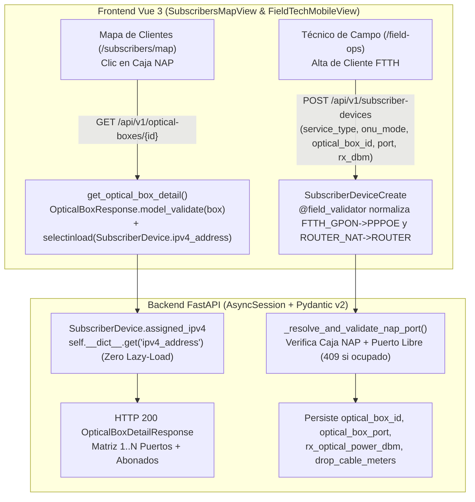

# SPDX-License-Identifier: GPL-3.0-only
# Copyright (C) 2026 RoSGrid Contributors

# Especificación 57: Corrección de Serialización Asíncrona (`MissingGreenlet`) en Detalle de Cajas NAP (`/subscribers/map`) y Contrato de Registro FTTH en Técnico de Campo (`/field-ops`) — Hito 28.2

> **🤖 DIRECTIVA DE EJECUCIÓN PARA GEMINI 3.8 FLASH HIGH (FLASH-READY SPEC):**
> Esta especificación contiene **bloques de código literales (`Target` / `Replacement`)**, rutas exactas de archivos y contratos cerrados listos para ser aplicados sin ambigüedad cuando se ejecute el lote de implementación del **Hito 28**.
> - **Cero Alucinaciones:** Respeta los nombres exactos de modelos SQLAlchemy (`OpticalBox`, `SubscriberDevice`), esquemas Pydantic (`OpticalBoxResponse`, `OpticalBoxDetailResponse`, `SubscriberDeviceCreate`, `CustomerServiceTypeEnum`, `ONUModeEnum`) y tiendas Pinia (`useFieldOpsStore`).
> - **Complejidad Ciclomática Radon Grado A:** Toda función Python nueva o modificada DEBE mantener `CC <= 5` (idealmente `<= 4`). Extrae helpers pequeños (`_normalize_service_type_alias`, `_normalize_onu_mode_alias`, `_resolve_and_validate_nap_port`) para mantener código plano.
> - **Paridad 11X:** Al implementar este cambio junto con el resto del Hito 28, ejecuta las pruebas en contenedores Docker efímeros (`Rule Zero`) y sincroniza los escenarios Karate Labs BDD con `docs/examples/`.

---

## 1. Contexto Operativo y Diagnóstico de Causa Raíz (Hallazgos UAT)

Durante las pruebas manuales de aceptación (UAT) sobre el entorno productivo local (`http://localhost:8085`), se detectaron dos errores críticos en el flujo FTTH / ISP:

### 1.1 Bug A: `⚠️ Error al cargar detalles de la Caja NAP` en Mapa de Clientes (`/subscribers/map`)

Al seleccionar o hacer clic sobre una Caja NAP (ej. `PRUEBA1`) en `/subscribers/map`, el frontend invoca `GET /api/v1/optical-boxes/{box_id}` y recibe un **HTTP 500 Internal Server Error**:

```text
File "/app/src/api/v1/optical_boxes.py", line 217, in get_optical_box_detail
  detail = OpticalBoxDetailResponse.model_validate(box)
pydantic_core._pydantic_core.ValidationError: 1 validation error for OpticalBoxDetailResponse
subscribers
  Error extracting attribute: MissingGreenlet: greenlet_spawn has not been called; can't call await_() here.
```

* **Causa Raíz 1 (`OpticalBox.subscribers` lazy-load en `AsyncSession`):**
  En `fastapi/src/api/v1/optical_boxes.py` (`get_optical_box_detail`), `stmt_box = select(OpticalBox).where(...)` carga la entidad `OpticalBox` en una sesión asíncrona sin `selectinload(OpticalBox.subscribers)`. En la línea 217 se llama a `OpticalBoxDetailResponse.model_validate(box)`. Dado que `OpticalBoxDetailResponse` hereda `ConfigDict(from_attributes=True)` y declara `subscribers: list[SubscriberDeviceResponse] = []`, Pydantic V2 intenta leer `box.subscribers` desde el objeto ORM, disparando una carga perezosa síncrona (`MissingGreenlet`) antes de llegar a la línea 221 (`detail.subscribers = sub_responses`).
* **Causa Raíz 2 (`SubscriberDevice.assigned_ipv4` lazy-load en `AsyncSession`):**
  En `fastapi/src/models/ipam.py` (líneas 364–370), el `@property def assigned_ipv4(self)` evalúa `if self.ipv4_address ...`. Cuando una instancia `SubscriberDevice` proviene de una consulta `AsyncSession` sin `selectinload(SubscriberDevice.ipv4_address)` (o tras `await db.refresh(device)`), acceder a `self.ipv4_address` dispara igualmente `MissingGreenlet`.

### 1.2 Bug B: `⚠️ Los datos proporcionados no cumplen con los requisitos de validación.` al Registrar Cliente FTTH (`/field-ops`)

En el **Panel del Técnico de Campo FTTH** (`/field-ops`, pestaña `🔌 Registrar Nuevo Cliente FTTH`), al pulsar el botón de registro, la petición `POST /api/v1/subscriber-devices` falla **siempre** con **HTTP 422 Unprocessable Content** sin importar los valores ingresados:

* **Causa Raíz 1 (`service_type: 'FTTH_GPON'` fuera de `CustomerServiceTypeEnum`):**
  En `vue3/src/components/field/FieldTechMobileView.vue` (línea 246), `handleRegisterCustomer()` envía fijo `service_type: 'FTTH_GPON'`. Sin embargo, `CustomerServiceTypeEnum` (`fastapi/src/models/ipam.py`, líneas 61–64) solo admite `'PPPOE'`, `'DHCP'` y `'STATIC'`. Pydantic rechaza la petición con HTTP 422, que `httpClient.ts` traduce como `Los datos proporcionados no cumplen con los requisitos de validación.`.
* **Causa Raíz 2 (`onu_mode: 'ROUTER_NAT'` fuera de `ONUModeEnum`):**
  En `FieldTechMobileView.vue` (línea 770), el `<select id="cust-onu-mode">` envía `value="ROUTER_NAT"` para el modo Router, pero `ONUModeEnum` (`fastapi/src/models/ipam.py`, líneas 72–75) solo admite `'ROUTER'`, `'BRIDGE'` y `'UNKNOWN'`.
* **Causa Raíz 3 (Omisión de persistencia de campos FTTH y RBAC en `create_subscriber_device`):**
  En `fastapi/src/api/v1/subscribers.py` (`create_subscriber_device`, líneas 655–724):
  1. No incluye `SystemRoleEnum.FIELD_TECH` en `require_roles(...)`.
  2. Aunque `SubscriberDeviceCreate` define `optical_box_id`, `optical_box_port`, `rx_optical_power_dbm` y `drop_cable_meters`, el constructor `SubscriberDevice(...)` en las líneas 689–708 **no los asignaba**, dejando al cliente huérfano de la Caja NAP y del puerto seleccionado.
  3. No validaba que `(optical_box_id, optical_box_port)` estuviera libre (`HTTP 409 Conflict` si el puerto ya está ocupado) ni autocompletaba `optical_box = box.box_code`.

---

## 2. Arquitectura de la Solución



---

## 3. Plan de Implementación Paso a Paso (Flash-Ready Blueprint)

### Paso 1: Blindaje Async-Safe en `SubscriberDevice.assigned_ipv4` (`fastapi/src/models/ipam.py`)

En `fastapi/src/models/ipam.py` (alrededor de las líneas 364–375), reemplaza la propiedad `assigned_ipv4` para que inspeccione `self.__dict__.get("ipv4_address")` en lugar de disparar un lazy-load síncrono sobre `self.ipv4_address` cuando la relación no fue pre-cargada:

```python
    @property
    def assigned_ipv4(self) -> Optional[str]:
        if hasattr(self, "_assigned_ipv4_cache") and self._assigned_ipv4_cache:
            return self._assigned_ipv4_cache
        ip_obj = self.__dict__.get("ipv4_address")
        if ip_obj is not None and getattr(ip_obj, "address", None):
            return str(ip_obj.address).split("/")[0]
        return None
```

---

### Paso 2: Validadores de Normalización FTTH en `SubscriberDeviceCreate` y `SubscriberDeviceUpdate` (`fastapi/src/schemas/ipam.py`)

En `fastapi/src/schemas/ipam.py`, añade las funciones auxiliares de normalización (todas con `CC <= 4`) y los `@field_validator` en `SubscriberDeviceCreate` y `SubscriberDeviceUpdate` para aceptar tanto los valores canónicos (`PPPOE`, `DHCP`, `STATIC`, `BRIDGE`, `ROUTER`) como los alias tácticos de campo (`FTTH_GPON`, `FTTH_PPPOE`, `FTTH_DHCP`, `ROUTER_NAT`):

```python
def _normalize_service_type_input(val: Any) -> Any:
    """Normaliza alias operativos FTTH hacia valores canónicos de CustomerServiceTypeEnum."""
    if not isinstance(val, str):
        return val
    upper_val = val.strip().upper()
    alias_map = {
        "FTTH_GPON": CustomerServiceTypeEnum.PPPOE.value,
        "FTTH_PPPOE": CustomerServiceTypeEnum.PPPOE.value,
        "GPON": CustomerServiceTypeEnum.PPPOE.value,
        "FTTH_DHCP": CustomerServiceTypeEnum.DHCP.value,
        "IPOE": CustomerServiceTypeEnum.DHCP.value,
    }
    return alias_map.get(upper_val, upper_val)


def _normalize_onu_mode_input(val: Any) -> Any:
    """Normaliza alias operativos de modo ONU hacia valores canónicos de ONUModeEnum."""
    if not isinstance(val, str):
        return val
    upper_val = val.strip().upper()
    alias_map = {
        "ROUTER_NAT": ONUModeEnum.ROUTER.value,
        "NAT": ONUModeEnum.ROUTER.value,
        "ONT_ROUTER": ONUModeEnum.ROUTER.value,
        "ONU_BRIDGE": ONUModeEnum.BRIDGE.value,
    }
    return alias_map.get(upper_val, upper_val)
```

Y dentro de `SubscriberDeviceCreate` y `SubscriberDeviceUpdate` añade:

```python
    @field_validator("service_type", mode="before")
    @classmethod
    def normalize_service_type(cls, v: Any) -> Any:
        return _normalize_service_type_input(v)

    @field_validator("onu_mode", mode="before")
    @classmethod
    def normalize_onu_mode(cls, v: Any) -> Any:
        return _normalize_onu_mode_input(v)
```

---

### Paso 3: Eliminación de `MissingGreenlet` en `get_optical_box_detail` (`fastapi/src/api/v1/optical_boxes.py`)

En `fastapi/src/api/v1/optical_boxes.py`:
1. Importa `selectinload` desde `sqlalchemy.orm`.
2. En `get_optical_box_detail` (líneas 172–222):
   - Añade `.options(selectinload(SubscriberDevice.ipv4_address))` a `stmt_subs`.
   - En lugar de llamar a `OpticalBoxDetailResponse.model_validate(box)` (que intenta leer `box.subscribers` en el modelo ORM y lanza `MissingGreenlet`), serializa primero `base_box = OpticalBoxResponse.model_validate(box)` y construye `OpticalBoxDetailResponse` a partir de `base_box.model_dump()`:

```python
    # Obtener suscriptores conectados con relación IPv4 pre-cargada
    stmt_subs = (
        select(SubscriberDevice)
        .options(selectinload(SubscriberDevice.ipv4_address))
        .where(
            SubscriberDevice.tenant_id == tenant_id,
            SubscriberDevice.optical_box_id == box_id,
        )
        .order_by(SubscriberDevice.optical_box_port.asc().nulls_last())
    )
    subs = list((await db.execute(stmt_subs)).scalars().all())
```

Y en las líneas 213–222 reemplaza la construcción de `detail` por:

```python
    sub_responses = [SubscriberDeviceResponse.model_validate(s) for s in subs]
    occupied_count = len(port_map)
    available_count = max(0, box.capacity_ports - occupied_count)

    base_data = OpticalBoxResponse.model_validate(box).model_dump()
    base_data["occupied_ports_count"] = occupied_count
    base_data["available_ports_count"] = available_count
    return OpticalBoxDetailResponse(
        **base_data,
        ports=ports,
        subscribers=sub_responses,
    )
```

---

### Paso 4: Persistencia Completa FTTH, Validación de Puerto NAP y Rol `FIELD_TECH` en `subscribers.py` (`fastapi/src/api/v1/subscribers.py`)

En `fastapi/src/api/v1/subscribers.py`:
1. Importa `selectinload` desde `sqlalchemy.orm` y `OpticalBox` desde `src.models.ipam`.
2. Añade `.options(selectinload(SubscriberDevice.ipv4_address))` en `list_subscriber_devices` y `get_subscriber_device`.
3. Crea un helper `_resolve_and_validate_nap_port` (con `CC <= 4`) para validar la Caja NAP y verificar que el puerto no esté ocupado:

```python
async def _resolve_and_validate_nap_port(
    db: AsyncSession,
    tenant_id: uuid.UUID,
    optical_box_id: Optional[uuid.UUID],
    optical_box_port: Optional[int],
    fallback_box_code: Optional[str],
) -> Optional[str]:
    """Valida existencia de la Caja NAP, rango/disponibilidad del puerto y retorna el box_code."""
    if not optical_box_id:
        return fallback_box_code

    stmt_box = select(OpticalBox).where(OpticalBox.id == optical_box_id, OpticalBox.tenant_id == tenant_id)
    box = (await db.execute(stmt_box)).scalar_one_or_none()
    if not box:
        raise HTTPException(status_code=status.HTTP_404_NOT_FOUND, detail="Caja NAP seleccionada no encontrada")

    if optical_box_port is not None:
        if optical_box_port < 1 or optical_box_port > box.capacity_ports:
            raise HTTPException(
                status_code=status.HTTP_422_UNPROCESSABLE_ENTITY,
                detail=f"El puerto {optical_box_port} excede la capacidad de la caja ({box.capacity_ports} puertos)",
            )
        stmt_occ = select(SubscriberDevice).where(
            SubscriberDevice.optical_box_id == optical_box_id,
            SubscriberDevice.optical_box_port == optical_box_port,
        )
        if (await db.execute(stmt_occ)).scalar_one_or_none():
            raise HTTPException(
                status_code=status.HTTP_409_CONFLICT,
                detail=f"El Puerto {optical_box_port} de la Caja NAP {box.box_code} ya se encuentra ocupado",
            )
    return fallback_box_code or box.box_code
```

4. Actualiza `create_subscriber_device` (`POST /api/v1/subscriber-devices`) para:
   - Incluir `SystemRoleEnum.FIELD_TECH` en `require_roles(...)`.
   - Llamar a `resolved_box_code = await _resolve_and_validate_nap_port(db, tenant_id, payload.optical_box_id, payload.optical_box_port, payload.optical_box)`.
   - Persistir `optical_box=resolved_box_code`, `optical_box_id=payload.optical_box_id`, `optical_box_port=payload.optical_box_port`, `rx_optical_power_dbm=payload.rx_optical_power_dbm`, `drop_cable_meters=payload.drop_cable_meters` e `is_custom_coordinates=payload.is_custom_coordinates` (o `True` cuando se proveen coordenadas de domicilio desde campo).

```python
@subscribers_router.post("", response_model=SubscriberDeviceResponse, status_code=status.HTTP_201_CREATED)
async def create_subscriber_device(
    payload: SubscriberDeviceCreate,
    db: AsyncSession = Depends(get_tenant_db_session),
    claims: dict[str, Any] = Depends(
        require_roles(
            SystemRoleEnum.SUPERADMIN_GLOBAL,
            SystemRoleEnum.TENANT_ADMIN,
            SystemRoleEnum.NOC_MONITOR,
            SystemRoleEnum.FIELD_TECH,
        )
    ),
) -> SubscriberDevice:
    tenant_id = get_tenant_id(claims)

    stmt_r = select(Router).where(Router.id == payload.router_id, Router.tenant_id == tenant_id)
    if not (await db.execute(stmt_r)).scalar_one_or_none():
        raise HTTPException(status_code=status.HTTP_404_NOT_FOUND, detail="Router no encontrado")

    ep_id = payload.endpoint_identifier or payload.pppoe_username or f"SUB-{uuid.uuid4().hex[:8].upper()}"
    serial = payload.device_serial or payload.onu_serial_number

    stmt_check = select(SubscriberDevice).where(
        SubscriberDevice.router_id == payload.router_id,
        SubscriberDevice.endpoint_identifier == ep_id,
    )
    if (await db.execute(stmt_check)).scalar_one_or_none():
        raise HTTPException(
            status_code=status.HTTP_409_CONFLICT,
            detail=f"El identificador de endpoint '{ep_id}' ya está registrado en este router",
        )

    resolved_box_code = await _resolve_and_validate_nap_port(
        db=db,
        tenant_id=tenant_id,
        optical_box_id=payload.optical_box_id,
        optical_box_port=payload.optical_box_port,
        fallback_box_code=payload.optical_box,
    )

    device = SubscriberDevice(
        tenant_id=tenant_id,
        router_id=payload.router_id,
        endpoint_identifier=ep_id,
        service_type=payload.service_type,
        auth_backend=payload.auth_backend,
        bandwidth_profile_id=payload.bandwidth_profile_id,
        ipv4_address_id=payload.ipv4_address_id,
        ipv6_delegated_prefix=payload.ipv6_delegated_prefix,
        onu_mode=payload.onu_mode,
        onu_mac_address=payload.onu_mac_address,
        device_serial=serial,
        cpe_wifi_mac_address=payload.cpe_wifi_mac_address,
        pon_port=payload.pon_port,
        optical_box=resolved_box_code,
        optical_box_id=payload.optical_box_id,
        optical_box_port=payload.optical_box_port,
        rx_optical_power_dbm=payload.rx_optical_power_dbm,
        drop_cable_meters=payload.drop_cable_meters,
        is_custom_coordinates=payload.is_custom_coordinates or (payload.latitude is not None and payload.longitude is not None),
        latitude=payload.latitude,
        longitude=payload.longitude,
        status=CustomerServiceStatusEnum.ACTIVE if payload.optical_box_id else CustomerServiceStatusEnum.PENDING_INSTALL,
        last_reachability_status="ONLINE",
    )
    db.add(device)
    await db.commit()
    await db.refresh(device)

    await write_audit_log(
        session=db,
        tenant_id=tenant_id,
        actor_user_id=uuid.UUID(str(claims["sub"])),
        actor_username=str(claims.get("username", "system")),
        actor_role=claims.get("rol"),
        actor_ip="127.0.0.1",
        event_category="NETWORK",
        event_action="CREATE_SUBSCRIBER_DEVICE",
        after_state={
            "endpoint_identifier": device.endpoint_identifier,
            "router_id": str(device.router_id),
            "optical_box": device.optical_box,
            "optical_box_port": device.optical_box_port,
        },
    )
    return device
```

---

### Paso 5: Alineación del Formulario FTTH y Matriz de Puertos en Vivo (`vue3/src/components/field/FieldTechMobileView.vue`)

En `vue3/src/components/field/FieldTechMobileView.vue`:
1. Importa `watch` desde `'vue'`.
2. Añade un watcher sobre `customerForm.value.optical_box_id` para consultar el detalle de puertos ocupados (`fieldStore.fetchOpticalBoxDetail(boxId)`) y preseleccionar automáticamente el primer puerto libre:

```ts
  watch(
    () => customerForm.value.optical_box_id,
    async (boxId) => {
      if (!boxId) return;
      try {
        const detail = await fieldStore.fetchOpticalBoxDetail(boxId);
        const firstFree = detail.ports?.find((p) => !p.is_occupied);
        if (firstFree) {
          customerForm.value.optical_box_port = firstFree.port_number;
        }
      } catch {
        // Fallback silencioso si la consulta de detalle falla en modo offline
      }
    },
  );

  function isNapPortOccupied(portNumber: number): boolean {
    const detail = fieldStore.selectedOpticalBox;
    if (!detail || detail.id !== customerForm.value.optical_box_id) return false;
    return Boolean(detail.ports?.some((p) => p.port_number === portNumber && p.is_occupied));
  }
```

3. En `handleRegisterCustomer()` (líneas 242–265):
   - Envía `service_type: customerForm.value.onu_mode === 'BRIDGE' ? 'PPPOE' : 'DHCP'` y `onu_mode: customerForm.value.onu_mode === 'BRIDGE' ? 'BRIDGE' : 'ROUTER'`.
   - Tras registrar el cliente, refresca `fieldStore.fetchOpticalBoxes()` y `fieldStore.fetchOpticalBoxDetail(customerForm.value.optical_box_id)` para que el contador de puertos ocupados se actualice de inmediato.
4. En el selector `#cust-onu-mode` (líneas 768–771), cambia `value="ROUTER_NAT"` a `value="ROUTER"`:

```html
                    <select id="cust-onu-mode" v-model="customerForm.onu_mode" class="rg-input">
                      <option value="BRIDGE">{{ t('field_tech.onu_mode_bridge') }}</option>
                      <option value="ROUTER">{{ t('field_tech.onu_mode_router') }}</option>
                    </select>
```

5. En la matriz de puertos (`nap-matrix-preview`, líneas 880–892), muestra visualmente los puertos ocupados (`.occupied`) y su estado:

```html
                    <button
                      v-for="p in selectedNapBox.capacity_ports"
                      :key="p"
                      type="button"
                      :disabled="isNapPortOccupied(p)"
                      :class="[
                        'port-btn',
                        {
                          selected: customerForm.optical_box_port === p,
                          occupied: isNapPortOccupied(p),
                        },
                      ]"
                      :title="isNapPortOccupied(p) ? `Puerto ${p} ocupado` : `Seleccionar Puerto ${p}`"
                      @click="customerForm.optical_box_port = p"
                    >
                      <span class="port-num">{{ p }}</span>
                    </button>
```

---

## 4. Aseguramiento de Calidad Level-11X (Pytest, Vitest y Karate Labs BDD)

1. **Pruebas Unitarias Backend (`fastapi/tests/api/test_optical_boxes_and_bimodal_ops.unit.py` y `fastapi/tests/api/test_subscribers.unit.py`):**
   - Simular en `test_optical_boxes_crud_lifecycle` un objeto `OpticalBox` cuyo acceso a `.subscribers` lance `RuntimeError("MissingGreenlet simulated")` si se accede directamente, certificando que `get_optical_box_detail` construye `OpticalBoxDetailResponse` vía `OpticalBoxResponse` sin tocar `box.subscribers`.
   - Probar en `test_subscribers.unit.py` el alta de cliente FTTH (`POST /api/v1/subscriber-devices`) enviando `service_type="FTTH_GPON"`, `onu_mode="ROUTER_NAT"`, `optical_box_id`, `optical_box_port=3` y `rx_optical_power_dbm=-19.2`, verificando `HTTP 201 Created`, persistencia de `optical_box_port == 3`, `rx_optical_power_dbm` y rechazo `HTTP 409 Conflict` al intentar registrar un segundo abonado en el mismo `optical_box_port=3`.
2. **Pruebas Unitarias Frontend (`vue3/src/components/field/FieldTechMobileView.unit.ts`):**
   - Añadir test unitario que complete y envíe el formulario de `#tab-btn-customer` (`#cust-service-id`, `#cust-nap-select`, `#cust-port-select`, `#cust-onu-serial`, `#cust-rx-power`), verificando que `fieldStore.registerSubscriberDevice` sea llamado con `optical_box_id`, `optical_box_port`, `rx_optical_power_dbm` y cambie automáticamente a la pestaña `diagnostics`.
3. **Escenarios BDD Karate Labs (`fastapi/test/api_test.feature`, `vue3/test/ui_business_flow.feature` y réplicas en `docs/examples/`):**
   - Incorporar escenario de consulta de detalle de Caja NAP (`GET /api/v1/optical-boxes/{id}`) y registro de abonado FTTH con validación de puerto NAP ocupado.
