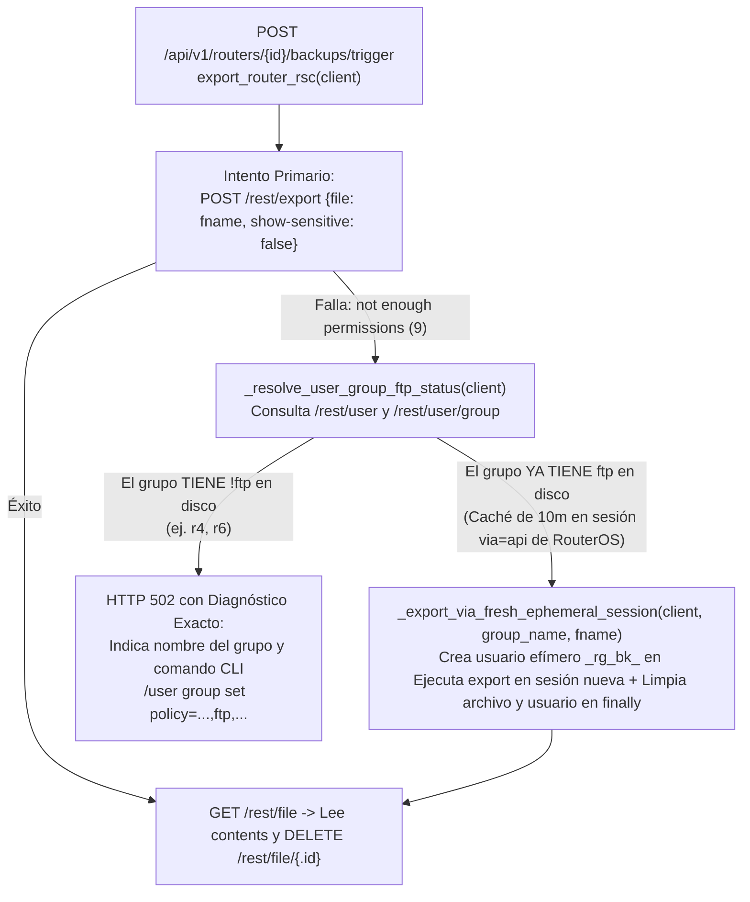

# SPDX-License-Identifier: GPL-3.0-only
# Copyright (C) 2026 RoSGrid Contributors

# Especificación 58: Bypass Automático de Caché de Sesión RouterOS v7 (10m) en Respaldos `.rsc`, Diagnóstico Exacto de Política `ftp` y Paridad Documental de `/user/group` — Hito 28.3

**Estado:** ✅ Completado y Certificado al 100% en Hito 28  
**Hito Asociado:** Hito 28.3 (`ROADMAP.md`)  
**Fecha de Certificación:** Noviembre 2026  

> **🤖 DIRECTIVA DE EJECUCIÓN PARA GEMINI 3.8 FLASH HIGH (FLASH-READY SPEC):**
> Esta especificación contiene **bloques de código literales (`Target` / `Replacement`)**, rutas exactas de archivos y contratos cerrados listos para ser aplicados sin ambigüedad cuando se ejecute el lote de implementación del **Hito 28**.
> - **Cero Alucinaciones:** Respeta los nombres exactos de funciones y clases en `fastapi/src/api/v1/backups.py` (`export_router_rsc`, `MikrotikRestClient`, `clean_rsc_export_comments`), `vue3/src/data/helpCatalog.ts` y los 6 archivos de documentación.
> - **Complejidad Ciclomática Radon Grado A:** Toda función Python nueva o modificada DEBE mantener `CC <= 5` (idealmente `<= 4`). Extrae helpers pequeños (`_read_and_cleanup_rsc_file`, `_resolve_user_group_ftp_status`, `_export_via_fresh_ephemeral_session`) para mantener código plano.
> - **Paridad 11X:** Al implementar este cambio junto con el resto del Hito 28, ejecuta las pruebas en contenedores Docker efímeros (`Rule Zero`) y sincroniza los escenarios Karate Labs BDD con `docs/examples/`.

---

## 1. Contexto Operativo y Diagnóstico Forense (Hallazgo UAT en `/backups`)

Durante las pruebas manuales de aceptación (UAT) en la vista **Historial de Respaldos & Comparador de Diferencias** (`http://localhost:8085/backups`), al pulsar **`+ Crear Backup Ahora`** sobre el router `caps1 (10.250.3.20)` se presentó el error:

```text
⚠️ El router no devolvió configuración o no tiene permisos de exportación (requiere política 'ftp' en MikroTik).
```

El operador se conectó por WinBox al router `caps1`, habilitó el permiso `ftp` en el grupo `rosgrid-api-group`, volvió a intentar crear el respaldo y **siguió recibiendo exactamente el mismo error durante 10 minutos**, además de observar que en la documentación oficial de RoSGrid el comando de creación del grupo `rosgrid-api-group` no incluía el permiso `ftp`.

### 1.1 Causa Raíz 1: Caché de Permisos de 10 Minutos en Sesiones `via=api` de RouterOS v7 (`www-ssl`)

Al inspeccionar `/rest/user`, `/rest/user/group` y `/rest/user/active` en `caps1`:
1. Cuando `rosgrid_agent` realiza una petición HTTP REST (`https://<ip>/rest/...`), el demonio `www-ssl` de MikroTik RouterOS v7 abre una sub-sesión interna persistente en `/user/active` (`via="rest-api"` + `via="api"`) con `inactivity-timeout=10m` (600 segundos).
2. RouterOS v7 **congela en memoria RAM la máscara de políticas (`!ftp`)** de esa sesión interna `via="api"` en el instante en que se crea (`18:39:05 UTC`).
3. Si el administrador entra por WinBox segúndos después (`18:39:34 UTC`) y activa `ftp` en `/user/group`, RouterOS v7 **no actualiza la máscara de permisos de la sesión `via="api"` ya abierta** hasta que se cumple la rotación de 10 minutos (`18:49:05 UTC`). Durante esos 10 minutos, `/rest/export` con `file=...` sigue respondiendo `RouterOS REST API Error [500]: not enough permissions (9)` para `rosgrid_agent`, mientras que cualquier sesión nueva creada en el mismo grupo `rosgrid-api-group` ya tiene el permiso `ftp` activo de inmediato.

### 1.2 Causa Raíz 2: Omisión de la Política `ftp` en los Comandos de Preparación de RouterOS v7 en la Documentación

En **6 archivos de documentación** (`README.md`, `docs/INSTALL.md`, `docs/FAQ.md`, `docs/02_PREPARACION_MIKROTIK_ROUTEROS_V7.md`, `docs/MANUAL_ADMINISTRADOR_E_INSTALADOR.md`, `docs/specs/08_MIKROTIK_REST_V7_CLIENT_TOFU_AND_SAFEMODE.md`) y en el catálogo de ayuda contextual (`vue3/src/data/helpCatalog.ts`), el comando canónico para crear `rosgrid-api-group` omitía `ftp`:

```routeros
# Incorrecto (sin ftp -> falla /export file=... y /system/backup/save con error 500 not enough permissions (9))
/user group add name=rosgrid-api-group policy=api,rest-api,read,write,test,reboot,policy,sensitive

# Correcto (con ftp habilitado)
/user group add name=rosgrid-api-group policy=api,rest-api,read,write,ftp,test,reboot,policy,sensitive
```

---

## 2. Arquitectura de la Solución



---

## 3. Plan de Implementación Paso a Paso (Flash-Ready Blueprint)

### Paso 1: Bypass Automático de Caché de Sesión (10m) y Diagnóstico Exacto de Grupo en `backups.py` (`fastapi/src/api/v1/backups.py`)

En `fastapi/src/api/v1/backups.py`, reemplaza la función `export_router_rsc` (líneas 75–108) por el conjunto de funciones modulares con complejidad ciclomática Radon Grado A (`CC <= 4` en cada función):

#### `Target` en `fastapi/src/api/v1/backups.py` (líneas 75–108):

```python
async def export_router_rsc(client: MikrotikRestClient) -> str:
    """Exporta configuración completa del router leyendo el archivo temporal .rsc y limpiándolo."""
    fname = f"rosgrid_bk_{uuid.uuid4().hex[:8]}"
    raw_text = ""
    try:
        await client.post("export", json_data={"file": fname, "show-sensitive": "false"})
        await asyncio.sleep(1.0)
        files = await client.get("file")
        if isinstance(files, list):
            target_files = [f for f in files if f.get("name") in (f"{fname}.rsc", fname)]
            if target_files:
                tf = target_files[0]
                raw_text = tf.get("contents", "")
                file_id = tf.get(".id")
                if file_id:
                    try:
                        await client.delete(f"file/{file_id}")
                    except Exception as del_err:
                        logger.debug("Error eliminando archivo temporal en router: %s", del_err)
    except Exception as exc:
        logger.warning("Fallo al exportar via archivo en router: %s", exc)

    if not raw_text:
        raw_res = await client.post("export", json_data={"terse": "false", "show-sensitive": "false"})
        raw_text = _extract_raw_rsc_text(raw_res)

    cleaned = clean_rsc_export_comments(raw_text)
    if not cleaned:
        raise HTTPException(
            status_code=502,
            detail="El router no devolvió configuración o no tiene permisos de exportación (requiere política 'ftp' en MikroTik).",
        )
    return cleaned
```

#### `Replacement` en `fastapi/src/api/v1/backups.py`:

```python
async def _read_and_cleanup_rsc_file(client: MikrotikRestClient, fname: str) -> str:
    """Lee el contenido del archivo temporal .rsc en RouterOS y lo elimina de flash."""
    files = await client.get("file")
    if not isinstance(files, list):
        return ""
    target_files = [f for f in files if isinstance(f, dict) and f.get("name") in (f"{fname}.rsc", fname)]
    if not target_files:
        return ""
    tf = target_files[0]
    raw_text = str(tf.get("contents", ""))
    file_id = tf.get(".id")
    if file_id:
        try:
            await client.delete(f"file/{file_id}")
        except Exception as del_err:
            logger.debug("Error eliminando archivo temporal en router: %s", del_err)
    return raw_text


async def _resolve_user_group_ftp_status(client: MikrotikRestClient) -> tuple[str, bool]:
    """Determina el grupo del usuario API actual y si el grupo ya posee la política 'ftp' activa."""
    users = await client.get("user")
    groups = await client.get("user/group")
    if not isinstance(users, list) or not isinstance(groups, list):
        return ("rosgrid-api-group", False)

    group_name = "rosgrid-api-group"
    for u in users:
        if isinstance(u, dict) and u.get("name") == client.username:
            group_name = str(u.get("group") or group_name)
            break

    for g in groups:
        if isinstance(g, dict) and g.get("name") == group_name:
            tokens = [t.strip() for t in str(g.get("policy", "")).split(",") if t.strip()]
            has_ftp = "ftp" in tokens and "!ftp" not in tokens
            return (group_name, has_ftp)
    return (group_name, False)


async def _export_via_fresh_ephemeral_session(
    client: MikrotikRestClient,
    group_name: str,
    fname: str,
) -> str:
    """Ejecuta export abriendo una sesión efímera limpia cuando RouterOS retiene permisos viejos en caché (10m)."""
    tmp_user = f"_rg_bk_{uuid.uuid4().hex[:6]}"
    tmp_pass = f"RgBk!{uuid.uuid4().hex[:12]}9a"
    uid: str | None = None
    try:
        created = await client.post(
            "user/add",
            json_data={"name": tmp_user, "password": tmp_pass, "group": group_name, "comment": "RoSGrid Ephemeral Backup"},
        )
        uid = created.get("ret") if isinstance(created, dict) else None
        tmp_client = MikrotikRestClient(
            host=client.host,
            port=client.port,
            username=tmp_user,
            password=tmp_pass,
            ssl_pinned_fingerprint=client.ssl_pinned_fingerprint,
            timeout=client.timeout,
        )
        try:
            await tmp_client.post("export", json_data={"file": fname, "show-sensitive": "false"})
            await asyncio.sleep(1.0)
            return await _read_and_cleanup_rsc_file(tmp_client, fname)
        finally:
            await tmp_client.close()
    except Exception as eph_err:
        logger.warning("No se pudo ejecutar bypass de sesión efímera para backup: %s", eph_err)
        return ""
    finally:
        if uid:
            try:
                await client.delete(f"user/{uid}")
            except Exception as cleanup_err:
                logger.debug("Error limpiando usuario efímero de backup: %s", cleanup_err)


async def _try_fallback_rsc_export(client: MikrotikRestClient, fname: str) -> tuple[str, str | None]:
    """Intenta recuperar el export vía sesión fresca si el grupo ya tiene 'ftp' o devuelve detalle de diagnóstico."""
    try:
        group_name, has_ftp = await _resolve_user_group_ftp_status(client)
    except Exception:
        return ("", None)

    if has_ftp:
        raw_text = await _export_via_fresh_ephemeral_session(client, group_name, fname)
        return (raw_text, None)

    detail_msg = (
        f"El grupo '{group_name}' del usuario '{client.username}' en MikroTik no tiene la política 'ftp'. "
        f"Ejecute en el router: /user group set {group_name} policy=api,rest-api,read,write,ftp,test,reboot,policy,sensitive"
    )
    return ("", detail_msg)


async def export_router_rsc(client: MikrotikRestClient) -> str:
    """Exporta configuración completa del router leyendo el archivo temporal .rsc y limpiándolo."""
    fname = f"rosgrid_bk_{uuid.uuid4().hex[:8]}"
    raw_text = ""
    custom_error_detail: str | None = None
    try:
        await client.post("export", json_data={"file": fname, "show-sensitive": "false"})
        await asyncio.sleep(1.0)
        raw_text = await _read_and_cleanup_rsc_file(client, fname)
    except Exception as exc:
        logger.warning("Fallo al exportar via archivo en router: %s", exc)
        if "not enough permissions" in str(exc).lower():
            raw_text, custom_error_detail = await _try_fallback_rsc_export(client, fname)

    if not raw_text and not custom_error_detail:
        try:
            raw_res = await client.post("export", json_data={"terse": "false", "show-sensitive": "false"})
            raw_text = _extract_raw_rsc_text(raw_res)
        except Exception as fallback_exc:
            logger.debug("Fallo en fallback directo de export: %s", fallback_exc)

    cleaned = clean_rsc_export_comments(raw_text)
    if not cleaned:
        raise HTTPException(
            status_code=502,
            detail=custom_error_detail
            or "El router no devolvió configuración o no tiene permisos de exportación (requiere política 'ftp' en MikroTik).",
        )
    return cleaned
```

---

### Paso 2: Paridad de Políticas en el Catálogo de Ayuda Contextual (`vue3/src/data/helpCatalog.ts`)

En `vue3/src/data/helpCatalog.ts` (línea 87):

#### `Target`:
```ts
    mikrotikV7Notes: [
      'Requiere el servicio www-ssl activo en /ip/service y usuario con políticas rest-api,read,write,policy,test,sensitive.',
    ],
```

#### `Replacement`:
```ts
    mikrotikV7Notes: [
      'Requiere el servicio www-ssl activo en /ip/service y usuario con políticas api,rest-api,read,write,ftp,test,reboot,policy,sensitive.',
    ],
```

---

### Paso 3: Paridad Documental en los 6 Archivos de Preparación de MikroTik RouterOS v7

Actualiza la definición de `rosgrid-api-group` en los siguientes 6 archivos para incluir siempre `ftp`:

1. **`README.md` (línea 330):**
   - `Target`:
     ```routeros
     /user group add name="rosgrid-api-group" policy=api,rest-api,read,write,test,reboot,policy,sensitive comment="Acceso REST para RoSGrid"
     ```
   - `Replacement`:
     ```routeros
     /user group add name="rosgrid-api-group" policy=api,rest-api,read,write,ftp,test,reboot,policy,sensitive comment="Acceso REST para RoSGrid"
     ```

2. **`docs/INSTALL.md` (línea 211):**
   - `Target`:
     ```routeros
     /user group add name="rosgrid-api-group" policy=api,rest-api,read,write,test,reboot,policy,sensitive comment="Acceso REST para RoSGrid"
     ```
   - `Replacement`:
     ```routeros
     /user group add name="rosgrid-api-group" policy=api,rest-api,read,write,ftp,test,reboot,policy,sensitive comment="Acceso REST para RoSGrid"
     ```

3. **`docs/FAQ.md` (línea 36):**
   - `Target`:
     ```routeros
       /user group add name=rosgrid-api-group policy=api,rest-api,read,write,test,reboot,policy,sensitive
     ```
   - `Replacement`:
     ```routeros
       /user group add name=rosgrid-api-group policy=api,rest-api,read,write,ftp,test,reboot,policy,sensitive
     ```

4. **`docs/02_PREPARACION_MIKROTIK_ROUTEROS_V7.md` (líneas 84 y 92):**
   - `Target`:
     ```markdown
     /user group add name=rosgrid-api-group policy=api,rest-api,read,write,test,reboot,policy,sensitive

     # 2. Crear usuario con contraseña criptográfica aleatoria
     /user add name=rosgrid_agent group=rosgrid-api-group password="CAMBIAR_POR_PASSWORD_ROBUSTO_DE_BOVEDA" comment="Gestionado por RoSGrid Central"
     ```

     > **[ADVERTENCIA TÉCNICA — RouterOS v7.13+]**  
     > Si el grupo ya existía previamente sin la política `rest-api`, el router rechazará la autenticación con HTTP 401 y registrará 0 sesiones en WinBox. Para remediarlo en routers existentes, ejecuta:  
     > `/user group set rosgrid-api-group policy=api,rest-api,read,write,test,reboot,policy,sensitive`
     ```
   - `Replacement`:
     ```markdown
     /user group add name=rosgrid-api-group policy=api,rest-api,read,write,ftp,test,reboot,policy,sensitive

     # 2. Crear usuario con contraseña criptográfica aleatoria
     /user add name=rosgrid_agent group=rosgrid-api-group password="CAMBIAR_POR_PASSWORD_ROBUSTO_DE_BOVEDA" comment="Gestionado por RoSGrid Central"
     ```

     > **[ADVERTENCIA TÉCNICA — RouterOS v7.13+ (`rest-api` y `ftp`)]**  
     > Si el grupo ya existía previamente sin la política `rest-api` (requerida para autenticar en `/rest/*`) o sin la política `ftp` (requerida por RouterOS v7 para generar archivos de exportación `.rsc` en `/export file=...`), ejecuta:  
     > `/user group set rosgrid-api-group policy=api,rest-api,read,write,ftp,test,reboot,policy,sensitive`
     ```

5. **`docs/MANUAL_ADMINISTRADOR_E_INSTALADOR.md` (líneas 210–212):**
   - `Target`:
     ```routeros
     /user group add name="rosgrid-api-group" \
         policy=api,rest-api,read,write,test,reboot,policy,sensitive \
         comment="Grupo REST API para RoSGrid"
     ```
   - `Replacement`:
     ```routeros
     /user group add name="rosgrid-api-group" \
         policy=api,rest-api,read,write,ftp,test,reboot,policy,sensitive \
         comment="Grupo REST API para RoSGrid"
     ```

6. **`docs/specs/08_MIKROTIK_REST_V7_CLIENT_TOFU_AND_SAFEMODE.md` (línea 62):**
   - `Target`:
     ```routeros
       /user group add name=rosgrid-api-group policy=api,rest-api,read,write,test,reboot,policy,sensitive
     ```
   - `Replacement`:
     ```routeros
       /user group add name=rosgrid-api-group policy=api,rest-api,read,write,ftp,test,reboot,policy,sensitive
     ```

---

## 4. Aseguramiento de Calidad Level-11X (Pytest, Vitest y Karate Labs BDD)

1. **Pruebas Unitarias Backend (`fastapi/tests/api/test_backups_diff_and_bulk_ops.unit.py`):**
   - Añadir test `test_export_router_rsc_bypass_stale_session_when_group_has_ftp`: simula que `client.post("export", ...)` lanza `Exception("RouterOS REST API Error [500]: not enough permissions (9)")`, pero `client.get("user")` y `client.get("user/group")` devuelven `policy="ftp,reboot,read,write,policy,test,sensitive,api,rest-api"`. Verifica que `_export_via_fresh_ephemeral_session` se invoque, cree el usuario temporal `_rg_bk_*`, obtenga el `.rsc` y elimine el usuario temporal.
   - Añadir test `test_export_router_rsc_raises_detailed_502_when_group_lacks_ftp`: simula que `client.get("user/group")` devuelve `policy="read,write,api,rest-api,!ftp"`. Verifica que `export_router_rsc` lance `HTTPException(status_code=502)` incluyendo el comando exacto `/user group set rosgrid-api-group policy=api,rest-api,read,write,ftp,test,reboot,policy,sensitive`.
2. **Escenarios BDD Karate Labs (`fastapi/test/api_test.feature` y réplica en `docs/examples/fastapi/test/api_test.feature`):**
   - Validar el disparo y listado de respaldos en `/api/v1/routers/{id}/backups/trigger`.
