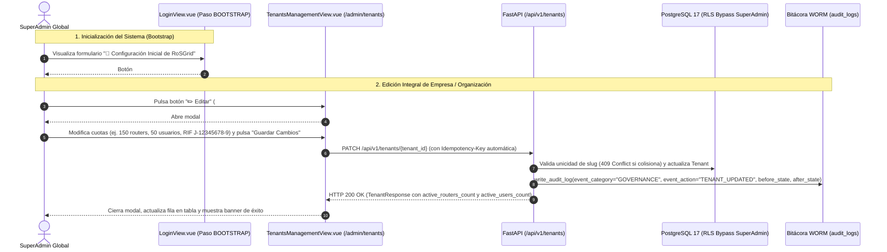

# SPDX-License-Identifier: GPL-3.0-only
# Copyright (C) 2026 RoSGrid Contributors

# Especificación Técnica 66 — Homologación de Estilo Táctico del Botón de Inicialización (*Bootstrap*) en `LoginView.vue` y Edición Integral de Empresas / Cuotas Multi-Tenant en `/admin/tenants` (`TenantsManagementView.vue` y `PATCH /api/v1/tenants/{tenant_id}`)

- **Estado:** Implementado y Certificado 11X (Hito 28.11)
- **Hito Asociado:** Hito 28.11 (`ROADMAP.md`)
- **Dominios Afectados:**
  - Frontend Auth / Bootstrap: [`vue3/src/views/LoginView.vue`](file:///home/sinfallas/Dropbox/git/tecno-consultores/RoSGrid/vue3/src/views/LoginView.vue)
  - Frontend Admin Multi-Tenant: [`vue3/src/views/admin/TenantsManagementView.vue`](file:///home/sinfallas/Dropbox/git/tecno-consultores/RoSGrid/vue3/src/views/admin/TenantsManagementView.vue), [`vue3/src/types/index.ts`](file:///home/sinfallas/Dropbox/git/tecno-consultores/RoSGrid/vue3/src/types/index.ts), [`vue3/src/locales/es.json`](file:///home/sinfallas/Dropbox/git/tecno-consultores/RoSGrid/vue3/src/locales/es.json), [`vue3/src/locales/en.json`](file:///home/sinfallas/Dropbox/git/tecno-consultores/RoSGrid/vue3/src/locales/en.json)
  - Backend Esquemas y API Multi-Tenant: [`fastapi/src/schemas/tenants.py`](file:///home/sinfallas/Dropbox/git/tecno-consultores/RoSGrid/fastapi/src/schemas/tenants.py), [`fastapi/src/api/v1/tenants.py`](file:///home/sinfallas/Dropbox/git/tecno-consultores/RoSGrid/fastapi/src/api/v1/tenants.py)
  - Pruebas Unitarias y BDD Level-11X: [`vue3/src/views/auth/loginView.unit.ts`](file:///home/sinfallas/Dropbox/git/tecno-consultores/RoSGrid/vue3/src/views/auth/loginView.unit.ts), [`vue3/src/views/admin/tenantsManagementView.unit.ts`](file:///home/sinfallas/Dropbox/git/tecno-consultores/RoSGrid/vue3/src/views/admin/tenantsManagementView.unit.ts), [`fastapi/tests/api/test_tenants_and_users.unit.py`](file:///home/sinfallas/Dropbox/git/tecno-consultores/RoSGrid/fastapi/tests/api/test_tenants_and_users.unit.py), [`fastapi/test/api_test.feature`](file:///home/sinfallas/Dropbox/git/tecno-consultores/RoSGrid/fastapi/test/api_test.feature), [`vue3/test/ui_business_flow.feature`](file:///home/sinfallas/Dropbox/git/tecno-consultores/RoSGrid/vue3/test/ui_business_flow.feature) (y réplicas en `docs/examples/`)

---

## 1. Diagnóstico Forense de Causa Raíz (Evidencia UAT)

Durante las pruebas de aceptación en el entorno de producción local con base de datos virgen (`is_bootstrapped: false` en `http://localhost:8085/login`) y posterior administración de empresas (`http://localhost:8085/admin/tenants`), se identificaron dos brechas operativas y visuales:

### 1.1. Defecto 1 — Botón de Creación de Super Administrador sin Estilo en Paso `BOOTSTRAP` (`LoginView.vue`)

1. En [`vue3/src/views/LoginView.vue`](file:///home/sinfallas/Dropbox/git/tecno-consultores/RoSGrid/vue3/src/views/LoginView.vue#L652-L657), dentro del formulario `<form v-if="currentStep === 'BOOTSTRAP'">`, el botón de envío fue declarado como:
   ```html
   <button type="submit" class="btn btn-primary" :disabled="isLoading">
     <span v-if="isLoading" class="spinner" aria-hidden="true"></span>
     <span>{{
       isLoading ? 'Inicializando...' : 'Crear Super Administrador y Continuar'
     }}</span>
   </button>
   ```
2. Sin embargo, el bloque `<style scoped>` de `LoginView.vue` ([líneas 1282-1308](file:///home/sinfallas/Dropbox/git/tecno-consultores/RoSGrid/vue3/src/views/LoginView.vue#L1282-L1308)) define únicamente la clase **`.btn-submit`** (utilizada en los formularios `CREDENTIALS`, `REGISTER` y `2FA`) y **no define `.btn` ni `.btn-primary`**.
3. Como consecuencia, al iniciar el sistema por primera vez, el botón **`Crear Super Administrador y Continuar`** se renderiza con la apariencia nativa sin estilos del navegador (fondo gris/blanco por defecto, sin ancho completo `100%`, sin color de acento `--rg-accent-cyan: #22d3ee` ni tipografía en negrita), rompiendo la coherencia visual del diseño *Tactical NOC Cyan*.

### 1.2. Defecto 2 — Ausencia de Botón y Modal para Editar Empresas (`TenantsManagementView.vue` y `PATCH /api/v1/tenants/{tenant_id}`)

1. Durante el asistente inicial (`POST /api/v1/auth/bootstrap` en [`fastapi/src/api/v1/auth.py`](file:///home/sinfallas/Dropbox/git/tecno-consultores/RoSGrid/fastapi/src/api/v1/auth.py#L957-L966)), la **Organización Principal** se crea únicamente con `name` y `slug`, quedando inicializada con los valores por defecto del modelo ORM (`tax_id=None`, `max_routers_quota=50`, `max_users_quota=10`, `default_safemode_seconds=60`, `require_2fa_all_users=True`).
2. En [`vue3/src/views/admin/TenantsManagementView.vue`](file:///home/sinfallas/Dropbox/git/tecno-consultores/RoSGrid/vue3/src/views/admin/TenantsManagementView.vue#L302-L323), la columna `Acciones` de la tabla de organizaciones incluye únicamente dos botones:
   - `⚙️ Módulos Studio` (que navega a `/admin/tenants/:id/modules` para activar/desactivar Feature Flags).
   - `Suspender / Reactivar` (que alterna `status` entre `ACTIVE` y `SUSPENDED`).
   **No existe ningún botón `✏️ Editar` ni modal de edición de datos de la empresa.** Por lo tanto, la primera empresa creada en el Bootstrap (ni ninguna otra empresa existente) puede modificar sus límites de routers (`max_routers_quota`), límites de usuarios (`max_users_quota`), razón social (`name`), `slug`, RIF / Identificación Fiscal (`tax_id`), tiempo de Safe Mode por defecto (`default_safemode_seconds`) o política obligatoria de 2FA (`require_2fa_all_users`).
3. Adicionalmente, en el backend ([`fastapi/src/schemas/tenants.py`](file:///home/sinfallas/Dropbox/git/tecno-consultores/RoSGrid/fastapi/src/schemas/tenants.py#L102-L166) y [`fastapi/src/api/v1/tenants.py`](file:///home/sinfallas/Dropbox/git/tecno-consultores/RoSGrid/fastapi/src/api/v1/tenants.py#L310-L338)):
   - `UpdateTenantRequest` no incluía el campo opcional `slug` (impidiendo actualizar el identificador de subdominio tras el Bootstrap) y tenía `default_safemode_seconds: int | None = Field(None, ge=15, le=300)` mientras que `CreateTenantRequest` (línea 57) y el input numérico de la UI (`min="10" max="300"`) permiten desde `10` segundos (`ge=10, le=300`).
   - `TenantResponse` no incluía `active_routers_count: int = 0` ni `active_users_count: int = 0`, provocando que en `TenantsManagementView.vue` la expresión `(tenant.active_routers_count / tenant.max_routers_quota) * 100` evaluara `undefined / 50 = NaN` al listar empresas desde el backend real.
   - `PATCH /api/v1/tenants/{tenant_id}` (`update_tenant`) no registraba la traza forense inmutable en la bitácora WORM (`event_category="GOVERNANCE"`, `event_action="TENANT_UPDATED"`).

---

## 2. Diseño Arquitectónico de la Solución



---

## 3. Blueprint de Implementación Literal "Flash-Ready" (Paso a Paso Anti-Errores para Gemini 3.8 Flash High)

> **⚠️ INSTRUCCIONES ESTRICTAS PARA GEMINI 3.8 FLASH HIGH:**
> 1. Aplica los bloques `Target` / `Replacement` exactamente como aparecen a continuación usando `edit_file`.
> 2. **Complejidad Ciclomática Radon Grado A (`CC <= 5`):** Todas las funciones nuevas o modificadas en Python están diseñadas con `CC <= 4`. No fusiones los helpers `_populate_tenant_counts`, `_validate_unique_tenant_slug` y `_apply_tenant_updates` dentro de `update_tenant`.
> 3. **Compatibilidad con `MockDbSession` y `fill_missing_feature_defaults`:**
>    - En `TenantFeatureFlagsMixin.fill_missing_feature_defaults` (`mode="before"`), asegúrate de inicializar `active_routers_count` y `active_users_count` a `0` cuando `getattr(data, ...)` devuelva `None`, evitando errores de validación Pydantic al serializar objetos ORM `Tenant`.
>    - En `_populate_tenant_counts(db, tenants)`, mantén la guarda `if not tenants or not isinstance(db, AsyncSession): return` para que las sesiones simuladas (`MockDbSession`) de las pruebas unitarias existentes continúen funcionando sin alteraciones.
> 4. **Invariante de Cero Endpoints Huérfanos:** Utiliza exclusivamente el verbo `PATCH /api/v1/tenants/{tenant_id}` ya registrado (no agregues `@router.put("/{tenant_id}")`) para mantener 0 endpoints huérfanos en `.agents/scripts/verify_no_orphan_api_endpoints.py`.

---

### Paso 3.1: Homologar Estilo del Botón de Bootstrap en `vue3/src/views/LoginView.vue`

1. En [`vue3/src/views/LoginView.vue`](file:///home/sinfallas/Dropbox/git/tecno-consultores/RoSGrid/vue3/src/views/LoginView.vue#L652-L657), añadir `id="btn-bootstrap-submit"` y la clase `btn-submit` (conservando `btn btn-primary` por retrocompatibilidad con selectores de pruebas):
   - **Target (`vue3/src/views/LoginView.vue`):**
     ```html
        <button type="submit" class="btn btn-primary" :disabled="isLoading">
          <span v-if="isLoading" class="spinner" aria-hidden="true"></span>
          <span>{{
            isLoading ? 'Inicializando...' : 'Crear Super Administrador y Continuar'
          }}</span>
        </button>
     ```
   - **Replacement (`vue3/src/views/LoginView.vue`):**
     ```html
        <button
          id="btn-bootstrap-submit"
          type="submit"
          class="btn-submit btn btn-primary"
          :disabled="isLoading"
        >
          <span v-if="isLoading" class="spinner" aria-hidden="true"></span>
          <span>{{
            isLoading ? 'Inicializando...' : 'Crear Super Administrador y Continuar'
          }}</span>
        </button>
     ```

2. En el bloque `<style scoped>` de [`vue3/src/views/LoginView.vue`](file:///home/sinfallas/Dropbox/git/tecno-consultores/RoSGrid/vue3/src/views/LoginView.vue#L1282-L1308), extender las reglas de `.btn-submit` también a `.btn-primary`:
   - **Target (`vue3/src/views/LoginView.vue`):**
     ```css
  .btn-submit {
    display: flex;
    align-items: center;
    justify-content: center;
    gap: var(--rg-space-2, 8px);
    width: 100%;
    padding: 12px;
    background-color: var(--rg-accent-cyan, #22d3ee);
    color: #0b0f19;
    border: none;
    border-radius: var(--rg-radius-md, 6px);
    font-weight: 700;
    font-size: 0.95rem;
    cursor: pointer;
    transition:
      background-color 0.2s,
      opacity 0.2s;
  }

  .btn-submit:hover:not(:disabled) {
    background-color: #38bdf8;
  }

  .btn-submit:disabled {
    opacity: 0.6;
    cursor: not-allowed;
  }
     ```
   - **Replacement (`vue3/src/views/LoginView.vue`):**
     ```css
  .btn-submit,
  .btn-primary {
    display: flex;
    align-items: center;
    justify-content: center;
    gap: var(--rg-space-2, 8px);
    width: 100%;
    padding: 12px;
    background-color: var(--rg-accent-cyan, #22d3ee);
    color: #0b0f19;
    border: none;
    border-radius: var(--rg-radius-md, 6px);
    font-weight: 700;
    font-size: 0.95rem;
    cursor: pointer;
    transition:
      background-color 0.2s,
      box-shadow 0.2s,
      opacity 0.2s;
  }

  .btn-submit:hover:not(:disabled),
  .btn-primary:hover:not(:disabled) {
    background-color: #38bdf8;
    box-shadow: var(--rg-cyan-glow, 0 0 12px rgba(6, 182, 212, 0.28));
  }

  .btn-submit:disabled,
  .btn-primary:disabled {
    opacity: 0.6;
    cursor: not-allowed;
  }
     ```

---

### Paso 3.2: Ampliar `UpdateTenantRequest` y `TenantResponse` en `fastapi/src/schemas/tenants.py`

En [`fastapi/src/schemas/tenants.py`](file:///home/sinfallas/Dropbox/git/tecno-consultores/RoSGrid/fastapi/src/schemas/tenants.py#L102-L166):
1. Añadir `slug: str | None = Field(None, min_length=2, max_length=64, pattern=r"^[a-z0-9]+(?:-[a-z0-9]+)*$")` en `UpdateTenantRequest` y alinear `default_safemode_seconds` a `ge=10, le=300`.
2. Añadir `active_routers_count: int = 0` y `active_users_count: int = 0` en `TenantResponse`, e inicializarlos a `0` si son `None` dentro de `fill_missing_feature_defaults`.

- **Target (`fastapi/src/schemas/tenants.py`):**
  ```python
  class UpdateTenantRequest(UpdateTenantFeaturesRequest):
      name: str | None = Field(None, min_length=2, max_length=150)
      tax_id: str | None = None
      status: TenantStatusEnum | None = None
      max_routers_quota: int | None = Field(None, gt=0)
      max_users_quota: int | None = Field(None, gt=0)
      require_2fa_all_users: bool | None = None
      default_safemode_seconds: int | None = Field(None, ge=15, le=300)
  ```
- **Replacement (`fastapi/src/schemas/tenants.py`):**
  ```python
  class UpdateTenantRequest(UpdateTenantFeaturesRequest):
      slug: str | None = Field(
          None, min_length=2, max_length=64, pattern=r"^[a-z0-9]+(?:-[a-z0-9]+)*$"
      )
      name: str | None = Field(None, min_length=2, max_length=150)
      tax_id: str | None = None
      status: TenantStatusEnum | None = None
      max_routers_quota: int | None = Field(None, gt=0)
      max_users_quota: int | None = Field(None, gt=0)
      require_2fa_all_users: bool | None = None
      default_safemode_seconds: int | None = Field(None, ge=10, le=300)
  ```

- **Target (`fastapi/src/schemas/tenants.py` — `fill_missing_feature_defaults` y `TenantResponse`):**
  ```python
      @model_validator(mode="before")
      @classmethod
      def fill_missing_feature_defaults(cls, data: Any) -> Any:
          source = data if isinstance(data, dict) else {name: getattr(data, name, None) for name in cls.model_fields}
          merged = dict(source)
          for key, default in TENANT_FEATURE_DEFAULTS.items():
              if merged.get(key) is None:
                  merged[key] = default
          return merged


  class TenantFeaturesResponse(TenantFeatureFlagsMixin):
      pass


  class TenantResponse(TenantFeatureFlagsMixin):
      id: uuid.UUID
      slug: str
      name: str
      tax_id: str | None
      status: TenantStatusEnum
      max_routers_quota: int
      max_users_quota: int
      require_2fa_all_users: bool
      default_safemode_seconds: int
      created_at: datetime
      updated_at: datetime
  ```
- **Replacement (`fastapi/src/schemas/tenants.py`):**
  ```python
      @model_validator(mode="before")
      @classmethod
      def fill_missing_feature_defaults(cls, data: Any) -> Any:
          source = data if isinstance(data, dict) else {name: getattr(data, name, None) for name in cls.model_fields}
          merged = dict(source)
          for key, default in TENANT_FEATURE_DEFAULTS.items():
              if merged.get(key) is None:
                  merged[key] = default
          for count_key in ("active_routers_count", "active_users_count"):
              if count_key in cls.model_fields and merged.get(count_key) is None:
                  merged[count_key] = 0
          return merged


  class TenantFeaturesResponse(TenantFeatureFlagsMixin):
      pass


  class TenantResponse(TenantFeatureFlagsMixin):
      id: uuid.UUID
      slug: str
      name: str
      tax_id: str | None
      status: TenantStatusEnum
      max_routers_quota: int
      max_users_quota: int
      active_routers_count: int = 0
      active_users_count: int = 0
      require_2fa_all_users: bool
      default_safemode_seconds: int
      created_at: datetime
      updated_at: datetime
  ```

---

### Paso 3.3: Enriquecer Conteo de Cuotas, Validación de `slug` y Auditoría WORM en `fastapi/src/api/v1/tenants.py`

En [`fastapi/src/api/v1/tenants.py`](file:///home/sinfallas/Dropbox/git/tecno-consultores/RoSGrid/fastapi/src/api/v1/tenants.py):
1. Importar `func` desde `sqlalchemy` y `Router` desde `src.models.inventory`.
2. Añadir el helper `_populate_tenant_counts(db: AsyncSession, tenants: list[Tenant]) -> None` (`CC = 4`) e invocarlo en `list_tenants` y `get_tenant`.
3. Añadir los helpers `_validate_unique_tenant_slug` (`CC = 4`) y `_apply_tenant_updates` (`CC = 3`) y actualizar `update_tenant` (`PATCH /api/v1/tenants/{tenant_id}`, `CC = 2`) para validar conflictos de `slug` (`HTTP 409`), registrar el evento WORM `TENANT_UPDATED` e invalidar la caché de features en KeyDB.

- **Target (`fastapi/src/api/v1/tenants.py` — imports y `list_tenants` / `get_tenant`):**
  ```python
  from fastapi import APIRouter, Depends, HTTPException, Query, Request, status
  from sqlalchemy import desc, select
  from sqlalchemy.ext.asyncio import AsyncSession

  from src.api.deps import get_current_user_claims, require_roles
  from src.core.audit import audit_actor_from_claims, write_audit_log
  from src.core.crypto import hash_password
  from src.db.session import get_db_session, set_tenant_context
  from src.models.core import SystemRoleEnum, Tenant, TenantStatusEnum, User
  from src.models.operations import AuditLog
  ```
- **Replacement (`fastapi/src/api/v1/tenants.py`):**
  ```python
  from fastapi import APIRouter, Depends, HTTPException, Query, Request, status
  from sqlalchemy import desc, func, select
  from sqlalchemy.ext.asyncio import AsyncSession

  from src.api.deps import get_current_user_claims, require_roles
  from src.core.audit import audit_actor_from_claims, write_audit_log
  from src.core.crypto import hash_password
  from src.db.session import get_db_session, set_tenant_context
  from src.models.core import SystemRoleEnum, Tenant, TenantStatusEnum, User
  from src.models.inventory import Router
  from src.models.operations import AuditLog
  ```

- **Target (`fastapi/src/api/v1/tenants.py` — `list_tenants` y `get_tenant`):**
  ```python
  @router.get("", response_model=list[TenantResponse])
  async def list_tenants(
      claims: dict[str, Any] = Depends(require_roles(SystemRoleEnum.SUPERADMIN_GLOBAL, SystemRoleEnum.TENANT_ADMIN)),
      db: AsyncSession = Depends(get_db_session),
  ) -> list[TenantResponse]:
      user_role = claims.get("rol")
      if user_role == SystemRoleEnum.SUPERADMIN_GLOBAL.value:
          await set_tenant_context(db, None, is_superadmin=True)
          stmt = select(Tenant).order_by(Tenant.created_at.desc())
          result = await db.execute(stmt)
          return [TenantResponse.model_validate(t) for t in result.scalars().all()]
      else:
          user_tid = claims.get("tid")
          if not user_tid:
              raise HTTPException(status_code=403, detail="Contexto de empresa no disponible")
          await set_tenant_context(db, uuid.UUID(str(user_tid)), is_superadmin=False)
          stmt = select(Tenant).where(Tenant.id == uuid.UUID(str(user_tid)))
          result = await db.execute(stmt)
          return [TenantResponse.model_validate(t) for t in result.scalars().all()]


  @router.get("/{tenant_id}", response_model=TenantResponse)
  async def get_tenant(
      tenant_id: uuid.UUID,
      claims: dict[str, Any] = Depends(get_current_user_claims),
      db: AsyncSession = Depends(get_db_session),
  ) -> TenantResponse:
      user_role = claims.get("rol")
      user_tid = claims.get("tid")
      if user_role != SystemRoleEnum.SUPERADMIN_GLOBAL.value and str(user_tid) != str(tenant_id):
          raise HTTPException(status_code=403, detail="No autorizado para consultar esta empresa")

      await set_tenant_context(db, None, is_superadmin=True)
      stmt = select(Tenant).where(Tenant.id == tenant_id)
      res = await db.execute(stmt)
      tenant = res.scalar_one_or_none()
      if not tenant:
          raise HTTPException(status_code=404, detail="Tenant no encontrado")
      return TenantResponse.model_validate(tenant)
  ```
- **Replacement (`fastapi/src/api/v1/tenants.py`):**
  ```python
  async def _populate_tenant_counts(db: AsyncSession, tenants: list[Tenant]) -> None:
      """Enriquece cada Tenant con el conteo real de routers y usuarios activos (CC = 4)."""
      if not tenants or not isinstance(db, AsyncSession):
          return
      try:
          r_res = await db.execute(select(Router.tenant_id, func.count(Router.id)).group_by(Router.tenant_id))
          r_counts = {row[0]: int(row[1]) for row in r_res.all()}
          u_res = await db.execute(select(User.tenant_id, func.count(User.id)).group_by(User.tenant_id))
          u_counts = {row[0]: int(row[1]) for row in u_res.all()}
          for t in tenants:
              t.active_routers_count = r_counts.get(t.id, 0)  # type: ignore[attr-defined]
              t.active_users_count = u_counts.get(t.id, 0)  # type: ignore[attr-defined]
      except Exception as exc:
          logger.debug("Conteo de cuotas de tenant omitido: %s", exc)


  @router.get("", response_model=list[TenantResponse])
  async def list_tenants(
      claims: dict[str, Any] = Depends(require_roles(SystemRoleEnum.SUPERADMIN_GLOBAL, SystemRoleEnum.TENANT_ADMIN)),
      db: AsyncSession = Depends(get_db_session),
  ) -> list[TenantResponse]:
      user_role = claims.get("rol")
      if user_role == SystemRoleEnum.SUPERADMIN_GLOBAL.value:
          await set_tenant_context(db, None, is_superadmin=True)
          stmt = select(Tenant).order_by(Tenant.created_at.desc())
      else:
          user_tid = claims.get("tid")
          if not user_tid:
              raise HTTPException(status_code=403, detail="Contexto de empresa no disponible")
          await set_tenant_context(db, uuid.UUID(str(user_tid)), is_superadmin=False)
          stmt = select(Tenant).where(Tenant.id == uuid.UUID(str(user_tid)))
      result = await db.execute(stmt)
      items = list(result.scalars().all())
      await _populate_tenant_counts(db, items)
      return [TenantResponse.model_validate(t) for t in items]


  @router.get("/{tenant_id}", response_model=TenantResponse)
  async def get_tenant(
      tenant_id: uuid.UUID,
      claims: dict[str, Any] = Depends(get_current_user_claims),
      db: AsyncSession = Depends(get_db_session),
  ) -> TenantResponse:
      user_role = claims.get("rol")
      user_tid = claims.get("tid")
      if user_role != SystemRoleEnum.SUPERADMIN_GLOBAL.value and str(user_tid) != str(tenant_id):
          raise HTTPException(status_code=403, detail="No autorizado para consultar esta empresa")

      tenant = await _load_tenant_or_404(db, tenant_id)
      await _populate_tenant_counts(db, [tenant])
      return TenantResponse.model_validate(tenant)
  ```

- **Target (`fastapi/src/api/v1/tenants.py` — `update_tenant` al final del archivo):**
  ```python
  @router.patch("/{tenant_id}", response_model=TenantResponse)
  async def update_tenant(
      tenant_id: uuid.UUID,
      body: UpdateTenantRequest,
      claims: dict[str, Any] = Depends(require_roles(SystemRoleEnum.SUPERADMIN_GLOBAL)),
      db: AsyncSession = Depends(get_db_session),
  ) -> TenantResponse:
      await set_tenant_context(db, None, is_superadmin=True)
      stmt = select(Tenant).where(Tenant.id == tenant_id)
      res = await db.execute(stmt)
      tenant = res.scalar_one_or_none()
      if not tenant:
          raise HTTPException(status_code=404, detail="Tenant no encontrado")

      update_data = body.model_dump(exclude_unset=True)
      for field, value in update_data.items():
          setattr(tenant, field, value)

      await db.commit()
      await db.refresh(tenant)

      # Invalidar caché de features en KeyDB
      redis = get_redis_client()
      try:
          await redis.delete(f"rg:{tenant_id}:features")
      except Exception as ex:
          logger.warning(f"Error al invalidar caché de features en redis: {ex}")

      return TenantResponse.model_validate(tenant)
  ```
- **Replacement (`fastapi/src/api/v1/tenants.py`):**
  ```python
  async def _validate_unique_tenant_slug(db: AsyncSession, tenant: Tenant, new_slug: str) -> str:
      """Verifica que el nuevo slug no esté asignado a otra organización (CC = 4)."""
      clean_slug = new_slug.strip().lower()
      if clean_slug == tenant.slug:
          return clean_slug
      res = await db.execute(select(Tenant).where(Tenant.slug == clean_slug, Tenant.id != tenant.id))
      conflict = res.scalar_one_or_none()
      if conflict and conflict.id != tenant.id:
          raise HTTPException(
              status_code=status.HTTP_409_CONFLICT,
              detail=f"Ya existe una organización con el slug '{clean_slug}'",
          )
      return clean_slug


  async def _apply_tenant_updates(
      db: AsyncSession, tenant: Tenant, update_data: dict[str, Any]
  ) -> dict[str, Any]:
      """Aplica las modificaciones de metadatos/cuotas sobre el Tenant y retorna before_state (CC = 3)."""
      before_state = {field: getattr(tenant, field, None) for field in update_data}
      if update_data.get("slug"):
          update_data["slug"] = await _validate_unique_tenant_slug(db, tenant, str(update_data["slug"]))
      for field, value in update_data.items():
          setattr(tenant, field, value)
      return before_state


  @router.patch("/{tenant_id}", response_model=TenantResponse)
  async def update_tenant(
      tenant_id: uuid.UUID,
      body: UpdateTenantRequest,
      request: Request,
      claims: dict[str, Any] = Depends(require_roles(SystemRoleEnum.SUPERADMIN_GLOBAL)),
      db: AsyncSession = Depends(get_db_session),
  ) -> TenantResponse:
      tenant = await _load_tenant_or_404(db, tenant_id)
      update_data = body.model_dump(exclude_unset=True)
      before_state = await _apply_tenant_updates(db, tenant, update_data)

      actor = audit_actor_from_claims(claims, request)
      actor["tenant_id"] = tenant.id
      await write_audit_log(
          session=db,
          **actor,
          event_category="GOVERNANCE",
          event_action="TENANT_UPDATED",
          before_state=before_state,
          after_state=update_data,
      )
      await db.commit()
      await db.refresh(tenant)
      await invalidate_tenant_features_cache(tenant_id)
      await _populate_tenant_counts(db, [tenant])
      return TenantResponse.model_validate(tenant)
  ```

---

### Paso 3.4: Actualizar `TenantItem` en `vue3/src/types/index.ts` y Diccionarios i18n (`es.json` / `en.json`)

1. En [`vue3/src/types/index.ts`](file:///home/sinfallas/Dropbox/git/tecno-consultores/RoSGrid/vue3/src/types/index.ts#L166-L179), añadir `require_2fa_all_users?: boolean;` a `TenantItem`:
   - **Target (`vue3/src/types/index.ts`):**
     ```ts
     export interface TenantItem {
       id: string;
       slug: string;
       name: string;
       tax_id?: string;
       status: 'ACTIVE' | 'SUSPENDED';
       max_routers_quota: number;
       max_users_quota: number;
       active_routers_count: number;
       active_users_count: number;
       default_safemode_seconds: number;
       created_at?: string;
       features?: Partial<TenantFeatureFlags>;
     }
     ```
   - **Replacement (`vue3/src/types/index.ts`):**
     ```ts
     export interface TenantItem {
       id: string;
       slug: string;
       name: string;
       tax_id?: string;
       status: 'ACTIVE' | 'SUSPENDED';
       max_routers_quota: number;
       max_users_quota: number;
       active_routers_count: number;
       active_users_count: number;
       default_safemode_seconds: number;
       require_2fa_all_users?: boolean;
       created_at?: string;
       features?: Partial<TenantFeatureFlags>;
     }
     ```

2. En [`vue3/src/locales/es.json`](file:///home/sinfallas/Dropbox/git/tecno-consultores/RoSGrid/vue3/src/locales/es.json#L801-L815), añadir las claves `btn_edit_tenant` y `modal_edit_title` dentro de `"tenants_mgmt"`:
   - **Target (`vue3/src/locales/es.json`):**
     ```json
         "btn_modules_studio": "⚙️ Módulos Studio",
         "btn_suspend_tenant": "🚫 Suspender",
         "btn_activate_tenant": "✓ Activar",
     ```
   - **Replacement (`vue3/src/locales/es.json`):**
     ```json
         "btn_modules_studio": "⚙️ Módulos Studio",
         "btn_edit_tenant": "✏️ Editar",
         "modal_edit_title": "Editar Organización y Cuotas",
         "btn_suspend_tenant": "🚫 Suspender",
         "btn_activate_tenant": "✓ Activar",
     ```

3. En [`vue3/src/locales/en.json`](file:///home/sinfallas/Dropbox/git/tecno-consultores/RoSGrid/vue3/src/locales/en.json#L801-L815), añadir las mismas claves en inglés dentro de `"tenants_mgmt"`:
   - **Target (`vue3/src/locales/en.json`):**
     ```json
         "btn_modules_studio": "⚙️ Modules Studio",
         "btn_suspend_tenant": "🚫 Suspend",
         "btn_activate_tenant": "✓ Activate",
     ```
   - **Replacement (`vue3/src/locales/en.json`):**
     ```json
         "btn_modules_studio": "⚙️ Modules Studio",
         "btn_edit_tenant": "✏️ Edit",
         "modal_edit_title": "Edit Organization & Quotas",
         "btn_suspend_tenant": "🚫 Suspend",
         "btn_activate_tenant": "✓ Activate",
     ```

---

### Paso 3.5: Añadir Botón `✏️ Editar` (`#btn-edit-tenant-{slug}`) y Modal de Edición (`#modal-edit-tenant`) en `vue3/src/views/admin/TenantsManagementView.vue`

1. En el `<script setup lang="ts">` de [`vue3/src/views/admin/TenantsManagementView.vue`](file:///home/sinfallas/Dropbox/git/tecno-consultores/RoSGrid/vue3/src/views/admin/TenantsManagementView.vue#L20-L45), añadir el estado reactivo `isEditModalOpen`, `isUpdating`, `editingTenant`, y las funciones `openEditTenantModal(tenant: TenantItem)` y `handleUpdateTenant()`:
   - **Target (`vue3/src/views/admin/TenantsManagementView.vue`):**
     ```ts
       function goToTenantModules(tenant: TenantItem): void {
         router.push(`/admin/tenants/${tenant.id}/modules`);
       }
     ```
   - **Replacement (`vue3/src/views/admin/TenantsManagementView.vue`):**
     ```ts
       // Modal de Editar Empresa
       const isEditModalOpen = ref(false);
       const isUpdating = ref(false);
       const editingTenant = ref({
         id: '',
         slug: '',
         name: '',
         tax_id: '',
         max_routers_quota: 50,
         max_users_quota: 20,
         default_safemode_seconds: 60,
         require_2fa_all_users: true,
       });

       function openEditTenantModal(tenant: TenantItem): void {
         errorMessage.value = '';
         editingTenant.value = {
           id: tenant.id,
           slug: tenant.slug,
           name: tenant.name,
           tax_id: tenant.tax_id || '',
           max_routers_quota: tenant.max_routers_quota ?? 50,
           max_users_quota: tenant.max_users_quota ?? 20,
           default_safemode_seconds: tenant.default_safemode_seconds ?? 60,
           require_2fa_all_users: tenant.require_2fa_all_users ?? true,
         };
         isEditModalOpen.value = true;
       }

       async function handleUpdateTenant(): Promise<void> {
         if (!editingTenant.value.id) return;
         isUpdating.value = true;
         errorMessage.value = '';
         try {
           const payload = {
             name: editingTenant.value.name.trim(),
             slug: editingTenant.value.slug.trim().toLowerCase(),
             tax_id: editingTenant.value.tax_id.trim() || null,
             max_routers_quota: Number(editingTenant.value.max_routers_quota),
             max_users_quota: Number(editingTenant.value.max_users_quota),
             default_safemode_seconds: Number(editingTenant.value.default_safemode_seconds),
             require_2fa_all_users: Boolean(editingTenant.value.require_2fa_all_users),
           };
           const res = await http.patch<TenantItem>(
             `/api/v1/tenants/${editingTenant.value.id}`,
             payload,
           );
           const idx = tenants.value.findIndex((item) => item.id === editingTenant.value.id);
           if (idx !== -1) {
             tenants.value[idx] = {
               ...tenants.value[idx],
               ...payload,
               ...(res.data || {}),
               tax_id: res.data?.tax_id ?? (payload.tax_id || undefined),
             };
           }
           await loadTenants();
           isEditModalOpen.value = false;
           successMessage.value = `Datos y cuotas de "${payload.name}" actualizados exitosamente.`;
         } catch (err: unknown) {
           const error = err as { message?: string; detail?: string };
           errorMessage.value =
             error.detail || error.message || 'Error al actualizar los datos de la empresa.';
         } finally {
           isUpdating.value = false;
         }
       }

       function goToTenantModules(tenant: TenantItem): void {
         router.push(`/admin/tenants/${tenant.id}/modules`);
       }
     ```

2. En el `<template>` de [`vue3/src/views/admin/TenantsManagementView.vue`](file:///home/sinfallas/Dropbox/git/tecno-consultores/RoSGrid/vue3/src/views/admin/TenantsManagementView.vue#L277-L324), proteger el cálculo de porcentaje de cuotas con `(tenant.active_routers_count ?? 0)` y `(tenant.active_users_count ?? 0)`, e insertar el botón **`✏️ Editar`** (`:id="'btn-edit-tenant-' + tenant.slug"`) en `td.col-actions`:
   - **Target (`vue3/src/views/admin/TenantsManagementView.vue`):**
     ```html
            <td class="cell-quota">
              <div class="quota-bar-track">
                <div
                  class="quota-bar-fill"
                  :style="{
                    width: `${Math.min(100, (tenant.active_routers_count / tenant.max_routers_quota) * 100)}%`,
                  }"
                ></div>
              </div>
              <span class="quota-text"
                >{{ tenant.active_routers_count }} / {{ tenant.max_routers_quota }}</span
              >
            </td>
            <td class="cell-quota">
              <div class="quota-bar-track">
                <div
                  class="quota-bar-fill"
                  :style="{
                    width: `${Math.min(100, (tenant.active_users_count / tenant.max_users_quota) * 100)}%`,
                  }"
                ></div>
              </div>
              <span class="quota-text">{{ tenant.active_users_count }} / {{ tenant.max_users_quota }}</span>
            </td>
            <td class="cell-safemode">{{ tenant.default_safemode_seconds }}s</td>
            <td class="col-actions">
              <button
                type="button"
                class="btn-action btn-action--features"
                :aria-label="`Configurar módulos y capacidades de ${tenant.name}`"
                @click="goToTenantModules(tenant)"
              >
                {{ t('tenants_mgmt.btn_modules_studio', '⚙️ Módulos Studio') }}
                <span v-if="countActiveModules(tenant) > 0" class="badge-modules-count">
                  {{ countActiveModules(tenant) }}
                </span>
              </button>
              <button
                v-if="authStore.currentRole === 'SUPERADMIN_GLOBAL'"
                type="button"
                class="btn-action"
                :class="{ 'btn-action--danger': tenant.status === 'ACTIVE' }"
                @click="toggleSuspendTenant(tenant)"
              >
                {{ tenant.status === 'ACTIVE' ? t('tenants_mgmt.btn_suspend_tenant', 'Suspender') : t('tenants_mgmt.btn_activate_tenant', 'Reactivar') }}
              </button>
            </td>
     ```
   - **Replacement (`vue3/src/views/admin/TenantsManagementView.vue`):**
     ```html
            <td class="cell-quota">
              <div class="quota-bar-track">
                <div
                  class="quota-bar-fill"
                  :style="{
                    width: `${Math.min(100, ((tenant.active_routers_count ?? 0) / Math.max(1, tenant.max_routers_quota)) * 100)}%`,
                  }"
                ></div>
              </div>
              <span class="quota-text"
                >{{ tenant.active_routers_count ?? 0 }} / {{ tenant.max_routers_quota }}</span
              >
            </td>
            <td class="cell-quota">
              <div class="quota-bar-track">
                <div
                  class="quota-bar-fill"
                  :style="{
                    width: `${Math.min(100, ((tenant.active_users_count ?? 0) / Math.max(1, tenant.max_users_quota)) * 100)}%`,
                  }"
                ></div>
              </div>
              <span class="quota-text">{{ tenant.active_users_count ?? 0 }} / {{ tenant.max_users_quota }}</span>
            </td>
            <td class="cell-safemode">{{ tenant.default_safemode_seconds }}s</td>
            <td class="col-actions">
              <button
                v-if="authStore.currentRole === 'SUPERADMIN_GLOBAL'"
                :id="`btn-edit-tenant-${tenant.slug}`"
                type="button"
                class="btn-action btn-action--edit"
                :aria-label="`Editar datos y cuotas de ${tenant.name}`"
                @click="openEditTenantModal(tenant)"
              >
                {{ t('tenants_mgmt.btn_edit_tenant', '✏️ Editar') }}
              </button>
              <button
                type="button"
                class="btn-action btn-action--features"
                :aria-label="`Configurar módulos y capacidades de ${tenant.name}`"
                @click="goToTenantModules(tenant)"
              >
                {{ t('tenants_mgmt.btn_modules_studio', '⚙️ Módulos Studio') }}
                <span v-if="countActiveModules(tenant) > 0" class="badge-modules-count">
                  {{ countActiveModules(tenant) }}
                </span>
              </button>
              <button
                v-if="authStore.currentRole === 'SUPERADMIN_GLOBAL'"
                type="button"
                class="btn-action"
                :class="{ 'btn-action--danger': tenant.status === 'ACTIVE' }"
                @click="toggleSuspendTenant(tenant)"
              >
                {{ tenant.status === 'ACTIVE' ? t('tenants_mgmt.btn_suspend_tenant', 'Suspender') : t('tenants_mgmt.btn_activate_tenant', 'Reactivar') }}
              </button>
            </td>
     ```

3. Justo debajo del Modal de Creación de Empresa en [`vue3/src/views/admin/TenantsManagementView.vue`](file:///home/sinfallas/Dropbox/git/tecno-consultores/RoSGrid/vue3/src/views/admin/TenantsManagementView.vue#L465-L471), añadir el **Modal de Edición de Empresa (`#modal-edit-tenant`)** y el estilo `.btn-action--edit`:
   - **Target (`vue3/src/views/admin/TenantsManagementView.vue`):**
     ```html
              <footer class="modal-footer">
                <button type="button" class="btn-cancel" @click="isCreateModalOpen = false">
                  Cancelar
                </button>
                <button type="submit" class="btn-submit" :disabled="isCreating">
                  {{ isCreating ? 'Creando...' : 'Crear Organización' }}
                </button>
              </footer>
            </form>
          </div>
        </div>

      </div>
    </template>
     ```
   - **Replacement (`vue3/src/views/admin/TenantsManagementView.vue`):**
     ```html
              <footer class="modal-footer">
                <button type="button" class="btn-cancel" @click="isCreateModalOpen = false">
                  Cancelar
                </button>
                <button type="submit" class="btn-submit" :disabled="isCreating">
                  {{ isCreating ? 'Creando...' : 'Crear Organización' }}
                </button>
              </footer>
            </form>
          </div>
        </div>

        <!-- Modal de Edición de Empresa y Cuotas -->
        <div
          v-if="isEditModalOpen"
          id="modal-edit-tenant"
          class="rg-modal-backdrop"
          @click.self="isEditModalOpen = false"
        >
          <div class="rg-modal" role="dialog" aria-modal="true" aria-labelledby="modal-edit-tenant-title">
            <header class="modal-header">
              <h2 id="modal-edit-tenant-title" class="modal-title">
                {{ t('tenants_mgmt.modal_edit_title', 'Editar Organización y Cuotas') }}
              </h2>
              <button
                type="button"
                class="btn-close"
                aria-label="Cerrar modal de edición"
                @click="isEditModalOpen = false"
              >
                ✕
              </button>
            </header>

            <form id="form-edit-tenant" class="modal-form" @submit.prevent="handleUpdateTenant">
              <div class="form-row">
                <div class="form-group">
                  <label for="edit-tenant-name" class="form-label">Nombre Comercial *</label>
                  <input
                    id="edit-tenant-name"
                    v-model="editingTenant.name"
                    type="text"
                    required
                    minlength="2"
                    class="form-input"
                  />
                </div>
                <div class="form-group">
                  <label for="edit-tenant-slug" class="form-label">Slug de Subdominio *</label>
                  <input
                    id="edit-tenant-slug"
                    v-model="editingTenant.slug"
                    type="text"
                    required
                    pattern="[a-z0-9-]+"
                    class="form-input"
                  />
                </div>
              </div>

              <div class="form-row">
                <div class="form-group">
                  <label for="edit-tenant-tax-id" class="form-label">RIF / Identificación Fiscal</label>
                  <input
                    id="edit-tenant-tax-id"
                    v-model="editingTenant.tax_id"
                    type="text"
                    placeholder="ej. J-12345678-9"
                    class="form-input"
                  />
                </div>
                <div class="form-group">
                  <label for="edit-tenant-safemode" class="form-label">
                    Safe Mode por Defecto (segundos)
                  </label>
                  <input
                    id="edit-tenant-safemode"
                    v-model.number="editingTenant.default_safemode_seconds"
                    type="number"
                    min="10"
                    max="300"
                    required
                    class="form-input"
                  />
                </div>
              </div>

              <fieldset class="form-fieldset">
                <legend class="fieldset-legend">Cuotas de Hardware y Operadores</legend>
                <div class="form-row">
                  <div class="form-group">
                    <label for="edit-max-routers" class="form-label">Límite de Routers *</label>
                    <input
                      id="edit-max-routers"
                      v-model.number="editingTenant.max_routers_quota"
                      type="number"
                      min="1"
                      required
                      class="form-input"
                    />
                  </div>
                  <div class="form-group">
                    <label for="edit-max-users" class="form-label">Límite de Usuarios *</label>
                    <input
                      id="edit-max-users"
                      v-model.number="editingTenant.max_users_quota"
                      type="number"
                      min="1"
                      required
                      class="form-input"
                    />
                  </div>
                </div>
                <label class="switch-row" for="edit-require-2fa">
                  <input
                    id="edit-require-2fa"
                    v-model="editingTenant.require_2fa_all_users"
                    type="checkbox"
                    class="switch-input"
                  />
                  <span>Exigir autenticación 2FA TOTP obligatoria para todos los usuarios</span>
                </label>
              </fieldset>

              <footer class="modal-footer">
                <button
                  id="btn-cancel-edit-tenant"
                  type="button"
                  class="btn-cancel"
                  @click="isEditModalOpen = false"
                >
                  Cancelar
                </button>
                <button
                  id="btn-save-edit-tenant"
                  type="submit"
                  class="btn-submit"
                  :disabled="isUpdating"
                >
                  {{ isUpdating ? 'Guardando...' : 'Guardar Cambios' }}
                </button>
              </footer>
            </form>
          </div>
        </div>

      </div>
    </template>
     ```

4. En el `<style scoped>` de [`vue3/src/views/admin/TenantsManagementView.vue`](file:///home/sinfallas/Dropbox/git/tecno-consultores/RoSGrid/vue3/src/views/admin/TenantsManagementView.vue#L895-L905), añadir `.btn-action--edit`:
   - **Target (`vue3/src/views/admin/TenantsManagementView.vue`):**
     ```css
      .btn-action--features {
        border-color: #38bdf8;
        color: #38bdf8;
        margin-right: 6px;
      }
     ```
   - **Replacement (`vue3/src/views/admin/TenantsManagementView.vue`):**
     ```css
      .btn-action--edit {
        border-color: var(--rg-accent-cyan, #22d3ee);
        color: var(--rg-accent-cyan, #22d3ee);
        margin-right: 6px;
      }

      .btn-action--features {
        border-color: #38bdf8;
        color: #38bdf8;
        margin-right: 6px;
      }
     ```

---

### Paso 3.6: Pruebas Unitarias (Pytest y Vitest) y Escenarios BDD Karate Labs (Pirámide 11X)

1. **Prueba Unitaria Frontend Auth (`vue3/src/views/auth/loginView.unit.ts`):**
   En `it('detecta automáticamente primer uso y activa el paso BOOTSTRAP si is_bootstrapped es false')`, verificar que el botón `#btn-bootstrap-submit` exista y posea la clase `btn-submit`:
   ```ts
   const submitBtn = wrapper.find('#btn-bootstrap-submit');
   expect(submitBtn.exists()).toBe(true);
   expect(submitBtn.classes()).toContain('btn-submit');
   ```

2. **Prueba Unitaria Frontend Tenants (`vue3/src/views/admin/tenantsManagementView.unit.ts`):**
   Añadir un test unitario que verifique la apertura del modal `#modal-edit-tenant` al pulsar `#btn-edit-tenant-isp-norte`, la modificación de `name`, `slug`, `tax_id`, `max_routers_quota`, `max_users_quota` y `default_safemode_seconds`, y el envío de `PATCH /api/v1/tenants/t-01`:
   ```ts
   it('permite editar los datos y cuotas de una organización existente vía PATCH /api/v1/tenants/:id (Hito 28.11)', async () => {
     const wrapper = mount(TenantsManagementView);
     await flushPromises();

     const editBtn = wrapper.find('#btn-edit-tenant-isp-norte');
     expect(editBtn.exists()).toBe(true);
     await editBtn.trigger('click');

     expect(wrapper.find('#modal-edit-tenant').exists()).toBe(true);
     await wrapper.find('#edit-tenant-name').setValue('ISP Norte Renovado C.A.');
     await wrapper.find('#edit-tenant-tax-id').setValue('J-99999999-9');
     await wrapper.find('#edit-max-routers').setValue('150');
     await wrapper.find('#edit-max-users').setValue('45');
     await wrapper.find('#edit-tenant-safemode').setValue('45');

     const patchSpy = vi.spyOn(http, 'patch').mockResolvedValueOnce({
       status: 200,
       data: {
         ...mockTenants[0],
         name: 'ISP Norte Renovado C.A.',
         tax_id: 'J-99999999-9',
         max_routers_quota: 150,
         max_users_quota: 45,
         default_safemode_seconds: 45,
       },
       headers: new Headers(),
     });

     await wrapper.find('#form-edit-tenant').trigger('submit');
     await flushPromises();

     expect(patchSpy).toHaveBeenCalledWith(
       '/api/v1/tenants/t-01',
       expect.objectContaining({
         name: 'ISP Norte Renovado C.A.',
         slug: 'isp-norte',
         tax_id: 'J-99999999-9',
         max_routers_quota: 150,
         max_users_quota: 45,
         default_safemode_seconds: 45,
       }),
     );
     expect(wrapper.text()).toContain('Datos y cuotas de "ISP Norte Renovado C.A." actualizados exitosamente.');
   });
   ```

3. **Prueba Unitaria Backend (`fastapi/tests/api/test_tenants_and_users.unit.py`):**
   En `test_tenants_crud_endpoints`, ampliar el bloque `# 3. Modificar tenant` para verificar que `PATCH /api/v1/tenants/{t.id}` actualice `name`, `slug`, `tax_id`, `max_routers_quota`, `max_users_quota`, `default_safemode_seconds` (`10`) y devuelva `active_routers_count` y `active_users_count`:
   ```python
        # 3. Modificar tenant (incluyendo cuotas, slug, tax_id y safemode de 10s)
        app.dependency_overrides[get_db_session] = lambda: db
        patch_headers = {**headers, "Idempotency-Key": str(uuid.uuid4())}
        res_patch = await async_client.patch(
            f"/api/v1/tenants/{t.id}",
            json={
                "name": "Corp One Updated",
                "slug": "corp-1-updated",
                "tax_id": "J-12345678-0",
                "max_routers_quota": 120,
                "max_users_quota": 40,
                "default_safemode_seconds": 10,
            },
            headers=patch_headers,
        )
        assert res_patch.status_code == 200
        patched_json = res_patch.json()
        assert patched_json["name"] == "Corp One Updated"
        assert patched_json["slug"] == "corp-1-updated"
        assert patched_json["max_routers_quota"] == 120
        assert patched_json["max_users_quota"] == 40
        assert patched_json["default_safemode_seconds"] == 10
        assert "active_routers_count" in patched_json
        assert "active_users_count" in patched_json
   ```

4. **Escenarios BDD Karate Labs (`fastapi/test/api_test.feature` y `vue3/test/ui_business_flow.feature` + réplicas en `docs/examples/`):**
   - En `fastapi/test/api_test.feature` (y `docs/examples/fastapi/test/api_test.feature`), añadir el **Escenario 144**:
     ```cucumber
       Scenario: 144. Edición Integral de Empresa y Cuotas Multi-Tenant: PATCH /api/v1/tenants/{id} sin autenticación devuelve 401 (Hito 28.11)
         Given path '/api/v1/tenants/01928000-0000-7000-8000-000000000001'
         And header Idempotency-Key = '01928900-0000-7000-8000-000000000146'
         And request { name: 'Empresa Principal Editada', slug: 'master-hq', tax_id: 'J-12345678-9', max_routers_quota: 150, max_users_quota: 50, default_safemode_seconds: 30 }
         When method patch
         Then status 401
         And match response == { detail: 'No autenticado (falta token o cookie de sesión)' }
     ```
   - En `vue3/test/ui_business_flow.feature` (y `docs/examples/vue3/test/ui_business_flow.feature`), añadir en el Escenario 80 (bloque de `/admin/tenants`) o como **Escenario 81** la verificación del botón de edición de empresa (`WaitFor(".btn-action--edit")`).

---

## 4. Criterios de Aceptación y Comandos de Certificación (Regla Cero)

```bash
# 1. Ejecutar pruebas unitarias y linters en contenedores Docker efímeros
make test-backend
make test-frontend
make lint

# 2. Reconstruir imágenes locales de prueba
docker build -t sinfallas/rosgrid-backend:local-test -f fastapi/Dockerfile fastapi/
docker build -t sinfallas/rosgrid-frontend:local-test -f vue3/Dockerfile vue3/

# 3. Recrear entorno local de producción y ejecutar compuerta de certificación 11X
docker compose -f docker-compose.prod.local.yml up -d --force-recreate
./.agents/scripts/certify_task_completion.sh
```
