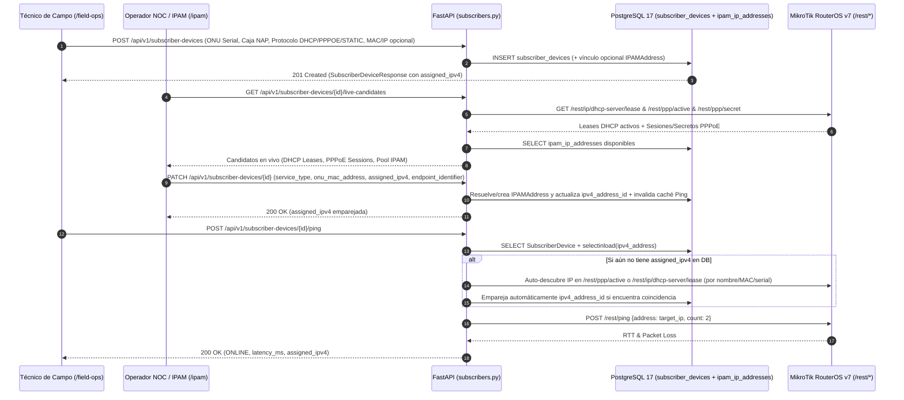

# SPDX-License-Identifier: GPL-3.0-only
# Copyright (C) 2026 Jesus Palencia <sinfallas@gmail.com> (Creado en Tecno Consultores)

# Especificación 70: Emparejamiento de Abonados FTTH (DHCP, PPPoE e IP Estática/IPAM), Reparación de Modales en `/ipam` y Resolución Automática de IP en Diagnóstico de Campo (Hito 28.15)

## 1. Contexto Operativo y Diagnóstico Forense de las 4 Causas Raíz

Al registrar un nuevo cliente FTTH desde el **Panel del Operador de Campo** (`/field-ops`, `FieldTechMobileView.vue`) —por ejemplo el abonado `151515` con caja NAP `1579856`—, dirigirnos a la pestaña **IPAM -> Servicios de Abonados (FTTH / ISP)** (`/ipam`, `IpamManagementView.vue`) para emparejarlo con una sesión PPPoE, un lease DHCP o una IP del IPAM, y finalmente ejecutar el diagnóstico de conectividad desde el panel del operador de campo, se presentan cuatro fallos encadenados:

1. **Causa Raíz #1 — El Panel de Operador de Campo (`FieldTechMobileView.vue`) fuerza `PPPOE` según el Modo ONU y no permite elegir el protocolo WAN (`DHCP` vs `PPPOE` vs `STATIC_IP`):**
   * En [`vue3/src/components/field/FieldTechMobileView.vue`](file:///home/sinfallas/Dropbox/git/tecno-consultores/RoSGrid/vue3/src/components/field/FieldTechMobileView.vue#L54) el formulario inicializa `onu_mode: 'BRIDGE'` por defecto y en `handleRegisterCustomer()` (línea 269) ejecuta:
     ```ts
     service_type: customerForm.value.onu_mode === 'BRIDGE' ? 'PPPOE' : 'DHCP',
     ```
   * Esto acopla erróneamente el modo físico/L2 de la ONU (`BRIDGE` vs `ROUTER`) con el protocolo de acceso WAN (`PPPOE` vs `DHCP` vs `STATIC_IP`). Como resultado, si un ISP **no utiliza PPPoE sino DHCP** (o IP estática), o si la ONU opera en modo `ROUTER (NAT)` con WAN PPPoE o DHCP, el técnico no tiene ningún selector para indicar el protocolo real ni campo opcional para ingresar la MAC (`onu_mac_address`) o IPv4 (`assigned_ipv4`), quedando el abonado registrado forzosamente como `PPPOE` y con `pppoe_username = endpoint_identifier` (`151515`).

2. **Causa Raíz #2 — La tabla `Servicios de Abonados (FTTH / ISP)` en `/ipam` (`IpamManagementView.vue`) carece de columna de IP emparejada y de botón/modal para emparejar el abonado con DHCP, PPPoE o IPAM:**
   * En [`vue3/src/views/IpamManagementView.vue`](file:///home/sinfallas/Dropbox/git/tecno-consultores/RoSGrid/vue3/src/views/IpamManagementView.vue#L497-L601), la tabla muestra `Usuario PPPoE: 151515` (porque `@property def pppoe_username` en `models/ipam.py:349` devuelve `self.endpoint_identifier`), pero **no muestra el Serial de la ONU (`device_serial`), la MAC (`onu_mac_address`) ni la IPv4 asignada (`assigned_ipv4`)**.
   * En la columna `Acciones` (líneas 556-598) solo existen los botones `📍 Ubicación`, `🔒`, `🟢`, `⚡ Plan` y `📜 Queue`. **No existe ningún botón `🔗 Emparejar Red` (`#btn-pair-subscriber-{id}`)** ni modal que permita al operador:
     * Cambiar el protocolo del abonado a **`DHCP`** (para ISPs que entregan IP por DHCP Server) y emparejarlo en 1 clic con un **Lease DHCP activo** descubierto en vivo desde `/rest/ip/dhcp-server/lease` del router MikroTik (o ingresando su MAC/IPv4),
     * Emparejarlo con una **Sesión PPPoE activa** (`/rest/ppp/active`) o **Secreto PPPoE** (`/rest/ppp/secret`) del router MikroTik, o
     * Asignarle una **Dirección IPv4 del Pool IPAM** (`ipam_ip_addresses`) o IP estática.

3. **Causa Raíz #3 — Los modales en `IpamManagementView.vue` (`Registrar Nuevo Servicio FTTH` y `Ubicación Geográfica`) carecen de estilos CSS scoped (`.rg-modal-backdrop`, `.rg-modal`) y no adaptan sus campos a `DHCP` / `STATIC_IP`:**
   * En [`vue3/src/views/IpamManagementView.vue`](file:///home/sinfallas/Dropbox/git/tecno-consultores/RoSGrid/vue3/src/views/IpamManagementView.vue#L741-L850), los modales utilizan las clases `.rg-modal-backdrop`, `.rg-modal`, `.modal-backdrop`, `.modal-card`, `.modal-header`, `.modal-body` y `.modal-footer`, las cuales **no están declaradas en el bloque `<style scoped>`** del componente. Por ello, al pulsar `+ Registrar Abonado`, el formulario se renderiza incrustado al final de la página sin superposición modal (*overlay*), y además muestra fijo el campo `Usuario PPPoE` incluso cuando el usuario selecciona `Protocolo: DHCP` o `Estático`.

4. **Causa Raíz #4 — `POST /api/v1/subscriber-devices/{device_id}/ping` (`subscribers.py`) omite `selectinload(SubscriberDevice.ipv4_address)` y carece de resolución automática de IP en vivo:**
   * En [`fastapi/src/schemas/ipam.py`](file:///home/sinfallas/Dropbox/git/tecno-consultores/RoSGrid/fastapi/src/schemas/ipam.py#L300-L335), `SubscriberDeviceResponse` omitía el campo `assigned_ipv4: Optional[str] = None`, y `SubscriberDeviceCreate` / `SubscriberDeviceUpdate` no permitían enviar `assigned_ipv4: Optional[str] = None` para vincular o crear automáticamente el registro en `ipam_ip_addresses`.
   * En [`fastapi/src/api/v1/subscribers.py`](file:///home/sinfallas/Dropbox/git/tecno-consultores/RoSGrid/fastapi/src/api/v1/subscribers.py#L922-L940), `ping_subscriber_device_live` ejecutaba `select(SubscriberDevice)` **sin `.options(selectinload(SubscriberDevice.ipv4_address))`**. Dado que `@property def assigned_ipv4` en `models/ipam.py:368` evalúa `self.__dict__.get("ipv4_address")`, `dev.assigned_ipv4` retornaba **siempre `None`** durante el ping, disparando `HTTPException(status_code=400, detail="El dispositivo no tiene dirección IPv4 asignada para realizar ping")` y mostrando en el panel de campo `"El equipo no respondió al diagnóstico."`.

---

## 2. Arquitectura de la Solución (Nivel 11X)



---

## 3. Plan de Implementación Exacto (Flash-Ready para Gemini 3.8 Flash High)

### 3.1. Esquemas Pydantic de Emparejamiento e IPv4 Asignada (`fastapi/src/schemas/ipam.py`)

Exponer `assigned_ipv4: Optional[str] = None` en `SubscriberDeviceCreate`, `SubscriberDeviceUpdate` y `SubscriberDeviceResponse`, y añadir los esquemas `SubscriberLiveCandidateDhcpLease`, `SubscriberLiveCandidatePppoe` y `SubscriberLiveCandidatesResponse`.

* **Archivo:** `fastapi/src/schemas/ipam.py`
* **Bloque `Target`:**
```python
class SubscriberDeviceCreate(BaseModel):
    router_id: uuid.UUID
    endpoint_identifier: Optional[str] = Field(None, max_length=64)
    service_type: CustomerServiceTypeEnum = CustomerServiceTypeEnum.PPPOE
    auth_backend: AuthBackendEnum = AuthBackendEnum.LOCAL_SECRET
    pppoe_password: Optional[str] = Field(None, min_length=4, max_length=64)
    ipv4_address_id: Optional[uuid.UUID] = None
    ipv6_delegated_prefix: Optional[str] = None
```
* **Bloque `Replacement`:**
```python
class SubscriberDeviceCreate(BaseModel):
    router_id: uuid.UUID
    endpoint_identifier: Optional[str] = Field(None, max_length=64)
    service_type: CustomerServiceTypeEnum = CustomerServiceTypeEnum.PPPOE
    auth_backend: AuthBackendEnum = AuthBackendEnum.LOCAL_SECRET
    pppoe_password: Optional[str] = Field(None, min_length=4, max_length=64)
    ipv4_address_id: Optional[uuid.UUID] = None
    assigned_ipv4: Optional[str] = Field(None, max_length=45)
    ipv6_delegated_prefix: Optional[str] = None
```

* **Segundo Bloque `Target` en `fastapi/src/schemas/ipam.py`:**
```python
class SubscriberDeviceUpdate(BaseModel):
    endpoint_identifier: Optional[str] = None
    service_type: Optional[CustomerServiceTypeEnum] = None
    auth_backend: Optional[AuthBackendEnum] = None
    pppoe_password: Optional[str] = None
    ipv4_address_id: Optional[uuid.UUID] = None
    ipv6_delegated_prefix: Optional[str] = None
```
* **Segundo Bloque `Replacement` en `fastapi/src/schemas/ipam.py`:**
```python
class SubscriberDeviceUpdate(BaseModel):
    endpoint_identifier: Optional[str] = None
    service_type: Optional[CustomerServiceTypeEnum] = None
    auth_backend: Optional[AuthBackendEnum] = None
    pppoe_password: Optional[str] = None
    ipv4_address_id: Optional[uuid.UUID] = None
    assigned_ipv4: Optional[str] = Field(None, max_length=45)
    ipv6_delegated_prefix: Optional[str] = None
```

* **Tercer Bloque `Target` en `fastapi/src/schemas/ipam.py`:**
```python
class SubscriberDeviceResponse(BaseModel):
    id: uuid.UUID
    tenant_id: uuid.UUID
    router_id: uuid.UUID
    service_type: CustomerServiceTypeEnum
    auth_backend: AuthBackendEnum
    endpoint_identifier: Optional[str] = None
    pppoe_username: Optional[str] = None
    ipv4_address_id: Optional[uuid.UUID] = None
    ipv6_delegated_prefix: Optional[str] = None
```
* **Tercer Bloque `Replacement` en `fastapi/src/schemas/ipam.py`:**
```python
class SubscriberLiveCandidateDhcpLease(BaseModel):
    address: str
    mac_address: Optional[str] = None
    host_name: Optional[str] = None
    server: Optional[str] = None
    status: Optional[str] = None
    comment: Optional[str] = None


class SubscriberLiveCandidatePppoe(BaseModel):
    name: str
    address: Optional[str] = None
    caller_id: Optional[str] = None
    service: Optional[str] = None
    uptime: Optional[str] = None
    source: str = "active"


class SubscriberLiveCandidatesResponse(BaseModel):
    device_id: uuid.UUID
    router_id: uuid.UUID
    router_name: str
    dhcp_leases: list[SubscriberLiveCandidateDhcpLease] = Field(default_factory=list)
    pppoe_sessions: list[SubscriberLiveCandidatePppoe] = Field(default_factory=list)
    ipam_addresses: list[IPAMAddressResponse] = Field(default_factory=list)


class SubscriberDeviceResponse(BaseModel):
    id: uuid.UUID
    tenant_id: uuid.UUID
    router_id: uuid.UUID
    service_type: CustomerServiceTypeEnum
    auth_backend: AuthBackendEnum
    endpoint_identifier: Optional[str] = None
    pppoe_username: Optional[str] = None
    ipv4_address_id: Optional[uuid.UUID] = None
    assigned_ipv4: Optional[str] = None
    ipv6_delegated_prefix: Optional[str] = None
```

---

### 3.2. Resolución/Creación Automática de IPAM IPv4, Endpoint `GET /live-candidates` y Auto-Descubrimiento en Ping (`fastapi/src/api/v1/subscribers.py`)

En `fastapi/src/api/v1/subscribers.py`:
1. Importar `SubscriberLiveCandidateDhcpLease`, `SubscriberLiveCandidatePppoe` y `SubscriberLiveCandidatesResponse` desde `src.schemas.ipam`.
2. Añadir el helper `_resolve_or_create_subscriber_ipv4(db, tenant_id, router_id, raw_ipv4, mac_address, description)` que busca o crea automáticamente la dirección en `IPAMAddress` (creando un prefijo `/24` contenedor en la VRF por defecto si aún no existe un prefijo para esa subred) y retorna su `IPAMAddress.id`.
3. En `create_subscriber_device` y `update_subscriber_device`, si el payload incluye `assigned_ipv4`, resolver/crear la `IPAMAddress` y recargar la relación `ipv4_address` con `selectinload(SubscriberDevice.ipv4_address)`. Además, invalidar la caché de ping en `DiagnosticGovernor.invalidate_cached_ping(tenant_id, device.id)`.
4. Crear el endpoint `GET /api/v1/subscriber-devices/{device_id}/live-candidates` que consulta en vivo `/ip/dhcp-server/lease`, `/ppp/active` y `/ppp/secret` en el router MikroTik del abonado más las direcciones `IPAMAddress` del tenant.
5. En `ping_subscriber_device_live` (`POST /api/v1/subscriber-devices/{device_id}/ping`), cargar `.options(selectinload(SubscriberDevice.ipv4_address))` y, si `target_ip` sigue siendo `None`, invocar `_discover_and_pair_live_ip_from_router(db, tenant_id, r, dev)` para buscar la IP activa del abonado en `/ppp/active` o `/ip/dhcp-server/lease` antes de lanzar el ping.

* **Archivo:** `fastapi/src/api/v1/subscribers.py`
* **Primer Bloque `Target` (Importaciones en `fastapi/src/api/v1/subscribers.py`):**
```python
from src.schemas.ipam import (
    BandwidthProfileCreate,
    BandwidthProfileResponse,
    BandwidthProfileUpdate,
    ChangeRateLimitRequest,
    OpticalBoxCreate,
    OpticalBoxDetailResponse,
    OpticalBoxPortStatus,
    OpticalBoxResponse,
    OpticalBoxUpdate,
    SimulateSubscribersResponse,
    SubscriberDeviceCreate,
    SubscriberDevicePingResponse,
    SubscriberDeviceResponse,
    SubscriberDeviceUpdate,
    SyncDhcpClientsResponse,
)
```
* **Primer Bloque `Replacement`:**
```python
from src.schemas.ipam import (
    BandwidthProfileCreate,
    BandwidthProfileResponse,
    BandwidthProfileUpdate,
    ChangeRateLimitRequest,
    IPAMAddressResponse,
    OpticalBoxCreate,
    OpticalBoxDetailResponse,
    OpticalBoxPortStatus,
    OpticalBoxResponse,
    OpticalBoxUpdate,
    SimulateSubscribersResponse,
    SubscriberDeviceCreate,
    SubscriberDevicePingResponse,
    SubscriberDeviceResponse,
    SubscriberDeviceUpdate,
    SubscriberLiveCandidateDhcpLease,
    SubscriberLiveCandidatePppoe,
    SubscriberLiveCandidatesResponse,
    SyncDhcpClientsResponse,
)
```

* **Segundo Bloque `Target` (En `create_subscriber_device` y `update_subscriber_device`, líneas 746-874 de `fastapi/src/api/v1/subscribers.py`):**
```python
    device = SubscriberDevice(
        tenant_id=tenant_id,
        router_id=payload.router_id,
        endpoint_identifier=ep_id,
        service_type=payload.service_type,
        auth_backend=payload.auth_backend,
        bandwidth_profile_id=payload.bandwidth_profile_id,
        ipv4_address_id=payload.ipv4_address_id,
        ipv6_delegated_prefix=payload.ipv6_delegated_prefix,
        onu_mode=payload.onu_mode,
        onu_mac_address=payload.onu_mac_address,
        device_serial=serial,
        cpe_wifi_mac_address=payload.cpe_wifi_mac_address,
        pon_port=payload.pon_port,
        optical_box=resolved_box_code,
        optical_box_id=payload.optical_box_id,
        optical_box_port=payload.optical_box_port,
        rx_optical_power_dbm=payload.rx_optical_power_dbm,
        drop_cable_meters=payload.drop_cable_meters,
        is_custom_coordinates=payload.is_custom_coordinates or (payload.latitude is not None and payload.longitude is not None),
        latitude=payload.latitude,
        longitude=payload.longitude,
        status=CustomerServiceStatusEnum.ACTIVE if payload.optical_box_id else CustomerServiceStatusEnum.PENDING_INSTALL,
        last_reachability_status="ONLINE",
    )
    db.add(device)
    await db.commit()
    await db.refresh(device)

    await write_audit_log(
        session=db,
        tenant_id=tenant_id,
        actor_user_id=uuid.UUID(str(claims["sub"])),
        actor_username=str(claims.get("username", "system")),
        actor_role=claims.get("rol"),
        actor_ip="127.0.0.1",
        event_category="NETWORK",
        event_action="CREATE_SUBSCRIBER_DEVICE",
        after_state={
            "endpoint_identifier": device.endpoint_identifier,
            "router_id": str(device.router_id),
            "optical_box": device.optical_box,
            "optical_box_port": device.optical_box_port,
        },
    )
    return device


@subscribers_router.get("/{device_id}", response_model=SubscriberDeviceResponse)
async def get_subscriber_device(
    device_id: uuid.UUID,
    db: AsyncSession = Depends(get_tenant_db_session),
    claims: dict[str, Any] = Depends(
        require_roles(
            SystemRoleEnum.SUPERADMIN_GLOBAL,
            SystemRoleEnum.TENANT_ADMIN,
            SystemRoleEnum.NOC_MONITOR,
            SystemRoleEnum.FIELD_TECH,
        )
    ),
) -> SubscriberDevice:
    tenant_id = get_tenant_id(claims)
    stmt = (
        select(SubscriberDevice)
        .options(selectinload(SubscriberDevice.ipv4_address))
        .where(SubscriberDevice.id == device_id, SubscriberDevice.tenant_id == tenant_id)
    )
    device = (await db.execute(stmt)).scalar_one_or_none()
    if not device:
        raise HTTPException(status_code=status.HTTP_404_NOT_FOUND, detail="Dispositivo de abonado no encontrado")
    return device


@subscribers_router.patch("/{device_id}", response_model=SubscriberDeviceResponse)
async def update_subscriber_device(
    device_id: uuid.UUID,
    payload: SubscriberDeviceUpdate,
    db: AsyncSession = Depends(get_tenant_db_session),
    claims: dict[str, Any] = Depends(
        require_roles(
            SystemRoleEnum.SUPERADMIN_GLOBAL,
            SystemRoleEnum.TENANT_ADMIN,
            SystemRoleEnum.NOC_MONITOR,
            SystemRoleEnum.FIELD_TECH,
        )
    ),
) -> SubscriberDevice:
    tenant_id = get_tenant_id(claims)
    stmt = select(SubscriberDevice).where(SubscriberDevice.id == device_id, SubscriberDevice.tenant_id == tenant_id)
    device = (await db.execute(stmt)).scalar_one_or_none()
    if not device:
        raise HTTPException(status_code=status.HTTP_404_NOT_FOUND, detail="Dispositivo de abonado no encontrado")

    update_dict = payload.model_dump(exclude_unset=True)
    if "onu_serial_number" in update_dict and "device_serial" not in update_dict:
        update_dict["device_serial"] = update_dict.pop("onu_serial_number")

    reset_coords = update_dict.pop("reset_to_router_coordinates", False)
    if reset_coords:
        stmt_r = select(Router).where(Router.id == device.router_id)
        r_obj = (await db.execute(stmt_r)).scalar_one_or_none()
        if r_obj:
            device.latitude = r_obj.latitude
            device.longitude = r_obj.longitude
            device.optical_box = r_obj.physical_location or r_obj.display_name
            device.is_custom_coordinates = False
    elif "latitude" in update_dict or "longitude" in update_dict:
        device.is_custom_coordinates = True

    for field, val in update_dict.items():
        if hasattr(device, field):
            setattr(device, field, val)

    await db.commit()
    await db.refresh(device)

    await write_audit_log(
        session=db,
        tenant_id=tenant_id,
        actor_user_id=uuid.UUID(str(claims["sub"])),
        actor_username=str(claims.get("username", "system")),
        actor_role=claims.get("rol"),
        actor_ip="127.0.0.1",
        event_category="NETWORK",
        event_action="UPDATE_SUBSCRIBER_DEVICE",
        after_state={"endpoint_identifier": device.endpoint_identifier, "updated_fields": list(update_dict.keys())},
    )
    return device
```
* **Segundo Bloque `Replacement`:**
```python
    resolved_ipv4_id = payload.ipv4_address_id
    if not resolved_ipv4_id and payload.assigned_ipv4:
        resolved_ipv4_id = await _resolve_or_create_subscriber_ipv4(
            db=db,
            tenant_id=tenant_id,
            router_id=payload.router_id,
            raw_ipv4=payload.assigned_ipv4,
            mac_address=payload.onu_mac_address,
            description=f"Abonado FTTH {ep_id}",
        )

    device = SubscriberDevice(
        tenant_id=tenant_id,
        router_id=payload.router_id,
        endpoint_identifier=ep_id,
        service_type=payload.service_type,
        auth_backend=payload.auth_backend,
        bandwidth_profile_id=payload.bandwidth_profile_id,
        ipv4_address_id=resolved_ipv4_id,
        ipv6_delegated_prefix=payload.ipv6_delegated_prefix,
        onu_mode=payload.onu_mode,
        onu_mac_address=payload.onu_mac_address,
        device_serial=serial,
        cpe_wifi_mac_address=payload.cpe_wifi_mac_address,
        pon_port=payload.pon_port,
        optical_box=resolved_box_code,
        optical_box_id=payload.optical_box_id,
        optical_box_port=payload.optical_box_port,
        rx_optical_power_dbm=payload.rx_optical_power_dbm,
        drop_cable_meters=payload.drop_cable_meters,
        is_custom_coordinates=payload.is_custom_coordinates or (payload.latitude is not None and payload.longitude is not None),
        latitude=payload.latitude,
        longitude=payload.longitude,
        status=CustomerServiceStatusEnum.ACTIVE if payload.optical_box_id else CustomerServiceStatusEnum.PENDING_INSTALL,
        last_reachability_status="ONLINE",
    )
    db.add(device)
    await db.commit()

    stmt_reload = (
        select(SubscriberDevice)
        .options(selectinload(SubscriberDevice.ipv4_address))
        .where(SubscriberDevice.id == device.id)
    )
    device = (await db.execute(stmt_reload)).scalar_one()

    await write_audit_log(
        session=db,
        tenant_id=tenant_id,
        actor_user_id=uuid.UUID(str(claims["sub"])),
        actor_username=str(claims.get("username", "system")),
        actor_role=claims.get("rol"),
        actor_ip="127.0.0.1",
        event_category="NETWORK",
        event_action="CREATE_SUBSCRIBER_DEVICE",
        after_state={
            "endpoint_identifier": device.endpoint_identifier,
            "router_id": str(device.router_id),
            "service_type": device.service_type.value,
            "assigned_ipv4": device.assigned_ipv4,
            "optical_box": device.optical_box,
            "optical_box_port": device.optical_box_port,
        },
    )
    return device


async def _resolve_or_create_subscriber_ipv4(
    db: AsyncSession,
    tenant_id: uuid.UUID,
    router_id: uuid.UUID,
    raw_ipv4: str,
    mac_address: Optional[str] = None,
    description: Optional[str] = None,
) -> Optional[uuid.UUID]:
    """Busca o registra en IPAMAddress la IPv4 asignada al abonado FTTH."""
    clean_ip = raw_ipv4.strip().split("/")[0].strip()
    if not clean_ip:
        return None
    try:
        ip_obj = ipaddress.ip_address(clean_ip)
    except ValueError as exc:
        raise HTTPException(
            status_code=status.HTTP_422_UNPROCESSABLE_CONTENT,
            detail=f"Dirección IPv4 inválida: '{raw_ipv4}'",
        ) from exc

    stmt_existing = select(IPAMAddress).where(
        IPAMAddress.tenant_id == tenant_id,
        func.host(IPAMAddress.address) == str(ip_obj),
    )
    existing_addr = (await db.execute(stmt_existing)).scalar_one_or_none()
    if existing_addr:
        if mac_address:
            existing_addr.mac_address = mac_address
        if description:
            existing_addr.description = description
        existing_addr.router_id = router_id
        await db.flush()
        return existing_addr.id

    default_vrf = await _get_or_create_default_vrf(db, tenant_id)
    net_24 = ipaddress.ip_network(f"{ip_obj}/24", strict=False) if ip_obj.version == 4 else ipaddress.ip_network(f"{ip_obj}/64", strict=False)
    stmt_pfx = select(IPAMPrefix).where(
        IPAMPrefix.tenant_id == tenant_id,
        IPAMPrefix.prefix == str(net_24),
    )
    prefix_obj = (await db.execute(stmt_pfx)).scalar_one_or_none()
    if not prefix_obj:
        prefix_obj = IPAMPrefix(
            tenant_id=tenant_id,
            vrf_id=default_vrf.id,
            prefix=str(net_24),
            ip_family=IPFamilyEnum.IPV4 if ip_obj.version == 4 else IPFamilyEnum.IPV6,
            role=IPPrefixRoleEnum.CUSTOMER_RESIDENTIAL,
            status=IPPrefixStatusEnum.ACTIVE,
            is_pool=True,
            description=f"Pool auto-registrado para abonados FTTH ({net_24})",
        )
        db.add(prefix_obj)
        await db.flush()

    new_addr = IPAMAddress(
        tenant_id=tenant_id,
        prefix_id=prefix_obj.id,
        address=str(ip_obj),
        ip_family=IPFamilyEnum.IPV4 if ip_obj.version == 4 else IPFamilyEnum.IPV6,
        status=IPAddressStatusEnum.ALLOCATED,
        router_id=router_id,
        mac_address=mac_address,
        description=description or "Abonado FTTH emparejado",
    )
    db.add(new_addr)
    await db.flush()
    return new_addr.id


@subscribers_router.get("/{device_id}/live-candidates", response_model=SubscriberLiveCandidatesResponse)
async def get_subscriber_live_pairing_candidates(
    device_id: uuid.UUID,
    db: AsyncSession = Depends(get_tenant_db_session),
    claims: dict[str, Any] = Depends(
        require_roles(
            SystemRoleEnum.SUPERADMIN_GLOBAL,
            SystemRoleEnum.TENANT_ADMIN,
            SystemRoleEnum.NOC_MONITOR,
            SystemRoleEnum.FIELD_TECH,
        )
    ),
) -> SubscriberLiveCandidatesResponse:
    """Consulta en vivo en el router MikroTik del abonado los Leases DHCP activos, Sesiones/Secretos PPPoE
    y direcciones IPAM disponibles para emparejar una ONU recién registrada en 1 clic.
    """
    tenant_id = get_tenant_id(claims)
    stmt_dev = select(SubscriberDevice).where(
        SubscriberDevice.id == device_id,
        SubscriberDevice.tenant_id == tenant_id,
    )
    dev = (await db.execute(stmt_dev)).scalar_one_or_none()
    if not dev:
        raise HTTPException(status_code=status.HTTP_404_NOT_FOUND, detail="Dispositivo de abonado no encontrado")

    stmt_r = select(Router).where(Router.id == dev.router_id, Router.tenant_id == tenant_id)
    r = (await db.execute(stmt_r)).scalar_one_or_none()
    if not r:
        raise HTTPException(status_code=status.HTTP_404_NOT_FOUND, detail="Router asignador no encontrado")

    dhcp_candidates: list[SubscriberLiveCandidateDhcpLease] = []
    pppoe_candidates: list[SubscriberLiveCandidatePppoe] = []
    seen_pppoe_names: set[str] = set()

    client = _get_router_client(r, tenant_id)
    try:
        async with client:
            raw_leases = await client.get("/ip/dhcp-server/lease")
            if isinstance(raw_leases, list):
                for item in raw_leases:
                    if not isinstance(item, dict):
                        continue
                    addr = str(item.get("address") or item.get("active-address") or "").strip()
                    if not addr:
                        continue
                    dhcp_candidates.append(
                        SubscriberLiveCandidateDhcpLease(
                            address=addr,
                            mac_address=str(item.get("mac-address") or item.get("active-mac-address") or "").strip() or None,
                            host_name=str(item.get("host-name") or "").strip() or None,
                            server=str(item.get("server") or "").strip() or None,
                            status=str(item.get("status") or "bound").strip(),
                            comment=str(item.get("comment") or "").strip() or None,
                        )
                    )

            raw_ppp_active = await client.get("/ppp/active")
            if isinstance(raw_ppp_active, list):
                for item in raw_ppp_active:
                    if not isinstance(item, dict):
                        continue
                    name = str(item.get("name") or "").strip()
                    if not name:
                        continue
                    seen_pppoe_names.add(name)
                    pppoe_candidates.append(
                        SubscriberLiveCandidatePppoe(
                            name=name,
                            address=str(item.get("address") or "").strip() or None,
                            caller_id=str(item.get("caller-id") or "").strip() or None,
                            service=str(item.get("service") or "pppoe").strip(),
                            uptime=str(item.get("uptime") or "").strip() or None,
                            source="active",
                        )
                    )

            raw_ppp_secrets = await client.get("/ppp/secret")
            if isinstance(raw_ppp_secrets, list):
                for item in raw_ppp_secrets:
                    if not isinstance(item, dict):
                        continue
                    name = str(item.get("name") or "").strip()
                    if not name or name in seen_pppoe_names:
                        continue
                    pppoe_candidates.append(
                        SubscriberLiveCandidatePppoe(
                            name=name,
                            address=str(item.get("remote-address") or "").strip() or None,
                            caller_id=str(item.get("caller-id") or "").strip() or None,
                            service=str(item.get("service") or "pppoe").strip(),
                            uptime=None,
                            source="secret",
                        )
                    )
    except Exception as e:
        logger.warning(f"Sondeo de candidatos en vivo en router {r.display_name} retornó aviso: {e}")

    stmt_ips = (
        select(IPAMAddress)
        .where(IPAMAddress.tenant_id == tenant_id)
        .order_by(IPAMAddress.created_at.desc())
        .limit(100)
    )
    ipam_rows = list((await db.execute(stmt_ips)).scalars().all())

    return SubscriberLiveCandidatesResponse(
        device_id=dev.id,
        router_id=r.id,
        router_name=r.display_name,
        dhcp_leases=dhcp_candidates,
        pppoe_sessions=pppoe_candidates,
        ipam_addresses=[IPAMAddressResponse.model_validate(ip) for ip in ipam_rows],
    )


@subscribers_router.get("/{device_id}", response_model=SubscriberDeviceResponse)
async def get_subscriber_device(
    device_id: uuid.UUID,
    db: AsyncSession = Depends(get_tenant_db_session),
    claims: dict[str, Any] = Depends(
        require_roles(
            SystemRoleEnum.SUPERADMIN_GLOBAL,
            SystemRoleEnum.TENANT_ADMIN,
            SystemRoleEnum.NOC_MONITOR,
            SystemRoleEnum.FIELD_TECH,
        )
    ),
) -> SubscriberDevice:
    tenant_id = get_tenant_id(claims)
    stmt = (
        select(SubscriberDevice)
        .options(selectinload(SubscriberDevice.ipv4_address))
        .where(SubscriberDevice.id == device_id, SubscriberDevice.tenant_id == tenant_id)
    )
    device = (await db.execute(stmt)).scalar_one_or_none()
    if not device:
        raise HTTPException(status_code=status.HTTP_404_NOT_FOUND, detail="Dispositivo de abonado no encontrado")
    return device


@subscribers_router.patch("/{device_id}", response_model=SubscriberDeviceResponse)
async def update_subscriber_device(
    device_id: uuid.UUID,
    payload: SubscriberDeviceUpdate,
    db: AsyncSession = Depends(get_tenant_db_session),
    claims: dict[str, Any] = Depends(
        require_roles(
            SystemRoleEnum.SUPERADMIN_GLOBAL,
            SystemRoleEnum.TENANT_ADMIN,
            SystemRoleEnum.NOC_MONITOR,
            SystemRoleEnum.FIELD_TECH,
        )
    ),
) -> SubscriberDevice:
    tenant_id = get_tenant_id(claims)
    stmt = (
        select(SubscriberDevice)
        .options(selectinload(SubscriberDevice.ipv4_address))
        .where(SubscriberDevice.id == device_id, SubscriberDevice.tenant_id == tenant_id)
    )
    device = (await db.execute(stmt)).scalar_one_or_none()
    if not device:
        raise HTTPException(status_code=status.HTTP_404_NOT_FOUND, detail="Dispositivo de abonado no encontrado")

    update_dict = payload.model_dump(exclude_unset=True)
    if "onu_serial_number" in update_dict and "device_serial" not in update_dict:
        update_dict["device_serial"] = update_dict.pop("onu_serial_number")
    if "pppoe_username" in update_dict and "endpoint_identifier" not in update_dict and update_dict["pppoe_username"]:
        update_dict["endpoint_identifier"] = update_dict.pop("pppoe_username")

    raw_assigned_ipv4 = update_dict.pop("assigned_ipv4", None)
    if raw_assigned_ipv4:
        resolved_ip_id = await _resolve_or_create_subscriber_ipv4(
            db=db,
            tenant_id=tenant_id,
            router_id=device.router_id,
            raw_ipv4=raw_assigned_ipv4,
            mac_address=update_dict.get("onu_mac_address") or device.onu_mac_address,
            description=f"Abonado FTTH {update_dict.get('endpoint_identifier') or device.endpoint_identifier}",
        )
        if resolved_ip_id:
            device.ipv4_address_id = resolved_ip_id

    reset_coords = update_dict.pop("reset_to_router_coordinates", False)
    if reset_coords:
        stmt_r = select(Router).where(Router.id == device.router_id)
        r_obj = (await db.execute(stmt_r)).scalar_one_or_none()
        if r_obj:
            device.latitude = r_obj.latitude
            device.longitude = r_obj.longitude
            device.optical_box = r_obj.physical_location or r_obj.display_name
            device.is_custom_coordinates = False
    elif "latitude" in update_dict or "longitude" in update_dict:
        device.is_custom_coordinates = True

    for field, val in update_dict.items():
        if hasattr(device, field):
            setattr(device, field, val)

    await db.commit()
    await DiagnosticGovernor.invalidate_cached_ping(tenant_id, device.id)

    stmt_reload = (
        select(SubscriberDevice)
        .options(selectinload(SubscriberDevice.ipv4_address))
        .where(SubscriberDevice.id == device.id)
    )
    device = (await db.execute(stmt_reload)).scalar_one()

    await write_audit_log(
        session=db,
        tenant_id=tenant_id,
        actor_user_id=uuid.UUID(str(claims["sub"])),
        actor_username=str(claims.get("username", "system")),
        actor_role=claims.get("rol"),
        actor_ip="127.0.0.1",
        event_category="NETWORK",
        event_action="UPDATE_SUBSCRIBER_DEVICE",
        after_state={
            "endpoint_identifier": device.endpoint_identifier,
            "service_type": device.service_type.value,
            "assigned_ipv4": device.assigned_ipv4,
            "updated_fields": list(update_dict.keys()),
        },
    )
    return device
```

* **Tercer Bloque `Target` (En `ping_subscriber_device_live`, líneas 922-946 de `fastapi/src/api/v1/subscribers.py`):**
```python
    stmt = select(SubscriberDevice).where(
        SubscriberDevice.id == device_id,
        SubscriberDevice.tenant_id == tenant_id,
    )
    dev = (await db.execute(stmt)).scalar_one_or_none()
    if not dev:
        raise HTTPException(status_code=status.HTTP_404_NOT_FOUND, detail="Dispositivo de red no encontrado")

    target_ip = dev.assigned_ipv4
    if not target_ip and dev.endpoint_identifier and "(" in dev.endpoint_identifier:
        parts = dev.endpoint_identifier.split("(")
        if len(parts) > 1:
            target_ip = parts[1].replace(")", "").strip()

    if not target_ip:
        raise HTTPException(
            status_code=status.HTTP_400_BAD_REQUEST,
            detail="El dispositivo no tiene dirección IPv4 asignada para realizar ping",
        )

    stmt_r = select(Router).where(Router.id == dev.router_id, Router.tenant_id == tenant_id)
    r = (await db.execute(stmt_r)).scalar_one_or_none()
    if not r:
        raise HTTPException(status_code=status.HTTP_404_NOT_FOUND, detail="Router asignador no encontrado")
```
* **Tercer Bloque `Replacement`:**
```python
    stmt = (
        select(SubscriberDevice)
        .options(selectinload(SubscriberDevice.ipv4_address))
        .where(
            SubscriberDevice.id == device_id,
            SubscriberDevice.tenant_id == tenant_id,
        )
    )
    dev = (await db.execute(stmt)).scalar_one_or_none()
    if not dev:
        raise HTTPException(status_code=status.HTTP_404_NOT_FOUND, detail="Dispositivo de red no encontrado")

    stmt_r = select(Router).where(Router.id == dev.router_id, Router.tenant_id == tenant_id)
    r = (await db.execute(stmt_r)).scalar_one_or_none()
    if not r:
        raise HTTPException(status_code=status.HTTP_404_NOT_FOUND, detail="Router asignador no encontrado")

    target_ip = dev.assigned_ipv4
    if not target_ip and dev.endpoint_identifier and "(" in dev.endpoint_identifier:
        parts = dev.endpoint_identifier.split("(")
        if len(parts) > 1:
            target_ip = parts[1].replace(")", "").strip()

    if not target_ip:
        target_ip = await _discover_and_pair_live_ip_from_router(db, tenant_id, r, dev)

    if not target_ip:
        raise HTTPException(
            status_code=status.HTTP_400_BAD_REQUEST,
            detail=(
                f"El abonado '{dev.endpoint_identifier}' ({dev.service_type.value}) aún no tiene dirección IPv4, "
                "Lease DHCP ni sesión PPPoE emparejada. Vincúlelo desde IPAM -> 🔗 Emparejar Red."
            ),
        )
```

* **Cuarto Bloque (Helper `_discover_and_pair_live_ip_from_router` justo antes de `ping_subscriber_device_live` en `fastapi/src/api/v1/subscribers.py`):**
```python
async def _discover_and_pair_live_ip_from_router(
    db: AsyncSession,
    tenant_id: uuid.UUID,
    r: Router,
    dev: SubscriberDevice,
) -> Optional[str]:
    """Intenta descubrir en vivo la IPv4 del abonado en /ppp/active o /ip/dhcp-server/lease
    cuando aún no ha sido emparejado manualmente en IPAM. Si encuentra coincidencia por
    endpoint_identifier, MAC o serial de ONU, persiste el emparejamiento automáticamente.
    """
    discovered_ip: Optional[str] = None
    discovered_mac: Optional[str] = dev.onu_mac_address
    ep_lower = (dev.endpoint_identifier or "").strip().lower()
    mac_upper = (dev.onu_mac_address or "").strip().upper()
    serial_lower = (dev.device_serial or "").strip().lower()

    client = _get_router_client(r, tenant_id)
    try:
        async with client:
            # 1. Buscar en sesiones PPPoE activas (/ppp/active)
            ppp_active = await client.get("/ppp/active")
            if isinstance(ppp_active, list):
                for item in ppp_active:
                    if not isinstance(item, dict):
                        continue
                    name = str(item.get("name") or "").strip().lower()
                    caller = str(item.get("caller-id") or "").strip().upper()
                    addr = str(item.get("address") or "").strip()
                    if addr and ((ep_lower and name == ep_lower) or (mac_upper and caller == mac_upper)):
                        discovered_ip = addr
                        if caller and not discovered_mac:
                            discovered_mac = caller
                        break

            # 2. Si no apareció en PPPoE activo, buscar en Leases DHCP (/ip/dhcp-server/lease)
            if not discovered_ip:
                leases = await client.get("/ip/dhcp-server/lease")
                if isinstance(leases, list):
                    for item in leases:
                        if not isinstance(item, dict):
                            continue
                        addr = str(item.get("address") or item.get("active-address") or "").strip()
                        mac = str(item.get("mac-address") or item.get("active-mac-address") or "").strip().upper()
                        host = str(item.get("host-name") or "").strip().lower()
                        comment = str(item.get("comment") or "").strip().lower()
                        if not addr:
                            continue
                        if (
                            (mac_upper and mac == mac_upper)
                            or (ep_lower and (ep_lower in host or ep_lower in comment))
                            or (serial_lower and (serial_lower in host or serial_lower in comment))
                        ):
                            discovered_ip = addr
                            if mac and not discovered_mac:
                                discovered_mac = mac
                            break
    except Exception as e:
        logger.warning(f"Auto-descubrimiento en vivo para abonado {dev.endpoint_identifier} falló: {e}")

    if discovered_ip:
        ip_id = await _resolve_or_create_subscriber_ipv4(
            db=db,
            tenant_id=tenant_id,
            router_id=r.id,
            raw_ipv4=discovered_ip,
            mac_address=discovered_mac,
            description=f"Auto-emparejado en vivo ({dev.endpoint_identifier})",
        )
        if ip_id:
            dev.ipv4_address_id = ip_id
            if discovered_mac and not dev.onu_mac_address:
                dev.onu_mac_address = discovered_mac
            await db.commit()
    return discovered_ip
```

---

### 3.3. Tipos Frontend y Store Pinia (`vue3/src/types/index.ts`, `vue3/src/stores/useIpamStore.ts` y `vue3/src/stores/useFieldOpsStore.ts`)

1. En `vue3/src/types/index.ts`, añadir `assigned_ipv4?: string | null;`, `device_serial?: string | null;` y `endpoint_identifier?: string | null;` a `CustomerService`, así como las interfaces `SubscriberLiveCandidateDhcpLease`, `SubscriberLiveCandidatePppoe` y `SubscriberLiveCandidatesResponse`.
2. En `vue3/src/stores/useIpamStore.ts`, añadir `fetchSubscriberLiveCandidates(deviceId)` y `pairSubscriberNetwork(deviceId, payload)`.
3. En `vue3/src/stores/useFieldOpsStore.ts`, permitir `assigned_ipv4?: string;` en `registerSubscriberDevice`.

* **Archivo:** `vue3/src/types/index.ts`
* **Bloque `Target`:**
```typescript
export interface CustomerService {
  id: string;
  tenant_id: string;
  router_id: string;
  customer_name: string;
  customer_code?: string;
  service_type: CustomerServiceType;
  auth_backend: AuthBackend;
  pppoe_username?: string;
  ipv4_address_id?: string;
  ipv6_delegated_prefix?: string;
  onu_mode: ONUMode;
  onu_mac_address?: string;
  onu_serial_number?: string;
  cpe_wifi_mac_address?: string;
  pon_port?: string;
  optical_box?: string;
  last_reachability_status: string;
  last_seen_at?: string;
  status: CustomerServiceStatus;
  physical_address?: string;
  latitude?: number;
  longitude?: number;
  created_at: string;
  updated_at: string;
}
```
* **Bloque `Replacement`:**
```typescript
export interface SubscriberLiveCandidateDhcpLease {
  address: string;
  mac_address?: string | null;
  host_name?: string | null;
  server?: string | null;
  status?: string | null;
  comment?: string | null;
}

export interface SubscriberLiveCandidatePppoe {
  name: string;
  address?: string | null;
  caller_id?: string | null;
  service?: string | null;
  uptime?: string | null;
  source: 'active' | 'secret' | string;
}

export interface SubscriberLiveCandidatesResponse {
  device_id: string;
  router_id: string;
  router_name: string;
  dhcp_leases: SubscriberLiveCandidateDhcpLease[];
  pppoe_sessions: SubscriberLiveCandidatePppoe[];
  ipam_addresses: IPAMAddress[];
}

export interface CustomerService {
  id: string;
  tenant_id: string;
  router_id: string;
  customer_name: string;
  customer_code?: string;
  endpoint_identifier?: string;
  service_type: CustomerServiceType;
  auth_backend: AuthBackend;
  pppoe_username?: string;
  ipv4_address_id?: string;
  assigned_ipv4?: string | null;
  ipv6_delegated_prefix?: string;
  onu_mode: ONUMode;
  onu_mac_address?: string;
  device_serial?: string;
  onu_serial_number?: string;
  cpe_wifi_mac_address?: string;
  pon_port?: string;
  optical_box?: string;
  last_reachability_status: string;
  last_seen_at?: string;
  status: CustomerServiceStatus;
  physical_address?: string;
  latitude?: number;
  longitude?: number;
  created_at: string;
  updated_at: string;
}
```

* **Archivo:** `vue3/src/stores/useIpamStore.ts`
* **Bloque `Target`:**
```typescript
  async function createCustomerService(
    payload: Partial<CustomerService>,
  ): Promise<CustomerService> {
    const { http } = await import('@/api/httpClient');
    const res = await http.post<CustomerService>('/api/v1/ipam/customer-services', payload);
    customerServices.value = [...customerServices.value, res.data];
    triggerRef(customerServices);
    return res.data;
  }
```
* **Bloque `Replacement`:**
```typescript
  async function createCustomerService(
    payload: Partial<CustomerService>,
  ): Promise<CustomerService> {
    const { http } = await import('@/api/httpClient');
    const res = await http.post<CustomerService>('/api/v1/ipam/customer-services', payload);
    customerServices.value = [...customerServices.value, res.data];
    triggerRef(customerServices);
    return res.data;
  }

  async function fetchSubscriberLiveCandidates(
    deviceId: string,
  ): Promise<import('@/types').SubscriberLiveCandidatesResponse> {
    const { http } = await import('@/api/httpClient');
    const res = await http.get<import('@/types').SubscriberLiveCandidatesResponse>(
      `/api/v1/subscriber-devices/${deviceId}/live-candidates`,
    );
    return res.data;
  }

  async function pairSubscriberNetwork(
    deviceId: string,
    payload: {
      service_type: string;
      endpoint_identifier?: string;
      pppoe_username?: string;
      onu_mac_address?: string;
      onu_mode?: string;
      assigned_ipv4?: string;
      ipv4_address_id?: string | null;
    },
  ): Promise<CustomerService> {
    const { http } = await import('@/api/httpClient');
    const res = await http.patch<CustomerService>(
      `/api/v1/subscriber-devices/${deviceId}`,
      payload,
    );
    customerServices.value = customerServices.value.map((s) =>
      s.id === deviceId ? { ...s, ...res.data } : s,
    );
    triggerRef(customerServices);
    return res.data;
  }
```
*(Incluir `fetchSubscriberLiveCandidates` y `pairSubscriberNetwork` en el objeto `return` de `useIpamStore.ts`).*

---

### 3.4. Selector de Protocolo WAN (`DHCP` / `PPPOE` / `STATIC_IP`) y Emparejamiento Opcional en el Panel de Operador de Campo (`vue3/src/components/field/FieldTechMobileView.vue`)

Desacoplar el protocolo WAN (`service_type`) del Modo ONU (`onu_mode`) en `FieldTechMobileView.vue` para que el técnico de campo pueda elegir explícitamente si el servicio usa **DHCP**, **PPPoE** o **IP Estática**, ingresar opcionalmente la MAC o IPv4/Usuario PPPoE, y visualizar la IP emparejada en la pestaña de Diagnósticos.

* **Archivo:** `vue3/src/components/field/FieldTechMobileView.vue`
* **Primer Bloque `Target` (Estado `customerForm` y `handleRegisterCustomer`):**
```typescript
  // Formulario 2: Registrar Nuevo Cliente FTTH
  const customerForm = ref({
    endpoint_identifier: '',
    optical_box_id: '',
    optical_box_port: 1,
    device_serial: '',
    onu_mac_address: '',
    model: 'HG8310M Bridge',
    onu_mode: 'BRIDGE',
    rx_optical_power_dbm: -19.2,
    drop_cable_meters: 65,
    latitude: 10.4806,
    longitude: -66.9036,
  });
```
* **Primer Bloque `Replacement`:**
```typescript
  // Formulario 2: Registrar Nuevo Cliente FTTH
  const customerForm = ref({
    endpoint_identifier: '',
    service_type: 'DHCP' as 'DHCP' | 'PPPOE' | 'STATIC_IP',
    assigned_ipv4: '',
    optical_box_id: '',
    optical_box_port: 1,
    device_serial: '',
    onu_mac_address: '',
    model: 'HG8310M Bridge',
    onu_mode: 'ROUTER',
    rx_optical_power_dbm: -19.2,
    drop_cable_meters: 65,
    latitude: 10.4806,
    longitude: -66.9036,
  });
```

* **Segundo Bloque `Target` (En `handleRegisterCustomer` de `FieldTechMobileView.vue`):**
```typescript
      const dev = await fieldStore.registerSubscriberDevice({
        router_id: routerId,
        endpoint_identifier: customerForm.value.endpoint_identifier.trim(),
        service_type: customerForm.value.onu_mode === 'BRIDGE' ? 'PPPOE' : 'DHCP',
        device_serial: customerForm.value.device_serial.trim().toUpperCase(),
        onu_mac_address: customerForm.value.onu_mac_address.trim() || undefined,
        onu_mode: customerForm.value.onu_mode === 'BRIDGE' ? 'BRIDGE' : 'ROUTER',
        optical_box_id: customerForm.value.optical_box_id,
        optical_box_port: Number(customerForm.value.optical_box_port),
        rx_optical_power_dbm: Number(customerForm.value.rx_optical_power_dbm),
        drop_cable_meters: Number(customerForm.value.drop_cable_meters),
        latitude: Number(customerForm.value.latitude),
        longitude: Number(customerForm.value.longitude),
      });
```
* **Segundo Bloque `Replacement`:**
```typescript
      const dev = await fieldStore.registerSubscriberDevice({
        router_id: routerId,
        endpoint_identifier: customerForm.value.endpoint_identifier.trim(),
        service_type: customerForm.value.service_type,
        assigned_ipv4: customerForm.value.assigned_ipv4.trim() || undefined,
        device_serial: customerForm.value.device_serial.trim().toUpperCase(),
        onu_mac_address: customerForm.value.onu_mac_address.trim() || undefined,
        onu_mode: customerForm.value.onu_mode === 'BRIDGE' ? 'BRIDGE' : 'ROUTER',
        optical_box_id: customerForm.value.optical_box_id,
        optical_box_port: Number(customerForm.value.optical_box_port),
        rx_optical_power_dbm: Number(customerForm.value.rx_optical_power_dbm),
        drop_cable_meters: Number(customerForm.value.drop_cable_meters),
        latitude: Number(customerForm.value.latitude),
        longitude: Number(customerForm.value.longitude),
      });
```

* **Tercer Bloque `Target` (Template del formulario de cliente en `FieldTechMobileView.vue`, líneas 822-841):**
```html
                <div class="form-row">
                  <div class="form-group flex-1">
                    <label for="cust-onu-model">{{ t('field_tech.onu_model') }}</label>
                    <select id="cust-onu-model" v-model="customerForm.model" class="rg-input">
                      <option value="HG8310M Bridge">Huawei HG8310M (Bridge 1GE)</option>
                      <option value="F601 Bridge">ZTE F601 (Bridge 1GE)</option>
                      <option value="F670L WiFi-6">ZTE F670L (Router Dual-Band AX)</option>
                      <option value="EG8145V5 WiFi">Huawei EG8145V5 (Router AC)</option>
                    </select>
                  </div>

                  <div class="form-group flex-1">
                    <label for="cust-onu-mode">{{ t('field_tech.onu_mode') }}</label>
                    <select id="cust-onu-mode" v-model="customerForm.onu_mode" class="rg-input">
                      <option value="BRIDGE">{{ t('field_tech.onu_mode_bridge') }}</option>
                      <option value="ROUTER">{{ t('field_tech.onu_mode_router') }}</option>
                    </select>
                  </div>
                </div>
```
* **Tercer Bloque `Replacement`:**
```html
                <div class="form-row">
                  <div class="form-group flex-1">
                    <label for="cust-service-proto">Protocolo de Acceso WAN *</label>
                    <select id="cust-service-proto" v-model="customerForm.service_type" class="rg-input">
                      <option value="DHCP">DHCP (Asignación Dinámica / Option 82)</option>
                      <option value="PPPOE">PPPoE (Túnel BRAS Autenticado)</option>
                      <option value="STATIC_IP">IP Estática (Pool IPAM)</option>
                    </select>
                  </div>

                  <div class="form-group flex-1">
                    <label for="cust-onu-mode">{{ t('field_tech.onu_mode') }}</label>
                    <select id="cust-onu-mode" v-model="customerForm.onu_mode" class="rg-input">
                      <option value="ROUTER">{{ t('field_tech.onu_mode_router') }}</option>
                      <option value="BRIDGE">{{ t('field_tech.onu_mode_bridge') }}</option>
                    </select>
                  </div>
                </div>

                <div class="form-row">
                  <div class="form-group flex-1">
                    <label for="cust-onu-model">{{ t('field_tech.onu_model') }}</label>
                    <select id="cust-onu-model" v-model="customerForm.model" class="rg-input">
                      <option value="HG8310M Bridge">Huawei HG8310M (Bridge 1GE)</option>
                      <option value="F601 Bridge">ZTE F601 (Bridge 1GE)</option>
                      <option value="F670L WiFi-6">ZTE F670L (Router Dual-Band AX)</option>
                      <option value="EG8145V5 WiFi">Huawei EG8145V5 (Router AC)</option>
                    </select>
                  </div>

                  <div class="form-group flex-1">
                    <label for="cust-onu-mac">MAC WAN / ONU (Opcional — o emparejar en IPAM)</label>
                    <input
                      id="cust-onu-mac"
                      v-model="customerForm.onu_mac_address"
                      type="text"
                      class="rg-input font-mono"
                      placeholder="Ej: AA:BB:CC:11:22:33"
                    />
                  </div>
                </div>

                <div class="form-row">
                  <div class="form-group flex-1">
                    <label for="cust-assigned-ipv4">IPv4 Asignada (Opcional — si ya conoce la IP o Lease)</label>
                    <input
                      id="cust-assigned-ipv4"
                      v-model="customerForm.assigned_ipv4"
                      type="text"
                      class="rg-input font-mono"
                      placeholder="Ej: 10.250.3.55 (Dejar vacío para emparejar luego en IPAM)"
                    />
                  </div>
                </div>
```

---

### 3.5. Modal Táctico `🔗 Emparejar Red (DHCP / PPPoE / IPAM)` y Reparación de Estilos de Modales en `/ipam` (`vue3/src/views/IpamManagementView.vue`)

En `vue3/src/views/IpamManagementView.vue`:
1. En la tabla `Servicios de Abonados (FTTH / ISP)`:
   * Mostrar en las columnas:
     * `Cliente / Razón Social`: `sub.customer_name || sub.endpoint_identifier` + Serial ONU (`sub.onu_serial_number || sub.device_serial`).
     * `Tipo & Protocolo`: badge `sub.service_type`.
     * `Sesión / IP Emparejada`: si `sub.assigned_ipv4` existe, mostrar badge verde `🌐 {{ sub.assigned_ipv4 }}` (más usuario PPPoE o MAC si aplica); si no tiene IP emparejada, mostrar badge ámbar `⚠️ Sin IP emparejada`.
   * Añadir el botón **`🔗 Emparejar`** (`:id="'btn-pair-subscriber-' + sub.id"`) en la barra de `Acciones` de cada fila.
2. Añadir el **Modal `#modal-pair-subscriber` (`Emparejar ONU con Sesión PPPoE, Lease DHCP o IP IPAM`)**:
   * Al abrirse mediante `openPairSubscriberModal(sub)`, invoca `ipamStore.fetchSubscriberLiveCandidates(sub.id)` para traer en tiempo real del router MikroTik:
     * **Leases DHCP activos** (`candidates.dhcp_leases`),
     * **Sesiones y Secretos PPPoE** (`candidates.pppoe_sessions`), y
     * **Direcciones del Pool IPAM** (`candidates.ipam_addresses`).
   * Permite seleccionar el protocolo real del abonado (`DHCP`, `PPPOE`, `STATIC`):
     * Si elige **`DHCP`** (para ISPs sin PPPoE): muestra un `<select id="pair-dhcp-lease-select">` con todos los leases DHCP activos del router (`IP — MAC — Hostname`). Al elegir uno, rellena automáticamente `assigned_ipv4` y `onu_mac_address`, permitiendo también escribirlos manualmente.
     * Si elige **`PPPOE`**: muestra un `<select id="pair-pppoe-session-select">` con las sesiones/secretos PPPoE del router (`Usuario — IP — Caller-ID MAC`). Al elegir uno, rellena automáticamente `pppoe_username`, `assigned_ipv4` y `onu_mac_address`.
     * Si elige **`STATIC`**: muestra un `<select id="pair-ipam-address-select">` con las direcciones IPv4 del Pool IPAM o entrada manual de IPv4.
   * Al guardar (`handleSavePairSubscriber`), envía `PATCH /api/v1/subscriber-devices/{id}` vía `ipamStore.pairSubscriberNetwork`, dejando al abonado inmediatamente listo para responder al **Ping 1-Click** y al **Diagnóstico 360°** desde el panel de operador de campo.
3. En el modal `+ Registrar Abonado` (`newSubscriberModalOpen`), mostrar campos dinámicos acordes al protocolo seleccionado (`PPPOE` vs `DHCP` vs `STATIC`) y permitir ingresar `onu_serial_number`, `onu_mac_address` y `assigned_ipv4`.
4. Añadir en `<style scoped>` de `IpamManagementView.vue` las reglas CSS completas para `.rg-modal-backdrop`, `.rg-modal`, `.modal-backdrop`, `.modal-card`, `.modal-header`, `.modal-body`, `.modal-footer`, `.btn-close`, `.rg-input`, `.rg-select` y `.btn-rg` para eliminar el renderizado desencajado al pie de la tabla.

* **Archivo:** `vue3/src/views/IpamManagementView.vue`
* **Bloque `Target` en Tabla de Abonados (`lines 497-602`):**
```html
      <div class="table-scroll-wrapper">
        <table class="rg-table">
          <thead>
            <tr>
              <th scope="col">{{ t('ipam.th_customer') }}</th>
              <th scope="col">{{ t('ipam.th_type_proto') }}</th>
              <th scope="col">{{ t('ipam.th_pppoe_user') }}</th>
              <th scope="col">{{ t('ipam.th_pon_box') }}</th>
              <th scope="col">{{ t('ipam.th_onu_mode') }}</th>
              <th scope="col">{{ t('ipam.th_reachability') }}</th>
              <th scope="col">{{ t('ipam.th_gps') }}</th>
              <th scope="col">{{ t('ipam.th_actions') }}</th>
            </tr>
          </thead>
          <tbody>
            <tr v-if="ipamStore.customerServices.length === 0">
              <td colspan="8" class="empty-state-cell">
                {{ t('ipam.empty_subscribers') }}
              </td>
            </tr>
            <tr v-for="sub in ipamStore.customerServices" :key="sub.id" class="table-row">
              <td class="font-bold">{{ sub.customer_name }}</td>
              <td>
                <span class="badge-type">{{ sub.service_type }}</span>
              </td>
              <td class="font-mono text-cyan">{{ sub.pppoe_username || '—' }}</td>
              <td>{{ sub.pon_port || 'S/N' }} / {{ sub.optical_box || 'S/N' }}</td>
              <td>
                <span
                  :class="[
                    'mode-pill',
                    sub.onu_mode === 'ROUTER' ? 'mode--router' : 'mode--bridge',
                  ]"
                >
                  {{ sub.onu_mode }}
                </span>
              </td>
              <td>
                <span
                  :class="[
                    'status-pill',
                    sub.last_reachability_status === 'ONLINE' ? 'pill--green' : 'pill--red',
                  ]"
                >
                  ● {{ sub.last_reachability_status }}
                </span>
              </td>
              <td>
                <span
                  v-if="sub.latitude && sub.longitude"
                  class="geo-badge geo-badge--ok font-mono"
                  :title="`Lat: ${sub.latitude}, Lng: ${sub.longitude}`"
                >
                  📍 {{ Number(sub.latitude).toFixed(4) }}, {{ Number(sub.longitude).toFixed(4) }}
                </span>
                <span v-else class="geo-badge geo-badge--none font-mono">
                  {{ t('ipam.no_coords') }}
                </span>
              </td>
              <td>
                <div style="display: flex; gap: 4px; align-items: center;">
                  <button
                    type="button"
                    class="btn-row-geo"
                    :aria-label="`Cambiar o agregar ubicación GPS de ${sub.customer_name}`"
                    @click="openLocationModal(sub)"
                  >
                    📍 {{ t('ipam.btn_location') }}
                  </button>
```
* **Bloque `Replacement` en Tabla de Abonados:**
```html
      <div class="table-scroll-wrapper">
        <table class="rg-table">
          <thead>
            <tr>
              <th scope="col">{{ t('ipam.th_customer') }} / Serial ONU</th>
              <th scope="col">{{ t('ipam.th_type_proto') }}</th>
              <th scope="col">IPv4 / Sesión Emparejada</th>
              <th scope="col">{{ t('ipam.th_pon_box') }}</th>
              <th scope="col">{{ t('ipam.th_onu_mode') }}</th>
              <th scope="col">{{ t('ipam.th_reachability') }}</th>
              <th scope="col">{{ t('ipam.th_gps') }}</th>
              <th scope="col">{{ t('ipam.th_actions') }}</th>
            </tr>
          </thead>
          <tbody>
            <tr v-if="ipamStore.customerServices.length === 0">
              <td colspan="8" class="empty-state-cell">
                {{ t('ipam.empty_subscribers') }}
              </td>
            </tr>
            <tr v-for="sub in ipamStore.customerServices" :key="sub.id" class="table-row">
              <td>
                <div class="font-bold">{{ sub.customer_name || sub.endpoint_identifier }}</div>
                <div v-if="sub.onu_serial_number || sub.device_serial" class="font-mono text-xs text-cyan">
                  ONU: {{ sub.onu_serial_number || sub.device_serial }}
                </div>
              </td>
              <td>
                <span class="badge-type">{{ sub.service_type }}</span>
              </td>
              <td class="font-mono">
                <div v-if="sub.assigned_ipv4" class="pair-badge pair-badge--ok">
                  🌐 {{ sub.assigned_ipv4 }}
                </div>
                <div v-else class="pair-badge pair-badge--unpaired">
                  ⚠️ Sin IP emparejada
                </div>
                <div v-if="sub.onu_mac_address" class="text-xs text-muted">
                  MAC: {{ sub.onu_mac_address }}
                </div>
              </td>
              <td>{{ sub.pon_port || 'S/N' }} / {{ sub.optical_box || 'S/N' }}</td>
              <td>
                <span
                  :class="[
                    'mode-pill',
                    sub.onu_mode === 'ROUTER' ? 'mode--router' : 'mode--bridge',
                  ]"
                >
                  {{ sub.onu_mode }}
                </span>
              </td>
              <td>
                <span
                  :class="[
                    'status-pill',
                    sub.last_reachability_status === 'ONLINE' ? 'pill--green' : 'pill--red',
                  ]"
                >
                  ● {{ sub.last_reachability_status }}
                </span>
              </td>
              <td>
                <span
                  v-if="sub.latitude && sub.longitude"
                  class="geo-badge geo-badge--ok font-mono"
                  :title="`Lat: ${sub.latitude}, Lng: ${sub.longitude}`"
                >
                  📍 {{ Number(sub.latitude).toFixed(4) }}, {{ Number(sub.longitude).toFixed(4) }}
                </span>
                <span v-else class="geo-badge geo-badge--none font-mono">
                  {{ t('ipam.no_coords') }}
                </span>
              </td>
              <td>
                <div style="display: flex; gap: 4px; align-items: center;">
                  <button
                    :id="`btn-pair-subscriber-${sub.id}`"
                    type="button"
                    class="btn-rg btn-rg--cyan btn-sm"
                    title="Emparejar ONU con Lease DHCP, Sesión PPPoE o IP IPAM"
                    @click="openPairSubscriberModal(sub)"
                  >
                    🔗 Emparejar
                  </button>
                  <button
                    type="button"
                    class="btn-row-geo"
                    :aria-label="`Cambiar o agregar ubicación GPS de ${sub.customer_name}`"
                    @click="openLocationModal(sub)"
                  >
                    📍 {{ t('ipam.btn_location') }}
                  </button>
```

* **Segundo Bloque `Target` en `vue3/src/views/IpamManagementView.vue` (Script de modales, líneas 80-95 y 316-326):**
```typescript
  // Modal Nuevo Abonado
  const newSubscriberModalOpen = ref(false);
  const newSubscriber = ref<Partial<CustomerService>>({
    router_id: '',
    customer_name: '',
    customer_code: '',
    service_type: 'PPPOE',
    auth_backend: 'LOCAL_SECRET',
    pppoe_username: '',
    onu_mode: 'ROUTER',
    onu_mac_address: '',
    onu_serial_number: '',
    pon_port: 'gpon-olt1/1/1',
    optical_box: 'NAP-01',
  });
```
* **Segundo Bloque `Replacement` en `vue3/src/views/IpamManagementView.vue`:**
```typescript
  // Modal Nuevo Abonado
  const newSubscriberModalOpen = ref(false);
  const newSubscriber = ref<Partial<CustomerService>>({
    router_id: '',
    customer_name: '',
    customer_code: '',
    service_type: 'DHCP',
    auth_backend: 'LOCAL_SECRET',
    pppoe_username: '',
    assigned_ipv4: '',
    onu_mode: 'ROUTER',
    onu_mac_address: '',
    onu_serial_number: '',
    pon_port: 'gpon-olt1/1/1',
    optical_box: 'NAP-01',
  });

  // Modal Emparejar Red de Abonado (DHCP / PPPoE / IPAM)
  const pairModalOpen = ref(false);
  const selectedSubForPair = ref<CustomerService | null>(null);
  const isLoadingCandidates = ref(false);
  const isSavingPair = ref(false);
  const pairErrorMsg = ref('');
  const pairSuccessMsg = ref('');
  const liveCandidates = ref<import('@/types').SubscriberLiveCandidatesResponse | null>(null);
  const selectedDhcpLeaseIp = ref('');
  const selectedPppoeSessionName = ref('');
  const pairForm = ref({
    service_type: 'DHCP' as 'DHCP' | 'PPPOE' | 'STATIC',
    onu_mode: 'ROUTER' as 'ROUTER' | 'BRIDGE',
    pppoe_username: '',
    onu_mac_address: '',
    assigned_ipv4: '',
  });

  async function openPairSubscriberModal(sub: CustomerService) {
    selectedSubForPair.value = sub;
    pairErrorMsg.value = '';
    pairSuccessMsg.value = '';
    selectedDhcpLeaseIp.value = '';
    selectedPppoeSessionName.value = '';
    pairForm.value = {
      service_type: (sub.service_type as 'DHCP' | 'PPPOE' | 'STATIC') || 'DHCP',
      onu_mode: (sub.onu_mode === 'BRIDGE' ? 'BRIDGE' : 'ROUTER'),
      pppoe_username: sub.pppoe_username || sub.endpoint_identifier || '',
      onu_mac_address: sub.onu_mac_address || '',
      assigned_ipv4: sub.assigned_ipv4 || '',
    };
    pairModalOpen.value = true;
    isLoadingCandidates.value = true;
    try {
      liveCandidates.value = await ipamStore.fetchSubscriberLiveCandidates(sub.id);
    } catch (err: unknown) {
      pairErrorMsg.value = getErrorMessage(err, 'No se pudieron consultar sesiones en vivo del router.');
    } finally {
      isLoadingCandidates.value = false;
    }
  }

  function handleSelectDhcpCandidate(address: string) {
    selectedDhcpLeaseIp.value = address;
    const found = liveCandidates.value?.dhcp_leases.find((l) => l.address === address);
    if (found) {
      pairForm.value.assigned_ipv4 = found.address;
      if (found.mac_address) {
        pairForm.value.onu_mac_address = found.mac_address;
      }
    }
  }

  function handleSelectPppoeCandidate(name: string) {
    selectedPppoeSessionName.value = name;
    const found = liveCandidates.value?.pppoe_sessions.find((p) => p.name === name);
    if (found) {
      pairForm.value.pppoe_username = found.name;
      if (found.address) {
        pairForm.value.assigned_ipv4 = found.address;
      }
      if (found.caller_id) {
        pairForm.value.onu_mac_address = found.caller_id;
      }
    }
  }

  async function handleSavePairSubscriber() {
    if (!selectedSubForPair.value) return;
    isSavingPair.value = true;
    pairErrorMsg.value = '';
    pairSuccessMsg.value = '';
    try {
      await ipamStore.pairSubscriberNetwork(selectedSubForPair.value.id, {
        service_type: pairForm.value.service_type,
        onu_mode: pairForm.value.onu_mode,
        endpoint_identifier:
          pairForm.value.service_type === 'PPPOE' && pairForm.value.pppoe_username.trim()
            ? pairForm.value.pppoe_username.trim()
            : selectedSubForPair.value.endpoint_identifier || selectedSubForPair.value.customer_name,
        onu_mac_address: pairForm.value.onu_mac_address.trim() || undefined,
        assigned_ipv4: pairForm.value.assigned_ipv4.trim() || undefined,
      });
      pairSuccessMsg.value = 'Abonado emparejado exitosamente. Diagnóstico Ping listo.';
      await ipamStore.fetchCustomerServices();
      setTimeout(() => {
        pairModalOpen.value = false;
      }, 900);
    } catch (err: unknown) {
      pairErrorMsg.value = getErrorMessage(err, 'Error al emparejar red del abonado.');
    } finally {
      isSavingPair.value = false;
    }
  }
```

* **Tercer Bloque `Target` en `vue3/src/views/IpamManagementView.vue` (Modal `#modal-pair-subscriber` y Modal `Registrar Nuevo Servicio FTTH`, líneas 740-846):**
```html
    <!-- Modal Registrar Abonado -->
    <div v-if="newSubscriberModalOpen" class="rg-modal-backdrop" role="dialog" aria-modal="true">
      <div class="rg-modal">
        <header class="modal-header">
          <h3>Registrar Nuevo Servicio FTTH</h3>
          <button type="button" class="btn-close" @click="newSubscriberModalOpen = false">✕</button>
        </header>
        <form class="modal-body" @submit.prevent="handleCreateSubscriber">
          <div class="form-group">

            <label for="sub-r">Router de Acceso / BRAS</label>
            <select id="sub-r" v-model="newSubscriber.router_id" class="rg-input" required>
              <option v-for="r in inventoryStore.routers" :key="r.id" :value="r.id">
                {{ r.display_name }} ({{ r.ip_address }})
              </option>
            </select>
          </div>
          <div class="form-row">
            <div class="form-group flex-1">
              <label for="sub-name">Nombre del Cliente</label>
              <input
                id="sub-name"
                v-model="newSubscriber.customer_name"
                class="rg-input"
                required
              />
            </div>
            <div class="form-group w-30">
              <label for="sub-type">Protocolo</label>
              <select id="sub-type" v-model="newSubscriber.service_type" class="rg-input">
                <option value="PPPOE">PPPoE</option>
                <option value="DHCP">DHCP</option>
                <option value="STATIC">Estático</option>
              </select>
            </div>
          </div>
          <div class="form-row">
            <div class="form-group flex-1">
              <label for="sub-user">Usuario PPPoE</label>
              <input id="sub-user" v-model="newSubscriber.pppoe_username" class="rg-input" />
            </div>
            <div class="form-group w-30">
              <label for="sub-mode">Modo ONU</label>
              <select id="sub-mode" v-model="newSubscriber.onu_mode" class="rg-input">
                <option value="ROUTER">ROUTER (NAT)</option>
                <option value="BRIDGE">BRIDGE</option>
              </select>
            </div>
          </div>
          <div class="form-row">
            <div class="form-group flex-1">
              <label for="sub-pon">Puerto PON (OLT)</label>
              <input
                id="sub-pon"
                v-model="newSubscriber.pon_port"
                class="rg-input"
                placeholder="gpon-olt1/1/1"
              />
            </div>
            <div class="form-group flex-1">
              <label for="sub-box">Caja / Manga NAP</label>
              <input
                id="sub-box"
                v-model="newSubscriber.optical_box"
                class="rg-input"
                placeholder="NAP-01"
              />
            </div>
          </div>
          <div class="form-row">
            <div class="form-group flex-1">
              <label for="sub-lat">Latitud GPS (Opcional)</label>
              <input
                id="sub-lat"
                v-model.number="newSubscriber.latitude"
                type="number"
                step="any"
                class="rg-input"
                placeholder="Ej: 10.480600"
              />
            </div>
            <div class="form-group flex-1">
              <label for="sub-lng">Longitud GPS (Opcional)</label>
              <input
                id="sub-lng"
                v-model.number="newSubscriber.longitude"
                type="number"
                step="any"
                class="rg-input"
                placeholder="Ej: -66.903600"
              />
            </div>
          </div>
          <footer class="modal-footer">
            <button
              type="button"
              class="btn-rg btn-rg--secondary"
              @click="newSubscriberModalOpen = false"
            >
              Cancelar
            </button>
            <button type="submit" class="btn-rg btn-rg--cyan">Registrar Servicio</button>
          </footer>
        </form>
      </div>
    </div>
```
* **Tercer Bloque `Replacement` en `vue3/src/views/IpamManagementView.vue`:**
```html
    <!-- Modal Emparejar Red de Abonado (DHCP / PPPoE / IPAM) -->
    <div
      v-if="pairModalOpen"
      id="modal-pair-subscriber"
      class="rg-modal-backdrop"
      role="dialog"
      aria-modal="true"
      aria-labelledby="modal-pair-subscriber-title"
    >
      <div class="rg-modal">
        <header class="modal-header">
          <h3 id="modal-pair-subscriber-title">
            🔗 Emparejar Red de Abonado FTTH ({{ selectedSubForPair?.customer_name || selectedSubForPair?.endpoint_identifier }})
          </h3>
          <button type="button" class="btn-close" @click="pairModalOpen = false">✕</button>
        </header>

        <form class="modal-body" @submit.prevent="handleSavePairSubscriber">
          <p class="sub-target-info">
            ONU Serial:
            <strong class="font-mono text-cyan">
              {{ selectedSubForPair?.onu_serial_number || selectedSubForPair?.device_serial || 'S/N' }}
            </strong>
            • Caja NAP:
            <strong class="font-mono">{{ selectedSubForPair?.optical_box || 'S/N' }}</strong>
            <span v-if="liveCandidates?.router_name">
              • Router: <strong>{{ liveCandidates.router_name }}</strong>
            </span>
          </p>

          <div v-if="pairSuccessMsg" class="banner banner--success mb-3">{{ pairSuccessMsg }}</div>
          <div v-if="pairErrorMsg" class="banner banner--error mb-3">{{ pairErrorMsg }}</div>

          <div class="form-row">
            <div class="form-group flex-1">
              <label for="pair-proto-select">Protocolo de Servicio del ISP *</label>
              <select id="pair-proto-select" v-model="pairForm.service_type" class="rg-input">
                <option value="DHCP">DHCP (Asignación por Lease DHCP / Option 82)</option>
                <option value="PPPOE">PPPoE (Sesión / Secreto PPPoE en BRAS)</option>
                <option value="STATIC">IP Estática (Asignación Manual / Pool IPAM)</option>
              </select>
            </div>
            <div class="form-group w-30">
              <label for="pair-onu-mode">Modo ONU</label>
              <select id="pair-onu-mode" v-model="pairForm.onu_mode" class="rg-input">
                <option value="ROUTER">ROUTER (NAT)</option>
                <option value="BRIDGE">BRIDGE</option>
              </select>
            </div>
          </div>

          <!-- Selector en vivo para ISPs con DHCP -->
          <div v-if="pairForm.service_type === 'DHCP'" class="form-group mb-3">
            <label for="pair-dhcp-lease-select">
              🔍 Leases DHCP Activos en el Router ({{ liveCandidates?.dhcp_leases.length || 0 }} detectados)
            </label>
            <select
              id="pair-dhcp-lease-select"
              :value="selectedDhcpLeaseIp"
              class="rg-input font-mono"
              @change="handleSelectDhcpCandidate(($event.target as HTMLSelectElement).value)"
            >
              <option value="">-- Seleccione un Lease DHCP activo o ingrese IP abajo --</option>
              <option
                v-for="lease in liveCandidates?.dhcp_leases || []"
                :key="`${lease.address}-${lease.mac_address}`"
                :value="lease.address"
              >
                {{ lease.address }} — MAC: {{ lease.mac_address || 'S/M' }} — {{ lease.host_name || lease.comment || lease.status || 'bound' }}
              </option>
            </select>
          </div>

          <!-- Selector en vivo para ISPs con PPPoE -->
          <div v-if="pairForm.service_type === 'PPPOE'" class="form-group mb-3">
            <label for="pair-pppoe-session-select">
              🔍 Sesiones / Secretos PPPoE en el Router ({{ liveCandidates?.pppoe_sessions.length || 0 }} detectados)
            </label>
            <select
              id="pair-pppoe-session-select"
              :value="selectedPppoeSessionName"
              class="rg-input font-mono"
              @change="handleSelectPppoeCandidate(($event.target as HTMLSelectElement).value)"
            >
              <option value="">-- Seleccione una Sesión/Secreto PPPoE o ingrese abajo --</option>
              <option
                v-for="ppp in liveCandidates?.pppoe_sessions || []"
                :key="`${ppp.source}-${ppp.name}`"
                :value="ppp.name"
              >
                [{{ ppp.source === 'active' ? 'ACTIVA' : 'SECRET' }}] {{ ppp.name }} — IP: {{ ppp.address || 'Dinámica' }} — Caller: {{ ppp.caller_id || '—' }}
              </option>
            </select>
          </div>

          <!-- Selector de Pool IPAM para IP Estática -->
          <div v-if="pairForm.service_type === 'STATIC'" class="form-group mb-3">
            <label for="pair-ipam-address-select">
              🔍 Direcciones IPv4 Registradas en Pool IPAM ({{ liveCandidates?.ipam_addresses.length || 0 }})
            </label>
            <select
              id="pair-ipam-address-select"
              v-model="pairForm.assigned_ipv4"
              class="rg-input font-mono"
            >
              <option value="">-- Seleccione del Pool IPAM o escriba la IP abajo --</option>
              <option
                v-for="ipItem in liveCandidates?.ipam_addresses || []"
                :key="ipItem.id"
                :value="ipItem.address.split('/')[0]"
              >
                {{ ipItem.address }} ({{ ipItem.status }}) — {{ ipItem.description || 'IPAM' }}
              </option>
            </select>
          </div>

          <div class="form-row">
            <div v-if="pairForm.service_type === 'PPPOE'" class="form-group flex-1">
              <label for="pair-pppoe-user">Usuario PPPoE</label>
              <input
                id="pair-pppoe-user"
                v-model="pairForm.pppoe_username"
                class="rg-input font-mono"
                placeholder="Ej: cliente_ftth_01"
              />
            </div>
            <div class="form-group flex-1">
              <label for="pair-assigned-ipv4">Dirección IPv4 Emparejada (Para Ping y Diagnóstico) *</label>
              <input
                id="pair-assigned-ipv4"
                v-model="pairForm.assigned_ipv4"
                class="rg-input font-mono"
                placeholder="Ej: 10.250.3.55"
                required
              />
            </div>
            <div class="form-group flex-1">
              <label for="pair-onu-mac">MAC WAN / ONU</label>
              <input
                id="pair-onu-mac"
                v-model="pairForm.onu_mac_address"
                class="rg-input font-mono"
                placeholder="AA:BB:CC:11:22:33"
              />
            </div>
          </div>

          <footer class="modal-footer">
            <button
              type="button"
              class="btn-rg btn-rg--secondary"
              @click="pairModalOpen = false"
            >
              Cancelar
            </button>
            <button
              id="btn-save-pair-subscriber"
              type="submit"
              class="btn-rg btn-rg--cyan"
              :disabled="isSavingPair"
            >
              {{ isSavingPair ? '⏳ Emparejando...' : '🔗 Guardar Emparejamiento' }}
            </button>
          </footer>
        </form>
      </div>
    </div>

    <!-- Modal Registrar Abonado -->
    <div v-if="newSubscriberModalOpen" class="rg-modal-backdrop" role="dialog" aria-modal="true">
      <div class="rg-modal">
        <header class="modal-header">
          <h3>Registrar Nuevo Servicio FTTH</h3>
          <button type="button" class="btn-close" @click="newSubscriberModalOpen = false">✕</button>
        </header>
        <form class="modal-body" @submit.prevent="handleCreateSubscriber">
          <div class="form-group mb-3">
            <label for="sub-r">Router de Acceso / BRAS</label>
            <select id="sub-r" v-model="newSubscriber.router_id" class="rg-input" required>
              <option v-for="r in inventoryStore.routers" :key="r.id" :value="r.id">
                {{ r.display_name }} ({{ r.ip_address }})
              </option>
            </select>
          </div>
          <div class="form-row">
            <div class="form-group flex-1">
              <label for="sub-name">Identificador / Nombre del Cliente *</label>
              <input
                id="sub-name"
                v-model="newSubscriber.customer_name"
                class="rg-input"
                placeholder="Ej: CLI-008492"
                required
              />
            </div>
            <div class="form-group w-30">
              <label for="sub-type">Protocolo WAN</label>
              <select id="sub-type" v-model="newSubscriber.service_type" class="rg-input">
                <option value="DHCP">DHCP</option>
                <option value="PPPOE">PPPoE</option>
                <option value="STATIC">Estático (IPAM)</option>
              </select>
            </div>
          </div>
          <div class="form-row">
            <div v-if="newSubscriber.service_type === 'PPPOE'" class="form-group flex-1">
              <label for="sub-user">Usuario PPPoE</label>
              <input
                id="sub-user"
                v-model="newSubscriber.pppoe_username"
                class="rg-input font-mono"
                placeholder="Ej: user_pppoe_01"
              />
            </div>
            <div class="form-group flex-1">
              <label for="sub-ipv4">IPv4 Asignada (DHCP Lease / IP Estática / PPPoE)</label>
              <input
                id="sub-ipv4"
                v-model="newSubscriber.assigned_ipv4"
                class="rg-input font-mono"
                placeholder="Ej: 10.250.3.55"
              />
            </div>
            <div class="form-group w-30">
              <label for="sub-mode">Modo ONU</label>
              <select id="sub-mode" v-model="newSubscriber.onu_mode" class="rg-input">
                <option value="ROUTER">ROUTER (NAT)</option>
                <option value="BRIDGE">BRIDGE</option>
              </select>
            </div>
          </div>
          <div class="form-row">
            <div class="form-group flex-1">
              <label for="sub-serial">Serial GPON de la ONU</label>
              <input
                id="sub-serial"
                v-model="newSubscriber.onu_serial_number"
                class="rg-input font-mono"
                placeholder="Ej: HWTC1234ABCD"
              />
            </div>
            <div class="form-group flex-1">
              <label for="sub-mac">MAC WAN / ONU</label>
              <input
                id="sub-mac"
                v-model="newSubscriber.onu_mac_address"
                class="rg-input font-mono"
                placeholder="AA:BB:CC:11:22:33"
              />
            </div>
          </div>
          <div class="form-row">
            <div class="form-group flex-1">
              <label for="sub-pon">Puerto PON (OLT)</label>
              <input
                id="sub-pon"
                v-model="newSubscriber.pon_port"
                class="rg-input"
                placeholder="gpon-olt1/1/1"
              />
            </div>
            <div class="form-group flex-1">
              <label for="sub-box">Caja / Manga NAP</label>
              <input
                id="sub-box"
                v-model="newSubscriber.optical_box"
                class="rg-input"
                placeholder="NAP-01"
              />
            </div>
          </div>
          <div class="form-row">
            <div class="form-group flex-1">
              <label for="sub-lat">Latitud GPS (Opcional)</label>
              <input
                id="sub-lat"
                v-model.number="newSubscriber.latitude"
                type="number"
                step="any"
                class="rg-input"
                placeholder="Ej: 10.480600"
              />
            </div>
            <div class="form-group flex-1">
              <label for="sub-lng">Longitud GPS (Opcional)</label>
              <input
                id="sub-lng"
                v-model.number="newSubscriber.longitude"
                type="number"
                step="any"
                class="rg-input"
                placeholder="Ej: -66.903600"
              />
            </div>
          </div>
          <footer class="modal-footer">
            <button
              type="button"
              class="btn-rg btn-rg--secondary"
              @click="newSubscriberModalOpen = false"
            >
              Cancelar
            </button>
            <button type="submit" class="btn-rg btn-rg--cyan">Registrar Servicio</button>
          </footer>
        </form>
      </div>
    </div>
```

* **Cuarto Bloque `Target` en `<style scoped>` de `vue3/src/views/IpamManagementView.vue` (Final del archivo, líneas 1363-1387):**
```css
  .rg-modal--sm {
    max-width: 480px;
    width: 95%;
  }
  .sub-target-info {
    font-size: 0.85rem;
    color: #cbd5e1;
    margin-bottom: 0.75rem;
  }
  .geo-actions-helper {
    display: flex;
    gap: 8px;
    flex-wrap: wrap;
  }
  .btn-xs {
    font-size: 0.75rem;
    padding: 4px 8px;
  }
  .mt-3 {
    margin-top: 0.75rem;
  }
  .mb-3 {
    margin-bottom: 0.75rem;
  }
</style>
```
* **Cuarto Bloque `Replacement` en `<style scoped>` de `vue3/src/views/IpamManagementView.vue`:**
```css
  .pair-badge {
    display: inline-block;
    padding: 2px 7px;
    border-radius: 4px;
    font-size: 0.74rem;
    font-weight: 700;
  }
  .pair-badge--ok {
    background: rgba(0, 255, 136, 0.14);
    border: 1px solid rgba(0, 255, 136, 0.35);
    color: #00ff88;
  }
  .pair-badge--unpaired {
    background: rgba(255, 170, 0, 0.14);
    border: 1px dashed rgba(255, 170, 0, 0.45);
    color: #ffaa00;
  }
  .rg-modal-backdrop,
  .modal-backdrop {
    position: fixed;
    inset: 0;
    z-index: 1200;
    background: rgba(4, 8, 18, 0.82);
    backdrop-filter: blur(4px);
    display: flex;
    align-items: center;
    justify-content: center;
    padding: 1rem;
  }
  .rg-modal,
  .modal-card {
    background: #0d1527;
    border: 1px solid rgba(0, 243, 255, 0.28);
    border-radius: 10px;
    width: 100%;
    max-width: 640px;
    max-height: 90vh;
    overflow-y: auto;
    box-shadow: 0 20px 50px rgba(0, 0, 0, 0.65);
    color: #f1f5f9;
  }
  .rg-modal--sm {
    max-width: 480px;
    width: 95%;
  }
  .modal-header {
    display: flex;
    justify-content: space-between;
    align-items: center;
    padding: 1rem 1.25rem;
    border-bottom: 1px solid rgba(255, 255, 255, 0.08);
  }
  .modal-header h3 {
    margin: 0;
    font-size: 1.05rem;
    color: #00f3ff;
  }
  .btn-close {
    background: transparent;
    border: 1px solid rgba(255, 255, 255, 0.15);
    color: #94a3b8;
    border-radius: 6px;
    width: 30px;
    height: 30px;
    cursor: pointer;
  }
  .modal-body {
    padding: 1.25rem;
  }
  .modal-footer {
    display: flex;
    justify-content: flex-end;
    gap: 0.65rem;
    padding: 0.9rem 1.25rem;
    border-top: 1px solid rgba(255, 255, 255, 0.08);
  }
  .form-group {
    display: flex;
    flex-direction: column;
    gap: 0.35rem;
  }
  .form-group label {
    font-size: 0.78rem;
    color: #94a3b8;
    font-weight: 600;
  }
  .rg-input,
  .rg-select {
    background: #060b16;
    border: 1px solid rgba(255, 255, 255, 0.16);
    border-radius: 6px;
    color: #f8fafc;
    padding: 0.55rem 0.75rem;
    font-size: 0.85rem;
    width: 100%;
  }
  .rg-input:focus,
  .rg-select:focus {
    outline: none;
    border-color: #00f3ff;
  }
  .sub-target-info {
    font-size: 0.85rem;
    color: #cbd5e1;
    margin-bottom: 0.75rem;
  }
  .geo-actions-helper {
    display: flex;
    gap: 8px;
    flex-wrap: wrap;
  }
  .btn-xs {
    font-size: 0.75rem;
    padding: 4px 8px;
  }
  .mt-3 {
    margin-top: 0.75rem;
  }
  .mb-3 {
    margin-bottom: 0.75rem;
  }
</style>
```

---

## 4. Pirámide de Aseguramiento de Calidad 11X

1. **Pruebas Unitarias Backend (`fastapi/tests/api/test_ftth_subscriber_pairing_and_ping.unit.py`):**
   * Verificar que `POST /api/v1/subscriber-devices` y `PATCH /api/v1/subscriber-devices/{id}` con `assigned_ipv4` y `service_type="DHCP"` o `"PPPOE"` crean o vinculan automáticamente el registro `IPAMAddress` y devuelven `assigned_ipv4` poblado en `SubscriberDeviceResponse`.
   * Verificar que `GET /api/v1/subscriber-devices/{id}/live-candidates` retorna los `dhcp_leases`, `pppoe_sessions` e `ipam_addresses` del router asignador.
   * Verificar que `POST /api/v1/subscriber-devices/{id}/ping` carga `selectinload(SubscriberDevice.ipv4_address)` y ejecuta ping exitosamente tanto cuando la IP fue emparejada en IPAM como cuando se auto-descubre en vivo desde `/ip/dhcp-server/lease` o `/ppp/active`.
2. **Pruebas Unitarias Frontend (`vue3/src/views/__tests__/IpamSubscriberPairing.unit.ts`):**
   * Montar `IpamManagementView.vue`, abrir el modal `#modal-pair-subscriber` con `#btn-pair-subscriber-{id}`, alternar entre protocolos `DHCP`, `PPPOE` y `STATIC`, seleccionar un lease DHCP activo del router y verificar la llamada `PATCH /api/v1/subscriber-devices/{id}` con `assigned_ipv4` y `onu_mac_address`.
3. **Escenarios BDD Karate Labs (`fastapi/test/api_test.feature` y `vue3/test/ui_business_flow.feature` + espejos en `docs/examples/`):**
   * Escenario de registro de ONU en campo, emparejamiento con Lease DHCP / Sesión PPPoE en `/ipam` y diagnóstico Ping 1-Click exitoso.

---

## 5. Estado de Implementación y Certificación 11X

- **Estado:** ✅ **IMPLEMENTADO Y CERTIFICADO (100%)**
- **Fecha de Certificación:** 2026-11-03
- **Cobertura y Métricas de Calidad:**
  - Backend: 6/6 pruebas unitarias dedicadas en `fastapi/tests/api/test_ftth_subscriber_pairing_and_ping.unit.py` (666 pruebas totales aprobadas al 100%).
  - Frontend: 3/3 pruebas unitarias dedicadas en `vue3/src/views/IpamSubscriberPairing.unit.ts` (525 pruebas totales en 80 suites aprobadas al 100%).
  - BDD Karate Labs: Escenario 148 API (`api_test.feature`) y Escenario 85 UI (`ui_business_flow.feature`) sincronizados canónicamente en `docs/examples/`.
  - Estándar 11X: 9/9 fases aprobadas en `certify_task_completion.sh` con 0 hallazgos Trivy IaC/CVE.
