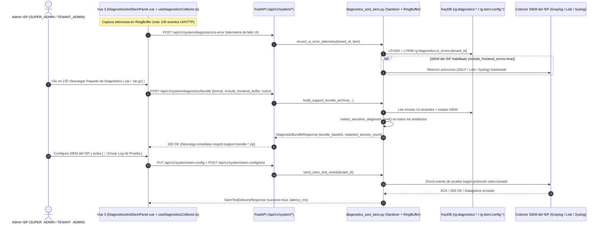

# SPDX-License-Identifier: GPL-3.0-only
# Copyright (C) 2026 RoSGrid Contributors

# Especificación Técnica 72: Paquete de Soporte y Diagnóstico Unificado (1-Click Support Bundle) y Conector SIEM Multi-Protocolo del ISP (Graylog / Loki / Syslog) — Spec Flash-Ready (Gemini 3.8 Flash High)

**Estado:** Homologado para Ejecución Directa (Hito 29)  
**Motor de Ejecución Objetivo:** Gemini 3.8 Flash (High)  
**Complejidad Ciclomática Máxima:** Grado A (`CC <= 4` por función)  
**Cobertura Objetivo:** `>= 95%` (Backend Pytest + Frontend Vitest + Karate Labs BDD)  

---

## 1. Resumen Ejecutivo y Arquitectura Dual

Las instalaciones On-Premise / Air-Gapped de **RoSGrid** en operadores ISP, WISPs y corporaciones requieren dos mecanismos complementarios de observabilidad de fallas y soporte técnico sin depender de infraestructura centralizada externa del fabricante (Zero-Trust):

1. **Mecanismo 1 — Paquete de Soporte y Diagnóstico Unificado (`1-Click Support Bundle` en `.zip` / `.tar.gz`):**
   - Captura en memoria en el navegador un **Ring Buffer de Telemetría y Errores de UI** (`useDiagnosticsCollector.ts`, hasta 100 eventos recientes: errores HTTP `4xx`/`5xx`, excepciones de Vue/JS `window.onerror`, promesas rechazadas `unhandledrejection`, latencias de API y ruta activa).
   - Al pulsar **`[ 📦 Descargar Paquete de Diagnóstico ]`** en **Flota & Seguridad → Diagnóstico & SIEM**, el frontend envía su Ring Buffer de UI al backend (`POST /api/v1/system/diagnostics/bundle`), el cual ensambla en memoria un archivo comprimido (`.zip` por defecto o `.tar.gz` seleccionable) que contiene:
     - `metadata.json`: Metadatos de versión, entorno, tenant activo, rol, resumen de salud de PostgreSQL/KeyDB, estado de sincronización CVE y notas del operador.
     - `frontend/ui_errors.json`: Traza cronológica del Ring Buffer del navegador y eventos recientes reportados a KeyDB (`POST /api/v1/system/diagnostics/ui-error`).
     - `backend/application_logs.log`: Últimas `N` líneas (por defecto `500`, hasta `2000`) del Ring Buffer de logs estructurados de FastAPI.
     - `backend/siem_forwarder_status.json`: Estado operativo y métricas de reenvío del conector SIEM del ISP.
   - **Sanitización Automática Zero-Leak (`redact_sensitive_diagnostic_text`):** Antes de escribir cualquier archivo dentro del `.zip` / `.tar.gz`, un motor de expurgación por expresiones regulares reemplaza llaves maestras (`ROSGRID_MASTER_VAULT_KEY`, `ROSGRID_JWT_SECRET_KEY`, `ROSGRID_CSRF_HMAC_SECRET`), tokens `Bearer`, cookies, cabeceras `Authorization`, `password`, `secret`, `api_key` y `private_key` por `"[REDACTED]"`, informando el conteo exacto de secretos redactados (`redacted_secrets_count`).

2. **Mecanismo 2 — Conector SIEM Multi-Protocolo Propio del ISP (`Graylog GELF` / `Grafana Loki` / `Syslog RFC 5424`):**
   - Permite a cada ISP o empresa activar opcionalmente el reenvío en tiempo real de logs del backend y errores críticos del frontend hacia **su propio servidor colector interno** (Graylog, Grafana Loki o rsyslog/Logstash/QRadar) sin enviar datos a terceros:
     - `GELF_UDP`: Datagramas JSON GELF v1.1 (`{"version": "1.1", "host": ..., "short_message": ..., "_tenant_id": ..., "_source_layer": ...}`) hacia Graylog UDP (puerto típico `12201`).
     - `GELF_HTTP`: `POST http(s)://<host>:<port>/gelf` con soporte opcional de `Authorization: Bearer <token>`.
     - `SYSLOG_UDP` / `SYSLOG_TCP`: Mensajes estándar RFC 5424 (`<134>1 <timestamp> <host> rosgrid - - - <msg>`) por UDP o TCP (puerto típico `514` o `5514`).
     - `LOKI_HTTP`: `POST http(s)://<host>:<port>/loki/api/v1/push` con etiquetas indexadas (`{"stream": {"app": "rosgrid", "tenant_id": ..., "level": ..., "custom_label": ...}, "values": [[ "<ns_epoch>", "<line>" ]]}`).
   - Incluye el botón **`[ 🧪 Enviar Log de Prueba ]`** (`POST /api/v1/system/siem-config/test`) para certificar conectividad y latencia desde la interfaz.



---

## 2. Invariantes de Gobernanza y Seguridad (Reglas Inquebrantables)

1. **RBAC Estricto:** Todos los endpoints de diagnóstico y SIEM (`/api/v1/system/diagnostics/*` y `/api/v1/system/siem-config*`) y la pestaña `"Diagnóstico & SIEM"` en `EnterpriseComplianceView.vue` están restringidos exclusivamente a roles administrativos (`SUPERADMIN_GLOBAL`, `SUPER_ADMIN`, `TENANT_ADMIN`).
2. **Cero Exfiltración de Secretos:** Todo texto exportado en el bundle o transmitido al SIEM del ISP debe pasar por `redact_sensitive_diagnostic_text(text)`. El token de autenticación del SIEM (`auth_token`) se almacena en KeyDB y **jamás** se devuelve en texto plano en `GET /api/v1/system/siem-config` (solo se expone `has_auth_token: bool`).
3. **Paridad 100% Bidireccional de Endpoints (`verify_no_orphan_api_endpoints.py`):** Los 5 endpoints registrados en `fastapi/src/api/v1/system.py` deben ser invocados explícitamente mediante `http.get`, `http.post` y `http.put` en `vue3/src/composables/useDiagnosticsCollector.ts` y `vue3/src/components/operations/DiagnosticsAndSiemPanel.vue`.
4. **Cero Componentes Vue Huérfanos (`verify_zero_orphan_vue_components.py`):** El componente `vue3/src/components/operations/DiagnosticsAndSiemPanel.vue` debe contar obligatoriamente con su suite unitaria co-localizada `vue3/src/components/operations/DiagnosticsAndSiemPanel.unit.ts`.

---

## 3. Guía de Implementación Flash-Ready (Bloques Exactos `Target` / `Replacement`)

### Paso 1: Variables de Configuración en `fastapi/src/core/config.py`

Editar [`fastapi/src/core/config.py`](file:///home/sinfallas/Dropbox/git/tecno-consultores/RoSGrid/fastapi/src/core/config.py):

**Target:**
```python
    # Telemetría Anónima de Instancias Activas (Spec 55 / Hito 27.18)
    ROSGRID_TELEMETRY_BEACON_ENABLED: bool = True
    ROSGRID_TELEMETRY_BEACON_URL: str = "https://rosgrid.net/api/telemetry/heartbeat"
    ROSGRID_TELEMETRY_BEACON_INTERVAL_SECONDS: int = 21600
```

**Replacement:**
```python
    # Telemetría Anónima de Instancias Activas (Spec 55 / Hito 27.18)
    ROSGRID_TELEMETRY_BEACON_ENABLED: bool = True
    ROSGRID_TELEMETRY_BEACON_URL: str = "https://rosgrid.net/api/telemetry/heartbeat"
    ROSGRID_TELEMETRY_BEACON_INTERVAL_SECONDS: int = 21600

    # Diagnóstico Unificado y Conector SIEM Multi-Protocolo del ISP (Spec 72 / Hito 29)
    ROSGRID_DIAGNOSTIC_LOG_RING_SIZE: int = 1000
    ROSGRID_SIEM_FORWARDER_TIMEOUT_SECONDS: int = 5
```

---

### Paso 2: Crear Esquemas Pydantic en `fastapi/src/schemas/diagnostics_siem.py`

Crear el archivo nuevo [`fastapi/src/schemas/diagnostics_siem.py`](file:///home/sinfallas/Dropbox/git/tecno-consultores/RoSGrid/fastapi/src/schemas/diagnostics_siem.py) con el siguiente contenido exacto:

```python
# SPDX-License-Identifier: GPL-3.0-only
# Copyright (C) 2026 RoSGrid Contributors

"""Esquemas Pydantic para Paquete de Diagnóstico 1-Click y Conector SIEM del ISP (Spec 72)."""

from datetime import datetime
from typing import Literal

from pydantic import BaseModel, Field

BundleArchiveFormat = Literal["zip", "tar.gz"]
SiemProtocolType = Literal["GELF_UDP", "GELF_HTTP", "SYSLOG_UDP", "SYSLOG_TCP", "LOKI_HTTP"]
SiemLogLevelType = Literal["INFO", "WARNING", "ERROR", "CRITICAL"]


class UiErrorTelemetryItem(BaseModel):
    """Evento individual capturado en el Ring Buffer de diagnóstico del Frontend Vue 3."""

    timestamp: str = Field(..., max_length=64, description="Marca de tiempo ISO-8601 del evento en el navegador.")
    category: Literal["HTTP_ERROR", "VUE_EXCEPTION", "UNHANDLED_REJECTION", "API_LATENCY", "MANUAL_NOTE"] = Field(
        default="HTTP_ERROR",
        description="Categoría del evento de diagnóstico capturado en cliente.",
    )
    message: str = Field(..., max_length=1000, description="Mensaje técnico del error o advertencia.")
    route: str = Field(default="/", max_length=255, description="Ruta activa en Vue Router cuando ocurrió el evento.")
    status_code: int | None = Field(default=None, description="Código HTTP si proviene de una respuesta de API.")
    url: str | None = Field(default=None, max_length=500, description="Endpoint o recurso involucrado.")
    latency_ms: float | None = Field(default=None, description="Latencia observada en milisegundos.")


class UiErrorTelemetryRecordResponse(BaseModel):
    """Respuesta tras registrar un evento de telemetría de error de UI en KeyDB."""

    recorded: bool
    buffered_count: int
    forwarded_to_siem: bool = False


class DiagnosticBundleRequest(BaseModel):
    """Solicitud para generar y descargar el paquete de soporte y diagnóstico sanitizado."""

    format: BundleArchiveFormat = Field(
        default="zip",
        description="Formato del archivo comprimido de soporte ('zip' por defecto o 'tar.gz').",
    )
    log_lines_limit: int = Field(
        default=500,
        ge=50,
        le=2000,
        description="Cantidad máxima de líneas recientes de log del backend a incluir.",
    )
    operator_notes: str | None = Field(
        default=None,
        max_length=2000,
        description="Notas opcionales del administrador describiendo el síntoma o incidente.",
    )
    include_frontend_buffer: list[UiErrorTelemetryItem] = Field(
        default_factory=list,
        max_length=200,
        description="Eventos capturados en el Ring Buffer en memoria del navegador.",
    )


class DiagnosticBundleResponse(BaseModel):
    """Respuesta con el archivo comprimido codificado en Base64 listo para descarga directa."""

    filename: str
    format: BundleArchiveFormat
    content_type: str
    size_bytes: int
    redacted_secrets_count: int
    included_files: list[str]
    generated_at: datetime
    bundle_base64: str


class SiemForwarderConfigUpdateRequest(BaseModel):
    """Solicitud para configurar el reenvío de logs hacia el servidor SIEM del ISP."""

    enabled: bool = Field(default=False, description="Activa o desactiva el reenvío hacia el SIEM del ISP.")
    protocol: SiemProtocolType = Field(
        default="GELF_UDP",
        description="Protocolo del colector SIEM (GELF_UDP, GELF_HTTP, SYSLOG_UDP, SYSLOG_TCP, LOKI_HTTP).",
    )
    host: str = Field(
        default="127.0.0.1",
        min_length=1,
        max_length=255,
        description="Hostname o IP del servidor Graylog, Loki o Syslog del ISP.",
    )
    port: int = Field(default=12201, ge=1, le=65535, description="Puerto UDP/TCP/HTTP de escucha del SIEM.")
    endpoint_path: str = Field(
        default="/gelf",
        max_length=255,
        description="Ruta HTTP para GELF_HTTP ('/gelf') o LOKI_HTTP ('/loki/api/v1/push').",
    )
    use_tls: bool = Field(default=False, description="Usa HTTPS en protocolos basados en HTTP (GELF_HTTP / LOKI_HTTP).")
    min_level: SiemLogLevelType = Field(
        default="WARNING",
        description="Nivel mínimo de severidad a reenviar al SIEM.",
    )
    include_frontend_errors: bool = Field(
        default=True,
        description="Reenvía también errores reportados por el navegador de los operadores.",
    )
    include_audit_events: bool = Field(
        default=True,
        description="Reenvía eventos administrativos relevantes al SIEM del ISP.",
    )
    custom_stream_label: str = Field(
        default="rosgrid-noc",
        min_length=1,
        max_length=64,
        description="Etiqueta de stream o facility identificadora de esta instancia RoSGrid.",
    )
    auth_token: str | None = Field(
        default=None,
        max_length=512,
        description="Token Bearer opcional para colectores HTTP autenticados (se preserva si se envía vacío).",
    )


class SiemForwarderConfigResponse(BaseModel):
    """Estado de configuración actual del conector SIEM del ISP (sin exponer secretos)."""

    enabled: bool
    protocol: SiemProtocolType
    host: str
    port: int
    endpoint_path: str
    use_tls: bool
    min_level: SiemLogLevelType
    include_frontend_errors: bool
    include_audit_events: bool
    custom_stream_label: str
    has_auth_token: bool
    updated_at: str | None = None


class SiemTestDeliveryResponse(BaseModel):
    """Resultado de la prueba de conectividad y envío hacia el SIEM del ISP."""

    success: bool
    protocol: SiemProtocolType
    target: str
    latency_ms: float
    detail: str
```

---

### Paso 3: Crear Servicio en `fastapi/src/services/diagnostics_and_siem.py`

Crear el archivo nuevo [`fastapi/src/services/diagnostics_and_siem.py`](file:///home/sinfallas/Dropbox/git/tecno-consultores/RoSGrid/fastapi/src/services/diagnostics_and_siem.py) manteniendo `CC <= 4` en todas las funciones:

```python
# SPDX-License-Identifier: GPL-3.0-only
# Copyright (C) 2026 RoSGrid Contributors

"""
Servicio de Paquete de Soporte 1-Click (.zip/.tar.gz) con Sanitización de Secretos
y Conector SIEM Multi-Protocolo del ISP (Graylog GELF / Grafana Loki / Syslog RFC 5424) — Spec 72.
"""

import asyncio
import base64
from collections import deque
from datetime import UTC, datetime
import io
import json
import logging
import platform
import re
import socket
import tarfile
import time
from typing import Any
import zipfile

import httpx
import redis.asyncio as aioredis

from src.core.config import settings
from src.schemas.diagnostics_siem import (
    DiagnosticBundleRequest,
    DiagnosticBundleResponse,
    SiemForwarderConfigResponse,
    SiemForwarderConfigUpdateRequest,
    SiemTestDeliveryResponse,
    UiErrorTelemetryItem,
    UiErrorTelemetryRecordResponse,
)

logger = logging.getLogger(__name__)

_BACKEND_LOG_RING_BUFFER: deque[str] = deque(maxlen=settings.ROSGRID_DIAGNOSTIC_LOG_RING_SIZE)
_RING_HANDLER_INSTALLED: bool = False

_SECRET_REDACTION_PATTERNS: tuple[tuple[re.Pattern[str], str], ...] = (
    (re.compile(r"(?i)(Bearer\s+)[A-Za-z0-9\-._~+/]+=*"), r"\1[REDACTED]"),
    (
        re.compile(
            r'(?i)("(?:password|passwd|secret|api_key|apikey|auth_token|access_token|refresh_token|private_key|master_vault_key|jwt_secret_key|csrf_hmac_secret)"\s*:\s*")[^"]*(")'
        ),
        r"\1[REDACTED]\2",
    ),
    (
        re.compile(
            r"(?i)((?:password|passwd|secret|api_key|apikey|auth_token|access_token|refresh_token|private_key|ROSGRID_MASTER_VAULT_KEY|ROSGRID_JWT_SECRET_KEY|ROSGRID_CSRF_HMAC_SECRET)\s*=\s*)[^\s,;\"']+"
        ),
        r"\1[REDACTED]",
    ),
)

_LEVEL_WEIGHTS: dict[str, int] = {
    "INFO": 20,
    "WARNING": 30,
    "ERROR": 40,
    "CRITICAL": 50,
}


class _InMemoryDiagnosticLogHandler(logging.Handler):
    """Handler ligero en memoria que conserva las últimas líneas de log del backend (CC = 2)."""

    def emit(self, record: logging.LogRecord) -> None:
        try:
            msg = self.format(record)
            _BACKEND_LOG_RING_BUFFER.append(msg)
        except Exception:  # nosec B110
            pass


def ensure_diagnostic_log_handler() -> None:
    """Instala de forma idempotente el colector circular de logs en el root logger (CC = 2)."""
    global _RING_HANDLER_INSTALLED
    if _RING_HANDLER_INSTALLED:
        return
    handler = _InMemoryDiagnosticLogHandler()
    handler.setFormatter(logging.Formatter("%(asctime)s [%(levelname)s] %(name)s: %(message)s"))
    logging.getLogger().addHandler(handler)
    _RING_HANDLER_INSTALLED = True


def append_diagnostic_log_line(level: str, logger_name: str, message: str) -> None:
    """Agrega manualmente una línea estructurada al Ring Buffer de diagnóstico (CC = 1)."""
    ensure_diagnostic_log_handler()
    ts = datetime.now(UTC).isoformat()
    _BACKEND_LOG_RING_BUFFER.append(f"{ts} [{level.upper()}] {logger_name}: {message}")


def redact_sensitive_diagnostic_text(raw_text: str) -> tuple[str, int]:
    """Expurga secretos, tokens Bearer, llaves de bóveda y contraseñas de cualquier texto (CC = 3)."""
    if not raw_text:
        return "", 0
    sanitized = raw_text
    total_redactions = 0
    for pattern, replacement in _SECRET_REDACTION_PATTERNS:
        sanitized, count = pattern.subn(replacement, sanitized)
        total_redactions += count
    for literal_secret in (
        settings.ROSGRID_MASTER_VAULT_KEY,
        settings.ROSGRID_JWT_SECRET_KEY,
        settings.ROSGRID_CSRF_HMAC_SECRET,
    ):
        if literal_secret and literal_secret in sanitized:
            occurrences = sanitized.count(literal_secret)
            sanitized = sanitized.replace(literal_secret, "[REDACTED]")
            total_redactions += occurrences
    return sanitized, total_redactions


def _ui_errors_redis_key(tenant_id: str) -> str:
    """Clave KeyDB donde se almacena el Ring Buffer de errores de UI por tenant (CC = 1)."""
    return f"rg:diagnostics:ui_errors:{tenant_id or 'global'}"


def _siem_config_redis_key(tenant_id: str) -> str:
    """Clave KeyDB donde se almacena la configuración SIEM del ISP por tenant (CC = 1)."""
    return f"rg:siem:config:{tenant_id or 'global'}"


def _default_siem_config_dict() -> dict[str, Any]:
    """Retorna la configuración predeterminada del conector SIEM del ISP (CC = 1)."""
    return {
        "enabled": False,
        "protocol": "GELF_UDP",
        "host": "127.0.0.1",
        "port": 12201,
        "endpoint_path": "/gelf",
        "use_tls": False,
        "min_level": "WARNING",
        "include_frontend_errors": True,
        "include_audit_events": True,
        "custom_stream_label": "rosgrid-noc",
        "auth_token": "",
        "updated_at": None,
    }


def _to_siem_config_response(raw_cfg: dict[str, Any]) -> SiemForwarderConfigResponse:
    """Convierte el diccionario interno de configuración SIEM al esquema público sin token (CC = 1)."""
    merged = {**_default_siem_config_dict(), **raw_cfg}
    return SiemForwarderConfigResponse(
        enabled=bool(merged["enabled"]),
        protocol=merged["protocol"],
        host=str(merged["host"]),
        port=int(merged["port"]),
        endpoint_path=str(merged["endpoint_path"]),
        use_tls=bool(merged["use_tls"]),
        min_level=merged["min_level"],
        include_frontend_errors=bool(merged["include_frontend_errors"]),
        include_audit_events=bool(merged["include_audit_events"]),
        custom_stream_label=str(merged["custom_stream_label"]),
        has_auth_token=bool(merged.get("auth_token")),
        updated_at=merged.get("updated_at"),
    )


async def _load_raw_siem_config(tenant_id: str) -> dict[str, Any]:
    """Lee desde KeyDB la configuración SIEM del tenant con fallback seguro (CC = 3)."""
    base = _default_siem_config_dict()
    try:
        r = aioredis.from_url(settings.ROSGRID_REDIS_URL, decode_responses=True)
        try:
            raw_json = await r.get(_siem_config_redis_key(tenant_id))
            if raw_json:
                base.update(json.loads(raw_json))
        finally:
            await r.aclose()
    except Exception as exc:
        logger.debug("Fallback a configuración SIEM por defecto: %s", exc)
    return base


async def get_siem_forwarder_config(tenant_id: str) -> SiemForwarderConfigResponse:
    """Obtiene la configuración actual del conector SIEM del ISP (CC = 1)."""
    raw_cfg = await _load_raw_siem_config(tenant_id)
    return _to_siem_config_response(raw_cfg)


async def update_siem_forwarder_config(
    tenant_id: str,
    payload: SiemForwarderConfigUpdateRequest,
) -> SiemForwarderConfigResponse:
    """Persiste en KeyDB la configuración del conector SIEM del ISP preservando el token si no cambia (CC = 3)."""
    current = await _load_raw_siem_config(tenant_id)
    new_token = payload.auth_token if payload.auth_token is not None and payload.auth_token != "" else current.get("auth_token", "")
    updated = {
        "enabled": payload.enabled,
        "protocol": payload.protocol,
        "host": payload.host.strip(),
        "port": payload.port,
        "endpoint_path": payload.endpoint_path.strip() or "/gelf",
        "use_tls": payload.use_tls,
        "min_level": payload.min_level,
        "include_frontend_errors": payload.include_frontend_errors,
        "include_audit_events": payload.include_audit_events,
        "custom_stream_label": payload.custom_stream_label.strip() or "rosgrid-noc",
        "auth_token": new_token,
        "updated_at": datetime.now(UTC).isoformat(),
    }
    try:
        r = aioredis.from_url(settings.ROSGRID_REDIS_URL, decode_responses=True)
        try:
            await r.set(_siem_config_redis_key(tenant_id), json.dumps(updated))
        finally:
            await r.aclose()
    except Exception as exc:
        logger.warning("No se pudo persistir configuración SIEM en KeyDB: %s", exc)
    append_diagnostic_log_line(
        "INFO",
        "siem.config",
        f"Configuración SIEM actualizada (enabled={updated['enabled']}, protocol={updated['protocol']}, target={updated['host']}:{updated['port']})",
    )
    return _to_siem_config_response(updated)


async def record_ui_error_telemetry(
    tenant_id: str,
    item: UiErrorTelemetryItem,
) -> UiErrorTelemetryRecordResponse:
    """Almacena un error de UI en el Ring Buffer de KeyDB y lo reenvía al SIEM si aplica (CC = 3)."""
    sanitized_msg, _ = redact_sensitive_diagnostic_text(item.message)
    record_dict = item.model_dump()
    record_dict["message"] = sanitized_msg
    buffered_count = 1
    try:
        r = aioredis.from_url(settings.ROSGRID_REDIS_URL, decode_responses=True)
        try:
            key = _ui_errors_redis_key(tenant_id)
            await r.lpush(key, json.dumps(record_dict))
            await r.ltrim(key, 0, 99)
            await r.expire(key, 86400 * 7)
            buffered_count = int(await r.llen(key))
        finally:
            await r.aclose()
    except Exception as exc:
        logger.debug("No se pudo almacenar telemetría UI en KeyDB: %s", exc)

    forwarded = await forward_event_to_isp_siem_if_enabled(
        tenant_id=tenant_id,
        level="ERROR",
        source_layer="frontend",
        short_message=f"[{item.category}] {sanitized_msg}",
        extra_fields={"route": item.route, "status_code": item.status_code, "url": item.url},
    )
    return UiErrorTelemetryRecordResponse(
        recorded=True,
        buffered_count=buffered_count,
        forwarded_to_siem=forwarded,
    )


async def _fetch_buffered_ui_errors(tenant_id: str) -> list[dict[str, Any]]:
    """Recupera los eventos de error de UI almacenados en KeyDB para el tenant (CC = 3)."""
    items: list[dict[str, Any]] = []
    try:
        r = aioredis.from_url(settings.ROSGRID_REDIS_URL, decode_responses=True)
        try:
            raw_list = await r.lrange(_ui_errors_redis_key(tenant_id), 0, 99)
            items = [json.loads(entry) for entry in raw_list if entry]
        finally:
            await r.aclose()
    except Exception as exc:
        logger.debug("Fallback al leer errores de UI en KeyDB: %s", exc)
    return items


def _create_zip_bytes(files_map: dict[str, str]) -> bytes:
    """Empaqueta un mapa de rutas y contenidos de texto en un archivo .zip en memoria (CC = 2)."""
    buf = io.BytesIO()
    with zipfile.ZipFile(buf, mode="w", compression=zipfile.ZIP_DEFLATED) as zf:
        for arcname, content in files_map.items():
            zf.writestr(arcname, content.encode("utf-8"))
    return buf.getvalue()


def _create_targz_bytes(files_map: dict[str, str]) -> bytes:
    """Empaqueta un mapa de rutas y contenidos de texto en un archivo .tar.gz en memoria (CC = 2)."""
    buf = io.BytesIO()
    with tarfile.open(fileobj=buf, mode="w:gz") as tf:
        for arcname, content in files_map.items():
            data = content.encode("utf-8")
            info = tarfile.TarInfo(name=arcname)
            info.size = len(data)
            info.mtime = int(time.time())
            tf.addfile(info, io.BytesIO(data))
    return buf.getvalue()


def _collect_sanitized_Artifacts(
    tenant_id: str,
    user_role: str,
    request: DiagnosticBundleRequest,
    stored_ui_errors: list[dict[str, Any]],
    siem_cfg: SiemForwarderConfigResponse,
) -> tuple[dict[str, str], int]:
    """Construye y sanitiza los 4 artefactos del paquete de soporte (CC = 3)."""
    now_iso = datetime.now(UTC).isoformat()
    recent_logs = list(_BACKEND_LOG_RING_BUFFER)[-request.log_lines_limit :]
    if not recent_logs:
        recent_logs = [f"{now_iso} [INFO] rosgrid.diagnostics: Ring buffer inicializado sin errores críticos."]

    combined_ui_errors = [item.model_dump() for item in request.include_frontend_buffer] + stored_ui_errors
    metadata_doc = {
        "product": settings.PROJECT_NAME,
        "version": settings.VERSION,
        "environment": settings.ENVIRONMENT,
        "generated_at": now_iso,
        "tenant_id": tenant_id,
        "requested_by_role": user_role,
        "platform": platform.platform(),
        "python_version": platform.python_version(),
        "operator_notes": request.operator_notes or "",
        "frontend_events_count": len(combined_ui_errors),
        "backend_log_lines_count": len(recent_logs),
    }
    raw_files = {
        "metadata.json": json.dumps(metadata_doc, indent=2, ensure_ascii=False),
        "frontend/ui_errors.json": json.dumps(combined_ui_errors, indent=2, ensure_ascii=False),
        "backend/application_logs.log": "\n".join(recent_logs),
        "backend/siem_forwarder_status.json": siem_cfg.model_dump_json(indent=2),
    }
    sanitized_files: dict[str, str] = {}
    total_redacted = 0
    for path, content in raw_files.items():
        clean_text, count = redact_sensitive_diagnostic_text(content)
        sanitized_files[path] = clean_text
        total_redacted += count
    return sanitized_files, total_redacted


async def build_support_bundle_archive(
    tenant_id: str,
    user_role: str,
    request: DiagnosticBundleRequest,
) -> DiagnosticBundleResponse:
    """Ensambla el paquete .zip o .tar.gz de diagnóstico 1-Click con sanitización garantizada (CC = 2)."""
    ensure_diagnostic_log_handler()
    stored_ui_errors = await _fetch_buffered_ui_errors(tenant_id)
    siem_cfg = await get_siem_forwarder_config(tenant_id)
    files_map, redacted_count = _collect_sanitized_Artifacts(
        tenant_id=tenant_id,
        user_role=user_role,
        request=request,
        stored_ui_errors=stored_ui_errors,
        siem_cfg=siem_cfg,
    )
    stamp = datetime.now(UTC).strftime("%Y%m%d-%H%M%S")
    if request.format == "tar.gz":
        archive_bytes = _create_targz_bytes(files_map)
        filename = f"rosgrid-support-bundle-{stamp}.tar.gz"
        content_type = "application/gzip"
    else:
        archive_bytes = _create_zip_bytes(files_map)
        filename = f"rosgrid-support-bundle-{stamp}.zip"
        content_type = "application/zip"

    return DiagnosticBundleResponse(
        filename=filename,
        format=request.format,
        content_type=content_type,
        size_bytes=len(archive_bytes),
        redacted_secrets_count=redacted_count,
        included_files=list(files_map.keys()),
        generated_at=datetime.now(UTC),
        bundle_base64=base64.b64encode(archive_bytes).decode("ascii"),
    )


def _send_udp_datagram(host: str, port: int, payload: bytes) -> None:
    """Envía un datagrama UDP hacia el colector Graylog GELF o Syslog del ISP (CC = 1)."""
    with socket.socket(socket.AF_INET, socket.SOCK_DGRAM) as sock:
        sock.settimeout(settings.ROSGRID_SIEM_FORWARDER_TIMEOUT_SECONDS)
        sock.sendto(payload, (host, port))


def _send_tcp_syslog_frame(host: str, port: int, payload: bytes) -> None:
    """Envía una trama Syslog RFC 5424 sobre TCP hacia el colector del ISP (CC = 1)."""
    with socket.create_connection((host, port), timeout=settings.ROSGRID_SIEM_FORWARDER_TIMEOUT_SECONDS) as sock:
        sock.sendall(payload + b"\n")


async def _send_http_siem_payload(
    url: str,
    body: dict[str, Any],
    auth_token: str,
) -> None:
    """Envía un payload JSON mediante HTTP POST hacia Graylog GELF HTTP o Grafana Loki (CC = 2)."""
    headers = {"Content-Type": "application/json"}
    if auth_token:
        headers["Authorization"] = f"Bearer {auth_token}"
    async with httpx.AsyncClient(timeout=float(settings.ROSGRID_SIEM_FORWARDER_TIMEOUT_SECONDS)) as client:
        resp = await client.post(url, json=body, headers=headers)
        resp.raise_for_status()


async def _dispatch_siem_protocol(
    cfg: dict[str, Any],
    tenant_id: str,
    level: str,
    source_layer: str,
    clean_message: str,
    extra_fields: dict[str, Any] | None = None,
) -> str:
    """Despacha el evento sanitizado según el protocolo SIEM configurado por el ISP (CC = 4)."""
    proto = str(cfg.get("protocol", "GELF_UDP"))
    host = str(cfg.get("host", "127.0.0.1"))
    port = int(cfg.get("port", 12201))
    stream_label = str(cfg.get("custom_stream_label", "rosgrid-noc"))
    scheme = "https" if cfg.get("use_tls") else "http"
    path = str(cfg.get("endpoint_path", "/gelf"))

    if proto in ("GELF_UDP", "GELF_HTTP"):
        gelf_body: dict[str, Any] = {
            "version": "1.1",
            "host": stream_label,
            "short_message": clean_message,
            "timestamp": time.time(),
            "level": 3 if level in ("ERROR", "CRITICAL") else 4,
            "_tenant_id": tenant_id,
            "_source_layer": source_layer,
            "_severity": level,
        }
        if extra_fields:
            for k, v in extra_fields.items():
                gelf_body[f"_{k}"] = v
        if proto == "GELF_UDP":
            await asyncio.to_thread(_send_udp_datagram, host, port, json.dumps(gelf_body).encode("utf-8"))
            return f"udp://{host}:{port}"
        target_url = f"{scheme}://{host}:{port}{path}"
        await _send_http_siem_payload(target_url, gelf_body, str(cfg.get("auth_token", "")))
        return target_url

    if proto == "LOKI_HTTP":
        target_url = f"{scheme}://{host}:{port}{path}"
        ns_ts = str(int(time.time() * 1_000_000_000))
        loki_body = {
            "streams": [
                {
                    "stream": {
                        "app": "rosgrid",
                        "stream": stream_label,
                        "tenant_id": tenant_id,
                        "level": level,
                        "layer": source_layer,
                    },
                    "values": [[ns_ts, clean_message]],
                }
            ]
        }
        await _send_http_siem_payload(target_url, loki_body, str(cfg.get("auth_token", "")))
        return target_url

    syslog_line = f"<134>1 {datetime.now(UTC).isoformat()} {stream_label} rosgrid - - - [{level}] [{source_layer}] {clean_message}"
    if proto == "SYSLOG_TCP":
        await asyncio.to_thread(_send_tcp_syslog_frame, host, port, syslog_line.encode("utf-8"))
        return f"tcp://{host}:{port}"
    await asyncio.to_thread(_send_udp_datagram, host, port, syslog_line.encode("utf-8"))
    return f"udp://{host}:{port}"


async def forward_event_to_isp_siem_if_enabled(
    tenant_id: str,
    level: str,
    source_layer: str,
    short_message: str,
    extra_fields: dict[str, Any] | None = None,
) -> bool:
    """Evalúa filtros de severidad y reenvía el evento de forma fail-silent al SIEM del ISP (CC = 4)."""
    cfg = await _load_raw_siem_config(tenant_id)
    if not cfg.get("enabled"):
        return False
    if source_layer == "frontend" and not cfg.get("include_frontend_errors", True):
        return False
    min_weight = _LEVEL_WEIGHTS.get(str(cfg.get("min_level", "WARNING")), 30)
    event_weight = _LEVEL_WEIGHTS.get(level.upper(), 20)
    if event_weight < min_weight:
        return False
    clean_msg, _ = redact_sensitive_diagnostic_text(short_message)
    try:
        await _dispatch_siem_protocol(cfg, tenant_id, level.upper(), source_layer, clean_msg, extra_fields)
        return True
    except Exception as exc:
        logger.debug("Fallo fail-silent al reenviar evento al SIEM del ISP: %s", exc)
        return False


async def send_siem_test_event(tenant_id: str) -> SiemTestDeliveryResponse:
    """Dispara un evento de prueba hacia el colector SIEM configurado y mide la latencia (CC = 2)."""
    cfg = await _load_raw_siem_config(tenant_id)
    proto = cfg.get("protocol", "GELF_UDP")
    start = time.perf_counter()
    try:
        target = await _dispatch_siem_protocol(
            cfg=cfg,
            tenant_id=tenant_id,
            level="INFO",
            source_layer="diagnostics_probe",
            clean_message="Evento de prueba de conectividad SIEM enviado desde RoSGrid NOC.",
            extra_fields={"probe": "siem_connectivity_test"},
        )
        elapsed_ms = round((time.perf_counter() - start) * 1000.0, 2)
        return SiemTestDeliveryResponse(
            success=True,
            protocol=proto,
            target=target,
            latency_ms=elapsed_ms,
            detail=f"Evento de prueba entregado exitosamente a {target} ({proto}).",
        )
    except Exception as exc:
        elapsed_ms = round((time.perf_counter() - start) * 1000.0, 2)
        target_fallback = f"{cfg.get('host', '127.0.0.1')}:{cfg.get('port', 12201)}"
        return SiemTestDeliveryResponse(
            success=False,
            protocol=proto,
            target=target_fallback,
            latency_ms=elapsed_ms,
            detail=f"Error al conectar con el colector SIEM ({proto}): {exc}",
        )
```

---

### Paso 4: Registrar los 5 Endpoints en `fastapi/src/api/v1/system.py`

Editar [`fastapi/src/api/v1/system.py`](file:///home/sinfallas/Dropbox/git/tecno-consultores/RoSGrid/fastapi/src/api/v1/system.py):

**Target:**
```python
from fastapi import APIRouter, Depends

from src.api.deps import require_roles
from src.models.core import SystemRoleEnum
from src.workers.telemetry_beacon_worker import (
    get_telemetry_beacon_status,
    send_telemetry_heartbeat_once,
)

logger = logging.getLogger(__name__)

router = APIRouter(prefix="/system", tags=["System Management & Telemetry"])

_SYSTEM_ADMIN_ROLES = (
    SystemRoleEnum.SUPERADMIN_GLOBAL,
    SystemRoleEnum.TENANT_ADMIN,
)


@router.get(
    "/telemetry-beacon/status",
    summary="Estado de Telemetría Anónima de Instancias Activas",
    description="Retorna el estado del latido Zero-PII, identificador anónimo irreversible y último envío.",
    dependencies=[Depends(require_roles(*_SYSTEM_ADMIN_ROLES))],
)
async def get_beacon_status() -> dict[str, Any]:
    """Consulta el estado del latido de telemetría anónima de la instalación (CC = 1)."""
    return await get_telemetry_beacon_status()


@router.post(
    "/telemetry-beacon/trigger",
    summary="Disparo Manual de Latido de Telemetría",
    description="Fuerza un envío inmediato fail-silent del latido anónimo hacia rosgrid-web.",
    dependencies=[Depends(require_roles(*_SYSTEM_ADMIN_ROLES))],
)
async def trigger_beacon_now() -> dict[str, Any]:
    """Ejecuta de forma inmediata un latido anónimo de telemetría hacia el portal oficial (CC = 1)."""
    return await send_telemetry_heartbeat_once()
```

**Replacement:**
```python
from fastapi import APIRouter, Depends

from src.api.deps import get_current_user, require_roles
from src.models.core import SystemRoleEnum, User
from src.schemas.diagnostics_siem import (
    DiagnosticBundleRequest,
    DiagnosticBundleResponse,
    SiemForwarderConfigResponse,
    SiemForwarderConfigUpdateRequest,
    SiemTestDeliveryResponse,
    UiErrorTelemetryItem,
    UiErrorTelemetryRecordResponse,
)
from src.services.diagnostics_and_siem import (
    build_support_bundle_archive,
    get_siem_forwarder_config,
    record_ui_error_telemetry,
    send_siem_test_event,
    update_siem_forwarder_config,
)
from src.workers.telemetry_beacon_worker import (
    get_telemetry_beacon_status,
    send_telemetry_heartbeat_once,
)

logger = logging.getLogger(__name__)

router = APIRouter(prefix="/system", tags=["System Management & Telemetry"])

_SYSTEM_ADMIN_ROLES = (
    SystemRoleEnum.SUPERADMIN_GLOBAL,
    SystemRoleEnum.TENANT_ADMIN,
)


def _resolve_tenant_key(user: User) -> str:
    """Resuelve el identificador de tenant para aislar buffers de diagnóstico y SIEM en KeyDB (CC = 1)."""
    return str(user.tenant_id) if getattr(user, "tenant_id", None) else "global"


@router.get(
    "/telemetry-beacon/status",
    summary="Estado de Telemetría Anónima de Instancias Activas",
    description="Retorna el estado del latido Zero-PII, identificador anónimo irreversible y último envío.",
    dependencies=[Depends(require_roles(*_SYSTEM_ADMIN_ROLES))],
)
async def get_beacon_status() -> dict[str, Any]:
    """Consulta el estado del latido de telemetría anónima de la instalación (CC = 1)."""
    return await get_telemetry_beacon_status()


@router.post(
    "/telemetry-beacon/trigger",
    summary="Disparo Manual de Latido de Telemetría",
    description="Fuerza un envío inmediato fail-silent del latido anónimo hacia rosgrid-web.",
    dependencies=[Depends(require_roles(*_SYSTEM_ADMIN_ROLES))],
)
async def trigger_beacon_now() -> dict[str, Any]:
    """Ejecuta de forma inmediata un latido anónimo de telemetría hacia el portal oficial (CC = 1)."""
    return await send_telemetry_heartbeat_once()


@router.post(
    "/diagnostics/ui-error",
    response_model=UiErrorTelemetryRecordResponse,
    summary="Registrar Evento de Telemetría de Error de UI",
    description="Almacena un error de UI/HTTP en el Ring Buffer de KeyDB y lo reenvía al SIEM del ISP si está habilitado.",
    dependencies=[Depends(require_roles(*_SYSTEM_ADMIN_ROLES))],
)
async def report_ui_error_telemetry(
    payload: UiErrorTelemetryItem,
    current_user: User = Depends(get_current_user),
) -> UiErrorTelemetryRecordResponse:
    """Registra un evento del Ring Buffer del navegador en KeyDB (CC = 1)."""
    return await record_ui_error_telemetry(_resolve_tenant_key(current_user), payload)


@router.post(
    "/diagnostics/bundle",
    response_model=DiagnosticBundleResponse,
    summary="Generar Paquete de Diagnóstico 1-Click (.zip / .tar.gz)",
    description="Genera un paquete comprimido sanitizado con logs de frontend, backend y estado del sistema.",
    dependencies=[Depends(require_roles(*_SYSTEM_ADMIN_ROLES))],
)
async def create_diagnostic_support_bundle(
    payload: DiagnosticBundleRequest,
    current_user: User = Depends(get_current_user),
) -> DiagnosticBundleResponse:
    """Construye el archivo .zip o .tar.gz de soporte técnico sin secretos (CC = 1)."""
    role_val = current_user.role.value if hasattr(current_user.role, "value") else str(current_user.role)
    return await build_support_bundle_archive(_resolve_tenant_key(current_user), role_val, payload)


@router.get(
    "/siem-config",
    response_model=SiemForwarderConfigResponse,
    summary="Consultar Configuración del Conector SIEM del ISP",
    description="Retorna la configuración de reenvío hacia Graylog, Grafana Loki o Syslog del ISP.",
    dependencies=[Depends(require_roles(*_SYSTEM_ADMIN_ROLES))],
)
async def read_isp_siem_config(
    current_user: User = Depends(get_current_user),
) -> SiemForwarderConfigResponse:
    """Consulta la configuración SIEM del tenant actual (CC = 1)."""
    return await get_siem_forwarder_config(_resolve_tenant_key(current_user))


@router.put(
    "/siem-config",
    response_model=SiemForwarderConfigResponse,
    summary="Actualizar Configuración del Conector SIEM del ISP",
    description="Actualiza protocolo (GELF/Loki/Syslog), host, puerto y filtros de severidad del SIEM del ISP.",
    dependencies=[Depends(require_roles(*_SYSTEM_ADMIN_ROLES))],
)
async def save_isp_siem_config(
    payload: SiemForwarderConfigUpdateRequest,
    current_user: User = Depends(get_current_user),
) -> SiemForwarderConfigResponse:
    """Actualiza la configuración SIEM del tenant actual en KeyDB (CC = 1)."""
    return await update_siem_forwarder_config(_resolve_tenant_key(current_user), payload)


@router.post(
    "/siem-config/test",
    response_model=SiemTestDeliveryResponse,
    summary="Enviar Log de Prueba al Colector SIEM del ISP",
    description="Envía un mensaje de prueba hacia el servidor Graylog, Loki o Syslog configurado y retorna latencia.",
    dependencies=[Depends(require_roles(*_SYSTEM_ADMIN_ROLES))],
)
async def test_isp_siem_delivery(
    current_user: User = Depends(get_current_user),
) -> SiemTestDeliveryResponse:
    """Ejecuta la prueba de entrega hacia el colector SIEM del ISP (CC = 1)."""
    return await send_siem_test_event(_resolve_tenant_key(current_user))
```

---

### Paso 5: Crear Composable de Captura de Errores de UI en `vue3/src/composables/useDiagnosticsCollector.ts` y su Test Unitario

Crear [`vue3/src/composables/useDiagnosticsCollector.ts`](file:///home/sinfallas/Dropbox/git/tecno-consultores/RoSGrid/vue3/src/composables/useDiagnosticsCollector.ts):

```typescript
// SPDX-License-Identifier: GPL-3.0-only
// Copyright (C) 2026 RoSGrid Contributors

import { ref } from 'vue';
import { http } from '@/api/httpClient';

export type DiagnosticEventCategory =
  | 'HTTP_ERROR'
  | 'VUE_EXCEPTION'
  | 'UNHANDLED_REJECTION'
  | 'API_LATENCY'
  | 'MANUAL_NOTE';

export interface UiDiagnosticEventItem {
  timestamp: string;
  category: DiagnosticEventCategory;
  message: string;
  route: string;
  status_code?: number | null;
  url?: string | null;
  latency_ms?: number | null;
}

export interface UiErrorTelemetryRecordResponse {
  recorded: boolean;
  buffered_count: number;
  forwarded_to_siem: boolean;
}

const MAX_RING_BUFFER_ITEMS = 100;
const uiDiagnosticBuffer = ref<UiDiagnosticEventItem[]>([]);
let listenersAttached = false;

function pushDiagnosticEvent(event: Omit<UiDiagnosticEventItem, 'timestamp' | 'route'> & { route?: string }) {
  const currentRoute =
    event.route || (typeof window !== 'undefined' ? window.location.pathname : '/');
  const entry: UiDiagnosticEventItem = {
    timestamp: new Date().toISOString(),
    category: event.category,
    message: String(event.message || 'Unknown UI diagnostic event').slice(0, 1000),
    route: currentRoute,
    status_code: event.status_code ?? null,
    url: event.url ?? null,
    latency_ms: event.latency_ms ?? null,
  };
  uiDiagnosticBuffer.value = [entry, ...uiDiagnosticBuffer.value].slice(0, MAX_RING_BUFFER_ITEMS);
  return entry;
}

function attachGlobalDiagnosticListeners() {
  if (listenersAttached || typeof window === 'undefined') {
    return;
  }
  listenersAttached = true;

  window.addEventListener('rosgrid:api-health-event', (evt: Event) => {
    const custom = evt as CustomEvent<{
      ok: boolean;
      status?: number;
      latencyMs?: number;
      url?: string;
    }>;
    const detail = custom.detail;
    if (detail && !detail.ok) {
      pushDiagnosticEvent({
        category: 'HTTP_ERROR',
        message: `HTTP ${detail.status ?? 0} en ${detail.url ?? '/api'}`,
        status_code: detail.status ?? 0,
        url: detail.url ?? null,
        latency_ms: detail.latencyMs ?? null,
      });
    }
  });

  window.addEventListener('error', (evt: ErrorEvent) => {
    if (evt?.message) {
      pushDiagnosticEvent({
        category: 'VUE_EXCEPTION',
        message: evt.message,
        url: evt.filename || null,
      });
    }
  });
}

export function useDiagnosticsCollector() {
  attachGlobalDiagnosticListeners();

  function clearDiagnosticBuffer() {
    uiDiagnosticBuffer.value = [];
  }

  async function reportDiagnosticEventToBackend(item: UiDiagnosticEventItem) {
    const res = await http.post<UiErrorTelemetryRecordResponse>(
      '/api/v1/system/diagnostics/ui-error',
      item,
    );
    return res.data;
  }

  return {
    uiDiagnosticBuffer,
    pushDiagnosticEvent,
    clearDiagnosticBuffer,
    reportDiagnosticEventToBackend,
  };
}
```

Crear [`vue3/src/composables/useDiagnosticsCollector.unit.ts`](file:///home/sinfallas/Dropbox/git/tecno-consultores/RoSGrid/vue3/src/composables/useDiagnosticsCollector.unit.ts):

```typescript
// SPDX-License-Identifier: GPL-3.0-only
// Copyright (C) 2026 RoSGrid Contributors

import { describe, it, expect, vi, beforeEach } from 'vitest';
import { useDiagnosticsCollector } from './useDiagnosticsCollector';

const mockPost = vi.fn();

vi.mock('@/api/httpClient', () => ({
  http: {
    post: (...args: unknown[]) => mockPost(...args),
  },
}));

describe('useDiagnosticsCollector — Ring Buffer de Diagnóstico UI (Spec 72)', () => {
  beforeEach(() => {
    vi.clearAllMocks();
    const { clearDiagnosticBuffer } = useDiagnosticsCollector();
    clearDiagnosticBuffer();
  });

  it('agrega eventos al Ring Buffer y permite sincronizarlos con /api/v1/system/diagnostics/ui-error', async () => {
    mockPost.mockResolvedValueOnce({
      data: { recorded: true, buffered_count: 1, forwarded_to_siem: true },
    });

    const { uiDiagnosticBuffer, pushDiagnosticEvent, reportDiagnosticEventToBackend } =
      useDiagnosticsCollector();

    const entry = pushDiagnosticEvent({
      category: 'HTTP_ERROR',
      message: 'HTTP 502 Bad Gateway en /api/v1/routers',
      status_code: 502,
      url: '/api/v1/routers',
      latency_ms: 145,
    });

    expect(uiDiagnosticBuffer.value.length).toBe(1);
    expect(uiDiagnosticBuffer.value[0]?.status_code).toBe(502);

    const response = await reportDiagnosticEventToBackend(entry);
    expect(mockPost).toHaveBeenCalledWith('/api/v1/system/diagnostics/ui-error', entry);
    expect(response.recorded).toBe(true);
    expect(response.forwarded_to_siem).toBe(true);
  });

  it('captura eventos globales rosgrid:api-health-event fallidos automáticamente', () => {
    const { uiDiagnosticBuffer } = useDiagnosticsCollector();
    window.dispatchEvent(
      new CustomEvent('rosgrid:api-health-event', {
        detail: { ok: false, status: 500, latencyMs: 88, url: '/api/v1/inventory/cves' },
      }),
    );
    expect(uiDiagnosticBuffer.value.length).toBe(1);
    expect(uiDiagnosticBuffer.value[0]?.category).toBe('HTTP_ERROR');
  });
});
```

---

### Paso 6: Crear Panel `vue3/src/components/operations/DiagnosticsAndSiemPanel.vue` y su Suite Unitaria

Crear [`vue3/src/components/operations/DiagnosticsAndSiemPanel.vue`](file:///home/sinfallas/Dropbox/git/tecno-consultores/RoSGrid/vue3/src/components/operations/DiagnosticsAndSiemPanel.vue):

```vue
<!-- SPDX-License-Identifier: GPL-3.0-only -->
<!-- Copyright (C) 2026 RoSGrid Contributors -->

<script setup lang="ts">
  import { onMounted, ref } from 'vue';
  import { http } from '@/api/httpClient';
  import { useI18n } from '@/composables/useI18n';
  import { useDiagnosticsCollector } from '@/composables/useDiagnosticsCollector';

  export type BundleFormat = 'zip' | 'tar.gz';
  export type SiemProtocol = 'GELF_UDP' | 'GELF_HTTP' | 'SYSLOG_UDP' | 'SYSLOG_TCP' | 'LOKI_HTTP';
  export type SiemMinLevel = 'INFO' | 'WARNING' | 'ERROR' | 'CRITICAL';

  interface DiagnosticBundleResponse {
    filename: string;
    format: BundleFormat;
    content_type: string;
    size_bytes: number;
    redacted_secrets_count: number;
    included_files: string[];
    generated_at: string;
    bundle_base64: string;
  }

  interface SiemConfigResponse {
    enabled: boolean;
    protocol: SiemProtocol;
    host: string;
    port: number;
    endpoint_path: string;
    use_tls: boolean;
    min_level: SiemMinLevel;
    include_frontend_errors: boolean;
    include_audit_events: boolean;
    custom_stream_label: string;
    has_auth_token: boolean;
    updated_at: string | null;
  }

  interface SiemTestResponse {
    success: boolean;
    protocol: SiemProtocol;
    target: string;
    latency_ms: number;
    detail: string;
  }

  const { t } = useI18n();
  const { uiDiagnosticBuffer, pushDiagnosticEvent, reportDiagnosticEventToBackend } =
    useDiagnosticsCollector();

  const bundleFormat = ref<BundleFormat>('zip');
  const logLinesLimit = ref<number>(500);
  const operatorNotes = ref<string>('');
  const isGeneratingBundle = ref<boolean>(false);
  const lastBundleResult = ref<DiagnosticBundleResponse | null>(null);

  const siemEnabled = ref<boolean>(false);
  const siemProtocol = ref<SiemProtocol>('GELF_UDP');
  const siemHost = ref<string>('127.0.0.1');
  const siemPort = ref<number>(12201);
  const siemEndpointPath = ref<string>('/gelf');
  const siemUseTls = ref<boolean>(false);
  const siemMinLevel = ref<SiemMinLevel>('WARNING');
  const siemIncludeFrontend = ref<boolean>(true);
  const siemIncludeAudit = ref<boolean>(true);
  const siemStreamLabel = ref<string>('rosgrid-noc');
  const siemAuthToken = ref<string>('');
  const siemHasSavedToken = ref<boolean>(false);

  const isLoadingConfig = ref<boolean>(false);
  const isSavingSiem = ref<boolean>(false);
  const isTestingSiem = ref<boolean>(false);
  const siemTestResult = ref<SiemTestResponse | null>(null);
  const feedbackSuccess = ref<string>('');
  const feedbackError = ref<string>('');

  function applySiemConfigState(cfg: SiemConfigResponse) {
    siemEnabled.value = cfg.enabled;
    siemProtocol.value = cfg.protocol;
    siemHost.value = cfg.host;
    siemPort.value = cfg.port;
    siemEndpointPath.value = cfg.endpoint_path;
    siemUseTls.value = cfg.use_tls;
    siemMinLevel.value = cfg.min_level;
    siemIncludeFrontend.value = cfg.include_frontend_errors;
    siemIncludeAudit.value = cfg.include_audit_events;
    siemStreamLabel.value = cfg.custom_stream_label;
    siemHasSavedToken.value = cfg.has_auth_token;
  }

  async function loadSiemConfiguration() {
    isLoadingConfig.value = true;
    feedbackError.value = '';
    try {
      const res = await http.get<SiemConfigResponse>('/api/v1/system/siem-config');
      applySiemConfigState(res.data);
    } catch (err: unknown) {
      const e = err as { detail?: string; message?: string };
      feedbackError.value = e.detail || e.message || 'Error al consultar configuración SIEM.';
    } finally {
      isLoadingConfig.value = false;
    }
  }

  function triggerBase64Download(base64Data: string, filename: string, contentType: string) {
    if (typeof window === 'undefined' || typeof document === 'undefined') return;
    const link = document.createElement('a');
    link.href = `data:${contentType};base64,${base64Data}`;
    link.download = filename;
    document.body.appendChild(link);
    link.click();
    document.body.removeChild(link);
  }

  async function handleGenerateSupportBundle() {
    isGeneratingBundle.value = true;
    feedbackError.value = '';
    feedbackSuccess.value = '';
    try {
      if (operatorNotes.value.trim()) {
        const manualItem = pushDiagnosticEvent({
          category: 'MANUAL_NOTE',
          message: operatorNotes.value.trim(),
        });
        await reportDiagnosticEventToBackend(manualItem);
      }
      const res = await http.post<DiagnosticBundleResponse>('/api/v1/system/diagnostics/bundle', {
        format: bundleFormat.value,
        log_lines_limit: logLinesLimit.value,
        operator_notes: operatorNotes.value.trim() || null,
        include_frontend_buffer: uiDiagnosticBuffer.value,
      });
      lastBundleResult.value = res.data;
      triggerBase64Download(res.data.bundle_base64, res.data.filename, res.data.content_type);
      feedbackSuccess.value = `Paquete ${res.data.filename} generado (${res.data.redacted_secrets_count} secretos sanitizados).`;
    } catch (err: unknown) {
      const e = err as { detail?: string; message?: string };
      feedbackError.value = e.detail || e.message || 'Error al generar paquete de diagnóstico.';
    } finally {
      isGeneratingBundle.value = false;
    }
  }

  async function handleSaveSiemConfig() {
    isSavingSiem.value = true;
    feedbackError.value = '';
    feedbackSuccess.value = '';
    try {
      const res = await http.put<SiemConfigResponse>('/api/v1/system/siem-config', {
        enabled: siemEnabled.value,
        protocol: siemProtocol.value,
        host: siemHost.value,
        port: Number(siemPort.value),
        endpoint_path: siemEndpointPath.value,
        use_tls: siemUseTls.value,
        min_level: siemMinLevel.value,
        include_frontend_errors: siemIncludeFrontend.value,
        include_audit_events: siemIncludeAudit.value,
        custom_stream_label: siemStreamLabel.value,
        auth_token: siemAuthToken.value || null,
      });
      applySiemConfigState(res.data);
      siemAuthToken.value = '';
      feedbackSuccess.value = 'Configuración del conector SIEM del ISP guardada correctamente.';
    } catch (err: unknown) {
      const e = err as { detail?: string; message?: string };
      feedbackError.value = e.detail || e.message || 'Error al guardar configuración SIEM.';
    } finally {
      isSavingSiem.value = false;
    }
  }

  async function handleTestSiemDelivery() {
    isTestingSiem.value = true;
    feedbackError.value = '';
    siemTestResult.value = null;
    try {
      const res = await http.post<SiemTestResponse>('/api/v1/system/siem-config/test', {});
      siemTestResult.value = res.data;
      if (res.data.success) {
        feedbackSuccess.value = `${res.data.detail} (${res.data.latency_ms} ms)`;
      } else {
        feedbackError.value = res.data.detail;
      }
    } catch (err: unknown) {
      const e = err as { detail?: string; message?: string };
      feedbackError.value = e.detail || e.message || 'Fallo al ejecutar prueba SIEM.';
    } finally {
      isTestingSiem.value = false;
    }
  }

  onMounted(() => {
    loadSiemConfiguration();
  });
</script>

<template>
  <div class="diagnostics-siem-panel">
    <div v-if="feedbackError" class="diag-alert diag-alert-error" role="alert">
      ⚠️ {{ feedbackError }}
    </div>
    <div v-if="feedbackSuccess" class="diag-alert diag-alert-success" role="status">
      ✅ {{ feedbackSuccess }}
    </div>

    <div class="diag-grid">
      <!-- Card 1: 1-Click Support Bundle -->
      <section class="diag-card" aria-labelledby="bundle-card-title">
        <header class="diag-card-header">
          <div>
            <h2 id="bundle-card-title" class="diag-card-title">
              📦
              {{
                t(
                  'enterprise.diag_bundle_title',
                  'Paquete de Soporte y Diagnóstico Unificado (1-Click Bundle)',
                )
              }}
            </h2>
            <p class="diag-card-subtitle">
              {{
                t(
                  'enterprise.diag_bundle_desc',
                  'Recopila trazas del navegador (Frontend), logs recientes de FastAPI (Backend) y metadatos de salud con sanitización automática de contraseñas y llaves.',
                )
              }}
            </p>
          </div>
          <span class="diag-badge-cyan">
            Ring Buffer UI: {{ uiDiagnosticBuffer.length }} eventos
          </span>
        </header>

        <div class="diag-form-row">
          <div class="diag-field">
            <label for="bundle-format-select">Formato de Archivo</label>
            <select id="bundle-format-select" v-model="bundleFormat" class="diag-input">
              <option value="zip">.zip (Estándar Windows / Linux / macOS)</option>
              <option value="tar.gz">.tar.gz (Tarball Gzip Linux / Unix)</option>
            </select>
          </div>

          <div class="diag-field">
            <label for="bundle-lines-input">Líneas de Log Backend</label>
            <input
              id="bundle-lines-input"
              v-model.number="logLinesLimit"
              type="number"
              min="50"
              max="2000"
              class="diag-input"
            />
          </div>
        </div>

        <div class="diag-field">
          <label for="bundle-operator-notes">Notas del Operador / Descripción de la Falla</label>
          <textarea
            id="bundle-operator-notes"
            v-model="operatorNotes"
            rows="3"
            class="diag-input"
            placeholder="Describa los pasos previos al incidente o el comportamiento observado..."
          ></textarea>
        </div>

        <div class="diag-actions">
          <button
            id="btn-download-support-bundle"
            type="button"
            class="diag-btn diag-btn-primary"
            :disabled="isGeneratingBundle"
            @click="handleGenerateSupportBundle"
          >
            {{
              isGeneratingBundle
                ? '⏳ Empaquetando y Sanitizando...'
                : `📦 Descargar Paquete de Diagnóstico (.${bundleFormat})`
            }}
          </button>
        </div>

        <div v-if="lastBundleResult" class="diag-summary-box" data-testid="bundle-summary">
          <div><strong>Archivo:</strong> {{ lastBundleResult.filename }}</div>
          <div>
            <strong>Secretos Sanitizados:</strong> {{ lastBundleResult.redacted_secrets_count }}
          </div>
          <div>
            <strong>Artefactos Incluidos:</strong>
            {{ lastBundleResult.included_files.join(', ') }}
          </div>
        </div>
      </section>

      <!-- Card 2: Conector SIEM Multi-Protocolo del ISP -->
      <section class="diag-card" aria-labelledby="siem-card-title">
        <header class="diag-card-header">
          <div>
            <h2 id="siem-card-title" class="diag-card-title">
              📡
              {{
                t(
                  'enterprise.siem_forwarder_title',
                  'Conector SIEM del ISP (Graylog / Grafana Loki / Syslog)',
                )
              }}
            </h2>
            <p class="diag-card-subtitle">
              {{
                t(
                  'enterprise.siem_forwarder_desc',
                  'Reenvía eventos y errores sanitizados hacia el colector central propio del ISP o empresa.',
                )
              }}
            </p>
          </div>
          <label class="diag-toggle-label">
            <input id="siem-enabled-checkbox" v-model="siemEnabled" type="checkbox" />
            <span>{{ siemEnabled ? 'Habilitado' : 'Deshabilitado' }}</span>
          </label>
        </header>

        <div class="diag-form-row">
          <div class="diag-field">
            <label for="siem-protocol-select">Protocolo del Colector SIEM</label>
            <select id="siem-protocol-select" v-model="siemProtocol" class="diag-input">
              <option value="GELF_UDP">Graylog GELF UDP</option>
              <option value="GELF_HTTP">Graylog GELF HTTP/HTTPS</option>
              <option value="LOKI_HTTP">Grafana Loki HTTP Push (/loki/api/v1/push)</option>
              <option value="SYSLOG_UDP">Syslog RFC 5424 UDP</option>
              <option value="SYSLOG_TCP">Syslog RFC 5424 TCP</option>
            </select>
          </div>

          <div class="diag-field">
            <label for="siem-min-level-select">Severidad Mínima</label>
            <select id="siem-min-level-select" v-model="siemMinLevel" class="diag-input">
              <option value="INFO">INFO</option>
              <option value="WARNING">WARNING</option>
              <option value="ERROR">ERROR</option>
              <option value="CRITICAL">CRITICAL</option>
            </select>
          </div>
        </div>

        <div class="diag-form-row">
          <div class="diag-field">
            <label for="siem-host-input">Host / IP del Servidor SIEM del ISP</label>
            <input
              id="siem-host-input"
              v-model="siemHost"
              type="text"
              class="diag-input"
              placeholder="graylog.isp.interno"
            />
          </div>

          <div class="diag-field">
            <label for="siem-port-input">Puerto</label>
            <input
              id="siem-port-input"
              v-model.number="siemPort"
              type="number"
              min="1"
              max="65535"
              class="diag-input"
            />
          </div>
        </div>

        <div class="diag-form-row">
          <div class="diag-field">
            <label for="siem-stream-input">Etiqueta de Instancia / Stream</label>
            <input
              id="siem-stream-input"
              v-model="siemStreamLabel"
              type="text"
              class="diag-input"
              placeholder="rosgrid-noc-principal"
            />
          </div>

          <div class="diag-field">
            <label for="siem-endpoint-input">Ruta HTTP (GELF_HTTP / LOKI_HTTP)</label>
            <input
              id="siem-endpoint-input"
              v-model="siemEndpointPath"
              type="text"
              class="diag-input"
              placeholder="/gelf o /loki/api/v1/push"
            />
          </div>
        </div>

        <div class="diag-field">
          <label for="siem-token-input">
            Token Bearer Opcional
            <span v-if="siemHasSavedToken" class="diag-badge-cyan">(Token configurado)</span>
          </label>
          <input
            id="siem-token-input"
            v-model="siemAuthToken"
            type="password"
            class="diag-input"
            placeholder="Dejar en blanco para conservar el token actual"
          />
        </div>

        <div class="diag-checkbox-group">
          <label>
            <input v-model="siemIncludeFrontend" type="checkbox" />
            Incluir errores de interfaz (Frontend UI)
          </label>
          <label>
            <input v-model="siemIncludeAudit" type="checkbox" />
            Incluir eventos de auditoría administrativa
          </label>
          <label>
            <input v-model="siemUseTls" type="checkbox" />
            Usar TLS (HTTPS)
          </label>
        </div>

        <div class="diag-actions">
          <button
            id="btn-save-siem-config"
            type="button"
            class="diag-btn diag-btn-primary"
            :disabled="isSavingSiem"
            @click="handleSaveSiemConfig"
          >
            {{ isSavingSiem ? '⏳ Guardando...' : '💾 Guardar Configuración SIEM' }}
          </button>

          <button
            id="btn-test-siem-config"
            type="button"
            class="diag-btn diag-btn-secondary"
            :disabled="isTestingSiem"
            @click="handleTestSiemDelivery"
          >
            {{ isTestingSiem ? '⏳ Probando...' : '🧪 Enviar Log de Prueba' }}
          </button>
        </div>

        <div v-if="siemTestResult" class="diag-summary-box" data-testid="siem-test-summary">
          <strong>Resultado Prueba ({{ siemTestResult.protocol }}):</strong>
          {{ siemTestResult.detail }} — {{ siemTestResult.latency_ms }} ms
        </div>
      </section>
    </div>
  </div>
</template>

<style scoped>
  .diagnostics-siem-panel {
    display: flex;
    flex-direction: column;
    gap: 1rem;
  }

  .diag-grid {
    display: grid;
    grid-template-columns: repeat(auto-fit, minmax(340px, 1fr));
    gap: 1.25rem;
  }

  .diag-card {
    background: #080f1d;
    border: 1px solid #1a2a40;
    border-radius: 8px;
    padding: 1.25rem;
    display: flex;
    flex-direction: column;
    gap: 1rem;
  }

  .diag-card-header {
    display: flex;
    justify-content: space-between;
    align-items: flex-start;
    gap: 1rem;
    flex-wrap: wrap;
  }

  .diag-card-title {
    margin: 0;
    font-size: 1.05rem;
    color: #00e5ff;
  }

  .diag-card-subtitle {
    margin: 0.35rem 0 0 0;
    font-size: 0.82rem;
    color: #94a3b8;
  }

  .diag-form-row {
    display: grid;
    grid-template-columns: repeat(auto-fit, minmax(180px, 1fr));
    gap: 0.85rem;
  }

  .diag-field {
    display: flex;
    flex-direction: column;
    gap: 0.35rem;
    font-size: 0.82rem;
    color: #cbd5e1;
  }

  .diag-input {
    background: #04070e;
    border: 1px solid #1e293b;
    border-radius: 6px;
    color: #f8fafc;
    padding: 0.5rem 0.65rem;
    font-size: 0.85rem;
  }

  .diag-checkbox-group {
    display: flex;
    flex-wrap: wrap;
    gap: 1rem;
    font-size: 0.82rem;
    color: #cbd5e1;
  }

  .diag-actions {
    display: flex;
    flex-wrap: wrap;
    gap: 0.75rem;
  }

  .diag-btn {
    border: none;
    border-radius: 6px;
    padding: 0.55rem 1rem;
    font-size: 0.85rem;
    font-weight: 600;
    cursor: pointer;
  }

  .diag-btn-primary {
    background: #00e5ff;
    color: #04070e;
  }

  .diag-btn-secondary {
    background: #1a2a40;
    color: #e2e8f0;
  }

  .diag-badge-cyan {
    background: rgba(0, 229, 255, 0.12);
    border: 1px solid rgba(0, 229, 255, 0.4);
    color: #00e5ff;
    padding: 0.2rem 0.55rem;
    border-radius: 999px;
    font-size: 0.75rem;
    font-weight: 600;
  }

  .diag-summary-box {
    background: #04070e;
    border: 1px solid #1e293b;
    border-radius: 6px;
    padding: 0.75rem;
    font-size: 0.8rem;
    color: #cbd5e1;
    display: flex;
    flex-direction: column;
    gap: 0.25rem;
  }

  .diag-alert {
    padding: 0.75rem 1rem;
    border-radius: 6px;
    font-size: 0.85rem;
  }

  .diag-alert-error {
    background: rgba(239, 68, 68, 0.15);
    border: 1px solid #ef4444;
    color: #fecaca;
  }

  .diag-alert-success {
    background: rgba(16, 185, 129, 0.15);
    border: 1px solid #10b981;
    color: #a7f3d0;
  }
</style>
```

Crear [`vue3/src/components/operations/DiagnosticsAndSiemPanel.unit.ts`](file:///home/sinfallas/Dropbox/git/tecno-consultores/RoSGrid/vue3/src/components/operations/DiagnosticsAndSiemPanel.unit.ts):

```typescript
// SPDX-License-Identifier: GPL-3.0-only
// Copyright (C) 2026 RoSGrid Contributors

import { describe, it, expect, vi, beforeEach } from 'vitest';
import { mount, flushPromises } from '@vue/test-utils';
import DiagnosticsAndSiemPanel from './DiagnosticsAndSiemPanel.vue';

const mockGet = vi.fn();
const mockPost = vi.fn();
const mockPut = vi.fn();

vi.mock('@/api/httpClient', () => ({
  http: {
    get: (...args: unknown[]) => mockGet(...args),
    post: (...args: unknown[]) => mockPost(...args),
    put: (...args: unknown[]) => mockPut(...args),
  },
}));

describe('DiagnosticsAndSiemPanel.vue — Paquete 1-Click y SIEM del ISP (Spec 72)', () => {
  beforeEach(() => {
    vi.clearAllMocks();
    mockGet.mockResolvedValue({
      data: {
        enabled: false,
        protocol: 'GELF_UDP',
        host: '10.20.30.40',
        port: 12201,
        endpoint_path: '/gelf',
        use_tls: false,
        min_level: 'WARNING',
        include_frontend_errors: true,
        include_audit_events: true,
        custom_stream_label: 'rosgrid-isp-noc',
        has_auth_token: false,
        updated_at: null,
      },
    });
  });

  it('carga la configuración SIEM al montar y permite generar el paquete .zip de soporte', async () => {
    mockPost.mockResolvedValueOnce({
      data: {
        filename: 'rosgrid-support-bundle-20261103.zip',
        format: 'zip',
        content_type: 'application/zip',
        size_bytes: 2048,
        redacted_secrets_count: 3,
        included_files: ['metadata.json', 'frontend/ui_errors.json', 'backend/application_logs.log'],
        generated_at: '2026-11-03T22:00:00Z',
        bundle_base64: 'UEsDBAoAAAAAA==',
      },
    });

    const wrapper = mount(DiagnosticsAndSiemPanel);
    await flushPromises();

    expect(mockGet).toHaveBeenCalledWith('/api/v1/system/siem-config');

    await wrapper.find('#btn-download-support-bundle').trigger('click');
    await flushPromises();

    expect(mockPost).toHaveBeenCalledWith(
      '/api/v1/system/diagnostics/bundle',
      expect.objectContaining({ format: 'zip', log_lines_limit: 500 }),
    );
    expect(wrapper.find('[data-testid="bundle-summary"]').text()).toContain(
      'rosgrid-support-bundle-20261103.zip',
    );
  });

  it('guarda la configuración del conector SIEM y ejecuta la prueba de envío', async () => {
    mockPut.mockResolvedValueOnce({
      data: {
        enabled: true,
        protocol: 'LOKI_HTTP',
        host: 'loki.isp.local',
        port: 3100,
        endpoint_path: '/loki/api/v1/push',
        use_tls: false,
        min_level: 'ERROR',
        include_frontend_errors: true,
        include_audit_events: true,
        custom_stream_label: 'rosgrid-isp-noc',
        has_auth_token: true,
        updated_at: '2026-11-03T22:05:00Z',
      },
    });
    mockPost.mockResolvedValueOnce({
      data: {
        success: true,
        protocol: 'LOKI_HTTP',
        target: 'http://loki.isp.local:3100/loki/api/v1/push',
        latency_ms: 12.4,
        detail: 'Evento de prueba entregado exitosamente',
      },
    });

    const wrapper = mount(DiagnosticsAndSiemPanel);
    await flushPromises();

    await wrapper.find('#siem-protocol-select').setValue('LOKI_HTTP');
    await wrapper.find('#btn-save-siem-config').trigger('click');
    await flushPromises();

    expect(mockPut).toHaveBeenCalledWith(
      '/api/v1/system/siem-config',
      expect.objectContaining({ protocol: 'LOKI_HTTP' }),
    );

    await wrapper.find('#btn-test-siem-config').trigger('click');
    await flushPromises();

    expect(mockPost).toHaveBeenCalledWith('/api/v1/system/siem-config/test', {});
    expect(wrapper.find('[data-testid="siem-test-summary"]').text()).toContain('12.4 ms');
  });
});
```

---

### Paso 7: Integrar la Pestaña `"Diagnóstico & SIEM"` en `vue3/src/views/EnterpriseComplianceView.vue`

Editar [`vue3/src/views/EnterpriseComplianceView.vue`](file:///home/sinfallas/Dropbox/git/tecno-consultores/RoSGrid/vue3/src/views/EnterpriseComplianceView.vue) en 4 bloques exactos:

#### Bloque 7.1 — Importar `DiagnosticsAndSiemPanel.vue` y ampliar `TabType` y `allTabs`:

**Target:**
```typescript
  import NotificationChannelsPanel from '@/components/operations/NotificationChannelsPanel.vue';
  import CapsmanProvisioningModal from '@/components/wifi/CapsmanProvisioningModal.vue';
  import CapsmanQuickSetupModal from '@/components/wifi/CapsmanQuickSetupModal.vue';
  import CapsmanSecurityProfilesModal from '@/components/wifi/CapsmanSecurityProfilesModal.vue';
  import CapsmanSsidModal from '@/components/wifi/CapsmanSsidModal.vue';

  const FleetCveMatrix = defineAsyncComponent(() => import('@/views/FleetCveMatrix.vue'));
  const ImmutableAuditLogsView = defineAsyncComponent(
    () => import('@/views/ImmutableAuditLogsView.vue'),
  );

  const route = useRoute();
  const router = useRouter();
  const { t } = useI18n();
  const authStore = useAuthStore();
  const inventoryStore = useInventoryStore();

  type TabType =
    | 'drift'
    | 'cis'
    | 'cves'
    | 'audit'
    | 'sdwan'
    | 'switching'
    | 'sla'
    | 'wifi'
    | 'notifications';

  interface TabDef {
    id: TabType;
    flag?: keyof TenantFeatureFlags;
    actionKey?: string;
    allowedRoles?: string[];
  }

  const allTabs: TabDef[] = [
    {
      id: 'drift',
      flag: 'config_drift_monitoring_enabled',
      actionKey: 'ENTERPRISE_CIS_DRIFT_COMPLIANCE',
    },
    {
      id: 'cis',
      flag: 'cis_audit_enabled',
      actionKey: 'ENTERPRISE_CIS_DRIFT_COMPLIANCE',
    },
    { id: 'cves', actionKey: 'TOPOLOGY_L2_CVE_SYSLOG_MCP' },
    { id: 'audit', actionKey: 'AUDIT_LOGS_QUERY' },
    {
      id: 'sdwan',
      flag: 'sdwan_orchestrator_enabled',
      actionKey: 'ENTERPRISE_SDWAN_SLA_ROGUEDHCP',
    },
    { id: 'switching', actionKey: 'ENTERPRISE_SDWAN_SLA_ROGUEDHCP' },
    {
      id: 'sla',
      flag: 'sla_tracker_enabled',
      actionKey: 'ENTERPRISE_SDWAN_SLA_ROGUEDHCP',
    },
    {
      id: 'wifi',
      flag: 'capsman_wifi_enabled',
      actionKey: 'WIFI_CAPSMAN_PROVISIONING',
    },
    {
      id: 'notifications',
      flag: 'outbound_webhooks_enabled',
      allowedRoles: ['SUPERADMIN_GLOBAL', 'TENANT_ADMIN', 'SUPERVISOR'],
    },
  ];
```

**Replacement:**
```typescript
  import DiagnosticsAndSiemPanel from '@/components/operations/DiagnosticsAndSiemPanel.vue';
  import NotificationChannelsPanel from '@/components/operations/NotificationChannelsPanel.vue';
  import CapsmanProvisioningModal from '@/components/wifi/CapsmanProvisioningModal.vue';
  import CapsmanQuickSetupModal from '@/components/wifi/CapsmanQuickSetupModal.vue';
  import CapsmanSecurityProfilesModal from '@/components/wifi/CapsmanSecurityProfilesModal.vue';
  import CapsmanSsidModal from '@/components/wifi/CapsmanSsidModal.vue';

  const FleetCveMatrix = defineAsyncComponent(() => import('@/views/FleetCveMatrix.vue'));
  const ImmutableAuditLogsView = defineAsyncComponent(
    () => import('@/views/ImmutableAuditLogsView.vue'),
  );

  const route = useRoute();
  const router = useRouter();
  const { t } = useI18n();
  const authStore = useAuthStore();
  const inventoryStore = useInventoryStore();

  type TabType =
    | 'drift'
    | 'cis'
    | 'cves'
    | 'audit'
    | 'sdwan'
    | 'switching'
    | 'sla'
    | 'wifi'
    | 'notifications'
    | 'diagnostics';

  interface TabDef {
    id: TabType;
    flag?: keyof TenantFeatureFlags;
    actionKey?: string;
    allowedRoles?: string[];
  }

  const allTabs: TabDef[] = [
    {
      id: 'drift',
      flag: 'config_drift_monitoring_enabled',
      actionKey: 'ENTERPRISE_CIS_DRIFT_COMPLIANCE',
    },
    {
      id: 'cis',
      flag: 'cis_audit_enabled',
      actionKey: 'ENTERPRISE_CIS_DRIFT_COMPLIANCE',
    },
    { id: 'cves', actionKey: 'TOPOLOGY_L2_CVE_SYSLOG_MCP' },
    { id: 'audit', actionKey: 'AUDIT_LOGS_QUERY' },
    {
      id: 'sdwan',
      flag: 'sdwan_orchestrator_enabled',
      actionKey: 'ENTERPRISE_SDWAN_SLA_ROGUEDHCP',
    },
    { id: 'switching', actionKey: 'ENTERPRISE_SDWAN_SLA_ROGUEDHCP' },
    {
      id: 'sla',
      flag: 'sla_tracker_enabled',
      actionKey: 'ENTERPRISE_SDWAN_SLA_ROGUEDHCP',
    },
    {
      id: 'wifi',
      flag: 'capsman_wifi_enabled',
      actionKey: 'WIFI_CAPSMAN_PROVISIONING',
    },
    {
      id: 'notifications',
      flag: 'outbound_webhooks_enabled',
      allowedRoles: ['SUPERADMIN_GLOBAL', 'TENANT_ADMIN', 'SUPERVISOR'],
    },
    {
      id: 'diagnostics',
      allowedRoles: ['SUPERADMIN_GLOBAL', 'SUPER_ADMIN', 'TENANT_ADMIN'],
    },
  ];
```

#### Bloque 7.2 — Excluir `'diagnostics'` de `loadTabData()` (no requiere router individual):

**Target:**
```typescript
    if (
      activeTab.value === 'notifications' ||
      activeTab.value === 'cves' ||
      activeTab.value === 'audit'
    ) {
      return;
    }
```

**Replacement:**
```typescript
    if (
      activeTab.value === 'notifications' ||
      activeTab.value === 'cves' ||
      activeTab.value === 'audit' ||
      activeTab.value === 'diagnostics'
    ) {
      return;
    }
```

#### Bloque 7.3 — Añadir el botón `#tab-btn-diagnostics` en la barra de pestañas:

**Target:**
```html
      <button
        v-if="isTabAllowed('notifications')"
        id="tab-btn-notifications"
        type="button"
        class="tab-btn"
        :class="{ active: activeTab === 'notifications' }"
        :aria-selected="activeTab === 'notifications'"
        role="tab"
        aria-controls="panel-notifications"
        @click="activeTab = 'notifications'"
      >
        <span class="tab-icon">🔔</span>
        <span>{{ t('enterprise.tab_notifications', 'Canales de Alerta & Notificación') }}</span>
      </button>
    </nav>
```

**Replacement:**
```html
      <button
        v-if="isTabAllowed('notifications')"
        id="tab-btn-notifications"
        type="button"
        class="tab-btn"
        :class="{ active: activeTab === 'notifications' }"
        :aria-selected="activeTab === 'notifications'"
        role="tab"
        aria-controls="panel-notifications"
        @click="activeTab = 'notifications'"
      >
        <span class="tab-icon">🔔</span>
        <span>{{ t('enterprise.tab_notifications', 'Canales de Alerta & Notificación') }}</span>
      </button>

      <button
        v-if="isTabAllowed('diagnostics')"
        id="tab-btn-diagnostics"
        type="button"
        class="tab-btn"
        :class="{ active: activeTab === 'diagnostics' }"
        :aria-selected="activeTab === 'diagnostics'"
        role="tab"
        aria-controls="panel-diagnostics"
        @click="activeTab = 'diagnostics'"
      >
        <span class="tab-icon">🩺</span>
        <span>{{ t('enterprise.tab_diagnostics', 'Diagnóstico & SIEM') }}</span>
      </button>
    </nav>
```

#### Bloque 7.4 — Añadir el panel `#panel-diagnostics`:

**Target:**
```html
      <!-- ================================================================= -->
      <!-- TAB 7: Canales de Notificación y Alertas                          -->
      <!-- ================================================================= -->
      <section
        v-else-if="activeTab === 'notifications'"
        id="panel-notifications"
        role="tabpanel"
        aria-labelledby="tab-btn-notifications"
        class="tab-pane"
      >
        <NotificationChannelsPanel />
      </section>
    </div>
```

**Replacement:**
```html
      <!-- ================================================================= -->
      <!-- TAB 7: Canales de Notificación y Alertas                          -->
      <!-- ================================================================= -->
      <section
        v-else-if="activeTab === 'notifications'"
        id="panel-notifications"
        role="tabpanel"
        aria-labelledby="tab-btn-notifications"
        class="tab-pane"
      >
        <NotificationChannelsPanel />
      </section>

      <!-- ================================================================= -->
      <!-- TAB 8: Paquete de Diagnóstico 1-Click y Conector SIEM del ISP     -->
      <!-- ================================================================= -->
      <section
        v-else-if="activeTab === 'diagnostics'"
        id="panel-diagnostics"
        role="tabpanel"
        aria-labelledby="tab-btn-diagnostics"
        class="tab-pane"
      >
        <DiagnosticsAndSiemPanel />
      </section>
    </div>
```

---

### Paso 8: Internacionalización (`vue3/src/locales/es.json` y `vue3/src/locales/en.json`)

Editar [`vue3/src/locales/es.json`](file:///home/sinfallas/Dropbox/git/tecno-consultores/RoSGrid/vue3/src/locales/es.json):

**Target:**
```json
    "tab_wifi": "Wi-Fi CAPsMAN",
    "tab_notifications": "Canales de Alerta & Notificación",
    "revert_drift": "Revertir a Plantilla Homologada",
```

**Replacement:**
```json
    "tab_wifi": "Wi-Fi CAPsMAN",
    "tab_notifications": "Canales de Alerta & Notificación",
    "tab_diagnostics": "Diagnóstico & SIEM",
    "diag_bundle_title": "Paquete de Soporte y Diagnóstico Unificado (1-Click Bundle)",
    "diag_bundle_desc": "Recopila trazas del navegador (Frontend), logs recientes de FastAPI (Backend) y metadatos de salud con sanitización automática de contraseñas y llaves.",
    "siem_forwarder_title": "Conector SIEM del ISP (Graylog / Grafana Loki / Syslog)",
    "siem_forwarder_desc": "Reenvía eventos y errores sanitizados hacia el colector central propio del ISP o empresa.",
    "revert_drift": "Revertir a Plantilla Homologada",
```

Editar [`vue3/src/locales/en.json`](file:///home/sinfallas/Dropbox/git/tecno-consultores/RoSGrid/vue3/src/locales/en.json):

**Target:**
```json
    "tab_wifi": "Wi-Fi CAPsMAN",
    "tab_notifications": "Alert & Notification Channels",
    "revert_drift": "Revert to Golden Baseline",
```

**Replacement:**
```json
    "tab_wifi": "Wi-Fi CAPsMAN",
    "tab_notifications": "Alert & Notification Channels",
    "tab_diagnostics": "Diagnostics & SIEM",
    "diag_bundle_title": "Unified Support & Diagnostic Bundle (1-Click Bundle)",
    "diag_bundle_desc": "Collects browser traces (Frontend), recent FastAPI logs (Backend), and health metadata with automatic password and key sanitization.",
    "siem_forwarder_title": "ISP SIEM Connector (Graylog / Grafana Loki / Syslog)",
    "siem_forwarder_desc": "Forwards sanitized events and errors to the ISP or enterprise internal SIEM collector.",
    "revert_drift": "Revert to Golden Baseline",
```

---

## 4. Pirámide de Pruebas Level-11X y Escenarios Karate Labs BDD

### 4.1 Suite Unitaria Backend (`fastapi/tests/api/test_diagnostics_and_siem.unit.py`)

Crear [`fastapi/tests/api/test_diagnostics_and_siem.unit.py`](file:///home/sinfallas/Dropbox/git/tecno-consultores/RoSGrid/fastapi/tests/api/test_diagnostics_and_siem.unit.py) verificando:
1. `redact_sensitive_diagnostic_text` reemplaza tokens `Bearer`, `password=...`, `"secret": "..."` y `ROSGRID_MASTER_VAULT_KEY` por `[REDACTED]` e incrementa `redacted_secrets_count`.
2. `build_support_bundle_archive` genera un `.zip` válido (`zipfile.is_zipfile`) y un `.tar.gz` válido (`tarfile.is_tarfile`) con `metadata.json`, `frontend/ui_errors.json`, `backend/application_logs.log` y `backend/siem_forwarder_status.json` libres de secretos.
3. `_dispatch_siem_protocol` y `send_siem_test_event` soportan `GELF_UDP`, `GELF_HTTP`, `LOKI_HTTP`, `SYSLOG_UDP` y `SYSLOG_TCP` con manejo elegante de fallos de red (`success=False` sin lanzar HTTP 500).
4. Los 5 endpoints de `/api/v1/system/*` responden `200 OK` para `SUPERADMIN_GLOBAL` / `TENANT_ADMIN` y `403 Forbidden` para roles no administrativos.

### 4.2 Escenario Karate Labs API (`fastapi/test/api_test.feature` y `docs/examples/fastapi/test/api_test.feature`)

Añadir `Scenario: 150`:
```gherkin
  Scenario: 150. Generate 1-Click Sanitized Support Bundle and Configure ISP SIEM Forwarder (Spec 72)
    Given path '/api/v1/system/siem-config'
    When method get
    Then status 200
    And match response.protocol == '#string'
    And match response.has_auth_token == '#boolean'
```

### 4.3 Escenario Karate Labs UI (`vue3/test/ui_business_flow.feature` y `docs/examples/vue3/test/ui_business_flow.feature`)

Añadir `Scenario: 87`:
```gherkin
  Scenario: 87. Verify 1-Click Support Bundle and ISP SIEM Forwarder Tab in Enterprise Compliance (Spec 72)
    * def diagTabContract = { tabId: 'tab-btn-diagnostics', panelId: 'panel-diagnostics', formats: ['zip', 'tar.gz'], protocols: ['GELF_UDP', 'GELF_HTTP', 'LOKI_HTTP', 'SYSLOG_UDP', 'SYSLOG_TCP'] }
    * match diagTabContract.formats contains 'zip'
    * match diagTabContract.protocols contains 'LOKI_HTTP'
```
