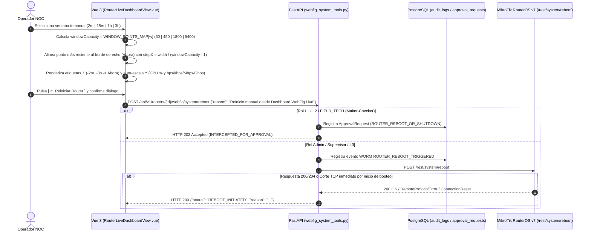

# SPDX-License-Identifier: GPL-3.0-only
# Copyright (C) 2026 RoSGrid Contributors

# Especificación Técnica 73: Escala Proporcional Real por Ventana en Gráficas de Telemetría WebFig Live y Resiliencia en Reinicio de Router (HTTP 422 / Desconexión TCP) — Spec Flash-Ready (Gemini 3.8 Flash High)

- **Estado:** Homologado para Ejecución Directa (Hito 28.16)
- **Fecha:** 2026-11-04
- **Motor de Ejecución Objetivo:** Gemini 3.8 Flash (High)
- **Complejidad Ciclomática Máxima:** Grado A (`CC <= 4` por función)
- **Cobertura Objetivo:** `>= 95%` (Backend Pytest + Frontend Vitest + Karate Labs BDD)
- **Ámbito:**
  - Frontend: [`vue3/src/views/RouterLiveDashboardView.vue`](file:///home/sinfallas/Dropbox/git/tecno-consultores/RoSGrid/vue3/src/views/RouterLiveDashboardView.vue), [`vue3/src/views/webfigViews.unit.ts`](file:///home/sinfallas/Dropbox/git/tecno-consultores/RoSGrid/vue3/src/views/webfigViews.unit.ts)
  - Backend: [`fastapi/src/schemas/webfig_ops.py`](file:///home/sinfallas/Dropbox/git/tecno-consultores/RoSGrid/fastapi/src/schemas/webfig_ops.py), [`fastapi/src/api/v1/webfig_system_tools.py`](file:///home/sinfallas/Dropbox/git/tecno-consultores/RoSGrid/fastapi/src/api/v1/webfig_system_tools.py), [`fastapi/src/mikrotik/client.py`](file:///home/sinfallas/Dropbox/git/tecno-consultores/RoSGrid/fastapi/src/mikrotik/client.py), [`fastapi/tests/api/test_webfig_endpoints_full.unit.py`](file:///home/sinfallas/Dropbox/git/tecno-consultores/RoSGrid/fastapi/tests/api/test_webfig_endpoints_full.unit.py)
  - Contratos BDD: [`fastapi/test/api_test.feature`](file:///home/sinfallas/Dropbox/git/tecno-consultores/RoSGrid/fastapi/test/api_test.feature), [`vue3/test/ui_business_flow.feature`](file:///home/sinfallas/Dropbox/git/tecno-consultores/RoSGrid/vue3/test/ui_business_flow.feature) y réplicas en `docs/examples/`
- **Referencias Cruzadas:** Especificaciones [08](file:///home/sinfallas/Dropbox/git/tecno-consultores/RoSGrid/docs/specs/08_MIKROTIK_REST_V7_CLIENT_TOFU_AND_SAFEMODE.md), [14](file:///home/sinfallas/Dropbox/git/tecno-consultores/RoSGrid/docs/specs/14_BACKEND_ENDPOINTS_WEBFIG_L1_PPP_QUEUES_SYSTEM_TOOLS.md), [22](file:///home/sinfallas/Dropbox/git/tecno-consultores/RoSGrid/docs/specs/22_FRONTEND_VIEWS_WEBFIG_CONSOLE_RINGBUFFER_AND_LAYERS.md), [60](file:///home/sinfallas/Dropbox/git/tecno-consultores/RoSGrid/docs/specs/60_ORPHAN_API_ENDPOINTS_AUDIT_AND_FRONTEND_PARITY.md) y [67](file:///home/sinfallas/Dropbox/git/tecno-consultores/RoSGrid/docs/specs/67_WEBFIG_ROUTER_IDENTITY_CHANGE_SAFEMODE_DB_SYNC_AND_UI_REACTIVITY.md).

---

## 1. Diagnóstico Forense de las Causas Raíz

Durante las pruebas operativas en el entorno local de producción (`docker-compose.prod.local.yml`) sobre el router `r1` (`c791ee0f-0be2-4cea-9b87-d7af60843be6` en `/routers/:routerId/webfig/live`), se identificaron dos defectos funcionales en la vista **Dashboard & Telemetría en Vivo** ([`RouterLiveDashboardView.vue`](file:///home/sinfallas/Dropbox/git/tecno-consultores/RoSGrid/vue3/src/views/RouterLiveDashboardView.vue)):

### 1.1. Defecto 1: Escala Fija en las Gráficas de Telemetría al Cambiar entre `2m (60 pts)`, `15m (450 pts)`, `1h (1800 pts)` y `3h (5400 pts)`

1. **Causa Raíz 1A — Paso horizontal (`stepX`) calculado sobre `points.length` en lugar de la capacidad nominal de la ventana seleccionada ([`drawAreaChart` L154](file:///home/sinfallas/Dropbox/git/tecno-consultores/RoSGrid/vue3/src/views/RouterLiveDashboardView.vue#L154) y [`drawTrafficChart` L202](file:///home/sinfallas/Dropbox/git/tecno-consultores/RoSGrid/vue3/src/views/RouterLiveDashboardView.vue#L202)):**
   - Tanto `drawAreaChart` como `drawTrafficChart` calculaban el espaciado horizontal de cada muestra mediante:
     ```ts
     const stepX = width / Math.max(1, points.length - 1);
     ```
   - En [`useTelemetryRingBuffer.ts`](file:///home/sinfallas/Dropbox/git/tecno-consultores/RoSGrid/vue3/src/composables/useTelemetryRingBuffer.ts#L98-L103), `windowPoints` retorna `all.length <= limit ? all : all.slice(all.length - limit)`.
   - Cuando el buffer en memoria acumula menos puntos que la ventana más pequeña (por ejemplo, `29` puntos recién conectado al router), las 4 ventanas (`2m = 60`, `15m = 450`, `1h = 1800`, `3h = 5400`) devuelven exactamente el mismo arreglo de `29` puntos.
   - Al dividir `width` entre `points.length - 1` (`28`) en lugar de dividirlo entre la capacidad de la ventana seleccionada (`windowCapacity = WINDOW_POINTS_MAP[currentWindow.value]`), los `29` puntos se estiraban siempre al 100% del ancho del `<canvas>`, produciendo exactamente el mismo dibujo sin importar qué intervalo temporal seleccionara el operador.

2. **Causa Raíz 1B — Piso rígido de `1 Mbps` (`1000000` bps) en `drawTrafficChart` ([L198-L200](file:///home/sinfallas/Dropbox/git/tecno-consultores/RoSGrid/vue3/src/views/RouterLiveDashboardView.vue#L198-L200)) y ausencia de etiquetas de referencia en los ejes X e Y:**
   - `drawTrafficChart` forzaba un mínimo fijo de `1,000,000` bps (`1 Mbps`):
     ```ts
     const maxRx = Math.max(...points.map((p) => p.rxBps || 0), 1000000);
     const maxTx = Math.max(...points.map((p) => p.txBps || 0), 1000000);
     ```
   - Con tráficos de control o laboratorio de pocos kilobits por segundo (ej. `RX: 7.47 kbps`, `TX: 22.36 kbps`), la curva quedaba aplastada en el 2% inferior del lienzo y carecía de etiquetas de referencia tanto en el eje vertical (`%` o `bps/kbps/Mbps/Gbps`) como en el eje horizontal (`-2m / -1m / Ahora`, `-15m / -7m 30s / Ahora`, `-1h / -30m / Ahora`, `-3h / -1h 30m / Ahora`).

### 1.2. Defecto 2: Error `HTTP 422 Unprocessable Content` (`"Los datos proporcionados no cumplen con los requisitos de validación."`) al pulsar `⚠️ Reiniciar Router`

1. **Causa Raíz 2A — Petición `POST` sin cuerpo JSON en [`handleRebootRouter` (`RouterLiveDashboardView.vue` L380)](file:///home/sinfallas/Dropbox/git/tecno-consultores/RoSGrid/vue3/src/views/RouterLiveDashboardView.vue#L380):**
   - El frontend ejecutaba:
     ```ts
     await http.post(`/api/v1/routers/${routerId.value}/webfig/system/reboot`);
     ```
     sin enviar cuerpo JSON (`input: None`).
   - En el backend, [`reboot_router` (`webfig_system_tools.py` L350-L353)](file:///home/sinfallas/Dropbox/git/tecno-consultores/RoSGrid/fastapi/src/api/v1/webfig_system_tools.py#L350-L353) declaraba `payload: SystemRebootRequest` como obligatorio y [`SystemRebootRequest` (`webfig_ops.py` L172-L173)](file:///home/sinfallas/Dropbox/git/tecno-consultores/RoSGrid/fastapi/src/schemas/webfig_ops.py#L172-L173) exigía `reason: str = Field(..., min_length=3, max_length=255)`.
   - Traza exacta registrada en `rosgrid_api_local`:
     ```text
     Error de validación Pydantic en POST /api/v1/routers/c791ee0f-0be2-4cea-9b87-d7af60843be6/webfig/system/reboot:
     [{'type': 'missing', 'loc': ('body',), 'msg': 'Field required', 'input': None}]
     INFO: 172.18.0.1:0 - "POST /api/v1/routers/c791ee0f-0be2-4cea-9b87-d7af60843be6/webfig/system/reboot HTTP/1.1" 422 Unprocessable Content
     ```

2. **Causa Raíz 2B — Desconexión TCP inmediata de RouterOS v7 al ejecutar `/rest/system/reboot` ([`webfig_system_tools.py` L405-L407](file:///home/sinfallas/Dropbox/git/tecno-consultores/RoSGrid/fastapi/src/api/v1/webfig_system_tools.py#L405-L407) y [`client.py` L147-L158](file:///home/sinfallas/Dropbox/git/tecno-consultores/RoSGrid/fastapi/src/mikrotik/client.py#L147-L158)):**
   - Cuando un equipo MikroTik RouterOS v7 real recibe `POST /rest/system/reboot`, inicia el apagado del sistema de inmediato y a menudo cierra abruptamente el socket TCP/TLS antes de enviar los bytes finales de la respuesta HTTP (`httpx.RemoteProtocolError: Server disconnected without sending a response`, `MikrotikConnectionError` o `MikrotikTimeoutError`).
   - En [`MikrotikRestClient._raw_send`](file:///home/sinfallas/Dropbox/git/tecno-consultores/RoSGrid/fastapi/src/mikrotik/client.py#L155-L158), solo se capturaban `httpx.TimeoutException` y `httpx.NetworkError` (dejando escapar `httpx.RemoteProtocolError`, que hereda de `httpx.TransportError`), y `reboot_router` no capturaba el corte esperado de conexión durante `/system/reboot`.



---

## 2. Instrucciones Exactas de Implementación (Flash-Ready `Target` / `Replacement`)

### 2.1. Backend: Valor por Defecto en `SystemRebootRequest` ([`fastapi/src/schemas/webfig_ops.py`](file:///home/sinfallas/Dropbox/git/tecno-consultores/RoSGrid/fastapi/src/schemas/webfig_ops.py#L172-L173))

**Target (`fastapi/src/schemas/webfig_ops.py` líneas 172-174):**
```python
class SystemRebootRequest(StrictBaseModel):
    reason: str = Field(..., min_length=3, max_length=255)
```

**Replacement:**
```python
class SystemRebootRequest(StrictBaseModel):
    reason: str = Field(
        default="Reinicio manual desde consola WebFig Live",
        min_length=3,
        max_length=255,
    )
```

---

### 2.2. Backend: Captura de `httpx.HTTPError` en `MikrotikRestClient._raw_send` ([`fastapi/src/mikrotik/client.py`](file:///home/sinfallas/Dropbox/git/tecno-consultores/RoSGrid/fastapi/src/mikrotik/client.py#L147-L159))

Envolver `httpx.TransportError` / `httpx.HTTPError` (incluyendo `httpx.RemoteProtocolError` cuando el router corta el socket al reiniciar) dentro de `MikrotikConnectionError`:

**Target (`fastapi/src/mikrotik/client.py` líneas 147-159):**
```python
        try:
            return await client.request(
                method=method,
                url=url,
                auth=auth,
                params=params,
                json=json_data,
            )
        except httpx.TimeoutException as exc:
            raise MikrotikTimeoutError(f"Timeout en {method} {url} tras {self.timeout}s") from exc
        except httpx.NetworkError as exc:
            raise MikrotikConnectionError(f"Error de red al conectar a {self.host}:{self.port}: {exc}") from exc
```

**Replacement:**
```python
        try:
            return await client.request(
                method=method,
                url=url,
                auth=auth,
                params=params,
                json=json_data,
            )
        except httpx.TimeoutException as exc:
            raise MikrotikTimeoutError(f"Timeout en {method} {url} tras {self.timeout}s") from exc
        except (httpx.NetworkError, httpx.TransportError, httpx.HTTPError) as exc:
            raise MikrotikConnectionError(f"Error de red al conectar a {self.host}:{self.port}: {exc}") from exc
```

---

### 2.3. Backend: Body Opcional con Valor por Defecto y Tolerancia a Corte TCP en `reboot_router` ([`fastapi/src/api/v1/webfig_system_tools.py`](file:///home/sinfallas/Dropbox/git/tecno-consultores/RoSGrid/fastapi/src/api/v1/webfig_system_tools.py#L10-L25))

1. Importar `Body` desde `fastapi` y `MikrotikConnectionError`, `MikrotikTimeoutError` desde `src.mikrotik.client`.
2. Permitir `payload: SystemRebootRequest | None = Body(default=None)` en `reboot_router` y capturar `(MikrotikConnectionError, MikrotikTimeoutError)` al enviar `await client.post("/system/reboot")` (ya que `get_router_and_client` y la verificación TOFU previa ya validaron el router, o podemos verificar `ensure_ssl_verified` antes del `post`).

**Target 1 (`fastapi/src/api/v1/webfig_system_tools.py` líneas 10-25):**
```python
from fastapi import APIRouter, Depends, HTTPException, Query, Request, status
from sqlalchemy.ext.asyncio import AsyncSession

from src.api.deps import get_current_user_claims, require_roles
from src.api.v1.webfig_common import (
    cached_mikrotik_get,
    execute_safe_mutation,
    get_router_and_client,
    intercept_maker_checker_if_needed,
    invalidate_webfig_cache,
)
from src.core.audit import write_audit_log
from src.db.session import get_tenant_db_session
from src.mikrotik.client import MikrotikRestClient
```

**Replacement 1:**
```python
from fastapi import APIRouter, Body, Depends, HTTPException, Query, Request, status
from sqlalchemy.ext.asyncio import AsyncSession

from src.api.deps import get_current_user_claims, require_roles
from src.api.v1.webfig_common import (
    cached_mikrotik_get,
    execute_safe_mutation,
    get_router_and_client,
    intercept_maker_checker_if_needed,
    invalidate_webfig_cache,
)
from src.core.audit import write_audit_log
from src.db.session import get_tenant_db_session
from src.mikrotik.client import (
    MikrotikConnectionError,
    MikrotikRestClient,
    MikrotikTimeoutError,
)
```

**Target 2 (`fastapi/src/api/v1/webfig_system_tools.py` líneas 349-408):**
```python
@system_router.post("/reboot")
async def reboot_router(
    router_id: uuid.UUID,
    payload: SystemRebootRequest,
    request: Request,
    claims: dict[str, Any] = Depends(
        require_roles(
            *_SYSTEM_ADMIN_ROLES,
            SystemRoleEnum.SUPPORT_L2,
            SystemRoleEnum.SUPPORT_L1,
            SystemRoleEnum.FIELD_TECH,
        )
    ),
    db: AsyncSession = Depends(get_tenant_db_session),
) -> Any:
    """Reinicia el router registrando el motivo en auditoría inmutable o intercepta en Maker-Checker (L1/L2/FIELD_TECH)."""
    intercepted = await intercept_maker_checker_if_needed(
        db=db,
        claims=claims,
        router_id=router_id,
        summary=f"Reinicio remoto de router ({payload.reason})",
        ros_rest_method="POST",
        ros_rest_path="/system/reboot",
        request_payload={},
        action_type=CriticalActionTypeEnum.ROUTER_REBOOT_OR_SHUTDOWN,
        requester_justification=payload.reason,
        intercept_roles={
            SystemRoleEnum.SUPPORT_L2.value,
            SystemRoleEnum.SUPPORT_L1.value,
            SystemRoleEnum.FIELD_TECH.value,
        },
    )
    if intercepted is not None:
        return intercepted

    router_obj, client = await get_router_and_client(router_id, claims, db)
    tenant_id = uuid.UUID(claims["tid"])
    user_id = uuid.UUID(claims["sub"])
    ip_addr = request.client.host if request.client else "127.0.0.1"

    await write_audit_log(
        session=db,
        tenant_id=tenant_id,
        actor_user_id=user_id,
        actor_username=claims.get("sub", ""),
        actor_role=claims.get("rol", SystemRoleEnum.SUPPORT_L3),
        actor_ip=ip_addr,
        actor_user_agent=request.headers.get("User-Agent"),
        event_category="SYSTEM",
        event_action="ROUTER_REBOOT_TRIGGERED",
        router_id=router_obj.id,
        router_display_name=router_obj.display_name,
        before_state={"reason": payload.reason},
    )
    await db.commit()

    async with client:
        await client.post("/system/reboot")
    return {"status": "REBOOT_INITIATED", "reason": payload.reason}
```

**Replacement 2:**
```python
@system_router.post("/reboot")
async def reboot_router(
    router_id: uuid.UUID,
    request: Request,
    payload: SystemRebootRequest | None = Body(default=None),
    claims: dict[str, Any] = Depends(
        require_roles(
            *_SYSTEM_ADMIN_ROLES,
            SystemRoleEnum.SUPPORT_L2,
            SystemRoleEnum.SUPPORT_L1,
            SystemRoleEnum.FIELD_TECH,
        )
    ),
    db: AsyncSession = Depends(get_tenant_db_session),
) -> Any:
    """Reinicia el router registrando el motivo en auditoría inmutable o intercepta en Maker-Checker (L1/L2/FIELD_TECH)."""
    effective_reason = (
        payload.reason.strip()
        if payload is not None and payload.reason and payload.reason.strip()
        else "Reinicio manual desde consola WebFig Live"
    )
    intercepted = await intercept_maker_checker_if_needed(
        db=db,
        claims=claims,
        router_id=router_id,
        summary=f"Reinicio remoto de router ({effective_reason})",
        ros_rest_method="POST",
        ros_rest_path="/system/reboot",
        request_payload={"reason": effective_reason},
        action_type=CriticalActionTypeEnum.ROUTER_REBOOT_OR_SHUTDOWN,
        requester_justification=effective_reason,
        intercept_roles={
            SystemRoleEnum.SUPPORT_L2.value,
            SystemRoleEnum.SUPPORT_L1.value,
            SystemRoleEnum.FIELD_TECH.value,
        },
    )
    if intercepted is not None:
        return intercepted

    router_obj, client = await get_router_and_client(router_id, claims, db)
    tenant_id = uuid.UUID(claims["tid"])
    user_id = uuid.UUID(claims["sub"])
    ip_addr = request.client.host if request.client else "127.0.0.1"

    await write_audit_log(
        session=db,
        tenant_id=tenant_id,
        actor_user_id=user_id,
        actor_username=claims.get("sub", ""),
        actor_role=claims.get("rol", SystemRoleEnum.SUPPORT_L3),
        actor_ip=ip_addr,
        actor_user_agent=request.headers.get("User-Agent"),
        event_category="SYSTEM",
        event_action="ROUTER_REBOOT_TRIGGERED",
        router_id=router_obj.id,
        router_display_name=router_obj.display_name,
        before_state={"reason": effective_reason},
    )
    await db.commit()

    async with client:
        try:
            await client.post("/system/reboot")
        except (MikrotikConnectionError, MikrotikTimeoutError) as exc:
            logger.info(
                "Router %s cerró la conexión TCP al iniciar /system/reboot (comportamiento esperado): %s",
                router_obj.display_name,
                exc,
            )
    return {"status": "REBOOT_INITIATED", "reason": effective_reason}
```

---

### 2.4. Frontend: Escala Proporcional Real por Ventana (`windowCapacity`), Etiquetas de Ejes X/Y y Payload de Reinicio en [`vue3/src/views/RouterLiveDashboardView.vue`](file:///home/sinfallas/Dropbox/git/tecno-consultores/RoSGrid/vue3/src/views/RouterLiveDashboardView.vue)

1. Definir el mapa de etiquetas de escala temporal para el eje X (`WINDOW_AXIS_LABELS`) según la ventana activa (`2m`, `15m`, `1h`, `3h`).
2. En `drawCanvasCharts()`, obtener `windowKey = currentWindow.value` y `windowCapacity = WINDOW_POINTS_MAP[windowKey] || 450`, y pasarlos a `drawAreaChart` y `drawTrafficChart`.
3. En `drawAreaChart` y `drawTrafficChart`:
   - Calcular el paso horizontal fijo de la ventana seleccionada:
     `const stepX = width / Math.max(1, windowCapacity - 1);`
   - Alinear los puntos acumulados al borde derecho (`Ahora` en `x = width`):
     `const startSlot = Math.max(0, windowCapacity - points.length);`
     `const x = (startSlot + index) * stepX;`
   - En `drawTrafficChart`, calcular `maxVal` de forma dinámica sobre los datos visibles de la ventana con un piso mínimo de `1000` bps (`1 kbps`, en lugar del piso rígido de `1,000,000` bps) para que tráficos en `kbps`, `Mbps` o `Gbps` se escalen proporcionalmente.
   - Dibujar mediante una función auxiliar `drawChartAxisLabels(...)` las etiquetas del eje Y (`100%`, `50%`, `0%` en CPU; `formatBps(maxVal)`, `formatBps(maxVal / 2)`, `0 bps` en Tráfico) y las 3 marcas temporales del eje X (`inicio`, `mitad`, `Ahora`) junto con el indicador de cobertura de ventana (`${points.length}/${windowCapacity} pts`).
4. En `handleSelectWindow(w)`: invocar `drawCanvasCharts()` inmediatamente al cambiar de ventana para actualizar el lienzo sin esperar al siguiente tick.
5. En `handleRebootRouter()`: enviar `{ reason: 'Reinicio manual desde Dashboard WebFig Live' }` en `http.post(...)` y verificar si fue interceptado por Maker-Checker (`HTTP 202`).

**Target 1 (`vue3/src/views/RouterLiveDashboardView.vue` líneas 68-236):**
```typescript
  const currentWindow = computed(() => ringBuffer.selectedWindow.value);

  function handleSelectWindow(w: TelemetryWindowKey) {
    ringBuffer.setWindow(w);
    if (isDeterministic) {
      drawCanvasCharts();
    }
  }

  function drawCanvasCharts() {
    const pts = ringBuffer.windowPoints.value;

    // 1. Gráfica de CPU
    if (cpuCanvasRef.value) {
      const canvas = cpuCanvasRef.value;
      const ctx = canvas.getContext('2d');
      if (ctx) {
        drawAreaChart(
          ctx,
          canvas.width,
          canvas.height,
          pts,
          'cpuLoadPct',
          '#22D3EE',
          'rgba(34, 211, 238, 0.18)',
          100,
        );
      }
    }

    // 2. Gráfica de Tráfico de Red (RX / TX)
    if (trafficCanvasRef.value) {
      const canvas = trafficCanvasRef.value;
      const ctx = canvas.getContext('2d');
      if (ctx) {
        drawTrafficChart(ctx, canvas.width, canvas.height, pts);
      }
    }

    if (!isDeterministic) {
      animationFrameId = requestAnimationFrame(drawCanvasCharts);
    }
  }

  function getThemeToken(tokenName: string, fallback: string): string {
    if (typeof document === 'undefined' || typeof getComputedStyle !== 'function') {
      return fallback;
    }
    const val = getComputedStyle(document.documentElement).getPropertyValue(tokenName).trim();
    return val || fallback;
  }

  function drawAreaChart(
    ctx: CanvasRenderingContext2D,
    width: number,
    height: number,
    points: TelemetryPoint[],
    key: 'cpuLoadPct' | 'freeMemoryPct',
    strokeColor: string,
    fillColor: string,
    maxY: number,
  ) {
    ctx.clearRect(0, 0, width, height);

    // Cuadrícula táctica estilo WinBox adaptativa al tema activo
    ctx.strokeStyle = getThemeToken('--rg-border-grid', '#1E293B');
    ctx.lineWidth = 1;
    for (let y = 0; y <= height; y += height / 4) {
      ctx.beginPath();
      ctx.moveTo(0, y);
      ctx.lineTo(width, y);
      ctx.stroke();
    }

    if (points.length < 2) {
      ctx.fillStyle = getThemeToken('--rg-text-muted', '#64748B');
      ctx.font = '12px monospace';
      ctx.fillText('Esperando telemetría en vivo...', width / 2 - 80, height / 2);
      return;
    }

    ctx.beginPath();
    ctx.strokeStyle = strokeColor;
    ctx.lineWidth = 2;
    ctx.lineJoin = 'round';

    const stepX = width / Math.max(1, points.length - 1);

    points.forEach((pt, index) => {
      const val = pt[key] || 0;
      const x = index * stepX;
      const y = height - (val / maxY) * height;

      if (index === 0) {
        ctx.moveTo(x, y);
      } else {
        ctx.lineTo(x, y);
      }
    });

    ctx.stroke();

    // Relleno translúcido inferior
    ctx.lineTo((points.length - 1) * stepX, height);
    ctx.lineTo(0, height);
    ctx.closePath();
    ctx.fillStyle = fillColor;
    ctx.fill();
  }

  function drawTrafficChart(
    ctx: CanvasRenderingContext2D,
    width: number,
    height: number,
    points: TelemetryPoint[],
  ) {
    ctx.clearRect(0, 0, width, height);

    // Cuadrícula de fondo adaptativa al tema activo
    ctx.strokeStyle = getThemeToken('--rg-border-grid', '#1E293B');
    ctx.lineWidth = 1;
    for (let y = 0; y <= height; y += height / 4) {
      ctx.beginPath();
      ctx.moveTo(0, y);
      ctx.lineTo(width, y);
      ctx.stroke();
    }

    if (points.length < 2) return;

    const maxRx = Math.max(...points.map((p) => p.rxBps || 0), 1000000);
    const maxTx = Math.max(...points.map((p) => p.txBps || 0), 1000000);
    const maxVal = Math.max(maxRx, maxTx, 1);

    const stepX = width / Math.max(1, points.length - 1);

    // RX (Cian #06B6D4)
    ctx.beginPath();
    ctx.strokeStyle = '#06B6D4';
    ctx.lineWidth = 2;
    points.forEach((pt, i) => {
      const x = i * stepX;
      const y = height - ((pt.rxBps || 0) / maxVal) * height;
      if (i === 0) ctx.moveTo(x, y);
      else ctx.lineTo(x, y);
    });
    ctx.stroke();

    // TX (Esmeralda #10B981)
    ctx.beginPath();
    ctx.strokeStyle = '#10B981';
    ctx.lineWidth = 2;
    points.forEach((pt, i) => {
      const x = i * stepX;
      const y = height - ((pt.txBps || 0) / maxVal) * height;
      if (i === 0) ctx.moveTo(x, y);
      else ctx.lineTo(x, y);
    });
    ctx.stroke();
  }

  function formatBps(bps?: number): string {
    if (!bps) return '0 bps';
    if (bps >= 1000000000) return `${(bps / 1000000000).toFixed(2)} Gbps`;
    if (bps >= 1000000) return `${(bps / 1000000).toFixed(2)} Mbps`;
    if (bps >= 1000) return `${(bps / 1000).toFixed(2)} kbps`;
    return `${bps} bps`;
  }
```

**Replacement 1:**
```typescript
  const WINDOW_AXIS_LABELS: Record<TelemetryWindowKey, [string, string, string]> = {
    '2m': ['-2m', '-1m', 'Ahora'],
    '15m': ['-15m', '-7m 30s', 'Ahora'],
    '1h': ['-1h', '-30m', 'Ahora'],
    '3h': ['-3h', '-1h 30m', 'Ahora'],
  };

  const currentWindow = computed(() => ringBuffer.selectedWindow.value);
  const currentWindowCapacity = computed(
    () => WINDOW_POINTS_MAP[currentWindow.value] || 450,
  );
  const currentTrafficScaleLabel = ref('1.00 kbps');

  function handleSelectWindow(w: TelemetryWindowKey) {
    ringBuffer.setWindow(w);
    if (animationFrameId !== null) {
      cancelAnimationFrame(animationFrameId);
      animationFrameId = null;
    }
    drawCanvasCharts();
  }

  function drawCanvasCharts() {
    const pts = ringBuffer.windowPoints.value;
    const windowKey = currentWindow.value;
    const windowCapacity = WINDOW_POINTS_MAP[windowKey] || 450;

    // 1. Gráfica de CPU
    if (cpuCanvasRef.value) {
      const canvas = cpuCanvasRef.value;
      const ctx = canvas.getContext('2d');
      if (ctx) {
        drawAreaChart(
          ctx,
          canvas.width,
          canvas.height,
          pts,
          'cpuLoadPct',
          '#22D3EE',
          'rgba(34, 211, 238, 0.18)',
          100,
          windowCapacity,
          windowKey,
        );
      }
    }

    // 2. Gráfica de Tráfico de Red (RX / TX)
    if (trafficCanvasRef.value) {
      const canvas = trafficCanvasRef.value;
      const ctx = canvas.getContext('2d');
      if (ctx) {
        drawTrafficChart(ctx, canvas.width, canvas.height, pts, windowCapacity, windowKey);
      }
    }

    if (!isDeterministic) {
      animationFrameId = requestAnimationFrame(drawCanvasCharts);
    }
  }

  function getThemeToken(tokenName: string, fallback: string): string {
    if (typeof document === 'undefined' || typeof getComputedStyle !== 'function') {
      return fallback;
    }
    const val = getComputedStyle(document.documentElement).getPropertyValue(tokenName).trim();
    return val || fallback;
  }

  function drawChartGridAndAxes(
    ctx: CanvasRenderingContext2D,
    width: number,
    height: number,
    windowKey: TelemetryWindowKey,
    topYLabel: string,
    midYLabel: string,
    bottomYLabel: string,
  ) {
    ctx.strokeStyle = getThemeToken('--rg-border-grid', '#1E293B');
    ctx.lineWidth = 1;
    for (let y = 0; y <= height; y += height / 4) {
      ctx.beginPath();
      ctx.moveTo(0, y);
      ctx.lineTo(width, y);
      ctx.stroke();
    }
    for (let x = 0; x <= width; x += width / 4) {
      ctx.beginPath();
      ctx.moveTo(x, 0);
      ctx.lineTo(x, height);
      ctx.stroke();
    }

    ctx.fillStyle = getThemeToken('--rg-text-muted', '#64748B');
    ctx.font = '10px monospace';
    ctx.fillText(topYLabel, 6, 12);
    ctx.fillText(midYLabel, 6, Math.round(height / 2) - 4);
    ctx.fillText(bottomYLabel, 6, height - 18);

    const [startLbl, midLbl, endLbl] = WINDOW_AXIS_LABELS[windowKey] || ['-15m', '-7m 30s', 'Ahora'];
    ctx.fillText(startLbl, 6, height - 4);
    ctx.fillText(midLbl, Math.max(6, Math.round(width / 2) - 20), height - 4);
    ctx.fillText(endLbl, Math.max(6, width - 38), height - 4);
  }

  function drawAreaChart(
    ctx: CanvasRenderingContext2D,
    width: number,
    height: number,
    points: TelemetryPoint[],
    key: 'cpuLoadPct' | 'freeMemoryPct',
    strokeColor: string,
    fillColor: string,
    maxY: number,
    windowCapacity = 450,
    windowKey: TelemetryWindowKey = '15m',
  ) {
    ctx.clearRect(0, 0, width, height);
    drawChartGridAndAxes(ctx, width, height, windowKey, `${maxY}%`, `${Math.round(maxY / 2)}%`, '0%');

    if (points.length < 2) {
      ctx.fillStyle = getThemeToken('--rg-text-muted', '#64748B');
      ctx.font = '12px monospace';
      ctx.fillText('Esperando telemetría en vivo...', width / 2 - 80, height / 2);
      return;
    }

    const effectiveCapacity = Math.max(2, windowCapacity, points.length);
    const stepX = width / (effectiveCapacity - 1);
    const startSlot = Math.max(0, effectiveCapacity - points.length);
    const firstX = startSlot * stepX;
    const lastX = (startSlot + points.length - 1) * stepX;

    ctx.beginPath();
    ctx.strokeStyle = strokeColor;
    ctx.lineWidth = 2;
    ctx.lineJoin = 'round';

    points.forEach((pt, index) => {
      const val = pt[key] || 0;
      const x = (startSlot + index) * stepX;
      const y = height - (val / maxY) * height;

      if (index === 0) {
        ctx.moveTo(x, y);
      } else {
        ctx.lineTo(x, y);
      }
    });

    ctx.stroke();

    // Relleno translúcido inferior acotado a la porción temporal ocupada en la ventana
    ctx.lineTo(lastX, height);
    ctx.lineTo(firstX, height);
    ctx.closePath();
    ctx.fillStyle = fillColor;
    ctx.fill();
  }

  function drawTrafficChart(
    ctx: CanvasRenderingContext2D,
    width: number,
    height: number,
    points: TelemetryPoint[],
    windowCapacity = 450,
    windowKey: TelemetryWindowKey = '15m',
  ) {
    ctx.clearRect(0, 0, width, height);

    const peakRx = points.length > 0 ? Math.max(...points.map((p) => p.rxBps || 0), 0) : 0;
    const peakTx = points.length > 0 ? Math.max(...points.map((p) => p.txBps || 0), 0) : 0;
    const maxVal = Math.max(peakRx, peakTx, 1000);
    currentTrafficScaleLabel.value = formatBps(maxVal);

    drawChartGridAndAxes(
      ctx,
      width,
      height,
      windowKey,
      formatBps(maxVal),
      formatBps(Math.round(maxVal / 2)),
      '0 bps',
    );

    if (points.length < 2) return;

    const effectiveCapacity = Math.max(2, windowCapacity, points.length);
    const stepX = width / (effectiveCapacity - 1);
    const startSlot = Math.max(0, effectiveCapacity - points.length);

    // RX (Cian #06B6D4)
    ctx.beginPath();
    ctx.strokeStyle = '#06B6D4';
    ctx.lineWidth = 2;
    points.forEach((pt, i) => {
      const x = (startSlot + i) * stepX;
      const y = height - ((pt.rxBps || 0) / maxVal) * height;
      if (i === 0) ctx.moveTo(x, y);
      else ctx.lineTo(x, y);
    });
    ctx.stroke();

    // TX (Esmeralda #10B981)
    ctx.beginPath();
    ctx.strokeStyle = '#10B981';
    ctx.lineWidth = 2;
    points.forEach((pt, i) => {
      const x = (startSlot + i) * stepX;
      const y = height - ((pt.txBps || 0) / maxVal) * height;
      if (i === 0) ctx.moveTo(x, y);
      else ctx.lineTo(x, y);
    });
    ctx.stroke();
  }

  function formatBps(bps?: number): string {
    if (!bps) return '0 bps';
    if (bps >= 1000000000) return `${(bps / 1000000000).toFixed(2)} Gbps`;
    if (bps >= 1000000) return `${(bps / 1000000).toFixed(2)} Mbps`;
    if (bps >= 1000) return `${(bps / 1000).toFixed(2)} kbps`;
    return `${bps} bps`;
  }
```

**Target 2 (`vue3/src/views/RouterLiveDashboardView.vue` líneas 365-388 — `handleRebootRouter`):**
```typescript
  async function handleRebootRouter(): Promise<void> {
    if (
      !confirm(
        '⚠️ ¿Confirmas el reinicio inmediato del router MikroTik? Se interrumpirá el tráfico de red durante el ciclo de booteo.',
      )
    ) {
      return;
    }
    if (!confirm('⚠️ CONFIRMACIÓN FINAL: ¿Reiniciar ahora?')) {
      return;
    }
    isRebooting.value = true;
    actionBannerMsg.value = '';
    actionBannerError.value = '';
    try {
      await http.post(`/api/v1/routers/${routerId.value}/webfig/system/reboot`);
      actionBannerMsg.value = 'Orden de reinicio enviada al router MikroTik.';
    } catch (err: unknown) {
      const e = err as { detail?: string; message?: string };
      actionBannerError.value = e.detail || e.message || 'Error al enviar comando de reinicio.';
    } finally {
      isRebooting.value = false;
    }
  }
```

**Replacement 2:**
```typescript
  async function handleRebootRouter(): Promise<void> {
    if (
      !confirm(
        '⚠️ ¿Confirmas el reinicio inmediato del router MikroTik? Se interrumpirá el tráfico de red durante el ciclo de booteo.',
      )
    ) {
      return;
    }
    if (!confirm('⚠️ CONFIRMACIÓN FINAL: ¿Reiniciar ahora?')) {
      return;
    }
    isRebooting.value = true;
    actionBannerMsg.value = '';
    actionBannerError.value = '';
    try {
      const res = await http.post(`/api/v1/routers/${routerId.value}/webfig/system/reboot`, {
        reason: 'Reinicio manual desde Dashboard WebFig Live',
      });
      if (res.status === 202 || (res.data as { status?: string })?.status === 'INTERCEPTED_FOR_APPROVAL') {
        webFigStore.handleMutationResponse(res, 60);
        actionBannerMsg.value =
          (res.data as { detail?: string })?.detail ||
          'Solicitud de reinicio enviada a la bandeja de aprobación Maker-Checker.';
      } else {
        actionBannerMsg.value = 'Orden de reinicio enviada exitosamente al router MikroTik.';
      }
    } catch (err: unknown) {
      const e = err as { detail?: string; message?: string };
      actionBannerError.value = e.detail || e.message || 'Error al enviar comando de reinicio.';
    } finally {
      isRebooting.value = false;
    }
  }
```

**Target 3 (`vue3/src/views/RouterLiveDashboardView.vue` líneas 509-535 — Etiquetas de ventana y escala en cabeceras de gráficos):**
```vue
      <!-- Gráfica 1: Carga de CPU -->
      <div class="chart-panel">
        <div class="panel-header">
          <h3 class="panel-title">{{ t('webfig.chart_cpu_history') }}</h3>
          <span class="panel-tag font-tabular">{{ t('webfig.chart_window_tag', { w: currentWindow }) }}</span>
        </div>
        <div class="canvas-container">
          <canvas
            ref="cpuCanvasRef"
            class="telemetry-canvas"
            aria-label="Gráfica de tiempo real de carga de CPU"
            role="img"
          ></canvas>
        </div>
      </div>

      <!-- Gráfica 2: Tráfico RX / TX por Interfaz -->
      <div class="chart-panel">
        <div class="panel-header">
          <div class="traffic-title-group">
            <h3 class="panel-title">{{ t('webfig.chart_traffic_history') }}</h3>
            <div class="traffic-legend font-tabular">
              <span class="legend-rx">■ RX</span>
              <span class="legend-tx">■ TX</span>
            </div>
          </div>
```

**Replacement 3:**
```vue
      <!-- Gráfica 1: Carga de CPU -->
      <div class="chart-panel">
        <div class="panel-header">
          <h3 class="panel-title">{{ t('webfig.chart_cpu_history') }}</h3>
          <span id="cpu-chart-scale-tag" class="panel-tag font-tabular">
            {{ t('webfig.chart_window_tag', { w: currentWindow }) }} · {{ ringBuffer.windowPoints.value.length }}/{{ currentWindowCapacity }} pts · 0–100%
          </span>
        </div>
        <div class="canvas-container">
          <canvas
            ref="cpuCanvasRef"
            class="telemetry-canvas"
            aria-label="Gráfica de tiempo real de carga de CPU"
            role="img"
          ></canvas>
        </div>
      </div>

      <!-- Gráfica 2: Tráfico RX / TX por Interfaz -->
      <div class="chart-panel">
        <div class="panel-header">
          <div class="traffic-title-group">
            <h3 class="panel-title">{{ t('webfig.chart_traffic_history') }}</h3>
            <div class="traffic-legend font-tabular">
              <span class="legend-rx">■ RX</span>
              <span class="legend-tx">■ TX</span>
              <span id="traffic-chart-scale-tag" class="panel-tag">
                Escala: {{ currentWindow }} ({{ currentTrafficScaleLabel }})
              </span>
            </div>
          </div>
```

---

## 3. Plan de Aseguramiento Level-11X (Pytest, Vitest y Karate Labs BDD)

1. **Pruebas Unitarias Backend ([`fastapi/tests/api/test_webfig_endpoints_full.unit.py`](file:///home/sinfallas/Dropbox/git/tecno-consultores/RoSGrid/fastapi/tests/api/test_webfig_endpoints_full.unit.py)):**
   - Verificar que `reboot_router` acepte `payload=None` (sin cuerpo JSON) aplicando el motivo por defecto `"Reinicio manual desde consola WebFig Live"`.
   - Verificar que si `client.post("/system/reboot")` lanza `MikrotikConnectionError` o `MikrotikTimeoutError` (desconexión abrupta del router durante el inicio de booteo), `reboot_router` devuelva `{"status": "REBOOT_INITIATED", "reason": ...}` sin lanzar HTTP 502.
2. **Pruebas Unitarias Frontend ([`vue3/src/views/webfigViews.unit.ts`](file:///home/sinfallas/Dropbox/git/tecno-consultores/RoSGrid/vue3/src/views/webfigViews.unit.ts)):**
   - Verificar que al cambiar entre las ventanas `2m`, `15m`, `1h` y `3h` en `RouterLiveDashboardView.vue` con menos de 60 puntos en memoria (ej. 10 puntos), `#cpu-chart-scale-tag` y `#traffic-chart-scale-tag` actualicen su escala (`10/60 pts`, `10/450 pts`, `10/1800 pts`, `10/5400 pts`) y las coordenadas `lineTo` del `<canvas>` cambien proporcionalmente a `windowCapacity`.
   - Verificar que al pulsar `#btn-reboot-router` y confirmar los diálogos, `http.post` se invoque con `('/api/v1/routers/r-1/webfig/system/reboot', { reason: 'Reinicio manual desde Dashboard WebFig Live' })`.
3. **Escenarios BDD Karate Labs:**
   - `fastapi/test/api_test.feature` y `docs/examples/fastapi/test/api_test.feature`: Escenario validando `POST /api/v1/routers/{id}/webfig/system/reboot` tanto con `{ "reason": "..." }` como sin cuerpo JSON (`{}`).
   - `vue3/test/ui_business_flow.feature` y `docs/examples/vue3/test/ui_business_flow.feature`: Escenario validando el cambio de escala de ventana (`#cpu-chart-scale-tag`, `#traffic-chart-scale-tag`) y el botón `#btn-reboot-router`.
