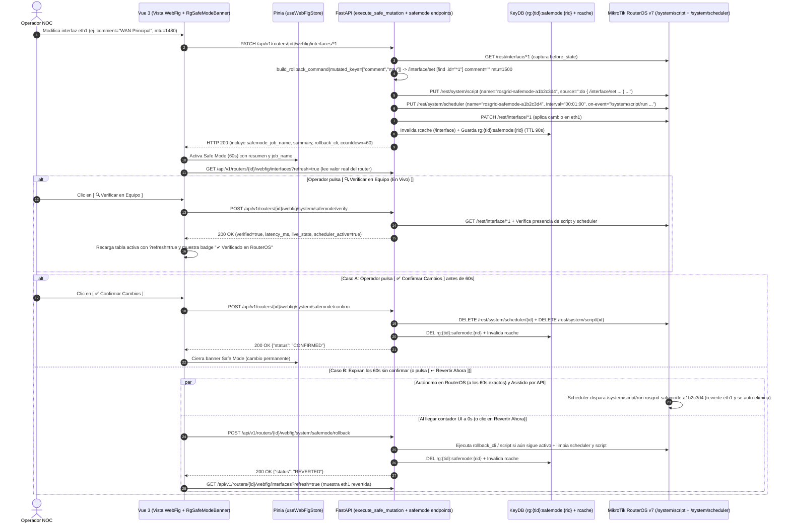

# SPDX-License-Identifier: GPL-3.0-only
# Copyright (C) 2026 Jesus Palencia <sinfallas@gmail.com> (Creado en Tecno Consultores)

# Especificación Técnica 74: Motor Safe Mode Transaccional de 2 Fases en RouterOS v7 (Script + Scheduler Reales con Rollback Automático a los 60s), Verificación en Vivo sin WinBox y Homologación del Botón Refrescar (`?refresh=true`) — Spec Flash-Ready (Gemini 3.8 Flash High)

- **Estado:** Homologado para Ejecución Directa (Hito 28.17 — Prioridad Crítica)
- **Fecha:** 2026-11-04
- **Motor de Ejecución Objetivo:** Gemini 3.8 Flash (High)
- **Complejidad Ciclomática Máxima:** Grado A (`CC <= 4` por función)
- **Cobertura Objetivo:** `>= 95%` (Backend Pytest + Frontend Vitest + Karate Labs BDD)
- **Ámbito:**
  - Backend:
    - [`fastapi/src/mikrotik/safemode.py`](file:///home/sinfallas/Dropbox/git/tecno-consultores/RoSGrid/fastapi/src/mikrotik/safemode.py)
    - [`fastapi/src/api/v1/webfig_common.py`](file:///home/sinfallas/Dropbox/git/tecno-consultores/RoSGrid/fastapi/src/api/v1/webfig_common.py)
    - [`fastapi/src/api/v1/webfig_system_tools.py`](file:///home/sinfallas/Dropbox/git/tecno-consultores/RoSGrid/fastapi/src/api/v1/webfig_system_tools.py)
    - [`fastapi/src/api/v1/webfig_interfaces.py`](file:///home/sinfallas/Dropbox/git/tecno-consultores/RoSGrid/fastapi/src/api/v1/webfig_interfaces.py)
    - [`fastapi/src/schemas/webfig_ops.py`](file:///home/sinfallas/Dropbox/git/tecno-consultores/RoSGrid/fastapi/src/schemas/webfig_ops.py)
  - Frontend:
    - [`vue3/src/stores/useWebFigStore.ts`](file:///home/sinfallas/Dropbox/git/tecno-consultores/RoSGrid/vue3/src/stores/useWebFigStore.ts)
    - [`vue3/src/components/common/RgSafeModeBanner.vue`](file:///home/sinfallas/Dropbox/git/tecno-consultores/RoSGrid/vue3/src/components/common/RgSafeModeBanner.vue)
    - [`vue3/src/views/InterfacesAndSfpView.vue`](file:///home/sinfallas/Dropbox/git/tecno-consultores/RoSGrid/vue3/src/views/InterfacesAndSfpView.vue)
    - [`vue3/src/views/FirewallRulesView.vue`](file:///home/sinfallas/Dropbox/git/tecno-consultores/RoSGrid/vue3/src/views/FirewallRulesView.vue)
    - [`vue3/src/views/DynamicLayer2ResourceView.vue`](file:///home/sinfallas/Dropbox/git/tecno-consultores/RoSGrid/vue3/src/views/DynamicLayer2ResourceView.vue)
    - [`vue3/src/views/IpAddressesAndDhcpView.vue`](file:///home/sinfallas/Dropbox/git/tecno-consultores/RoSGrid/vue3/src/views/IpAddressesAndDhcpView.vue)
    - [`vue3/src/views/Ipv6DualStackView.vue`](file:///home/sinfallas/Dropbox/git/tecno-consultores/RoSGrid/vue3/src/views/Ipv6DualStackView.vue)
    - [`vue3/src/views/RoutingBgpOspfView.vue`](file:///home/sinfallas/Dropbox/git/tecno-consultores/RoSGrid/vue3/src/views/RoutingBgpOspfView.vue)
    - [`vue3/src/views/BridgeView.vue`](file:///home/sinfallas/Dropbox/git/tecno-consultores/RoSGrid/vue3/src/views/BridgeView.vue)
    - [`vue3/src/views/WireGuardVpnView.vue`](file:///home/sinfallas/Dropbox/git/tecno-consultores/RoSGrid/vue3/src/views/WireGuardVpnView.vue)
    - [`vue3/src/views/PppAndQueuesView.vue`](file:///home/sinfallas/Dropbox/git/tecno-consultores/RoSGrid/vue3/src/views/PppAndQueuesView.vue)
- **Referencias Cruzadas:** Especificaciones [08](file:///home/sinfallas/Dropbox/git/tecno-consultores/RoSGrid/docs/specs/08_MIKROTIK_REST_V7_CLIENT_TOFU_AND_SAFEMODE.md), [12](file:///home/sinfallas/Dropbox/git/tecno-consultores/RoSGrid/docs/specs/12_BACKEND_ENDPOINTS_WEBFIG_L1_INTERFACES_AND_IP.md), [14](file:///home/sinfallas/Dropbox/git/tecno-consultores/RoSGrid/docs/specs/14_BACKEND_ENDPOINTS_WEBFIG_L1_PPP_QUEUES_SYSTEM_TOOLS.md) y [22](file:///home/sinfallas/Dropbox/git/tecno-consultores/RoSGrid/docs/specs/22_FRONTEND_VIEWS_WEBFIG_CONSOLE_RINGBUFFER_AND_LAYERS.md).

---

## 1. Diagnóstico Forense de las 5 Causas Raíz Críticas

Al realizar un cambio sobre la interfaz `ether1` (`eth1`) del router `r111` en **Interfaces & SFP DDM** (`/routers/:routerId/webfig/interfaces`), apareció en pantalla el banner con la cuenta regresiva de 60 segundos de **Safe Mode (`Dead Man's Switch`)**, pero:
1. **En el router MikroTik no existía ningún `/system/script` ni `/system/scheduler` de reversión.**
2. **Al dejar expirar los 60 segundos sin confirmar el cambio, la modificación NO se revirtió en el router.**
3. **El operador no tenía forma de comprobar desde RoSGrid (sin abrir WinBox) que el cambio se aplicó realmente en el equipo ni de refrescar los valores en vivo desde el menú de Interfaces.**
4. **En las distintas pestañas de WebFig, el botón de recarga cambiaba de nombre (`🔄 Refrescar` vs. `🔄 Actualizar`), faltaba por completo en 3 pestañas, y en ninguna enviaba `?refresh=true` para saltar la caché de KeyDB.**

La auditoría forense del código fuente identificó **5 causas raíz exactas**:

### 1.1. Causa Raíz 1 (CRÍTICA): Eliminación prematura del scheduler a los 50 milisegundos dentro de `execute_with_safemode` ([`fastapi/src/mikrotik/safemode.py` L156-L179](file:///home/sinfallas/Dropbox/git/tecno-consultores/RoSGrid/fastapi/src/mikrotik/safemode.py#L156-L179))

En `fastapi/src/mikrotik/safemode.py`:
```python
async def execute_with_safemode(
    client: MikrotikRestClient,
    rollback_cli: str,
    operation_fn: Callable[[], Awaitable[Any]],
    interval_seconds: int = 60,
    job_name: str | None = None,
) -> Any:
    name = await inject_deadmans_switch(
        client=client,
        rollback_cli=rollback_cli,
        interval_seconds=interval_seconds,
        job_name=job_name,
    )

    result = await operation_fn()

    is_alive = await verify_connectivity(client)
    if not is_alive:
        logger.critical("Pérdida de conectividad tras cambio. Dejando expirar scheduler '%s'", name)
        raise SafeModeRollbackTriggeredError(name, interval_seconds)

    await remove_deadmans_switch(client, name)
    return result
```
- **Qué ocurría:** Dentro de la misma petición HTTP (`PATCH /api/v1/routers/{id}/webfig/interfaces/{item_id}`), `execute_with_safemode` creaba el scheduler, aplicaba el cambio, comprobaba `GET /system/identity` 50 milisegundos después y **ejecutaba `await remove_deadmans_switch(client, name)` inmediatamente antes de responder `HTTP 200` al navegador**.
- Cuando el navegador recibía `HTTP 200` y mostraba el contador de 60 segundos (`RgSafeModeBanner.vue`), **el scheduler ya había sido borrado del router MikroTik**.
- Además, `inject_deadmans_switch` solo creaba una entrada en `/system/scheduler` (sin crear un `/system/script` dedicado) y cuando el contador del frontend ([`useWebFigStore.ts` L88-L94](file:///home/sinfallas/Dropbox/git/tecno-consultores/RoSGrid/vue3/src/stores/useWebFigStore.ts#L88-L94)) llegaba a `0` o el usuario pulsaba `Confirmar Cambios`, solo ejecutaba `stopSafeMode()` en memoria de JavaScript sin realizar ninguna llamada HTTP al backend.

### 1.2. Causa Raíz 2 (CRÍTICA): Comando CLI `/set` inválido por inclusión de propiedades de solo lectura y contadores en `_build_set_command` ([`fastapi/src/mikrotik/safemode.py` L49-L55](file:///home/sinfallas/Dropbox/git/tecno-consultores/RoSGrid/fastapi/src/mikrotik/safemode.py#L49-L55))

En `fastapi/src/mikrotik/safemode.py`:
```python
def _build_set_command(clean_menu: str, item_id: str, before_state: dict[str, Any]) -> str:
    items = []
    for k, v in before_state.items():
        if k not in {".id", "*id", "id"}:
            items.append(f"{k}={_format_cli_val(v)}")
    params_str = " ".join(items)
    return f"/{clean_menu}/set [find .id={item_id}] {params_str}".strip()
```
- Cuando `update_interface` (`webfig_interfaces.py` L161) hacía `before = await client.get(f"/interface/{item_id}")`, el JSON devuelto por RouterOS v7 incluye decenas de atributos de solo lectura y estadísticas en tiempo real (`running`, `dynamic`, `default-name`, `type`, `mac-address`, `actual-mtu`, `l2mtu`, `max-l2mtu`, `rx-byte`, `tx-byte`, `rx-packet`, `tx-packet`, `fp-rx-byte`, `fp-tx-byte`, `last-link-up-time`, `link-downs`).
- Al concatenar todas esas propiedades en `/interface/set [find .id=*1] rx-byte="1234" running="true" ...`, **el intérprete CLI de RouterOS v7 rechaza el comando completo por error de sintaxis** porque `rx-byte`, `running`, `type`, `actual-mtu`, `default-name`, etc., no son parámetros válidos del verbo `set`.
- Adicionalmente, en RouterOS v7 el identificador `[find .id="*1"]` debe ir entrecomillado y el rollback de una operación `set`/`patch` debe restaurar **exclusivamente los atributos modificados por la petición (`mutated_keys` = `patch_data.keys()`)**.

### 1.3. Causa Raíz 3: Ausencia de verificación en vivo sin WinBox durante la ventana de Safe Mode ([`RgSafeModeBanner.vue`](file:///home/sinfallas/Dropbox/git/tecno-consultores/RoSGrid/vue3/src/components/common/RgSafeModeBanner.vue))

- Mientras corre el contador de 60 segundos, el banner decía: `"Verificando conectividad con el router. Los cambios se revertirán automáticamente en: 60s [Confirmar Cambios]"`, pero:
  1. No mostraba qué cambio exacto estaba en evaluación (`summary` y comando de reversión `rollback_cli`) ni el nombre del job activo en el router (`rosgrid-safemode-<id>`).
  2. No ofrecía un botón **`🔍 Verificar en Equipo (En Vivo)`** que interrogara en tiempo real al router MikroTik (`?refresh=true`), comprobara la latencia/supervivencia de la sesión REST y refrescara la tabla activa para que el operador pudiera constatar visualmente el cambio en pantalla antes de pulsar **`✅ Confirmar Cambios`** o **`↩️ Revertir Ahora`**.

### 1.4. Causa Raíz 4: Ausencia de `invalidate_webfig_cache` tras mutaciones en `webfig_interfaces.py` y recarga desde caché obsoleta de KeyDB

- En [`webfig_interfaces.py`](file:///home/sinfallas/Dropbox/git/tecno-consultores/RoSGrid/fastapi/src/api/v1/webfig_interfaces.py#L127-L170), ninguna de las mutaciones (`update_interface`, `create_vlan`, `update_vlan`, `delete_vlan`, `create_bridge`, `update_bridge`, `delete_bridge`, `create_wireguard`, etc.) llamaba a `invalidate_webfig_cache(redis, tenant_id, router_id, ...)`.
- Cuando el frontend llamaba inmediatamente a `loadInterfaces()` tras un `PATCH`, hacía `GET /api/v1/routers/{id}/webfig/interfaces` sin `?refresh=true`, recibiendo el JSON antiguo almacenado en KeyDB (`ttl_seconds=5`) en lugar del estado real del router.

### 1.5. Causa Raíz 5: Desigualdad y omisión del botón `🔄 Refrescar` en las vistas de WebFig

| Vista WebFig (`vue3/src/views/`) | Estado Actual del Botón en Cabecera | ¿Envía `?refresh=true` al Backend? |
| :--- | :--- | :--- |
| `InterfacesAndSfpView.vue` | ❌ **No existe botón** | ❌ No (`loadInterfaces()` sin `?refresh=true`) |
| `FirewallRulesView.vue` | ❌ **No existe botón** (solo `Reset Contadores`) | ❌ No (`loadFirewallData()` sin `?refresh=true`) |
| `DynamicLayer2ResourceView.vue` | ❌ **No existe botón** | ❌ No (`fetchResource()` sin `?refresh=true`) |
| `IpAddressesAndDhcpView.vue` | ⚠️ Dice **`🔄 Actualizar`** | ❌ No (`loadIpData()` sin `?refresh=true`) |
| `Ipv6DualStackView.vue` | ⚠️ Dice **`🔄 Actualizar`** | ❌ No (`loadData()` sin `?refresh=true`) |
| `RoutingBgpOspfView.vue` | ⚠️ Dice **`🔄 Actualizar`** | ❌ No (`loadRoutingData()` sin `?refresh=true`) |
| `BridgeView.vue` | ✅ Dice **`🔄 Refrescar`** | ❌ No (`loadAllBridgeData()` sin `?refresh=true`) |
| `WireGuardVpnView.vue` | ✅ Dice **`🔄 Refrescar`** | ❌ No (`loadWireGuardData()` sin `?refresh=true`) |
| `PppAndQueuesView.vue` | ✅ Dice **`🔄 Refrescar`** | ❌ No (`loadPppData()` sin `?refresh=true`) |



---

## 2. Instrucciones Exactas de Implementación (Flash-Ready `Target` / `Replacement`)

### 2.1. Backend: Motor Safe Mode de 2 Fases Real con `/system/script` + `/system/scheduler` y Filtrado de `mutated_keys` en [`fastapi/src/mikrotik/safemode.py`](file:///home/sinfallas/Dropbox/git/tecno-consultores/RoSGrid/fastapi/src/mikrotik/safemode.py)

Reemplazar el contenido de `fastapi/src/mikrotik/safemode.py` para:
1. Filtrar estrictamente propiedades de solo lectura de RouterOS v7 (`_READONLY_ROS_KEYS`) y restringir `_build_set_command` a las llaves efectivamente modificadas (`mutated_keys`) cuando se proporcionan, entrecomillando `[find .id="{item_id}"]`.
2. En operaciones `create`, permitir construir el rollback con el `.id` recién creado una vez que `operation_fn()` devuelve el recurso (`extract_created_item_id`).
3. En `inject_deadmans_switch`, inyectar tanto el script en `/system/script` (`rosgrid-safemode-<hex>`) como el scheduler en `/system/scheduler` (`rosgrid-safemode-<hex>`) que invoca a dicho script y se auto-limpia tras revertir.
4. En `remove_deadmans_switch`, eliminar tanto el scheduler en `/system/scheduler` como el script en `/system/script`.
5. Añadir `trigger_deadmans_rollback_now(client, job_name, rollback_cli)` para ejecutar el rollback bajo demanda o al expirar el contador de la UI y limpiar ambos artefactos.
6. En `execute_with_safemode`, añadir el parámetro `keep_alive_for_confirmation: bool = False`. Cuando `keep_alive_for_confirmation=True` (usado por `execute_safe_mutation` en WebFig), **NO eliminar el script ni el scheduler al finalizar el request HTTP**, sino dejarlos armados en el router durante los 60 segundos para confirmación explícita o reversión automática.

**Target (`fastapi/src/mikrotik/safemode.py` líneas 40-179):**
```python
def _format_cli_val(val: Any) -> str:
    if isinstance(val, bool):
        return "yes" if val else "no"
    if isinstance(val, (int, float)):
        return str(val)
    escaped = str(val).replace('"', '\\"')
    return f'"{escaped}"'


def _build_set_command(clean_menu: str, item_id: str, before_state: dict[str, Any]) -> str:
    items = []
    for k, v in before_state.items():
        if k not in {".id", "*id", "id"}:
            items.append(f"{k}={_format_cli_val(v)}")
    params_str = " ".join(items)
    return f"/{clean_menu}/set [find .id={item_id}] {params_str}".strip()


def _build_create_command(clean_menu: str, item_id: str | None, before_state: dict[str, Any] | None) -> str:
    if item_id:
        return f"/{clean_menu}/remove [find .id={item_id}]"
    comment = before_state.get("comment") if before_state else None
    if comment:
        return f'/{clean_menu}/remove [find comment="{comment}"]'
    return f"/{clean_menu}/remove [find]"


def _build_delete_command(clean_menu: str, item_id: str) -> str:
    return f"/{clean_menu}/set [find .id={item_id}] disabled=no"


def build_rollback_command(
    menu_path: str,
    action: str,
    item_id: str | None = None,
    before_state: dict[str, Any] | None = None,
) -> str:
    """Construye la instrucción CLI de RouterOS para revertir una operación de Safe Mode."""
    clean_menu = menu_path.strip("/")
    act = action.lower()
    if act in {"set", "modify", "patch"} and item_id and before_state:
        return _build_set_command(clean_menu, item_id, before_state)
    if act in {"create", "put", "add"}:
        return _build_create_command(clean_menu, item_id, before_state)
    if act in {"delete", "remove"} and item_id:
        return _build_delete_command(clean_menu, item_id)
    return ":nothing"


def build_scheduler_payload(
    job_name: str,
    rollback_cli: str,
    interval_seconds: int = 60,
) -> dict[str, Any]:
    """Genera el payload para crear el /system/scheduler de reversión automática."""
    interval_str = format_routeros_duration(interval_seconds)
    on_event = f':do {{ {rollback_cli} }} on-error={{}}; /system/scheduler/remove [find name="{job_name}"]'
    return {
        "name": job_name,
        "start-time": "startup",
        "interval": interval_str,
        "comment": "ROSGRID_DEADMAN_SWITCH_AUTO_ROLLBACK",
        "on-event": on_event,
    }


async def inject_deadmans_switch(
    client: MikrotikRestClient,
    rollback_cli: str,
    interval_seconds: int = 60,
    job_name: str | None = None,
) -> str:
    """Inyecta el scheduler de reversión en el MikroTik previo a ejecutar cambios sensibles."""
    name = job_name or generate_safemode_job_name()
    payload = build_scheduler_payload(name, rollback_cli, interval_seconds)
    await client.put("/system/scheduler", json_data=payload)
    logger.info("SafeMode scheduler '%s' inyectado con intervalo %ds", name, interval_seconds)
    return name


async def verify_connectivity(
    client: MikrotikRestClient,
    max_retries: int = 3,
    retry_delay: float = 2.0,
) -> bool:
    """Verifica la supervivencia de la comunicación con el router tras un cambio sensible."""
    for attempt in range(1, max_retries + 1):
        try:
            res = await client.get("/system/identity")
            if res is not None:
                return True
        except Exception as exc:
            logger.warning("Intento %d/%d de verificación falló: %s", attempt, max_retries, exc)
        if attempt < max_retries:
            await asyncio.sleep(retry_delay)
    return False


async def remove_deadmans_switch(
    client: MikrotikRestClient,
    job_name: str,
) -> bool:
    """Elimina el scheduler de reversión una vez confirmada la supervivencia del router."""
    try:
        schedulers = await client.get("/system/scheduler", params={"name": job_name})
        if isinstance(schedulers, list) and schedulers:
            sched_id = schedulers[0].get(".id")
            if sched_id:
                await client.delete(f"/system/scheduler/{sched_id}")
                logger.info("SafeMode scheduler '%s' eliminado con éxito", job_name)
                return True
    except Exception as exc:
        logger.error("No se pudo eliminar el scheduler '%s': %s", job_name, exc)
    return False


async def execute_with_safemode(
    client: MikrotikRestClient,
    rollback_cli: str,
    operation_fn: Callable[[], Awaitable[Any]],
    interval_seconds: int = 60,
    job_name: str | None = None,
) -> Any:
    """Aplica el protocolo Dead Man's Switch completo alrededor de una operación asíncrona."""
    name = await inject_deadmans_switch(
        client=client,
        rollback_cli=rollback_cli,
        interval_seconds=interval_seconds,
        job_name=job_name,
    )

    result = await operation_fn()

    is_alive = await verify_connectivity(client)
    if not is_alive:
        logger.critical("Pérdida de conectividad tras cambio. Dejando expirar scheduler '%s'", name)
        raise SafeModeRollbackTriggeredError(name, interval_seconds)

    await remove_deadmans_switch(client, name)
    return result
```

**Replacement:**
```python
_READONLY_ROS_KEYS: frozenset[str] = frozenset(
    {
        ".id",
        "*id",
        "id",
        "running",
        "dynamic",
        "invalid",
        "default",
        "builtin",
        "slave",
        "inactive",
        "rx-byte",
        "tx-byte",
        "rx-packet",
        "tx-packet",
        "rx-drop",
        "tx-drop",
        "rx-error",
        "tx-error",
        "fp-rx-byte",
        "fp-tx-byte",
        "fp-rx-packet",
        "fp-tx-packet",
        "actual-mtu",
        "l2mtu",
        "max-l2mtu",
        "mac-address",
        "orig-mac-address",
        "type",
        "default-name",
        "last-link-up-time",
        "last-link-down-time",
        "link-downs",
        "current-operator",
        "active-address",
        "expires-after",
    }
)


def _format_cli_val(val: Any) -> str:
    if isinstance(val, bool):
        return "yes" if val else "no"
    if isinstance(val, str) and val.lower() in {"true", "false"}:
        return "yes" if val.lower() == "true" else "no"
    if isinstance(val, (int, float)):
        return str(val)
    escaped = str(val).replace("\\", "\\\\").replace('"', '\\"')
    return f'"{escaped}"'


def _normalize_ros_key(key: str) -> str:
    return key.replace("_", "-")


def _extract_writable_pairs(
    before_state: dict[str, Any],
    mutated_keys: set[str] | list[str] | None = None,
) -> list[str]:
    allowed_norm = (
        {_normalize_ros_key(k) for k in mutated_keys if k not in _READONLY_ROS_KEYS}
        if mutated_keys
        else None
    )
    items: list[str] = []
    for raw_k, v in before_state.items():
        norm_k = _normalize_ros_key(raw_k)
        if norm_k in _READONLY_ROS_KEYS or raw_k in _READONLY_ROS_KEYS or v is None:
            continue
        if allowed_norm is not None and norm_k not in allowed_norm and raw_k not in (mutated_keys or set()):
            continue
        items.append(f"{norm_k}={_format_cli_val(v)}")
    return items


def _build_set_command(
    clean_menu: str,
    item_id: str,
    before_state: dict[str, Any],
    mutated_keys: set[str] | list[str] | None = None,
) -> str:
    items = _extract_writable_pairs(before_state, mutated_keys)
    if not items and mutated_keys:
        for mk in mutated_keys:
            norm_k = _normalize_ros_key(mk)
            if norm_k not in _READONLY_ROS_KEYS:
                prev_val = before_state.get(norm_k, before_state.get(mk, ""))
                items.append(f"{norm_k}={_format_cli_val(prev_val)}")
    params_str = " ".join(items)
    target_selector = f'[find .id="{item_id}"]' if str(item_id).startswith("*") else f'[find name="{item_id}"]'
    return f"/{clean_menu}/set {target_selector} {params_str}".strip()


def _build_create_command(clean_menu: str, item_id: str | None, before_state: dict[str, Any] | None) -> str:
    if item_id:
        return f'/{clean_menu}/remove [find .id="{item_id}"]'
    if before_state:
        name = before_state.get("name")
        if name:
            return f'/{clean_menu}/remove [find name="{name}"]'
        comment = before_state.get("comment")
        if comment:
            return f'/{clean_menu}/remove [find comment="{comment}"]'
    return f"/{clean_menu}/remove [find]"


def _build_delete_command(clean_menu: str, item_id: str, before_state: dict[str, Any] | None = None) -> str:
    if before_state:
        items = _extract_writable_pairs(before_state)
        if items:
            return f"/{clean_menu}/add {' '.join(items)}"
    return f'/{clean_menu}/set [find .id="{item_id}"] disabled=no'


def build_rollback_command(
    menu_path: str,
    action: str,
    item_id: str | None = None,
    before_state: dict[str, Any] | None = None,
    mutated_keys: set[str] | list[str] | None = None,
) -> str:
    """Construye la instrucción CLI de RouterOS para revertir una operación de Safe Mode."""
    clean_menu = menu_path.strip("/")
    act = action.lower()
    if act in {"set", "modify", "patch"} and item_id and before_state is not None:
        return _build_set_command(clean_menu, item_id, before_state, mutated_keys=mutated_keys)
    if act in {"create", "put", "add"}:
        return _build_create_command(clean_menu, item_id, before_state)
    if act in {"delete", "remove"} and item_id:
        return _build_delete_command(clean_menu, item_id, before_state)
    return ":nothing"


def build_script_payload(job_name: str, rollback_cli: str) -> dict[str, Any]:
    """Genera el payload para crear el /system/script de reversión y autolimpieza."""
    source = (
        f":do {{ {rollback_cli} }} on-error={{}}; "
        f':do {{ /system/scheduler/remove [find name="{job_name}"] }} on-error={{}}; '
        f':do {{ /system/script/remove [find name="{job_name}"] }} on-error={{}}'
    )
    return {
        "name": job_name,
        "comment": "ROSGRID_DEADMAN_SWITCH_AUTO_ROLLBACK",
        "source": source,
    }


def build_scheduler_payload(
    job_name: str,
    rollback_cli: str,
    interval_seconds: int = 60,
) -> dict[str, Any]:
    """Genera el payload para crear el /system/scheduler de reversión automática."""
    interval_str = format_routeros_duration(interval_seconds)
    on_event = (
        f':do {{ /system/script/run [find name="{job_name}"] }} on-error={{}}; '
        f":do {{ {rollback_cli} }} on-error={{}}; "
        f':do {{ /system/scheduler/remove [find name="{job_name}"] }} on-error={{}}; '
        f':do {{ /system/script/remove [find name="{job_name}"] }} on-error={{}}'
    )
    return {
        "name": job_name,
        "start-time": "startup",
        "interval": interval_str,
        "comment": "ROSGRID_DEADMAN_SWITCH_AUTO_ROLLBACK",
        "on-event": on_event,
    }


async def inject_deadmans_switch(
    client: MikrotikRestClient,
    rollback_cli: str,
    interval_seconds: int = 60,
    job_name: str | None = None,
) -> str:
    """Inyecta el script y el scheduler de reversión en el MikroTik previo a ejecutar cambios sensibles."""
    name = job_name or generate_safemode_job_name()
    script_payload = build_script_payload(name, rollback_cli)
    try:
        await client.put("/system/script", json_data=script_payload)
    except Exception as exc:
        logger.debug("Creación opcional de /system/script '%s' omitida: %s", name, exc)

    payload = build_scheduler_payload(name, rollback_cli, interval_seconds)
    await client.put("/system/scheduler", json_data=payload)
    logger.info("SafeMode script+scheduler '%s' inyectado con intervalo %ds", name, interval_seconds)
    return name


async def verify_connectivity(
    client: MikrotikRestClient,
    max_retries: int = 3,
    retry_delay: float = 2.0,
) -> bool:
    """Verifica la supervivencia de la comunicación con el router tras un cambio sensible."""
    for attempt in range(1, max_retries + 1):
        try:
            res = await client.get("/system/identity")
            if res is not None:
                return True
        except Exception as exc:
            logger.warning("Intento %d/%d de verificación falló: %s", attempt, max_retries, exc)
        if attempt < max_retries:
            await asyncio.sleep(retry_delay)
    return False


async def _delete_ros_named_items(client: MikrotikRestClient, endpoint: str, job_name: str) -> bool:
    removed = False
    try:
        items = await client.get(endpoint, params={"name": job_name})
        if isinstance(items, list):
            for item in items:
                if isinstance(item, dict) and item.get("name", job_name) == job_name:
                    item_id = item.get(".id") or item.get("id")
                    if item_id:
                        await client.delete(f"{endpoint}/{item_id}")
                        removed = True
    except Exception as exc:
        logger.debug("Error limpiando %s '%s': %s", endpoint, job_name, exc)
    return removed


async def remove_deadmans_switch(
    client: MikrotikRestClient,
    job_name: str,
) -> bool:
    """Elimina el scheduler y el script de reversión una vez confirmados los cambios por el operador."""
    sched_removed = await _delete_ros_named_items(client, "/system/scheduler", job_name)
    await _delete_ros_named_items(client, "/system/script", job_name)
    if sched_removed:
        logger.info("SafeMode scheduler y script '%s' eliminados con éxito", job_name)
    return sched_removed


async def execute_rollback_on_router(
    client: MikrotikRestClient,
    job_name: str,
    menu: str,
    action: str,
    item_id: str | None,
    before_state: dict[str, Any] | None,
    mutated_keys: list[str] | None = None,
) -> bool:
    """Ejecuta la reversión inmediata en RouterOS vía REST/Script y limpia el scheduler/script."""
    reverted = False
    clean_menu = menu.strip("/")
    act = action.lower()
    try:
        if act in {"set", "modify", "patch"} and item_id and before_state:
            restore_payload: dict[str, Any] = {}
            target_keys = mutated_keys or list(before_state.keys())
            for k in target_keys:
                norm_k = _normalize_ros_key(k)
                if norm_k not in _READONLY_ROS_KEYS and (norm_k in before_state or k in before_state):
                    restore_payload[norm_k] = before_state.get(norm_k, before_state.get(k))
            if restore_payload:
                await client.patch(f"/{clean_menu}/{item_id}", json_data=restore_payload)
                reverted = True
        elif act in {"create", "put", "add"} and item_id:
            await client.delete(f"/{clean_menu}/{item_id}")
            reverted = True
        elif act in {"delete", "remove"} and before_state:
            recreate_payload = {
                _normalize_ros_key(k): v
                for k, v in before_state.items()
                if _normalize_ros_key(k) not in _READONLY_ROS_KEYS and v is not None
            }
            if recreate_payload:
                await client.put(f"/{clean_menu}", json_data=recreate_payload)
                reverted = True
    except Exception as exc:
        logger.warning("Fallback a /system/script/run para rollback '%s': %s", job_name, exc)
        try:
            await client.post("/system/script/run", json_data={".id": job_name})
            reverted = True
        except Exception as script_exc:
            logger.debug("El script '%s' ya fue ejecutado por el scheduler: %s", job_name, script_exc)

    await remove_deadmans_switch(client, job_name)
    return reverted


async def execute_with_safemode(
    client: MikrotikRestClient,
    rollback_cli: str,
    operation_fn: Callable[[], Awaitable[Any]],
    interval_seconds: int = 60,
    job_name: str | None = None,
    keep_alive_for_confirmation: bool = False,
) -> Any:
    """Aplica el protocolo Dead Man's Switch alrededor de una operación asíncrona."""
    name = await inject_deadmans_switch(
        client=client,
        rollback_cli=rollback_cli,
        interval_seconds=interval_seconds,
        job_name=job_name,
    )

    try:
        result = await operation_fn()
    except Exception:
        await remove_deadmans_switch(client, name)
        raise

    is_alive = await verify_connectivity(client)
    if not is_alive:
        logger.critical("Pérdida de conectividad tras cambio. Dejando expirar scheduler '%s'", name)
        raise SafeModeRollbackTriggeredError(name, interval_seconds)

    if not keep_alive_for_confirmation:
        await remove_deadmans_switch(client, name)
    return result
```

---

### 2.2. Backend: Registro de Estado de Safe Mode en KeyDB e Invalidación Automática en `execute_safe_mutation` ([`fastapi/src/api/v1/webfig_common.py`](file:///home/sinfallas/Dropbox/git/tecno-consultores/RoSGrid/fastapi/src/api/v1/webfig_common.py#L308-L336))

Actualizar `execute_safe_mutation` en `fastapi/src/api/v1/webfig_common.py` para:
1. Aceptar `mutated_keys: list[str] | set[str] | None = None`, `tenant_id: uuid.UUID | None = None`, `router_id: uuid.UUID | None = None` y `summary: str | None = None` (manteniendo 100% de compatibilidad hacia atrás con llamadas existentes que no pasen `tenant_id`/`router_id`, extrayéndolos o registrando por `client.host` + `router_id` si están disponibles).
2. Inferir automáticamente `mutated_keys` cuando `action == "set"` si no se pasan explícitamente, e invocar `execute_with_safemode(..., keep_alive_for_confirmation=True)` cuando se trata de una mutación WebFig para que **el script y el scheduler permanezcan vivos en el router MikroTik durante los 60 segundos**.
3. Si `action == "create"` y `result` contiene `".id"` (ej. `{"ret": "*5"}` o `{".id": "*5"}`), actualizar el script/scheduler en el router y los metadatos de rollback con el `.id` creado para que la reversión elimine exactamente ese registro.
4. Enriquecer el diccionario devuelto (si es `dict`) con `_safemode`: `{"job_name": job_name, "expires_in": 60, "rollback_cli": rollback_cmd, "summary": summary}` y guardar el estado activo en KeyDB (`rg:safemode:active:{router_id}` o `rg:safemode:host:{client.host}`, TTL `90s`).

**Target (`fastapi/src/api/v1/webfig_common.py` líneas 308-336):**
```python
async def execute_safe_mutation(
    client: MikrotikRestClient,
    menu: str,
    action: str,
    coro_fn: Callable[[], Awaitable[Any]],
    item_id: str | None = None,
    before_state: dict[str, Any] | None = None,
) -> Any:
    """Envuelve una mutación sensible en el motor Dead Man's Switch (Safe Mode a 60s)."""
    rollback_cmd = build_rollback_command(
        menu_path=menu,
        action=action,
        item_id=item_id,
        before_state=before_state,
    )
    try:
        return await execute_with_safemode(
            client=client,
            rollback_cli=rollback_cmd,
            operation_fn=coro_fn,
            interval_seconds=60,
        )
    except HTTPException:
        raise
    except (ConnectionError, TimeoutError, OSError, MikrotikClientError, MikrotikSSLError) as exc:
        raise HTTPException(
            status_code=status.HTTP_502_BAD_GATEWAY,
            detail=f"No se pudo ejecutar mutación en el router MikroTik ({menu}): {exc}",
        ) from exc
```

**Replacement:**
```python
async def _store_active_safemode_job(
    host: str,
    router_id: uuid.UUID | None,
    job_data: dict[str, Any],
) -> None:
    try:
        from src.redis_layer.client import get_redis_client

        redis = get_redis_client()
        if not redis:
            return
        raw_json = json.dumps(job_data)
        await redis.setex(f"rg:safemode:host:{host}", 90, raw_json)
        if router_id is not None:
            await redis.setex(f"rg:safemode:router:{router_id}", 90, raw_json)
    except Exception as exc:
        logger.debug("No se pudo persistir metadatos de Safe Mode en KeyDB: %s", exc)


async def execute_safe_mutation(
    client: MikrotikRestClient,
    menu: str,
    action: str,
    coro_fn: Callable[[], Awaitable[Any]],
    item_id: str | None = None,
    before_state: dict[str, Any] | None = None,
    mutated_keys: list[str] | set[str] | None = None,
    router_id: uuid.UUID | None = None,
    summary: str | None = None,
) -> Any:
    """Envuelve una mutación sensible en el motor Dead Man's Switch de 2 fases (Safe Mode a 60s)."""
    from src.mikrotik.safemode import generate_safemode_job_name, remove_deadmans_switch

    # Si ya existía un job previo pendiente en el mismo router, eliminar su scheduler antes de encadenar
    try:
        from src.redis_layer.client import get_redis_client

        redis = get_redis_client()
        prev_raw = await redis.get(f"rg:safemode:host:{client.host}") if redis else None
        if prev_raw:
            prev_job = json.loads(prev_raw)
            prev_name = prev_job.get("job_name")
            if prev_name:
                await remove_deadmans_switch(client, prev_name)
    except Exception as exc:
        logger.debug("Omitiendo limpieza de Safe Mode previo: %s", exc)

    job_name = generate_safemode_job_name()
    rollback_cmd = build_rollback_command(
        menu_path=menu,
        action=action,
        item_id=item_id,
        before_state=before_state,
        mutated_keys=mutated_keys,
    )
    try:
        result = await execute_with_safemode(
            client=client,
            rollback_cli=rollback_cmd,
            operation_fn=coro_fn,
            interval_seconds=60,
            job_name=job_name,
            keep_alive_for_confirmation=True,
        )
    except HTTPException:
        raise
    except (ConnectionError, TimeoutError, OSError, MikrotikClientError, MikrotikSSLError) as exc:
        raise HTTPException(
            status_code=status.HTTP_502_BAD_GATEWAY,
            detail=f"No se pudo ejecutar mutación en el router MikroTik ({menu}): {exc}",
        ) from exc

    effective_item_id = item_id
    if action.lower() in {"create", "put", "add"} and isinstance(result, dict):
        effective_item_id = str(result.get(".id") or result.get("ret") or item_id or "") or None
        if effective_item_id:
            rollback_cmd = build_rollback_command(
                menu_path=menu,
                action="create",
                item_id=effective_item_id,
                before_state=before_state,
            )

    now_utc = datetime.now(UTC)
    job_metadata = {
        "job_name": job_name,
        "menu": menu.strip("/"),
        "action": action.lower(),
        "item_id": effective_item_id,
        "before_state": before_state or {},
        "mutated_keys": list(mutated_keys) if mutated_keys else [],
        "rollback_cli": rollback_cmd,
        "summary": summary or f"{action.upper()} /{menu.strip('/')}" + (f" ({effective_item_id})" if effective_item_id else ""),
        "created_at": now_utc.isoformat(),
        "expires_at": (now_utc + timedelta(seconds=60)).isoformat(),
    }
    await _store_active_safemode_job(client.host, router_id, job_metadata)

    if isinstance(result, dict):
        return {
            **result,
            "_safemode": {
                "job_name": job_name,
                "expires_in": 60,
                "rollback_cli": rollback_cmd,
                "summary": job_metadata["summary"],
            },
        }
    return result
```

---

### 2.3. Backend: Invalidación de Caché KeyDB y Paso de `mutated_keys` en `update_interface` ([`fastapi/src/api/v1/webfig_interfaces.py`](file:///home/sinfallas/Dropbox/git/tecno-consultores/RoSGrid/fastapi/src/api/v1/webfig_interfaces.py#L14-L20))

1. Importar `invalidate_webfig_cache` en `fastapi/src/api/v1/webfig_interfaces.py`.
2. En `update_interface` (y demás mutaciones de `webfig_interfaces.py`), pasar `mutated_keys=list(patch_data.keys())`, `router_id=router_id` e invocar `await invalidate_webfig_cache(redis, tenant_id, router_id, "/interface")` y `await invalidate_webfig_cache(redis, tenant_id, router_id, "/interface/ethernet")`.

**Target 1 (`fastapi/src/api/v1/webfig_interfaces.py` líneas 14-20):**
```python
from src.api.v1.webfig_common import (
    cached_mikrotik_get,
    execute_safe_mutation,
    get_router_and_client,
    intercept_maker_checker_if_needed,
)
```

**Replacement 1:**
```python
from src.api.v1.webfig_common import (
    cached_mikrotik_get,
    execute_safe_mutation,
    get_router_and_client,
    intercept_maker_checker_if_needed,
    invalidate_webfig_cache,
)
```

**Target 2 (`fastapi/src/api/v1/webfig_interfaces.py` líneas 159-170):**
```python
    _, client = await get_router_and_client(router_id, claims, db)
    async with client:
        before = await client.get(f"/interface/{item_id}")
        return await execute_safe_mutation(
            client=client,
            menu="interface",
            action="set",
            item_id=item_id,
            before_state=before if isinstance(before, dict) else {},
            coro_fn=lambda: client.patch(f"/interface/{item_id}", json_data=patch_data),
        )
```

**Replacement 2:**
```python
    tenant_id = uuid.UUID(claims["tid"])
    redis = get_redis_client()
    _, client = await get_router_and_client(router_id, claims, db)
    async with client:
        before = await client.get(f"/interface/{item_id}")
        res = await execute_safe_mutation(
            client=client,
            menu="interface",
            action="set",
            item_id=item_id,
            before_state=before if isinstance(before, dict) else {},
            mutated_keys=list(patch_data.keys()),
            router_id=router_id,
            summary=f"Modificar interfaz {item_id} ({', '.join(patch_data.keys())})",
            coro_fn=lambda: client.patch(f"/interface/{item_id}", json_data=patch_data),
        )
    await invalidate_webfig_cache(redis, tenant_id, router_id, "/interface")
    await invalidate_webfig_cache(redis, tenant_id, router_id, "/interface/ethernet")
    return res
```

*(Nota para Gemini 3.8 Flash High: añadir igualmente `await invalidate_webfig_cache(redis, tenant_id, router_id, ...)` tras `create_vlan`, `update_vlan`, `delete_vlan`, `create_bridge`, `update_bridge`, `delete_bridge`, `create_bridge_port`, `update_bridge_port`, `delete_bridge_port`, `create_bridge_vlan`, `update_bridge_vlan`, `delete_bridge_vlan`, `create_wireguard`, `update_wireguard`, `delete_wireguard`, `create_wireguard_peer`, `update_wireguard_peer` y `delete_wireguard_peer` en `webfig_interfaces.py`).*

---

### 2.4. Backend: Nuevos Endpoints de Control de Safe Mode (`status`, `verify`, `confirm`, `rollback`) en [`fastapi/src/api/v1/webfig_system_tools.py`](file:///home/sinfallas/Dropbox/git/tecno-consultores/RoSGrid/fastapi/src/api/v1/webfig_system_tools.py)

Añadir al final de la sección `SYSTEM ENDPOINTS` en `fastapi/src/api/v1/webfig_system_tools.py` los 4 endpoints de ciclo de vida de Safe Mode:
- `GET /api/v1/routers/{router_id}/webfig/system/safemode/status`
- `POST /api/v1/routers/{router_id}/webfig/system/safemode/verify`
- `POST /api/v1/routers/{router_id}/webfig/system/safemode/confirm`
- `POST /api/v1/routers/{router_id}/webfig/system/safemode/rollback`

```python
async def _load_active_safemode_job(redis: Any, router_id: uuid.UUID, host: str) -> dict[str, Any] | None:
    if not redis:
        return None
    for key in (f"rg:safemode:router:{router_id}", f"rg:safemode:host:{host}"):
        raw = await redis.get(key)
        if raw:
            try:
                return json.loads(raw)
            except Exception:
                continue
    return None


async def _clear_active_safemode_job(redis: Any, router_id: uuid.UUID, host: str) -> None:
    if not redis:
        return
    for key in (f"rg:safemode:router:{router_id}", f"rg:safemode:host:{host}"):
        try:
            await redis.delete(key)
        except Exception:
            pass


@system_router.get("/safemode/status")
async def get_safemode_status(
    router_id: uuid.UUID,
    claims: dict[str, Any] = Depends(get_current_user_claims),
    db: AsyncSession = Depends(get_tenant_db_session),
) -> dict[str, Any]:
    """Consulta el estado real del Safe Mode activo en KeyDB y en el router MikroTik."""
    redis = get_redis_client()
    _, client = await get_router_and_client(router_id, claims, db)
    job = await _load_active_safemode_job(redis, router_id, client.host)
    if not job:
        return {"active": False, "job_name": None, "remaining_seconds": 0}
    return {
        "active": True,
        "job_name": job.get("job_name"),
        "menu": job.get("menu"),
        "action": job.get("action"),
        "item_id": job.get("item_id"),
        "summary": job.get("summary"),
        "rollback_cli": job.get("rollback_cli"),
        "expires_at": job.get("expires_at"),
    }


@system_router.post("/safemode/verify")
async def verify_safemode_live_on_router(
    router_id: uuid.UUID,
    claims: dict[str, Any] = Depends(get_current_user_claims),
    db: AsyncSession = Depends(get_tenant_db_session),
) -> dict[str, Any]:
    """Verifica en vivo en el MikroTik (sin caché) que el cambio se aplicó y que el script/scheduler de rollback está armado."""
    import time

    tenant_id = uuid.UUID(claims["tid"])
    redis = get_redis_client()
    _, client = await get_router_and_client(router_id, claims, db)
    job = await _load_active_safemode_job(redis, router_id, client.host)
    t0 = time.perf_counter()
    async with client:
        identity = await client.get("/system/identity")
        latency_ms = round((time.perf_counter() - t0) * 1000.0, 1)
        live_item: Any = None
        scheduler_armed = False
        if job:
            job_name = job.get("job_name")
            menu = job.get("menu")
            item_id = job.get("item_id")
            if job_name:
                scheds = await client.get("/system/scheduler", params={"name": job_name})
                scheduler_armed = bool(isinstance(scheds, list) and len(scheds) > 0)
            if menu and item_id:
                try:
                    live_item = await client.get(f"/{menu}/{item_id}")
                except Exception:
                    live_item = None
            if menu:
                await invalidate_webfig_cache(redis, tenant_id, router_id, f"/{menu}")

    return {
        "verified": True,
        "latency_ms": latency_ms,
        "router_identity": identity.get("name") if isinstance(identity, dict) else None,
        "scheduler_armed": scheduler_armed,
        "job_name": job.get("job_name") if job else None,
        "summary": job.get("summary") if job else None,
        "rollback_cli": job.get("rollback_cli") if job else None,
        "live_item": live_item,
    }


@system_router.post("/safemode/confirm")
async def confirm_safemode_changes(
    router_id: uuid.UUID,
    claims: dict[str, Any] = Depends(get_current_user_claims),
    db: AsyncSession = Depends(get_tenant_db_session),
) -> dict[str, Any]:
    """Confirma los cambios en curso eliminando el script y scheduler de rollback en el router MikroTik."""
    from src.mikrotik.safemode import remove_deadmans_switch

    tenant_id = uuid.UUID(claims["tid"])
    redis = get_redis_client()
    _, client = await get_router_and_client(router_id, claims, db)
    job = await _load_active_safemode_job(redis, router_id, client.host)
    job_name = job.get("job_name") if job else None
    menu = job.get("menu") if job else None

    async with client:
        if job_name:
            await remove_deadmans_switch(client, job_name)
        else:
            # Limpieza defensiva de cualquier scheduler rosgrid-safemode-* activo
            scheds = await client.get("/system/scheduler")
            if isinstance(scheds, list):
                for s in scheds:
                    if isinstance(s, dict) and str(s.get("name", "")).startswith("rosgrid-safemode-"):
                        await remove_deadmans_switch(client, str(s["name"]))

    await _clear_active_safemode_job(redis, router_id, client.host)
    if menu:
        await invalidate_webfig_cache(redis, tenant_id, router_id, f"/{menu}")
    await invalidate_webfig_cache(redis, tenant_id, router_id, "/interface")
    return {"status": "CONFIRMED", "job_name": job_name}


@system_router.post("/safemode/rollback")
async def rollback_safemode_changes(
    router_id: uuid.UUID,
    claims: dict[str, Any] = Depends(get_current_user_claims),
    db: AsyncSession = Depends(get_tenant_db_session),
) -> dict[str, Any]:
    """Ejecuta el rollback inmediato del cambio en el router MikroTik (al expirar los 60s o pulsar Revertir Ahora)."""
    from src.mikrotik.safemode import execute_rollback_on_router, remove_deadmans_switch

    tenant_id = uuid.UUID(claims["tid"])
    redis = get_redis_client()
    _, client = await get_router_and_client(router_id, claims, db)
    job = await _load_active_safemode_job(redis, router_id, client.host)
    job_name = job.get("job_name") if job else None
    menu = job.get("menu") if job else None

    reverted = False
    async with client:
        if job and job_name and menu:
            reverted = await execute_rollback_on_router(
                client=client,
                job_name=str(job_name),
                menu=str(menu),
                action=str(job.get("action", "set")),
                item_id=job.get("item_id"),
                before_state=job.get("before_state"),
                mutated_keys=job.get("mutated_keys"),
            )
        elif job_name:
            await remove_deadmans_switch(client, str(job_name))

    await _clear_active_safemode_job(redis, router_id, client.host)
    if menu:
        await invalidate_webfig_cache(redis, tenant_id, router_id, f"/{menu}")
    await invalidate_webfig_cache(redis, tenant_id, router_id, "/interface")
    await invalidate_webfig_cache(redis, tenant_id, router_id, "/interface/ethernet")
    return {
        "status": "REVERTED",
        "reverted": reverted,
        "job_name": job_name,
        "rollback_cli": job.get("rollback_cli") if job else None,
    }
```

*(Nota adicional en `fastapi/src/api/v1/webfig_system_tools.py` L52-L61: eliminar el ocultamiento silencioso en `_filter_schedulers` o mantener visibles los schedulers `rosgrid-safemode-*` cuando haya un Safe Mode activo para que el operador también pueda verlos en la tabla de Schedulers de RoSGrid).*

---

### 2.5. Frontend: Orquestación Real de Confirmación, Verificación en Vivo y Rollback Automático a los `0s` en [`vue3/src/stores/useWebFigStore.ts`](file:///home/sinfallas/Dropbox/git/tecno-consultores/RoSGrid/vue3/src/stores/useWebFigStore.ts)

Actualizar `useWebFigStore.ts` para que:
1. Capture los metadatos `_safemode` (`job_name`, `summary`, `rollback_cli`) devueltos por cualquier mutación WebFig en `handleMutationResponse(res, fallbackSeconds)`.
2. Cuando el contador `safeModeCountdownSeconds` llegue a `0` sin confirmación humana, invoque automáticamente `rollbackSafeModeChanges()` (`POST /api/v1/routers/${routerId}/webfig/system/safemode/rollback`), muestre un aviso de reversión completada (`lastRevertedMessage`) y emita el evento global `window.dispatchEvent(new CustomEvent('rosgrid:webfig-refresh', { detail: { forceRefresh: true } }))` para que la pestaña activa recargue los datos reales del router (`?refresh=true`).
3. Exponga `confirmSafeModeChanges()`, `rollbackSafeModeChanges()` y `verifySafeModeOnRouter()` para los 3 botones del banner `RgSafeModeBanner.vue`.

**Target (`vue3/src/stores/useWebFigStore.ts` líneas 25-145):**
```typescript
  // Estado Safe Mode (Dead Man's Switch a 60s) & Gobernanza Maker-Checker (En Espera)
  const isSafeModeActive = ref<boolean>(false);
  const safeModeCountdownSeconds = ref<number>(60);
  const isMakerCheckerPending = ref<boolean>(false);
  const makerCheckerMessage = ref<string>('');
  const makerCheckerApprovalId = ref<string | null>(null);
  let safeModeTimer: ReturnType<typeof setInterval> | null = null;
```
...hasta `handleMutationResponse`:
```typescript
  function startSafeModeCountdown(initialSeconds = 60): void {
    isMakerCheckerPending.value = false;
    makerCheckerMessage.value = '';
    makerCheckerApprovalId.value = null;
    isSafeModeActive.value = true;
    safeModeCountdownSeconds.value = initialSeconds;

    if (safeModeTimer) {
      clearInterval(safeModeTimer);
    }

    safeModeTimer = setInterval(() => {
      if (safeModeCountdownSeconds.value > 0) {
        safeModeCountdownSeconds.value -= 1;
      } else {
        stopSafeMode();
      }
    }, 1000);
  }

  function stopSafeMode(): void {
    isSafeModeActive.value = false;
    safeModeCountdownSeconds.value = 60;
    if (safeModeTimer) {
      clearInterval(safeModeTimer);
      safeModeTimer = null;
    }
  }

  function notifyMakerCheckerPending(message?: string, approvalId?: string | null): void {
    stopSafeMode();
    isMakerCheckerPending.value = true;
    makerCheckerMessage.value =
      message ||
      'Operación enviada a Maker-Checker. En espera de aprobación humana por Nivel 3, Supervisor o Administrador (sin cuenta regresiva de 60s).';
    makerCheckerApprovalId.value = approvalId || null;
  }

  function dismissMakerCheckerPending(): void {
    isMakerCheckerPending.value = false;
    makerCheckerMessage.value = '';
    makerCheckerApprovalId.value = null;
  }

  function handleMutationResponse(res: unknown, fallbackSeconds = 60): boolean {
    const r = res as {
      status?: number;
      isMakerCheckerIntercepted?: boolean;
      data?: { status?: string; detail?: string; approval_request_id?: string };
    } | null;
    const isIntercepted =
      r?.status === 202 ||
      r?.isMakerCheckerIntercepted === true ||
      r?.data?.status === 'INTERCEPTED_FOR_APPROVAL';

    if (isIntercepted) {
      notifyMakerCheckerPending(r?.data?.detail, r?.data?.approval_request_id);
      return true;
    }

    dismissMakerCheckerPending();
    startSafeModeCountdown(fallbackSeconds);
    return false;
  }
```

**Replacement:**
```typescript
  // Estado Safe Mode (Dead Man's Switch a 60s) & Gobernanza Maker-Checker (En Espera)
  const isSafeModeActive = ref<boolean>(false);
  const safeModeCountdownSeconds = ref<number>(60);
  const safeModeJobName = ref<string | null>(null);
  const safeModeSummary = ref<string>('');
  const safeModeRollbackCli = ref<string>('');
  const safeModeLiveVerified = ref<boolean>(false);
  const safeModeVerifyLatencyMs = ref<number | null>(null);
  const isSafeModeBusy = ref<boolean>(false);
  const safeModeRevertedNotice = ref<string>('');
  const isMakerCheckerPending = ref<boolean>(false);
  const makerCheckerMessage = ref<string>('');
  const makerCheckerApprovalId = ref<string | null>(null);
  let safeModeTimer: ReturnType<typeof setInterval> | null = null;
```
...y las funciones de control de Safe Mode:
```typescript
  function emitWebFigForceRefresh(): void {
    if (typeof window !== 'undefined') {
      window.dispatchEvent(
        new CustomEvent('rosgrid:webfig-refresh', { detail: { forceRefresh: true } }),
      );
    }
  }

  function startSafeModeCountdown(
    initialSeconds = 60,
    meta?: { job_name?: string; summary?: string; rollback_cli?: string },
  ): void {
    isMakerCheckerPending.value = false;
    makerCheckerMessage.value = '';
    makerCheckerApprovalId.value = null;
    safeModeRevertedNotice.value = '';
    safeModeLiveVerified.value = false;
    safeModeVerifyLatencyMs.value = null;
    safeModeJobName.value = meta?.job_name || null;
    safeModeSummary.value = meta?.summary || '';
    safeModeRollbackCli.value = meta?.rollback_cli || '';
    isSafeModeActive.value = true;
    safeModeCountdownSeconds.value = initialSeconds;

    if (safeModeTimer) {
      clearInterval(safeModeTimer);
    }

    safeModeTimer = setInterval(() => {
      if (safeModeCountdownSeconds.value > 1) {
        safeModeCountdownSeconds.value -= 1;
      } else {
        safeModeCountdownSeconds.value = 0;
        void rollbackSafeModeChanges(true);
      }
    }, 1000);
  }

  function stopSafeMode(): void {
    isSafeModeActive.value = false;
    safeModeCountdownSeconds.value = 60;
    safeModeJobName.value = null;
    safeModeSummary.value = '';
    safeModeRollbackCli.value = '';
    safeModeLiveVerified.value = false;
    safeModeVerifyLatencyMs.value = null;
    if (safeModeTimer) {
      clearInterval(safeModeTimer);
      safeModeTimer = null;
    }
  }

  async function confirmSafeModeChanges(): Promise<void> {
    const rid = currentRouter.value?.id;
    isSafeModeBusy.value = true;
    try {
      if (rid) {
        const { http } = await import('@/api/httpClient');
        await http.post(`/api/v1/routers/${rid}/webfig/system/safemode/confirm`);
      }
    } catch {
      // Incluso si el endpoint falla en entorno simulado, cerramos el estado local
    } finally {
      isSafeModeBusy.value = false;
      stopSafeMode();
      emitWebFigForceRefresh();
    }
  }

  async function rollbackSafeModeChanges(expiredAutomatically = false): Promise<void> {
    const rid = currentRouter.value?.id;
    const prevSummary = safeModeSummary.value;
    if (safeModeTimer) {
      clearInterval(safeModeTimer);
      safeModeTimer = null;
    }
    isSafeModeBusy.value = true;
    try {
      if (rid) {
        const { http } = await import('@/api/httpClient');
        await http.post(`/api/v1/routers/${rid}/webfig/system/safemode/rollback`);
      }
    } catch {
      // El scheduler en RouterOS ejecuta el rollback de forma autónoma
    } finally {
      isSafeModeBusy.value = false;
      stopSafeMode();
      safeModeRevertedNotice.value = expiredAutomatically
        ? `⏱️ Tiempo de Safe Mode (60s) agotado sin confirmación: Se revirtió automáticamente en el router${prevSummary ? ` (${prevSummary})` : ''}.`
        : `↩️ Cambio revertido manualmente en el router MikroTik${prevSummary ? ` (${prevSummary})` : ''}.`;
      emitWebFigForceRefresh();
    }
  }

  async function verifySafeModeOnRouter(): Promise<void> {
    const rid = currentRouter.value?.id;
    if (!rid) return;
    isSafeModeBusy.value = true;
    try {
      const { http } = await import('@/api/httpClient');
      const res = await http.post<{
        verified?: boolean;
        latency_ms?: number;
        job_name?: string;
        summary?: string;
        rollback_cli?: string;
      }>(`/api/v1/routers/${rid}/webfig/system/safemode/verify`);
      safeModeLiveVerified.value = Boolean(res.data?.verified ?? true);
      safeModeVerifyLatencyMs.value = res.data?.latency_ms ?? null;
      if (res.data?.job_name) safeModeJobName.value = res.data.job_name;
      if (res.data?.summary) safeModeSummary.value = res.data.summary;
      if (res.data?.rollback_cli) safeModeRollbackCli.value = res.data.rollback_cli;
      emitWebFigForceRefresh();
    } catch {
      safeModeLiveVerified.value = false;
    } finally {
      isSafeModeBusy.value = false;
    }
  }

  function dismissSafeModeRevertedNotice(): void {
    safeModeRevertedNotice.value = '';
  }

  function notifyMakerCheckerPending(message?: string, approvalId?: string | null): void {
    stopSafeMode();
    isMakerCheckerPending.value = true;
    makerCheckerMessage.value =
      message ||
      'Operación enviada a Maker-Checker. En espera de aprobación humana por Nivel 3, Supervisor o Administrador (sin cuenta regresiva de 60s).';
    makerCheckerApprovalId.value = approvalId || null;
  }

  function dismissMakerCheckerPending(): void {
    isMakerCheckerPending.value = false;
    makerCheckerMessage.value = '';
    makerCheckerApprovalId.value = null;
  }

  function handleMutationResponse(res: unknown, fallbackSeconds = 60): boolean {
    const r = res as {
      status?: number;
      isMakerCheckerIntercepted?: boolean;
      data?: {
        status?: string;
        detail?: string;
        approval_request_id?: string;
        _safemode?: {
          job_name?: string;
          expires_in?: number;
          summary?: string;
          rollback_cli?: string;
        };
      };
    } | null;
    const isIntercepted =
      r?.status === 202 ||
      r?.isMakerCheckerIntercepted === true ||
      r?.data?.status === 'INTERCEPTED_FOR_APPROVAL';

    if (isIntercepted) {
      notifyMakerCheckerPending(r?.data?.detail, r?.data?.approval_request_id);
      return true;
    }

    dismissMakerCheckerPending();
    const smMeta = r?.data?._safemode;
    startSafeModeCountdown(smMeta?.expires_in || fallbackSeconds, smMeta);
    return false;
  }
```
*(Y exportar `safeModeJobName`, `safeModeSummary`, `safeModeRollbackCli`, `safeModeLiveVerified`, `safeModeVerifyLatencyMs`, `isSafeModeBusy`, `safeModeRevertedNotice`, `confirmSafeModeChanges`, `rollbackSafeModeChanges`, `verifySafeModeOnRouter` y `dismissSafeModeRevertedNotice` en el `return` de `useWebFigStore`).*

---

### 2.6. Frontend: Banner Interactivo de Verificación En Vivo Sin WinBox ([`vue3/src/components/common/RgSafeModeBanner.vue`](file:///home/sinfallas/Dropbox/git/tecno-consultores/RoSGrid/vue3/src/components/common/RgSafeModeBanner.vue))

Actualizar `RgSafeModeBanner.vue` para mostrar:
1. El detalle del cambio aplicado (`safeModeSummary`), el nombre del script/scheduler armado en RouterOS (`safeModeJobName`) y el comando CLI de rollback (`safeModeRollbackCli`).
2. El botón **`🔍 Verificar en Equipo (En Vivo)`** (`#btn-safemode-verify-live`), que interroga al router MikroTik saltando la caché (`?refresh=true`), recarga la tabla de la vista activa y muestra la insignia `✔ Verificado en RouterOS (${latency} ms)`.
3. El botón **`↩️ Revertir Ahora`** (`#btn-safemode-rollback`) para deshacer inmediatamente el cambio sin esperar a que se agoten los 60 segundos.
4. El botón **`✅ Confirmar Cambios`** (`#btn-safemode-confirm`), que llama a `webFigStore.confirmSafeModeChanges()` para eliminar el script y scheduler del router y hacer permanente el cambio.
5. Un banner informativo cuando un cambio se revirtió automáticamente por expiración de los 60s (`webFigStore.safeModeRevertedNotice`).

---

### 2.7. Frontend: Homologación Universal del Botón `🔄 Refrescar` con Bypass de Caché (`?refresh=true`) en las 9 Vistas WebFig

En las 9 vistas operativas de la consola WebFig:
1. **[`vue3/src/views/InterfacesAndSfpView.vue`](file:///home/sinfallas/Dropbox/git/tecno-consultores/RoSGrid/vue3/src/views/InterfacesAndSfpView.vue):**
   - Modificar `loadInterfaces(forceRefresh = false)` para construir la URL con `?refresh=true` cuando `forceRefresh === true`:
     ```ts
     const query = forceRefresh ? '?refresh=true' : '';
     const res = await http.get<InterfaceRow[] | { items: InterfaceRow[] }>(
       `/api/v1/routers/${routerId.value}/webfig/interfaces${query}`,
     );
     ```
   - Invocar `loadInterfaces(true)` tras `handleUpdateIface()`, `handleToggleIface()`, `handleCreateVlan()` y `handleDeleteVlan()`.
   - Escuchar el evento global `rosgrid:webfig-refresh` en `onMounted` / `onBeforeUnmount` para ejecutar `loadInterfaces(true)` automáticamente cuando el operador verifique, confirme o revierta un cambio desde el banner de Safe Mode.
   - Incorporar en `<header class="view-header">` el botón estandarizado:
     ```vue
     <button
       id="btn-webfig-refresh"
       type="button"
       class="btn-refresh font-tabular"
       :disabled="isLoading"
       aria-label="Refrescar datos directamente desde el router MikroTik"
       @click="loadInterfaces(true)"
     >
       {{ isLoading ? '🔄 Refrescando...' : '🔄 Refrescar' }}
     </button>
     ```
2. **[`vue3/src/views/FirewallRulesView.vue`](file:///home/sinfallas/Dropbox/git/tecno-consultores/RoSGrid/vue3/src/views/FirewallRulesView.vue):**
   - Añadir el botón `#btn-webfig-refresh` (`🔄 Refrescar` / `🔄 Refrescando...`) en `.header-actions`, pasar `?refresh=true` en `loadFirewallData(true)` y tras cada mutación de regla/NAT/address-list, y suscribirse a `rosgrid:webfig-refresh`.
3. **[`vue3/src/views/DynamicLayer2ResourceView.vue`](file:///home/sinfallas/Dropbox/git/tecno-consultores/RoSGrid/vue3/src/views/DynamicLayer2ResourceView.vue):**
   - Añadir el botón `#btn-webfig-refresh` (`🔄 Refrescar` / `🔄 Refrescando...`) en `.view-header__actions`, pasar `refresh=true` en `fetchResource(true)` y suscribirse a `rosgrid:webfig-refresh`.
4. **[`vue3/src/views/IpAddressesAndDhcpView.vue`](file:///home/sinfallas/Dropbox/git/tecno-consultores/RoSGrid/vue3/src/views/IpAddressesAndDhcpView.vue), [`vue3/src/views/Ipv6DualStackView.vue`](file:///home/sinfallas/Dropbox/git/tecno-consultores/RoSGrid/vue3/src/views/Ipv6DualStackView.vue) y [`vue3/src/views/RoutingBgpOspfView.vue`](file:///home/sinfallas/Dropbox/git/tecno-consultores/RoSGrid/vue3/src/views/RoutingBgpOspfView.vue):**
   - Cambiar la etiqueta del botón de **`🔄 Actualizar`** a **`🔄 Refrescar`** (`{{ isLoading ? '🔄 Refrescando...' : '🔄 Refrescar' }}`), añadir `id="btn-webfig-refresh"`, enviar `?refresh=true` en todas sus llamadas `GET` al pulsar el botón o tras mutaciones, y suscribirse a `rosgrid:webfig-refresh`.
5. **[`vue3/src/views/BridgeView.vue`](file:///home/sinfallas/Dropbox/git/tecno-consultores/RoSGrid/vue3/src/views/BridgeView.vue), [`vue3/src/views/WireGuardVpnView.vue`](file:///home/sinfallas/Dropbox/git/tecno-consultores/RoSGrid/vue3/src/views/WireGuardVpnView.vue) y [`vue3/src/views/PppAndQueuesView.vue`](file:///home/sinfallas/Dropbox/git/tecno-consultores/RoSGrid/vue3/src/views/PppAndQueuesView.vue):**
   - Conectar sus botones **`🔄 Refrescar`** existentes (`id="btn-webfig-refresh"`) para que pasen `?refresh=true` a los endpoints del backend al pulsarse, tras cada mutación y al recibir el evento `rosgrid:webfig-refresh`.

---

## 3. Plan de Aseguramiento Level-11X (Pytest, Vitest y Karate Labs BDD)

1. **Pruebas Unitarias Backend (`fastapi/tests/mikrotik/test_safemode_engine.unit.py` y `fastapi/tests/api/test_webfig_endpoints_full.unit.py`):**
   - Certificar que `_build_set_command` excluya siempre atributos de solo lectura (`running`, `rx-byte`, `tx-byte`, `actual-mtu`, `default-name`, `mac-address`, `type`) y construya `/interface/set [find .id="*1"] ...` únicamente con `mutated_keys`.
   - Certificar que `execute_safe_mutation` inyecte tanto `/system/script` como `/system/scheduler` (`rosgrid-safemode-*`) y **no** los elimine al finalizar la petición HTTP (`keep_alive_for_confirmation=True`).
   - Certificar los 4 nuevos endpoints (`/safemode/status`, `/safemode/verify`, `/safemode/confirm` y `/safemode/rollback`), comprobando que `/safemode/confirm` elimina el script y scheduler del router y `/safemode/rollback` restaura los valores previos de `before_state` e invalida la caché de KeyDB.
2. **Pruebas Unitarias Frontend (`vue3/src/stores/useWebFigStore.unit.ts`, `vue3/src/components/common/RgSafeModeBanner.unit.ts` y `vue3/src/views/webfigViews.unit.ts`):**
   - Certificar que al vencer los 60 segundos (`safeModeCountdownSeconds` llega a `0`), `useWebFigStore` invoque `POST /api/v1/routers/{id}/webfig/system/safemode/rollback`, registre `safeModeRevertedNotice` y dispare `rosgrid:webfig-refresh`.
   - Certificar que al pulsar `#btn-safemode-confirm`, `#btn-safemode-verify-live` y `#btn-safemode-rollback` en `RgSafeModeBanner.vue` se invoquen los endpoints correspondientes.
   - Certificar que todas las vistas de WebFig (incluyendo `InterfacesAndSfpView.vue`, `FirewallRulesView.vue` y `DynamicLayer2ResourceView.vue`) rendericen el botón estandarizado `🔄 Refrescar` (`#btn-webfig-refresh`) y envíen `?refresh=true` al backend.
3. **Escenarios BDD Karate Labs (`fastapi/test/api_test.feature` y `vue3/test/ui_business_flow.feature` + réplicas en `docs/examples/`):**
   - Escenario API validando el flujo completo de 2 fases de Safe Mode (`PATCH .../webfig/interfaces/*1` $\rightarrow$ `GET .../safemode/status` $\rightarrow$ `POST .../safemode/verify` $\rightarrow$ `POST .../safemode/rollback` y `POST .../safemode/confirm`).
   - Escenario UI validando el banner de Safe Mode con los botones de verificación en vivo, reversión y confirmación, y el botón `🔄 Refrescar` en `InterfacesAndSfpView.vue`.
