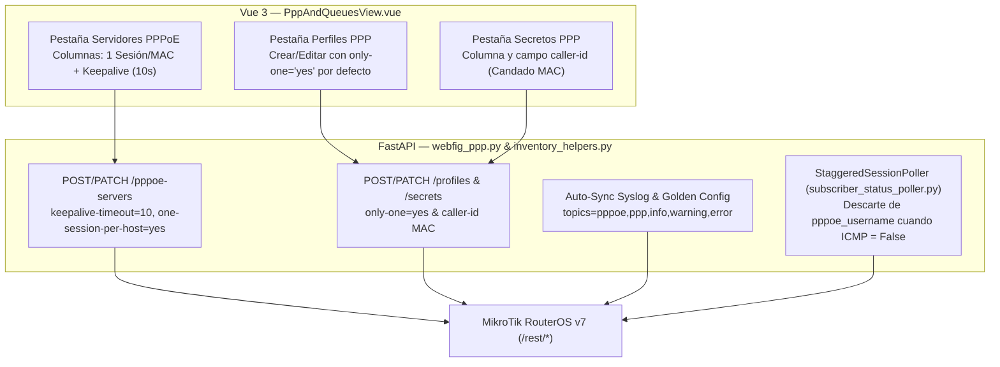

# SPDX-License-Identifier: GPL-3.0-only
# Copyright (C) 2026 RoSGrid Contributors

# Especificación 84: Seguridad de Sesiones PPPoE, Prevención de Sesiones Fantasma (`keepalive-timeout=10`, `one-session-per-host=yes`, `only-one=yes`), Candado MAC (`caller-id`), Telemetría Syslog PPPoE y Detección ICMP en Poller (Hito 30.6)

> **Estado:** APROBADO PARA IMPLEMENTACIÓN  
> **Hito Asociado:** Hito 30 — Subhito `30.6`  
> **Grounding Canónico MikroTik RouterOS v7:** `/rest/interface/pppoe-server/server`, `/rest/ppp/profile`, `/rest/ppp/secret`, `/rest/ppp/active` y `/rest/system/logging`

---

## 1. Contexto Operativo y Diagnóstico de Brechas

En redes de proveedores de Internet (ISP / WISP) con concentradores BNG MikroTik RouterOS v7, dos de los incidentes más frecuentes reportados por soporte técnico tienen su origen en colisiones de sesiones PPPoE y sesiones fantasma:

1. **Microcortes cíclicos cada 6–22 segundos (`already active - closing previous one`):**
   - **Causa:** El router del cliente (CPE) tiene dos clientes PPPoE activos con el mismo usuario en la misma interfaz/VLAN (misma dirección MAC).
   - **Mecanismo en RouterOS v7:** Con `one-session-per-host=yes` en `/interface/pppoe-server/server`, la nueva conexión desde la misma MAC cierra la anterior (`PPPoE connection from <MAC> was already active - closing previous one`), reiniciando el `uptime` constantemente.
2. **Rechazo al cambiar de router o tras corte eléctrico (`user <name> is already active` / Sesión Fantasma):**
   - **Causa A (Intrusión o cuenta compartida desde otra MAC):** Con `only-one=yes` en `/ppp/profile`, el BNG impide que un segundo equipo con distinta MAC conecte simultáneamente y consuma doble IP/ancho de banda. El CPE rechazado muestra `failed to authenticate ourselves to peer` (idéntico a contraseña inválida), mientras la causa real solo aparece en el log del BNG (`user <name> is already active`).
   - **Causa B (Sesión Fantasma por corte eléctrico/fibra sin paquete `PADT`):** Si `keepalive-timeout` está deshabilitado en `/interface/pppoe-server/server` y la ONU/CPE se apaga sin enviar `PADT`, la sesión permanece indefinidamente en `/ppp/active` con contadores de tráfico congelados y el `caller-id` viejo. Al conectar un router nuevo (nueva MAC), el BNG lo rechaza eternamente porque la sesión fantasma sigue ocupando el usuario bajo `only-one=yes`. Con `keepalive-timeout=10`, el BNG detecta `peer is not responding` en ~19 segundos y purga la sesión inactiva.

### Brechas Identificadas en RoSGrid Antes de la Spec 84

1. **Ausencia de `keepalive-timeout` en Servidores PPPoE:** `PppoeServerCreateRequest` y `PppoeServerUpdateRequest` (`fastapi/src/schemas/webfig_ops.py`), `webfig_ppp.py` y `PppAndQueuesView.vue` omitían el parámetro `keepalive-timeout`, impidiendo auditar o forzar el valor recomendado de `10` segundos desde WebFig.
2. **Controles Visuales Faltantes en `PppAndQueuesView.vue` y Candado MAC (`caller-id`) en Secretos PPP:**
   - Los modales de Crear y Editar Servidor PPPoE en `PppAndQueuesView.vue` no mostraban los controles para `one_session_per_host` ni `keepalive_timeout`, y la tabla `serverColumns` no exhibía su estado.
   - El modal de Crear Perfil PPP no exponía el selector `only_one`, y `PppProfileCreateRequest` tenía `only_one: str | None = None` en lugar de `"yes"` por defecto.
   - `PppSecretCreateRequest`, `PppSecretUpdateRequest`, `webfig_ppp.py` y `PppAndQueuesView.vue` no exponían el campo `caller_id` (`caller-id`), necesario para vincular o liberar manualmente la dirección MAC autorizada de un usuario PPPoE cuando reemplaza su CPE.
3. **Ausencia del Tópico `pppoe,ppp` en el Auto-Aprovisionamiento de Syslog:** Ni `SYSLOG_CENTRALIZADO_ROSGRID` (`bulk_and_updates.py`) ni `discover_and_persist_syslog_status` (`inventory_helpers.py`) aprovisionaban la regla `/system logging add topics=pppoe,ppp,info,warning,error action="rosgridsyslog"`, impidiendo recibir en RoSGrid los eventos `already active - closing previous one` y `user <x> is already active`.
4. **Falso Positivo `ONLINE` ante Sesiones PPPoE Fantasma en `subscriber_status_poller.py`:** En `_probe_devices_icmp` (`fastapi/src/workers/subscriber_status_poller.py`), cuando el sondeo ICMP fallaba (`icmp_alive is False`), se descartaban `ip` y `mac` de `active_identifiers`, pero **no se descartaba `pppoe_username` / `endpoint_identifier`**, provocando que `_is_device_matched` siguiera reportando `ONLINE` a un abonado cuya sesión en `/ppp/active` era una sesión fantasma sin respuesta ICMP.

---

## 2. Diseño Arquitectónico de la Solución

### 2.1 Esquemas Pydantic y Endpoints WebFig PPP (`webfig_ops.py` y `webfig_ppp.py`)

1. **`PppSecretCreateRequest` y `PppSecretUpdateRequest`:**
   - Añadir `caller_id: str | None = Field(default=None, max_length=64)` para permitir fijar o limpiar (`""`) el candado MAC (`caller-id`) en `/rest/ppp/secret`.
2. **`PppProfileCreateRequest`:**
   - Establecer `only_one: str | None = Field(default="yes")` para garantizar por defecto una única sesión activa por cuenta PPP.
3. **`PppoeServerCreateRequest` y `PppoeServerUpdateRequest`:**
   - En `PppoeServerCreateRequest`: establecer `one_session_per_host: bool | None = True` y añadir `keepalive_timeout: int | None = Field(default=10, ge=0, le=3600)`.
   - En `PppoeServerUpdateRequest`: añadir `keepalive_timeout: int | None = Field(default=None, ge=0, le=3600)`.
   - En `create_pppoe_server` y `update_pppoe_server` (`webfig_ppp.py`): mapear `keepalive_timeout` hacia `"keepalive-timeout": str(payload.keepalive_timeout) if payload.keepalive_timeout > 0 else "disabled"`.

### 2.2 Telemetría Syslog para Colisiones PPPoE (`bulk_and_updates.py` e `inventory_helpers.py`)

1. En `SYSLOG_CENTRALIZADO_ROSGRID` (`fastapi/src/api/v1/bulk_and_updates.py`):
   - Añadir `/system logging add topics=pppoe,ppp,info,warning,error action="rosgridsyslog"` al script CLI y como paso REST #11 en `rest_steps_template`.
2. En `discover_and_persist_syslog_status` (`fastapi/src/api/v1/inventory_helpers.py`):
   - Ampliar la tupla de tópicos auto-sincronizados a `("system,info", "account", "firewall,info", "pppoe,ppp,info,warning,error")` para que los logs de diagnóstico PPPoE (`already active - closing previous one`, `user <x> is already active`, `peer is not responding`) se reenvíen automáticamente al colector UDP de RoSGrid.

### 2.3 Purga de Identificador PPPoE ante Sesión Fantasma en `subscriber_status_poller.py`

1. En `_probe_devices_icmp` (`fastapi/src/workers/subscriber_status_poller.py`):
   - Cuando `icmp_alive is False`, además de descartar `ip` y `mac` de `active_identifiers`, descartar también `pppoe = str(getattr(dev, "pppoe_username", "") or getattr(dev, "endpoint_identifier", "") or "").strip().lower()` y `ep = str(getattr(dev, "endpoint_identifier", "") or "").strip().lower()`.
   - De este modo, si existe una sesión fantasma colgada en `/ppp/active` pero la ONU no responde ICMP, `_is_device_matched(dev, active_identifiers)` evalúa `False` y transiciona el abonado a `OFFLINE` emitiendo `DEVICE_STATUS_CHANGED`.

### 2.4 Interfaz Táctica WebFig en `vue3/src/views/PppAndQueuesView.vue`

1. **Pestaña `🔑 Secretos / Usuarios`:**
   - Añadir la columna `caller_id` (`Candado MAC (Caller-ID)`) en `secretColumns`.
   - Añadir el campo `#sec-caller-id` en el modal Crear Secreto PPP y `#edit-sec-caller-id` en el modal Editar Secreto PPP.
2. **Pestaña `📋 Perfiles`:**
   - Añadir el selector `#prof-only-one` (`Sesión Única (Only One)`) en el modal Crear Perfil PPP (con valor inicial `'yes'`).
3. **Pestaña `📡 Servidores PPPoE`:**
   - Añadir en `serverColumns` las columnas `one_session_per_host` (`1 Sesión/MAC`, mostrando `🟢 Sí` / `⚠️ No`) y `keepalive_timeout` (`Keepalive (s)`, mostrando `${row.keepalive_timeout}s` o `⚠️ Deshabilitado` si es `0`/nulo).
   - Añadir en los modales de Crear y Editar Servidor PPPoE el campo numérico `#srv-keepalive` / `#edit-srv-keepalive` (`Keepalive Timeout (s)`, predeterminado `10`) y el checkbox `#srv-one-session` / `#edit-srv-one-session` (`Una sesión por MAC (one-session-per-host)`).

---

## 3. Criterios de Aceptación y Aseguramiento Level-11X

1. **Pruebas Unitarias Backend (`pytest` en Docker):**
   - Verificar `keepalive_timeout`, `one_session_per_host`, `only_one` y `caller_id` en `test_webfig_endpoints_full.unit.py` y `test_webfig_crud_and_maintenance_expiry.unit.py`.
   - Verificar que `_probe_devices_icmp` en `test_subscriber_status_poller.unit.py` descarta el `pppoe_username` de una sesión fantasma cuando el ping ICMP da timeout, marcando el dispositivo como `OFFLINE`.
   - Verificar la inclusión de `pppoe,ppp,info,warning,error` en `SYSLOG_CENTRALIZADO_ROSGRID` (`test_compliance_cis_expanded.unit.py` y `test_operations_endpoints_full.unit.py`).
2. **Pruebas Unitarias Frontend (`vitest` en Docker):**
   - Verificar en `webfigViews.unit.ts` la creación y edición de secretos con `caller_id`, perfiles con `only_one` y servidores PPPoE con `keepalive_timeout: 10` y `one_session_per_host: true`.
3. **Escenarios BDD Karate Labs:**
   - Incorporar el **Escenario 160** en `fastapi/test/api_test.feature` y el **Escenario 98** en `vue3/test/ui_business_flow.feature`, replicándolos en `docs/examples/`.
