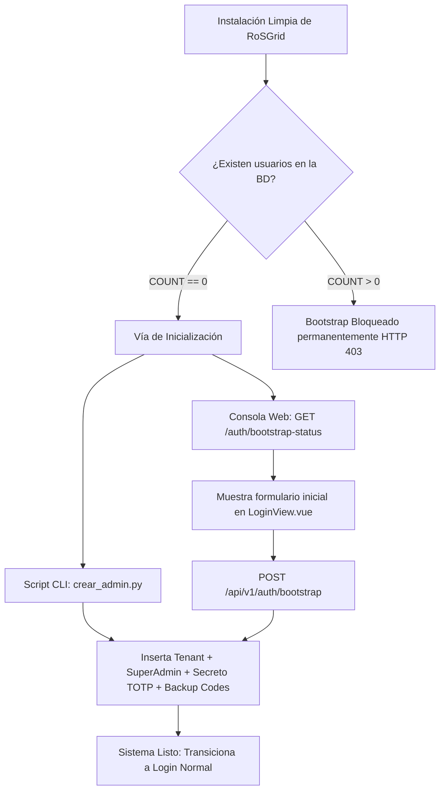

# 31 — INICIALIZACIÓN (BOOTSTRAP/SEEDER), PIPELINE LOCAL DE PRODUCCIÓN, AUDITORÍA DE SCRIPTS BASH Y OPERACIONES DISTRIBUIDAS

**[DIRECTIVA DE SISTEMA PARA ANTIGRAVITY]:** Este documento especifica la arquitectura de arranque inicial (primer usuario / Super Administrador), la generación de tokens de servicio para agentes IA (MCP), el pipeline de validación integral de imágenes de producción en local sin publicar a Docker Hub, la política obligatoria de auditoría estática con ShellCheck para todos los scripts en Bash, y las opciones de despliegue en servidores separados (Cross-Origin Directo y Proxy Reverso).

Todo script o código relacionado DEBE cumplir con la **Regla Cero** (cero ejecuciones locales fuera de Docker), complejidad ciclomática Grado A (`CC <= 5`), tipado estricto y cero alertas de seguridad.

---

## 1. Arquitectura de Inicialización (Bootstrap y Seeder)

### 1.1 El Problema del Primer Usuario en Sistemas Zero-Trust
En una base de datos recién migrada por Alembic (`alembic upgrade head`), las tablas `tenants` y `users` están vacías. Debido a las políticas de seguridad estrictas:
- El endpoint de login (`POST /api/v1/auth/login`) requiere un `tenant_slug` activo existente.
- La creación de tenants (`POST /api/v1/tenants/`) exige autenticación previa con el rol `SUPERADMIN_GLOBAL`.
- La creación de usuarios (`POST /api/v1/users`) exige `SUPERADMIN_GLOBAL` o `TENANT_ADMIN`.

Para evitar bloqueos al desplegar instalaciones limpias, RoSGrid implementa una **doble compuerta de inicialización**:



### 1.2 Endpoints Seguros de Bootstrap en FastAPI
1. **`GET /api/v1/auth/bootstrap-status`:**
   - Público (no requiere cookies ni tokens).
   - Realiza un conteo atómico: `SELECT COUNT(id) FROM users`.
   - Si el conteo es `0`, devuelve `{"is_bootstrapped": false, "tenants_count": 0, "users_count": 0, "message": "Inicialización requerida"}`.
   - Si el conteo es `> 0`, devuelve `{"is_bootstrapped": true, ...}`.

2. **`POST /api/v1/auth/bootstrap`:**
   - Valida estrictamente que `COUNT(users) == 0`. Si ya existen usuarios, responde inmediatamente con HTTP `403 Forbidden` (*"El sistema ya ha sido inicializado"*).
   - Recibe: `tenant_name`, `tenant_slug`, `admin_username`, `admin_email`, `admin_password` (mínimo 12 caracteres), `admin_full_name`.
   - Genera atómicamente el Tenant principal con estado `ACTIVE`.
   - Genera el secreto `TOTP` RFC 6238 y 8 códigos de respaldo aleatorios, cifrados en reposo con `AES-256-GCM` bajo la llave maestra `ROSGRID_MASTER_VAULT_KEY`.
   - Hashea la contraseña con `Argon2id` e inserta al usuario con rol `SUPERADMIN_GLOBAL` y `has_all_routers_access=True`.
   - Devuelve HTTP `201 Created` con el secreto TOTP en texto plano, la URI de aprovisionamiento para el código QR y la lista de códigos de respaldo.

### 1.3 Script CLI Seeder (`fastapi/scripts/crear_admin.py`)
Permite aprovisionar el Super Administrador directamente en el servidor sin requerir navegador:
```bash
docker exec -it rosgrid_api python3 /app/scripts/crear_admin.py
```
O de forma desatendida mediante parámetros:
```bash
docker exec rosgrid_api python3 /app/scripts/crear_admin.py \
    --tenant-name "Organización Principal" \
    --tenant-slug "master" \
    --username "superadmin" \
    --email "admin@miempresa.com" \
    --password "ClaveMuySegura2026!" \
    --full-name "Super Administrador"
```

---

## 2. Emisión de Tokens Bearer para Agentes IA MCP (`SERVICE_ACCOUNT`)

Los agentes autónomos como **Hermes Agent** o **Claude Desktop** que interactúan con `POST /api/v1/mcp` no pueden resolver desafíos 2FA interactivos ni manipular cookies de navegador.

Para aprovisionar su acceso de forma segura:
1. El Super Administrador crea una cuenta con rol `SERVICE_ACCOUNT` asignándole una lista blanca CIDR (ej. `["10.0.10.50/32"]`) y permisos de routers específicos.
2. Ejecuta el script de emisión de tokens:
   ```bash
   docker exec rosgrid_api python3 /app/scripts/generar_token_mcp.py --username mcp-hermes --expiry-days 365
   ```
3. El script:
   - Valida que el usuario exista y pertenezca al rol `SERVICE_ACCOUNT`.
   - Genera un `session_id` UUID único y registra la sesión activa en KeyDB (`rg:{tenant_id}:sess:{session_id}`) con un TTL correspondiente a los días de vigencia solicitados.
   - Firma un token JWT con la llave secreta `ROSGRID_JWT_SECRET_KEY` conteniendo los claims requeridos (`sub`, `tid`, `tslug`, `sid`, `rol: "SERVICE_ACCOUNT"`).
   - Imprime la cabecera formateada: `Authorization: Bearer <TOKEN>` lista para incorporar en la configuración del cliente MCP.

---

## 3. Política Mandatoria de Calidad para Scripts en Bash (ShellCheck)

Por directiva innegociable de gobernanza QA 11X:
> **Regla de Scripts:** Todo script con extensión `.sh` presente en el repositorio DEBE ser sometido a análisis estático con ShellCheck dentro de un contenedor Docker efímero (`koalaman/shellcheck:stable`), garantizando **cero (0) errores y cero (0) advertencias**.

### Comando de Verificación Oficial:
```bash
docker run --rm -v "$(pwd):/mnt" koalaman/shellcheck:stable \
    /mnt/auditar-infra.sh \
    /mnt/instalar-rosgrid.sh \
    /mnt/build.sh \
    /mnt/instalar-hooks.sh \
    /mnt/limpieza.sh \
    /mnt/probar-prod-local.sh \
    /mnt/fastapi/scripts/entrypoint.sh
```

### Reglas de Escritura de Scripts:
1. Usar siempre `set -euo pipefail` y `LC_ALL=C`.
2. No usar `rm -f *.log` sin calificar el directorio (usar `./*.log` o rutas absolutas) para evitar la advertencia `SC2035`.
3. Comprobar siempre privilegios de usuario (`EUID != 0` para scripts de usuario habitual, `EUID == 0` solo si es estrictamente necesario).
4. No incluir `docker system prune -af` en scripts de limpieza rutinaria, ya que elimina las imágenes base locales necesarias para desarrollo.

---

## 4. Pipeline de Validación Local de Imágenes de Producción (`probar-prod-local.sh`)

Para comprobar que las imágenes construidas con `Dockerfile` funcionan correctamente bajo el perfil de producción estricto (`--no-dev`) **antes de publicarlas a Docker Hub**:

1. **Definición de `docker-compose.prod.local.yml`:**
   - Define los servicios `rosgrid_db_local`, `rosgrid_redis_local`, `rosgrid_api_local`, `rosgrid_worker_local` y `rosgrid_ui_local`.
   - Utiliza las etiquetas locales `sinfallas/rosgrid-backend:local-test` y `sinfallas/rosgrid-frontend:local-test`.
   - Configura `pull_policy: never` para evitar descargas accidentales desde registros remotos.
2. **Pipeline Automatizado Bajo Demanda (`probar-prod-local.sh`):**
   - Ejecuta las 6 fases de validación pre-publicación con estándar de calidad QA 11X:
     1. **Auditoría e Imágenes:** Opcional con `--audit` (`./auditar-infra.sh` Trivy IaC, FS y Hadolint) y compilación local de `sinfallas/rosgrid-backend:local-test` y `sinfallas/rosgrid-frontend:local-test` (omissible con `--skip-build`).
     2. **Despliegue Aislado:** Levantamiento de `docker-compose.prod.local.yml` en red interna con `pull_policy: never`.
     3. **Healthchecks Activos:** Verificación continua hasta 45 intentos de PostgreSQL 17, KeyDB Multi-Hilo, FastAPI y runner de segundo plano `rosgrid-worker`.
     4. **Pruebas Sintéticas HTTP, Hardening y Proxy Reverso:**
        - Smoke test estricto `--no-dev` (`test_production_boot_smoke.py`: verificación AST de cero dependencias dev e importación limpia de todos los módulos).
        - Liveness `/health` (HTTP 200) y exportación de métricas Prometheus `/metrics`.
        - Estado de bootstrap inicial `/api/v1/auth/bootstrap-status` (`is_bootstrapped: false`).
        - Servidor Nginx UI en puerto configurado (`--port`, por defecto 8085) verificando cabeceras de seguridad (`X-Frame-Options: DENY`, `X-Content-Type-Options: nosniff`).
        - Validación del proxy inverso Nginx hacia la API: `GET http://127.0.0.1:${UI_PORT}/api/v1/auth/bootstrap-status` respondiendo HTTP 200 sin saltarse Nginx.
        - Verificación de ocultamiento estricto de documentación en producción: `GET /docs`, `/redoc` y `/openapi.json` deben retornar HTTP 404.
        - Prueba negativa de autenticación (Fail-Closed): `GET /api/v1/auth/me` sin cabecera de autenticación debe retornar HTTP 401.
     5. **Aprovisionamiento E2E, Token Bearer MCP, Invocación JSON-RPC 2.0 y Contratos UI-API:**
        - Ejecución de `crear_admin.py` y confirmación de transición a `is_bootstrapped: true`.
        - Emisión de token JWT Bearer con `generar_token_mcp.py --raw-token` y validación de sesión en KeyDB mediante llamada autenticada a `GET /api/v1/auth/me`.
        - Invocación real del endpoint MCP (`POST /api/v1/mcp` con JSON-RPC 2.0 `tools/list`) certificando el protocolo de agentes IA, rate limiting en KeyDB y exposición de las 16 tools operativas.
        - Ejecución obligatoria de la suite de 24 contratos Front-Back (`fastapi/scripts/validar_comunicacion_front_back.py`) dentro del contenedor `rosgrid_api_local` con 100% de éxito.
     6. **Diagnóstico de Logs, Aislamiento de Red y Finalización:**
        - Inspección de logs en busca de `Traceback` y `CRITICAL` tanto en `rosgrid_api_local` como en `rosgrid_worker_local`.
        - Verificación de aislamiento estricto de puertos internos (PostgreSQL 5432 y KeyDB 6379 cerrados al host).
        - Purga de volúmenes efímeros o entrega de entorno persistente (`--keep-alive` / `--wizard`) para inspección manual en el navegador.
   - **Gatekeeper en `build.sh`:** El script de compilación multi-plataforma invoca `./probar-prod-local.sh` como Paso 0 mandatorio previo a publicar a Docker Hub.
   - **Manual Operativo:** Especificación completa en [docs/08_PIPELINE_VALIDACION_LOCAL_PRODUCCION.md](file:///home/sinfallas/Dropbox/git/tecno-consultores/RoSGrid/docs/08_PIPELINE_VALIDACION_LOCAL_PRODUCCION.md).

---

## 5. Arquitectura de Despliegue Distribuido (Servidores Separados)

RoSGrid soporta dos modelos operativos según la infraestructura del cliente:

### 5.1 Opción A: Proxy Reverso en la Misma Origen (Recomendada)
- **Servidor 1 (Frontend Nginx en DMZ):** `https://noc.empresa.com`
- **Servidor 2 (Backend FastAPI en LAN/VPC):** `http://backend.internal:8000`
- Nginx actúa como terminador TLS y reenvía `/api/` y `/ws/` al Servidor 2 por red interna.
- Las cookies de sesión conservan `__Host-rg_at` con `SameSite=Strict` y `Secure`.

### 5.2 Opción B: Dominios Cruzados / Cross-Origin Directo (CORS)
- **Frontend:** `https://app.empresa.com`
- **Backend:** `https://api.empresa.com`
- **Configuración en Backend (`.env`):**
  * `ROSGRID_CORS_ORIGINS="https://app.empresa.com,http://localhost:8080"`
  * `ROSGRID_CROSS_ORIGIN_COOKIES=true`
- **Comportamiento:**
  - FastAPI activa `CORSMiddleware` con `allow_origins=settings.cors_origins_list` y `allow_credentials=True`.
  - Las cookies se emiten como `rg_at`, `rg_rt`, `rg_csrf` con `SameSite=None; Secure; Path=/` (ya que las cookies con prefijo `__Host-` o `SameSite=Strict` son rechazadas por los navegadores en peticiones cruzadas).
  - En el Frontend, `httpClient.ts` resuelve las peticiones anteponiendo `VITE_API_BASE_URL` (ej. `https://api.empresa.com`) con `credentials: 'include'`.

---

## 6. Dictamen de Compatibilidad con Arquitecturas de Hardware

| Arquitectura | Soporte RoSGrid | Observaciones Técnicas |
| :--- | :---: | :--- |
| **`linux/amd64`** | ✅ Oficial Completo | Arquitectura primaria para servidores Intel/AMD x86_64. |
| **`linux/arm64` (`aarch64`)** | ✅ Oficial Completo | Soportada en Raspberry Pi 3, 4, 5 (con SO de 64 bits), AWS Graviton, Apple Silicon y servidores ARM empresariales. PostgreSQL 17 y KeyDB tienen imágenes multi-hilo nativas. |
| **`linux/arm/v7` (32-bit)** | ❌ No Soportada | **Incompatible:** KeyDB carece de imágenes oficiales para 32 bits (requiere atómicas de 64 bits). PostgreSQL 17 discontinuó builds en Alpine 32-bit. Espacio de direcciones limitado a 2 GB. |
